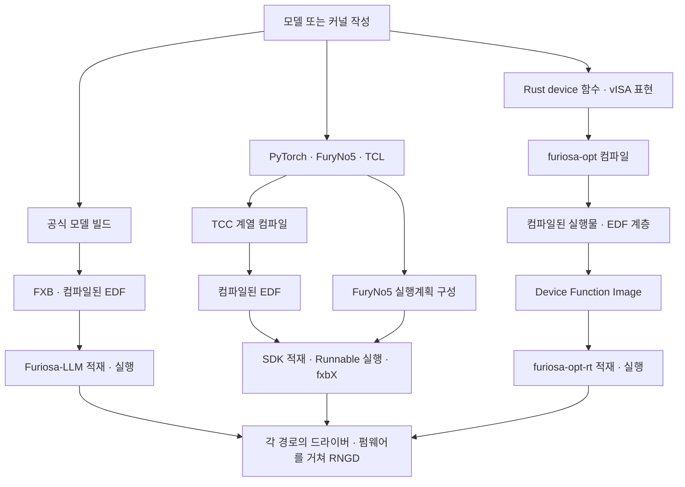

# FuryNo5 개발 핸드북

## 이 책에서 따라갈 일

Python으로 쓴 모델을 RNGD에서 실행하려면 무엇을 준비해야 할까? 결과는 맞는데 속도가 느리다면 어디부터 살펴봐야 할까? 이 책은 작은 계산 하나에서 출발해, 그 계산을 NPU에 맡기고 여러 요청을 처리하는 과정까지 따라간다.

Python의 함수·배열·반복문을 읽을 수 있으면 시작할 수 있다. 처음 등장하는 장치·모델 용어는 계산 예와 함께 설명한다. 실행할 장비가 없어도 숫자와 코드로 원리를 확인하는 부분부터 읽을 수 있다.

## 모델·커널·추론을 함수 하나로 구별해 보자

입력 1에는 답 3, 입력 2에는 답 5, 입력 3에는 답 7을 내고 싶다고 하자. 이 예에는 ‘입력에 2를 곱하고 1을 더한다’는 규칙이 맞는다.

```python
def model(number):
    return number * 2 + 1

print(model(4))  # 새 입력 4의 답은 9다.
```

**모델(model)은** 이 계산 방법과 계산에 사용하는 숫자를 함께 말한다. 여기서는 곱하는 수 2와 더하는 수 1이다. 곱하는 수를 **가중치(weight)**, 더하는 수를 **바이어스(bias)라고** 부른다. 실제 모델에는 이런 수가 훨씬 많이 들어간다.

예제의 정답을 보고 2와 1처럼 계산에 사용할 수를 찾아 조정하는 과정이 **학습(training)이다**. 이미 정한 규칙으로 새로운 입력 4의 답 9를 구하는 일은 **추론(inference)이다**. 이 책의 모델 실행은 주로 추론을 다룬다. 16장의 FuryBoost는 트리 학습을 다루므로 별도로 구분한다.


**커널(kernel)은** 장치가 실행하는 계산 함수다. 위 모델의 곱셈·덧셈을 한 커널에 담을 수도 있고 두 커널로 나눌 수도 있다. 모델은 구할 답을 정하고, 커널의 구분은 그 계산을 장치에 맡기는 방법을 정한다. 이 작은 예는 뜻을 설명하기 위한 것으로, 실제 학습이나 NPU 속도 측정 결과가 아니다.

## CPU에서 계산하던 일을 NPU에 맡기면 생기는 일

위 Python 함수를 실행하면 CPU가 계산한다. CPU는 운영체제와 일반 프로그램을 실행하는 프로세서다. **NPU**는 신경망의 많은 배열 계산을 처리하도록 만든 장치이며, **RNGD**는 이 책에서 사용하는 Furiosa의 NPU다.

NPU를 쓰려면 계산 방법과 데이터가 장치에 전달되어야 한다. CPU 쪽 프로그램은 계속 남아서 다음 일을 한다.

1. 어떤 계산을 할지 준비한다.
2. NPU가 사용할 프로그램을 적재하고 입력 값을 연결한다.
3. 계산을 요청한다.
4. 완료된 결과를 받아 다음 일에 사용한다.

여기서 **호스트(host)는** NPU를 제어하는 CPU 쪽 시스템, **장치(device)는** RNGD를 뜻한다. CPU 메모리의 배열과 NPU 메모리의 배열은 위치가 다르므로 값을 옮기는 작업도 필요하다. 이 전송을 전용 엔진에 맡기는 방식이 **DMA**다. [02장](02-memory-dma.md)에서 실제 이동 경로와 버퍼를 다시 써도 되는 시점을 다룬다.

## 계산을 준비하는 일과 실제 값을 넣어 실행하는 일

‘2를 곱하고 1을 더한다’는 방법은 같아도, 넣는 숫자는 4였다가 5로 바뀔 수 있다. 준비한 계산 방법과 이번 입력을 나누어 생각하면 반복 실행을 이해하기 쉽다.

**컴파일(compile)은** 작성한 계산을 장치가 실행할 프로그램으로 바꾸는 일이다. **런타임(runtime)은** 그 프로그램을 적재하고 이번 입력으로 호출하며 완료를 관리하는 소프트웨어다. **드라이버(driver)는** 운영체제 쪽에서 장치 접근과 작업 제출 등을 제공한다. 세 역할은 [03장](03-driver-runtime.md)에서 덧셈 하나로 구분한다.

FuryNo5 export 경로를 예로 들면 다음과 같다. 화살표는 역할의 연결이며 내부 호출 횟수나 걸리는 시간을 나타내지는 않는다.


그림을 읽을 때 필요한 이름은 다음과 같다.

| 이름 | 지금 이해할 뜻 |
|---|---|
| PyTorch·ATen | PyTorch는 모델을 작성하는 도구다. ATen은 그 안에서 덧셈·행렬곱 같은 텐서 연산을 요청하는 계층이다. |
| TCL | 계산의 축과 연산을 컴파일러에 설명하는 언어다. |
| TCC | TCL 계산을 NPU용으로 컴파일하는 도구다. |
| EDF | 컴파일한 장치 프로그램을 담는 산출물이다. 실행할 때 실제 입력 값도 필요하다. |
| 실행계획 | ‘첫 계산의 결과를 둘째 계산의 입력으로 보낸다’처럼 프로그램 사이의 값 연결을 적은 것이다. |
| FXB·fxbX | 실행물과 관련 정보를 보관·전달하기 위한 묶음이다. fxbX는 비공식 프로젝트이며 공식 FXB와 소비자가 다를 수 있다. |
| SDK·Runnable | SDK는 개발 도구 묶음이다. Runnable은 준비한 프로그램을 실제 입력으로 호출할 때 사용하는 SDK 객체 이름이다. |

이 이름들을 먼저 외울 필요는 없다. 04장에서 TCL 커널 하나를 작성해 EDF를 만들고, 05장에서 여러 계산을 잇는 실행계획으로 넓힌다.

## 연결을 읽을 때 확인할 네 가지

**입력의 조건.** 길이 8을 처리하도록 만든 프로그램에 길이 16을 넣어도 되는지는 따로 확인해야 한다. 배열의 각 축 길이가 shape, 숫자 하나의 자료형이 dtype, 주소를 따라 읽는 간격이 stride다. 01·02장에서 같은 작은 배열로 확인한다.

**프로그램의 대상.** 어느 장치 구성으로 컴파일했는지와 실행기의 지원 조건이 맞아야 한다. 같은 확장자의 파일이라는 이유만으로 다른 실행기에 넣을 수는 없다. 04·12장에서 파일을 읽는 일과 실제 장치에 적재하는 일을 나눈다.

**데이터를 쓰는 시점.** 입력을 보내는 함수를 호출했다고 전송이나 계산이 끝난 것은 아닐 수 있다. 장치가 읽는 중에 그 공간을 덮어쓰면 틀린 값을 계산할 수 있다. 이 관계는 02장, 완료까지 시간을 재는 방법은 17장에서 다룬다.

**호출 사이에 남기는 값.** 독립된 사진 두 장을 처리하는 경우와 한 문장을 토큰마다 이어 쓰는 경우는 다르다. 후자는 앞 토큰의 정보를 저장해 다음 호출에서 사용한다. 이를 담는 KV Cache와 요청별 상태 관리는 06·14장에서 예를 들어 설명한다.

## 같은 NPU로 가는 서로 다른 길

공식 Furiosa-LLM은 지원 모델의 실행과 요청 처리를 제공한다. FuryNo5는 PyTorch 모델의 계산을 준비하는 프로젝트이며, fxbX는 그 경로에서 만든 실행계획·프로그램을 읽어 실행하는 소비자가 될 수 있다.

공개 `furiosa-opt`에는 Rust로 장치 계산과 메모리 배치를 더 구체적으로 쓰는 경로가 있다. 여기서 다루는 **vISA는 컴파일 중간 표현**이다. vISA 텍스트를 그대로 장치에 보내 실행하는 것은 아니다. 이 경로의 컴파일과 적재는 08장에서 다룬다.

다음 그림은 이 세 경로를 비교한다. TCL·SDK 경로와 opt 경로가 같은 바이너리를 서로 읽는다는 뜻은 아니다. 각 경로의 산출물과 로더가 맞아야 한다.



<!-- interactive:route -->

## 읽는 순서와 필요한 장 찾기

| 지금 알고 싶은 것 | 읽을 장 |
|---|---|
| 배열의 숫자를 누가 계산하고 어디에 저장하는가? | [01 하드웨어](01-hardware.md), [02 메모리](02-memory-dma.md), [03 스택](03-driver-runtime.md) |
| 계산 하나를 작성하고 장치에서 실행하려면? | [04 TCL 실습](04-tcl-edf.md), [05 실행계획](05-graphs-fallback.md) |
| 입력 길이가 달라지거나 실행이 느리다면? | [06 버킷](06-buckets-shapes.md), [07 최적화](07-optimization.md), [08 저수준 경로](08-eisa-visa.md) |
| PyTorch 코드가 FuryNo5 안에서 어떻게 바뀌는가? | [09 ATen](09-torch-aten.md), [10 프로젝트 구조](10-furyno5-architecture.md), [11 컴파일](11-furyno5-compiler.md) |
| 실행 파일을 전달하고 실제 모델을 서비스하려면? | [12 fxbX](12-fxbx.md), [13 포팅](13-porting-fha.md), [14 서빙](14-serving-vllm.md), [15 여러 NPU](15-multi-npu.md) |
| 성능 차이를 해석하고 다음 개선을 고르려면? | [16 FuryBoost](16-furyboost.md), [17 측정](17-debugging.md), [18 다른 스택](18-npu-ecosystems.md), [19 모델 최적화](19-model-optimization.md) |

질문 하나부터 읽으려면 [핵심 질문과 해설](reader-review.md), 용어를 다시 찾으려면 [용어 사전](glossary.md)을 이용하면 된다. 실습 전에 맞출 환경과 지원 경계는 [실행 전 확인사항](review.md)에 있다.

## 코드와 성능 수치를 읽는 방법

본문에는 작은 원리를 계산하는 코드, 실제 장치 실습, 실제 구현의 일부를 보여 주는 발췌가 있다. 발췌는 필요한 주변 변수와 전체 파일을 함께 안내한다. 장치 없이 시작하려면 [행렬곱 예제](examples/tensor_basics.py)와 [배열·메모리 예제](examples/array_layout.py)를 실행해 볼 수 있다.

설명용 시간 계산과 저장소에 남은 기존 실측은 구분해서 표시한다. 문법 검사 통과가 NPU 실행 성공을 뜻하지는 않는다. 이 핸드북에서 새 RNGD 성능 측정을 수행한 것은 아니며, 버전과 원자료는 [출처와 버전 기록](sources.md)에서 확인할 수 있다.

## 출처

| 근거 | 용도 |
|---|---|
| [Furiosa software stack](https://developer.furiosa.ai/v2026.4.0/en/overview/software_stack.html) | 공식 계층 구분 |
| [공식 FXB 문서](https://developer.furiosa.ai/v2026.4.0/en/furiosa_llm/fxb.html) | 모델 자산과 실행 프로그램의 관계 |
| [furiosa-opt 고정 소스](https://github.com/furiosa-ai/furiosa-opt/tree/3d43bc9d20f324af60e3006c3f1541938d7f5097) | 공개 저수준 경로 |
| [FuryNo5 고정 소스](https://github.com/smallstep-zzz/FuryNo5/tree/bba9efea8201aec48150514a35d0b637d29d107e) | 프로젝트 구현. 접근 권한 필요 |
| [출처와 버전 기록](sources.md), [실행 전 확인사항](review.md) | 세부 근거와 미해결 항목 |
