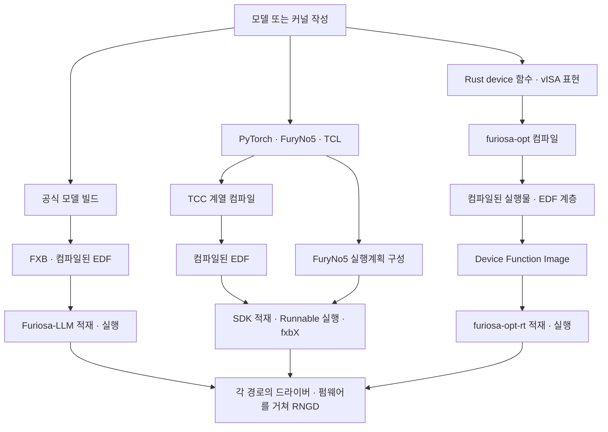

# FuryNo5 개발 핸드북

## 이 책의 목표

**PyTorch 코드 한 줄이 어떤 프로그램과 실행계획으로 바뀌어 RNGD에서 동작하는지, 그리고 어디를 바꾸어야 빨라지는지 설명한다.** 하드웨어 사양을 외우는 책도, 명령만 복사하는 설치 안내서도 아니다. 장치의 제약이 컴파일러와 런타임의 설계를 어떻게 바꾸는지 이해하고, FuryNo5의 실제 구현을 수정할 수 있도록 연결한다.

C·Python의 함수·배열·반복문과 자료구조·운영체제의 기초를 알고 있다면 읽기 시작할 수 있다. NPU·컴파일러 내부·텐서 프로그래밍에 필요한 용어와 계산은 본문에서 차례로 설명한다. Rust와 비동기 실행도 예제에 필요한 규칙부터 살펴본다. 용어를 다시 찾으려면 [용어 사전](glossary.md)을 참고한다.

본문을 읽다가 막히기 쉬운 질문과 보충 설명은 [학습 점검과 보완 기록](reader-review.md)에서 찾아볼 수 있다.

## 모델·커널·추론을 함수 하나로 구별해 보자

모델은 **입력으로 출력을 계산하는 규칙과 그 규칙이 사용하는 가중치**를 함께 가리킨다. 아주 작은 예로 입력에 2를 곱하고 1을 뺀 뒤, 음수이면 0으로 바꾸는 함수를 생각하자.

```python
def model(x, weight=2, bias=-1):
    # weight와 bias는 입력마다 다시 정하지 않고 모델이 보관하는 값이다.
    affine = x * weight + bias  # x=3이면 3×2-1=5, x=0이면 -1이다.
    return max(0, affine)       # ReLU(Rectified Linear Unit): 음수는 0, 0 이상은 그대로 반환한다.

print(model(3))  # 5: 첫 번째 요청의 결과
print(model(0))  # 0: 같은 모델에 다른 입력을 넣은 결과
```

이처럼 정해진 가중치로 새 입력의 결과를 구하는 것이 **추론(inference)이다**. 반대로 예제 데이터의 정답과 비교해 weight·bias를 조정하는 과정은 **학습(training)이다**. 이 책의 모델 포팅과 서빙은 주로 추론을 다루며, FuryBoost 장에서는 트리의 학습을 별도로 다룬다. 위 숫자는 개념 설명을 위해 정한 값이며 학습 결과나 NPU 성능 측정값은 아니다.

**커널(kernel)은** 장치가 실행할 계산 작업을 담은 함수 단위다. 위 모델의 곱셈·덧셈·ReLU를 각각 처리하는 장치 함수가 있을 수도 있고, 세 계산을 하나로 묶은 커널을 만들 수도 있다. 따라서 모델의 수학식만으로 커널 개수가 정해지지 않는다. 컴파일러와 실행 방식이 그 경계를 정한다. 가중치도 실행물 안에 포함하는 방식과 별도 입력으로 전달하는 방식이 있으며, 뒤의 예제는 어느 계약을 쓰는지 명시한다.

다음 이름은 **무엇을 표현하는가**부터 구분하면 된다. 아직 자세한 사용법을 외울 필요는 없다.

| 이름 | 종류 | 지금 이해할 역할 |
|---|---|---|
| ATen(A Tensor Library) | PyTorch의 텐서 연산 계층 | `add`, `mm`처럼 프로그램이 요구한 계산의 이름과 호출 계약 |
| TCL(Tensor Contraction Language) | 커널을 적는 언어 | Python 기반 표기로 입력·출력·계산 축을 적음 |
| EDF(Executable Device Format) | 컴파일 산출물 | 장치 실행을 준비하는 데 사용하는 컴파일 결과 bytes |
| FXB(Furiosa Executable Bundle)·fxbX | 실행물과 관련 정보를 묶는 패키지 | 무엇을 읽고 어떻게 연결할지 전달. fxbX는 비공식 형식 |
| Runnable | SDK(Software Development Kit)의 실행 객체 이름 | 적재한 프로그램과 장치 자원을 이용해 입력을 처리하는 호출 인터페이스 |
| vISA(Virtual Instruction Set Architecture) | 컴파일러의 중간 표현 | 장치의 계산·메모리 배치를 더 구체적으로 표현 |

역할 구분은 [공식 소프트웨어 스택](https://developer.furiosa.ai/v2026.4.0/en/overview/software_stack.html), [EDF 정의](https://developer.furiosa.ai/furiosa-opt/book/quick-start/kernel-validation.html), [공식 FXB](https://developer.furiosa.ai/v2026.4.0/en/furiosa_llm/fxb.html)를 기준으로 하며, 각 프로젝트의 실제 호출은 해당 장에서 같은 역할과 연결한다.

## 기초부터 어떤 순서로 연결하는가

첫 예제는 입력 `[[1,2,3],[4,5,6]]`을 간단한 가중치와 곱해 `[[4,5],[10,11]]`을 만드는 계산이다. **숫자를 따라갈 수 있어야 그 숫자를 어디에 놓고, 누가 옮기고, 어느 장치가 계산하는지도 이해할 수 있다.** 이 예제를 다음 순서로 확장한다.

| 먼저 확인할 것 | 여기서 익히는 기초 | 다음에 연결할 문제 |
|---|---|---|
| 출력 한 칸이 왜 4인가? | 스칼라·벡터·행렬, 내적, 행렬곱, 반복문, `np.einsum` | 계산을 여러 실행 자원에 어떻게 나누는가? |
| 6개 숫자를 어떻게 저장하는가? | shape, `reshape`, 전치, stride, view와 복사 | 같은 계산인데 데이터 이동량이 왜 달라지는가? |
| 숫자는 어떤 경계를 통과하는가? | host 메모리, 장치 메모리, DMA, slice·lane, 연산 파이프라인 | 누가 버퍼를 준비하고 완료를 기다리는가? |
| 함수 호출을 어떻게 준비하는가? | 컴파일, 적재, 인수 연결, 제출, 완료 | TCL·EDF·실행계획이 각각 무엇을 저장하는가? |

앞의 두 행은 [01장](01-hardware.md)과 [02장](02-memory-dma.md)에서 실제 숫자와 주석이 있는 코드로 시작한다. 그 뒤의 장도 필요한 기초를 그 자리에서 다시 짚는다. 예를 들어 버킷은 길이 5의 입력을 8칸에 넣는 상황으로, 실행그래프는 덧셈과 ReLU의 연결 순서를 바꾸는 상황으로 설명한다. **외부 출처는 설명의 근거를 확인하기 위한 링크다. 핵심 개념을 이해하기 위해 먼저 영문 문서나 논문을 읽고 돌아와야 하는 구성을 피한다.**

## 먼저 고쳐 놓을 다섯 가지 생각

| 질문 | 이 책의 판단 | 확인할 장 |
|---|---|---|
| FuryNo5가 모든 ATen을 NPU에서 실행하는가? | 범용 지원은 목표다. 소스의 등록 범위, 수치 검증, 장치 검증은 각각 따로 확인해야 한다. | [실제 구조와 지원 범위](10-furyno5-architecture.md) |
| EDF가 없으면 CPU로 넘어가는가? | 로더·컴파일러·디스패처 정책에 따라 다르다. EDF 누락 자체가 CPU 폴백 정책은 아니다. | [오류와 폴백](05-graphs-fallback.md) |
| EDF들을 주면 런타임이 모델 그래프를 복원하는가? | 모델의 연결·가중치·상태 계약이 필요하다. 단일 EDF를 실행 객체로 만드는 것과 모델 전체 계획을 만드는 것은 다르다. | [실행그래프](05-graphs-fallback.md) |
| `furiosa-opt`가 Python TCL을 실행하는 런타임인가? | 컴파일 도구와 `furiosa-opt-rt` 실행 경로를 나누어 봐야 한다. 공개 vISA와 SDK TCL의 API도 구분한다. | [vISA와 도구](08-eisa-visa.md) |
| fxbX를 공식 서빙기에 넘기면 임의 모델을 서빙할 수 있는가? | 포맷을 읽는 일 외에 모델 등록·텐서 계약·KV 상태·배칭 연결이 필요하다. | [패키지](12-fxbx.md), [서빙](14-serving-vllm.md) |

각 판단의 소스와 제한은 연결된 장에 붙였다. 이 표를 기능의 영구적인 한계로 읽지 말자. **검토한 버전에서 어디까지 확인했는지**를 표시한 것이다.

## 같은 NPU로 가는 서로 다른 길

그림은 위에서 아래로 **작성한 계산 → 컴파일 도구 → 만들어진 실행물 → 적재·실행** 순서로 읽는다. C를 배웠다면 `.c` 소스, 컴파일러, 실행 파일, 로더와 실행 중인 프로세스를 서로 구분했던 것을 떠올리면 된다. 여기서도 TCL·vISA는 프로그램을 적는 표현이고 EDF·Device Function Image는 준비된 실행물, Runnable·runtime은 그것을 사용하는 실행 계층이다. C 실행 파일과 EDF의 포맷이나 적재 방식이 같다는 비유는 아니다.



**vISA(Virtual Instruction Set Architecture)는 컴파일 중 다루는 표현이며, 런타임이 vISA 텍스트를 직접 실행한다는 뜻이 아니다.** 공식 Kernel Validation 문서는 컴파일된 EDF(Executable Device Format)를 SDK와 실제 장치로 실행한다고 설명한다. 공개 `furiosa-opt-rt`는 컴파일러가 만든 Device Function Image를 적재한다. 그림에는 이전 개요에서 생략했던 **컴파일 → 산출물 → 적재·실행** 경계를 보이게 했다. EDF 계층과 Image를 표시한 것은 논리적 역할 구분이며, 항상 별도 `.edf` 파일이 하나씩 나오는 구조나 SDK EDF와 opt Image의 동일 포맷을 보장하는 그림은 아니다. [EDF 공식 정의](https://developer.furiosa.ai/furiosa-opt/book/quick-start/kernel-validation.html) · [Image와 실행기 설계](https://github.com/furiosa-ai/furiosa-opt/blob/3d43bc9d20f324af60e3006c3f1541938d7f5097/furiosa-opt-rt/DESIGN.md)

가운데 가지는 FuryNo5의 TCL·EDF export 경로를 나타낸다. SDK compiler 결과를 직접 준비하는 경로는 [04장](04-tcl-edf.md)에서 별도로 구분한다. 마지막 상자는 같은 RNGD 하드웨어에 도달한다는 뜻이다. 세 실행기가 같은 내부 라이브러리·큐·펌웨어 프로토콜을 사용하거나 서로의 바이너리를 바로 읽는다는 뜻은 아니다. 특히 **TCL 경로가 opt와 동일한 vISA·LIR 구현을 사용한다는 주장, opt Image를 `sdk.ir.Runnable`에 바로 넣을 수 있다는 주장은 확인하지 못했다.** `sdk.ir.Runnable`의 역직렬화, `sdk.Runnable`의 장치 실행, opt Image의 ABI(Application Binary Interface)는 04장과 [08장](08-eisa-visa.md)에서 분리해 설명한다.

공식 모델 서빙은 [Furiosa-LLM과 FXB 문서](https://developer.furiosa.ai/v2026.4.0/en/furiosa_llm/fxb.html), FuryNo5 경로는 [프로젝트 소스](https://github.com/smallstep-zzz/FuryNo5/tree/bba9efea8201aec48150514a35d0b637d29d107e)를 기준으로 한다. 위 그림의 실행기들을 이용해 포팅 작업을 조직하는 역할은 FHA(Furiosa-Hug-Anything), 기존 모델과 포팅 요청·배포 정보를 모으는 역할은 FuryAwesome에 있다. 이 관계와 자동화 범위는 [13장 모델 포팅·FHA·FuryAwesome](13-porting-fha.md)에 이어진다.

<!-- interactive:route -->

## 학습 순서

| 단계 | 읽는 장 | 읽고 나서 답할 질문 |
|---|---|---|
| 디바이스 이해 | 01–03 | 어느 메모리에 무엇을 두며, 누가 복사하고 완료를 알리는가? |
| 커널과 실행 | 04–06 | TCL의 축이 무엇을 뜻하며, 어떤 입력에 어떤 EDF와 계획을 쓰는가? |
| 성능과 저수준 제어 | 07–08 | 느린 구간이 호스트인가, 전송인가, 연산인가? vISA까지 내려갈 이유가 있는가? |
| PyTorch와 FuryNo5 | 09–11 | 어떤 ATen 호출이 어떤 파일·함수에서 변환되고, 무엇이 캐시되는가? |
| 포팅과 서빙 | 12–15 | 실행 가능한 패키지와 서비스 가능한 모델 사이에 어떤 계약이 필요한가? |
| 실험과 회고 | 16–17 | 기준선과 비교해 무엇이 실제로 좋아졌고, 다음 실험은 무엇인가? |
| 다른 생태계에서 배우기 | [18](18-npu-ecosystems.md) | 다른 NPU는 PyTorch·모델·커널을 어느 경계에서 받아들이는가? |
| 모델과 실행 방식을 함께 바꾸기 | [19](19-model-optimization.md) | 공식 기준선보다 나은 결과를 목표로 무엇을 바꾸고 어떤 품질·성능 검증을 해야 하는가? |

한 번에 끝까지 읽기보다 **작은 연산 하나를 이 순서로 따라가는 방법**을 권한다. 예를 들어 행렬곱 뒤 ReLU(Rectified Linear Unit)를 붙인 모델을 택한다. CPU(Central Processing Unit) 기준값을 저장하고, shape·dtype·layout을 기록하고, 컴파일 산출물을 확인하고, NPU 출력과 비교한다. 이후 같은 모델을 연산별 EDF와 묶인 EDF로 실행해 경계 비용이 어떻게 변하는지 측정한다. 구체적 포팅 명령은 [13장](13-porting-fha.md)에 있다.

## 근거를 읽는 방법

**공식 자료**는 SDK(Software Development Kit) 문서, 공개 소스, 공식 담당자의 답변이다. 공식 자료도 버전마다 달라지며, 문서 URL에 버전이 있다고 본문이 항상 고정되어 있는 것은 아니다. 이번 조사에서는 `/v2026.4.0/` 페이지가 `2026.4.1` 헤더를 표시하는 사례를 확인했다. 따라서 URL·조회일·코드 커밋을 함께 기록한다.

**코드 확인**은 특정 소스에서 조건·호출·테스트를 읽었다는 뜻이다. 테스트 코드가 존재하는 것, 저장된 테스트가 통과한 것, 이번 세션에서 실제 장비로 실행한 것은 구분한다. 이 핸드북을 작성한 환경에는 RNGD와 Furiosa SDK가 없으므로 새로운 NPU 실측을 했다고 주장하지 않는다. FuryBoost의 숫자는 저장소의 기존 실험 기록이다.

**FuryNo5의 해석**은 개발 관점의 설계 판단이다. 정확도 확인 → 불필요한 전송 제거 → 상주와 재사용 → 영역 융합 → 배치·배치형상 조정 같은 순서는 유용한 출발점이다. 하지만 모든 워크로드에 적용되는 하드웨어 규칙은 아니다. 이미 커널 계산이 대부분인 경우와 호스트 제출 비용이 대부분인 경우는 우선순위가 다르다. [07장](07-optimization.md)에서 판단 기준을 다룬다.

**미확인·개발 과제**는 공개 자료나 현재 코드로 결론 내리지 못한 경계다. 임의 실행계획을 공식 Furiosa-LLM에 등록하는 방법, FuryNo5 산출물과 새 서빙 엔진의 연결 등은 구현된 기능과 분리해서 적었다. 찾아보지 않은 내용을 '불가능'이라고 쓰지 않고, 무엇을 추가로 확인해야 하는지 남긴다.

## 코드 예제를 사용하는 방법

본문의 코드는 세 종류다. 실행 순서를 갖춘 **실습 예제**, 실제 함수의 핵심을 보여주는 **소스 발췌**, 원리를 설명하는 **의사코드·설명 모델**이다. 소스 발췌는 필요한 인수와 주변 문맥을 본문에서 설명하며, 파일 전체를 확인할 수 있도록 원문 링크도 제공한다. 실제 장치에 연결하는 예제에는 SDK와 토폴로지 전제가 필요하다.

배열을 바꾸는 코드에는 **입력 모양, 연산의 뜻, 출력 모양, 그 처리가 필요한 이유**를 주석으로 남긴다. `reshape(2, 3)`은 “reshape한다”로 끝내지 않고 “6개 값을 2행×3열로 해석하며 원소 수는 유지한다”고 설명한다. `@`와 `*`, 전치와 reshape, 값이 같은 것과 메모리 공유도 구분한다. 실제 소스에 설명용 주석을 보탠 경우에는 그 사실을 표시한다.

장치 없이 시작하려면 NumPy만 필요한 [행렬곱 기초 예제](examples/tensor_basics.py)와 [배열·메모리 기초 예제](examples/array_layout.py)를 실행하면 된다. 이 두 파일은 문서 편집 환경의 CPU에서 실행해 값과 shape·stride를 확인했다. 장치 실습과 성능 검증은 별도 범위다.

준비 → 컴파일 → 로드 → 반복 실행의 시간을 각각 분리한다. 비동기 호출의 Python 반환 시각은 장치 완료 시각이 아니다. 초기 컴파일 비용을 제외한 반복 실행 수치를 '최초 실행 시간'이라고 쓰지 않고, CPU에서 남아 있는 준비·후처리를 NPU 시간에 섞어 해석하지 않는다. 측정 양식과 추적 도구는 [17장](17-debugging.md)에 모았다.

## 출처

| 근거 | 용도 |
|---|---|
| [Furiosa software stack](https://developer.furiosa.ai/v2026.4.0/en/overview/software_stack.html) | 공식 계층 구분 |
| [공식 FXB 문서](https://developer.furiosa.ai/v2026.4.0/en/furiosa_llm/fxb.html) | 모델 자산과 실행 프로그램의 관계 |
| [furiosa-opt 고정 소스](https://github.com/furiosa-ai/furiosa-opt/tree/3d43bc9d20f324af60e3006c3f1541938d7f5097) | 공개 저수준 경로 |
| [FuryNo5 고정 소스](https://github.com/smallstep-zzz/FuryNo5/tree/bba9efea8201aec48150514a35d0b637d29d107e) | 프로젝트 구현. 접근 권한 필요 |
| [출처와 버전 기록](sources.md), [개편 회고](review.md) | 세부 근거와 미해결 항목 |
