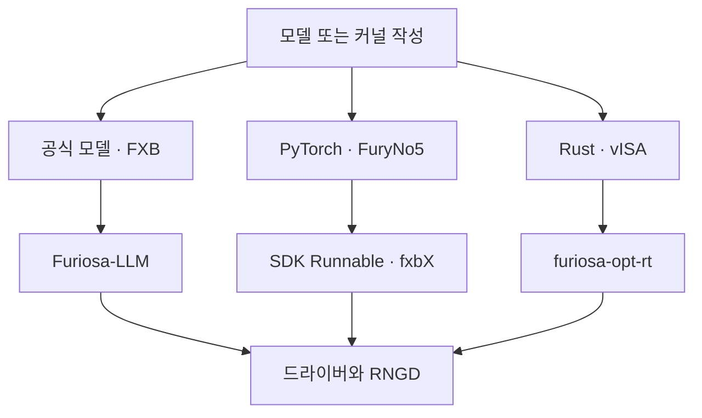

# FuryNo5 개발 핸드북

## 이 책의 목표

**PyTorch 코드 한 줄이 어떤 프로그램과 실행계획으로 바뀌어 RNGD에서 동작하는지, 그리고 어디를 바꾸어야 빨라지는지 설명한다.** 하드웨어 사양을 외우는 책도, 명령만 복사하는 설치 안내서도 아니다. 장치의 제약이 컴파일러와 런타임의 설계를 어떻게 바꾸는지 이해하고, FuryNo5의 실제 구현을 수정할 수 있도록 연결한다.

독자는 개발 경험이 있지만 Furiosa NPU(Neural Processing Unit, 신경망 처리 장치)에 익숙하지 않은 사람이다. 필요한 용어는 처음 등장하는 문맥에서 설명하고 [용어 사전](glossary.md)에 모았다. 모델 포팅이 급해도 [하드웨어](01-hardware.md), [TCL과 EDF](04-tcl-edf.md), [실행그래프와 실패 경계](05-graphs-fallback.md)를 먼저 읽으면 실패한 계층을 구분하기 쉬워진다.

## 먼저 고쳐 놓을 다섯 가지 생각

| 질문 | 이 책의 판단 | 확인할 장 |
|---|---|---|
| FuryNo5가 모든 ATen을 NPU에서 실행하는가? | 범용 지원은 목표다. 소스의 등록 범위, 수치 검증, 장치 검증은 각각 따로 확인해야 한다. | [실제 구조와 지원 범위](10-furyno5-architecture.md) |
| EDF가 없으면 CPU로 넘어가는가? | 로더·컴파일러·디스패처 정책에 따라 다르다. EDF 누락 자체가 CPU 폴백 정책은 아니다. | [오류와 폴백](05-graphs-fallback.md) |
| EDF들을 주면 런타임이 모델 그래프를 복원하는가? | 모델의 연결·가중치·상태 계약이 필요하다. 단일 EDF를 실행 객체로 만드는 것과 모델 전체 계획을 만드는 것은 다르다. | [실행그래프](05-graphs-fallback.md) |
| `furiosa-opt`가 Python TCL을 실행하는 런타임인가? | 컴파일 도구와 `furiosa-opt-rt` 실행 경로를 나누어 봐야 한다. 공개 vISA와 SDK TCL의 API도 구분한다. | [vISA와 도구](08-eisa-visa.md) |
| fxbX를 공식 서빙기에 넘기면 임의 모델을 서빙할 수 있는가? | 포맷을 읽는 일 외에 모델 등록·텐서 계약·KV 상태·배칭 연결이 필요하다. | [패키지](12-fxbx.md), [서빙](14-serving-vllm.md) |

각 판단의 소스와 제한은 연결된 장에 붙였다. 이 표를 기능의 영구적인 한계로 읽지 말자. **검토한 버전에서 어디까지 확인했는지**를 표시한 것이다.

## 같은 NPU로 가는 서로 다른 길

이 그림의 마지막 상자는 계층 관계를 단순화했다. 세 실행기가 같은 비공개 내부 라이브러리나 동일한 큐 구현을 쓴다는 뜻은 아니다. 공식 모델 서빙은 [Furiosa-LLM과 FXB 문서](https://developer.furiosa.ai/v2026.4.0/en/furiosa_llm/fxb.html), 저수준 장치 함수 실행은 [공개 furiosa-opt 런타임](https://github.com/furiosa-ai/furiosa-opt/tree/3d43bc9d20f324af60e3006c3f1541938d7f5097/furiosa-opt-rt)에서 확인한다. FuryNo5 경로는 [프로젝트 소스](https://github.com/smallstep-zzz/FuryNo5/tree/bba9efea8201aec48150514a35d0b637d29d107e)를 기준으로 설명한다.

<!-- interactive:route -->

## 학습 순서

| 단계 | 읽는 장 | 읽고 나서 답할 질문 |
|---|---|---|
| 디바이스 이해 | 01–03 | 어느 메모리에 무엇을 두며, 누가 복사하고 완료를 알리는가? |
| 커널과 실행 | 04–06 | TCL의 축이 무엇을 뜻하며, 어떤 입력에 어떤 EDF와 계획을 쓰는가? |
| 성능과 저수준 제어 | 07–08 | 느린 구간이 호스트인가, 전송인가, 연산인가? vISA까지 내려갈 이유가 있는가? |
| PyTorch와 FuryNo5 | 09–11 | 어떤 ATen 호출이 어떤 파일·함수에서 변환되고, 무엇이 캐시되는가? |
| 포팅과 서빙 | 12–15 | 실행 가능한 패키지와 서비스 가능한 모델 사이에 어떤 계약이 필요한가? |
| 실험과 회고 | 16–17 | 기준선과 비교해 무엇이 실제로 좋아졌고, 다음 실험은 무엇인가? |

한 번에 끝까지 읽기보다 **작은 연산 하나를 이 순서로 따라가는 방법**을 권한다. 예를 들어 행렬곱 뒤 ReLU(Rectified Linear Unit)를 붙인 모델을 택한다. CPU(Central Processing Unit) 기준값을 저장하고, shape·dtype·layout을 기록하고, 컴파일 산출물을 확인하고, NPU 출력과 비교한다. 이후 같은 모델을 연산별 EDF와 묶인 EDF로 실행해 경계 비용이 어떻게 변하는지 측정한다. 구체적 포팅 명령은 [13장](13-porting-fha.md)에 있다.

## 근거를 읽는 방법

**공식 자료**는 SDK(Software Development Kit) 문서, 공개 소스, 공식 담당자의 답변이다. 공식 자료도 버전마다 달라지며, 문서 URL에 버전이 있다고 본문이 항상 고정되어 있는 것은 아니다. 이번 조사에서는 `/v2026.4.0/` 페이지가 `2026.4.1` 헤더를 표시하는 사례를 확인했다. 따라서 URL·조회일·코드 커밋을 함께 기록한다.

**코드 확인**은 특정 소스에서 조건·호출·테스트를 읽었다는 뜻이다. 테스트 코드가 존재하는 것, 저장된 테스트가 통과한 것, 이번 세션에서 실제 장비로 실행한 것은 구분한다. 이 핸드북을 작성한 환경에는 RNGD와 Furiosa SDK가 없으므로 새로운 NPU 실측을 했다고 주장하지 않는다. FuryBoost의 숫자는 저장소의 기존 실험 기록이다.

**FuryNo5의 해석**은 개발 관점의 설계 판단이다. 정확도 확인 → 불필요한 전송 제거 → 상주와 재사용 → 영역 융합 → 배치·배치형상 조정 같은 순서는 유용한 출발점이다. 하지만 모든 워크로드에 적용되는 하드웨어 규칙은 아니다. 이미 커널 계산이 대부분인 경우와 호스트 제출 비용이 대부분인 경우는 우선순위가 다르다. [07장](07-optimization.md)에서 판단 기준을 다룬다.

**미확인·개발 과제**는 공개 자료나 현재 코드로 결론 내리지 못한 경계다. 임의 실행계획을 공식 Furiosa-LLM에 등록하는 방법, FuryNo5 산출물과 새 서빙 엔진의 연결 등은 구현된 기능과 분리해서 적었다. 찾아보지 않은 내용을 '불가능'이라고 쓰지 않고, 무엇을 추가로 확인해야 하는지 남긴다.

## 코드 예제를 사용하는 방법

본문의 코드는 세 종류다. 실행 순서를 갖춘 **실습 예제**, 실제 함수의 핵심을 보여주는 **소스 발췌**, 원리를 설명하는 **의사코드·설명 모델**이다. 소스 발췌는 주변 import·객체 생성·타입 정의를 생략할 수 있으므로 원문 링크를 같이 본다. 실제 장치에 연결하는 예제에는 SDK와 토폴로지 전제가 필요하다.

준비 → 컴파일 → 로드 → 반복 실행의 시간을 각각 분리한다. 비동기 호출의 Python 반환 시각은 장치 완료 시각이 아니다. 초기 컴파일 비용을 제외한 반복 실행 수치를 '최초 실행 시간'이라고 쓰지 않고, CPU에서 남아 있는 준비·후처리를 NPU 시간에 섞어 해석하지 않는다. 측정 양식과 추적 도구는 [17장](17-debugging.md)에 모았다.

## 출처

| 근거 | 용도 |
|---|---|
| [Furiosa software stack](https://developer.furiosa.ai/v2026.4.0/en/overview/software_stack.html) | 공식 계층 구분 |
| [공식 FXB 문서](https://developer.furiosa.ai/v2026.4.0/en/furiosa_llm/fxb.html) | 모델 자산과 실행 프로그램의 관계 |
| [furiosa-opt 고정 소스](https://github.com/furiosa-ai/furiosa-opt/tree/3d43bc9d20f324af60e3006c3f1541938d7f5097) | 공개 저수준 경로 |
| [FuryNo5 고정 소스](https://github.com/smallstep-zzz/FuryNo5/tree/bba9efea8201aec48150514a35d0b637d29d107e) | 프로젝트 구현. 접근 권한 필요 |
| [출처와 버전 기록](sources.md), [개편 회고](review.md) | 세부 근거와 미해결 항목 |
