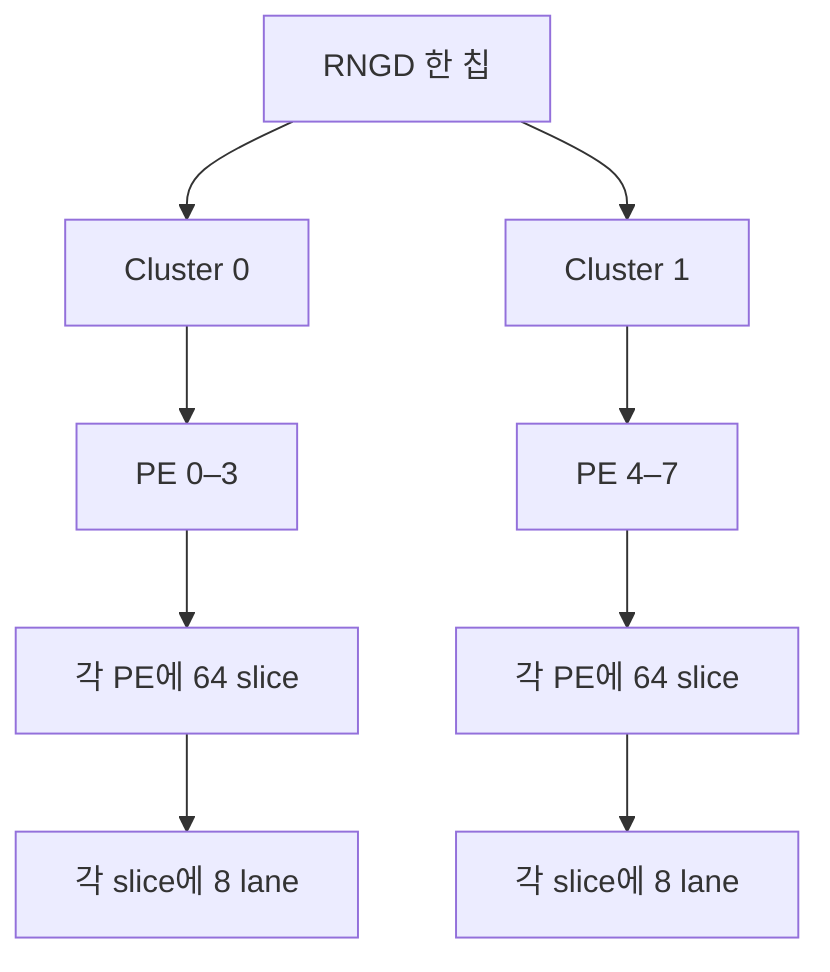
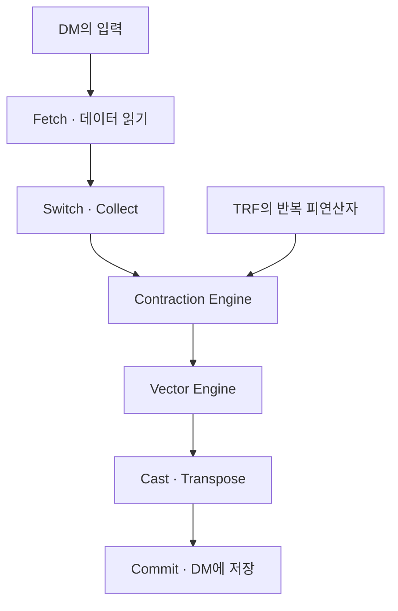

# RNGD 하드웨어: 행렬 뒤에서 움직이는 장치

RNGD(제품명 Renegade)는 딥러닝 **추론**을 위한 NPU(Neural Processing Unit)다. 이 장에서 먼저 알아야 할 것은 최대 연산량보다 **어떤 데이터를 어느 연산기에 언제 공급하는가**이다. 같은 수식을 실행해도 데이터를 나누는 축, 재사용 횟수, 메모리 이동 순서에 따라 성능이 달라진다. FuryNo5가 만드는 코드를 이해하려면 이 연결을 먼저 보아야 한다.

> **근거 범위** · 하드웨어 사양은 Furiosa의 RNGD 제품 문서, 실행 구조는 ISCA 2024 논문과 `furiosa-opt`의 `3d43bc9d20f324af60e3006c3f1541938d7f5097` 문서를 대조했다. 수치는 제조사의 명목 사양이며 이 핸드북에서 측정한 결과가 아니다. 논문의 구형 수치와 현재 제품 사양이 다른 경우 현재 제품 문서를 우선한다.

## 1. 개발자가 기억할 사양

| 항목 | 공식 공개 사양 | 개발할 때의 의미 |
|---|---|---|
| 설계 | TCP(Tensor Contraction Processor) | 텐서 축을 결합·축약하는 연산이 중심이다. |
| 칩 전체 연산량 | BF16 256 TFLOPS, FP8 512 TFLOPS, INT8 512 TOPS, INT4 1024 TOPS | 서로 다른 정밀도의 수치다. 모델 처리량과 동일하지 않다. |
| HBM3(High Bandwidth Memory 3) | 48 GB, 1.5 TB/s | 가중치·큰 활성값을 담는 장치 메모리다. |
| 온칩 SRAM(Static Random Access Memory) | 256 MB | 연산 가까이에서 데이터를 재사용한다. |
| 호스트 연결 | PCIe(Peripheral Component Interconnect Express) Gen5 ×16 | CPU 메모리 왕복은 HBM 내부 접근과 다른 비용이다. |
| 장치 분할 | 최대 8 인스턴스, SR-IOV(Single Root I/O Virtualization) | 한 물리 카드와 한 실행 인스턴스의 자원량이 다를 수 있다. |

BF16은 Brain Floating Point 16, FP8은 8-bit Floating Point, TFLOPS는 초당 조 단위 부동소수점 연산, TOPS는 초당 조 단위 연산을 뜻한다. 연산량 표는 해당 형식·조건에서의 칩 전체 능력을 나타낸다. [공식 RNGD 사양](https://developer.furiosa.ai/v2026.4.0/en/overview/rngd.html)

예를 들어 작은 벡터 하나를 처리하는 함수가 전체 장치를 충분히 채우지 못한다면, 칩의 최대 TFLOPS가 높아도 사용자 체감 지연은 줄지 않을 수 있다. 이때는 연산기를 더 쓰는 방법보다 호출 준비·전송·동기화의 비중을 먼저 확인해야 한다. 이는 성능 수치에서 직접 도출한 일반적인 판단이며 특정 커널의 실측 결론은 아니다.

## 2. PE와 slice를 같은 것으로 생각하지 말자

PE(Processing Element)는 장치를 구성하는 실행 단위다. 공개 vISA(Virtual Instruction Set Architecture) 문서에서 한 칩은 두 cluster, cluster당 네 PE, PE당 64 slice로 설명된다. 따라서 전체는 여덟 PE와 512 slice다. Slice는 Tensor Unit의 세부 병렬 단위이며, Contraction Engine 안에는 slice당 여덟 lane이 있다. [공간 차원과 하드웨어 수](https://github.com/furiosa-ai/furiosa-opt/blob/3d43bc9d20f324af60e3006c3f1541938d7f5097/docs/src/mapping-tensors/spatial-temporal-dimensions.md)



이 그림은 계산 자원의 계층을 나타낸다. `furiosa-smi`의 core 표기, SDK의 fusion 수, Rust 타입의 `Chip/Cluster/Slice/Lane`은 서로 관계가 있지만 **동일한 API 매개변수는 아니다**. 예를 들어 Rust의 `#[device(chip = 1)]`은 칩 수를 나타내고, Python의 `set_fusion(8)`은 해당 SDK의 PE 실행 설정이다. 각각의 런타임이 지원하는 배치 단위와 사용 권한을 확인해야 한다. [vISA 배치 제약](https://github.com/furiosa-ai/furiosa-opt/blob/3d43bc9d20f324af60e3006c3f1541938d7f5097/docs/src/mapping-tensors/spatial-temporal-dimensions.md), [FuryNo5의 Python 설정](https://github.com/smallstep-zzz/FuryNo5/blob/bba9efea8201aec48150514a35d0b637d29d107e/tplmachine/direct_runtime.py)

## 3. TCP가 다루는 계산: 축을 남기고 축을 줄인다

행렬곱을 `A[M,K] × B[K,N] → C[M,N]`으로 쓰자. `M`과 `N`은 출력에 남고, `K`는 곱한 뒤 더해서 없어진다. 이것이 contraction, 즉 **공통 축에 대한 곱과 축약**이다.

```python
# CPU에서 의미를 확인하는 예제. Furiosa 장치 API가 아니다.
import numpy as np

a = np.arange(12, dtype=np.float32).reshape(3, 4)
b = np.arange(20, dtype=np.float32).reshape(4, 5)
c = np.einsum("mk,kn->mn", a, b)
assert np.allclose(c, a @ b)
```

위 코드의 의미는 하나이지만 실행 방법은 여러 가지다. `M`을 slice에 나누면 서로 다른 행을 동시에 계산하고, `N`을 lane에 나누면 하나의 입력을 여러 출력 열에서 재사용할 수 있다. `K`를 여러 단위에 나누면 나중에 부분합을 합쳐야 한다. 어떤 분배가 유리한지는 형상과 메모리 배치에 달려 있다. TCP 논문은 이런 lowered shape와 tactic 선택, 이웃 연산 사이 배치가 다를 때 필요한 변환을 설명한다. [TCP 논문, II–V절](https://furiosa.ai/download/FuriosaAI-tensor-contraction-processor-isca24)

**논리 축**은 문제의 좌표이고, **물리 축**은 그 좌표를 나눠 실행할 장소다. 배치 축 `B`가 항상 PE를 의미하는 것도 아니고, 숨김 차원 `H`가 항상 lane을 의미하는 것도 아니다. 둘을 직접 연결하는 선택이 컴파일러와 커널 개발자의 작업이다.

## 4. 데이터는 연산 파이프라인을 통과한다

공개 vISA는 DM(Data Memory)의 값을 Fetch로 읽고, 필요한 배치로 보내고, 계산하고, Commit으로 저장하는 과정을 드러낸다. Register File은 연산기에 반복해서 공급할 피연산자를 보관한다. [메모리와 연산의 경계](https://github.com/furiosa-ai/furiosa-opt/blob/3d43bc9d20f324af60e3006c3f1541938d7f5097/docs/src/moving-tensors/index.md)



TRF(Tensor Register File)는 contraction 쪽 피연산자를, VRF(Vector Register File)는 vector 쪽 피연산자를 공급한다. 작은 행렬곱을 수백 번 부를 때도 가중치를 이 계층에 재사용할 수 있는지, 매번 바깥 메모리에서 다시 가져오는지를 구별해야 한다. Register File의 물리 비트 용량과 자료형별 API 허용 용량은 같은 숫자로 단순 합산하면 안 된다. [Register Files](https://github.com/furiosa-ai/furiosa-opt/blob/3d43bc9d20f324af60e3006c3f1541938d7f5097/docs/src/computing-tensors/register-files.md)

위 그림의 모든 상자가 항상 실행되는 것은 아니다. 실제 엔진 선택, 우회 경로, 명령 수는 생성된 커널과 스케줄을 확인해야 한다. 예를 들어 단순 덧셈에는 큰 contraction이 필요하지 않다. 반대로 reduction을 어느 엔진에서 처리하는지는 결과 shape만 보고 판단할 수 없다.

## 5. 제어 코어와 텐서 연산기는 다른 일을 한다

장치 안에도 제어용 CPU 코어와 명령 큐가 있다. TCP 논문은 이 코어가 Tensor Unit의 제어 레지스터·명령 큐를 다루고, DMA와 연산 명령의 의존성을 관리하는 구조를 설명한다. **호스트 CPU가 바쁘다**, **장치 제어 코어가 바쁘다**, **Tensor Unit이 계산 중이다**는 서로 다른 관측이다. [TCP 논문, III·V절](https://furiosa.ai/download/FuriosaAI-tensor-contraction-processor-isca24)

따라서 `CPU 사용률이 올라갔다`만으로 CPU 폴백을 주장하면 안 된다. 입력 준비, 토크나이저, 샘플링, 메모리 매핑, 제출·완료 대기처럼 NPU를 사용하면서도 호스트에서 수행하는 일이 있다. 폴백 여부는 **어떤 연산이 어느 장치에서 실행됐는가**로 확인해야 한다. 5장에서 이를 경로별로 나눈다.

## 6. 처음 장치를 만났을 때의 관찰

다음 명령은 장치를 변경하지 않고 식별·상태·사용 프로세스를 확인한다. 설치 환경에서 지원되는 세부 옵션은 `--help`와 함께 확인한다.

```bash
furiosa-smi version
furiosa-smi info --format full
furiosa-smi status --format full
furiosa-smi ps
furiosa-smi topo
```

`info`는 장치·펌웨어·클록을, `status`는 메모리·core 사용 상태를, `topo`는 PCIe 연결과 NUMA(Non-Uniform Memory Access) 배치를 보여준다. 사양 표의 48 GB와 도구 출력의 47.50 GiB는 서로 다른 종류의 표시다. 설치된 런타임의 실제 할당 가능 범위는 allocator·장치 설정에서도 확인해야 한다. [Furiosa SMI CLI](https://developer.furiosa.ai/v2026.4.0/en/device_management/system_management_interface/furiosa_smi_cli.html)

**이 장을 읽고 답할 수 있어야 할 질문**은 세 가지다. 내가 가진 자원은 카드 전체인가 일부 PE인가? 계산할 값은 HBM·DM·Register File 중 어디에 있는가? 논리 축을 병렬 자원과 반복 시간에 어떻게 나누는가? 이 질문이 해결되어야 버킷과 최적화가 의미를 갖는다.

## 출처

| 근거 | 이 장에서 사용한 범위 |
|---|---|
| [RNGD 제품·SDK 문서](https://developer.furiosa.ai/v2026.4.0/en/overview/rngd.html) | 제품 사양, SR-IOV |
| [TCP: A Tensor Contraction Processor for AI Workloads, ISCA 2024](https://furiosa.ai/download/FuriosaAI-tensor-contraction-processor-isca24) | 설계 이유, 제어 코어, 축과 tactic |
| [vISA Spatial and Temporal Dimensions](https://github.com/furiosa-ai/furiosa-opt/blob/3d43bc9d20f324af60e3006c3f1541938d7f5097/docs/src/mapping-tensors/spatial-temporal-dimensions.md) | PE·cluster·slice·lane 관계, 타입 의미 |
| [Moving Tensors](https://github.com/furiosa-ai/furiosa-opt/blob/3d43bc9d20f324af60e3006c3f1541938d7f5097/docs/src/moving-tensors/index.md) | 메모리와 파이프라인 경계 |
| [Register Files](https://github.com/furiosa-ai/furiosa-opt/blob/3d43bc9d20f324af60e3006c3f1541938d7f5097/docs/src/computing-tensors/register-files.md) | TRF·VRF의 역할 |
| [SMI CLI](https://developer.furiosa.ai/v2026.4.0/en/device_management/system_management_interface/furiosa_smi_cli.html) | 읽기 전용 관찰 명령 |
