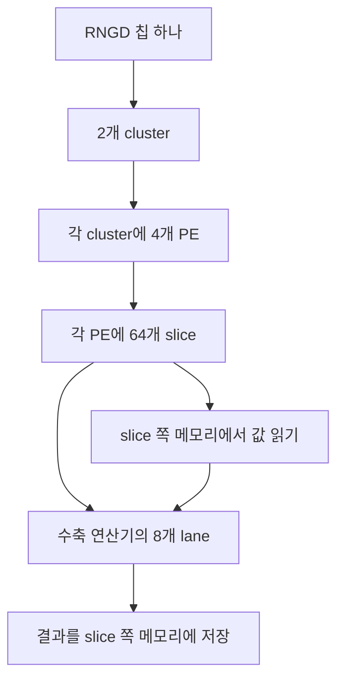
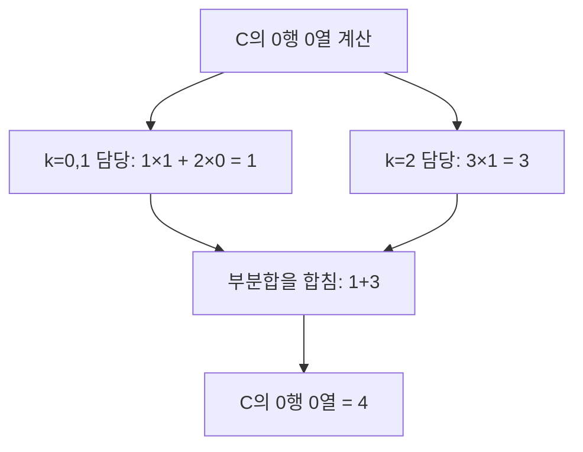
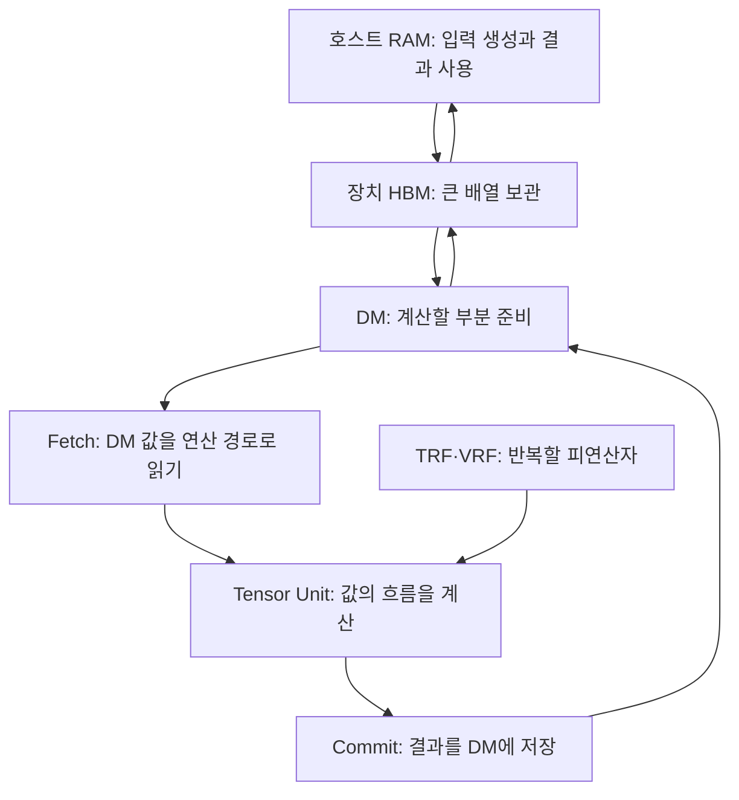
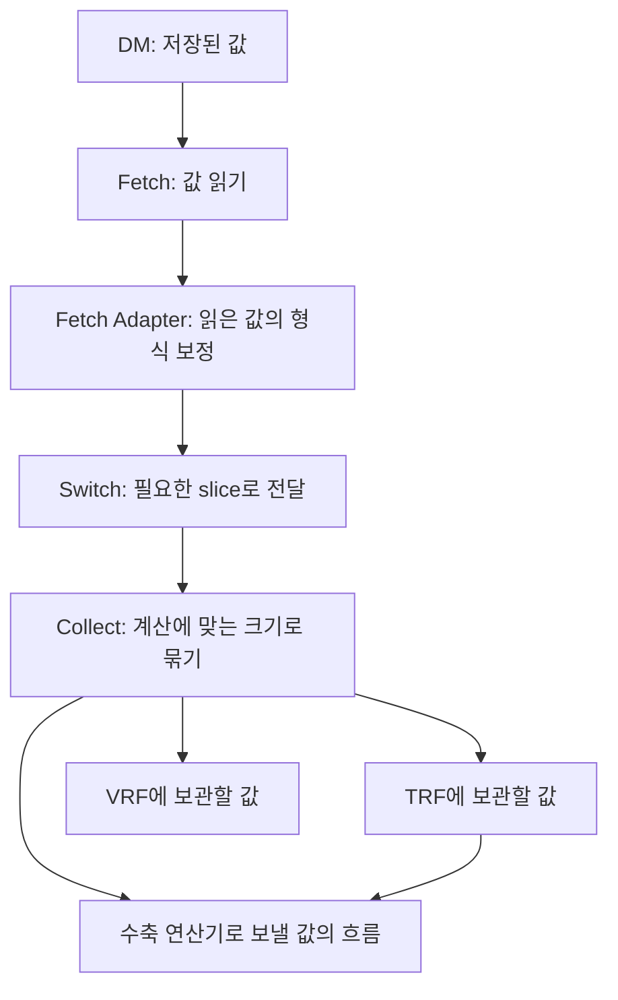
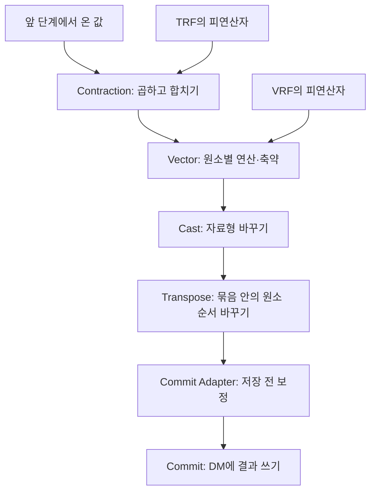

# RNGD 하드웨어: 작은 행렬곱 하나를 끝까지 따라가기

한 번의 곱셈이 아니라 많은 곱셈을 나눠 맡기는 것이 NPU의 출발점이다. 먼저 같은 행렬곱을 손으로 계산하고, 그 일을 RNGD의 여러 계산 자원이 어떻게 나누는지 보자. 숫자가 저장되는 위치는 다음 [02장](02-memory-dma.md)에서 이어 살펴본다.

RNGD(Renegade)는 많은 숫자의 곱셈·덧셈을 병렬로 처리하는 NPU다. 호스트 프로그램이 계산 방법과 데이터를 준비하면 장치가 계산을 수행한다. 한 행렬곱을 직접 계산한 뒤, 같은 일을 여러 자원에 나누어 맡겨 보겠다.

아래 숫자는 손으로 계산할 수 있도록 작게 잡았다. 이 크기의 연산을 NPU에 보내는 것이 CPU보다 빠르다는 예는 아니다. 제품 사양표는 계산 원리를 익힌 뒤 읽는다. 사양의 명목 성능과 실제 프로그램의 속도가 다른 이유도 그때 살펴본다.

## 1. 먼저 장치 없이 계산해 보자

### 스칼라·벡터·행렬은 숫자를 담는 모양이다

숫자 `3` 하나를 **스칼라(scalar)**, `[1,2,3]`처럼 한 줄로 모은 것을 **벡터(vector)라고** 한다. 두 줄을 쌓아 `[[1,2,3],[4,5,6]]`으로 만들면 2행 3열의 **행렬(matrix)이다**.

이런 배열을 통틀어 **텐서(tensor)라고** 부른다. 행렬에서 값을 찾으려면 행과 열을 고른다. 이 두 방향이 **축(axis)이다**. `A[0,1]`은 0번 행의 1번 열이며, Python처럼 번호를 0부터 센다.

벡터의 **내적(dot product)은** 같은 위치의 값을 곱한 뒤 더해 숫자 하나를 만드는 계산이다. `[1,2,3]`과 `[1,0,1]`의 내적은 `1×1 + 2×0 + 3×1 = 4`다. 수학에서 `Σ`는 여러 항을 더하라는 합산 기호다. 이 예의 `Σₖ A[0,k]×W[k,0]`는 `k`를 0부터 2까지 바꾸며 곱을 더하라는 뜻으로, 아래의 `total += ...` 반복문과 같은 계산이다.

**행렬곱(matrix multiplication)은** 왼쪽 행렬의 각 행과 오른쪽 행렬의 각 열에 대해 이 내적을 반복하는 것이다. 왼쪽 한 행의 값 개수와 오른쪽 한 열의 값 개수가 같아야 짝지을 수 있다. 그래서 `(M,K)`와 `(K,N)`을 곱하면 결과가 `(M,N)`이 된다. 사라지는 `K`는 단순히 버리는 것이 아니라 곱들을 더해 결과 안에 반영하는 축이다.

입력 데이터가 두 개 있고, 각 데이터가 세 개의 숫자로 이루어졌다고 하자. 이를 2행 3열 행렬 `A`에 담는다. 각 입력에서 두 개의 출력값을 계산하기 위해 3행 2열의 계수 행렬 `W`를 사용한다. `A @ W`의 결과 `C`는 2행 2열이며, `C`의 각 행은 `A`의 해당 입력 행에서 계산한 두 출력값이다. 신경망에서는 학습으로 정하는 이런 계수를 **가중치(weight)** 라고 부른다.

배열의 **shape(형상)는** 각 축의 길이다. `(2,3)`은 2행 3열, `(3,2)`는 3행 2열이라는 뜻이다. 아래 코드 주석의 `(2,3) @ (3,2) → (2,2)`는 값의 내용이 아니라 입력 두 개와 출력의 모양을 적은 것이다. 저장 순서와의 차이는 3절에서 실제 주소 위치와 함께 살펴본다.

```python
import numpy as np  # 숫자 배열을 계산하는 NumPy를 np라는 짧은 이름으로 사용한다.

# 두 입력 행, 각 행에 세 값: shape는 (2, 3)이다.
# float32는 값 하나를 32비트 부동소수점으로 저장한다는 뜻이다.
A = np.array([[1, 2, 3],
              [4, 5, 6]], dtype=np.float32)
# 각 열이 출력 하나를 만드는 계수다. 첫 열은 첫 값+셋째 값,
# 둘째 열은 둘째 값+셋째 값을 선택하므로 shape는 (3, 2)다.
W = np.array([[1, 0],
              [0, 1],
              [1, 1]], dtype=np.float32)
C = A @ W  # 행렬곱: (2, 3) @ (3, 2) → (2, 2). 각 칸은 행·열의 내적이다.
print(C)
# [[ 4.  5.]
#  [10. 11.]]
```

`np`는 `import numpy as np`에서 붙인 NumPy의 짧은 이름이다. `np.array`는 숫자를 배열로 만들고, `dtype=np.float32`는 각 값을 32비트 부동소수점으로 저장한다는 뜻이다. 여기서 `@`는 행렬곱이다. `A`의 한 행과 `W`의 한 열을 골라, 같은 위치끼리 곱하고 모두 더한다. [NumPy 배열과 행렬곱 API](https://numpy.org/doc/stable/reference/generated/numpy.matmul.html)

첫 번째 결과 `C[0,0]`을 손으로 계산하면 다음과 같다.

| 같은 위치 `k` | 입력 `A[0,k]` | 계수 `W[k,0]` | 곱 |
|---|---:|---:|---:|
| 0 | 1 | 1 | 1 |
| 1 | 2 | 0 | 0 |
| 2 | 3 | 1 | 3 |
| 합계 | | | **4** |

두 번째 열도 같은 방법이다. `C[0,1] = 1×0 + 2×1 + 3×1 = 5`다. 두 번째 입력 행 `[4,5,6]`에서는 결과 `[10,11]`이 나온다. 모든 결과는 다음 반복문으로도 계산할 수 있다.

```python
M, K = A.shape       # M=2: 입력 행 수, K=3: 한 행에서 곱해 더할 항 수.
K_of_W, N = W.shape  # W의 행 수는 K와 같아야 한다. N=2는 출력 열 수다.
assert K == K_of_W   # 내적의 두 벡터 길이가 일치하는지 확인한다.
C_loop = np.zeros((M, N), dtype=np.float32)  # 결과 (2, 2)를 0으로 채워 준비한다.

for m in range(M):             # 입력 행을 하나 고른다: m=0, 1.
    for n in range(N):         # 만들 출력 열을 고른다: n=0, 1.
        total = 0.0           # 출력 칸마다 합계를 새로 시작한다.
        for k in range(K):    # 같은 위치끼리 곱할 세 쌍을 순서대로 방문한다.
            total += A[m, k] * W[k, n]  # 곱 하나를 현재 합계에 더한다.
        C_loop[m, n] = total  # 세 항을 모두 더한 뒤 출력 한 칸을 저장한다.

np.testing.assert_allclose(C_loop, C)  # @ 결과와 부동소수점 허용오차 안에서 같은지 검사한다.
```

여기까지 필요한 계산은 **어느 출력 칸을 만들지 고르는 두 반복문 `m,n`과, 그 칸을 만들기 위해 곱해서 더하는 반복문 `k`다**. NPU가 할 일을 이해할 때도 이 구분을 유지하면 된다.

`A * A`는 다른 연산이다. 같은 위치끼리만 곱하므로 `[[1,4,9],[16,25,36]]`이 되고 shape `(2,3)`이 유지된다. 이것을 **원소별 곱(elementwise multiplication)이라고** 한다. `@`는 행·열의 내적이고 `*`는 이 예에서 같은 칸끼리의 곱이라는 차이를 먼저 구분하자. [행렬곱](https://numpy.org/doc/stable/reference/generated/numpy.matmul.html) · [원소별 곱](https://numpy.org/doc/stable/reference/generated/numpy.multiply.html)

## 2. `np.einsum`은 반복문의 계산 규칙을 짧게 쓰는 함수다

`einsum`은 **Einstein summation, 아인슈타인 합산 표기**에서 온 이름이다. NumPy의 `np.einsum`은 배열의 각 축에 글자를 붙여, 어떤 값끼리 곱하고 어떤 축을 더할지 문자열로 지정한다. 이름은 낯설지만 위 반복문의 계산 관계를 적는 방법이다. 이 책은 출력 축을 직접 적는 `->` 형식을 사용한다. [NumPy `einsum` 공식 설명](https://numpy.org/doc/stable/reference/generated/numpy.einsum.html)

```python
# m,n은 결과에 남기고 k는 곱한 뒤 합산한다. 결과 shape는 (2, 2)다.
C_einsum = np.einsum("mk,kn->mn", A, W)
np.testing.assert_allclose(C_einsum, C)  # 문자열로 적은 계산도 앞의 @와 같은지 확인한다.
```

문자열을 왼쪽부터 읽으면 된다.

| 부분 | 이 예에서의 의미 |
|---|---|
| `mk` | 첫 번째 배열 `A`의 첫 축에 `m`, 둘째 축에 `k`라는 이름을 붙인다. |
| 쉼표 `,` | 다음 입력 배열로 넘어간다. |
| `kn` | 두 번째 배열 `W`의 첫 축은 `k`, 둘째 축은 `n`이다. 같은 `k`를 가진 위치끼리 연결한다. |
| 화살표 `->` | 오른쪽에 결과 배열의 축을 적는다. |
| `mn` | 결과는 입력 행 `m`과 출력 열 `n`으로 찾는 2차원 배열이다. |
| 출력에서 빠진 `k` | `k=0,1,2`의 곱들을 더해서 한 결과값으로 만든다. |

따라서 `"mk,kn->mn"`은 **“`A[m,k]`와 `W[k,n]`을 곱하고 `k`에 대해 더해 `C[m,n]`에 넣어라”라는** 뜻이다. `m,k,n`은 예약된 하드웨어 이름이 아니다. `"ij,jl->il"`처럼 글자를 바꿔도 같은 계산 관계를 나타낼 수 있다.

모든 `einsum`이 행렬곱인 것도 아니다. 아래는 같은 표기 규칙의 다른 사용 예다.

| 호출 | 계산과 결과 |
|---|---|
| `np.einsum("mk->m", A)` | 각 행의 값을 더한다. 결과는 `[6, 15]`다. |
| `np.einsum("mk->km", A)` | 합산할 축이 없고 순서만 바뀐다. 결과의 행·열이 바뀌는 전치다. |
| `np.einsum("mk,mk->mk", A, A)` | 출력에 `m,k`가 모두 남는다. 같은 칸끼리 곱하므로 원소별 제곱이다. |

**같은 글자가 보인다고 무조건 없애는 것이 아니다.** 이 명시적 표기에서는 출력에 어떤 축을 남겼는지까지 읽는다. 같은 입력 안에서 글자를 반복하는 대각선 표기 등 추가 문법도 있지만, 위 세 예와 행렬곱을 이해하는 데 필요하지 않다. [명시적 출력 표기와 합산 규칙](https://numpy.org/doc/stable/reference/generated/numpy.einsum.html)

이처럼 여러 곱을 합쳐 어떤 축을 없애는 계산을 **텐서 수축(tensor contraction)이라고** 한다. **텐서(tensor)는** 여기서는 다차원 숫자 배열이라고 이해하면 된다. 행렬은 2차원 텐서이고, 행렬곱은 텐서 수축의 한 예다. RNGD의 TCP(Tensor Contraction Processor)라는 이름은 이런 계산을 중심으로 설계했다는 뜻이다. [TCP 논문 I–II절](https://furiosa.ai/download/FuriosaAI-tensor-contraction-processor-isca24)

## 3. Shape는 배열의 형태, 메모리 배치는 값의 저장 위치를 나타낸다

**Shape(형상)는 각 축의 길이를 적은 목록**이다. `A.shape == (2,3)`은 “행이 두 개이고 각 행에 값이 세 개”라는 뜻이다. 입력과 결과의 shape는 `A:(2,3)`, `W:(3,2)`, `C:(2,2)`다. `M=2,K=3,N=2`는 이 길이에 이름을 붙인 것이다.

Shape는 값이 저장된 주소나 병렬 실행 방법까지 말해 주지 않는다. 같은 `A`를 메모리의 한 줄에 펼칠 때 행부터 적으면 `[1,2,3,4,5,6]`, 열부터 적으면 `[1,4,2,5,3,6]`이다. 둘 다 “0행 1열의 값은 2”라는 논리적 배열을 표현할 수 있지만, 그 값을 찾을 주소 계산은 달라진다.

| 질문 | 행부터 저장 | 열부터 저장 |
|---|---|---|
| 메모리 순서 | `1,2,3,4,5,6` | `1,4,2,5,3,6` |
| `A[0,1]`의 원소 위치, 0부터 셈 | 1 | 2 |
| 첫 행 `[1,2,3]`을 읽는 원소 위치 | `0,1,2` | `0,2,4` |
| 논리적인 shape | `(2,3)` | `(2,3)` |

메모리 배치(layout)는 이런 저장 순서와 주소 대응을 말한다. NPU에서는 값을 여러 메모리 조각이나 연산 단위에 나눠 놓는 선택까지 생긴다. 이때 논리적 인덱스를 장치 위치와 연결하는 규칙을 매핑(mapping)이라고 부른다. C의 2차원 배열을 1차원 주소로 계산하는 방식에, “어느 장치 조각인가”라는 좌표가 추가된 셈이다. NumPy에서도 shape와 주소 증가량인 stride가 구분된다. [NumPy 배열 표현](https://numpy.org/doc/stable/reference/arrays.ndarray.html), [Furiosa의 물리 차원](https://github.com/furiosa-ai/furiosa-opt/blob/3d43bc9d20f324af60e3006c3f1541938d7f5097/docs/src/mapping-tensors/spatial-temporal-dimensions.md)

이제 “형상과 메모리 배치에 따라 유리한 방법이 달라진다”는 말을 구체적으로 읽을 수 있다. **행이 두 개뿐인지 수천 개인지**에 따라 나눠 줄 일의 수가 달라지고, **필요한 한 행이 붙어 있는지 떨어져 있는지**에 따라 공급하는 방법이 달라진다는 뜻이다.

## 4. PE, slice, lane은 계산 자원의 어느 크기를 말하는가

지금까지는 숫자 표를 계산했다. 이제 그 일을 맡길 장치 쪽을 보자. RNGD에는 큰 처리 단위인 PE가 있고, 그 안에 더 작은 slice와 lane이 있다. 큰 일을 작은 작업으로 나눠 여러 자원에 맡기기 위한 구분이다.

아래 표는 이 단위들의 포함 관계다. 먼저 ‘큰 묶음 안에 작은 자원이 있다’는 관계를 읽고, 개수는 뒤의 배치 예제에서 사용하면 된다.

| 이름 | 무엇인가 | 이 장에서 기억할 역할 |
|---|---|---|
| **Chip, 칩** | RNGD 하드웨어 한 개 | 여러 실행 단위와 메모리가 함께 들어 있다. |
| **Cluster, 클러스터** | 칩 안의 PE 묶음 | 공개 매핑에서 여러 slice를 묶어 지정하는 단위다. 서버 클러스터와 다른 뜻이다. |
| **PE(Processing Element)** | 제어 코어·텐서 연산기·데이터 이동 기능을 가진 큰 실행 단위 | 맡은 연산과 데이터 이동을 진행한다. |
| **Slice, 슬라이스** | PE의 텐서 연산기 안에서 병렬로 배치된 데이터 처리 단위 | 자기 쪽 데이터를 읽고 계산해 저장하는 경로를 갖는다. |
| **Lane, 레인** | 한 slice의 수축 연산기 안에 있는 더 작은 병렬 계산 경로 | 여러 곱·누산 계산을 나눠 수행한다. 독립적인 Python 함수를 실행하는 스레드는 아니다. |

고정한 공개 문서에서 칩은 **2 cluster**, cluster당 **4 PE**, PE당 **64 slice**, 수축 연산기의 slice당 **8 lane**으로 설명된다. 따라서 칩 전체의 PE는 8개, slice는 512개다. `Lane`은 TRF(Tensor Register File, 수축 연산용 레지스터 묶음)의 배치에도 사용된다. 레지스터의 구체적인 역할은 바로 뒤의 파이프라인 예에서 설명한다. [공간 차원의 단위·수량](https://github.com/furiosa-ai/furiosa-opt/blob/3d43bc9d20f324af60e3006c3f1541938d7f5097/docs/src/mapping-tensors/spatial-temporal-dimensions.md), [PE와 slice의 구성: TCP 논문 III절](https://furiosa.ai/download/FuriosaAI-tensor-contraction-processor-isca24)



이것은 포함 관계와 데이터 역할을 그린 개념도다. 실제 프로그램이 항상 자원을 전부 유효하게 사용하는 것은 아니다. 한쪽에 일이 몰리면 나머지 계산기가 기다릴 수 있다. SDK(Software Development Kit)의 PE 설정과 Rust 저수준 API의 chip·cluster 설정도 서로 다른 호출 계약이므로, 숫자가 같다는 이유로 같은 옵션으로 바꿔 쓰면 안 된다.

## 5. 같은 계산을 나눠 맡기는 세 가지 방법

앞의 행렬곱으로 돌아가자. 작업을 병렬로 나눌 때 중요한 것은 **다른 출력 칸을 만드는 일**과 **같은 출력 칸의 일부를 만드는 일**의 차이다.

아래는 이해를 위해 두 작업 단위만 그린 예다. 실제 RNGD 커널의 최소 활성 slice 수나 패딩·정렬 조건을 그대로 나타낸 설정은 아니다. 그림의 두 단위를 실제 Rust 타입에 그대로 넣는 예제로 사용하지 않는다.

### M을 나누기: 서로 다른 입력 행을 맡긴다

첫 작업은 입력의 첫 행 `[1,2,3]`으로 답 `[4,5]`를 만든다. 둘째 작업은 두 번째 행 `[4,5,6]`으로 답 `[10,11]`을 만든다. 답의 행이 서로 다르므로 제자리에 놓으면 끝이다. 둘을 더할 필요가 없다.

이 작업을 서로 다른 장치 위치에 맡기는 것을 ‘행 축을 공간에 나눈다’고 표현한다. 여기서 공간은 배열의 빈칸이 아니라 일을 맡는 하드웨어 위치를 뜻한다.

### N을 나누기: 같은 입력에서 서로 다른 출력 열을 맡긴다

첫 입력 행을 계산할 때 작업 0은 `W`의 첫 열 `[1,0,1]`을, 작업 1은 둘째 열 `[0,1,1]`을 사용한다. 두 작업 모두 입력 `[1,2,3]`이 필요하다. 입력을 한 번 공급해 여러 계산 경로가 함께 쓰도록 구성하면 반복해서 가져오는 일을 줄일 기회가 생긴다. 이를 **브로드캐스트(broadcast), 같은 값의 여러 소비자에 대한 공급**라고 한다. lane들에 다른 출력 열의 계산을 맡기는 선택을 이렇게 이해할 수 있다. 실제 공급·재사용 방식은 컴파일된 매핑에 달려 있다.

### K를 나누기: 같은 출력의 일부를 계산하므로 더해야 한다

`C[0,0]`의 세 곱을 나눠 보자. 작업 0이 앞의 두 항 `1×1 + 2×0 = 1`을, 작업 1이 마지막 항 `3×1 = 3`을 계산하면, 마지막에 `1+3=4`를 만들어야 한다. 이때 각각이 만든 값은 **부분합(partial sum)이다**. 여러 부분합을 하나로 합치는 처리를 **리덕션(reduction, 축약)이라고** 한다.



| 나눈 축 | 각 작업이 만드는 것 | 결과를 모으는 일 |
|---|---|---|
| `M` | 서로 다른 출력 행 | 정해진 행 위치에 배치 |
| `N` | 서로 다른 출력 열 | 정해진 열 위치에 배치 |
| `K` | 같은 출력 칸의 부분합 | 대응하는 부분합끼리 더함 |

### 두 작업에 어떤 값을 각각 준비해야 하는가

이번에는 두 작업이 사용할 값을 **각자 따로 받고, 서로 저장소를 공유하지 않는다**고 가정하자. 이 가정은 데이터 중복을 세기 위한 교육용 조건이며 실제 RNGD의 전송 횟수나 바이트 수를 예측하는 규칙은 아니다. 원래 `A`는 6개, `W`도 6개, 최종 `C`는 4개 원소다.

| 분할 | 두 작업에 준비하는 A | 두 작업에 준비하는 W | 각 작업이 내놓는 결과 |
|---|---:|---:|---|
| M: 입력 행 하나씩 | 3개 + 3개 = 6개 | 같은 전체 W가 각각 필요: 6개 + 6개 = 12개 | 서로 다른 행, 합계 4개 값 |
| N: 출력 열 하나씩 | 같은 전체 A가 각각 필요: 6개 + 6개 = 12개 | 필요한 열만 각각 준비: 3개 + 3개 = 6개 | 서로 다른 열, 합계 4개 값 |
| K: 앞 두 항 / 마지막 한 항 | 4개 + 2개 = 6개 | 4개 + 2개 = 6개 | 각각 2×2 부분합, 합계 8개 값 |

K 분할의 두 결과는 `[[1,2],[4,5]]`와 `[[3,3],[6,6]]`이다. 같은 좌표끼리 더해야 최종 `[[4,5],[10,11]]`이 된다. 합산이 마지막 별도 단계로 남고 그 단계에 부분합을 공급해야 한다. 이것이 전체 수식의 덧셈 횟수가 언제나 늘어난다는 뜻은 아니다.

이제 재사용의 이득도 구체적으로 보인다. M 분할에서 두 작업이 W를 함께 공급받을 수 있다면 중복 준비를 줄일 기회가 있고, N 분할에서는 A를 함께 공급하는 것이 중요하다. 실제 하드웨어의 broadcast·가까운 저장소·스케줄이 이 기회를 실현할 수 있는지는 별도로 확인한다. **어느 축을 나누는가와 어느 값을 재사용할 수 있는가는 연결된 선택**이다.

어떤 선택이 유리한지는 “병렬 계산기를 많이 켜는가”만으로 정해지지 않는다. `M`이 작으면 행별 분담의 일감이 부족할 수 있고, `K`를 쪼개면 부분합을 모으는 일이 필요하다. `N`을 나눌 때 입력을 공유할 수 있는지는 저장 위치와 공급 경로가 영향을 준다. 이제 이 선택을 실제 RNGD의 공간·시간 차원과 수축 연산기에 연결해 보자.

### 공간과 시간에 축을 배치한다는 뜻

수학식 `C[m,n] = Σₖ A[m,k] × W[k,n]`에서 `M·N·K`는 **계산할 값의 좌표**다. 반면 RNGD의 `Chip·Cluster·Slice·Lane`은 **동시에 계산하거나 저장할 하드웨어 위치**, `Time`은 **여러 차례에 걸쳐 데이터를 공급하는 반복 순서**다. `Packet`은 한 차례에 각 slice로 공급되는 데이터 묶음 안의 위치를 나타낸다. 이처럼 수학의 축을 하드웨어 위치와 전달 차례에 연결하는 규칙이 **물리 매핑(physical mapping)** 이다.

| 물리 차원 | 무엇을 결정하는가 | 앞의 행렬곱에서 생각할 예 |
|---|---|---|
| `Chip` | 어느 칩에 값을 분산하는가 | 여러 칩에 다른 배치를 배치 |
| `Cluster` | 칩 안의 어느 클러스터에 맡기는가 | 서로 다른 출력 행 묶음 배정 |
| `Slice` | 클러스터 안의 어느 slice에 맡기는가 | 서로 다른 입력 행 또는 배치 요소 분담 |
| `Lane` | 한 slice 안에서 어느 병렬 곱셈 경로를 쓰는가 | 서로 다른 출력 열 `N` 분담 |
| `Time` | 몇 번째 차례에 데이터를 공급하는가 | 입력 행 `M`을 순서대로 처리 |
| `Packet` | 한 차례에 공급되는 묶음 안의 어느 원소인가 | 같은 출력의 `K` 항 여러 개를 동시에 곱하고 합산 |

여기서 `Time`을 선택했다고 **CPU가 반복문을 실행한다는 뜻은 아니다.** NPU 연산 스트림에 데이터를 여러 차례 흘려보내는 하드웨어 차원의 반복이다. `Packet`은 `Time`과 달리 한 차례 내의 병렬 묶음이므로, 같은 `K`축이라도 어디에 놓느냐에 따라 처리 방식이 달라진다.

예를 들어 `M=4, N=2, K=8`인 행렬곱을 생각하자. 설명을 위해 네 입력 행을 각각 다른 slice에 맡기고, 각 slice의 두 lane이 두 출력 열을 맡으며, 여덟 개 `K` 항을 한 번의 `Packet`으로 공급한다고 가정할 수 있다. 그러면 서로 다른 출력 좌표는 동시에 계산하고, 같은 출력의 여덟 곱은 묶음 안에서 합산한다. 실제로 이 배치를 쓸 수 있는지는 자료형, Packet 크기, 패딩과 장치 제약을 만족해야 하며, 예시가 곧 실행 가능한 TCL 코드는 아니다.

공식 자료에는 `Cluster`가 칩당 2개, `Slice`가 클러스터당 256개, `Pe`가 클러스터당 4개라고 명시되어 있다. 한 PE가 64개 slice를 포함한다. 공간 차원 타입은 이 물리 자원 수와 크기를 맞춰야 하고, 일부 차원은 패딩으로 채울 수 있다. 그러나 **패딩했다고 런타임이 원하는 PE나 클러스터만 독립적으로 할당해 준다는 뜻은 아니다.** 해당 공개 문서는 런타임이 칩 단위로 동작하며 부분 칩·클러스터 사용은 아직 지원하지 않는다고 명시한다. 따라서 매핑상의 활성 연산 자원과 런타임 자원 점유를 구별해야 한다.

### 수축 연산기(Contraction Engine)에서는 K축의 위치가 특히 중요하다

행렬곱의 `K`축은 최종 출력에서 사라진다. 하지만 없어지는 것이 아니라, `K`에 해당하는 곱을 모두 **더해서 하나의 결과로 합친다(reduction)**. RNGD의 수축 연산기(Contraction Engine)는 이 일을 다음 순서로 나눠 처리한다.

1. **Outer:** 입력 스트림과 TRF에 준비된 피연산자를 맞는 형태로 확장(broadcast)해 곱한다.
2. **Packet Reducer:** 같은 Packet 안에 나란히 들어온 `K` 항들을 병렬 합산한다.
3. **Time Reducer:** 여러 Time 차례에 걸쳐 나온 부분합들을 누적한다.
4. **Lane Folder:** 여러 lane의 결과를 출력 스트림의 형태로 정리한다.

#### MAC은 무엇이며, 활용률 1/32는 무슨 뜻인가

**MAC(Multiply–Accumulate, 곱셈-누산)**은 두 수를 곱한 값을 지금까지의 합계에 더하는 연산이다. 예를 들어 `1×2 + 3×4 + 5×6`을 계산할 때 `합계=0`에서 시작해 `합계 += 1×2`, `합계 += 3×4`, `합계 += 5×6`을 수행한다. 이처럼 행렬곱은 많은 곱셈과 합산으로 이루어진다. 하드웨어에서는 곱과 누산을 처리하는 계산 자원을 MAC 연산 경로라고 부르기도 한다.

**MAC 활용률(utilization)**은 일정한 실행 구간에서 이용할 수 있는 곱셈·누산 계산 능력 가운데 **유효한 계산에 실제 사용된 비율**을 뜻한다. 예컨대 한 차례에 32개 원소의 곱을 처리할 수 있는데 실제로 1개만 계산한다면 그 차례의 유효 곱셈 위치 활용률은 `1÷32 = 3.125%`다. 32개 중 나머지 31개는 그 차례의 유효한 계산에 기여하지 않는다. 이것은 **그 커널 전체가 32배 느리다거나 NPU 전체 사용률이 3.125%라는 뜻이 아니다.**

공식 Furiosa-opt의 **BF16(16비트 부동소수점)** batched-matmul 예제에는 일부러 비효율적으로 만든 기준선이 나온다. `K`축을 `Time`에만 배치하고 `Packet`에는 실제 값 1개만 공급한다. 해당 예제에서는 한 차례에 32개 곱셈 위치를 활용할 수 있음에도 1개 위치만 유효하므로 **MAC 활용률을 1/32(3.125%)**로 설명한다. 핵심은 **곱셈 자체가 복잡해서 느린 것이 아니라, 한 번에 계산할 수 있는 자리를 비워 둔 배치**라는 점이다. 실제 활용률은 자료형·매핑·패딩 및 다른 실행 조건에 따라 달라진다.

반대로 여러 `K` 항을 `Packet`에 배치하면 한 차례에 여러 곱을 처리하고 **Packet Reducer(패킷 축 합산기)**가 그 결과를 합산할 수 있다. `K`를 `Time`에 배치하면 여러 차례에 걸쳐 곱을 처리하고 **Time Reducer(시간 축 누산기)**가 누적한다. 이것은 병렬 처리와 순차 누적의 차이이며, `Packet`에는 크기 제한이 있으므로 큰 `K`는 두 차원으로 나누기도 한다.

#### 배치 축 V는 새로 만드는 축인가? 직접 지정할 수 있는가?

여기서 **배치 축(batch axis) `V`**는 동일한 형태의 행렬곱을 서로 다른 입력 데이터에 반복 적용할 때, **몇 번째 입력 묶음인지를 나타내는 논리적 축**이다. 앞에서 배운 `M·N·K`와 같은 종류의 **데이터 좌표**이지 PE·Slice처럼 별도의 하드웨어 부품이 아니다. `V`는 공식 문서의 예제에서 쓴 축 이름이고, 모델에서는 보통 `B`라고 쓰기도 한다.

예를 들어 `V=2, M=2, K=3, N=2`라면:
- 입력 `A`의 shape는 `(V,M,K)=(2,2,3)`: 2개의 입력 행렬, 각 행렬은 2행 3열이다.
- 가중치 `W`의 shape는 `(K,N)=(3,2)`: 두 입력 행렬에서 **공통으로 사용하는** 가중치다.
- 결과 `C`의 shape는 `(V,M,N)=(2,2,2)`: 입력 행렬마다 2행 2열의 결과가 하나씩 나온다.

수식으로는 `C[v,m,n] = Σₖ A[v,m,k] × W[k,n]`이다. 앞에서 배운 행렬곱에 **몇 번째 입력 행렬인가(`v`)**라는 인덱스가 하나 추가된 것뿐이다. 이 연산을 **배치 행렬곱(batched matrix multiplication)**이라고 한다.

**축을 지정한다는 말은 두 가지로 나눠 이해해야 한다.** 첫째, 입력 데이터를 만들거나 모델을 작성할 때 batch 크기 `V`와 shape를 정할 수 있다(모델·API가 허용하는 범위에서). 둘째, TCL에서 매핑을 작성할 때 **이미 존재하는 논리 축 `V`를 `Slice`로 병렬 배치할지, `Time`으로 여러 차례 처리할지** 선택하는 것이다. 두 번째는 데이터에 새 축을 추가하는 작업이 아니라 **기존 축에 하드웨어 처리 위치와 순서를 할당하는 작업**이다. 모든 TCL이나 컴파일 경로에서 이 선택이 자동으로 이루어지거나 자유롭게 조정된다는 뜻은 아니다.

공식 예제는 `K`를 `Packet`에 두면서 `M`을 `Time`에 놓는 방식과, `V`를 `Time`에 놓는 방식을 각각 소개한다. 다른 축은 `Cluster`·`Slice`·`Lane`을 이용해 병렬로 처리한다. 특히 출력 열 `N`을 `Lane`에 배치할 수 있고 반복 사용되는 가중치는 **TRF(Tensor Register File, 텐서 레지스터 파일)**에 준비해 재사용할 수 있다. 어떤 배치가 효율적인지는 축 길이·레지스터 용량·전달 크기·데이터 재사용에 따라 달라진다.

| 배치 선택 | 동시에 수행하는 일 | 추가로 고려할 비용 |
|---|---|---|
| `M`을 Slice로 분할 | 여러 출력 행을 병렬 계산 | 가중치 공급 및 저장 위치 |
| `N`을 Lane으로 분할 | 같은 입력으로 여러 출력 열 계산 | lane 수·TRF 배치·입력 공유 |
| `K`를 Packet에 배치 | 같은 출력의 여러 곱을 병렬 합산 | Packet 크기·정렬·패딩 |
| `K`를 Time에 배치 | 곱과 부분합 누적을 여러 차례 진행 | 반복 횟수·누산·연산기 활용률 |

**FuryNo5에서 확인할 기준:** TCL 길이나 EDF 개수만으로 성능을 판단하지 말고, (1) 출력 축이 어느 공간 자원에 배치되는지, (2) `K`의 병렬·시간 분할이 어떻게 되는지, (3) 입력과 가중치가 얼마나 재사용되는지, (4) 부분합 이동과 합산이 필요한지를 함께 확인해야 한다. 여기서 설명한 것은 Furiosa-opt가 공개한 매핑·연산 모델이며, FuryNo5의 모든 TCL이 자동으로 이 배치를 선택한다는 보장은 아니다.

**원문 링크:** [공간·시간 차원의 정의와 제약](https://github.com/furiosa-ai/furiosa-opt/blob/3d43bc9d20f324af60e3006c3f1541938d7f5097/docs/src/mapping-tensors/spatial-temporal-dimensions.md) · [수축 연산기 구조와 Batched MatMul 매핑 예제](https://github.com/furiosa-ai/furiosa-opt/blob/3d43bc9d20f324af60e3006c3f1541938d7f5097/docs/src/computing-tensors/contraction-engine/index.md)

<!-- interactive:axes -->

### 이제 논리 축과 물리 축을 구분할 수 있다

**논리 축은 배열에서 값을 구분하는 좌표**다. 위의 `m,n,k`가 이에 해당한다. 물리 차원은 값을 놓거나 계산을 나눌 실제 장치 위치다. chip·cluster·slice·lane이 그 예다. 한 번에 다 처리하지 못한 일을 여러 차례 나눠 공급하는 것은 시간 차원이다.

예를 들어 입력 행이 128개라 해도 “행 축의 이름이 M이므로 PE 128개가 필요하다”는 뜻은 아니다. 일부를 동시에 계산하고 나머지를 다음 차례에 처리할 수 있다. 반대로 여러 행을 한 slice가 차례로 담당할 수도 있다. 모델에서 한 번에 처리하는 입력 수를 배치 축 `B`, 입력 하나를 표현하는 내부 특징의 개수를 숨김 차원 `H`라고 적기도 한다. 이 이름만 보고 장치 위치를 결정할 수는 없다. 이름은 모델 안의 의미를, 매핑은 실행할 위치와 순서를 나타낸다.

논문에서 **lowered shape**라고 부르는 표현은 이런 장치상의 분할·저장 정보를 붙인 형태로 읽으면 된다. Tactic은 연산을 수행할 구체적인 배치·반복·재사용 전략이다. 예를 들어 “이 값은 가까운 저장소에 유지하고, 다른 입력 행을 차례로 흘려 보낸다”라는 선택이다. 단어를 외우기보다 위 세 분할에서 어떤 값이 어디에 남고 무엇이 반복해서 들어오는지를 먼저 이해하면 된다. [TCP 논문 II절](https://furiosa.ai/download/FuriosaAI-tensor-contraction-processor-isca24)

## 6. 데이터를 저장하는 곳과 계산하는 곳을 구분하자

행렬을 메모리에 올리는 것만으로 계산이 시작되지는 않는다. CPU에서도 배열이 RAM(Random Access Memory)에 존재하는 것과 산술 명령이 실행되는 것은 다른 일이다. RNGD의 데이터 경로에도 같은 구분이 있다.

| 위치 | 쉬운 설명 | 예제의 값 |
|---|---|---|
| **호스트 RAM** | Python·Rust 프로그램이 사용하는 CPU 쪽 메모리 | 처음 만든 `A`, `W`와 마지막에 읽을 `C` |
| **HBM(High Bandwidth Memory)** | 카드에 있는 큰 용량의 장치 메모리 | 모델 가중치와 큰 입력·출력 |
| **DM(Data Memory)** | 칩 안에서 계산할 데이터를 준비하고 결과를 받는 메모리 | 이번에 계산할 `A`·`W`의 일부와 결과 |
| **TRF(Tensor Register File)** | 수축 연산기에 반복 공급할 값을 가까이 두는 레지스터 묶음 | 이 예의 `W`에서 현재 계산에 쓸 부분 |
| **VRF(Vector Register File)** | 벡터 연산기에 공급할 값을 두는 레지스터 묶음 | 원소별 덧셈 등에 반복 사용되는 값 |
| **Tensor Unit의 stream** | 연산 경로를 따라 이동 중인 값 | 지금 처리 중인 입력과 계산 중간값 |

**Register File의 file은 디스크 파일이라는 뜻이 아니다.** 작은 값을 빠르게 읽어 연산기에 공급하는 하드웨어 저장소의 묶음이다. HBM·DM·레지스터를 전부 같은 “NPU 메모리”로 부르면, 큰 모델이 카드에 올라간 것과 현재 연산기에 값이 준비된 것을 구분하기 어렵다. [공식 메모리 이동 경계](https://github.com/furiosa-ai/furiosa-opt/blob/3d43bc9d20f324af60e3006c3f1541938d7f5097/docs/src/moving-tensors/index.md), [레지스터의 역할](https://github.com/furiosa-ai/furiosa-opt/blob/3d43bc9d20f324af60e3006c3f1541938d7f5097/docs/src/computing-tensors/register-files.md)



이 도식은 Furiosa의 **Moving Tensors** 도식을 바탕으로 한국어로 재구성하고 저장소의 역할을 덧붙였다. `Fetch`와 `Commit`은 각각 **메모리에서 계산 경로로 들어가는 경계**, **계산 경로에서 메모리로 나오는 경계**다. 여기서 Commit은 Git 커밋이나 데이터베이스 트랜잭션 확정이 아니다. [원본 도식](https://github.com/furiosa-ai/furiosa-opt/blob/3d43bc9d20f324af60e3006c3f1541938d7f5097/docs/src/moving-tensors/index.md#engine-boundaries) · [Apache-2.0 라이선스](../assets/licenses/furiosa-opt-Apache-2.0.txt) · [원저작자 고지](../assets/licenses/furiosa-opt-NOTICE.txt)

호스트와 HBM 사이, HBM과 DM 사이를 옮기는 전송에는 **DMA(Direct Memory Access)** 엔진이 쓰인다. CPU가 모든 원소의 복사를 직접 반복하는 대신 전송 장치에 일을 맡긴다는 뜻이다. Fetch·Commit은 이와 구별되는 Tensor Unit 입출력 경계다. 이 세 이동을 같은 호출로 생각하지 않는다.

## 7. 데이터는 연산 파이프라인을 통과한다

파이프라인(pipeline)은 일을 여러 단계로 나눠, 앞 단계의 결과를 다음 단계로 전달하는 구조다. CPU 명령 파이프라인을 배웠다면 구조가 익숙할 것이다. 여기서 흐르는 것은 텐서의 숫자 묶음이다. 전체 큰 배열을 한 번에 연산기에 넣는 대신, 계산할 일부를 순서대로 보낸다. 이 흐름을 스트림(stream), 한 번에 전달하는 묶음을 **패킷(packet)이라고** 한다.

### 첫 입력 행이 결과가 되는 과정

`A @ W`에서 `W`의 필요한 부분을 TRF에 준비하고 입력 행들을 차례로 공급하는 설명용 배치를 선택하자. 실제 컴파일러의 명령 개수나 cycle 수를 재현하는 예는 아니며, 작은 값으로 각 단계의 책임을 보여준다.

| 단계 | 값이 어디에 있는가 | 무엇을 하는가 |
|---|---|---|
| 1. 준비 | `A`, `W`가 HBM에 있음 | 장치가 사용할 원본 배열을 보관한다. |
| 2. 계산할 부분 이동 | 필요한 값이 DM에 있음 | 이번 연산에 사용할 부분을 가까운 메모리에 준비한다. |
| 3. 반복 피연산자 준비 | `W`의 필요한 부분이 TRF에 있음 | 뒤의 입력 행에서도 사용할 계수를 준비한다. |
| 4. Fetch | 첫 행 `[1,2,3]`이 연산 경로로 들어감 | DM에서 값을 읽어 정해진 순서로 공급한다. |
| 5. 수축 연산 | 입력과 TRF의 계수를 사용 | `1×1+2×0+3×1=4`, `1×0+2×1+3×1=5`를 계산한다. |
| 6. Commit | `[4,5]`를 DM의 결과 위치에 기록 | 계산 중이던 값이 다시 주소로 읽을 수 있는 배열이 된다. |
| 7. 다음 행과 반환 | 둘째 행의 `[10,11]`도 계산 | 필요한 결과를 HBM으로 옮기고 호스트가 사용할 때 가져온다. |

`W`를 계속 사용할 수 있는 배치라면 두 번째 행을 계산할 때 같은 계수를 다시 준비하는 일을 줄일 수 있다. 이것이 **재사용(reuse)의** 구체적인 뜻이다. 단, 레지스터 공간과 다음 연산의 요구에 따라 언제까지 유지할지는 달라진다. “같은 모델의 가중치이므로 영구히 TRF에 남는다”는 뜻은 아니다. [수축 연산의 stream·TRF 입력](https://github.com/furiosa-ai/furiosa-opt/blob/3d43bc9d20f324af60e3006c3f1541938d7f5097/docs/src/computing-tensors/index.md), [TRF 준비와 소비](https://github.com/furiosa-ai/furiosa-opt/blob/3d43bc9d20f324af60e3006c3f1541938d7f5097/docs/src/computing-tensors/register-files.md)

### 공식 도식의 엔진 이름을 여기에서 해석하자

다음은 공식 **Computing Tensors**의 파이프라인을 앞·뒤 두 부분으로 나눠 재구성한 것이다. 연결 순서는 보존하되, 한 그림에 모든 세부사항을 넣지 않았다. 엔진(engine)은 여기서 특정 일을 하는 하드웨어 블록을 뜻한다.



| 이름 | 이 자리에서 하는 일 | 오해하기 쉬운 점 |
|---|---|---|
| **Fetch** | DM의 주소를 따라 값을 읽어 스트림을 만든다. | 호스트에서 카드로 모델을 업로드하는 전체 작업의 이름이 아니다. |
| **Fetch Adapter** | 읽은 값에 필요한 자료형 변환 등의 보정을 한다. | 선택한 커널에서 필요하지 않으면 변환 없이 통과할 수 있다. |
| **Switch** | 값을 필요로 하는 slice 쪽으로 전달한다. | Python의 `switch` 분기문이 아니다. |
| **Collect** | 뒤 엔진이 사용할 단위로 값을 묶고, TRF·VRF로 보낼 수도 있다. | 여기의 collect는 여러 NPU의 집단 통신을 뜻하지 않는다. |
| **TRF·VRF** | 뒤 연산에서 읽을 값을 보관한다. | 보관 명령만 냈다고 소비가 먼저 실행되어도 되는 것은 아니다. 준비가 완료되어야 한다. |

공식 문서는 Collect 뒤의 기본 전달 묶음을 **flit**이라고 부르고 32바이트로 설명한다. 지금은 “뒤 엔진이 약속한 크기의 숫자 묶음을 받는다”는 점을 이해하면 된다. 한 묶음의 값 개수는 자료형의 바이트 수에 따라 달라진다. [공식 엔진 역할과 패킷 규칙](https://github.com/furiosa-ai/furiosa-opt/blob/3d43bc9d20f324af60e3006c3f1541938d7f5097/docs/src/computing-tensors/index.md)

단위를 직접 바꾸어 보자. 32바이트를 같은 자료형의 값으로 채운다면 float32는 값 하나가 4바이트여서 `32÷4=8개`, BF16은 값 하나가 2바이트여서 `32÷2=16개`다. 앞의 논리 행 `[1,2,3]`에 원소가 3개 있다는 사실과 하드웨어의 전달 묶음 크기는 다른 정보다. 한 논리 행이 반드시 flit 하나와 일치하지는 않는다. 실제로 어느 값을 함께 묶고 어느 위치가 유효한지는 물리 매핑·반복·패딩 계약으로 정하므로, shape만 보고 전송 횟수를 확정할 수 없다. 패딩은 실행 단위에 맞추기 위해 추가한 위치이며, 값이 자동으로 0이라는 뜻도 아니다.



**Contraction Engine**은 위 행렬곱처럼 곱과 합산을 수행한다. **Vector Engine**은 원소별 연산이나 축약을 담당한다. **Cast**는 예를 들어 표현 비트 수가 다른 자료형으로 바꾸는 작업이다. Transpose는 이 엔진의 범위에서 묶음 안의 순서를 바꾸며, 임의의 거대한 행렬 전치를 언제나 한 번에 처리한다는 뜻이 아니다. Commit Adapter는 저장 전에 필요한 자료형 변환·ReLU(Rectified Linear Unit, 음수를 0으로 만드는 함수)·유효 범위 정리 등을 수행할 수 있다. 마지막 Commit이 DM에 기록한다. [엔진별 역할·제약](https://github.com/furiosa-ai/furiosa-opt/blob/3d43bc9d20f324af60e3006c3f1541938d7f5097/docs/src/computing-tensors/index.md)

두 도식은 FuriosaAI의 공식 그림을 한국어로 재구성한 것이다. 세부 API 제약과 실행 context의 일부 경로는 표에서 설명하고 그림에서는 생략했다. 모든 연산이 모든 엔진에서 유효한 계산을 하는 것은 아니다. 단순 덧셈과 행렬곱은 필요한 처리 단계가 다르며, 실제 명령과 우회는 컴파일 결과로 확인한다. [원본 도식](https://github.com/furiosa-ai/furiosa-opt/blob/3d43bc9d20f324af60e3006c3f1541938d7f5097/docs/src/computing-tensors/index.md#tensor-unit) · [라이선스](../assets/licenses/furiosa-opt-Apache-2.0.txt) · [원저작자 고지](../assets/licenses/furiosa-opt-NOTICE.txt)

같은 첫 행을 두 계산에 넣어 보면 “필요한 단계가 다르다”는 말이 분명해진다.

| 계산이 요구한 일 | 순수 행렬곱 `C=A@W` | bias와 ReLU를 붙인 `max(0,C+b)`, `b=[-5,-2]` |
|---|---|---|
| 곱하고 합치기 | `[4,5]`를 얻음 | 먼저 같은 `[4,5]`를 얻음 |
| 추가 덧셈 | 요구하지 않음 | `[4-5,5-2]=[-1,3]` |
| 음수 처리 | 요구하지 않음 | `[-1,3]`을 `[0,3]`으로 바꿈 |
| 출력 자료형·배치 | 호출자가 요구한 표현으로 저장 | 마찬가지로 요구한 표현으로 저장 |

Vector·Cast·Transpose·Commit Adapter의 상자가 그림에 있다는 사실만으로 모든 계산에 덧셈·자료형 변경·전치가 반드시 발생했다고 읽으면 안 된다. 먼저 위처럼 **수학적으로 어떤 처리가 필요한지** 확인하고, 컴파일 결과에서 어떤 엔진과 설정으로 수행했는지 살핀다. 표는 두 계산의 의미 차이를 보여 주며 특정 SDK가 항상 같은 엔진 조합을 선택한다는 실행 보장은 아니다.

### 계산과 다음 데이터 준비를 겹친다는 뜻

현재 입력을 계산하면서 다음 입력을 준비하면 계산기가 다음 값을 기다리는 시간을 줄일 수 있다. 이때 어느 명령 흐름이 계산하고 어느 흐름이 준비하는지 구분해야 한다. 그 흐름의 실행 상태를 **context**라고 부른다.

공개 문서는 주 계산의 main context, 다음 피연산자 준비 등에 쓰는 sub context, 메모리 이동의 DMA context를 구분한다. 이름이 셋이라고 모든 일이 동시에 끝나는 것은 아니다. 같은 메모리나 연산기를 쓰려면 서로 기다릴 수 있다. [공식 실행 context](https://github.com/furiosa-ai/furiosa-opt/blob/3d43bc9d20f324af60e3006c3f1541938d7f5097/docs/src/computing-tensors/index.md#execution-context)

의존성도 지켜야 한다. 아직 TRF에 계수를 쓰는 중이라면 그 계수를 소비하는 계산을 시작하면 안 된다. 아직 DM에 결과를 쓰는 중이라면 다음 연산이 완성된 결과라고 읽으면 안 된다. “비동기로 요청했다”와 “사용해도 되는 값이 완성됐다”의 차이는 여기서 생긴다.

## 8. 제어 코어는 무엇을 하는가

PE 안의 제어용 CPU는 계산할 작업과 데이터 이동을 지시하고, 준비·완료 관계를 관리한다. Tensor Unit은 많은 숫자의 계산을 맡는다. 호스트 CPU는 입력 준비, 호출, 결과 후처리 같은 일을 계속 수행한다. 제어 CPU가 작업 큐에 다음 명령을 넣는 동안 텐서 연산기가 현재 연산을 진행할 수 있다. [TCP 논문 III절의 PE·명령 큐](https://furiosa.ai/download/FuriosaAI-tensor-contraction-processor-isca24)

따라서 호스트 CPU 사용률이 높다는 사실만으로 **CPU 폴백(fallback, 원래 장치 대신 CPU 구현을 선택해 연산하는 것)을** 판정할 수 없다. 토크나이저로 텍스트를 숫자로 바꾸거나, 입력을 복사하거나, 다음 요청을 준비하면서도 실제 행렬곱은 NPU에서 수행할 수 있다. 판정하려면 “문제의 행렬곱이 어느 구현에서 실행됐는가”를 확인해야 한다.

## 9. 사양표와 관측 도구를 이제 읽어 보자

지금까지의 개념으로 제품 사양을 읽으면 각 숫자의 역할이 보인다. 아래 값은 공식 제품의 칩 전체 명목 사양이다. 정밀도별 최대 연산량을 특정 모델의 처리량으로 그대로 바꾸지 않는다. [RNGD 제품 사양](https://developer.furiosa.ai/v2026.4.1/en/overview/rngd.html)

| 항목 | 공식 사양 | 이제 연결할 수 있는 의미 |
|---|---|---|
| BF16(Brain Floating Point 16) | 256 TFLOPS | 해당 16비트 표현의 부동소수점 연산 능력 |
| FP8(8-bit Floating Point) | 512 TFLOPS | 8비트 부동소수점의 연산 능력. 같은 정확도를 보장하는 숫자는 아님 |
| INT8·INT4(8-bit·4-bit Integer) | 512·1024 TOPS | 정수 표현의 최대 연산 능력. SDK 지원 범위는 별도로 확인 |
| HBM3(High Bandwidth Memory 3) | 48 GB, 1.5 TB/s | 큰 배열의 저장 용량과 명목 데이터 공급 속도 |
| 온칩 SRAM(Static Random Access Memory) | 256 MB | 계산 가까이에서 사용할 메모리 |
| PCIe(Peripheral Component Interconnect Express) | Gen5 ×16 | 호스트와 카드 사이의 연결 |
| SR-IOV(Single Root I/O Virtualization) | 최대 8 인스턴스 | 물리 카드의 일부 자원만 사용하는 실행 환경도 가능 |

TFLOPS(Tera Floating-Point Operations Per Second)는 초당 조 단위 부동소수점 연산, TOPS(Tera Operations Per Second)는 초당 조 단위 연산을 뜻한다. 값이 작고 호출 준비가 긴 작업은 이 최대 연산량을 활용하기 어렵다. 이것은 “계산할 일이 충분한가, 데이터를 제때 주는가”라는 앞의 질문으로 돌아온다.

다음 명령은 설치된 도구로 장치와 상태를 확인한다. SMI(System Management Interface)는 장치 관리·관측 인터페이스다.

```bash
furiosa-smi version
furiosa-smi info --format full
furiosa-smi status --format full
furiosa-smi ps
furiosa-smi topo
```

`info`는 장치·펌웨어 정보를, `status`는 메모리와 연산 자원의 상태를, `ps`는 사용 프로세스를 보여준다. `topo`는 연결 구조를 보여준다. 여기의 NUMA(Non-Uniform Memory Access)는 호스트 CPU가 어느 메모리에 접근하느냐에 따라 비용이 달라지는 구조다. 실제 옵션은 설치본의 `--help`로 확인한다. [SMI CLI 근거](https://developer.furiosa.ai/v2026.4.0/en/device_management/system_management_interface/furiosa_smi_cli.html)

이제 `M`·`N`·`K`는 계산을 구분하는 축이고, slice·lane은 그 계산에 사용할 자원이며, HBM·DM·레지스터는 값이 머무는 곳이라는 관계가 연결된다. 다음 장은 같은 배열로 주소·전송·버퍼 수명을 더 자세히 따라간다. 이 장의 핵심 계산과 용어를 이해하기 위해 외부 논문을 먼저 읽을 필요는 없다.

## CPU에서 기초 계산을 직접 실행하기

이 장의 행렬곱, 세 반복문, `einsum`, 원소별 곱, K 분할의 부분합을 하나로 모은 [tensor_basics.py](../examples/tensor_basics.py)를 제공한다. NumPy가 설치된 환경에서 `python examples/tensor_basics.py`로 실행하면 배열 값과 각 표현의 결과가 같은지 확인한다. 이 파일은 CPU에서 계산 의미를 확인하는 예제이며 NPU 커널의 성능이나 실행 가능성을 검증하는 예제는 아니다.

## 출처

| 근거 | 본문에서 풀어 설명한 내용 |
|---|---|
| [NumPy `einsum`](https://numpy.org/doc/stable/reference/generated/numpy.einsum.html) · [행렬곱](https://numpy.org/doc/stable/reference/generated/numpy.matmul.html) | 글자로 축에 이름을 붙이는 규칙, 곱·합산·전치와 예제 |
| [NumPy 배열 표현](https://numpy.org/doc/stable/reference/arrays.ndarray.html) | shape와 stride·저장 표현의 구분 |
| [RNGD 제품 문서](https://developer.furiosa.ai/v2026.4.1/en/overview/rngd.html) | 제품의 명목 사양 |
| [TCP 논문](https://furiosa.ai/download/FuriosaAI-tensor-contraction-processor-isca24) | 수축 중심 설계, PE와 제어, lowered shape·tactic의 의미 |
| [공간·시간 차원](https://github.com/furiosa-ai/furiosa-opt/blob/3d43bc9d20f324af60e3006c3f1541938d7f5097/docs/src/mapping-tensors/spatial-temporal-dimensions.md) | chip·cluster·PE·slice·lane 수량과 매핑 |
| [Moving Tensors](https://github.com/furiosa-ai/furiosa-opt/blob/3d43bc9d20f324af60e3006c3f1541938d7f5097/docs/src/moving-tensors/index.md) | 메모리→연산→메모리의 흐름과 도식 재구성 |
| [Computing Tensors](https://github.com/furiosa-ai/furiosa-opt/blob/3d43bc9d20f324af60e3006c3f1541938d7f5097/docs/src/computing-tensors/index.md) · [Register Files](https://github.com/furiosa-ai/furiosa-opt/blob/3d43bc9d20f324af60e3006c3f1541938d7f5097/docs/src/computing-tensors/register-files.md) | 엔진·stream·TRF·VRF·context와 도식 재구성 |
| [SMI CLI](https://developer.furiosa.ai/v2026.4.0/en/device_management/system_management_interface/furiosa_smi_cli.html) | 장치 관측 명령 |

Furiosa-opt 문서의 근거는 commit `3d43bc9d20f324af60e3006c3f1541938d7f5097`에 고정했다. 이 장의 NumPy 계산은 CPU에서 확인할 수 있으며, 실제 NPU 매핑·성능 검증을 대신하지 않는다.
