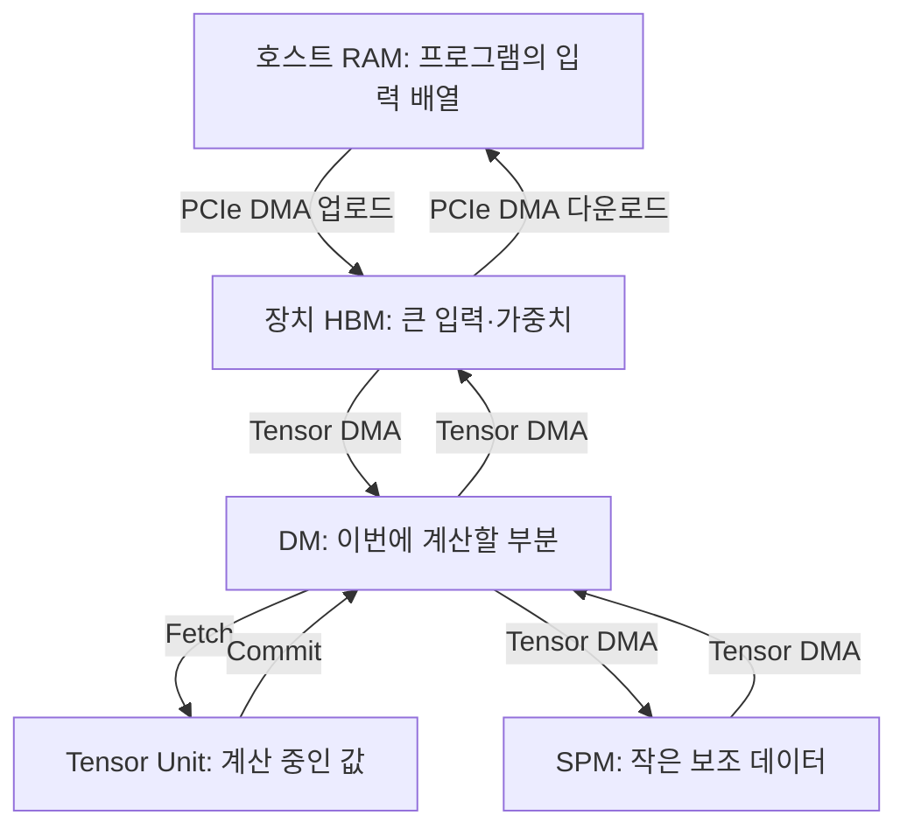
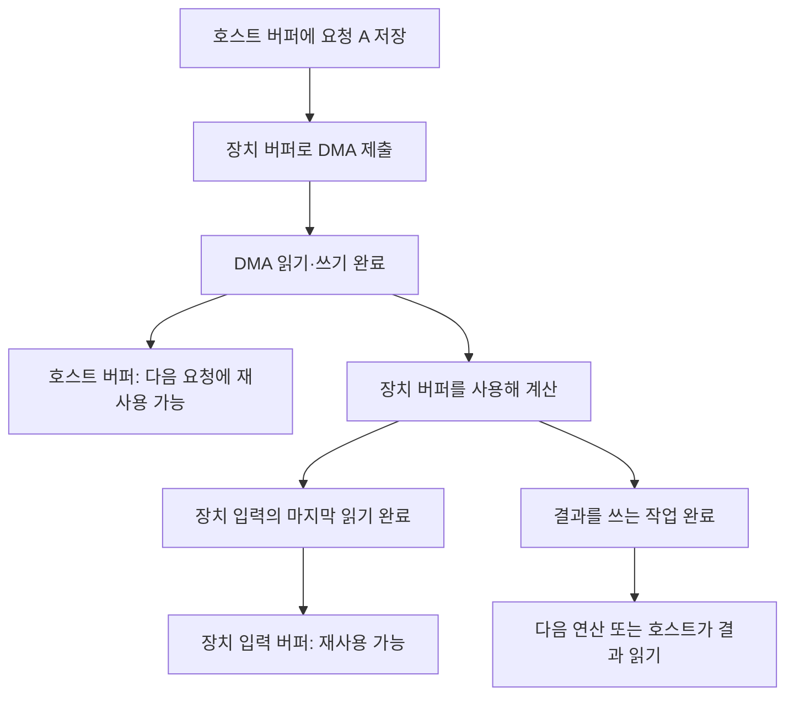

# 메모리와 DMA: 배열의 값·주소·이동을 구분하기

**계산할 값이 맞아도, 그 값을 읽는 주소와 사용 시점이 틀리면 결과가 틀린다.** NPU(Neural Processing Unit)를 다룰 때 메모리가 어려워지는 이유는 CPU(Central Processing Unit) 쪽 배열, 카드의 큰 메모리, 계산 가까이의 메모리가 따로 있기 때문이다. 이 장은 여섯 숫자가 든 배열에서 시작해 `reshape`, 전치, 주소 계산, 장치 전송과 버퍼 수명을 연결한다.

## 1. `reshape(2, 3)`은 무엇을 하는가

먼저 숫자 여섯 개를 만든다. **Shape(형상)**는 각 축의 길이이며, 길이 6인 1차원 배열의 shape는 `(6,)`이다. `reshape`는 원소의 총수를 유지하면서 이 값을 어떤 모양으로 읽을지 바꾸는 함수다. `reshape(2, 3)`은 **2행 3열로 읽겠다**는 뜻이다. 새로 곱셈이나 덧셈을 수행하는 연산은 아니다. [NumPy reshape 계약](https://numpy.org/doc/stable/reference/generated/numpy.reshape.html)

```python
import numpy as np  # CPU에서 숫자 배열과 메모리 표현을 살펴보기 위해 사용한다.

# arange(start, stop)는 start부터 stop 직전까지 만든다. 따라서 값은 1~6이다.
# float32는 원소 하나가 4바이트인 부동소수점 형식이다.
flat = np.arange(1, 7, dtype=np.float32)

# 6개 값을 2행×3열로 해석한다. 이 연속 배열에서는 원래 저장 공간을 공유한다.
x = flat.reshape(2, 3)

# 같은 6개를 3행×2열로 해석할 수도 있다. 원소의 총수 6은 유지된다.
reshaped = flat.reshape(3, 2)
print(x)          # [[1., 2., 3.], [4., 5., 6.]]
print(reshaped)   # [[1., 2.], [3., 4.], [5., 6.]]
```

`2×3=6`, `3×2=6`이므로 두 변환이 가능하다. `reshape(4,2)`는 8칸을 요구하므로 이 6개짜리 배열에는 사용할 수 없다. `reshape(-1,3)`처럼 한 차원에 `-1`을 쓰면 전체 원소 수에서 그 길이를 계산한다. 여기서는 `6÷3=2`이므로 `(2,3)`이 된다. `-1`은 축 길이가 음수라는 뜻이 아니다.

**값의 재해석과 메모리 복사도 구분한다.** 위처럼 가능한 경우에는 같은 저장 공간을 공유하는 **view(뷰)**를 만든다. 그러나 원래 배열의 저장 순서와 요청한 모양에 따라 reshape에 복사가 필요할 수도 있다. 따라서 함수 이름만으로 “항상 공짜인 메타데이터 변경”이라고 판단하지 않는다. [reshape의 view·copy 설명](https://numpy.org/doc/stable/reference/generated/numpy.reshape.html)

## 2. `reshape`와 전치는 결과부터 다르다

**전치(transpose)**는 행과 열처럼 축의 역할을 바꾸는 연산이다. 2차원 배열의 `x.T`는 새 배열의 `[열,행]`이 원래 배열의 `[행,열]`을 읽게 한다. 원래 첫 행 `[1,2,3]`은 결과의 첫 열이 된다. [NumPy transpose](https://numpy.org/doc/stable/reference/generated/numpy.transpose.html)

```python
# 앞 절의 x는 [[1,2,3],[4,5,6]], shape는 (2, 3)이다.
xt = x.T  # 행·열의 역할을 교환한다: (2, 3) → (3, 2).
print(xt)
# [[1., 4.],
#  [2., 5.],
#  [3., 6.]]
```

| 결과 | shape | 행 순서로 읽은 값 |
|---|---|---|
| 원본 `x` | `(2,3)` | `[1,2,3]`, `[4,5,6]` |
| `x.reshape(3,2)` | `(3,2)` | `[1,2]`, `[3,4]`, `[5,6]` |
| `x.T` | `(3,2)` | `[1,4]`, `[2,5]`, `[3,6]` |

뒤의 두 결과는 shape가 같지만 **어느 값이 어느 칸에 있는지가 다르다.** 모델이 전치를 요구하는 곳에서 shape만 맞추려고 reshape를 사용하면 다른 계산이 된다. 반대로 올바른 전치 view를 만들었더라도 다음 연산기가 그 저장 순서를 읽을 수 있는지 확인해야 한다. 수학적 값과 하드웨어가 읽을 표현은 두 개의 검사다.

## 3. stride를 보면 주소 계산이 보인다

**Stride(스트라이드)**는 한 축의 인덱스를 1 늘렸을 때 주소를 얼마나 이동할지 나타낸다. NumPy의 `strides` 단위는 **바이트**다. float32는 값 하나가 4바이트이므로, 행부터 연속으로 저장한 `(2,3)` 배열은 다음 행으로 이동할 때 `3×4=12`바이트, 다음 열로 이동할 때 4바이트를 건너뛴다. 따라서 `x.strides == (12,4)`다. [NumPy ndarray의 주소·stride](https://numpy.org/doc/stable/reference/arrays.ndarray.html)

`x[1,2]`의 주소는 `시작 주소 + 1×12 + 2×4`, 즉 시작에서 20바이트 떨어진 곳이다. 값 6이 들어 있는 여섯 번째 원소의 위치와 일치한다. C에서 배열 주소를 계산하는 원리와 같다.

전치 view `xt`는 원본 저장 공간을 읽는 방향을 바꾸므로 stride가 `(4,12)`다. `xt[0,1]`은 시작에서 12바이트 떨어진 값 4를 읽는다. 여기에 **contiguous(연속 배치)**가 필요한 소비자가 있다면, 값을 새 순서로 실제 복사할 수 있다.

```python
# ascontiguousarray는 xt의 '논리적 값'을 유지하며 C 순서로 연속 배치한다.
# 이 xt는 C 순서 연속 배열이 아니므로 여기서는 실제 복사가 필요하다.
packed = np.ascontiguousarray(xt)

for name, value in [("x", x), ("xt", xt), ("packed", packed)]:
    # shape: 축 길이, strides: 축별 주소 증가 바이트 수,
    # c_contiguous: 행부터 읽는 C 순서로 연속 배치됐는지 확인한다.
    print(name, value.shape, value.strides, value.flags.c_contiguous)

# 값은 같아야 한다. 배열의 저장 방법만 달라지는 실험이다.
np.testing.assert_array_equal(xt, packed)
# 이 예에서 xt는 x의 저장 공간을 공유하지만 packed는 별도 공간을 사용한다.
print(np.shares_memory(x, xt), np.shares_memory(x, packed))  # True, False
```

| 배열 | shape | 바이트 stride | C 순서 연속 여부 |
|---|---|---|---|
| `x` | `(2,3)` | `(12,4)` | 참 |
| `xt` | `(3,2)` | `(4,12)` | 거짓 |
| `packed` | `(3,2)` | `(8,4)` | 참 |

`xt`와 `packed`는 모두 `[[1,4],[2,5],[3,6]]`이다. 그러나 `xt`의 첫 행은 원본에서 떨어져 있는 두 위치를 읽고, `packed`의 첫 행은 새 저장 공간의 이웃한 두 위치를 읽는다. **Layout(메모리 배치)이 다르다**는 말을 이 예에서는 그렇게 해석하면 된다. [연속 배열 생성](https://numpy.org/doc/stable/reference/generated/numpy.ascontiguousarray.html), [저장 공간 공유 확인](https://numpy.org/doc/stable/reference/generated/numpy.shares_memory.html)

> PyTorch의 `Tensor.stride()`는 원소 개수 단위이고, 이 예의 NumPy `strides`는 바이트 단위다. 같은 숫자로 바로 비교하지 않는다. 예를 들어 float32에서 3원소 stride는 12바이트다. [PyTorch stride 계약](https://docs.pytorch.org/docs/2.10/generated/torch.Tensor.stride.html)

### 같은 작은 값을 여러 행에 더할 때: broadcasting

모델에는 각 출력 행에 같은 보정값을 더하는 계산도 있다. `x + [10,20,30]`은 첫 행에만 더하는 것이 아니라 두 행 모두에 적용된다. 이런 크기 확장 규칙을 **broadcasting(브로드캐스팅)**이라고 한다. NumPy는 오른쪽 축부터 길이를 비교해, 같거나 한쪽이 1인 축을 맞춘다. `(2,3)`과 `(3,)`에서는 뒤의 길이 3을 맞추고 앞의 행 방향에 같은 값을 적용할 수 있다. [NumPy broadcasting 규칙](https://numpy.org/doc/stable/user/basics.broadcasting.html)

```python
bias = np.array([10, 20, 30], dtype=np.float32)  # 열마다 더할 값, shape (3,).
y = x + bias  # 두 행에 같은 bias를 적용한다. 결과 shape는 (2, 3)이다.
print(y)      # [[11., 22., 33.], [14., 25., 36.]]
```

수학적으로 반복 적용한다는 것과 메모리에 bias 사본을 행 수만큼 실제 생성한다는 것은 다르다. 장치 컴파일러도 반복해서 쓸 값을 어떻게 공급할지 결정한다. 다만 **NumPy의 shape broadcasting 규칙**과 **RNGD의 하드웨어 broadcast 배치**는 서로 다른 계층의 계약이다. 전자가 가능하다고 후자의 모든 배치가 유효한 것은 아니다.

## 4. NPU에서는 주소에 장치 위치가 더해진다

호스트 배열은 시작 주소와 stride로 값을 찾았다. RNGD에서는 그 값이 **어느 칩, 어느 cluster, 어느 slice의 어느 위치에 있는지**도 선택해야 한다. Cluster는 칩 안의 PE 묶음이다. PE(Processing Element)는 큰 실행 단위이고, slice는 그 안의 작은 병렬 데이터 처리 단위다. 장치 위치와 논리적 인덱스를 연결하는 규칙이 **mapping(매핑)**이다.

다음은 개념을 보여 주기 위해 두 slice만 그린 예다. 실제 Rust 커널이 요구하는 활성 단위 수·정렬·패딩 조건을 표현한 설정은 아니다.

| 원소의 논리적 인덱스 | 방법 A: 앞·뒤 절반으로 나누기 | 방법 B: 짝수·홀수로 나누기 |
|---|---|---|
| 0 | slice 0, 지역 위치 0 | slice 0, 지역 위치 0 |
| 1 | slice 0, 지역 위치 1 | slice 1, 지역 위치 0 |
| 4 | slice 1, 지역 위치 0 | slice 0, 지역 위치 2 |
| 7 | slice 1, 지역 위치 3 | slice 1, 지역 위치 3 |

두 방법 모두 같은 8개 값을 표현한다. 그러나 인덱스 `0,1,2,3`을 함께 사용할 연산과 `0,2,4,6`을 함께 사용할 연산은 선호하는 공급 방식이 다를 수 있다. 앞 연산이 방법 A로 결과를 만들었는데 다음 연산은 방법 B를 요구한다면, 인덱스 이름만 바꾸어서는 해결되지 않는다. 필요한 곳으로 값을 실제로 옮기거나 읽는 경로를 바꿔야 한다. 공개 vISA(Virtual Instruction Set Architecture)의 메모리 타입은 이런 물리 차원을 따로 적는다. [물리 차원과 저장 위치](https://github.com/furiosa-ai/furiosa-opt/blob/3d43bc9d20f324af60e3006c3f1541938d7f5097/docs/src/mapping-tensors/spatial-temporal-dimensions.md)

## 5. DMA는 어디서 어디로 무엇을 옮기는가

**DMA(Direct Memory Access)**는 CPU가 원소마다 복사 명령을 반복하는 대신 전송 엔진에 데이터 이동을 맡기는 방식이다. CPU·런타임이 전송을 준비하고 완료를 관리하는 일까지 없어지지는 않는다. **호스트(host)**는 NPU를 제어하는 CPU 쪽 시스템, **장치(device)**는 여기서는 RNGD다.

HBM(High Bandwidth Memory)은 카드의 큰 메모리, DM(Data Memory)은 계산할 값을 준비하는 칩 내부 메모리다. **Tensor Unit**은 DM에서 읽은 값을 여러 연산 엔진을 거쳐 처리하는 칩 내부 계산 파이프라인이다. **Fetch**는 DM에서 그 계산 흐름으로 값을 읽고, **Commit**은 계산 결과를 DM에 저장한다. 아래의 서로 다른 화살표를 구분하는 것이 출발점이다.



공식 **Moving Tensors**의 경계를 한국어로 재구성했다. SPM(Scratchpad Memory)은 여기서 인덱스 같은 보조 데이터를 둘 때 사용하는 메모리다. PCIe(Peripheral Component Interconnect Express)는 호스트와 카드의 연결이다. [원본 이동 경계](https://github.com/furiosa-ai/furiosa-opt/blob/3d43bc9d20f324af60e3006c3f1541938d7f5097/docs/src/moving-tensors/index.md) · [라이선스](../assets/licenses/furiosa-opt-Apache-2.0.txt) · [원저작자 고지](../assets/licenses/furiosa-opt-NOTICE.txt)

공개 Rust 경로에서는 다음처럼 타입이 위치를 드러낸다. 표는 해당 경로의 API(Application Programming Interface)를 설명하며 Python SDK의 메서드 이름을 뜻하지 않는다.

| 시작 → 도착 | 공개 경로 | 호출의 의미 |
|---|---|---|
| 호스트 → HBM | `HostTensor::to_hbm`, `Device::pdma` | 호스트 배열을 카드 메모리로 보낸다. |
| HBM → 호스트 | `HbmTensor::to_host`, `Device::pdma` | 장치 결과를 호스트가 사용할 배열로 가져온다. |
| HBM → DM | `HbmTensor::to_dm`, `Device::tdma` | 계산 가까이에 사용할 부분을 준비한다. |
| DM → HBM | `DmTensor::to_hbm`, `Device::tdma` | 칩 내부 결과를 큰 장치 메모리에 옮긴다. |
| DM → 계산 흐름 → DM | `begin`·`fetch`·`commit` | 메모리에 있는 값으로 계산을 진행하고 다시 저장한다. |

앞의 두 호스트 전송은 비동기 I/O(Input/Output)다. `await`는 그 전송의 완료를 기다려 다음 코드가 준비된 데이터를 사용하도록 연결한다. 커널 내부 명령도 제출과 실제 완료가 구분되므로, 관련 버퍼를 완료 전까지 유지해야 한다. [DMA API](https://github.com/furiosa-ai/furiosa-opt/blob/3d43bc9d20f324af60e3006c3f1541938d7f5097/docs/src/moving-tensors/dma-engine.md), [순서·수명 계약](https://github.com/furiosa-ai/furiosa-opt/blob/3d43bc9d20f324af60e3006c3f1541938d7f5097/docs/src/moving-tensors/index.md#keep-transfers-ordered)

### 주소를 하나씩 계산하는 대신 sequencer를 준비한다

**Sequencer(시퀀서)**는 반복 범위와 주소 증가량으로 읽기·쓰기 주소를 차례로 만드는 장치 기능이다. `for row`와 `for col`에서 주소를 계산하는 일을 떠올리면 된다. `x`를 읽는 쪽은 행 증가 12바이트·열 증가 4바이트, 전치한 연속 결과를 쓰는 쪽은 다른 증가량을 사용할 수 있다. 읽는 순서와 쓰는 순서를 달리하면 데이터 이동과 함께 배치도 바꿀 수 있다.

Furiosa의 DMA는 출발·도착 mapping으로 이러한 주소 발생 규칙을 만든다. 이때 **목적지의 mapping을 가진 새 값을 만드는 것**과 **원본 객체의 의미를 바꾸는 것**을 구분한다. 앞에서 `xt`와 `packed`를 나눴던 이유가 장치 경로에서도 이어진다. [공식 sequencer와 DMA 재배치](https://github.com/furiosa-ai/furiosa-opt/blob/3d43bc9d20f324af60e3006c3f1541938d7f5097/docs/src/moving-tensors/dma-engine.md)

## 6. 작은 복사를 많이 하면 왜 느릴 수 있는가

전송은 시작 준비에도 시간이 든다. 첫 근사로 `전송 시간 ≈ 제출·시작 시간 + 바이트 수 ÷ 유효 대역폭`이라고 생각할 수 있다. **대역폭(bandwidth)**은 초당 옮길 수 있는 데이터 양이다. 아래는 차이를 이해하기 위한 가상 수치이며 RNGD의 실측값이 아니다.

가정: 전송 한 번을 시작하는 비용이 10마이크로초이고, 1 kB를 옮기는 데 1마이크로초가 든다고 하자. 여기의 kB는 1,000바이트다.

| 같은 100 kB를 보내는 방법 | 계산 | 전체 시간 |
|---|---|---:|
| 1 kB씩 100번 | `(10 + 1) × 100` | 1,100 µs |
| 100 kB 한 번 | `10 + 100` | 110 µs |

옮긴 바이트 수는 같지만 시작 비용을 100번 냈는지 한 번 냈는지가 다르다. 따라서 작은 tensor마다 업로드·실행·다운로드를 반복하는 구조에서는, 연산 자체를 조금 빠르게 만들어도 전체 시간이 크게 줄지 않을 수 있다. 다만 요청을 모으느라 기다린 시간이나 더 큰 버퍼 비용도 함께 측정해야 한다.

### 복사와 계산을 겹친다는 뜻

아래 조절 도구에서 `D`는 DMA 복사 구간, `C`는 계산 구간이다. 예를 들어 한 묶음 복사에 3 ms, 계산에 5 ms가 걸리고 묶음이 네 개라면 완전히 직렬로 실행할 때 `4×(3+5)=32 ms`다. 별도 버퍼를 사용해 다음 묶음의 복사를 현재 계산과 겹칠 수 있는 이상적 조건에서는 첫 복사·계산 8 ms 뒤에 5 ms마다 한 결과가 끝나 `8+3×5=23 ms`가 된다.

<!-- interactive:dma -->

**Tile(타일)**은 큰 배열을 나눠 한 번에 처리하는 작은 묶음이다. 겹침을 만들려면 계산 중인 타일과 다음에 복사할 타일이 서로의 데이터를 덮어쓰면 안 된다. 두 버퍼를 번갈아 쓰는 **double buffering(이중 버퍼링)**이 한 방법이다. 장치의 실제 엔진·메모리 경쟁과 제출 비용 때문에 모든 작업이 이 이상적 시간에 도달하는 것은 아니다. [공식 메모리 이동·스케줄 전제](https://github.com/furiosa-ai/furiosa-opt/blob/3d43bc9d20f324af60e3006c3f1541938d7f5097/docs/src/moving-tensors/index.md)

## 7. 정렬·bank·채널이 성능에 영향을 주는 이유

### 정렬: 요청이 하드웨어 전송 단위의 경계를 넘는가

**Alignment(정렬)**는 시작 주소나 크기를 장치가 처리하는 단위에 맞추는 것이다. 공개 HBM 문서는 256바이트 전송 단위를 설명한다. 주소 240부터 32바이트를 읽으면 `240~255`와 `256~271`로 두 단위에 걸친다. 전체 데이터가 작아도 내부 요청은 나뉠 수 있다.

쓰기는 더 까다롭다. 256바이트 중 일부만 바꾸려면 나머지를 보존하기 위해 기존 단위를 읽고, 일부를 고치고, 다시 쓸 수 있다. 이를 **RMW(Read-Modify-Write)**라고 한다. 시작 주소가 정렬돼 있어도 마지막 조각의 크기가 전송 단위를 채우지 않으면 부분 쓰기가 남을 수 있다. 그래서 시작 주소만 보는 것으로 끝나지 않는다. [HBM 정렬·부분 쓰기](https://github.com/furiosa-ai/furiosa-opt/blob/3d43bc9d20f324af60e3006c3f1541938d7f5097/docs/src/moving-tensors/memory-performance.md#misaligned-access)

### Bank: 메모리 안에서도 접근이 한곳에 몰릴 수 있다

**Bank(뱅크)**는 메모리 내부에서 접근을 나눠 처리하는 구획이다. 개념을 보기 위해 4개 bank에 주소를 번갈아 배치한다고 가정하자. 원소 위치 `0,1,2,3`을 읽으면 bank `0,1,2,3`으로 분산된다. `0,4,8,12`를 읽으면 모두 bank 0에 몰릴 수 있다. 연산기를 여러 개 켜도 같은 bank를 기다리면 이득이 줄어든다.

실제 고정 문서의 DM slice는 16개 bank와 8바이트 폭을 설명한다. 위 4-bank 예는 원리 설명이며 실제 주소 비트식을 대체하지 않는다. HBM의 **channel(채널)**도 병렬 전송에 사용하는 통로다. **Interleaving(교차 분산)**은 연속 요청을 여러 bank·채널에 나눠 한 통로에 몰리지 않게 하는 배치다. [DM bank·HBM 채널 설명](https://github.com/furiosa-ai/furiosa-opt/blob/3d43bc9d20f324af60e3006c3f1541938d7f5097/docs/src/moving-tensors/memory-performance.md)

특정 잘못된 접근은 느려지는 데서 끝나지 않을 수 있다. 공식 문서는 우선순위가 높은 Fetch·Commit이 같은 DM bank를 계속 사용해 DMA가 장시간 기다리는 경우, NoC(Network-on-Chip, 칩 내부 연결망) timeout과 복구가 필요할 수 있다고 설명한다. 따라서 저수준 mapping을 수정할 때는 먼저 지원 조건을 지키고, 이후 trace에서 대기를 확인한다. 문서의 특정 패턴에 대한 감속 배수를 사용자 모델 전체의 예상 감속률로 옮기지 않는다. [Bank starvation의 조건](https://github.com/furiosa-ai/furiosa-opt/blob/3d43bc9d20f324af60e3006c3f1541938d7f5097/docs/src/moving-tensors/memory-performance.md#bank-starvation)

## 8. 할당한 버퍼는 언제 다시 쓸 수 있는가

**Buffer(버퍼)**는 데이터를 넣기 위해 확보한 메모리 영역이다. **할당(allocation)**은 그 영역을 확보하는 일이고, **해제**는 더는 사용하지 않음을 알리는 일이다. 비동기 작업에서는 Python 함수나 Rust 함수가 반환돼도 장치가 그 버퍼를 계속 읽고 있을 수 있다.

요청 A의 입력 버퍼를 전송 중인데 요청 B의 값으로 덮어쓰면, 장치가 A의 앞부분과 B의 뒷부분을 읽는 오류가 생길 수 있다. 계산 결과가 나오기 전에 다음 연산이 읽는 것도 같은 종류의 문제다. 여기서는 **업로드 원본인 호스트 버퍼**와 **장치 계산이 읽는 장치 버퍼**의 수명을 나누어 봐야 한다.



호스트 원본은 DMA가 마지막으로 읽은 뒤, 장치 입력은 계산이 마지막으로 읽은 뒤에 재사용할 수 있다. 위 그림은 호스트 쪽 재사용을 전송 전체 완료로 확인하는 보수적인 예다. SDK가 더 긴 소유권·수명 계약을 요구하거나 완료를 더 큰 작업 단위로만 알린다면 해당 계약을 따라야 한다.

핵심은 **각 버퍼의 마지막 사용자가 끝났는가**다. 메모리를 공유하는 **alias(별칭)**가 있거나 제출된 작업이 소유권을 갖고 있으면, 지역 변수 하나를 지웠다고 실제 메모리를 즉시 재사용할 수 있는 것은 아니다. 공개 runtime은 제출한 작업이 끝날 때까지 관련 메모리를 유지하고 충돌하는 접근의 순서를 관리하는 계약을 설명한다. [Runtime의 수명·충돌 보장](https://github.com/furiosa-ai/furiosa-opt/blob/3d43bc9d20f324af60e3006c3f1541938d7f5097/furiosa-opt-rt/README.md)

### Pinned memory와 장치 주소

호스트의 가상 주소를 숫자로 바꿔 장치에 넘기는 것만으로 DMA가 읽을 수 있는 버퍼가 되지는 않는다. 운영체제의 가상 메모리와 장치가 사용하는 주소 변환을 연결해야 한다. **Pinned memory(핀 고정 메모리)**와 등록 절차는 전송 중 장치가 참조할 메모리의 접근 가능성과 수명을 유지하는 데 사용된다.

공개 `Device::map()`은 pinned memory를 장치 전송에 사용할 수 있도록 등록한다. 한편 `mmap()`으로 장치의 제어 영역을 매핑하는 것은 레지스터·큐 등을 접근하기 위한 경로일 수 있다. **전송할 숫자 배열을 등록하는 일**과 **장치를 제어하는 주소 영역을 매핑하는 일**을 구별하자. [장치 버퍼 등록](https://github.com/furiosa-ai/furiosa-opt/blob/3d43bc9d20f324af60e3006c3f1541938d7f5097/furiosa-opt-rt/src/device/mod.rs), [제어 영역 매핑](https://github.com/furiosa-ai/furiosa-opt/blob/3d43bc9d20f324af60e3006c3f1541938d7f5097/furiosa-opt-rt/src/driver/kernel/map.rs)

## 9. 48 GB 카드에서 몇 GB 할당이 실패하는 이유

물리 카드의 전체 용량과 지금 프로그램이 할당할 수 있는 용량은 다를 수 있다. 예를 들어 현재 allocator가 약 6 GiB를 관리하는 실행 범위라면, 카드 전체에 더 큰 메모리가 있어도 그 allocator에 8 GiB를 한 번에 요청하는 것은 실패할 수 있다. 이 수치는 원리를 보여 주는 예이며 모든 SDK 설정의 고정 분할 규칙을 뜻하지 않는다.

확인은 다음 순서로 나누면 된다.

| 확인할 범위 | 질문 |
|---|---|
| 물리 용량 | 카드에 장착된 메모리는 얼마나 되는가? |
| 현재 실행 범위 | 어느 PE 집합·인스턴스에 접근하는가? |
| 할당 가능 용량 | 예약분을 뺀 allocator의 관리 범위는 얼마인가? |
| 살아 있는 버퍼 | 가중치·입력·중간값·출력·진행 중 작업이 얼마를 붙잡는가? |
| 이번 요청 조건 | 요구 크기와 정렬을 만족하는 공간이 있는가? |

GiB(Gibibyte)는 `2³⁰`바이트, GB(Gigabyte)는 십진 표기에서는 `10⁹`바이트다. 제품의 `48 GB`와 도구의 용량 표시는 단위와 집계 범위를 함께 읽는다. 두 숫자를 단순히 서로의 환산값이라고 가정하지 않는다.

공개 opt runtime의 `capacity()`는 관리하는 메모리 종류의 할당 가능 범위를, `usage()`는 사용 상태를 확인하는 지점이다. 아래는 **NPU와 호환된 opt runtime이 있는 환경에서 실행하는 Rust 예제**다. 이 핸드북 편집 환경에서는 장치 실행하지 않았다. [Device·allocator API](https://github.com/furiosa-ai/furiosa-opt/blob/3d43bc9d20f324af60e3006c3f1541938d7f5097/furiosa-opt-rt/src/device/mod.rs)

```rust
use furiosa_opt_rt::{Device, Result, Topology, memory::Kind};

fn main() -> Result<()> {
    // 이 API에서 칩 1개와 PE 8개를 사용하는 장치 객체를 준비한다.
    // Python SDK의 set_fusion과 같은 함수라고 해석하지 않는다.
    let device = Device::new(Topology { chips: 1, pes: 8 })?;

    // Dram은 이 runtime이 구분하는 장치 메모리 종류다. 단위는 바이트다.
    println!("capacity bytes = {}", device.capacity(Kind::Dram));

    // 4 MiB = 4×1024×1024바이트를 실제로 요청한다. 실패하면 ?로 오류를 반환한다.
    let sample = device.alloc(Kind::Dram, 4 * 1024 * 1024)?;
    println!("sample allocation succeeded");

    // 이 예는 장치 작업에 버퍼를 제출하지 않았다. 소유권을 놓아 해제 가능하게 한다.
    drop(sample);
    Ok(())
}
```

SMI(System Management Interface)의 메모리 집계와 이 allocator의 집계 범위는 다를 수 있다. 할당 실패를 **OOM(Out Of Memory)**이라고 부르더라도 어느 범위의 부족인지 기록해야 진단할 수 있다.

## 10. 무엇을 반복문 밖으로 옮길 것인가

다음은 구조 설명용 Python 의사코드다. `upload`, `launch_and_wait`, `download`는 실제 SDK 함수가 아니다. 여기서는 완료를 기다리는 함수라고 정의해 수명 문제와 재사용 문제를 분리했다.

```python
# 매 요청마다 같은 프로그램과 가중치를 다시 준비하는 구조.
for request in requests:
    program = load_program(binary)     # 변하지 않는 실행 프로그램을 매번 적재한다.
    weights_on_device = upload(weights)  # 같은 가중치도 매번 장치로 복사한다.
    input_on_device = upload(request)  # 이번 요청의 입력은 새로 필요하다.
    result = launch_and_wait(program, input_on_device, weights_on_device)
    answer = download(result)          # 장치 계산 완료 뒤 결과를 가져온다.
```

```python
# 모델과 실행 조건이 같다면 고정 자원을 한 번 준비해 재사용하는 구조.
program = load_program(binary)          # 프로그램 적재를 반복문 밖에서 한 번 수행한다.
weights_on_device = upload(weights)     # 가중치도 한 번 올려 장치에 유지한다.
for request in requests:
    input_on_device = upload(request)  # 바뀐 입력만 전달한다.
    result = launch_and_wait(program, input_on_device, weights_on_device)
    answer = download(result)
```

두 번째 구조는 반복 준비를 줄이지만 그만큼 메모리를 계속 사용한다. 여러 모델을 번갈아 실행한다면 유지할 가중치를 선택해야 한다. 여러 커널이 이어질 때도 중간값을 CPU로 내려받았다가 다시 올리는 대신 장치 안에서 넘길 수 있는지 살펴본다. 다만 **다음 커널이 같은 값·shape·배치를 기대하는지**, **앞선 쓰기가 완료됐는지**를 확인해야 한다.

증상을 보면 관찰할 곳도 달라진다. 전송 횟수가 많으면 시작 비용, 전치 이후 느려지면 stride와 재배치, 엔진을 늘려도 그대로면 공유 메모리 경쟁을 의심할 수 있다. 이는 진단 후보이며 로그 없이 원인을 확정하는 규칙은 아니다. 호스트의 NUMA(Non-Uniform Memory Access) 위치와 PCIe 연결도 비용을 바꿀 수 있다. `furiosa-smi topo`는 어느 경로에 연결돼 있는지 확인하는 출발점이다. [호스트 메모리·PCIe 튜닝 근거](https://developer.furiosa.ai/v2026.4.0/en/device_management/host_tuning.html)

## CPU에서 메모리 표현을 직접 확인하기

[array_layout.py](../examples/array_layout.py)는 이 장의 `reshape`, 전치, stride, 연속 복사, broadcasting 예제를 한 파일에 모았다. NumPy가 설치된 환경에서 `python examples/array_layout.py`로 실행한다. 모양이 같아도 값의 배치가 다른 경우, 값은 같아도 저장 공간을 공유하지 않는 경우를 각각 확인한다. 원소 수가 맞지 않는 `reshape(4, 2)`가 실패하는 예도 포함했다.

## 출처

| 근거 | 본문에서 설명한 내용 |
|---|---|
| [NumPy reshape](https://numpy.org/doc/stable/reference/generated/numpy.reshape.html) · [transpose](https://numpy.org/doc/stable/reference/generated/numpy.transpose.html) | 원소 수 보존, 모양 변경과 축 교환의 차이 |
| [ndarray](https://numpy.org/doc/stable/reference/arrays.ndarray.html) · [ascontiguousarray](https://numpy.org/doc/stable/reference/generated/numpy.ascontiguousarray.html) · [shares_memory](https://numpy.org/doc/stable/reference/generated/numpy.shares_memory.html) | stride·주소 계산·view와 복사 |
| [NumPy broadcasting](https://numpy.org/doc/stable/user/basics.broadcasting.html) · [PyTorch stride](https://docs.pytorch.org/docs/2.10/generated/torch.Tensor.stride.html) | 반복 적용 규칙, stride 단위의 차이 |
| [Moving Tensors](https://github.com/furiosa-ai/furiosa-opt/blob/3d43bc9d20f324af60e3006c3f1541938d7f5097/docs/src/moving-tensors/index.md) · [DMA Engine](https://github.com/furiosa-ai/furiosa-opt/blob/3d43bc9d20f324af60e3006c3f1541938d7f5097/docs/src/moving-tensors/dma-engine.md) | 메모리 경계·전송·sequencer·순서와 수명 |
| [Memory Performance](https://github.com/furiosa-ai/furiosa-opt/blob/3d43bc9d20f324af60e3006c3f1541938d7f5097/docs/src/moving-tensors/memory-performance.md) | 전송 정렬, DM bank, HBM 채널과 접근 제약 |
| [공간·시간 차원](https://github.com/furiosa-ai/furiosa-opt/blob/3d43bc9d20f324af60e3006c3f1541938d7f5097/docs/src/mapping-tensors/spatial-temporal-dimensions.md) | 논리 인덱스와 물리 위치의 mapping |
| [Device 구현](https://github.com/furiosa-ai/furiosa-opt/blob/3d43bc9d20f324af60e3006c3f1541938d7f5097/furiosa-opt-rt/src/device/mod.rs) · [장치 영역 Mapping](https://github.com/furiosa-ai/furiosa-opt/blob/3d43bc9d20f324af60e3006c3f1541938d7f5097/furiosa-opt-rt/src/driver/kernel/map.rs) | 용량·할당·등록·mmap |
| [Runtime 보장](https://github.com/furiosa-ai/furiosa-opt/blob/3d43bc9d20f324af60e3006c3f1541938d7f5097/furiosa-opt-rt/README.md) | 충돌·완료·메모리 수명 |
| [Host PCI 튜닝](https://developer.furiosa.ai/v2026.4.0/en/device_management/host_tuning.html) | 호스트 측 경로 |
