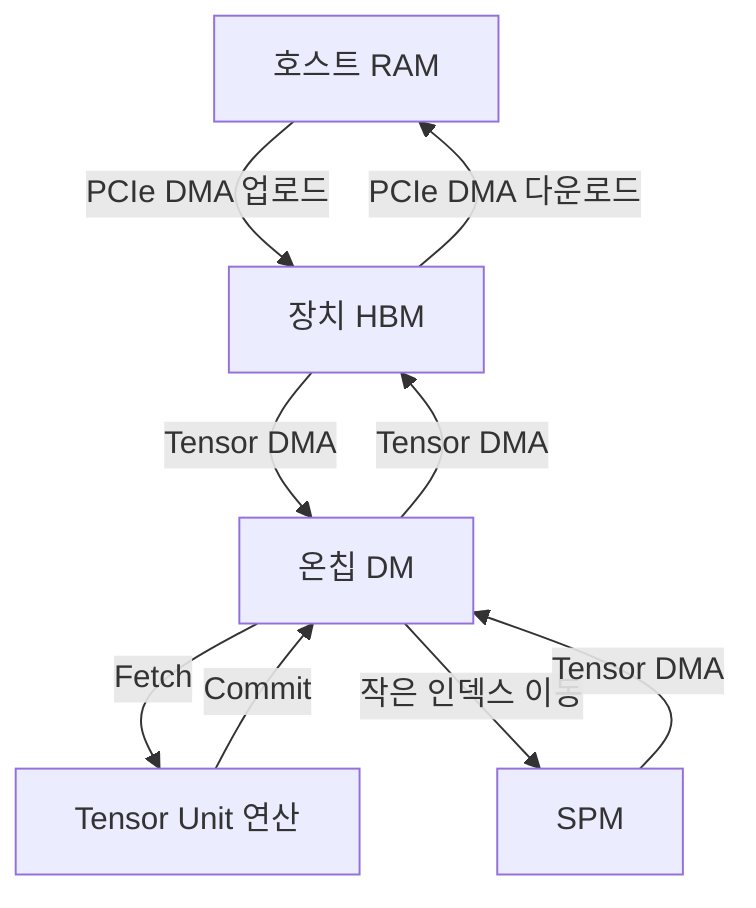

# 메모리와 DMA: 계산보다 먼저 확인할 데이터 이동

모델이 NPU 메모리에 들어갔다고 해서 연산 준비가 모두 끝난 것은 아니다. 입력을 호스트에서 옮기고, HBM(High Bandwidth Memory)에 놓고, 연산에 맞는 DM(Data Memory) 배치로 바꾸고, 결과가 준비될 때까지 의존성을 지켜야 한다. **DMA(Direct Memory Access)는 CPU가 모든 원소를 직접 복사하는 대신 전송 엔진이 메모리 이동을 수행하는 방식**이다. 전송을 제출하고 완료를 관리하는 비용까지 사라지는 것은 아니다.

## 1. 어디서 어디로 이동하는가



공개 Rust 경로에서는 호스트 전송에 `device.pdma`, 장치 내부 이동에 `device.tdma`를 사용한다. `HostTensor`의 `to_hbm()`과 `HbmTensor`의 `to_host()`는 비동기 I/O다. HBM↔DM 이동은 물리적으로 다른 경로이며 destination mapping에 따라 재배치도 일어난다. [DMA Engine](https://developer.furiosa.ai/furiosa-opt/book/moving-tensors/dma-engine.html)

SPM(Scratchpad Memory)은 작은 보조 데이터를 두는 메모리다. 예를 들어 gather에 필요한 인덱스를 올바른 PE에 두는 데 쓰인다. TRF(Tensor Register File)·VRF(Vector Register File)는 각각 contraction·vector 연산의 피연산자를 반복 공급한다. 이 계층을 모두 `NPU 메모리`라고만 부르면, 복사가 어디에서 발생하는지 놓치기 쉽다. [메모리 표현과 배치](https://github.com/furiosa-ai/furiosa-opt/blob/3d43bc9d20f324af60e3006c3f1541938d7f5097/docs/src/mapping-tensors/spatial-temporal-dimensions.md)

## 2. shape는 같아도 stride와 mapping은 다를 수 있다

`shape`는 각 논리 축의 길이, `stride`는 해당 축의 인덱스를 한 칸 늘릴 때 메모리 주소가 얼마나 움직이는지를 나타낸다. 장치의 `mapping`은 여기서 더 나아가 값을 chip·cluster·slice·lane 또는 시간 반복에 어떻게 분배하는지 기술한다.

```python
# CPU 예제: 원소 수가 같다는 사실만으로 저장 순서가 같지는 않다.
import numpy as np

x = np.arange(24, dtype=np.float32).reshape(4, 6)
xt = x.T
packed = np.ascontiguousarray(xt)
for name, value in [("x", x), ("xt", xt), ("packed", packed)]:
    print(name, value.shape, value.strides, value.flags.c_contiguous)
```

`xt`는 논리적 전치 view이고, `packed`는 같은 값을 새로운 연속 배치에 복사한 결과다. NPU에서도 **view 메타데이터 변경**과 **실제 데이터 재배치**를 구별해야 한다. 전자의 비용으로 후자를 설명하면 성능 추정이 틀린다. vISA의 DMA는 출발·도착 mapping에서 전송 sequencer를 생성한다. Sequencer는 반복 범위·주소 증가량에 따라 데이터를 읽고 쓰는 장치 측 주소 생성기다. [DMA sequencer 설명](https://developer.furiosa.ai/furiosa-opt/book/moving-tensors/dma-engine.html)

## 3. 대역폭, 시작 비용, 정렬을 따로 계산하자

전송 시간을 이해하는 첫 근사는 `T ≈ 제출·시작 비용 + 전송 바이트 / 유효 대역폭`이다. 이 식은 교육용 모델이며 측정 도구가 아니다. 작은 전송을 많이 하면 시작 비용이 누적되고, 큰 전송도 정렬·bank 충돌·채널 편중 때문에 유효 대역폭이 줄 수 있다.

<!-- interactive:dma -->

공식 Memory Performance 문서는 HBM의 256-byte 정렬, 채널 분산, DM bank 접근 패턴을 구체적으로 설명한다. 일부 잘못된 접근에서는 단순한 속도 저하를 넘어 NoC(Network on Chip) timeout이 생길 수 있다. 문서에 제시된 배수는 해당 접근 패턴의 조건부 사례이므로 모델 전체의 예상 감속률로 사용하지 않는다. [Memory Performance](https://developer.furiosa.ai/furiosa-opt/book/moving-tensors/memory-performance.html)

| 증상 | 우선 의심할 것 | 다음 관찰 |
|---|---|---|
| 큰 전송 한 번보다 작은 전송 수천 번이 느림 | 반복적인 제출·시작 비용 | 전송 횟수와 크기 분포 |
| 원소 수는 같은데 전치 후 느려짐 | 비연속 접근·재배치 | 전송 sequencer·stride |
| 여러 엔진을 켰는데 처리량이 그대로임 | 같은 HBM 채널·DM bank 경쟁 | 스케줄의 메모리 대기 |
| 장치 사용률이 간헐적으로 떨어짐 | 호스트 준비·동기화·전송·실제 계산의 틈 | CPU 시간과 NPU 실행 구간을 함께 기록 |
| 할당 시 실패함 | 자원 분할·최대 연속 공간·live buffer 합계 | PE 설정, allocator 용량과 사용량 |

표는 FuryNo5 개발자의 진단 순서 제안이다. 어느 행도 로그 없이 확정할 수 있는 원인은 아니다.

## 4. 48 GB 카드에서 몇 GB 할당이 실패하는 이유

확인 순서를 나누면 혼동이 줄어든다.

1. **물리 용량**: 카드에 장착된 HBM의 사양.
2. **현재 실행 범위**: 사용 중인 PE 집합·장치 인스턴스·mesh 설정.
3. **할당 가능 용량**: 드라이버·펌웨어·런타임 예약분을 제외한 범위.
4. **현재 live 용량**: 가중치, 중간 텐서, 결과, 진행 중 전송이 붙잡고 있는 공간.
5. **한 번의 할당 조건**: 요구된 크기를 수용하는 연속 범위·정렬·메모리 종류.

`furiosa-opt-rt::Device::capacity()`는 할당 가능 범위를, `usage()`는 allocator의 현재 사용 상태를 노출한다. 버퍼를 버려도 실행 중 작업이 마지막 소유권을 갖고 있으면 즉시 재사용 가능한 공간이 되지 않는다. [Device와 allocator 계약](https://github.com/furiosa-ai/furiosa-opt/blob/3d43bc9d20f324af60e3006c3f1541938d7f5097/furiosa-opt-rt/src/device/mod.rs)

```rust
// furiosa-opt main 3d43bc9 기준의 API 사용 예. NPU 필요.
use furiosa_opt_rt::{Device, Result, Topology, memory::Kind};

fn main() -> Result<()> {
    let device = Device::new(Topology { chips: 1, pes: 8 })?;
    println!("capacity bytes = {}", device.capacity(Kind::Dram));
    let sample = device.alloc(Kind::Dram, 4 * 1024 * 1024)?;
    println!("sample allocation succeeded");
    drop(sample);
    Ok(())
}
```

이 예는 실제 버퍼 한 개를 요청한다. `furiosa-smi`의 집계와 allocator 관측의 범위가 다를 수 있으므로 한 숫자로 다른 숫자를 대체하지 않는다. 프로젝트에서 보았던 큰 할당 실패를 `카드 전체 OOM(Out Of Memory)`이라고 단정하기 전에 실행 설정과 계약을 함께 기록해야 한다.

## 5. 핀 고정과 장치 주소

DMA에 전달할 호스트 메모리는 전송이 끝날 때까지 접근 가능한 상태여야 한다. Pinned memory는 해당 메모리의 수명과 접근 가능성을 유지하는 데 사용한다. 가상 주소를 정수로 바꾸는 것만으로 장치에서 읽을 수 있는 주소가 되지는 않는다.

공개 runtime 구현의 `Device::map()`은 pinned memory를 등록하고 전송 descriptor를 준비한다. `driver/kernel/map.rs`의 `Mapping`은 장치 노드가 노출한 영역을 `mmap()`으로 매핑한다. **DMA용 데이터 버퍼와 제어 레지스터의 메모리 매핑은 역할이 다르다.** [Pinned 등록](https://github.com/furiosa-ai/furiosa-opt/blob/3d43bc9d20f324af60e3006c3f1541938d7f5097/furiosa-opt-rt/src/device/mod.rs), [장치 영역 매핑](https://github.com/furiosa-ai/furiosa-opt/blob/3d43bc9d20f324af60e3006c3f1541938d7f5097/furiosa-opt-rt/src/driver/kernel/map.rs)

## 6. 느린 루프와 재사용하는 루프

다음은 Python의 **개념 의사코드**다. `upload`나 `launch`는 이 장에서 제공하는 실제 SDK 함수 이름이 아니다. 어느 객체를 반복문 밖으로 옮겨야 하는지 보여준다.

```python
# 개념 의사코드: 매 요청마다 가중치와 프로그램을 다시 준비한다.
for request in requests:
    program = load_program(binary)
    weights_on_device = upload(weights)
    input_on_device = upload(request)
    result = launch(program, input_on_device, weights_on_device)
    answer = download(result)
```

```python
# 개념 의사코드: 고정 자원을 재사용한다.
program = load_program(binary)
weights_on_device = upload(weights)
for request in requests:
    input_on_device = upload(request)
    result = launch(program, input_on_device, weights_on_device)
    answer = download(result)
```

한 단계 더 나아가 여러 커널 사이의 중간값을 장치에 유지하면, 다음 연산 전에 CPU로 내려받았다가 다시 올리는 왕복을 줄일 수 있다. 다만 버퍼 재사용에는 **마지막 소비가 끝났는가**라는 수명 조건이 붙는다. 비동기 호출을 빨리 반환하는 것과 결과가 안전하게 준비된 것은 다르다. 공식 runtime은 충돌하는 작업을 기다리거나 오류로 거절하고, 이미 제출된 작업이 끝날 때까지 관련 메모리를 유지한다고 설명한다. [runtime 보장](https://github.com/furiosa-ai/furiosa-opt/blob/3d43bc9d20f324af60e3006c3f1541938d7f5097/furiosa-opt-rt/README.md)

호스트 NUMA 배치와 PCIe 경로도 장치 외부의 비용이다. `furiosa-smi topo`로 연결을 확인하고, 호스트 튜닝은 해당 시스템의 공식 지침에 맞춘다. BIOS·커널 설정을 이 핸드북의 보편적인 기본값으로 제시하지 않는다. [Host PCI Optimization Tuning](https://developer.furiosa.ai/v2026.4.0/en/device_management/host_tuning.html)

## 출처

| 근거 | 이 장에서 사용한 범위 |
|---|---|
| [DMA Engine](https://developer.furiosa.ai/furiosa-opt/book/moving-tensors/dma-engine.html) | PDMA·TDMA, sequencer와 재배치 |
| [Memory Performance](https://developer.furiosa.ai/furiosa-opt/book/moving-tensors/memory-performance.html) | 정렬·bank·채널 제약 |
| [Spatial and Temporal Dimensions](https://github.com/furiosa-ai/furiosa-opt/blob/3d43bc9d20f324af60e3006c3f1541938d7f5097/docs/src/mapping-tensors/spatial-temporal-dimensions.md) | 메모리별 mapping |
| [Device 구현](https://github.com/furiosa-ai/furiosa-opt/blob/3d43bc9d20f324af60e3006c3f1541938d7f5097/furiosa-opt-rt/src/device/mod.rs) | 용량·할당·pinned 등록·수명 |
| [Mapping 구현](https://github.com/furiosa-ai/furiosa-opt/blob/3d43bc9d20f324af60e3006c3f1541938d7f5097/furiosa-opt-rt/src/driver/kernel/map.rs) | mmap, MMIO(Memory-Mapped Input/Output) |
| [Runtime 보장](https://github.com/furiosa-ai/furiosa-opt/blob/3d43bc9d20f324af60e3006c3f1541938d7f5097/furiosa-opt-rt/README.md) | 충돌·완료·실패 상태 |
| [Host PCI 튜닝](https://developer.furiosa.ai/v2026.4.0/en/device_management/host_tuning.html) | 호스트 측 경로 확인 |
