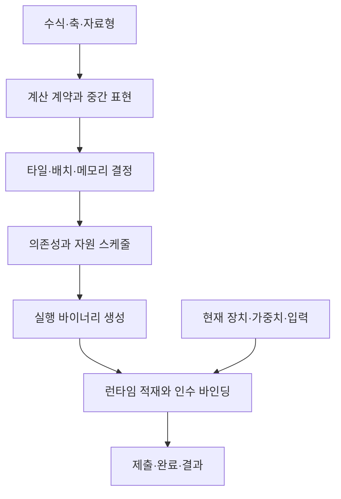
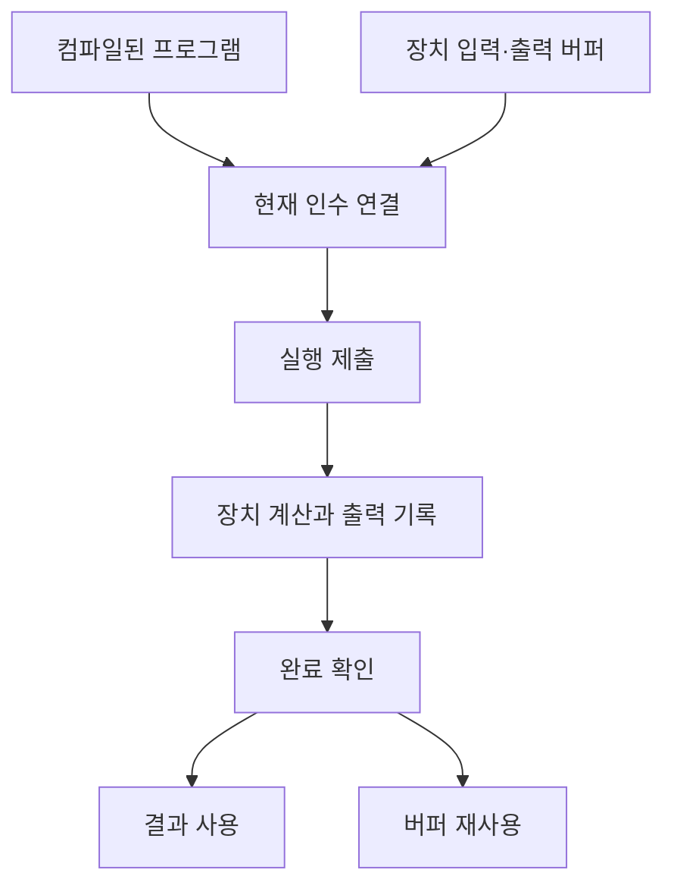
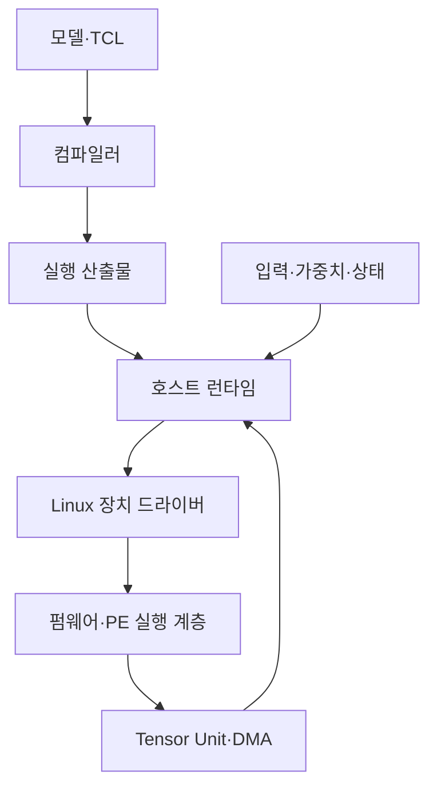

# 드라이버·컴파일러·런타임: 배열 계산 한 번이 장치에 도착하기까지

C에서 배열의 각 원소에 1을 더하는 함수를 만들었다고 하자. 함수를 **컴파일하는 일**, 실행할 때 **배열을 준비하는 일**, 함수를 **호출하고 결과를 받는 일**은 서로 다르다. NPU(Neural Processing Unit, 신경망 처리 장치)에서도 이 구분은 그대로 남는다. 여기에 CPU(Central Processing Unit)가 쓰는 메모리와 NPU가 쓰는 메모리 사이의 데이터 이동, 장치 접근 권한, 비동기 실행의 완료 확인이 추가된다.

이 장에서는 `x = [3, 7, 11, 15]`를 받아 `y = [4, 8, 12, 16]`을 만드는 계산을 끝까지 따라간다. 이 계산은 역할을 설명하기 위한 예이며, 뒤에 나오는 실제 SDK(Software Development Kit, 소프트웨어 개발 키트)의 API(Application Programming Interface)와 구분한다. Furiosa 공식 스택은 컴파일러·런타임·드라이버·장치 실행 계층을 각각 두고 있다. [공식 소프트웨어 스택](https://developer.furiosa.ai/v2026.4.0/en/overview/software_stack.html)

> **버전** · Python 예제는 SDK 2026.4 계열과 FuryNo5의 해당 API 사용을 기준으로 한다. `/v2026.4.0/` 문서 URL도 조사일에는 헤더가 2026.4.1이었다. 공개 Rust 구현은 `furiosa-opt` commit `3d43bc9`를 기준으로 한다. 이 장의 코드는 RNGD에서 새로 실행한 결과가 아니다.

## 1. 먼저 계산, 배열, 저장 공간을 분리한다

다음은 NPU 코드가 아니라 익숙한 CPU 프로그램이다.

```python
x = [3, 7, 11, 15]               # 입력: 원소 네 개
y = [value + 1 for value in x]   # 각 원소를 독립적으로 변환하며 길이는 유지한다.
assert y == [4, 8, 12, 16]
```

컴파일된 `x + 1` 프로그램을 저장했다고 해서 `x`의 현재 값까지 저장된 것은 아니다. 내일 `x = [0, 0, 0, 0]`을 넣어도 같은 계산 코드를 사용할 수 있다. **프로그램은 할 일이고, 버퍼(buffer)는 그 일이 읽거나 쓸 저장 공간이다.** 모델의 가중치도 값이며, 실행물에 포함되는지 별도로 전달되는지는 각 로더의 계약에 달려 있다.

배열을 넘길 때 필요한 정보도 값만은 아니다. 축(axis)은 행·열처럼 좌표를 구분하는 방향이다. 다음 세 가지를 구분한다.

| 정보 | 작은 예 | 왜 필요한가 |
|---|---|---|
| 형상(shape) | `[4]`는 길이 4인 벡터, `[2,2]`는 2행 2열 | 같은 원소 4개라도 어떤 좌표로 계산할지 다르다. |
| 자료형(dtype, data type) | 32비트 정수 `int32`, 16비트 부동소수점 BF16(BFloat16) | 원소당 바이트 수와 가능한 계산·오차가 달라진다. |
| 배치(layout) | 행 우선 2×3 배열은 첫 행 다음에 둘째 행을 저장 | 논리 좌표를 실제 저장 위치로 바꾸는 규칙이다. |

예를 들어 논리 배열 `[[1,2,3],[4,5,6]]`이 연속 버퍼 `[1,2,3,4,5,6]`에 있으면 좌표 `(행, 열)`의 원소 위치는 `행×3+열`이다. 한 행을 이동하면 원소 3개, 한 열을 이동하면 원소 1개만큼 이동한다. 이를 원소 단위 stride `(3,1)`이라고 부른다. 여기서 **shape가 같다는 것만으로 layout도 같다고 보장되지는 않는다.** PyTorch의 `Tensor.stride()`도 각 차원으로 한 칸 움직일 때의 저장 위치 간격을 돌려준다. [PyTorch stride 정의](https://docs.pytorch.org/docs/stable/generated/torch.Tensor.stride.html)

CPU 프로그램은 보통 운영체제가 제공한 가상 주소를 사용한다. NPU 프로그램은 장치가 접근할 수 있는 데이터와 장치 실행 자원이 필요하다. 따라서 host, 즉 NPU를 제어하는 CPU 측 프로세스가 `x`를 갖고 있다는 것만으로 장치 계산 준비가 끝나지 않는다. 런타임이 적절한 장치 저장 공간과 전송·접근 절차를 준비해야 한다. [공개 Device 구현](https://github.com/furiosa-ai/furiosa-opt/blob/3d43bc9d20f324af60e3006c3f1541938d7f5097/furiosa-opt-rt/src/device/mod.rs)

## 2. 컴파일러: 수식만으로는 정해지지 않은 일을 정한다

`y[i] = x[i] + 1`에는 원소 간 의존성이 없다. 그러나 이 수식만으로는 장치에 원소를 몇 개씩 옮길지, 어느 계산 자원에 놓을지, 입력을 읽기 전에 계산이 시작되지 않게 할지 정해지지 않는다. 컴파일러는 계산 의미를 유지하면서 이런 실행 선택을 구체화한다.

작은 배열을 두 묶음으로 나누는 **개념 예제**를 보자. 실제 RNGD의 최소 작업 단위나 최적 배치가 원소 2개라는 뜻은 아니다.

| 단계 | 첫 묶음 | 둘째 묶음 | 필요한 판단 |
|---|---|---|---|
| 나누기 | `[3,7]` | `[11,15]` | 큰 계산을 저장 공간에 맞는 작은 단위인 tile로 나눌 것인가? |
| 입력 이동 | 두 원소가 장치 계산 위치에 도착 | 다음 두 원소를 준비 | 데이터가 도착하기 전에 읽지 않도록 순서를 정한다. |
| 계산 | `[4,8]` 생성 | `[12,16]` 생성 | 어떤 계산 엔진에 일을 배치할지 정한다. |
| 결과 이동 | 첫 출력 구간에 기록 | 둘째 출력 구간에 기록 | 아직 사용 중인 입력·출력을 덮어쓰지 않는다. |

**IR(Intermediate Representation, 중간 표현)은** 이 계산을 컴파일러가 검사·변환하기 좋은 자료구조로 나타낸 것이다. 소스 문자열을 그대로 실행하는 대신, 입력 값·덧셈·출력 값과 그 연결을 표현한다고 생각하면 된다. **Lowering**은 이 표현을 더 구체적인 장치 연산과 이동으로 바꾸는 과정이다. **Mapping**은 논리 원소를 어느 장치 자원과 처리 순서에 대응시킬지 정하는 일이다. 이 정의는 일반적인 컴파일러 원리이며, 아래의 공개 근거와 구분해 읽는다.

TCL(Tensor Contraction Language)은 텐서 계산을 기술하는 언어다. 공식 TCL 소개는 tiling, scheduling, fusion, hardware mapping을 컴파일러의 책임으로 명시한다. 공식 스택은 그래프 최적화, 메모리 할당, 연산 결합, 데이터 이동 최적화도 설명한다. [TCL에서 위임하는 결정](https://furiosa.ai/blog/furiosa-sdk-2026-3-a-new-kernel-framework-and-the-models-it-unlocks), [컴파일러의 공식 역할](https://developer.furiosa.ai/v2026.4.0/en/overview/software_stack.html)

행렬곱은 출력 한 칸을 만들기 위해 여러 곱을 더한다. 여러 좌표의 값을 합쳐 그 방향을 출력에서 없애는 것이 축약(reduction)이며, 부분합에 다음 계산 결과를 계속 더하는 것이 누산(accumulation)이다. 아래 표에서는 이런 계산의 의미와 장치 실행 방법을 나누어 본다.

표에 나오는 PE(Processing Element)는 장치의 계산·메모리 자원 묶음이고, slice·lane은 그 안의 더 작은 배치 단위다. DMA(Direct Memory Access)는 전송 엔진을 이용한 메모리 이동이다. vISA(Virtual Instruction Set Architecture)는 장치에 가까운 중간 표현으로, 더 구체적인 배치·이동을 기술한다.

다음 표에서 **공식 확인**은 공개 문서·소스가 직접 설명하는 범위다. **원리 설명**은 그 책임을 개발자가 이해하도록 풀어쓴 일반적인 컴파일러 개념이다. 이 표의 행 순서는 Furiosa 비공개 컴파일러의 실제 pass 순서나 정확한 탐색 알고리즘을 재현한 것이 아니다. pass는 프로그램 표현을 검사하거나 바꾸는 하나의 처리 단계다.

| 결정 | 구체적으로 묻는 질문 | 공개 확인 범위와 원리 설명 |
|---|---|---|
| 형상·자료형·축 검증 | 두 입력이 같은 축을 축약하는가? 저장 형식과 누산 형식이 맞는가? | **공식 확인:** 공개 opt 검증은 shape·mapping 오류를 실행 전에 검사한다. **원리 설명:** 행렬곱의 `K` 길이가 맞지 않으면 좋은 스케줄을 고르는 단계 이전에 계산 계약이 성립하지 않는다. |
| IR(Intermediate Representation) 구성 | 값과 연산, 의존성, 축의 의미를 어떤 구조로 보존할 것인가? | **공식 확인:** TCL은 contraction과 축 의미를 보존하도록 설계됐고 opt는 중간 vISA를 출력한다. **원리 설명:** 컴파일러가 최적화하려면 Python 문장 순서만이 아니라 어떤 값이 누구에게 필요한지 알아야 한다. |
| Lowering | 논리 연산을 어떤 장치 엔진·데이터 경로로 표현할 것인가? | **공개 소스 확인:** `config_fetch`, `config_commit`, `config_transpose` 등의 입력·결과·오류 경계가 있다. **원리 설명:** lowering은 높은 수준의 의미를 더 구체적인 실행 표현으로 바꾸는 과정이다. |
| Fusion(연산 결합) | 인접 계산을 함께 보면 중간 저장이나 호출을 줄일 수 있는가? | **공식 확인:** TCL 커널을 결합해 하나의 단위로 컴파일할 수 있다. **원리 설명:** 이득은 데이터 재사용과 경계 감소에서 생길 수 있지만, 결합으로 동시에 보존해야 하는 중간값의 메모리와 컴파일 비용도 고려해야 한다. |
| Tiling(작은 단위로 나누기)·mapping | 큰 텐서를 얼마나 나누고, 어느 PE·slice·lane·시간 방향에 둘 것인가? | **공식 확인:** TCL은 이런 선택을 컴파일러에 위임하며 vISA에서는 더 직접 표현한다. **원리 설명:** 같은 연산량이라도 데이터를 반복해서 읽는지, 자원을 얼마나 채우는지가 달라진다. |
| 메모리 배치·수명 | 값을 어느 메모리에 둘 것인가? 마지막 사용 뒤 공간을 재사용할 수 있는가? | **공식 확인:** 메모리 할당 최적화와 스케줄의 메모리 의존성 관리가 설명돼 있다. **원리 설명:** 아직 소비되지 않은 값을 덮어쓰지 않으면서 저장 공간을 재사용하는 문제가 생긴다. 특정 내부 allocator나 liveness pass의 이름은 확인하지 않았다. |
| 명령·DMA 스케줄 | 무엇을 먼저 하고 무엇을 겹칠 수 있는가? | **공식 확인:** 공개 scheduler 설명은 데이터 의존성과 공유 자원 제약을 보존하며 main·sub·DMA context를 배치한다고 설명한다. **원리 설명:** 다음 입력 전송을 계산과 겹쳐도, 계산이 아직 읽는 버퍼를 덮어써서는 안 된다. |
| Code generation(실행 코드 생성) | 선택한 계산·이동·제어를 무엇으로 저장할 것인가? | **공식 확인:** TCL은 EDF(Executable Device Format) 실행 바이너리로 컴파일된다. **공개 경계:** SDK EDF의 모든 section과 명령 encoding을 이 책에서 확인한 것은 아니다. |

형상 검증과 EDF 이름은 [Kernel Validation](https://github.com/furiosa-ai/furiosa-opt/blob/3d43bc9d20f324af60e3006c3f1541938d7f5097/docs/src/quick-start/kernel-validation.md), lowering 경계는 [공개 lowering interface](https://github.com/furiosa-ai/furiosa-opt/blob/3d43bc9d20f324af60e3006c3f1541938d7f5097/furiosa-opt-lower/src/lowering/mod.rs), 메모리·자원 순서의 제약은 [공식 scheduling 설명](https://github.com/furiosa-ai/furiosa-opt/blob/3d43bc9d20f324af60e3006c3f1541938d7f5097/docs/src/scheduling/schedule.md)을 근거로 한다.

### 행렬곱에서는 무엇이 추가되는가

`left[M,K] × right[K,N] → output[M,N]`에서 M은 왼쪽 행 수, K는 두 입력이 공유하는 곱셈·합산 길이, N은 오른쪽 열 수다. 출력 한 칸은 K개의 곱을 더한다. 이 표기는 계산 의미를 정한다. 개발자가 `M=32, K=128, N=64`를 정하면 입력과 출력의 크기를 알 수 있지만, 그 사실만으로 **어느 메모리에서 어느 타일을 읽고, 언제 부분합을 저장하며, 어떤 전송을 겹칠지**까지 결정된 것은 아니다. 이것이 컴파일러에 맡기는 부분이다. 반대로 사용자가 vISA로 메모리와 mapping을 이미 지정한 경우에는 컴파일러가 선택할 수 있는 범위와 검사해야 할 제약이 달라진다. [TCL과 vISA의 역할](https://furiosa.ai/developers), [mapping의 공간·시간 차원](https://github.com/furiosa-ai/furiosa-opt/blob/3d43bc9d20f324af60e3006c3f1541938d7f5097/docs/src/mapping-tensors/spatial-temporal-dimensions.md)

예를 들어 입력을 읽기 전에 계산을 시작할 수 없고, 누산이 끝나기 전에 최종 결과를 내보낼 수도 없다. 그러나 의존성이 없는 다음 타일의 전송은 현재 타일 계산과 겹칠 여지가 있다. 다음 그림은 **이런 결정 관계를 설명하는 모형**이며 특정 compiler pass의 출력 순서를 복제한 것이 아니다.



### 공개된 검증과 공개되지 않은 선택 알고리즘

공개 저장소가 있다고 해서 전체 compiler 구현까지 모두 읽을 수 있는 것은 아니다. `furiosa-opt-lower/src/lib.rs`는 엔진의 제약 검증 함수는 공개하지만, 일부 lowering 알고리즘은 미리 빌드한 비공개 `furiosa-opt-lower-impl` 정적 라이브러리를 호출하는 wrapper라고 명시한다. 따라서 “이 mapping을 왜 거절하는가”를 공개 코드로 설명할 수 있는 부분과 “가능한 mapping 중 왜 이 결과를 선택했는가”를 확인할 수 없는 부분이 공존한다. [공개·비공개 구현 경계](https://github.com/furiosa-ai/furiosa-opt/blob/3d43bc9d20f324af60e3006c3f1541938d7f5097/furiosa-opt-lower/src/lib.rs)

구체적으로 `verify/engine/contraction/time.rs`의 `config_contract_time()`은 축약 후 남는 축의 순서와 padding 보존을 검사하고 구분된 오류를 낸다. 이런 오류는 장치가 실행하다 발견할 문제를 컴파일·검증 단계에서 드러내는 예다. 이 코드 하나로 TCL의 전체 shape checker나 모든 최적화 pass가 공개됐다고 확대하지 않는다. [Time Reducer 제약 검증](https://github.com/furiosa-ai/furiosa-opt/blob/3d43bc9d20f324af60e3006c3f1541938d7f5097/furiosa-opt-lower/src/verify/engine/contraction/time.rs)

## 3. 런타임: 이번 호출의 프로그램과 데이터를 연결한다

C에서 이미 컴파일한 `add_one(int *x, int *y, size_t n)`을 호출할 때도 실제 `x`, `y`, `n`을 전달해야 한다. NPU 런타임의 **binding(바인딩)도** 이와 비슷한 역할을 한다. 저장된 프로그램이 기대하는 입력·출력 자리에 **이번 호출에서 사용할 장치 버퍼와 값**을 연결한다. 입력 순서, 형상, 자료형, 장치 배치가 프로그램의 계약과 맞아야 한다.

다음 표의 값은 같은 `x + 1` 예를 추적한 것이다. 실제 API의 내부 구현 순서를 단정하는 표가 아니라, 비용과 오류 위치를 구분하기 위한 실행 수명이다.

| 시점 | 준비된 것 | 아직 끝나지 않은 것 |
|---|---|---|
| Compile(컴파일) | 길이 4의 정수에 1을 더하는 장치 실행물 | 현재 입력 값, 장치 버퍼, 결과 |
| Load(적재) | 호환 장치에서 사용할 실행 객체 | 이번 입력의 전달과 호출 |
| 입력 준비 | 장치가 읽을 `x=[3,7,11,15]`, 출력 저장 공간 | 덧셈 수행 |
| Bind(인수 연결) | 프로그램의 입력·출력 자리에 실제 버퍼 연결 | 실행 완료 |
| Submit(제출) | 런타임이 실행 요청을 받아 처리할 수 있는 상태 | 장치가 계산과 기록을 마쳤다는 보장 |
| Completion(완료) | 출력 `[4,8,12,16]`을 사용할 수 있다는 완료 조건 | CPU에서 읽으려면 필요한 결과 전송·대기 |

여기서 가장 자주 생기는 버그는 **제출을 완료로 착각하는 것**이다. 비동기 호출에서는 CPU 함수가 돌아온 뒤에도 NPU가 입력을 읽고 있을 수 있다. 입력 버퍼를 곧바로 다음 요청의 데이터로 덮어쓰면, 앞 요청이 바뀐 값을 읽는 문제가 생길 수 있다. 결과를 사용하거나 버퍼를 재사용할 수 있는 시점은 해당 런타임의 완료·소유권 계약을 따라야 한다. 공개 Rust 런타임도 함수 제출과 완료, 인수·출력의 수명을 구분한다. [함수 실행 구현](https://github.com/furiosa-ai/furiosa-opt/blob/3d43bc9d20f324af60e3006c3f1541938d7f5097/furiosa-opt-rt/src/function/mod.rs)



실행물과 가중치를 계속 장치에 둔 채 여러 요청에 재사용하면 반복 적재 비용을 줄일 수 있다. 이처럼 살아 있는 객체·데이터를 유지하는 것을 resident 상태라고 부른다. 대신 그동안 장치 메모리를 점유하므로 용량과 수명 관리가 필요하다. 첫 요청의 시간과 반복 요청의 시간을 나누어 재야 하는 이유가 여기에 있다.

컴파일된 실행물은 계산 방식의 많은 결정을 보존하지만, **현재 프로세스가 어느 장치를 얻었는지, 실제 입출력 버퍼 주소가 무엇인지, 어느 가중치·요청 상태를 연결할지**는 로딩과 호출 시점의 문제다. 이를 binding이라고 부른다. 저장된 프로그램에 현재의 값·버퍼·장치 자원을 연결하는 일이다. 파일을 읽는 일, 장치에 적재하는 일, 인수를 바인딩하는 일, 실행을 제출하는 일을 나눠 보면 첫 요청이 느린 이유도 더 정확히 진단할 수 있다. 실제 SDK 호출별 구분은 [4장의 EDF 적재 절차](04-tcl-edf.md), 공개 Rust 이미지의 구성과 적재는 [8장](08-eisa-visa.md)에 이어진다.

| 시점 | 발생할 수 있는 작업 | 재사용할 수 있는 대상 |
|---|---|---|
| 개발·빌드 | 그래프 캡처, lowering, 커널 컴파일 | 컴파일된 커널·일치하는 메타데이터 |
| 프로세스 시작 | 호환성 확인, 이미지 로딩, 가중치 준비 | 같은 프로세스의 resident 객체 |
| 새 형상 선택 | 버킷 선택, 입력 패딩, 바인딩 | 사전 컴파일된 같은 버킷 |
| 매 요청 | 입력 전송, 제출, 결과·상태 처리 | 고정 가중치·버퍼·실행 준비 |

이 표는 비용을 분석하는 분류다. 특정 SDK가 모든 항목을 반드시 매 요청마다 수행한다는 주장은 아니다. 프로파일에서 어느 구간에 실제 시간이 쓰였는지 기록해야 한다.

`furiosa-opt`는 컴파일·최적화 도구이며 `furiosa-opt-rt`는 실행 런타임이다. SDK의 `furiosa.torch.ir.Runnable`과 이름이 비슷한 개념을 갖더라도, **두 Python/Rust 객체가 같은 함수나 동일 바이너리 ABI를 쓴다고 볼 공개 근거는 없다.** 각각의 loader·image·tensor binding 계약을 따라야 한다. [Kernel Optimizer](https://github.com/furiosa-ai/furiosa-opt/blob/3d43bc9d20f324af60e3006c3f1541938d7f5097/docs/src/tools/kernel-optimizer.md), [SDK Runnable 실제 사용](https://github.com/smallstep-zzz/FuryNo5/blob/bba9efea8201aec48150514a35d0b637d29d107e/tplmachine/direct_runtime.py)

## 4. 드라이버와 장치 실행 계층의 책임

| 층 | 입력과 출력 | 대표적인 책임 | 이 층에 맡기면 안 되는 추측 |
|---|---|---|---|
| 모델·서비스 | 사용자 입력 → 모델 호출 | 전처리, 요청 정책, 결과 해석 | 모델 구조를 모르는 드라이버가 대신 추론한다고 생각하기 |
| 컴파일러 | 그래프·TCL → 실행 산출물 | 분해, fusion, 배치, 메모리·명령 스케줄 | 컴파일 성공을 수치 정확성 증명으로 보기 |
| 호스트 런타임 | 실행 산출물·버퍼 → 제출·완료 | 로딩, 자원 배치, 입출력 바인딩, 수명·오류 관리 | 실행 산출물이 없으면 모든 모델을 자동 CPU 실행한다고 보기 |
| 커널 드라이버 | 장치 노드·시스템 호출 | 장치 발견·권한·매핑·전송 인터페이스 | Python 레이어나 토크나이저를 처리한다고 보기 |
| 펌웨어·PERT(PE Runtime, Processing Element 실행 계층) | 장치 명령·메시지 | PE(Processing Element) 실행·자원·호스트 통신 | 호스트의 서비스 스케줄러와 동일하다고 보기 |

공식 스택 문서는 이 책임을 개념적으로 설명한다. `furiosa-llm` 네이티브 구현의 모든 내부 함수가 공개되어 있지는 않으므로, 아래에서 **공개 소스로 따라갈 수 있는 Rust 경로**와 **공식 문서로 확인하는 SDK 경로**를 구분한다. [공식 스택](https://developer.furiosa.ai/v2026.4.0/en/overview/software_stack.html)



## 5. 실제 코드로 장치 상태를 확인한다

관찰 목적이라면 먼저 SMI(System Management Interface)를 사용한다. SDK 2026.4에서는 Python 패키지가 `furiosa-smi-py`에서 `furiosa-smi`로 바뀌었다. 초기화 함수를 가정하지 않고 현재 문서의 `furiosa_smi` API를 사용한다. [SMI Python API](https://developer.furiosa.ai/v2026.4.0/en/device_management/system_management_interface/furiosa_smi_lib.html)

```python
import furiosa_smi

# 모델 실행이 아니라 설치된 드라이버 정보를 읽는 관찰 API다.
driver = furiosa_smi.driver_info()
print({"driver": str(driver)})
# 각 장치의 이름·펌웨어·소비전력을 기록해 실행 환경을 구분한다.
for item in furiosa_smi.list_devices():
    print({
        "device": item.device_name(),
        "firmware": str(item.firmware_version()),
        "power_w": item.power_consumption(),
    })
```

재현 기록에는 Python 패키지와 장치 소프트웨어의 버전을 따로 남긴다.

```python
from importlib.metadata import version, PackageNotFoundError

# Python 패키지 버전은 장치 드라이버·펌웨어 버전과 별도로 기록한다.
for name in ("torch", "furiosa-torch", "furiosa-tcc", "furiosa-llm", "furiosa-smi"):
    try:
        print(name, version(name))
    except PackageNotFoundError:
        print(name, "not installed")
```

```bash
furiosa-smi version
furiosa-smi info --format full
furiosa-tcc --version
```

패키지를 설치했다고 장치 노드·드라이버·펌웨어가 자동으로 모두 호환된다는 뜻은 아니다. 설치·업그레이드는 공식 prerequisite와 release note의 조합에 맞춘다. 예를 들어 2026.4 공식 공지는 대응 RNGD 드라이버 업데이트를 요구한다. [2026.4 발표](https://forums.furiosa.ai/t/furiosa-sdk-2026-4-0-release/489), [설치 전제조건](https://developer.furiosa.ai/v2026.4.0/en/get_started/prerequisites.html)

## 6. 더 아래로 내려가면 어떤 코드가 있는가

| 소스 파일 | 핵심 역할 | 읽을 때 확인할 것 |
|---|---|---|
| `furiosa-opt-rt/src/device/mod.rs` | `Device::new`, 할당, 전송, 동기화 | 어떤 장치를 열고 누가 메모리를 소유하는가 |
| `furiosa-opt-rt/src/driver/chip.rs` | 노드 개방, 예약, peer 연결 | 권한·다중 장치·PDMA 지원 확인 |
| `furiosa-opt-rt/src/registry/load/mod.rs` | 컴파일 이미지 로딩 | 이미지의 ABI와 배치 조건 |
| `furiosa-opt-rt/src/function/mod.rs` | 함수 제출과 완료 | 인수·출력 수명, 실패 전파 |
| `furiosa-opt-rt/src/driver/mailbox.rs` | 요청과 응답 연결 | 어느 제출의 응답인지 식별 |
| `furiosa-opt-rt/src/driver/link.rs` | ring과 doorbell | 호스트·장치 메시지 이동 |

여기서 mailbox는 요청을 응답과 매칭하는 계층, ring은 순환 큐, doorbell은 상대에게 새 일이 있음을 알리는 장치 통지 수단이다. `furiosa-opt-rt` README는 이 계층과 `furiosa-opt-ipc`, `furiosa-opt-abi`의 역할을 공개한다. [런타임 계층표](https://github.com/furiosa-ai/furiosa-opt/blob/3d43bc9d20f324af60e3006c3f1541938d7f5097/furiosa-opt-rt/README.md)

이 경로는 **실행할 이미지가 이미 있는 경우의 경로**다. `registry::load`에 임의 모델 파일을 넣으면 컴파일까지 해 주는 구조가 아니다. 고수준의 `furiosa-opt-std::launch`를 쓰면 아래 런타임을 직접 다룰 필요가 줄지만, 병목을 분석할 때는 이 층들이 중요해진다.

### 드라이버의 ioctl 경계

`furiosa-opt-rt/src/driver/kernel/mod.rs`에서 장치 노드 기본 경로 `/dev/rngd`와 ioctl(Input/Output Control) payload를 확인할 수 있다. `PeWindow`, `DmaMap`, `GroupConfig`는 PE 주소 범위, DMA 등록, 여러 장치의 연결 정보를 전달하는 내부 구조체다. 이 파일은 **해당 런타임 구현의 내부 인터페이스**이며 독립적으로 안정성이 보장되는 사용자 SDK라고 선언하지 않는다. [커널 인터페이스 정의](https://github.com/furiosa-ai/furiosa-opt/blob/3d43bc9d20f324af60e3006c3f1541938d7f5097/furiosa-opt-rt/src/driver/kernel/mod.rs)

아래는 소스의 중요한 선언 두 줄에 설명 주석을 추가한 발췌다. ioctl 번호만 복사해 새 드라이버 호출기를 만드는 예제는 아니다.

```rust
// PE 메모리 창의 계약을 담는 구조체를 주고받는 내부 ioctl 선언이다.
nix::ioctl_readwrite!(set_window, b'N', 0x03, PeWindow);
// DMA 접근 등록에 필요한 구조체를 전달한다. payload 없이 번호만 호출할 수 없다.
nix::ioctl_readwrite!(dma_map, b'N', 1, DmaMap);
```

실제 호출에는 장치 파일 descriptor, ABI(Application Binary Interface)와 일치하는 구조체, 소유권·예약 상태, 버전 호환성이 모두 필요하다. `driver/chip.rs`는 장치 노드를 열고 예약·물리 식별·peer window를 준비한다. `driver/kernel/map.rs`는 BAR(Base Address Register) 영역 등의 메모리 매핑을 맡는다. [칩 개방과 예약](https://github.com/furiosa-ai/furiosa-opt/blob/3d43bc9d20f324af60e3006c3f1541938d7f5097/furiosa-opt-rt/src/driver/chip.rs), [mmap 구현](https://github.com/furiosa-ai/furiosa-opt/blob/3d43bc9d20f324af60e3006c3f1541938d7f5097/furiosa-opt-rt/src/driver/kernel/map.rs)

## 7. Furiosa-LLM이 추가하는 요청과 상태 관리

Furiosa-LLM은 LLM(Large Language Model, 대규모 언어 모델) 추론을 위한 엔진이다. 글을 입력하면 tokenizer가 이를 토큰이라는 정수 단위로 바꾼다. **Prefill**은 받은 입력 토큰들을 처리하여 첫 출력을 만들 준비를 하는 단계이고, **decode**는 이미 계산한 상태를 재사용하며 이후 토큰을 생성하는 단계다. **KV(Key–Value) cache**는 attention 계산에 다시 필요한 이전 토큰의 key·value 값을 보관하는 저장 공간이다.

예를 들어 길이 3의 입력을 처리한 뒤 한 토큰을 생성했다고 하자. 다음 계산에서는 입력 전체를 처음부터 다시 처리하기보다 이전 세 토큰의 KV를 사용하고 새 토큰의 계산을 더할 수 있다. 여러 사용자에게서 이런 요청이 동시에 들어오면, 어떤 요청들을 함께 실행하고 각 요청의 KV를 어디에 둘지 결정해야 한다. Furiosa-LLM은 요청 묶기, prefill·decode 진행, KV 관리, 토큰 선택, API(Application Programming Interface) 응답 생성을 담당한다. 장치가 계산하는 컴파일 커널과, 다음에 어떤 요청을 실행할지 결정하는 서비스 정책이 함께 필요하다. [Furiosa-LLM 개요](https://developer.furiosa.ai/v2026.4.0/en/overview/software_stack.html)

공식 FXB(Furiosa Executable Bundle)는 compiled kernels를 제공하고, 모델 디렉터리는 설정·토크나이저·가중치를 제공한다. `--fxb`는 모델 전체를 대체하는 인수가 아니다. [공식 FXB 사용](https://developer.furiosa.ai/v2026.4.0/en/furiosa_llm/fxb.html)

```bash
# 호환되는 공식 FXB가 준비된 SDK 환경에서 실행한다.
furiosa-llm serve Qwen/Qwen3-8B-FP8 --fxb ./qwen3-8b-fp8.fxb
```

```python
from furiosa_llm import LLM

# 모델 설정·토크나이저·가중치 경로와 사전 컴파일된 공식 번들을 함께 지정한다.
engine = LLM("Qwen/Qwen3-8B-FP8", fxb="./qwen3-8b-fp8.fxb")
```

여기에서 드라이버로 이어지는 관계는 공식 스택의 역할 설명까지 확인된다. **FuryNo5의 임의 EDF와 임의 실행계획을 등록하는 공개 Furiosa-LLM 확장 ABI**는 이 근거만으로 확인되지 않는다. 공식 FXB를 받을 수 있다는 사실과 모든 독자 포맷을 받을 수 있다는 주장은 다르다. 이 제약 때문에 fxbX의 전용 실행 경로와 `furiosa-opt-vllm`의 별도 엔진 경로를 뒤에서 다룬다.

## 8. 오류를 단계에 맞춰 읽는다

다음처럼 실패한 **단계와 관찰한 사실**을 먼저 기록한다. 오류 메시지 없이 원인을 추측해서 설정을 바꾸면 서로 다른 문제를 섞기 쉽다.

| 관찰 | 먼저 볼 대상 | 이것만으로 말할 수 없는 것 |
|---|---|---|
| EDF 파일 읽기에서 `FileNotFoundError` | 경로·빌드 산출물 | NPU가 연산을 지원하는지 여부 |
| 행렬곱의 두 K 길이가 다르다고 컴파일 거절 | 입력 형상·커널 선언 | 장치 드라이버의 정상 여부 |
| 장치를 열지 못함 | 드라이버·권한·예약·호환 버전 | 모델 수식이 잘못됐다는 결론 |
| 실행은 끝났지만 값이 다름 | 입력 순서·shape·dtype·layout·수치 오차 | 무조건 하드웨어 고장이라는 결론 |

컴파일 거절은 모델 의미·자료형·배치·lowering 문제일 수 있다. 장치 열기 실패는 드라이버·권한·예약·호환성 문제일 수 있다. 메모리 할당 실패는 현재 실행 범위의 용량 문제일 수 있다. 실행 후 수치 불일치는 입력 계약·정밀도·커널 의미까지 점검해야 한다. 서로 다른 오류를 `NPU 미지원` 하나로 묶으면 수정 위치를 잃는다.

특히 공개 runtime은 장치 기능이 부족한 경우 명시적인 오류를 낸다. README는 firmware DMA에 필요한 PDMA 채널 예약이 지원되지 않는 드라이버에서는 해당 launch가 `Error::Unsupported`로 실패할 수 있다고 설명한다. 이는 CPU 연산 폴백이 아니다. [드라이버와 DMA 조건](https://github.com/furiosa-ai/furiosa-opt/blob/3d43bc9d20f324af60e3006c3f1541938d7f5097/furiosa-opt-rt/README.md)

## 출처

| 근거 | 확인한 내용 |
|---|---|
| [공식 소프트웨어 스택](https://developer.furiosa.ai/v2026.4.0/en/overview/software_stack.html) | 컴파일러·런타임·드라이버·PERT·LLM 역할 |
| [2026.4 release 발표](https://forums.furiosa.ai/t/furiosa-sdk-2026-4-0-release/489) | 드라이버·FXB·SMI 변경 |
| [SMI Python API](https://developer.furiosa.ai/v2026.4.0/en/device_management/system_management_interface/furiosa_smi_lib.html) | 공개 장치 관찰 API |
| [커널 인터페이스 소스](https://github.com/furiosa-ai/furiosa-opt/blob/3d43bc9d20f324af60e3006c3f1541938d7f5097/furiosa-opt-rt/src/driver/kernel/mod.rs) | 노드·ioctl 구조 |
| [Runtime README](https://github.com/furiosa-ai/furiosa-opt/blob/3d43bc9d20f324af60e3006c3f1541938d7f5097/furiosa-opt-rt/README.md) | 공개 실행 계층·DMA 조건 |
| [공식 FXB 문서](https://developer.furiosa.ai/v2026.4.0/en/furiosa_llm/fxb.html) | LLM의 공식 번들 전달 |
| [TCL 설계와 컴파일러 책임](https://furiosa.ai/blog/furiosa-sdk-2026-3-a-new-kernel-framework-and-the-models-it-unlocks) | fusion·tiling·mapping·schedule·EDF 생성 |
| [Kernel Validation](https://github.com/furiosa-ai/furiosa-opt/blob/3d43bc9d20f324af60e3006c3f1541938d7f5097/docs/src/quick-start/kernel-validation.md) | shape·mapping 검증, EDF의 공식 풀네임 |
| [Lowering 공개 경계](https://github.com/furiosa-ai/furiosa-opt/blob/3d43bc9d20f324af60e3006c3f1541938d7f5097/furiosa-opt-lower/src/lib.rs) | 공개 검증과 비공개 알고리즘의 구분 |
| [Schedule](https://github.com/furiosa-ai/furiosa-opt/blob/3d43bc9d20f324af60e3006c3f1541938d7f5097/docs/src/scheduling/schedule.md) | 데이터 의존성·context·공유 자원 제약 |
