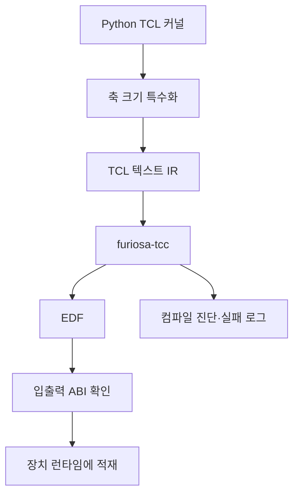
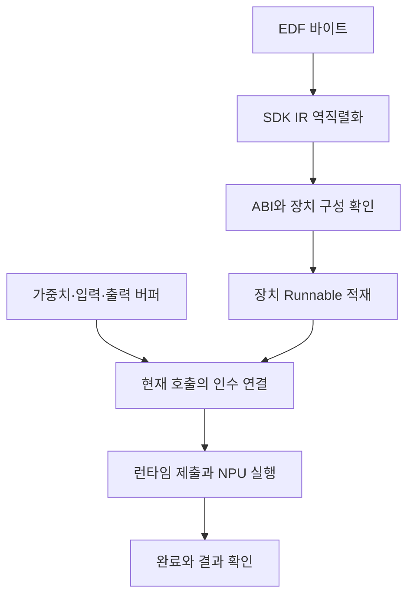

# TCL에서 EDF로: 행렬곱의 수식이 장치 프로그램이 되는 과정

컴파일러와 런타임의 역할을 구분했으니, 이번에는 직접 계산 하나를 맡겨 보자. 작은 행렬곱을 TCL로 적고 EDF를 만든 뒤 실제 입력으로 호출한다. 계산 여러 개를 잇는 일은 다음 [05장](05-graphs-fallback.md)에서 시작한다.

행렬곱의 답을 CPU에서 먼저 구해 두자. 그다음 같은 수식을 TCL로 적고, 축의 길이를 정해 컴파일한다. 만들어진 EDF를 적재하고 같은 입력을 넣으면 두 결과를 비교할 수 있다. 뒤의 예제는 이 순서로 진행한다.

TCL은 Python 안에서 쓰는 eDSL(embedded Domain-Specific Language, 내장형 도메인 전용 언어)이다. 여기서 도메인은 텐서 계산이다. Python 문법을 사용하지만, 커널의 목적은 Python 반복문을 바로 실행하는 것이 아니라 **컴파일러가 분석할 계산을 표현하는 것**이다. 이후 컴파일러가 EDF(Executable Device Format)라는 장치 실행 바이너리를 만든다. [공식 TCL 소개](https://furiosa.ai/blog/furiosa-sdk-2026-3-a-new-kernel-framework-and-the-models-it-unlocks), [EDF 명칭](https://github.com/furiosa-ai/furiosa-opt/blob/3d43bc9d20f324af60e3006c3f1541938d7f5097/docs/src/quick-start/kernel-validation.md)

## 1. 행렬곱을 숫자 네 개까지 직접 계산한다

**스칼라**는 숫자 하나, **벡터**는 숫자를 한 줄로 나열한 것, **행렬**은 행과 열이 있는 숫자 표다. 텐서(tensor)는 이처럼 차원을 가진 배열을 가리킨다. 여기서는 다음 두 행렬만 사용한다.

```python
# CPU에서 계산 의미를 확인하는 예제다. Furiosa SDK(Software Development Kit)는 사용하지 않는다.
A = [[1, 2, 3], [4, 5, 6]]       # 2행 3열: shape (M, K) = (2, 3)
W = [[1, 0], [0, 1], [1, 1]]    # 3행 2열: shape (K, N) = (3, 2)

# 출력에는 A의 행 수와 W의 열 수가 남는다: shape (M, N) = (2, 2).
C = [[0, 0], [0, 0]]
for m in range(2):               # 출력의 행을 하나 고른다.
    for n in range(2):           # 출력의 열을 하나 고른다.
        for k in range(3):       # 공통 길이 K에 걸쳐 곱한 값을 더한다.
            C[m][n] += A[m][k] * W[k][n]
assert C == [[4, 5], [10, 11]]
```

벡터 `[1,2,3]`과 `[1,0,1]`을 **원소별로 곱하면** `[1,0,3]`이다. 이를 **합산하면** 스칼라 `4`가 된다. 대응하는 원소를 곱한 뒤 전부 합산하는 연산이 **내적(dot product)이다**. 행렬곱은 왼쪽 행렬의 한 행과 오른쪽 행렬의 한 열의 내적을 출력 한 칸에 넣는 계산이다.

| 출력 좌표 | 고른 행과 열 | 원소별 곱 | 합산한 결과 |
|---|---|---|---|
| `C[0,0]` | `[1,2,3]`, `[1,0,1]` | `[1,0,3]` | `4` |
| `C[0,1]` | `[1,2,3]`, `[0,1,1]` | `[0,2,3]` | `5` |
| `C[1,0]` | `[4,5,6]`, `[1,0,1]` | `[4,0,6]` | `10` |
| `C[1,1]` | `[4,5,6]`, `[0,1,1]` | `[0,5,6]` | `11` |

이를 식으로 쓰면 `C[m,n] = Σ_k A[m,k] × W[k,n]`이다. `Σ_k`는 “k가 가질 수 있는 각 값에 대해 오른쪽 항을 계산하여 모두 더하라”는 뜻이다. 이 예에서는 k가 0, 1, 2를 돈다. **원소별 곱**은 각 좌표의 값을 개별적으로 곱하지만, **행렬곱**은 K축의 곱을 합쳐 출력 하나를 만든다. NumPy·PyTorch에서 `*`와 `@`가 서로 다른 이유다.

### 축은 좌표의 이름이고 shape는 각 축의 길이다

**축(axis)은** 배열의 좌표 방향이다. 이 예제에서 M축은 A의 행, K축은 두 입력의 공통 합산 방향, N축은 W의 열을 가리킨다. `M=2, K=3, N=2`는 각 축의 길이다. M과 N의 길이가 둘 다 2라고 해서 같은 축은 아니다. 하나는 출력 행이고 다른 하나는 출력 열이다.

출력 `C[M,N]`에는 M과 N이 남고 K가 사라진다. K에 해당하는 여러 값을 하나로 합쳤기 때문이다. 이렇게 특정 축을 따라 값을 합치는 것을 **축약(reduction)이라고** 한다. TCL 이름의 contraction은 이처럼 곱셈과 축약을 조합하는 텐서 계산을 중심에 둔다.

NumPy의 `einsum` 표기는 이 관계를 그대로 보여준다. 화살표 왼쪽은 두 입력의 축이고, 오른쪽은 출력에 남길 축이다. 아래의 소문자 m·k·n은 앞의 M·K·N과 같은 역할의 이름이다. [NumPy einsum 명시적 출력 표기](https://numpy.org/doc/stable/reference/generated/numpy.einsum.html)

```python
import numpy as np

A = np.array([[1, 2, 3], [4, 5, 6]])    # shape (2, 3)
W = np.array([[1, 0], [0, 1], [1, 1]]) # shape (3, 2)
C = np.einsum("mk,kn->mn", A, W)       # k는 출력에 없으므로 합산한다.
assert np.array_equal(C, A @ W)        # 두 표현 모두 shape (2, 2)의 행렬곱이다.
assert C.tolist() == [[4, 5], [10, 11]]
```

공유하는 축이라고 항상 축약되는 것은 아니다. `"bmk,bkn->bmn"`에서는 b가 두 입력과 출력 모두에 있으므로 b별 행렬곱을 유지한다. b는 서로 다른 문제를 한 번에 묶는 batch(배치) 축이다. 반대로 k는 출력에서 빠져 각 b의 행렬곱 내부에서 합산된다.

### reshape는 합산도 행렬곱도 아니다

`[1,2,3,4,5,6]`을 shape `(2,3)`으로 해석하면 `[[1,2,3],[4,5,6]]`, `(3,2)`로 해석하면 `[[1,2],[3,4],[5,6]]`이다. 이것이 **reshape**, 즉 원소 수를 유지하면서 배열의 차원별 길이를 바꾸는 일이다. 원소를 더하지 않으며, 행과 열을 교환하는 **transpose(전치)와도** 다르다. 전치는 첫 배열을 `[[1,4],[2,5],[3,6]]`으로 보이게 한다. reshape·전치가 실제 복사를 요구하는지는 기존 저장 배치와 API(Application Programming Interface)에 달려 있다. 이 장의 TCL 행렬곱은 축의 의미를 지정하며, 맞지 않는 K 길이를 reshape로 임의 보정하지 않는다.

## 2. Python 함수가 TCL 계산 표현이 되는 지점

Python의 `@decorator`는 함수가 정의될 때 그 함수를 다른 처리에 넘기는 문법이다. `@tcl.kernel`이 붙은 정의는 TCL 커널의 입출력 계약을 표현한다. **이 줄을 import했다고 NPU가 행렬곱을 실행한 것은 아니다.** `@tcl.tensor_operation`은 커널 안에서 다시 조합할 계산을 정의할 때 사용한다. 커널 진입점과 내부 계산 조각을 나누는 이유는 같은 계산 조각을 다른 커널에서도 사용할 수 있게 하기 위해서다.

이 예에서는 `to=[M,N]`이 앞의 `einsum("mk,kn->mn", ...)`의 오른쪽 `mn`과 대응한다. K를 따라 곱셈 결과를 합산하고 M·N을 남긴다. 최종 형변환(typecast)은 그 계산 결과를 BF16(BFloat16) 저장 형식으로 내보내려는 선택이다. 입력·출력이 BF16이라고 해서 모든 중간 계산도 반드시 같은 형식이라고 단정할 수는 없다.

### 실습 환경과 파일

이 장은 설치된 SDK로 새 커널을 만드는 실습이다. 호환되는 `furiosa.tcl`, `furiosa.torch`, `torch`, `furiosa-tcc`가 같은 개발 환경에 있어야 하며, 실행 단계에는 정상 동작하는 RNGD와 드라이버가 필요하다. SDK 설치는 [공식 prerequisites](https://developer.furiosa.ai/v2026.4.0/en/get_started/prerequisites.html), 장치 확인은 [3장](03-driver-runtime.md)을 따른다. `kernels.py`, `emit_tcl.py`, `run_edf.py`를 새 작업 디렉터리에 만들고 세 파일이 있는 디렉터리에서 명령을 실행한다. 소스 파일을 읽는 eDSL 경로를 재현하도록 노트북 셀 대신 `.py` 파일을 사용한다.

```bash
# Python 패키지 import, compiler 옵션, 장치 상태를 각각 확인한다.
python -c "import torch, furiosa.tcl, furiosa.torch; print(torch.__version__)"
furiosa-tcc --help
furiosa-smi info
```

import 성공은 패키지 접근을, SMI(System Management Interface) 출력은 장치 상태를 확인한다. 아직 커널 컴파일이나 NPU 계산을 검증한 것은 아니다. 앞의 2×3 계산은 수학을 이해하기 위한 CPU 예제다. 아래 장치 실습은 별도로 `M=32, K=128, N=64`를 사용한다. 이 크기가 최적이라는 뜻은 아니며, 작은 CPU 예제가 그대로 장치의 유효 배치를 보장하는 것도 아니다.

실습 파일을 그대로 내려받을 수 있다: [kernels.py](../examples/tcl/kernels.py), [emit_tcl.py](../examples/tcl/emit_tcl.py), [run_edf.py](../examples/tcl/run_edf.py). 세 파일을 같은 디렉터리에 저장한다.

### 두 데코레이터를 적용한 커널

FuryNo5가 사용 중인 SDK 경로에는 `@tcl.kernel`과 `@tcl.tensor_operation`이 함께 나온다. 전자는 커널의 입력·출력 텐서와 논리 축을 선언하고, 후자는 커널 내부에서 조합할 계산 표현을 구성한다. 아래 예제는 저장소의 `aten_kernels.py`와 같은 API 표기를 따른다. [실제 커널 정의](https://github.com/smallstep-zzz/FuryNo5/blob/bba9efea8201aec48150514a35d0b637d29d107e/tplmachine/aten_kernels.py)

```python
# kernels.py — FuryNo5의 2026.4 계열 SDK 사용 방식에 맞춘 예제
from __future__ import annotations
import furiosa.tcl as tcl

@tcl.tensor_operation
def bf16_dot(left, right, output_axes):
    # 출력에 남길 축을 전달한다. matmul_smoke에서는 K축의 곱을 합산한다.
    wide = tcl.operation.contract(left, right, to=output_axes)
    # 계산 결과를 BF16 출력 저장 형식으로 변환하는 표현을 만든다.
    return tcl.commit.typecast(wide, tcl.bf16)

@tcl.kernel
def matmul_smoke(
    left: tcl.Tensor[tcl.bf16, [M, K]],   # 왼쪽: M행 K열
    right: tcl.Tensor[tcl.bf16, [K, N]],  # 오른쪽: K행 N열, 같은 K를 공유
) -> tcl.Tensor[tcl.bf16, [M, N]]:
    return bf16_dot(left, right, [M, N]) # 출력: M행 N열, K는 축약됨
```

위 코드의 M·K·N은 아직 정하지 않은 길이의 이름이다. 나중에 M=32, K=128, N=64를 넣으면 입력과 출력의 크기가 확정된다. 출력에 M·N만 남긴다는 `to=[M,N]`은 K 방향으로 곱한 값들을 더하라는 뜻이다.

`from __future__ import annotations`는 Python이 이 길이 이름을 즉시 일반 변수로 계산하지 않도록 한다. 따라서 이 줄을 지우거나 M·K·N을 임의의 Python 정수로 바꾸지 않는다. TCL이 해석할 표기다.

마지막 typecast는 결과를 BF16 형식으로 저장한다는 뜻이다. 입출력이 BF16이라고 중간 계산도 모두 같은 형식이라고 단정할 수는 없다.

공식 개발자 소개 페이지는 `tcl.bf16[M,K]` 및 `out=`처럼 다른 시기의 짧은 표기도 보여준다. 이 핸드북의 실습은 **FuryNo5 소스에서 확인한 `tcl.Tensor[...]` 및 `to=` 경로**를 사용한다. API 표기를 서로 섞지 말고 설치된 SDK에 맞춘다. [공식 개발자 페이지](https://furiosa.ai/developers)

## 3. 축의 길이를 정하고 TCL 텍스트를 저장한다

앞 코드에는 M·K·N이라는 길이 이름만 있었다. 이제 `{"M":32,"K":128,"N":64}`를 넣어 ‘왼쪽 32×128, 오른쪽 128×64, 출력 32×64’인 한 가지 프로그램을 준비한다. 이렇게 실제 길이를 대입하는 일이 **특수화(specialization)다**.

처음의 2×3 행렬은 손으로 답을 확인하는 예였고, 여기서는 소스·컴파일·실행을 잇는 실습 크기를 사용한다. 작은 배열 예와 같은 행렬곱 규칙이 적용된다. 다음 스크립트는 아직 입력 숫자를 계산하지 않고 TCL 텍스트를 파일에 저장한다.

```python
# emit_tcl.py — NPU 실행을 하지 않고 TCL 소스를 생성한다.
from pathlib import Path
import furiosa.tcl as tcl
from kernels import matmul_smoke

# 이 실습의 계산 계약: (32,128) @ (128,64) -> (32,64)
sizes = {"M": 32, "K": 128, "N": 64}
# 축 이름에 실제 길이를 대입한다. 입력 값 자체는 아직 필요하지 않다.
specialized = tcl.specialize_kernel(matmul_smoke, sizes)
kernel = specialized if isinstance(specialized, tcl.Kernel) else tcl.Kernel.from_edsl(specialized)
# 컴파일러가 읽을 TCL 텍스트를 저장한다. 아직 EDF도 결과 텐서도 아니다.
Path("matmul.tc").write_text(kernel.dsl)
print("wrote matmul.tc", sizes)
```

FuryNo5의 `export_single_aten()`도 커널을 선택한 뒤 `specialize_kernel → Kernel.from_edsl → .dsl` 순서로 소스를 얻는다. 입출력 바인딩과 shape·dtype·stride 계약은 별도로 유지한다. [특수화와 TCL 생성](https://github.com/smallstep-zzz/FuryNo5/blob/bba9efea8201aec48150514a35d0b637d29d107e/tplmachine/tcl_edf.py)

이때 `M=32`로 컴파일했다면 `M=33`도 자동으로 지원한다고 말할 수 없다. 다른 크기를 패딩해서 같은 커널에 넣을지, 다른 버킷을 선택할지, 다시 컴파일할지는 위쪽 실행 계약이 결정한다. 버킷은 6장에서 별도로 다룬다.

| 지금 있는 것 | 아직 없는 것 |
|---|---|
| 연산: 행렬곱, 입력 형상 `(32,128)`·`(128,64)`, 출력 형상 `(32,64)` | 이번 요청의 실제 입력 숫자 |
| `matmul.tc`의 TCL 텍스트 | 컴파일된 `matmul.edf` |
| 계산의 선언 | 장치 적재·실행·완료 결과 |

## 4. 컴파일러가 EDF를 생성한다

```bash
# Python 커널을 특수화한 TCL 텍스트 matmul.tc를 만든다.
python emit_tcl.py
furiosa-tcc --version
furiosa-tcc --help
# 8-PE 장치 구성에 맞춘 EDF를 만든다. 캐시 비활성화는 이 재현 경로의 선택이다.
furiosa-tcc --target-npu renegade-8pe --no-compiler-cache \
  --output matmul.edf matmul.tc
```

이 호출 형태는 FuryNo5의 `tcl_compiler.py`와 `compile_job.py`에서 확인했다. `--no-compiler-cache`는 이 프로젝트 경로의 선택이며 모든 사용자에게 캐시를 꺼야 한다는 권고가 아니다. SDK에 따라 target 이름과 지원 옵션이 달라질 수 있으므로 `--help`가 기준이다. [컴파일 설정](https://github.com/smallstep-zzz/FuryNo5/blob/bba9efea8201aec48150514a35d0b637d29d107e/tplmachine/tcl_compiler.py), [실제 subprocess 명령](https://github.com/smallstep-zzz/FuryNo5/blob/bba9efea8201aec48150514a35d0b637d29d107e/tplmachine/compile_job.py)



컴파일러 내부에서는 타일·엔진·배치·메모리·스케줄 선택이 필요하다. 순서와 패스 이름은 컴파일러 버전에 따라 달라질 수 있다. 생성된 EDF는 그 선택의 결과다. 구체적인 결정과 공개 구현의 경계는 [3장 컴파일러의 책임](03-driver-runtime.md)을 참고한다. `TCL 문법이 맞음`, `EDF 생성 성공`, `장치 로드 성공`, `정답 일치`를 네 단계로 나누어 기록한다.

## 5. EDF를 적재하고 실제 데이터를 넣어 실행한다

아래는 같은 버킷의 행렬곱 한 개를 실행하는 **재현용 예제**다. 호출 API는 저장소와 대조했으며, 이 핸드북 작성 환경에는 RNGD가 없어 실제 장치 실행 결과를 주장하지 않는다. Python 패키지·컴파일러·드라이버가 호환되는 RNGD 머신에서 실행한다.

실행 경계를 먼저 나누어 보자. ABI(Application Binary Interface)는 컴파일된 코드와 호출자가 맞춰야 하는 이진 수준의 약속이다. 여기서는 입력·출력 개수와 형태, 실행 장치 구성이 그 계약의 일부다. 아래 표는 바로 뒤 예제의 실제 호출에 대응한다. `sdk.ir.Runnable`이라는 이름에 `Runnable`이 들어 있어도, **역직렬화한 IR 객체와 장치에서 호출하는 `sdk.Runnable` 객체는 구분**해야 한다.

| 단계 | 예제의 호출 | 그 단계에서 이해할 일 |
|---|---|---|
| 바이트 읽기 | `Path(...).read_bytes()` | host 메모리에 파일을 읽는다. NPU 실행을 시작하지 않는다. |
| 역직렬화 | `sdk.ir.Runnable.from_serialized_edf(...)` | EDF를 SDK 프로그램 표현으로 읽고 ABI 정보를 확인한다. 예제는 fusion과 입출력 개수를 추가 검사한다. |
| 실행 객체·장치 적재 | `sdk.Runnable(ir).to("furiosa:0")` | 현재 장치에서 사용할 실행 객체를 준비한다. 바이너리를 다른 모델로 재캡처하는 호출이 아니다. |
| 입력 준비 | `left.to(...)`, `right.to(...)` | 현재 호출의 데이터를 장치 tensor로 준비한다. 반복 실행에서는 불변 가중치 등의 재사용 여부가 중요하다. |
| 실행 호출 | `program(left_device, right_device)` | 준비된 프로그램에 실제 입출력 관계를 연결해 실행한다. 프로그램과 데이터가 모두 필요하다. |
| 결과 읽기·검증 | `value.cpu()`, `assert_close(...)` | CPU에서 결과를 확인한다. 이 구간까지 잰 시간은 순수 장치 계산 시간과 다르다. |

[EDF loader·ABI 검사](https://github.com/smallstep-zzz/FuryNo5/blob/bba9efea8201aec48150514a35d0b637d29d107e/tplmachine/tcl_compiler.py), [실제 SDK 실행 객체 사용](https://github.com/smallstep-zzz/FuryNo5/blob/bba9efea8201aec48150514a35d0b637d29d107e/tplmachine/direct_runtime.py)



이 예제는 위 단계의 호출 경계를 보여준다. SDK 내부의 모든 메모리 할당·명령 패치·재배치 처리를 공개 소스 수준으로 해부했다는 뜻은 아니다. 실제 주소 바인딩과 host 실행 파일의 relocation을 구분할 수 있는 **공개 opt 구현 사례**는 [8장](08-eisa-visa.md)에 따로 설명한다.

### `8`, `Single`, `0`은 서로 다른 설정이다

이 실습에서 컴파일 명령은 `renegade-8pe`를 지정했고, 실행 코드는 `set_fusion(8)`, `MeshKind.Single()`, `furiosa:0`을 사용한다. 세 숫자·이름이 모두 장치 개수를 뜻하는 것은 아니다. 특히 `Single`과 8개 PE(Processing Element)는 서로 다른 설정 항목이므로 모순되지 않는다.

| 설정 | 이 실습에서 읽어야 할 의미 | 서로 맞춰 확인하는 곳 |
|---|---|---|
| `--target-npu renegade-8pe` | 컴파일할 장치 실행 구성: RNGD의 8-PE 대상 | 이 대상으로 만든 EDF를 사용한다. |
| `sdk.set_fusion(8)` | SDK에 요청하는 PE 결합 수 설정. 여기서는 8개 PE 구성 | 복원한 프로그램의 `expected_num_fusion`이 8인지 검사한다. |
| `sdk.MeshKind.Single()` | SDK의 mesh 구성 선택값. mesh는 실행 자원을 구성하는 방식에 관한 별도 항목 | 이 consumer가 확인한 조합은 `fusion=8, mesh=single`이다. |
| `"furiosa:0"` | 실행 객체와 tensor를 보낼 SDK의 논리 장치 식별자 | 실행 객체와 두 입력을 모두 같은 식별자로 보낸다. |

이 실습의 `8`은 장치 안에서 함께 사용할 PE 수이고, `furiosa:0`의 0은 실행 대상을 가리키는 논리 장치 번호다. 커널 여덟 개를 만들거나 PE 0 하나만 쓴다는 뜻이 아니다.

현재 fxbX 소비자는 `fusion=8, mesh=single`과 `furiosa:0` 조합을 검사한다. 예제를 바꿀 때는 이 조건을 먼저 확인한다. Single의 내부 배치나 논리 장치 번호와 실제 카드 번호의 일반 대응을 이름만 보고 추정하지 않는다. [EDF의 fusion 검사](https://github.com/smallstep-zzz/FuryNo5/blob/bba9efea8201aec48150514a35d0b637d29d107e/tplmachine/tcl_compiler.py#L112-L134) · [fxbX 장치 구성 계약](https://github.com/smallstep-zzz/fxbX/blob/03d993b4d1b36cdda209d61bbf447434c174b401/fxbex/execution_fxb.py#L158-L161) · [지원 장치 식별자와 적재](https://github.com/smallstep-zzz/fxbX/blob/03d993b4d1b36cdda209d61bbf447434c174b401/fxbex/execution_fxb.py#L307-L422)

```python
# run_edf.py — NPU와 호환 SDK가 필요하다.
from pathlib import Path
import torch
import furiosa.torch as sdk

# 검증 중에는 다른 실행 경로가 실패를 가리지 않도록 CPU 폴백을 끈다.
sdk.config.set_cpu_fallback(False)
# 이 예제는 8-PE(Processing Element) 장치 구성으로 컴파일했다.
# 여기의 fusion 수는 아래 8절에서 설명하는 연산 결합과 구분한다.
sdk.set_fusion(8)
sdk.set_mesh_kind(sdk.MeshKind.Single())

# EDF 바이트를 프로그램 표현으로 복원한다. 이 호출만으로 NPU 계산이 끝나지 않는다.
ir = sdk.ir.Runnable.from_serialized_edf(Path("matmul.edf").read_bytes())
if ir.expected_num_fusion != 8:
    raise RuntimeError("EDF fusion contract does not match the requested device")
if len(ir.input_dram_shapes) != 2 or len(ir.output_dram_shapes) != 1:
    raise RuntimeError("Unexpected EDF input/output arity")
print("ABI input shapes:", ir.input_dram_shapes)
print("ABI output shapes:", ir.output_dram_shapes)
```

앞 코드는 EDF를 읽고 인수 개수와 PE 구성을 검사한다. 아직 계산은 하지 않았다. 이어서 같은 `ir`로 실행 객체를 만들고 두 입력을 장치에 준비한다.

```python
# 실제 장치에서 호출할 객체를 만든다. 같은 객체를 반복 호출에 재사용할 수 있다.
program = sdk.Runnable(ir).to("furiosa:0")
# 컴파일 때 정한 shape와 dtype에 맞춘다. 출력의 각 원소는 1을 128번 더한 128이다.
left = torch.ones((32, 128), dtype=torch.bfloat16)
right = torch.ones((128, 64), dtype=torch.bfloat16)
# CPU 텐서의 값을 장치 텐서로 준비한다. 전송 비용은 계산 비용과 따로 본다.
left_device = left.to("furiosa:0")
right_device = right.to("furiosa:0")
```

마지막으로 입력 두 개를 선언 순서대로 전달하고 CPU로 회수한 결과를 비교한다. 아래 코드는 위 코드와 같은 파일에서 이어진다.

```python
with torch.inference_mode():
    # 입력 두 개를 선언 순서대로 전달한다. 실제 계산 결과의 shape는 (32,64)다.
    value = program(left_device, right_device)
if isinstance(value, (tuple, list)):
    if len(value) != 1:
        raise RuntimeError("Expected one result")
    value = value[0]
# CPU에서 결과를 읽을 수 있게 가져온 뒤 기준값과 비교한다.
actual = value.cpu()
torch.testing.assert_close(actual, left @ right, rtol=0, atol=0)
print("single-shape all-ones smoke check passed")
```

앞 절의 컴파일이 성공하여 같은 디렉터리에 `matmul.edf`가 생긴 뒤 실행한다.

```bash
# 앞에서 만든 EDF를 적재하고 CPU 정답과 비교한다.
python run_edf.py
```

EDF loader와 fusion 검사는 `tcl_compiler._verify_abi()`를, 외부 `sdk.Runnable(...).to(device)`와 결과 전달은 `direct_runtime.py`를 참고했다. 입력 ABI의 개수 확인만으로 **논리적 shape와 모든 물리 배치가 완전히 증명되는 것은 아니다**. FuryNo5도 일반 loader 메타데이터만으로는 논리→물리 매핑을 `unknown`으로 남긴다. [ABI 확인 코드](https://github.com/smallstep-zzz/FuryNo5/blob/bba9efea8201aec48150514a35d0b637d29d107e/tplmachine/tcl_compiler.py), [런타임 객체 사용](https://github.com/smallstep-zzz/FuryNo5/blob/bba9efea8201aec48150514a35d0b637d29d107e/tplmachine/direct_runtime.py)

모든 원소가 1인 예제는 `K=128`의 합을 검증하기 쉽다. 이 검사는 연결·형상·기본 계산의 smoke test이며 수치 검증을 대신하지 않는다. 포팅 승인에는 서로 다른 값, 경계값, 양수·음수, 지원 dtype, stride·shape 범위, 반복 실행·가중치 변경을 별도로 검증한다.

## 6. EDF 파일에는 무엇이 들어 있고 무엇이 더 필요한가

공식 자료가 직접 확인해 주는 것은 **TCL에서 생성하는 실행 바이너리**라는 점과 SDK를 통해 장치에서 실행한다는 점이다. 이 사실만으로 SDK `.edf`의 바이트 전체가 NPU 명령어라고 결론 내릴 수는 없다. 코드와 메타데이터가 어떤 section으로 직렬화되는지, 장치 코드의 재배치표가 있는지, ELF(Executable and Linkable Format)인지 등은 이번에 확보한 SDK 공개 근거만으로 확정하지 않았다. 바이너리라는 말은 사람이 읽는 TCL 텍스트와 다른 저장 표현이라는 뜻이지, 파일의 모든 바이트를 계산 엔진이 그대로 명령어로 읽는다는 뜻이 아니다. [TCL과 실행 바이너리](https://furiosa.ai/blog/furiosa-sdk-2026-3-a-new-kernel-framework-and-the-models-it-unlocks), [SDK를 통한 EDF 실행](https://developer.furiosa.ai/furiosa-opt/book/quick-start/kernel-validation.html)

| 산출물 | 이 경로에서 확인한 의미 | 읽는 경계 |
|---|---|---|
| `matmul.tc` | 특수화한 TCL 텍스트 IR | `furiosa-tcc`의 입력 |
| `matmul.edf` | 커널의 컴파일된 장치 실행 바이너리 | `sdk.ir.Runnable.from_serialized_edf(raw)` |
| SDK compiler 결과의 `compiled.serialize()` | SDK 고유 직렬화 표현. EDF와 같은 형식으로 취급하지 않음 | FuryNo5 direct 경로의 `sdk.ir.Runnable.deserialize(raw)` |
| 공식 `.fxb` | manifest와 실행 EDF들을 묶은 bundle | 공식 FXB loader와 모델 자산 계약 |
| fxbX package | 사용자 프로젝트의 실행 계획·계약과 실행물 묶음 | fxbX loader가 계획과 EDF를 읽음 |

FuryNo5의 EDF 경로는 [`tcl_compiler.py`](https://github.com/smallstep-zzz/FuryNo5/blob/bba9efea8201aec48150514a35d0b637d29d107e/tplmachine/tcl_compiler.py), SDK 직렬화 경로는 [`direct_runtime.py`](https://github.com/smallstep-zzz/FuryNo5/blob/bba9efea8201aec48150514a35d0b637d29d107e/tplmachine/direct_runtime.py), package의 책임은 [공식 FXB 문서](https://developer.furiosa.ai/v2026.4.0/en/furiosa_llm/fxb.html)와 [fxbX 장](12-fxbx.md)에서 확인한다. 파일 확장자를 바꾸는 것으로 이 loader들의 계약이 바뀌지는 않는다.

### 가중치는 EDF 안에 들어 있는가

이 장의 행렬곱은 `left`와 `right`를 실행 인수로 받는다. `right`를 모델 가중치로 사용하더라도 **실제 값은 `run_edf.py`에서 따로 만든 뒤 전달**한다. 따라서 이 예제에서 EDF가 존재한다는 것만으로 모델 checkpoint까지 준비된 것은 아니다.

공식 Furiosa-LLM FXB는 model weights를 포함하지 않고, configuration·tokenizer·weights는 별도 모델 assets에서 읽는다고 명시한다. 한편 [공개 opt compiler image](https://github.com/furiosa-ai/furiosa-opt/blob/3d43bc9d20f324af60e3006c3f1541938d7f5097/furiosa-opt-abi/src/image.rs)에는 선택적인 weight bytes가 존재한다. 두 설명은 서로 다른 생성 경로와 계층에 관한 것이다. **모델 전체 가중치, 컴파일할 때 넣은 상수·초기 데이터, 실행 시 바인딩할 tensor를 구분**하고 해당 경로의 계약을 확인해야 한다. “모든 EDF에는 모든 가중치가 있다” 또는 “모든 EDF에는 어떤 상수도 없다”로 일반화하지 않는다. [공식 FXB의 외부 모델 자산](https://developer.furiosa.ai/v2026.4.0/en/furiosa_llm/fxb.html)

## 7. 같은 커널을 다시 호출할 때 재사용하는 것

위 실습은 **컴파일 후 로드하고 여러 번 실행**하는 구조다. NPU 호출 한 번마다 `furiosa-tcc`를 실행하지 않는다. 동적 그래프·eager 경로에서는 새 연산 조합·형상이 처음 나타날 때 다른 컴파일 경로를 탈 수 있지만, 이것을 모든 Torch 함수 호출의 공통 동작으로 설명해서는 안 된다.

FuryNo5는 소스·계약·SDK·compiler identity·flags를 키로 보존된 EDF를 재사용하는 경로를 가진다. 바이트 해시와 ABI를 다시 확인하고 재사용 여부를 기록한다. 동일 함수 이름만으로 캐시를 공유하지 않는 이유는 **수식이 같아도 shape·dtype·장치 설정이 다른 실행 파일일 수 있기 때문**이다. [소스 캐시 구현](https://github.com/smallstep-zzz/FuryNo5/blob/bba9efea8201aec48150514a35d0b637d29d107e/tplmachine/tcl_compiler.py)

## 8. 여러 계산을 합치는 선택과 그 비용

연산을 합치면 경계의 전송·호출을 줄이고 데이터를 재사용할 기회가 생긴다. 반대로 한 번에 보이는 그래프가 커지면 컴파일 탐색 비용과 동시에 살아 있는 중간 텐서가 늘 수 있다. SDK 2026.3 소개는 TCL kernel을 조합해 단일 단위로 컴파일할 수 있다고 설명하지만, 모든 조합의 성능 향상을 보장하지 않는다. [TCL 조합의 설계 목적](https://developer.furiosa.ai/latest/en/whatsnew/release-2026.3.0.html)

따라서 실험 기록에는 `분리한 커널 수`, `호출 수`, `중간 HBM(High Bandwidth Memory) 전송량`, `최대 live memory`, `컴파일 시간`, `warm 실행 시간`, `정확성`을 함께 남긴다. 크기가 큰 한 TCL과 작은 여러 TCL 중 무엇이 좋은지는 이 측정으로 선택한다. FuryNo5의 우선순위는 7·11장에서 구체적으로 연결한다.

## 9. 최신 기능과 별도 컴파일 경로를 구분한다

2026.5 beta release note의 `furiosa-tcc --evaluate-tcl`은 EDF를 생성하지 않고 TCL IR 비용을 추정하는 기능이다. 추정치가 실제 장치 지연을 의미하지 않으며 2026.4.0에 존재한다고 가정하지 않는다. [2026.5.0b0 release note](https://developer.furiosa.ai/v2026.5.0b4/en/whatsnew/release-2026.5.0b0.html)

Rust vISA의 `cargo furiosa-opt compile --dump-schedule`은 별도 컴파일 경로다. **임의의 TCL EDF를 schedule viewer 입력으로 열 수 있다고 확인되지 않았다.** TCL 병목을 Rust로 재현하려면 동일 수식·shape·dtype·mapping·오차 기준을 맞추고, 다른 커널로 바꿨다는 사실을 기록해야 한다.

## 출처

| 근거 | 확인한 내용 |
|---|---|
| [공식 TCL 도입 배경](https://furiosa.ai/blog/furiosa-sdk-2026-3-a-new-kernel-framework-and-the-models-it-unlocks) | TCL과 EDF의 관계 |
| [FuryNo5 aten_kernels.py](https://github.com/smallstep-zzz/FuryNo5/blob/bba9efea8201aec48150514a35d0b637d29d107e/tplmachine/aten_kernels.py) | 두 데코레이터·축·contraction |
| [tcl_edf.py](https://github.com/smallstep-zzz/FuryNo5/blob/bba9efea8201aec48150514a35d0b637d29d107e/tplmachine/tcl_edf.py) | 특수화·소스 생성 |
| [tcl_compiler.py](https://github.com/smallstep-zzz/FuryNo5/blob/bba9efea8201aec48150514a35d0b637d29d107e/tplmachine/tcl_compiler.py) | cache·공식 EDF loader·ABI |
| [compile_job.py](https://github.com/smallstep-zzz/FuryNo5/blob/bba9efea8201aec48150514a35d0b637d29d107e/tplmachine/compile_job.py) | CLI 호출·오류 기록 |
| [direct_runtime.py](https://github.com/smallstep-zzz/FuryNo5/blob/bba9efea8201aec48150514a35d0b637d29d107e/tplmachine/direct_runtime.py) | Python Runnable·장치 실행 |
| [2026.5 beta 변경](https://developer.furiosa.ai/v2026.5.0b4/en/whatsnew/release-2026.5.0b0.html) | 비용 추정 기능의 버전 경계 |
| [Kernel Validation](https://github.com/furiosa-ai/furiosa-opt/blob/3d43bc9d20f324af60e3006c3f1541938d7f5097/docs/src/quick-start/kernel-validation.md) | EDF의 공식 풀네임, SDK를 통한 장치 실행 |
| [공식 FXB 문서](https://developer.furiosa.ai/v2026.4.0/en/furiosa_llm/fxb.html) | 실행 bundle과 외부 weights·config·tokenizer의 구분 |
| [공개 opt image 정의](https://github.com/furiosa-ai/furiosa-opt/blob/3d43bc9d20f324af60e3006c3f1541938d7f5097/furiosa-opt-abi/src/image.rs) | 다른 공개 경로의 선택적 weight·메타데이터 존재 |

FuryNo5 소스 링크는 비공개 저장소 권한이 필요할 수 있다. 이 장의 예제는 실제 코드를 읽어 구성한 재현 절차이며 이 핸드북에서 NPU 실행 결과를 새로 얻은 것은 아니다.


## 공식 SDK로 직접 실행해 보기

[20장: 공식 SDK 컴파일·실행·서빙 실습](20-official-sdk-practice.md)에서 SDK 2026.4.0으로 실제 통과한 터미널 명령과 차단된 조합을 확인할 수 있습니다. 모델·TCL·PyTorch backend·공식 LLM 서버의 재현용 샘플을 함께 제공합니다.
