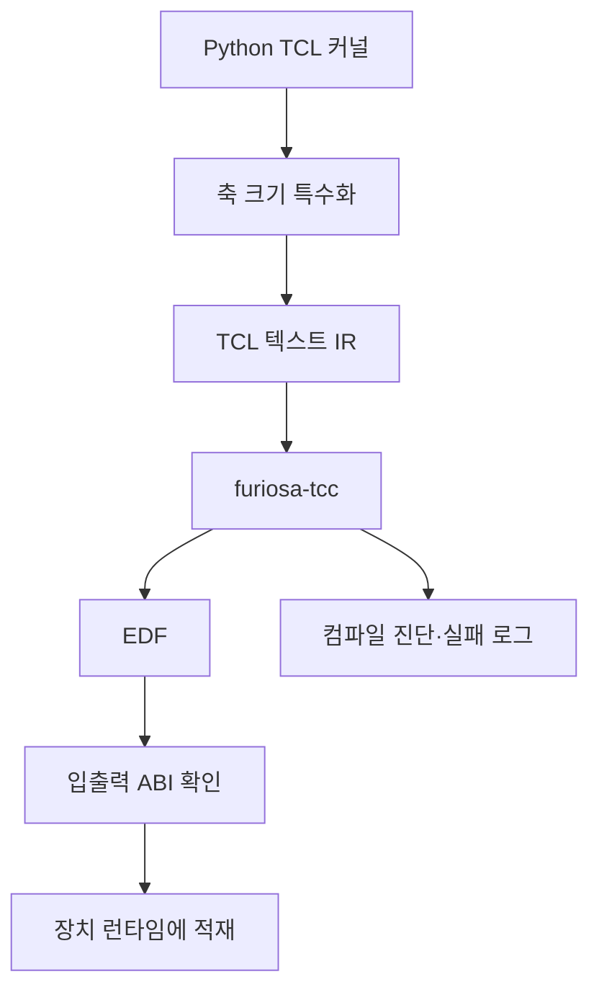
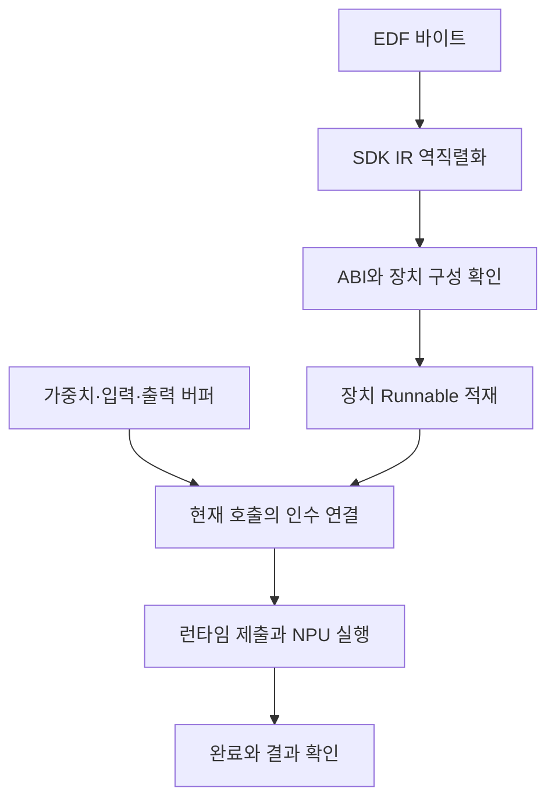

# TCL에서 EDF로: 축이 실행 프로그램이 되는 과정

TCL(Tensor Contraction Language)은 Python에 포함된 eDSL(embedded Domain-Specific Language)이다. 일반 Python 함수처럼 보이지만, 커널이 기술한 계산을 컴파일러가 분석할 수 있는 표현으로 만든다. 텐서 contraction과 축의 의미를 남기는 것이 핵심이다. 그 결과로 생성하는 **EDF(Executable Device Format)는 컴파일된 장치 실행 바이너리**다. Python 반복문을 CPU에서 실행한 결과를 저장하는 방식이 아니다. [공식 TCL 소개](https://furiosa.ai/blog/furiosa-sdk-2026-3-a-new-kernel-framework-and-the-models-it-unlocks), [EDF의 공식 명칭](https://github.com/furiosa-ai/furiosa-opt/blob/3d43bc9d20f324af60e3006c3f1541938d7f5097/docs/src/quick-start/kernel-validation.md)

> **바이너리와 실행의 구분** · EDF가 이미 컴파일되었다는 것과 NPU에서 실행할 준비가 끝났다는 것은 다르다. 호환 런타임의 역직렬화·적재, 현재 장치와 입출력 버퍼의 연결, 실행 제출이 필요하다. `.edf`와 SDK compiler 결과의 `compiled.serialize()` 산출물은 각기 대응하는 loader를 사용한다. 후자는 `sdk.ir.Runnable.deserialize()`로 복원한다.

## 실습 준비와 파일 배치

이 장은 **설치된 SDK로 새 커널을 만드는 실습**이다. 호환되는 `furiosa.tcl`, `furiosa.torch`, `torch`, `furiosa-tcc`가 같은 개발 환경에 있어야 하며, 실행 단계에는 정상 동작하는 RNGD와 드라이버가 필요하다. SDK 설치는 [공식 prerequisites](https://developer.furiosa.ai/v2026.4.0/en/get_started/prerequisites.html), 장치 확인은 [3장](03-driver-runtime.md)을 따른다. `kernels.py`, `emit_tcl.py`, `run_edf.py`를 새 작업 디렉터리에 만들고 **세 파일이 있는 디렉터리에서** 명령을 실행한다. 소스 파일을 읽는 eDSL 경로를 재현하도록 노트북 셀 대신 `.py` 파일을 사용한다.

```bash
python -c "import torch, furiosa.tcl, furiosa.torch; print(torch.__version__)"
furiosa-tcc --help
furiosa-smi info
```

import 성공은 패키지 접근을, SMI 출력은 장치 상태를 확인한다. 아직 커널 컴파일이나 NPU 계산을 검증한 것은 아니다. 아래 예제의 shape는 하나로 고정했으며, 다른 크기는 별도 컴파일·버킷 계약을 요구한다.

실습 파일을 그대로 내려받을 수 있다: [kernels.py](../examples/tcl/kernels.py), [emit_tcl.py](../examples/tcl/emit_tcl.py), [run_edf.py](../examples/tcl/run_edf.py). 세 파일을 같은 디렉터리에 저장한다.

## 1. 두 종류의 데코레이터

FuryNo5가 사용 중인 SDK 경로에는 `@tcl.kernel`과 `@tcl.tensor_operation`이 함께 나온다. 전자는 커널의 입력·출력 텐서와 논리 축을 선언하고, 후자는 커널 내부에서 조합할 계산 표현을 구성한다. 아래 예제는 저장소의 `aten_kernels.py`와 같은 API 표기를 따른다. [실제 커널 정의](https://github.com/smallstep-zzz/FuryNo5/blob/bba9efea8201aec48150514a35d0b637d29d107e/tplmachine/aten_kernels.py)

```python
# kernels.py — FuryNo5의 2026.4 계열 SDK 사용 방식에 맞춘 예제
from __future__ import annotations
import furiosa.tcl as tcl

@tcl.tensor_operation
def bf16_dot(left, right, output_axes):
    wide = tcl.operation.contract(left, right, to=output_axes)
    return tcl.commit.typecast(wide, tcl.bf16)

@tcl.kernel
def matmul_smoke(
    left: tcl.Tensor[tcl.bf16, [M, K]],
    right: tcl.Tensor[tcl.bf16, [K, N]],
) -> tcl.Tensor[tcl.bf16, [M, N]]:
    return bf16_dot(left, right, [M, N])
```

`M,K,N`은 TCL이 해석할 상징 축이다. 이 예제의 지연 annotation을 임의로 제거하거나, 같은 이름의 Python 정수로 바꿔 넣지 않는다. 커널을 구체적인 형상으로 만드는 단계에서 축 크기를 전달한다. `to=[M,N]`은 출력 축을 지정하며 `K`가 축약된다. 마지막 typecast는 출력 저장 형식을 BF16으로 정한다. BF16 입출력이라고 해서 모든 중간 단계가 반드시 BF16인 것은 아니다.

공식 개발자 소개 페이지는 `tcl.bf16[M,K]` 및 `out=`처럼 다른 시기의 짧은 표기도 보여준다. 이 핸드북의 실습은 **FuryNo5 소스에서 확인한 `tcl.Tensor[...]` 및 `to=` 경로**를 사용한다. API 표기를 서로 섞지 말고 설치된 SDK에 맞춘다. [공식 개발자 페이지](https://furiosa.ai/developers)

## 2. shape를 정하고 텍스트 IR을 만든다

IR(Intermediate Representation)은 컴파일러가 다루는 중간 표현이다. 여기서는 특수화한 TCL 커널의 `.dsl`을 파일로 내보낸다. 다음 스크립트는 커널이 정의된 파일과 같은 디렉터리에 둔다.

```python
# emit_tcl.py — NPU 실행을 하지 않고 TCL 소스를 생성한다.
from pathlib import Path
import furiosa.tcl as tcl
from kernels import matmul_smoke

sizes = {"M": 32, "K": 128, "N": 64}
specialized = tcl.specialize_kernel(matmul_smoke, sizes)
kernel = specialized if isinstance(specialized, tcl.Kernel) else tcl.Kernel.from_edsl(specialized)
Path("matmul.tc").write_text(kernel.dsl)
print("wrote matmul.tc", sizes)
```

FuryNo5의 `export_single_aten()`도 커널을 선택한 뒤 `specialize_kernel → Kernel.from_edsl → .dsl` 순서로 소스를 얻는다. 입출력 바인딩과 shape·dtype·stride 계약은 별도로 유지한다. [특수화와 TCL 생성](https://github.com/smallstep-zzz/FuryNo5/blob/bba9efea8201aec48150514a35d0b637d29d107e/tplmachine/tcl_edf.py)

이때 `M=32`로 컴파일했다면 `M=33`도 자동으로 지원한다고 말할 수 없다. 다른 크기를 패딩해서 같은 커널에 넣을지, 다른 버킷을 선택할지, 다시 컴파일할지는 위쪽 실행 계약이 결정한다. 버킷은 6장에서 별도로 다룬다.

## 3. 컴파일러가 EDF를 생성한다

```bash
python emit_tcl.py
furiosa-tcc --version
furiosa-tcc --help
furiosa-tcc --target-npu renegade-8pe --no-compiler-cache \
  --output matmul.edf matmul.tc
```

이 호출 형태는 FuryNo5의 `tcl_compiler.py`와 `compile_job.py`에서 확인했다. `--no-compiler-cache`는 이 프로젝트 경로의 선택이며 모든 사용자에게 캐시를 꺼야 한다는 권고가 아니다. SDK에 따라 target 이름과 지원 옵션이 달라질 수 있으므로 `--help`가 기준이다. [컴파일 설정](https://github.com/smallstep-zzz/FuryNo5/blob/bba9efea8201aec48150514a35d0b637d29d107e/tplmachine/tcl_compiler.py), [실제 subprocess 명령](https://github.com/smallstep-zzz/FuryNo5/blob/bba9efea8201aec48150514a35d0b637d29d107e/tplmachine/compile_job.py)



컴파일러 내부에서는 타일·엔진·배치·메모리·스케줄 선택이 필요하다. 순서와 패스 이름은 컴파일러 버전에 따라 달라질 수 있다. 생성된 EDF는 그 선택의 결과다. 구체적인 결정과 공개 구현의 경계는 [3장 컴파일러의 책임](03-driver-runtime.md)을 참고한다. `TCL 문법이 맞음`, `EDF 생성 성공`, `장치 로드 성공`, `정답 일치`를 네 단계로 나누어 기록한다.

### EDF는 원시 명령어 배열인가, 모델 패키지인가

공식 자료가 직접 확인해 주는 것은 **TCL에서 생성하는 실행 바이너리**라는 점과 SDK를 통해 장치에서 실행한다는 점이다. 이 사실만으로 SDK `.edf`의 바이트 전체가 NPU 명령어라고 결론 내릴 수는 없다. 코드와 메타데이터가 어떤 section으로 직렬화되는지, 장치 코드의 재배치표가 있는지, ELF(Executable and Linkable Format)인지 등은 이번에 확보한 SDK 공개 근거만으로 확정하지 않았다. 바이너리라는 말은 사람이 읽는 TCL 텍스트와 다른 저장 표현이라는 뜻이지, 파일의 모든 바이트를 계산 엔진이 그대로 명령어로 읽는다는 뜻이 아니다. [TCL과 실행 바이너리](https://furiosa.ai/blog/furiosa-sdk-2026-3-a-new-kernel-framework-and-the-models-it-unlocks), [SDK를 통한 EDF 실행](https://developer.furiosa.ai/furiosa-opt/book/quick-start/kernel-validation.html)

| 산출물 | 이 경로에서 확인한 의미 | 읽는 경계 |
|---|---|---|
| `matmul.tc` | 특수화한 TCL 텍스트 IR | `furiosa-tcc`의 입력 |
| `matmul.edf` | 커널의 컴파일된 장치 실행 바이너리 | `sdk.ir.Runnable.from_serialized_edf(raw)` |
| SDK compiler 결과의 `compiled.serialize()` | SDK 고유 직렬화 표현. EDF와 같은 형식으로 취급하지 않음 | FuryNo5 direct 경로의 `sdk.ir.Runnable.deserialize(raw)` |
| 공식 `.fxb` | manifest와 실행 EDF들을 묶은 bundle | 공식 FXB loader와 모델 자산 계약 |
| fxbX package | 사용자 프로젝트의 실행 계획·계약과 실행물 묶음 | fxbX loader가 계획과 EDF를 읽음 |

FuryNo5의 EDF 경로는 [`tcl_compiler.py`](https://github.com/smallstep-zzz/FuryNo5/blob/bba9efea8201aec48150514a35d0b637d29d107e/tplmachine/tcl_compiler.py), SDK 직렬화 경로는 [`direct_runtime.py`](https://github.com/smallstep-zzz/FuryNo5/blob/bba9efea8201aec48150514a35d0b637d29d107e/tplmachine/direct_runtime.py), package의 책임은 [공식 FXB 문서](https://developer.furiosa.ai/v2026.4.0/en/furiosa_llm/fxb.html)와 [fxbX 장](12-fxbx.md)에서 확인한다. 파일 확장자를 바꾸는 것으로 이 loader들의 계약이 바뀌지는 않는다.

### 가중치는 EDF 안에 들어 있는가

이 장의 행렬곱은 `left`와 `right`를 실행 인수로 받는다. `right`를 모델 가중치로 사용하더라도 **실제 값은 `run_edf.py`에서 따로 만든 뒤 전달**한다. 따라서 이 예제에서 EDF가 존재한다는 것만으로 모델 checkpoint까지 준비된 것은 아니다.

공식 Furiosa-LLM FXB는 model weights를 포함하지 않고, configuration·tokenizer·weights는 별도 모델 assets에서 읽는다고 명시한다. 한편 [공개 opt compiler image](https://github.com/furiosa-ai/furiosa-opt/blob/3d43bc9d20f324af60e3006c3f1541938d7f5097/furiosa-opt-abi/src/image.rs)에는 선택적인 weight bytes가 존재한다. 두 설명은 서로 다른 생성 경로와 계층에 관한 것이다. **모델 전체 가중치, 컴파일할 때 넣은 상수·초기 데이터, 실행 시 바인딩할 tensor를 구분**하고 해당 경로의 계약을 확인해야 한다. “모든 EDF에는 모든 가중치가 있다” 또는 “모든 EDF에는 어떤 상수도 없다”로 일반화하지 않는다. [공식 FXB의 외부 모델 자산](https://developer.furiosa.ai/v2026.4.0/en/furiosa_llm/fxb.html)

## 4. EDF 로드와 장치 실행

아래는 같은 버킷의 행렬곱 한 개를 실행하는 **재현용 예제**다. 호출 API는 저장소와 대조했으며, 이 핸드북 작성 환경에는 RNGD가 없어 실제 장치 실행 결과를 주장하지 않는다. Python 패키지·컴파일러·드라이버가 호환되는 RNGD 머신에서 실행한다.

실행 경계를 먼저 나누어 보자. 아래 표는 바로 뒤 예제의 실제 호출에 대응한다. `sdk.ir.Runnable`이라는 이름에 `Runnable`이 들어 있어도, **역직렬화한 IR 객체와 장치에서 호출하는 `sdk.Runnable` 객체는 구분**해야 한다.

| 단계 | 예제의 호출 | 그 단계에서 이해할 일 |
|---|---|---|
| 바이트 읽기 | `Path(...).read_bytes()` | host 메모리에 파일을 읽는다. NPU 실행을 시작하지 않는다. |
| 역직렬화 | `sdk.ir.Runnable.from_serialized_edf(...)` | EDF를 SDK 프로그램 표현으로 읽고 ABI 정보를 확인한다. 예제는 fusion과 입출력 개수를 추가 검사한다. |
| 실행 객체·장치 적재 | `sdk.Runnable(ir).to("furiosa:0")` | 현재 장치에서 사용할 실행 객체를 준비한다. 바이너리를 다른 모델로 재캡처하는 호출이 아니다. |
| 입력 준비 | `left.to(...)`, `right.to(...)` | 현재 호출의 데이터를 장치 tensor로 준비한다. 반복 실행에서는 불변 가중치 등의 재사용 여부가 중요하다. |
| 실행 호출 | `program(left_device, right_device)` | 준비된 프로그램에 실제 입출력 관계를 연결해 실행한다. 프로그램과 데이터가 모두 필요하다. |
| 결과 읽기·검증 | `value.cpu()`, `assert_close(...)` | CPU에서 결과를 확인한다. 이 구간까지 잰 시간은 순수 장치 계산 시간과 다르다. |

[EDF loader·ABI 검사](https://github.com/smallstep-zzz/FuryNo5/blob/bba9efea8201aec48150514a35d0b637d29d107e/tplmachine/tcl_compiler.py), [실제 SDK 실행 객체 사용](https://github.com/smallstep-zzz/FuryNo5/blob/bba9efea8201aec48150514a35d0b637d29d107e/tplmachine/direct_runtime.py)



이 예제는 위 단계의 호출 경계를 보여준다. SDK 내부의 모든 메모리 할당·명령 패치·재배치 처리를 공개 소스 수준으로 해부했다는 뜻은 아니다. 실제 주소 바인딩과 host 실행 파일의 relocation을 구분할 수 있는 **공개 opt 구현 사례**는 [8장](08-eisa-visa.md)에 따로 설명한다.

```python
# run_edf.py — NPU와 호환 SDK가 필요하다.
from pathlib import Path
import torch
import furiosa.torch as sdk

sdk.config.set_cpu_fallback(False)
sdk.set_fusion(8)
sdk.set_mesh_kind(sdk.MeshKind.Single())

ir = sdk.ir.Runnable.from_serialized_edf(Path("matmul.edf").read_bytes())
if ir.expected_num_fusion != 8:
    raise RuntimeError("EDF fusion contract does not match the requested device")
if len(ir.input_dram_shapes) != 2 or len(ir.output_dram_shapes) != 1:
    raise RuntimeError("Unexpected EDF input/output arity")
print("ABI input shapes:", ir.input_dram_shapes)
print("ABI output shapes:", ir.output_dram_shapes)

program = sdk.Runnable(ir).to("furiosa:0")
left = torch.ones((32, 128), dtype=torch.bfloat16)
right = torch.ones((128, 64), dtype=torch.bfloat16)
left_device = left.to("furiosa:0")
right_device = right.to("furiosa:0")
with torch.inference_mode():
    value = program(left_device, right_device)
if isinstance(value, (tuple, list)):
    if len(value) != 1:
        raise RuntimeError("Expected one result")
    value = value[0]
actual = value.cpu()
torch.testing.assert_close(actual, left @ right, rtol=0, atol=0)
print("single-shape all-ones smoke check passed")
```

앞 절의 컴파일이 성공하여 같은 디렉터리에 `matmul.edf`가 생긴 뒤 실행한다.

```bash
python run_edf.py
```

EDF loader와 fusion 검사는 `tcl_compiler._verify_abi()`를, 외부 `sdk.Runnable(...).to(device)`와 결과 전달은 `direct_runtime.py`를 참고했다. 입력 ABI의 개수 확인만으로 **논리적 shape와 모든 물리 배치가 완전히 증명되는 것은 아니다**. FuryNo5도 일반 loader 메타데이터만으로는 논리→물리 매핑을 `unknown`으로 남긴다. [ABI 확인 코드](https://github.com/smallstep-zzz/FuryNo5/blob/bba9efea8201aec48150514a35d0b637d29d107e/tplmachine/tcl_compiler.py), [런타임 객체 사용](https://github.com/smallstep-zzz/FuryNo5/blob/bba9efea8201aec48150514a35d0b637d29d107e/tplmachine/direct_runtime.py)

모든 원소가 1인 예제는 `K=128`의 합을 검증하기 쉽다. 이 검사는 연결·형상·기본 계산의 smoke test이며 수치 검증을 대신하지 않는다. 포팅 승인에는 서로 다른 값, 경계값, 양수·음수, 지원 dtype, stride·shape 범위, 반복 실행·가중치 변경을 별도로 검증한다.

## 5. 커널은 호출할 때마다 컴파일되는가

위 실습은 **컴파일 후 로드하고 여러 번 실행**하는 구조다. NPU 호출 한 번마다 `furiosa-tcc`를 실행하지 않는다. 동적 그래프·eager 경로에서는 새 연산 조합·형상이 처음 나타날 때 다른 컴파일 경로를 탈 수 있지만, 이것을 모든 Torch 함수 호출의 공통 동작으로 설명해서는 안 된다.

FuryNo5는 소스·계약·SDK·compiler identity·flags를 키로 보존된 EDF를 재사용하는 경로를 가진다. 바이트 해시와 ABI를 다시 확인하고 재사용 여부를 기록한다. 동일 함수 이름만으로 캐시를 공유하지 않는 이유는 **수식이 같아도 shape·dtype·장치 설정이 다른 실행 파일일 수 있기 때문**이다. [소스 캐시 구현](https://github.com/smallstep-zzz/FuryNo5/blob/bba9efea8201aec48150514a35d0b637d29d107e/tplmachine/tcl_compiler.py)

## 6. 몇 개의 TCL을 합치면 항상 빨라지는가

연산을 합치면 경계의 전송·호출을 줄이고 데이터를 재사용할 기회가 생긴다. 반대로 한 번에 보이는 그래프가 커지면 컴파일 탐색 비용과 동시에 살아 있는 중간 텐서가 늘 수 있다. SDK 2026.3 소개는 TCL kernel을 조합해 단일 단위로 컴파일할 수 있다고 설명하지만, 모든 조합의 성능 향상을 보장하지 않는다. [TCL 조합의 설계 목적](https://developer.furiosa.ai/latest/en/whatsnew/release-2026.3.0.html)

따라서 실험 기록에는 `분리한 커널 수`, `호출 수`, `중간 HBM 전송량`, `최대 live memory`, `컴파일 시간`, `warm 실행 시간`, `정확성`을 함께 남긴다. 크기가 큰 한 TCL과 작은 여러 TCL 중 무엇이 좋은지는 이 측정으로 선택한다. FuryNo5의 우선순위는 7·11장에서 구체적으로 연결한다.

## 7. 최신 기능을 2026.4 예제에 섞지 않는다

2026.5 beta release note의 `furiosa-tcc --evaluate-tcl`은 EDF를 생성하지 않고 TCL IR 비용을 추정하는 기능이다. 추정치가 실제 장치 지연을 의미하지 않으며 2026.4.0에 존재한다고 가정하지 않는다. [2026.5.0b0 release note](https://developer.furiosa.ai/v2026.5.0b4/en/whatsnew/release-2026.5.0b0.html)

Rust vISA의 `cargo furiosa-opt compile --dump-schedule`은 별도 컴파일 경로다. **임의의 TCL EDF를 schedule viewer 입력으로 열 수 있다고 확인되지 않았다.** TCL 병목을 Rust로 재현하려면 동일 수식·shape·dtype·mapping·오차 기준을 맞추고, 다른 커널로 바꿨다는 사실을 기록해야 한다.

## 출처

| 근거 | 확인한 내용 |
|---|---|
| [공식 TCL 도입 배경](https://furiosa.ai/blog/furiosa-sdk-2026-3-a-new-kernel-framework-and-the-models-it-unlocks) | TCL과 EDF의 관계 |
| [FuryNo5 aten_kernels.py](https://github.com/smallstep-zzz/FuryNo5/blob/bba9efea8201aec48150514a35d0b637d29d107e/tplmachine/aten_kernels.py) | 두 데코레이터·축·contraction |
| [tcl_edf.py](https://github.com/smallstep-zzz/FuryNo5/blob/bba9efea8201aec48150514a35d0b637d29d107e/tplmachine/tcl_edf.py) | 특수화·소스 생성 |
| [tcl_compiler.py](https://github.com/smallstep-zzz/FuryNo5/blob/bba9efea8201aec48150514a35d0b637d29d107e/tplmachine/tcl_compiler.py) | cache·공식 EDF loader·ABI |
| [compile_job.py](https://github.com/smallstep-zzz/FuryNo5/blob/bba9efea8201aec48150514a35d0b637d29d107e/tplmachine/compile_job.py) | CLI 호출·오류 기록 |
| [direct_runtime.py](https://github.com/smallstep-zzz/FuryNo5/blob/bba9efea8201aec48150514a35d0b637d29d107e/tplmachine/direct_runtime.py) | Python Runnable·장치 실행 |
| [2026.5 beta 변경](https://developer.furiosa.ai/v2026.5.0b4/en/whatsnew/release-2026.5.0b0.html) | 비용 추정 기능의 버전 경계 |
| [Kernel Validation](https://github.com/furiosa-ai/furiosa-opt/blob/3d43bc9d20f324af60e3006c3f1541938d7f5097/docs/src/quick-start/kernel-validation.md) | EDF의 공식 풀네임, SDK를 통한 장치 실행 |
| [공식 FXB 문서](https://developer.furiosa.ai/v2026.4.0/en/furiosa_llm/fxb.html) | 실행 bundle과 외부 weights·config·tokenizer의 구분 |
| [공개 opt image 정의](https://github.com/furiosa-ai/furiosa-opt/blob/3d43bc9d20f324af60e3006c3f1541938d7f5097/furiosa-opt-abi/src/image.rs) | 다른 공개 경로의 선택적 weight·메타데이터 존재 |

FuryNo5 소스 링크는 비공개 저장소 권한이 필요할 수 있다. 이 장의 예제는 실제 코드를 읽어 구성한 재현 절차이며 이 핸드북에서 NPU 실행 결과를 새로 얻은 것은 아니다.
