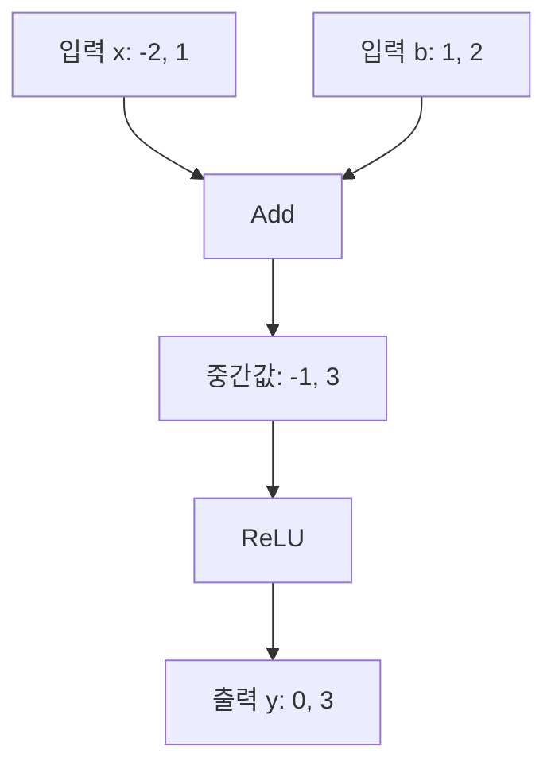
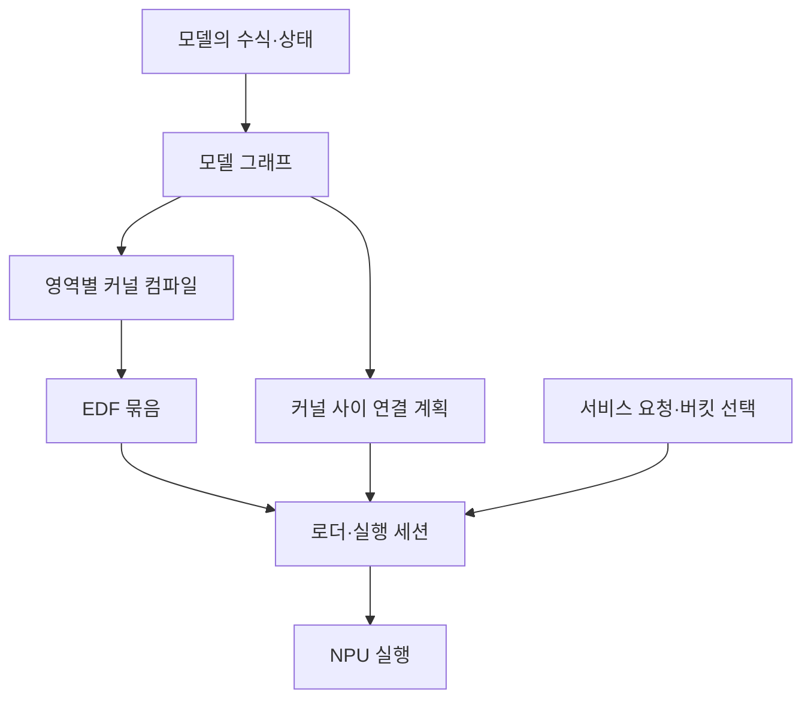
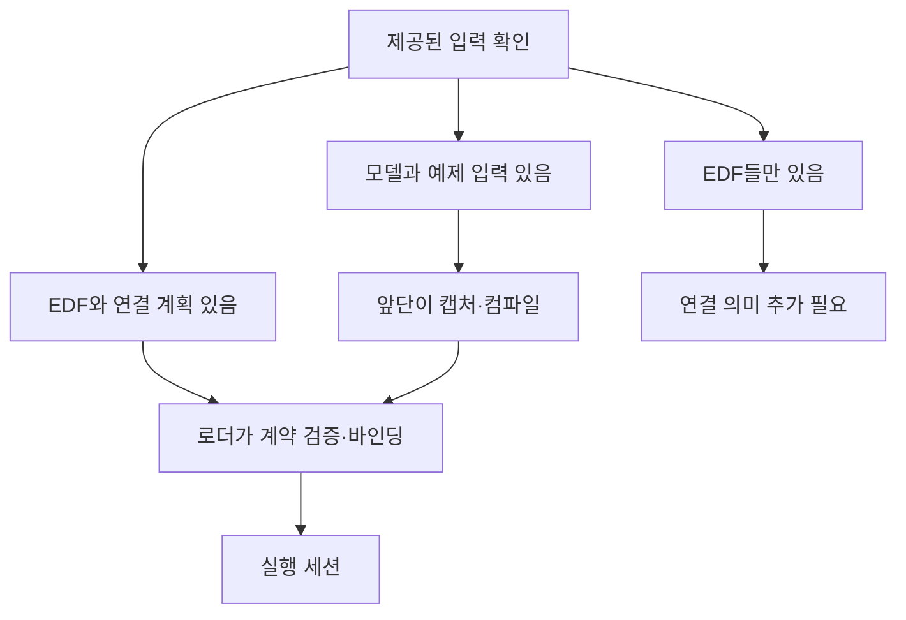

# 실행그래프와 폴백: 계산의 연결을 누가 알고 있는가

> **전체 경로에서의 위치**
>
> 첫 계산의 답을 다음 계산의 입력으로 보내 모델 하나를 실행하는 단계다. 그 연결을 파일에 담아 전달하는 방법은 [12장](12-fxbx.md)으로 이어진다.

함수 두 개가 있다고 해서 프로그램 하나가 정해지지는 않는다. `add`와 `relu`라는 함수를 가진 CPU(Central Processing Unit) 라이브러리에도 **무엇을 먼저 호출하고 결과를 어디에 넘길지** 정한 코드가 필요하다. NPU(Neural Processing Unit)의 컴파일된 커널도 같다. EDF(Executable Device Format)는 장치에서 실행할 컴파일 결과이고, 여러 EDF 사이의 연결은 별도의 실행계획이 담당할 수 있다.

이 장에서는 두 연산을 연결하는 예로 그래프를 이해한 뒤, 그래프를 저장했을 때 줄어드는 작업과 실제 `export_model()`·`GraphFXB` 호출을 살펴본다. 마지막에는 EDF가 없을 때 발생하는 오류와 CPU 폴백을 구분한다.

## 1. 같은 두 연산으로도 다른 프로그램이 된다

**ReLU(Rectified Linear Unit)는** 각 원소가 음수이면 0, 그렇지 않으면 원래 값을 반환하는 함수다. 여기서는 `relu(v) = max(0,v)`만 알면 된다. 두 입력 벡터 `x=[-2,1]`, `b=[1,2]`에 대해 먼저 원소별 덧셈을 하고 ReLU를 적용해 보자.

```python
# CPU에서 두 실행 순서가 서로 다른 결과를 내는지 확인한다.
x = [-2, 1]
b = [1, 2]

added = [a + offset for a, offset in zip(x, b)] # shape (2,) -> (2,), 결과 [-1,3]
y = [max(0, value) for value in added]         # 음수만 0으로 바꿔 [0,3]
assert y == [0, 3]

activated = [max(0, value) for value in x]     # 이번에는 ReLU를 먼저 실행한다: [0,1]
z = [a + offset for a, offset in zip(activated, b)]
assert z == [1, 3]                            # 같은 Add·ReLU여도 연결 순서가 다르다.
```

| 프로그램 | 첫 연산 뒤 값 | 둘째 연산 뒤 값 |
|---|---|---|
| `relu(x + b)` | `[-1,3]` | `[0,3]` |
| `relu(x) + b` | `[0,1]` | `[1,3]` |

두 연산 모두 길이 2의 벡터를 받는다. 따라서 “길이 2를 받는 Add EDF와 ReLU EDF가 있다”는 사실만으로 어떤 프로그램인지 정할 수 없다. **입출력 형상이 같아도 연결 의미는 다를 수 있다.** 그래프가 보관하는 핵심 정보가 이 연결이다.

그래프에서 **노드(node)는** 연산이나 값이고, **간선(edge)은** 누가 만든 값을 누가 사용하는지 나타낸다. 아래 그림은 첫 번째 프로그램이다. Add는 x와 b가 필요하고, ReLU는 Add가 만든 중간값이 필요하다.



### 실행계획은 값에 이름을 붙이고 소비자를 연결한다

여러 커널을 호출하는 계획은 “Add 다음 ReLU”라는 순서만으로 부족하다. Add의 어느 출력이 ReLU의 어느 입력으로 들어가는지, 최종 출력은 무엇인지도 필요하다. 다음 표는 이 예를 설명하는 **교육용 계획**이다. 실제 fxbX JSON 스키마를 그대로 복사한 형식은 아니다.

| 값의 이름 | 만드는 곳 | 사용하는 곳 | 수명을 판단하는 기준 |
|---|---|---|---|
| `input_x` | 호출자가 전달 | Add의 첫 입력 | Add가 읽기를 완료했는가? |
| `input_b` | 호출자가 전달하거나 고정값으로 준비 | Add의 둘째 입력 | 다음 호출에서 재사용할 고정값인가? |
| `tmp_sum` | Add의 출력 | ReLU의 입력 | ReLU가 읽기를 완료했는가? |
| `output_y` | ReLU의 출력 | 호출자 | 결과 전달과 사용이 끝났는가? |

**버퍼(buffer)는** 이 값이 실제로 저장되는 공간이다. 계획의 값 이름과 현재 프로세스의 버퍼는 별개이며, 둘을 연결하는 것을 **binding(바인딩)이라고** 한다. 중간값 `tmp_sum`을 만드는 커널을 CPU가 제출했다고 바로 공간을 재사용할 수 있는 것도 아니다. 그 값을 읽는 작업의 **완료**까지 보장되어야 한다. FuryNo5 실행계획과 fxbX 로더는 이러한 입력·출력·상태 연결을 명시한다. [공유 실행계획 계약](https://github.com/smallstep-zzz/FuryNo5/blob/bba9efea8201aec48150514a35d0b637d29d107e/docs/fxbx-producer/EXECUTION_PLAN.md), [로더의 값 수명 처리](https://github.com/smallstep-zzz/fxbX/blob/03d993b4d1b36cdda209d61bbf447434c174b401/fxbex/execution_fxb.py)

## 2. 서로 다른 네 종류의 그래프와 스케줄

앞 예는 연산 사이의 데이터 연결이다. 그런데 문서나 프로파일러에서는 장치 내부 명령 순서와 사용자 요청 순서도 ‘그래프’ 또는 ‘스케줄’이라고 부른다. **누구의 순서를 정하는지** 먼저 구분하면 혼동을 줄일 수 있다.

| 종류 | 노드와 간선이 뜻하는 것 | 만드는 주체·시점 | 대표 산출물 |
|---|---|---|---|
| 모델 그래프 | 앞 예의 Add·ReLU와 텐서 의존성 | Torch 캡처·export 또는 모델 작성자 | FX Graph, ExportedProgram |
| 커널 내부 스케줄 | 커널 하나 안의 데이터 이동·엔진 계산 순서 | 컴파일러 | EDF 내부 실행 코드, vISA schedule JSON |
| 여러 커널의 실행계획 | Add EDF 출력 → ReLU EDF 입력 같은 연결 | FuryNo5 같은 producer | `tclmachine.execution-plan.v1/v2` |
| 서비스 스케줄 | 사용자 A·B 중 어떤 요청을 언제 묶어 실행할지 선택 | Furiosa-LLM 또는 vLLM 서버 | 요청 대기열과 실행 중 배치 |

Torch 그래프의 간선은 텐서 데이터 관계이고, 서비스 스케줄의 순서는 여러 사용자 요청 사이의 선택이다. 한쪽을 저장했다고 다른 쪽이 사라지는 것은 아니다. 정적 schedule JSON도 운영 중 요청의 실측 trace와 다르다. [FuryNo5 실행계획](https://github.com/smallstep-zzz/FuryNo5/blob/bba9efea8201aec48150514a35d0b637d29d107e/docs/NATIVE_EXECUTION_PLAN.md), [Schedule Viewer의 범위](https://github.com/furiosa-ai/furiosa-opt/blob/3d43bc9d20f324af60e3006c3f1541938d7f5097/docs/src/tools/schedule-viewer.md)



상태(state)는 다음 호출에도 남기는 값이다. 예를 들어 언어 모델의 KV(Key–Value) cache는 이전 토큰에서 계산한 attention 정보를 보관한다. 매 호출의 출력만 연결하는 모델과 이 상태를 갱신하는 모델은 실행계획의 요구사항이 다르다.

## 3. 저장된 그래프가 없을 때 무엇을 만들 수 있는가

### 모델 코드와 예제 입력이 있다

‘덧셈 뒤에 ReLU를 한다’는 모델 코드와 예제 입력이 있다면, 준비 단계가 그 호출 순서와 값 연결을 기록할 수 있다. 이것이 **그래프 캡처**다.

FuryNo5의 `prepare_model_direct()`는 모델을 export하고 표현을 정리한 뒤 SDK compiler로 실행 객체를 준비한다. `.activate()` 일부 작업이 첫 호출로 미뤄질 수 있어도, EDF 목록만 보고 원래 모델을 알아내는 것과는 다르다. [직접 준비 구현](https://github.com/smallstep-zzz/FuryNo5/blob/bba9efea8201aec48150514a35d0b637d29d107e/tplmachine/direct_runtime.py)

### EDF와 연결 계약이 있다

실행계획에 ‘덧셈의 답을 ReLU 입력으로 쓴다’고 적혀 있다면 로더는 그 지시를 읽어 실행 객체를 만든다. **로더(loader)는** 파일에서 필요한 내용을 읽어 사용할 수 있게 준비하는 코드다.

계획에는 현재 프로세스의 실제 입력 주소까지 영구 저장할 수 없으므로, 이번에 쓸 가중치·입력 버퍼·장치 객체를 연결하는 일은 남는다. 파일을 읽는 단계와 이번 입력으로 실행하는 단계를 구분해야 한다. [공유 실행계획 계약](https://github.com/smallstep-zzz/FuryNo5/blob/bba9efea8201aec48150514a35d0b637d29d107e/docs/fxbx-producer/EXECUTION_PLAN.md)

### EDF 파일만 여러 개 있다

크기가 같은 배열 두 개가 있어도 어느 것이 입력이고 어느 것이 보정값인지는 크기만으로 알 수 없다. 같은 이유로 EDF 파일들의 입출력 크기만 보고 모델의 연결을 하나로 결정할 수는 없다.

어느 출력이 다음 프로그램의 어느 입력으로 가는지 적은 설명, 모델 코드, 또는 그 모델 구조를 아는 어댑터가 더 필요하다. 정보가 없는 부분을 런타임이 자동으로 추측해 주는 것으로 이해하면 안 된다.



## 4. 저장한 계획으로 줄이는 작업과 남는 작업

앞의 Add·ReLU 모델을 매번 Python에서 분석하면 연산 연결을 다시 찾아야 한다. 반대로 “첫 입력과 고정값을 Add에 넣고, 결과를 ReLU에 넣는다”는 계획과 대응 EDF가 저장되어 있으면 그 분석과 커널 컴파일을 재사용할 수 있다. 그렇더라도 **이번 입력 값과 이번 장치 메모리 주소까지 파일에 영구 고정할 수는 없다.** 로딩과 실제 데이터 연결은 남는다.

| 이미 보존된 것 | 로딩에서 생략하거나 재사용할 수 있는 것 | 여전히 해야 하는 것 |
|---|---|---|
| 진짜 EDF | 해당 커널 컴파일 | 버전·해시·입출력 ABI(Application Binary Interface) 확인, 장치 적재 |
| 커널 연결·tensor ID | 원본 모델 재캡처, 영역 선택 재계산 | 계획 검증, 현재 버퍼·가중치 연결 |
| 형상(shape)·자료형(dtype)·저장 간격(stride) 계약 | 계약 추론 | 실제 입력이 계약에 맞는지 검사 |
| 상태 갱신 선언 | 상태 의미의 재추론 | 상태 할당·reset·완료 후 commit |
| 외부 가중치 target | 원본 Python 객체 구조 의존 줄이기 | 가중치 읽기·검사·업로드 |

FuryNo5의 공유 실행계획 문서는 loader에 producer나 compiler가 필요하지 않도록 의도했고, 별도 프로세스에서 producer import와 compiler 호출을 막은 reload 시험 범위를 기록한다. 이 장은 그 **기존 검증 기록을 읽어 설명하는 것**이며 새 NPU 재시험을 한 것이 아니다. 원본 모델이 필요한 direct preparation 경로와 compiler 없이 package를 재로드하는 경로도 구별한다. [Native execution owner](https://github.com/smallstep-zzz/FuryNo5/blob/bba9efea8201aec48150514a35d0b637d29d107e/docs/NATIVE_EXECUTION_PLAN.md), [Direct runtime 계약](https://github.com/smallstep-zzz/FuryNo5/blob/bba9efea8201aec48150514a35d0b637d29d107e/docs/DIRECT_RUNTIME.md)

## 5. 실행계획과 EDF를 함께 만들고 전달한다

FuryNo5의 `export_model()`은 모델을 분석해 실행계획을 만들고 해당 계획에서 참조할 EDF를 생성한다. fxbX의 `GraphFXB`는 package의 계획 schema(필드와 연결을 읽는 규칙)를 보고 실행한다. 여기서 **export**는 모델을 저장 가능한 실행 계약으로 만드는 준비 작업이고, **load**는 그 계약을 읽어 현재 장치의 실행 객체를 만드는 작업이다.

실습 모델은 MLP(Multi-Layer Perceptron)의 작은 예다. 입력은 4개 샘플, 샘플당 8개 숫자여서 shape `(4,8)`이다. `Linear(8,12)`는 각 샘플에 같은 가중치를 적용하여 12개 숫자로 바꾸고, ReLU는 shape를 유지하며 음수를 0으로 만든다. 마지막 `Linear(12,8)`이 `(4,8)` 출력을 만든다. Linear의 계산은 입력과 가중치의 행렬곱에 bias(각 출력 좌표에 더하는 고정값)를 더하는 것이다.

| 단계 | 텐서 shape | 값에 가하는 일 |
|---|---|---|
| 입력 | `(4,8)` | 4개 샘플의 특징값 |
| 첫 Linear | `(4,12)` | 샘플마다 8개 입력의 가중합 12개 생성 |
| ReLU | `(4,12)` | 각 값에 `max(0,v)` 적용 |
| 둘째 Linear | `(4,8)` | 12개 값의 가중합 8개 생성 |

실습 전에 [13장의 호환 checkout 설치](13-porting-fha.md)를 마치고 [3장의 장치 확인](03-driver-runtime.md)을 수행한다. 아래 코드를 **새 작업 디렉터리의 `build_and_run.py`로 저장**한다. 출력 경로는 실행한 디렉터리를 기준으로 해석된다.

```python
# build_and_run.py — 호환 SDK(Software Development Kit), FuryNo5/fxbX, RNGD가 필요하다.
import torch
from tclmachine import export_model
from fxbx import GraphFXB

def main():
    # 같은 모델과 입력을 다시 만들 수 있도록 CPU 난수 시드를 고정한다.
    torch.manual_seed(42)
    # shape: (4,8) -> (4,12) -> (4,12) -> (4,8)
    model = torch.nn.Sequential(
        torch.nn.Linear(8, 12), torch.nn.ReLU(), torch.nn.Linear(12, 8)
    ).bfloat16().eval().requires_grad_(False)
    # BF16(BFloat16) 입출력에 맞춰 예제 입력을 만든다.
    x = torch.randn(4, 8, dtype=torch.bfloat16)

    # 준비 단계: 예제 shape로 모델을 분석하고 실행계획과 EDF들을 저장한다.
    export_model(model, (x,), "./small-mlp.fxbx", compile_workers=4)
    # 적재 단계: 외부 가중치를 이름에 맞춰 연결하고 장치 실행을 준비한다.
    with GraphFXB("./small-mlp.fxbx", weights=model.state_dict()) as session:
        # 실행 단계: 입력 하나를 tuple로 전달하고 CPU에서 확인할 출력을 받는다.
        actual, = session.predict((x,), output_device="cpu")
    # 수치 검증은 별도 단계다. 일치만으로 NPU 실행 사실이 증명되지는 않는다.
    torch.testing.assert_close(actual, model(x), atol=0.02, rtol=0.02)
    print("single-shape numerical comparison passed")

# 병렬 컴파일의 자식 프로세스가 import할 때 빌드를 다시 시작하지 않게 한다.
if __name__ == "__main__":
    main()
```

```bash
# main 보호가 있는 파일로 실행해 병렬 컴파일의 재귀 시작을 막는다.
python build_and_run.py
```

이 컴파일 경로는 여러 작업을 자식 프로세스에서 실행한다. 새 프로세스가 스크립트를 불러올 때 파일의 맨 위 코드가 다시 실행될 수 있다. 그래서 파일 아래의 `if __name__ == "__main__":` 안에서 빌드를 시작한다.

이 보호가 없으면 자식 프로세스도 다시 전체 빌드를 시작할 수 있다. 실습은 노트북 셀에 조각별로 붙이기보다 제공한 파일로 실행한다. `compile_workers=4`는 CPU 컴파일 작업 수이며 NPU 수가 아니다. [사용자 프로젝트의 실제 예제](https://github.com/smallstep-zzz/FuryNo5/blob/bba9efea8201aec48150514a35d0b637d29d107e/examples/native_execution_plan.py) · [계획 exporter](https://github.com/smallstep-zzz/FuryNo5/blob/bba9efea8201aec48150514a35d0b637d29d107e/tplmachine/execution_plan.py)

가중치는 `model.state_dict()`로 별도 전달한다. 이 예제는 동일한 프로세스에 모델이 있어 바로 넘기지만, 실제 배포에서는 모델 코드가 없어도 읽을 수 있는 호환 checkpoint와 가중치 이름 계약을 함께 보존해야 한다. `0.02` 오차는 작은 BF16 예제를 위한 값이며 모든 모델의 합격 기준이 아니다. 재실행에는 새 출력 디렉터리를 사용해 실험 결과를 분리한다.

### `atol=0.02, rtol=0.02`가 허용하는 차이

**절대 허용오차(atol, absolute tolerance)는** 값의 크기와 무관하게 허용할 차이고, **상대 허용오차(rtol, relative tolerance)는** 기준값 크기에 비례한 차이다. 유한한 일반 실수 tensor의 각 원소에 대해 `assert_close(actual, expected)`는 다음 조건을 확인한다. 오른쪽 기준은 `actual`이 아니라 `expected`다. [PyTorch 2.10의 비교 규칙](https://docs.pytorch.org/docs/2.10/testing.html#torch.testing.assert_close)

`abs(actual - expected) <= atol + rtol * abs(expected)`

| 기준 원소 expected | 이번 예의 허용 차이 | 비교 결과의 예 |
|---:|---:|---|
| 0 | `0.02 + 0.02×0 = 0.02` | actual=0.01은 통과, 0.03은 실패 |
| 100 | `0.02 + 0.02×100 = 2.02` | actual=102는 통과, 103은 실패 |

따라서 rtol 0.02를 “어떤 원소든 차이가 0.02 이하면 된다”로 읽으면 안 된다. 0 근처에서는 atol이 영향을 크게 주고 큰 값에서는 rtol 항이 커진다. 두 값 모두 0이면 원소 값이 정확히 같아야 한다. 위 숫자는 판정식을 이해하기 위한 예이며 모델 품질 기준을 정한 실험은 아니다. 실제 모델에서는 작은 출력의 중요도, 누적 오차, 정답률·생성 품질을 보고 허용오차를 정한다.

### 저장한 package에서 실제 값 ID를 따라 읽기

1절의 `tmp_sum`은 교육용 이름이었다. 이제 방금 만든 파일에서 **실제 이름과 연결**을 읽어 보자. fxbX의 `read_execution_plan(path)`는 package와 EDF 해시를 검사한 뒤 Python `dict`를 돌려준다. 장치에 실행 객체를 적재하거나 계산을 제출하는 함수는 아니다. 이 고정 버전의 읽기 함수는 구현 모듈 `fxbex.execution_fxb`에 있으며, `fxbx` 최상위의 안정된 공식 SDK API라는 뜻으로 제시하지 않는다. [실제 reader와 검증](https://github.com/smallstep-zzz/fxbX/blob/03d993b4d1b36cdda209d61bbf447434c174b401/fxbex/execution_fxb.py#L136-L304)

| 실제 필드 | 프로그램을 읽을 때 묻는 질문 |
|---|---|
| `plan['tensors'][value_id]` | 이 값의 shape·dtype·stride·역할은 무엇인가? |
| `plan['entries']['forward']['inputs']` | 호출자가 넘길 입력 tensor ID와 그 순서는 무엇인가? |
| `entry['steps'][i]['kernel']` | i번째 단계가 어떤 컴파일 결과를 사용할 것인가? |
| `step['inputs']`, `step['outputs']` | 이 단계가 읽을 값 ID, 새로 만들 값 ID는 무엇인가? |
| `plan['kernels'][kernel_id]['member']` | 해당 EDF가 ZIP package 안의 어느 경로에 있는가? |
| `entry['outputs']` | 중간값들 중 어떤 것을 호출자에게 돌려줄 것인가? |

다음 완전한 읽기 전용 스크립트([inspect_execution_plan.py](../examples/inspect_execution_plan.py))를 저장하고 앞 실습과 같은 디렉터리에서 실행한다. `read_execution_plan`이 검증한 연결을 그대로 출력하며 파일을 수정하거나 NPU를 호출하지 않는다.

```python
# inspect_execution_plan.py — 고정 버전과 호환되는 fxbX 설치가 필요하다.
import sys
from fxbex.execution_fxb import read_execution_plan

def main(path):
    plan = read_execution_plan(path)      # schema·연결·저장 EDF 해시를 검사하고 dict 반환
    entry = plan["entries"]["forward"]
    tensors = plan["tensors"]
    # 값 ID -> 이 값을 준비한 곳. 매 호출 입력과 외부 가중치·상태를 먼저 등록한다.
    origin = {name: "호출자 입력" for name in entry["inputs"]}
    for name, spec in tensors.items():
        if spec["kind"] in {"parameter", "buffer", "state"}:
            origin[name] = f"{spec['kind']}:{spec.get('target', name)}"

    print("entry inputs:", entry["inputs"])
    for number, step in enumerate(entry["steps"]):
        kernel_id = step["kernel"]
        kernel = plan["kernels"][kernel_id]
        print(f"step {number}: kernel={kernel_id}, EDF={kernel['member']}")
        for name in step["inputs"]:
            spec = tensors[name]
            # 같은 ID를 쓰는 소비자가 누구에게서 값을 받는지 보인다.
            print(f"  read {name} <- {origin[name]}, shape={spec['shape']}, dtype={spec['dtype']}")
        for name in step["outputs"]:
            origin[name] = f"step {number}의 출력"
            print(f"  write {name}, shape={tensors[name]['shape']}")
    for name in entry["outputs"]:
        print(f"return {name} <- {origin[name]}") # 마지막 step 출력이라고 가정하지 않는다.
    print("state updates:", entry["state_updates"]) # 이 MLP에는 지속 상태 갱신이 없다.

if __name__ == "__main__":
    main(sys.argv[1])
```

```bash
# plan 읽기 성공은 package를 읽었다는 뜻이며 NPU 실행 성공이 아니다.
python inspect_execution_plan.py ./small-mlp.fxbx
```

출력에서 어떤 ID가 `step 0`의 `write`에 나타나고 나중 단계의 `read`에 다시 나타나면, 그 ID가 두 단계를 잇는 중간값이다. `parameter:...`로 표시되는 입력은 `state_dict()`의 이름과 연결된 가중치다. 이들은 사용자가 `predict((x,))`에 넘기는 입력 목록과 구분된다. 커널 결합 결과에 따라 Linear·ReLU가 한 step에 함께 들어갈 수 있으므로 **Python 연산 수와 step 수가 같다고 미리 정하지 않는다**. 실제 출력 이름과 step 수를 이 작성 환경에서 새로 생성·관측한 것은 아니다.

터미널에서는 저장소에 있는 재현 스크립트를 사용할 수 있다.

```bash
# FuryNo5 저장소 루트, 호환 SDK 환경
python examples/native_execution_plan.py build ./small-mlp.fxbx
python examples/native_execution_plan.py run ./small-mlp.fxbx
```

예제 스크립트는 빌드와 실행을 분리하며, 수치 일치만으로 NPU 실행이 증명되는 것은 아니라고 결과에 적는다. NPU Task trace도 확인해야 한다. 한 EDF만 로드하는 낮은 수준의 Python 호출은 4장의 `from_serialized_edf()` 예제로 돌아가면 된다.

## 6. EDF 누락과 CPU 폴백을 구분한다

**폴백(fallback)은** 원래 시도한 실행 경로를 사용할 수 없을 때 다른 구현으로 계산을 이어가는 정책이다. 예를 들어 NPU용 구현이 없는 연산을 CPU 구현으로 수행하도록 백엔드가 명시적으로 지원할 수 있다. 그러나 파일 읽기 실패, 컴파일 실패, NPU 호출 실패가 모두 이런 정책을 갖는 것은 아니다.

4장 예제는 먼저 `Path("matmul.edf").read_bytes()`를 수행한다. 파일이 없으면 Python의 파일 읽기가 실패하므로 NPU 실행 함수에 도착하지 않는다. 그 코드에는 오류를 잡아 `left @ right`로 바꾸는 분기가 없다. **EDF가 없으면 자동으로 CPU로 넘어간다는 일반 규칙은 없다.** 실제로 호출한 경로를 기준으로 판단해야 한다.

| 상황 | 이 핸드북에서 확인한 판단 | 근거·제약 |
|---|---|---|
| `.edf` 경로가 없음 | 파일 읽기 또는 loader 준비가 실패한다. | 존재하지 않는 바이너리를 NPU가 실행할 수 없다. |
| EDF·SDK·fusion 계약 불일치 | load·ABI 검증 단계에서 거절될 수 있다. | FuryNo5는 명시적으로 검사한다. |
| 공식 FXB(Furiosa Executable Bundle) 캐시에 호환 bundle 없음 | `fxb check`는 non-zero 종료한다. | 이것은 CPU 폴백 명령이 아니다. |
| 공식 FXB 캐시에 오래된 IR revision만 있음 | 공식 문서는 자동 serving 실패를 설명한다. | 명시적 선택과 호환성 판단은 별개다. |
| PyTorch 경로의 미지원 연산 | backend의 fallback 정책에 달려 있다. | 해당 SDK의 모든 기본값을 일반화하지 않는다. |
| FuryNo5 직접 준비·선택된 EDF 경로 | CPU fallback을 끄고 문제를 드러내는 정책이다. | 지원 규칙이 없으면 구체적인 gap을 보고해야 한다. |
| Rust 예제의 일반 `cargo run` | 처음부터 선택한 CPU backend다. | NPU 실패 후 자동 전환을 뜻하지 않는다. |

[공식 FXB cache와 오류](https://developer.furiosa.ai/v2026.4.0/en/furiosa_llm/fxb.html), [FuryNo5 fallback 정책](https://github.com/smallstep-zzz/FuryNo5/blob/bba9efea8201aec48150514a35d0b637d29d107e/tplmachine/direct_runtime.py), [Rust CPU/NPU build 구분](https://github.com/furiosa-ai/furiosa-opt/blob/3d43bc9d20f324af60e3006c3f1541938d7f5097/docs/src/tools/kernel-optimizer.md)

`fail`도 구체적으로 써야 한다. Python 예외, Rust `Result::Err`, 컴파일 subprocess의 non-zero 종료, 장치 timeout, 프로세스 crash는 다른 현상이다. 근거가 예외를 보여줄 때 이를 `항상 crash`라고 부르지 않는다. 복구 가능성도 해당 오류와 런타임 정책을 확인한다.

## 7. CPU 사용과 NPU 계산의 증거를 따로 확인한다

사용자 문자열을 토큰 정수로 바꾸기, 입력 길이 검사, 다음 요청 선택, 응답 포맷 만들기는 원래 CPU 호스트에서 수행할 수 있다. 이것은 NPU에 맡겼던 행렬곱을 CPU로 대체한 상황과 구분한다. lookup 입력의 범위를 CPU에서 검사한 것도 embedding 계산 자체를 CPU에서 수행했다는 뜻이 아니다. 반대로 최종 출력이 맞는다는 이유만으로 NPU가 계산했다고 확정할 수 없다. [fxbX execution contract의 입력 검사 설명](https://github.com/smallstep-zzz/FuryNo5/blob/bba9efea8201aec48150514a35d0b637d29d107e/docs/fxbx-producer/EXECUTION_PLAN.md)

FuryNo5를 검증할 때는 다음 네 항목을 연결해 본다.

1. **정책**: `sdk.config.set_cpu_fallback(False)`처럼 요청한 실행 정책.
2. **산출물**: 실제 EDF의 해시·컴파일러 identity·입출력 계약.
3. **실행 증거**: 각 계산 step에 대응하는 공식 NPU Task.
4. **의미 검증**: CPU reference와의 일치, 다른 입력, 반복 실행, 상태 갱신.

첫 항목만으로 모든 단계의 NPU 실행이 증명되지는 않는다. 준비된 상수를 반환하는 EDF와 새 값을 계산하는 EDF도 다르게 기록한다. 저장소는 `static_value_preparation`을 NPU compute 증거와 구분한다. [준비된 값과 계산 구분](https://github.com/smallstep-zzz/FuryNo5/blob/bba9efea8201aec48150514a35d0b637d29d107e/docs/fxbx-producer/EXECUTION_PLAN.md)

### 방금 실행한 step을 공식 profiler 기록과 대조한다

호스트에서 함수를 호출한 것과 NPU가 실제 계산한 것은 서로 다른 사건이다. 두 사건의 이름과 시간을 남긴 목록이 **trace**다.

이 경로의 `Profiler`는 JSON 파일의 `traceEvents`에 사건을 기록한다. fxbX에서 `FXBX_TRACE_STEPS=1`을 쓰면 각 단계에 `execution_plan::forward::단계번호::커널ID`라는 이름을 붙인다. 검증 코드는 장치 Task 기록에도 그 이름이 전달되었는지 찾는다.

아래 예에서는 ‘호출했다고 기록한 단계’와 ‘장치에서 실행했다고 기록한 단계’를 대조하는 데 집중한다. 단순히 이름 하나가 보였다는 이유로 모델 전체가 NPU에서 실행됐다고 판단하지 않는다. [step 이름을 붙이는 consumer](https://github.com/smallstep-zzz/fxbX/blob/03d993b4d1b36cdda209d61bbf447434c174b401/fxbex/execution_fxb.py#L598-L648) · [공식 profiler 호출·필드 판독의 실제 예](https://github.com/smallstep-zzz/FuryNo5/blob/bba9efea8201aec48150514a35d0b637d29d107e/tplmachine/verified_worker.py#L21-L101)

| 기록에서 확인할 것 | 확인되는 범위 |
|---|---|
| `name`이 `execution_plan::...`으로 시작 | 호스트가 해당 이름의 실행 구간을 기록했다. 이것만으로 장치 계산은 증명되지 않는다. |
| `name`에 `::Task::execution_plan::...` 포함 | 같은 계획 step 이름에 연결된 공식 NPU Task가 수집됐다. |
| `name`에 `run_by_cpu` 포함 | 이 수집기가 인식하는 CPU 실행 경로가 관측됐다. 개수가 0이어도 이것만으로 전체 동작을 증명하지 않는다. |
| 필요한 step의 Task가 누락되거나 JSON 필드가 다름 | 이 절차로는 해당 실행을 확인하지 못했다. 성공으로 바꾸어 기록하지 않는다. |

아래 `observe_execution.py`는 5절의 `build_and_run.py`가 만든 **동일한 작은 MLP package**를 재사용한다. 같은 seed·모델 선언으로 외부 가중치를 준비하므로 다른 모델의 package에 그대로 적용하는 범용 실행기는 아니다. NPU·호환 SDK·fxbX가 필요하며, 준비·적재는 trace 밖에서, 한 번의 `predict()`는 trace 안에서 수행한다. `output_device="cpu"`인 이 consumer는 결과를 CPU로 옮기고 stream을 동기화한 뒤 반환한다. [완료를 포함하는 predict 구현](https://github.com/smallstep-zzz/fxbX/blob/03d993b4d1b36cdda209d61bbf447434c174b401/fxbex/execution_fxb.py#L576-L648)

[observe_execution.py](../examples/observe_execution.py)를 내려받아 앞 실습에서 만든 package와 함께 사용한다.

아래는 전체 파일에서 **준비와 한 번의 관찰 호출**만 꺼낸 예다. 추적 경로는 기존 기록을 덮어쓰지 않는 새 이름으로 지정한다.

```python
import os
os.environ["FXBX_TRACE_STEPS"] = "1"  # SDK import 전에 설정
import torch
from fxbx import GraphFXB
from furiosa.torch.profiler import Profiler

torch.manual_seed(42)                 # 5절 생산자와 같은 가중치·입력을 만든다.
model = torch.nn.Sequential(
    torch.nn.Linear(8, 12), torch.nn.ReLU(), torch.nn.Linear(12, 8)
).bfloat16().eval().requires_grad_(False)
x = torch.randn(4, 8, dtype=torch.bfloat16)
with GraphFXB("./small-mlp.fxbx", weights=model.state_dict()) as session:
    # 이 consumer는 load 때 CPU fallback을 끈다. 적재 실패는 예외로 남는다.
    with Profiler("./small-mlp-trace-001.json"):
        actual, = session.predict((x,), output_device="cpu")
torch.testing.assert_close(actual, model(x), atol=0.02, rtol=0.02)
```

여기까지는 trace 생성과 출력 비교다. NPU 실행을 판정하려면 계획이 요구한 step과 실제 Task를 대조해야 한다. 전체 파일은 `static_value_preparation` 단계를 분리하고, 누락·예상 밖 Task·CPU 경로가 있으면 실패 처리한다. 그중 필드 읽기 부분은 다음과 같다. `trace_path`는 생성한 JSON 경로다.

```python
import json
from pathlib import Path

trace_path = Path("./small-mlp-trace-001.json")
events = json.loads(trace_path.read_text())["traceEvents"]
names = [event.get("name", "") for event in events]
task_steps = {
    name.split("::Task::", 1)[1] for name in names
    if "::Task::execution_plan::" in name
}
print(sorted(task_steps))
```

```bash
# package를 만든 디렉터리에서 새 trace 파일 이름을 지정한다.
python observe_execution.py ./small-mlp.fxbx ./small-mlp-trace-001.json
```

예를 들어 한 행에서 `host=True, NPU Task=False`이면 제출 구간은 보였지만 필요한 장치 Task는 확인되지 않은 상태다. 원인을 조사하기 전에는 이를 NPU 실행 성공이나 CPU 폴백 성공으로 해석하지 않는다. Task 하나와 ATen 연산 하나가 일대일 대응한다는 뜻도 아니다. 커널 하나에서 Task가 여러 개 나올 수 있으므로 이 예는 단순 Task 개수 대신 **필요한 step 이름의 포함 여부**를 본다.

이 추적 모드는 step별 기록을 위해 준비된 sequence 재생 경로를 끈다. 따라서 출력의 실행 여부를 확인하는 용도로 쓰고 성능 비교에는 같은 조건의 별도 무추적 측정을 사용한다. 실제 trace는 이 명령을 실행한 환경에서 생성·확인해야 한다.

## 출처

| 근거 | 확인한 내용 |
|---|---|
| [Native execution owner](https://github.com/smallstep-zzz/FuryNo5/blob/bba9efea8201aec48150514a35d0b637d29d107e/docs/NATIVE_EXECUTION_PLAN.md) | producer·consumer 경계, 검증 정책 |
| [공유 실행계획](https://github.com/smallstep-zzz/FuryNo5/blob/bba9efea8201aec48150514a35d0b637d29d107e/docs/fxbx-producer/EXECUTION_PLAN.md) | 스키마, 상태, loader, 준비값 구분 |
| [Direct runtime](https://github.com/smallstep-zzz/FuryNo5/blob/bba9efea8201aec48150514a35d0b637d29d107e/tplmachine/direct_runtime.py) | 모델 캡처·컴파일·직접 실행 |
| [터미널 예제](https://github.com/smallstep-zzz/FuryNo5/blob/bba9efea8201aec48150514a35d0b637d29d107e/examples/native_execution_plan.py) | build/run 분리 |
| [공식 FXB 문서](https://developer.furiosa.ai/v2026.4.0/en/furiosa_llm/fxb.html) | cache fallback 의미와 실패 |
| [Kernel Optimizer](https://github.com/furiosa-ai/furiosa-opt/blob/3d43bc9d20f324af60e3006c3f1541938d7f5097/docs/src/tools/kernel-optimizer.md) | CPU build와 NPU build |
| [PyTorch 2.10 testing](https://docs.pytorch.org/docs/2.10/testing.html) | 절대·상대 허용오차 판정식 |
| [fxbX reader와 실행기](https://github.com/smallstep-zzz/fxbX/blob/03d993b4d1b36cdda209d61bbf447434c174b401/fxbex/execution_fxb.py) | 실제 계획 필드, step 이름, 적재·호출·완료 경계 |
| [FuryNo5 독립 검증 worker](https://github.com/smallstep-zzz/FuryNo5/blob/bba9efea8201aec48150514a35d0b637d29d107e/tplmachine/verified_worker.py) | Profiler 사용과 traceEvents·Task 이름 판독 |
