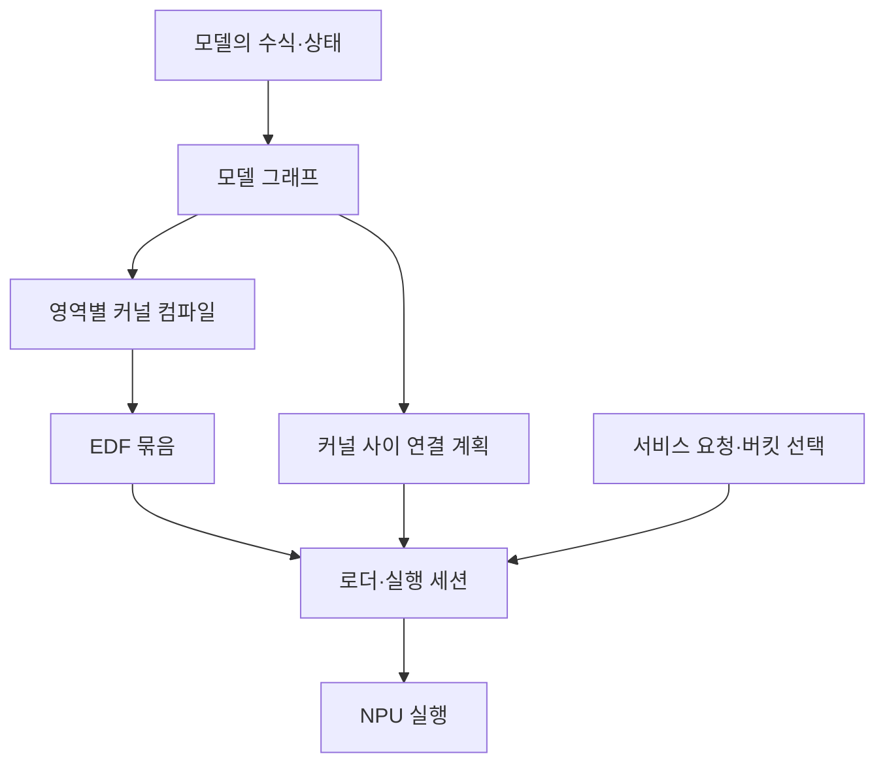
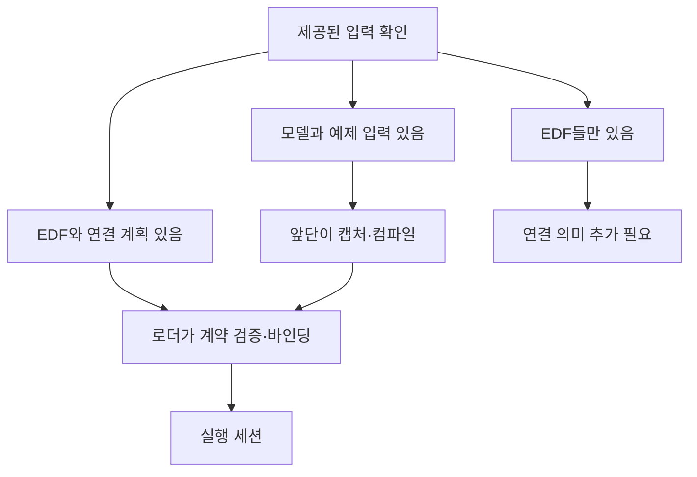

# 실행그래프와 폴백: 자동으로 해 주는 일의 경계

**EDF가 없으면 자동으로 CPU로 넘어간다는 일반 규칙은 없다. 실행그래프가 없으면 런타임이 원래 모델을 알아서 복원한다는 일반 규칙도 없다.** 어떤 입력을 받은 어느 계층이 어떤 정책으로 동작하는지를 확인해야 한다. 이 장에서는 그래프·실행 산출물·폴백을 별개로 설명한다.

## 1. 같은 ‘실행그래프’로 부르면 안 되는 네 가지

| 종류 | 노드와 간선이 뜻하는 것 | 만드는 주체·시점 | 대표 산출물 |
|---|---|---|---|
| 모델 그래프 | 연산과 텐서 의존성 | Torch 캡처·export 또는 모델 작성자 | FX Graph, ExportedProgram |
| 커널 내부 스케줄 | 엔진 명령·메모리 의존성·시각 | 컴파일러 | EDF 내부 실행 코드, vISA schedule JSON |
| 여러 커널의 실행계획 | EDF 호출 순서·입출력 tensor ID·상태 연결 | FuryNo5 같은 producer | `tclmachine.execution-plan.v1/v2` |
| 서비스 스케줄 | 요청·배치·prefill·decode 선택 | Furiosa-LLM 또는 vLLM 서버 | 요청 대기열과 실행 중 배치 |

Torch 그래프의 간선은 텐서 데이터 관계이고, 서비스 스케줄의 순서는 여러 사용자 요청 사이의 선택이다. 한쪽을 저장했다고 다른 쪽이 사라지는 것은 아니다. 정적 schedule JSON도 운영 중 요청의 실측 trace와 다르다. [FuryNo5 실행계획](https://github.com/smallstep-zzz/FuryNo5/blob/bba9efea8201aec48150514a35d0b637d29d107e/docs/NATIVE_EXECUTION_PLAN.md), [Schedule Viewer의 범위](https://github.com/furiosa-ai/furiosa-opt/blob/3d43bc9d20f324af60e3006c3f1541938d7f5097/docs/src/tools/schedule-viewer.md)



## 2. 그래프가 없는 경우: 무엇이 제공됐는가

### 모델 코드와 예제 입력이 있다

모델을 캡처하고 컴파일하는 **앞단**이 그래프를 만들 수 있다. FuryNo5의 `prepare_model_direct()`는 모델을 export하고, 필요한 정규화를 적용하고, 공식 SDK compiler를 호출해 `Runnable`을 만든다. 이 작업은 명시적인 준비 단계다. 첫 호출에서 `.activate()`가 지연 실행될 수 있지만, 이 사실을 `EDF 목록에서 모델 그래프를 추론한다`는 뜻으로 바꾸면 안 된다. [직접 준비 구현](https://github.com/smallstep-zzz/FuryNo5/blob/bba9efea8201aec48150514a35d0b637d29d107e/tplmachine/direct_runtime.py)

### EDF와 연결 계약이 있다

로더는 이미 정해진 인수 순서와 커널 연결을 장치 객체로 **구체화**한다. 파일 안의 선언적 계획과 현재 프로세스의 실행 객체는 다르므로, 계획이 저장되어 있어도 주소·버퍼·가중치 바인딩·완료 상태는 실행 시 준비해야 한다. [공유 실행계획 계약](https://github.com/smallstep-zzz/FuryNo5/blob/bba9efea8201aec48150514a35d0b637d29d107e/docs/fxbx-producer/EXECUTION_PLAN.md)

### EDF 파일만 여러 개 있다

각 EDF의 입출력 개수·물리 형상만으로 원래 모델의 연결을 유일하게 복원할 수는 없다. 같은 shape의 값이라도 residual 입력인지 bias인지 이전 층의 출력인지 의미가 다르다. 이는 정보가 부족한 문제다. 연결 메타데이터, 모델 코드 또는 해당 구조를 아는 adapter가 필요하다.



## 3. 계획을 저장하면 줄어드는 작업과 남는 작업

| 이미 보존된 것 | 로딩에서 생략하거나 재사용할 수 있는 것 | 여전히 해야 하는 것 |
|---|---|---|
| 진짜 EDF | 해당 커널 컴파일 | 버전·해시·입출력 ABI 확인, 장치 적재 |
| 커널 연결·tensor ID | 원본 모델 재캡처, 영역 선택 재계산 | 계획 검증, 현재 버퍼·가중치 연결 |
| shape·dtype·stride 계약 | 계약 추론 | 실제 입력이 계약에 맞는지 검사 |
| 상태 갱신 선언 | 상태 의미의 재추론 | 상태 할당·reset·완료 후 commit |
| 외부 가중치 target | 원본 Python 객체 구조 의존 줄이기 | 가중치 읽기·검사·업로드 |

FuryNo5의 공유 실행계획 문서는 loader에 producer나 compiler가 필요하지 않도록 의도했고, 별도 프로세스에서 producer import와 compiler 호출을 막은 reload 시험 범위를 기록한다. 이 장은 그 **기존 검증 기록을 읽어 설명하는 것**이며 새 NPU 재시험을 한 것이 아니다. 원본 모델이 필요한 direct preparation 경로와 compiler 없이 package를 재로드하는 경로도 구별한다. [Native execution owner](https://github.com/smallstep-zzz/FuryNo5/blob/bba9efea8201aec48150514a35d0b637d29d107e/docs/NATIVE_EXECUTION_PLAN.md), [Direct runtime 계약](https://github.com/smallstep-zzz/FuryNo5/blob/bba9efea8201aec48150514a35d0b637d29d107e/docs/DIRECT_RUNTIME.md)

## 4. 코드에서 실행계획과 EDF를 함께 전달하기

FuryNo5의 `export_model()`은 모델을 분석해 실행계획을 만들고 해당 계획에서 참조할 EDF를 생성한다. fxbX의 `GraphFXB`는 package의 계획 schema를 보고 실행한다. 실습 전에 [13장의 호환 checkout 설치](13-porting-fha.md)를 마치고 [3장의 장치 확인](03-driver-runtime.md)을 수행한다. 아래 코드를 **새 작업 디렉터리의 `build_and_run.py`로 저장**한다. 출력 경로는 실행한 디렉터리를 기준으로 해석된다.

```python
# build_and_run.py — 호환 SDK, FuryNo5/fxbX, RNGD가 필요하다.
import torch
from tclmachine import export_model
from fxbx import GraphFXB

def main():
    torch.manual_seed(42)
    model = torch.nn.Sequential(
        torch.nn.Linear(8, 12), torch.nn.ReLU(), torch.nn.Linear(12, 8)
    ).bfloat16().eval().requires_grad_(False)
    x = torch.randn(4, 8, dtype=torch.bfloat16)

    export_model(model, (x,), "./small-mlp.fxbx", compile_workers=4)
    with GraphFXB("./small-mlp.fxbx", weights=model.state_dict()) as session:
        actual, = session.predict((x,))
    torch.testing.assert_close(actual, model(x), atol=0.02, rtol=0.02)
    print("single-shape numerical comparison passed")

if __name__ == "__main__":
    main()
```

```bash
python build_and_run.py
```

컴파일러는 여러 커널을 처리할 때 `multiprocessing.get_context('spawn')`를 사용한다. 따라서 `compile_workers=4`인 이 독립 스크립트에서 `if __name__ == "__main__"` 보호를 빼면 자식 프로세스의 import가 빌드를 다시 시작할 수 있다. 노트북에 그대로 붙이기보다 파일로 실행한다. API 의미는 [사용자 프로젝트의 실제 예제](https://github.com/smallstep-zzz/FuryNo5/blob/bba9efea8201aec48150514a35d0b637d29d107e/examples/native_execution_plan.py)와 [계획 exporter](https://github.com/smallstep-zzz/FuryNo5/blob/bba9efea8201aec48150514a35d0b637d29d107e/tplmachine/execution_plan.py)를 확인했다. 이 핸드북 작성 환경에서는 NPU로 실행하지 않았다. namespace `tclmachine`은 저장소가 유지하는 실제 import 이름이다.

가중치는 `model.state_dict()`로 별도 전달한다. 이 예제는 동일한 프로세스에 모델이 있어 바로 넘기지만, 실제 배포에서는 모델 코드가 없어도 읽을 수 있는 호환 checkpoint와 가중치 이름 계약을 함께 보존해야 한다. `0.02` 오차는 작은 BF16 예제를 위한 값이며 모든 모델의 합격 기준이 아니다. 재실행에는 새 출력 디렉터리를 사용해 실험 결과를 분리한다.

터미널에서는 저장소에 있는 재현 스크립트를 사용할 수 있다.

```bash
# FuryNo5 저장소 루트, 호환 SDK 환경
python examples/native_execution_plan.py build ./small-mlp.fxbx
python examples/native_execution_plan.py run ./small-mlp.fxbx
```

예제 스크립트는 빌드와 실행을 분리하며, 수치 일치만으로 NPU 실행이 증명되는 것은 아니라고 결과에 적는다. NPU Task trace도 확인해야 한다. 한 EDF만 로드하는 낮은 수준의 Python 호출은 4장의 `from_serialized_edf()` 예제로 돌아가면 된다.

## 5. 빠진 EDF, 호환되지 않는 EDF, 지원하지 않는 연산

| 상황 | 이 핸드북에서 확인한 판단 | 근거·제약 |
|---|---|---|
| `.edf` 경로가 없음 | 파일 읽기 또는 loader 준비가 실패한다. | 존재하지 않는 바이너리를 NPU가 실행할 수 없다. |
| EDF·SDK·fusion 계약 불일치 | load·ABI 검증 단계에서 거절될 수 있다. | FuryNo5는 명시적으로 검사한다. |
| 공식 FXB 캐시에 호환 bundle 없음 | `fxb check`는 non-zero 종료한다. | 이것은 CPU 폴백 명령이 아니다. |
| 공식 FXB 캐시에 오래된 IR revision만 있음 | 공식 문서는 자동 serving 실패를 설명한다. | 명시적 선택과 호환성 판단은 별개다. |
| PyTorch 경로의 미지원 연산 | backend의 fallback 정책에 달려 있다. | 해당 SDK의 모든 기본값을 일반화하지 않는다. |
| FuryNo5 직접 준비·선택된 EDF 경로 | CPU fallback을 끄고 문제를 드러내는 정책이다. | 지원 규칙이 없으면 구체적인 gap을 보고해야 한다. |
| Rust 예제의 일반 `cargo run` | 처음부터 선택한 CPU backend다. | NPU 실패 후 자동 전환을 뜻하지 않는다. |

[공식 FXB cache와 오류](https://developer.furiosa.ai/v2026.4.0/en/furiosa_llm/fxb.html), [FuryNo5 fallback 정책](https://github.com/smallstep-zzz/FuryNo5/blob/bba9efea8201aec48150514a35d0b637d29d107e/tplmachine/direct_runtime.py), [Rust CPU/NPU build 구분](https://github.com/furiosa-ai/furiosa-opt/blob/3d43bc9d20f324af60e3006c3f1541938d7f5097/docs/src/tools/kernel-optimizer.md)

`fail`도 구체적으로 써야 한다. Python 예외, Rust `Result::Err`, 컴파일 subprocess의 non-zero 종료, 장치 timeout, 프로세스 crash는 다른 현상이다. 근거가 예외를 보여줄 때 이를 `항상 crash`라고 부르지 않는다. 복구 가능성도 해당 오류와 런타임 정책을 확인한다.

## 6. CPU를 썼다는 사실과 CPU 폴백의 구분

토큰화·입력 검사·스케줄·결과 포맷은 원래 호스트에서 수행할 수 있다. lookup 입력의 범위를 CPU에서 검사한 것도 embedding 계산 자체를 CPU에서 수행했다는 뜻이 아니다. 반대로 최종 출력이 맞는다는 이유만으로 NPU가 계산했다고 확정할 수 없다. [fxbX execution contract의 입력 검사 설명](https://github.com/smallstep-zzz/FuryNo5/blob/bba9efea8201aec48150514a35d0b637d29d107e/docs/fxbx-producer/EXECUTION_PLAN.md)

FuryNo5를 검증할 때는 다음 네 항목을 연결해 본다.

1. **정책**: `sdk.config.set_cpu_fallback(False)`처럼 요청한 실행 정책.
2. **산출물**: 실제 EDF의 해시·컴파일러 identity·입출력 계약.
3. **실행 증거**: 각 계산 step에 대응하는 공식 NPU Task.
4. **의미 검증**: CPU reference와의 일치, 다른 입력, 반복 실행, 상태 갱신.

첫 항목만으로 모든 단계의 NPU 실행이 증명되지는 않는다. 준비된 상수를 반환하는 EDF와 새 값을 계산하는 EDF도 다르게 기록한다. 저장소는 `static_value_preparation`을 NPU compute 증거와 구분한다. [준비된 값과 계산 구분](https://github.com/smallstep-zzz/FuryNo5/blob/bba9efea8201aec48150514a35d0b637d29d107e/docs/fxbx-producer/EXECUTION_PLAN.md)

## 출처

| 근거 | 확인한 내용 |
|---|---|
| [Native execution owner](https://github.com/smallstep-zzz/FuryNo5/blob/bba9efea8201aec48150514a35d0b637d29d107e/docs/NATIVE_EXECUTION_PLAN.md) | producer·consumer 경계, 검증 정책 |
| [공유 실행계획](https://github.com/smallstep-zzz/FuryNo5/blob/bba9efea8201aec48150514a35d0b637d29d107e/docs/fxbx-producer/EXECUTION_PLAN.md) | 스키마, 상태, loader, 준비값 구분 |
| [Direct runtime](https://github.com/smallstep-zzz/FuryNo5/blob/bba9efea8201aec48150514a35d0b637d29d107e/tplmachine/direct_runtime.py) | 모델 캡처·컴파일·직접 실행 |
| [터미널 예제](https://github.com/smallstep-zzz/FuryNo5/blob/bba9efea8201aec48150514a35d0b637d29d107e/examples/native_execution_plan.py) | build/run 분리 |
| [공식 FXB 문서](https://developer.furiosa.ai/v2026.4.0/en/furiosa_llm/fxb.html) | cache fallback 의미와 실패 |
| [Kernel Optimizer](https://github.com/furiosa-ai/furiosa-opt/blob/3d43bc9d20f324af60e3006c3f1541938d7f5097/docs/src/tools/kernel-optimizer.md) | CPU build와 NPU build |
