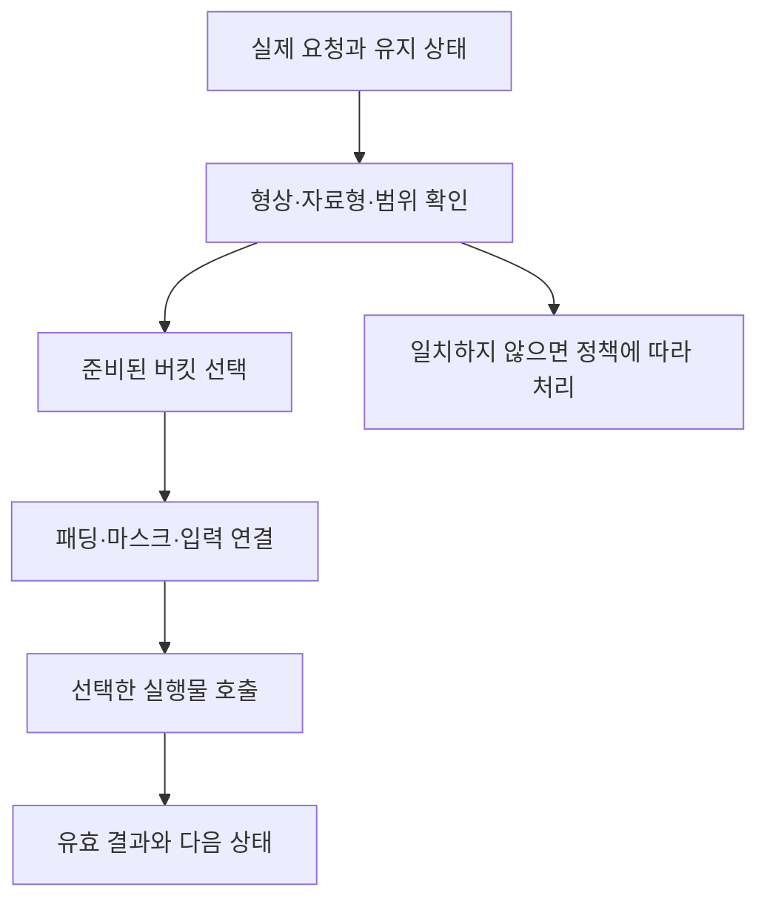

# Shape와 버킷: 길이가 바뀌는 입력을 준비된 프로그램에 맞추기

길이 8의 C 배열을 처리하도록 준비한 함수를 생각해 보자. 이번 입력은 길이 5이고 다음 입력은 길이 11이다. 함수가 임의 길이를 받을 수 없다면, 입력을 담을 공간과 처리 범위를 어떻게 맞출지 정해야 한다. NPU(Neural Processing Unit)에서도 어떤 형상으로 컴파일된 프로그램을 재사용할 것인지가 중요한 문제가 된다.

**버킷(bucket)은** 자주 등장하는 입력 조건을 몇 가지 준비된 실행 조건으로 묶는 방법이다. 예를 들어 길이 8·16의 실행물을 준비하고, 길이 5는 8 버킷에, 길이 11은 16 버킷에 배정한다. 버킷은 소프트웨어의 선택 단위다. PE(Processing Element) 안에 ‘버킷’이라는 하드웨어 저장소가 있는 것은 아니다. 공식 FXB(Furiosa Executable Bundle)도 준비된 커널과 입출력 시그니처를 제공하며, 런타임은 실제 요청에 맞는 조건을 사용한다. [공식 FXB 문서](https://developer.furiosa.ai/v2026.4.0/en/furiosa_llm/fxb.html)

## 1. 길이 하나만 다른 요청부터 처리해 본다

다음은 **버킷 선택 원리를 보여주는 순수 Python 코드**다. 실제 Furiosa 스케줄러를 복제한 구현이 아니며 NPU를 사용하지 않는다. 준비한 길이 중 입력을 담을 수 있는 가장 작은 길이를 고른다.

```python
from bisect import bisect_left

def choose_length_bucket(length, buckets):
    if length <= 0:
        raise ValueError("length must be positive")
    candidates = sorted(set(buckets))     # 중복을 없애고 작은 길이부터 비교한다.
    if not candidates or candidates[0] <= 0:
        raise ValueError("buckets must contain positive lengths")
    i = bisect_left(candidates, length)   # length 이상인 첫 후보의 위치를 찾는다.
    if i == len(candidates):
        # 범위를 벗어나면 거절한다. 긴 입력을 조용히 잘라 넣지 않는다.
        raise ValueError(f"no bucket covers {length} tokens")
    selected = candidates[i]
    return {"actual": length, "bucket": selected,
            "padding": selected - length} # 실제 데이터가 아닌 여유 위치 수

assert choose_length_bucket(5, [8, 16]) == {"actual": 5, "bucket": 8, "padding": 3}
print(choose_length_bucket(120, [128, 256, 512, 1024]))
```

| 실제 입력 길이 | 선택한 버킷 | 추가 위치 수 | 결과 처리에서 기억할 것 |
|---:|---:|---:|---|
| 5 | 8 | 3 | 유효 입력은 앞의 5개다. |
| 11 | 16 | 5 | 유효 입력은 앞의 11개다. |
| 17 | 없음 | — | 재빌드·다른 경로·요청 거절 중 명시된 정책이 필요하다. |
| 120 | 128 | 8 | 128개 모두 원래 입력이라고 해석하면 안 된다. |

**패딩(padding)은** 남는 위치를 채워 준비된 형상을 만드는 일이다. **마스크(mask)는** 어느 위치가 실제 입력인지 계산에 알려주는 정보다. 버킷 선택, 패딩, 마스크 준비는 함께 검토해야 한다.

## 2. 0을 채우기만 하면 결과가 보존되는가

값 `[1,3,5]`의 평균은 `(1+3+5)/3 = 3`이다. 길이 4에 맞춰 0을 더하고 네 값의 평균을 구하면 `2.25`가 된다. 0이 덧셈 결과를 바꾸지 않아도 **분모가 달라져 계산 의미가 바뀐 것**이다.

```python
values = [1.0, 3.0, 5.0]                 # 실제 입력 3개
padded = values + [0.0]                  # 길이 4의 실행 조건을 맞춘다.
valid = [True, True, True, False]        # 마지막 값은 입력이 아니라 패딩이다.

wrong_mean = sum(padded) / len(padded)   # 9 / 4 = 2.25: 패딩도 원소로 세는 오류
valid_count = sum(valid)                 # True는 1로 합산되어 실제 개수 3이 된다.
masked_mean = sum(v for v, ok in zip(padded, valid) if ok) / valid_count
assert wrong_mean == 2.25
assert masked_mean == 3.0                # 원래 계산의 분모와 유효 값을 보존한다.
```

원소별 `x+1`처럼 각 위치를 독립적으로 계산한 뒤 유효 출력만 잘라 쓰는 경우와, 전체 길이에 걸쳐 평균·최대·attention을 계산하는 경우는 다르다. Attention은 다른 토큰의 값을 가중합하므로 패딩 위치가 가중치 계산에 참여하지 않게 해야 한다. 문장 생성의 **causal mask**는 미래 토큰을 보지 못하게 하는 규칙이고, **padding mask**는 존재하지 않는 위치를 보지 못하게 하는 규칙이다. 두 규칙은 목적이 다르다. 실제 모델의 마스크 규약을 유지하며 패딩해야 한다.

이 예의 Python 평균은 설명용이다. 모든 NPU 커널이 `valid` 배열을 인수로 받거나 마스킹된 계산을 자동 생략한다는 뜻은 아니다. 사용하는 모델·커널·실행계획이 유효 길이를 표현하는 방식을 따라야 한다.

## 3. shape는 길이 하나보다 많은 정보를 갖는다

**Shape(형상)는** 각 축(axis, 좌표 방향)의 길이다. 언어 모델에서 흔한 `[B,S,D]`는 B개의 요청, 요청마다 S개 토큰 위치, 토큰마다 D개 특징값을 뜻한다. 다음 예에서는 B=2, S=3, D=2이므로 전체 원소 수는 `2×3×2 = 12`다.

| 좌표의 의미 | 첫 요청 | 둘째 요청 |
|---|---|---|
| 토큰 위치 0의 특징 두 개 | `[1,2]` | `[7,8]` |
| 토큰 위치 1의 특징 두 개 | `[3,4]` | `[9,10]` |
| 토큰 위치 2의 특징 두 개 | `[5,6]` | `[11,12]` |

입력 토큰 ID는 보통 `[B,S]`의 정수이고, 이를 embedding(토큰별 특징 벡터 조회)하면 `[B,S,D]`가 된다. **토큰 하나와 숫자 하나를 같은 것으로 취급하지 않는다.** 토큰 하나가 수백·수천 개 특징값으로 표현될 수 있기 때문이다.

같은 shape라도 자료형(dtype), 저장 배치(layout), 저장 간격(stride)이 다르면 호출 계약이 달라질 수 있다. 예를 들어 행 우선 `[2,3]`의 stride `(3,1)`은 다음 행으로 원소 3개, 다음 열로 1개 이동한다는 뜻이다. 행과 열을 교환한 view는 같은 버퍼를 다른 간격으로 읽을 수 있다. `reshape`는 원소 수를 유지하며 차원 길이를 바꾸는 작업이므로, 유효 입력을 더 만드는 패딩과도 다르다.

버킷은 이러한 조건 중 어떤 것을 고정하는지까지 정의해야 한다. 공식 FXB의 입출력 시그니처와 과거 `BucketConfig` 예시는 버킷이 단순한 파일 이름이 아니라 실행 조건임을 보여준다. 과거 API의 필드·옵션을 현재 버전에 그대로 옮겨 쓰지는 않는다. [FXB 시그니처](https://developer.furiosa.ai/v2026.4.0/en/furiosa_llm/fxb.html), [2026.2의 버킷 설정 예](https://developer.furiosa.ai/v2026.2.0/en/furiosa_llm/model-preparation.html)



## 4. Prefill과 decode를 값의 변화로 구분한다

LLM(Large Language Model, 대규모 언어 모델)의 입력 문장이 토큰 `[A,B,C]`라고 하자. 여기의 A·B·C는 토큰을 구분하는 기호이며 실제 구현에서는 정수 ID다.

**Prefill**은 새 입력 토큰들을 처리하여 이후 생성에 필요한 상태를 준비하는 단계다. **Decode**는 이미 계산한 문맥을 재사용하면서 다음 토큰을 생성하는 단계다. **KV(Key–Value) cache**는 attention 계산에서 다시 참조할 이전 토큰의 key·value 벡터를 저장한다.

| 실행 단계 | 이번에 새로 계산할 입력 | 시작할 때 재사용할 KV | 이번 계산이 참조하는 문맥 | 완료 뒤 KV |
|---|---|---|---|---|
| 첫 prefill | A, B, C: 3개 | 없음 | 최대 A, B, C의 3개 위치 | A, B, C에 대한 값 |
| 다음 decode | 방금 생성한 D: 1개 | A, B, C | A, B, C, D의 4개 위치 | A, B, C, D에 대한 값 |
| 그다음 decode | 다음 토큰 E: 1개 | A, B, C, D | 5개 위치 | 5개 위치의 값 |

첫 prefill의 출력으로 D를 선택했더라도 D 자체의 KV는 다음에 D를 입력으로 처리할 때 추가된다는 점을 구분한다. 따라서 “새 입력은 1개”와 “참조하는 문맥은 4개”는 동시에 참이다. 이 차이를 무시하면 decode를 항상 길이 1짜리 작은 계산이라고 오해하게 된다.

설명용으로 `(배치 수, 참조 문맥 길이, 새 입력 길이)`를 쓰면 `(1,128,128)`과 `(1,1024,1)`은 다른 일을 나타낸다. 이 표기는 **개념 설명**이며 모든 SDK(Software Development Kit) 버전의 공통 생성자 인수가 아니다. 과거 2026.2 문서는 prefill·decode의 버킷 설정 예와 모델별 preset(미리 준비된 설정)을 보여준다. 아래 7절의 실행 예는 2026.4의 FXB 명령을 따른다. [역사적 모델 준비 API](https://developer.furiosa.ai/v2026.2.0/en/furiosa_llm/model-preparation.html)

### Prefix cache가 있으면 전체 길이와 새 계산 길이가 달라진다

기존 요청에서 `[A,B,C]`의 유효한 KV를 보관했고 새 요청이 `[A,B,C,X,Y]`라면, 앞의 세 토큰을 재사용하고 새 구간 X·Y를 계산할 기회가 생긴다. 이때 전체 문맥 길이는 5이지만 새 입력 길이는 2다. 단지 뜻이 비슷한 문장이라는 이유로 재사용할 수는 없다. 토큰이 같은 시작 구간과 해당 모델·상태에 유효한 KV가 필요하다. [공식 Prefix Caching](https://developer.furiosa.ai/v2026.4.0/en/furiosa_llm/prefix-caching.html)

| 상황 | 전체 문맥 | 재사용한 앞부분 | 새 계산 구간 |
|---|---:|---:|---:|
| 처음 받는 길이 5 요청 | 5 | 0 | 5 |
| 앞 3개 토큰의 유효 cache 적중 | 5 | 3 | 2 |

## 5. 패딩 비용을 수로 비교한다

<!-- interactive:bucket -->

입력 길이 120을 128 버킷에 넣으면 8개 위치가 남고, 512 버킷에 넣으면 392개가 남는다. 실제 입력이 차지하는 비율은 각각 `120/128=93.75%`, `120/512≈23.44%`다. 이는 **위치 수의 비율**이며 NPU 사용률이나 실행시간 예측값이 아니다.

| 실제 길이 | 버킷 길이 | 패딩 수 | 단순 위치 기준 유효 비율 |
|---:|---:|---:|---:|
| 120 | 128 | 8 | 93.75% |
| 120 | 256 | 136 | 46.88% |
| 120 | 512 | 392 | 23.44% |

독립적인 토큰별 계산은 토큰 수와 함께 커지는 부분이 있고, 일반적인 dense self-attention의 두 토큰 간 점수 표는 길이 S에 대해 `S×S` 위치를 가진다. 하지만 전체 모델에는 가중치 읽기, 행렬곱, KV 접근, 호출 비용도 있다. 패딩 비율 또는 점수 표의 크기 비율을 전체 지연 비율로 바로 바꾸면 안 된다. 이것은 연산량을 이해하기 위한 설명이며 RNGD 실측 수치가 아니다.

[버킷 분포 비교 예제](../examples/bucket_planner.py)는 실제 입력 길이 목록에 대해 패딩 위치 수를 비교한다. 후보를 줄이는 데 사용한 뒤, 선택한 후보의 정확성과 실제 시간을 따로 측정한다.

## 6. 버킷을 촘촘하게 준비할 때의 비용

길이마다 실행물을 하나씩 만들면 패딩은 줄일 수 있지만 준비할 변형이 많아진다. 예를 들어 배치 후보 2개, 길이 후보 3개, 자료형 후보 2개를 모두 조합하면 `2×3×2=12`개 조건이다. 여기에 서로 다른 장치 배치까지 더하면 후보 수가 더 늘 수 있다. 이는 조합 증가를 보여주는 모형이며, 공식 빌더가 언제나 이 모든 조합을 생성한다는 뜻은 아니다.

각 변형에는 컴파일 시간, 파일 공간, 로딩과 메타데이터 관리 비용이 들 수 있다. FuryNo5의 제안은 **실제 입력 분포를 먼저 기록하고, 자주 쓰는 조건부터 준비**하는 것이다. 드문 입력은 다른 준비된 범위, 별도 빌드, 명시적 거절 등 제품 계약에 맞는 정책을 정한다. 성능을 위해 입력을 알리지 않고 잘라 버리는 것은 버킷 최적화가 아니다.

## 7. 빌드 때 만드는 조건과 실행 때 선택하는 조건

공식 2026.4 릴리스는 `furiosa-llm serve`에서 예전 `--prefill-buckets`, `--decode-buckets`, `--max-batch-size` 등의 옵션을 제거했다고 명시한다. 버킷 집합은 `fxb build` 단계에서 준비하고, 실행 시에는 그 집합 안에서 스케줄러가 조건을 선택한다. 예전 문서의 옵션을 최신 서버에 그대로 붙이지 말자. [2026.4 릴리스의 변경 사항](https://developer.furiosa.ai/v2026.4.0/en/whatsnew/release-2026.4.0.html).

```bash
# 설치된 버전과 실제 지원 옵션을 먼저 기록한다.
python -m pip show furiosa-llm
fxb build --help
furiosa-llm serve --help

# 공식 FXB 문서에 있는 dry-run 흐름을 사용하는 예.
# 이 명령은 해당 아키텍처가 현재 빌더에서 지원되어야 성립한다.
fxb build Qwen/Qwen3-8B-FP8 qwen3-8b-check.fxb \
  --max-model-len 4096 --dry-run

# 이미 빌드된 파일의 버킷과 I/O를 조사한다.
fxb show ./qwen3-8b.fxb
fxb inspect ./qwen3-8b.fxb
```

위 CLI(Command-Line Interface)는 조회 시점의 [2026.4 계열 FXB 문서](https://developer.furiosa.ai/v2026.4.0/en/furiosa_llm/fxb.html)에 근거한다. 이번 작성 환경에서는 실행하지 않았다. `/v2026.4.0/` URL도 후속 2026.4.1 내용이 보이므로 설치된 2026.4.0의 도움말과 대조해야 한다. 컴파일하지 않는 `--dry-run`도 설정·가중치 메타데이터를 조회하기 위한 다운로드가 발생할 수 있으므로 '아무 작업도 하지 않는다'는 뜻은 아니다.

`--max-model-len`도 시점을 구분한다. 빌드에서는 준비할 프로그램 범위에 영향을 주고, 서빙에서는 이미 있는 FXB의 범위를 확장하지 않은 채 수용할 문맥 길이를 제한한다. 실제 수용 한도는 모델 설정, FXB 범위, KV 메모리 등과 함께 결정된다. [공식 성능 설정](https://developer.furiosa.ai/v2026.4.0/en/furiosa_llm/performance-optimization.html).

## 8. 실행 중에는 요청을 어떻게 묶는지가 중요하다

**배치(batch)는** 여러 요청을 한 번의 실행으로 묶은 것이다. 요청 한 개가 들어올 때마다 즉시 처리하면 기다림은 짧지만 작은 계산을 자주 제출할 수 있다. 네 개가 모일 때까지 기다리면 가중치를 함께 쓰는 기회가 생겨도 먼저 온 요청의 대기시간이 늘어난다. 좋은 버킷은 요청이 언제 들어오는지까지 포함해 평가해야 한다.

동일한 버킷 집합이라도 요청을 묶는 방법에 따라 결과가 달라진다. 긴 요청 하나 때문에 짧은 요청들이 큰 조건을 사용하면 불필요한 일이 늘어날 수 있다. 그렇다고 길이별로 무한히 큐를 나누면 각 큐가 충분히 차기까지 기다리면서 TTFT(Time To First Token, 첫 토큰까지의 시간)가 나빠질 수 있다. 처리량과 응답 지연을 함께 평가해야 한다.

공식 Furiosa-LLM의 profile-guided decode batching은 실측 비용을 이용해 배치와 버킷 선택을 조정한다. 별도로 overlap scheduling은 NPU가 현재 batch를 실행하는 동안 CPU(Central Processing Unit)가 다음 batch를 준비한다. 이는 커널 자체를 빠르게 만드는 기능과 다르다. 새 요청이 이미 준비된 batch에 참여하지 못해 TTFT가 늘 수 있고, 지원하지 않는 모델·기능 조합도 있다. [성능 최적화](https://developer.furiosa.ai/v2026.4.0/en/furiosa_llm/performance-optimization.html), [Overlap Scheduling](https://developer.furiosa.ai/v2026.4.0/en/furiosa_llm/overlap-scheduling.html).


Overlap(겹침)의 의미도 계산을 생략하는 것이 아니다. 예를 들어 현재 NPU 작업 중에 CPU가 다음 요청들의 입력 버퍼와 KV 할당을 준비해 두는 것이다. 다음 토큰의 실제 값이 필요한 부분은 앞 작업의 결과를 받은 뒤 채운다. 이처럼 준비와 계산을 겹쳐 빈 시간을 줄일 수 있지만, 이미 준비된 배치에 새 요청이 곧바로 참여하지 못할 수 있다. [Overlap Scheduling의 실행 순서](https://developer.furiosa.ai/v2026.4.0/en/furiosa_llm/overlap-scheduling.html)


## 9. FuryNo5가 재사용 전에 확인할 실행계약

FuryNo5 개발자의 관점에서 재사용 키에는 적어도 무엇을 계산하는지, 입력 shape·dtype·layout이 무엇인지, 어떤 SDK와 장치 배치에서 컴파일했는지의 식별이 필요하다. 다음 표는 **설계 검토용**이다. 현재 캐시가 모든 항목을 이 이름으로 구현했다는 뜻은 아니며, 실제 구현은 [11장](11-furyno5-compiler.md)의 파일·함수를 따라 확인한다.

| 항목 | 누락하면 생길 수 있는 문제 |
|---|---|
| 연산 그래프와 상수 계약 | 다른 계산에 같은 EDF를 잘못 연결 |
| shape·dtype·layout·stride | 입출력 바인딩 실패 또는 잘못된 해석 |
| SDK·컴파일러·산출물 버전 | 역직렬화 또는 lowering 호환성 실패 |
| PE 수와 topology(장치 연결·배치 구성) | 메모리·분할·장치 매핑 계약 불일치 |
| 외부 가중치의 형식·정렬 | 메모리 크기만 같고 논리 배치가 다른 데이터 사용 |
| 상태와 버킷의 전이 | prefill 결과를 잘못된 decode 상태로 연결 |

큰 TCL(Tensor Contraction Language) 하나로 합치는 선택과 버킷 설계는 함께 검토한다. 입력 조건별로 모든 블록을 다시 만드는지, 길이에 민감하지 않은 블록을 공유할 수 있는지, 경계 텐서 이동이 공유의 이점을 상쇄하는지 측정한다. 적절한 크기는 컴파일 시간, 산출물 크기, 장치 메모리, 반복 지연시간을 동시에 비교해 정한다.

## 10. 비교 실험에 남길 값

한 개의 최대 처리량 숫자 대신 실제 입력 분포, 버킷 세트, padding 비율, prefix cache 조건, 컴파일 시간·최대 RSS(Resident Set Size), 로드 시간, peak HBM(High Bandwidth Memory), TTFT, TPOT(Time Per Output Token, 출력 토큰당 시간), 요청 지연 p50·p95를 함께 남긴다. 짧은 입력만 빠른 세트와 긴 입력도 안정적으로 처리하는 세트는 서비스 요구에 따라 가치가 다르다.

여기서 우선순위는 FuryNo5의 해석이다. 처음 포팅할 때는 가장 작은 검증 가능한 입력으로 정확한 실행을 확보한다. 그다음 실제 수요가 큰 shape를 추가한다. 최종적으로 긴 문맥과 높은 동시성까지 확장한다. 이 순서가 모델의 모든 동작을 작은 shape 하나로 검증할 수 있다는 뜻은 아니다. 경계 길이·마스크·상태 전이를 별도 테스트해야 한다.

p50은 측정값의 가운데 수준, p95는 95%의 요청이 그 이하에서 끝나는 수준이다. 평균이 좋아져도 일부 긴 요청의 대기가 늘면 p95가 악화될 수 있다. 작은 입력의 정확성을 먼저 잡는 순서는 개발을 시작하기 위한 지침이며, 실제 배포에는 지원 범위의 경계·마스크·상태 전이까지 확인해야 한다.


## 출처

| 자료 | 확인한 내용 |
|---|---|
| [FXB 문서](https://developer.furiosa.ai/v2026.4.0/en/furiosa_llm/fxb.html) | 버킷·시그니처 조사와 빌드 명령 |
| [2026.2 Model Preparation](https://developer.furiosa.ai/v2026.2.0/en/furiosa_llm/model-preparation.html) | 역사적 버킷 설정 예·모델별 preset. 현재 2026.4 CLI와 구분 |
| [2026.4 릴리스](https://developer.furiosa.ai/v2026.4.0/en/whatsnew/release-2026.4.0.html) | serve-time bucket 옵션 제거 |
| [Performance Optimization](https://developer.furiosa.ai/v2026.4.0/en/furiosa_llm/performance-optimization.html) | 길이 한도·profile-guided batching |
| [Overlap Scheduling](https://developer.furiosa.ai/v2026.4.0/en/furiosa_llm/overlap-scheduling.html) | 호스트 준비와 장치 실행의 겹침 |
| [Prefix Caching](https://developer.furiosa.ai/v2026.4.0/en/furiosa_llm/prefix-caching.html) | 유효 prefix 상태 재사용 |
