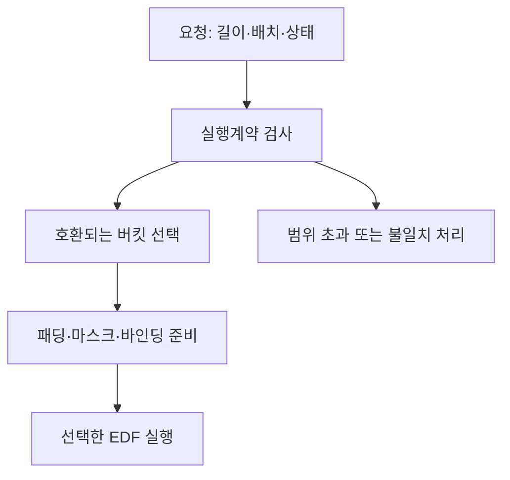

# Shape와 버킷 설계

## 버킷은 하드웨어 부품이 아니다

**버킷(bucket)은 자주 쓰는 입력 조건을 몇 가지 실행 조건으로 묶는 소프트웨어 전략이다.** NPU의 PE(Processing Element, 처리 요소)가 버킷이라는 저장소를 갖는다는 뜻은 아니다. 컴파일된 프로그램이 기대하는 조건과 실제 요청의 조건을 연결하기 위해 런타임과 컴파일러가 사용하는 개념이다.

shape는 텐서의 각 축 길이다. 예를 들어 `[B, S, D]`는 배치 수 `B`, 토큰 수 `S`, 임베딩 차원 `D`인 텐서를 나타낸다. 같은 shape라도 데이터형(dtype), 물리적 배치(layout), stride(다음 원소까지의 간격), 분할 방식이 다르면 동일한 프로그램에 그대로 넣을 수 있다고 보장할 수 없다. 버킷 설계는 입력 길이를 반올림하는 일에서 시작할 수 있지만, 실행계약 전체를 맞추는 일이 되어야 한다. [공식 FXB 입출력 시그니처](https://developer.furiosa.ai/v2026.4.0/en/furiosa_llm/fxb.html), [공식 BucketConfig 정의](https://developer.furiosa.ai/latest/en/_modules/furiosa_llm/artifact/types/config.html).



## Prefill과 Decode에서 shape가 다른 이유

LLM(Large Language Model, 대규모 언어 모델)의 **prefill**은 새 프롬프트 구간을 처리하고 KV(Key–Value) 캐시를 채우는 단계다. **decode**는 이전 문맥의 KV를 참고해 다음 토큰을 만드는 단계다. 둘 다 attention을 수행하지만 한 번에 새로 넣는 토큰 수와 참조하는 문맥 길이가 다르다.

공식 설정 소스의 attention 관련 표현에서는 배치 수, attention이 참조하는 길이, 이번에 새로 넣는 입력 토큰 수를 나누어 다룬다. 예를 들어 `(batch=1, attention=1024, input=1)`은 새 입력 한 개가 최대 1024 길이의 문맥을 참조하는 모양을 설명한다. `(1, 128, 128)`은 첫 입력 구간을 한 번에 처리하는 모양의 예다. 이 숫자는 교육용 예이며 모든 모델에 바로 넣을 유효 버킷 세트가 아니다. 실제 프리필 존재 여부, 중복, 양의 차원, 최대 문맥 등의 검증을 거쳐야 한다. [BucketConfig 소스](https://developer.furiosa.ai/latest/en/_modules/furiosa_llm/artifact/types/config.html).

| 구분 | 주로 변하는 조건 | 설계할 때 확인할 것 |
|---|---|---|
| Tokenwise 연산 | 한 번에 처리할 토큰 수 | 작은 decode와 큰 prefill을 같은 변형으로 처리할 필요가 있는가? |
| Attention | 배치, 문맥 길이, 새 입력 길이 | KV 캐시와 입력 위치·마스크가 버킷 조건에 맞는가? |
| 이미지 모델 | 배치, 높이, 너비 등 | 패딩 후 출력 좌표·유효 영역을 올바르게 복원하는가? |
| 상태가 있는 모델 | 입력 shape와 유지 상태 | 상태의 크기·수명·갱신 순서가 프로그램 계약에 맞는가? |

마지막 두 행은 FuryNo5 관점에서 같은 원리를 일반화한 설계 항목이다. 공식 LLM 버킷 CLI(Command-Line Interface)가 이미지 모델의 버킷을 자동 생성한다는 뜻이 아니다.

## 직접 조절해 보는 패딩 비용

<!-- interactive:bucket -->

입력 길이가 120인데 128 버킷을 쓰면 8개의 여유 위치가 생긴다. 512 버킷이면 392개다. 이 계산은 단순하지만 실행시간은 같은 비율로 늘지 않는다. 마스킹된 위치를 얼마나 계산하는지, 타일링과 메모리 접근이 어떻게 생성되는지, batch 구성과 정렬이 무엇인지에 따라 달라진다.

일반적인 dense self-attention의 score 행렬 크기는 길이의 제곱에 비례할 수 있지만, 그 사실을 전체 모델의 지연 비율로 바꾸면 안 된다. Q/K/V projection, MLP(Multi-Layer Perceptron), 캐시 읽기, 제출 비용은 서로 다른 비중을 가진다. 버킷별로 전체 시간과 커널 시간을 함께 측정하는 이유다. 이 단락은 연산량에 대한 일반적 해석이며 RNGD 성능 수치가 아니다.

## 버킷을 많이 만들면 생기는 비용

버킷을 촘촘하게 만들면 패딩을 줄일 기회가 늘어난다. 대신 컴파일할 변형, 디스크에 보관할 프로그램, 시작 시 준비할 메타데이터가 증가한다. 가능한 모든 축 조합을 무조건 펼치면 `배치 후보 수 × 길이 후보 수 × dtype 후보 수 × 토폴로지 후보 수`로 후보 공간이 커진다. 실제 빌더가 모든 조합을 생성한다는 의미가 아니라, 설계 검토에서 경계해야 할 조합 증가를 보여주는 식이다.

FuryNo5의 제안은 먼저 운영 입력의 분포를 저장하고, 자주 쓰는 조건을 준비하고, 드문 조건은 별도의 처리 정책으로 남기는 것이다. 한 번에 어떤 조건까지 수용할지 정하면 컴파일 비용과 런타임 단순성도 함께 통제할 수 있다. 성능만을 위해 사용자의 입력을 조용히 잘라 버리는 것은 이 정책에 포함하지 않는다. 길이를 줄일 필요가 있다면 제품의 명시적인 입력 계약이어야 한다.

아래는 순수 Python 설명 예제다. NPU를 사용하지 않고 준비한 길이 중 가장 작은 호환 길이를 고른다. 실제 런타임의 버킷 선택 알고리즘을 복제한 코드는 아니다.

```python
from bisect import bisect_left

def choose_length_bucket(length, buckets):
    if length <= 0:
        raise ValueError("length must be positive")
    candidates = sorted(set(buckets))
    if not candidates or candidates[0] <= 0:
        raise ValueError("buckets must contain positive lengths")
    i = bisect_left(candidates, length)
    if i == len(candidates):
        raise ValueError(f"no bucket covers {length} tokens")
    selected = candidates[i]
    return {"actual": length, "bucket": selected,
            "padding": selected - length}

print(choose_length_bucket(120, [128, 256, 512, 1024]))
```

[전체 분포를 비교하는 예제](../examples/bucket_planner.py)에서는 입력 길이들을 한 번에 넣고 준비할 버킷 세트마다 사용하지 않는 위치 수를 비교할 수 있다. 이 비교는 컴파일 후보를 줄이기 위한 전처리이지 실제 지연시간 최적화의 증거가 아니다.

## 빌드 시점과 서빙 시점을 나누기

공식 2026.4 릴리스는 `furiosa-llm serve`에서 예전 `--prefill-buckets`, `--decode-buckets`, `--max-batch-size` 등의 옵션을 제거했다고 명시한다. 버킷 집합은 `fxb build` 단계에서 준비하고, 실행 시에는 그 집합 안에서 스케줄러가 조건을 선택한다. 예전 문서의 옵션을 최신 서버에 그대로 붙이지 말자. [2026.4 릴리스의 변경 사항](https://developer.furiosa.ai/v2026.4.0/en/whatsnew/release-2026.4.0.html).

```bash
# 설치된 버전과 실제 지원 옵션을 먼저 기록한다.
python -m pip show furiosa-llm
fxb build --help
furiosa-llm serve --help

# 공식 FXB 문서에 있는 dry-run 흐름을 사용하는 예.
# 이 명령은 해당 아키텍처가 현재 빌더에서 지원되어야 성립한다.
fxb build Qwen/Qwen3-8B-FP8 qwen3-8b-check.fxb \
  --max-model-len 4096 --dry-run

# 이미 빌드된 파일의 버킷과 I/O를 조사한다.
fxb show ./qwen3-8b.fxb
fxb inspect ./qwen3-8b.fxb
```

위 CLI는 조회 시점의 [2026.4 계열 FXB 문서](https://developer.furiosa.ai/v2026.4.0/en/furiosa_llm/fxb.html)에 근거한다. 이번 작성 환경에서는 실행하지 않았다. `/v2026.4.0/` URL도 후속 2026.4.1 내용이 보이므로 설치된 2026.4.0의 도움말과 대조해야 한다. 컴파일하지 않는 `--dry-run`도 설정·가중치 메타데이터를 조회하기 위한 다운로드가 발생할 수 있으므로 '아무 작업도 하지 않는다'는 뜻은 아니다.

`--max-model-len`도 시점을 구분한다. 빌드에서는 준비할 프로그램 범위에 영향을 주고, 서빙에서는 이미 있는 FXB의 범위를 확장하지 않은 채 수용할 문맥 길이를 제한한다. 실제 수용 한도는 모델 설정, FXB 범위, KV 메모리 등과 함께 결정된다. [공식 성능 설정](https://developer.furiosa.ai/v2026.4.0/en/furiosa_llm/performance-optimization.html).

## 런타임 최적화와 버킷의 연결

동일한 버킷 집합이라도 요청을 묶는 방법에 따라 결과가 달라진다. 긴 요청 하나 때문에 짧은 요청들이 큰 조건을 사용하면 불필요한 일이 늘어날 수 있다. 그렇다고 길이별로 무한히 큐를 나누면 각 큐가 충분히 차기까지 기다리면서 TTFT(Time To First Token, 첫 토큰까지의 시간)가 나빠질 수 있다. 처리량과 응답 지연을 함께 평가해야 한다.

공식 Furiosa-LLM의 profile-guided decode batching은 실측 비용을 이용해 배치와 버킷 선택을 조정한다. 별도로 overlap scheduling은 NPU가 현재 batch를 실행하는 동안 CPU가 다음 batch를 준비한다. 이는 커널 자체를 빠르게 만드는 기능과 다르다. 새 요청이 이미 준비된 batch에 참여하지 못해 TTFT가 늘 수 있고, 지원하지 않는 모델·기능 조합도 있다. [성능 최적화](https://developer.furiosa.ai/v2026.4.0/en/furiosa_llm/performance-optimization.html), [Overlap Scheduling](https://developer.furiosa.ai/v2026.4.0/en/furiosa_llm/overlap-scheduling.html).

KV prefix cache 적중도 분포를 바꾼다. 동일한 앞부분을 재사용하면 이번에 실제로 계산할 입력 구간은 짧아지지만, 참조할 문맥은 길 수 있다. 따라서 전체 프롬프트 길이만으로 prefill 작업량을 추정하면 오판한다. cache는 토큰이 같은 시작 구간과 유효한 상태를 재사용해야 하며, 의미가 비슷하다는 이유만으로 동일 KV를 쓸 수는 없다. [Prefix Caching](https://developer.furiosa.ai/v2026.4.0/en/furiosa_llm/prefix-caching.html).

## FuryNo5에서 먼저 고정할 계약

FuryNo5 개발자의 관점에서 재사용 키에는 적어도 무엇을 계산하는지, 입력 shape·dtype·layout이 무엇인지, 어떤 SDK와 장치 배치에서 컴파일했는지의 식별이 필요하다. 다음 표는 **설계 검토용**이다. 현재 캐시가 모든 항목을 이 이름으로 구현했다는 뜻은 아니며, 실제 구현은 [11장](11-furyno5-compiler.md)의 파일·함수를 따라 확인한다.

| 항목 | 누락하면 생길 수 있는 문제 |
|---|---|
| 연산 그래프와 상수 계약 | 다른 계산에 같은 EDF를 잘못 연결 |
| shape·dtype·layout·stride | 입출력 바인딩 실패 또는 잘못된 해석 |
| SDK·컴파일러·산출물 버전 | 역직렬화 또는 lowering 호환성 실패 |
| PE 수와 topology | 메모리·분할·장치 매핑 계약 불일치 |
| 외부 가중치의 형식·정렬 | 메모리 크기만 같고 논리 배치가 다른 데이터 사용 |
| 상태와 버킷의 전이 | prefill 결과를 잘못된 decode 상태로 연결 |

큰 TCL 하나로 합치는 선택과 버킷 설계는 함께 검토한다. 입력 조건별로 모든 블록을 다시 만드는지, 길이에 민감하지 않은 블록을 공유할 수 있는지, 경계 텐서 이동이 공유의 이점을 상쇄하는지 측정한다. 적절한 크기는 컴파일 시간, 산출물 크기, 장치 메모리, 반복 지연시간을 동시에 비교해 정한다.

## 실습 결과에 남길 항목

한 개의 최대 처리량 숫자 대신 실제 입력 분포, 버킷 세트, padding 비율, prefix cache 조건, 컴파일 시간·최대 RSS(Resident Set Size), 로드 시간, peak HBM(High Bandwidth Memory), TTFT, TPOT(Time Per Output Token), 요청 지연 p50·p95를 함께 남긴다. 짧은 입력만 빠른 세트와 긴 입력도 안정적으로 처리하는 세트는 서비스 요구에 따라 가치가 다르다.

여기서 우선순위는 FuryNo5의 해석이다. 처음 포팅할 때는 가장 작은 검증 가능한 입력으로 정확한 실행을 확보한다. 그다음 실제 수요가 큰 shape를 추가한다. 최종적으로 긴 문맥과 높은 동시성까지 확장한다. 이 순서가 모델의 모든 동작을 작은 shape 하나로 검증할 수 있다는 뜻은 아니다. 경계 길이·마스크·상태 전이를 별도 테스트해야 한다.

## 출처

| 자료 | 확인한 내용 |
|---|---|
| [FXB 문서](https://developer.furiosa.ai/v2026.4.0/en/furiosa_llm/fxb.html) | 버킷·시그니처 조사와 빌드 명령 |
| [BucketConfig 소스](https://developer.furiosa.ai/latest/en/_modules/furiosa_llm/artifact/types/config.html) | 역사적 설정 필드와 attention tuple 의미. 페이지는 2026.3 표기 |
| [2026.4 릴리스](https://developer.furiosa.ai/v2026.4.0/en/whatsnew/release-2026.4.0.html) | serve-time bucket 옵션 제거 |
| [Performance Optimization](https://developer.furiosa.ai/v2026.4.0/en/furiosa_llm/performance-optimization.html) | 길이 한도·profile-guided batching |
| [Overlap Scheduling](https://developer.furiosa.ai/v2026.4.0/en/furiosa_llm/overlap-scheduling.html) | 호스트 준비와 장치 실행의 겹침 |
| [Prefix Caching](https://developer.furiosa.ai/v2026.4.0/en/furiosa_llm/prefix-caching.html) | 유효 prefix 상태 재사용 |
