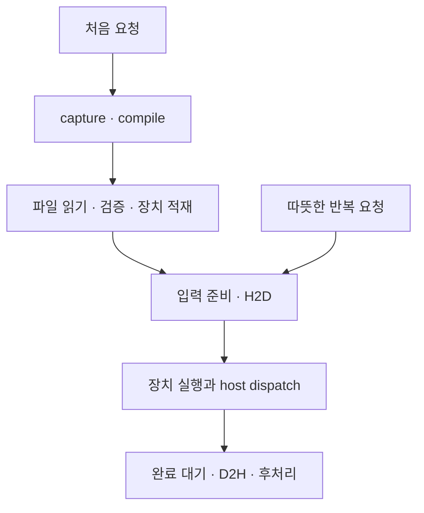
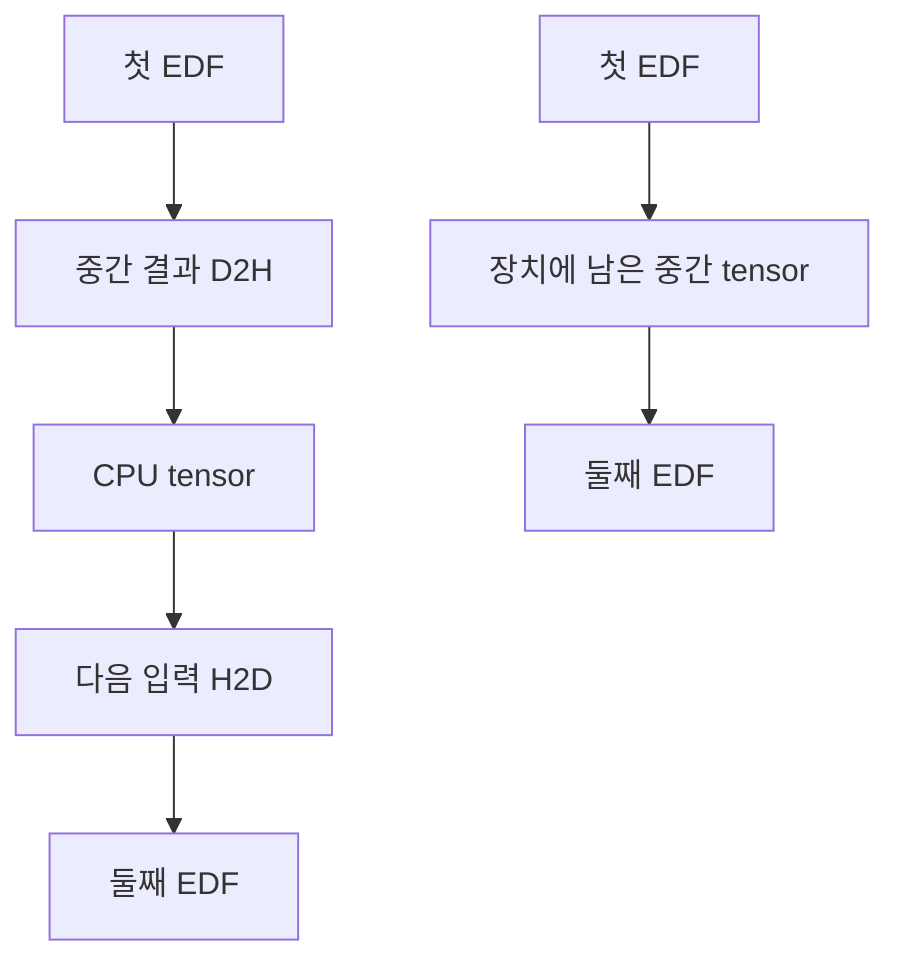
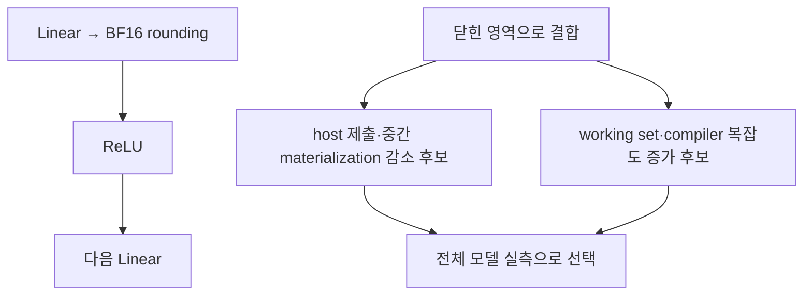

# 최적화: 같은 계산을 같은 범위로 재고 큰 비용부터 줄이기

> **전체 경로에서의 위치**
>
> 정확한 실행·측정 → **병목 선택과 변경** → 같은 조건의 재측정
>
> 계층을 새로 추가하는 장이 아니라 전체 경로의 비용을 줄이는 장이다. 컴파일·적재·전송·제출·연산을 나누어 어느 경계를 바꿀지 정한다. 저수준 스케줄은 [08장](08-eisa-visa.md), 모델 구조를 바꾸는 방법은 [19장](19-model-optimization.md)에서 이어간다.

CPU(Central Processing Unit) 함수의 앞뒤에 타이머를 놓으면 경과 시간을 잴 수 있다. 그러나 NPU(Neural Processing Unit) 호출은 **일을 제출한 뒤 CPU로 먼저 돌아올 수 있다.** 이때 함수가 돌아온 시간만 재면 장치 계산이 끝나기 전까지의 일부 시간만 측정하게 된다. 또한 첫 호출에는 컴파일·파일 읽기·가중치 적재가 포함될 수 있어 반복 호출과 같은 조건이 아니다.

따라서 첫 최적화 작업은 코드 변경보다 **어디서부터 어디까지 재는지 정하는 일**이다. 여기서는 한 요청의 시간을 나누고, 실제 fxbX 호출을 계측한 다음, 데이터 이동·저장 배치·연산 결합을 비교하는 순서로 진행한다.

> **FuryNo5의 해석** · 이 장의 작업 순서는 공식 필수 규격이 아니다. 반복 요청의 지연시간, 처리량, 시작 시간, 메모리, 컴파일 시간 중 무엇이 목표인지에 따라 바꿀 수 있다. 계산 예의 가상 시간과 저장소에 보존된 NPU 실측은 명확히 구분한다.

## 1. 첫 호출과 반복 호출의 시간을 분리한다



위 그림은 모델을 새로 캡처·컴파일하는 준비 경로다. 이미 만든 FXB·fxbX를 적재하는 경우에는 해당 준비를 반복하지 않고 파일 검사·장치 적재부터 시작한다.

H2D(Host to Device)는 호스트에서 장치로, D2H(Device to Host)는 장치에서 호스트로 데이터를 옮기는 것이다. **Host**는 장치를 제어하는 CPU 측 프로세스이며, **wall time**은 실제 시계로 잰 시작부터 완료까지의 시간이다. “모델이 198초 걸린다”는 관측은 초기 적재인지, 첫 compile인지, 요청 지연인지부터 나눠야 한다. 이 그림의 항목은 계측 구간이며, 비동기 overlap이 있으면 단순 합이 실제 wall time과 일치하지 않을 수 있다.

| 측정값 | 포함 범위 | 용도 |
|---|---|---|
| cold 준비 | 모델 연결을 추출하는 capture·컴파일·검증·적재를 각각 기록 | 개발 속도와 배포 시작 시간 |
| warm 요청 | 실제 사용자 입력부터 완료된 결과까지 | 제품 체감 지연 |
| resident 실행 | 이미 장치에 있는 입력에서 완료된 장치 결과까지 | kernel/dispatch 최적화 |
| 장치 task 합계 | trace에 나타난 task별 시간의 합 | 일이 많이 든 kernel 후보 찾기 |

병렬 task의 시간 합은 wall time이 아니다. FuryNo5의 `rank_hotspots`도 이를 명시한다. 겹쳐 실행된 두 task가 각각 10 µs라고 해서 요청이 20 µs 걸렸다고 계산하면 안 된다. [hotspot 집계기](https://github.com/smallstep-zzz/FuryNo5/blob/bba9efea8201aec48150514a35d0b637d29d107e/tplmachine/profile_hotspots.py#L7-L16)

다음 숫자는 비율을 이해하기 위한 **가상 예**다. 모든 구간이 직렬이고 이미 만든 실행물과 가중치를 반복 요청에 재사용한다고 가정한다.

| 구간 | 가상의 시간 | 반복 요청마다 필요한가? |
|---|---:|---|
| 컴파일 | 5,000 ms | 같은 실행물 재사용 시 제외 |
| 프로그램·가중치 적재 | 60 ms | 같은 실행 객체 유지 시 제외 |
| 입력 H2D | 0.4 ms | 이 예에서는 포함 |
| 호스트 제출 | 0.1 ms | 포함 |
| 장치 계산 | 0.8 ms | 포함 |
| 완료된 결과 D2H | 0.2 ms | 포함 |

이 조건에서 처음 준비부터 결과까지는 `5,061.5 ms`, 준비된 객체의 반복 요청은 `1.5 ms`다. 계산만 절반인 0.4 ms로 줄여도 반복 요청은 `1.1 ms`가 된다. 전체 개선은 약 26.7%이며, 전체가 두 배 빨라진 것은 아니다. 반대로 요청마다 컴파일을 반복하고 있었다면 0.4 ms의 계산 개선보다 준비를 재사용하는 변경의 영향이 훨씬 크다.

### 겹친 작업의 시간을 더하면 안 된다

두 장치 task(작업)가 다음처럼 겹쳤다고 하자. 이 역시 시간 개념을 설명하기 위한 예다.

| 작업 | 시작 | 끝 | 작업 자체의 길이 |
|---|---:|---:|---:|
| A | 0 μs | 10 μs | 10 μs |
| B | 5 μs | 15 μs | 10 μs |

작업 시간의 합은 20 μs지만 첫 시작부터 마지막 완료까지는 15 μs다. 프로파일의 task 합계는 비용이 큰 계산을 찾는 데 쓰고, 사용자가 기다리는 시간은 별도로 잰다. NPU trace(실행 사건 기록)에도 어떤 작업이 겹쳤는지 함께 봐야 한다.

## 2. 실제 측정 코드: 완료된 CPU 출력을 기준으로 잰다

다음 스크립트는 5장의 `small-mlp.fxbx`와 **동일한 시드·구조·가중치**를 사용한다. 패키지의 입력 형상은 `(4,8)`이고 출력도 `(4,8)`인, 호출 사이에 상태를 유지하지 않는 작은 MLP(Multi-Layer Perceptron)다. 호환 SDK(Software Development Kit), FuryNo5·fxbX 설치와 RNGD가 필요하다.

`output_device="cpu"`를 명시하여 호출자에게 돌아온 결과를 CPU에서 읽을 수 있는 범위까지 잰다. 따라서 이 예의 측정값은 **CPU 입력 → 실행 → CPU 출력의 요청 시간**이며, 순수 장치 커널 시간으로 부르면 안 된다. fxbX의 해당 실행계획 경로가 이 인수를 지원한다. [ExecutionFXB.predict 구현](https://github.com/smallstep-zzz/fxbX/blob/03d993b4d1b36cdda209d61bbf447434c174b401/fxbex/execution_fxb.py)

실습 파일: [benchmark_mlp.py](../examples/benchmark_mlp.py). 5장에서 만든 패키지가 있는 작업 디렉터리에서 실행한다.

전체 파일은 동일 가중치 준비, 최초 적재·호출, 예열, 반복 측정, 수치 비교를 각각 수행한다. 본문에서는 **이미 적재한 세션에서 반복 요청의 완료 시간을 재는 부분**에 집중한다. `session`, `x`, `reference`는 앞서 설명한 패키지·입력·CPU 기준값으로 준비한 값이다.

```python
from time import perf_counter_ns
import torch

# GraphFXB 세션을 연 with 블록 안에서 실행하는 발췌다.
for _ in range(10):
    session.predict((x,), output_device="cpu")  # 예열은 측정에서 제외

elapsed_ms = []
for _ in range(100):
    started = perf_counter_ns()
    last, = session.predict((x,), output_device="cpu")
    elapsed_ms.append((perf_counter_ns() - started) / 1e6)
torch.testing.assert_close(last, reference, atol=0.02, rtol=0.02)
```

호출이 CPU 출력을 돌려준 뒤 시간을 기록한다. 정답 비교는 측정 반복문 밖에 둔다. 수집한 100개 값으로 중앙값과 p95를 계산한다.

```python
from math import ceil
from statistics import median

ordered = sorted(elapsed_ms)
p95_ms = ordered[ceil(0.95 * len(ordered)) - 1]
print({"median_ms": median(ordered), "p95_ms": p95_ms,
       "samples": len(ordered)})
```

```bash
# 파일 안에서 컴파일하지 않는다. 기존 5장 패키지를 읽고 반복 실행만 측정한다.
python benchmark_mlp.py
```

**지연시간(latency)은** 요청 한 개가 끝날 때까지의 시간이고, **처리량(throughput)은** 초당 끝낸 요청·토큰 수다. 위 코드는 요청을 하나씩 실행하므로 동시 요청이 있는 서버의 처리량·대기열·p95를 측정하지 않는다. p95는 여기서 측정한 100개 완료 시간의 높은 쪽 꼬리를 보는 값일 뿐 운영 환경 전체의 보장이 아니다. 모델 구조나 가중치를 바꿨다면 새 계약과 패키지를 사용한다. 상태가 있는 모델에는 이 반복 코드를 그대로 적용하지 말고 요청별 초기 상태·reset 정책을 정해야 한다.

## 3. 첫 비교: 요청마다 적재하는가, 같은 객체를 재사용하는가


다음 두 함수는 같은 package와 요청을 사용한다. 호환 fxbX 설치본에서 기존에 생성한 package와 외부 weights를 전달하는 코드다.

```python
from fxbx import GraphFXB

def repeated_load(package, weights, requests):
    outputs = []
    for inputs in requests:
        # 매 요청마다 새 실행 객체를 준비한다. 적재가 측정 구간에 섞일 수 있다.
        with GraphFXB(package, weights=weights) as runtime:
            outputs.append(runtime.predict(inputs, output_device="cpu"))
    return outputs

def reuse_loaded_runtime(package, weights, requests):
    outputs = []
    # 프로그램·가중치의 수명을 반복 루프 밖으로 옮겨 재사용할 기회를 만든다.
    with GraphFXB(package, weights=weights) as runtime:
        for inputs in requests:
            outputs.append(runtime.predict(inputs, output_device="cpu"))
    return outputs
```

두 번째는 session(실행 준비와 자원을 보유한 객체)의 수명을 요청 밖으로 옮긴다. **Resident**는 이런 객체나 입력·가중치를 장치에 유지하는 상태를 뜻한다. 반복 적재를 줄이는 대신 메모리를 계속 점유한다. 변화의 목적은 파일 검증·준비·장치 context·가중치 적재의 반복을 줄이는 것이다. 정확한 어떤 단계가 재사용되는지는 선택한 adapter와 cache 상태에 따라 달라지므로 실측한다. state가 있는 모델에서는 요청 간 상태를 공유할지 초기 상태로 되돌릴지 명시해야 한다. 구체적인 초기화 API는 해당 실행기의 계약을 따른다. [검증된 GraphFXB 사용 예](https://github.com/smallstep-zzz/FuryNo5/blob/bba9efea8201aec48150514a35d0b637d29d107e/examples/native_execution_plan.py)

더 깊은 개선은 중간 tensor가 CPU로 나오는 것을 줄이는 것이다. 다만 `predict`가 CPU 결과를 반환하는 경로를 사용하면서 “전송을 모두 제거했다”고 쓰면 안 된다. 입력·출력 API 경계를 유지한 최적화인지, 장치 상주 실행 API로 바꾼 최적화인지 구별한다.



DMA(Direct Memory Access)는 CPU가 bytes를 하나씩 옮기지 않고 전송 엔진이 이동을 처리한다는 뜻이다. **전송이 무료라는 뜻은 아니다.** 공식 opt 문서는 host↔HBM(High Bandwidth Memory)용 PCIe(Peripheral Component Interconnect Express) DMA와 장치 내부 tensor DMA를 별개로 설명하고, host 왕복을 줄이고 데이터를 재사용하도록 안내한다. [DMA Engine](https://developer.furiosa.ai/furiosa-opt/book/moving-tensors/dma-engine.html)

## 4. 저장 배치: 수식이 같아도 읽는 위치가 달라진다

다음은 CPU 텐서에서 reshape와 transpose를 직접 비교하는 코드다. **Shape**는 행·열의 수, **layout**은 그 좌표를 실제 저장 위치에 대응시키는 규칙이다. `stride`는 한 좌표를 증가시킬 때 원소 몇 개만큼 이동하는지 나타낸다.

```python
import torch

x = torch.tensor([[1, 2, 3], [4, 5, 6]])  # shape (2,3), 연속 버퍼 [1,2,3,4,5,6]
reshaped = x.reshape(3, 2)                # 원소 수 6을 유지하며 행·열 길이를 바꾼다.
transposed = x.T                          # 행과 열 좌표를 교환한다: (2,3) -> (3,2)
assert reshaped.tolist() == [[1, 2], [3, 4], [5, 6]]
assert transposed.tolist() == [[1, 4], [2, 5], [3, 6]]
assert x.stride() == (3, 1)               # 행 이동은 3칸, 열 이동은 1칸이다.
assert transposed.stride() == (1, 3)      # 전치 view는 같은 저장소를 다른 간격으로 읽는다.
packed = transposed.contiguous()         # 이 비연속 view를 새 연속 저장소에 실제로 배치한다.
assert packed.tolist() == transposed.tolist()  # 논리 값은 같고 저장 배치만 바뀐다.
```

전치 view를 만드는 일과 전치된 값을 새 버퍼에 복사하는 일은 비용이 다르다. NPU 커널이 그 view의 stride를 그대로 받을 수 없다면 추가 packing(요구 배치로 값을 모아 저장하는 작업)이 필요할 수 있다. 고정 가중치에 필요한 변환을 한 번 수행하는 것과 요청마다 반복하는 것도 비용이 다르다. PyTorch의 stride 정의와 공식 opt mapping은 논리 좌표·저장 순서를 따로 다루도록 한다. [PyTorch stride](https://docs.pytorch.org/docs/stable/generated/torch.Tensor.stride.html), [Mapping Tensors](https://developer.furiosa.ai/furiosa-opt/book/mapping-tensors/index.html)

### 계산량과 읽을 데이터량을 함께 센다

행렬곱 `A[M,K] @ W[K,N] -> C[M,N]`은 출력 한 칸마다 K개의 곱을 합산한다. **FLOP(Floating-Point Operation)은** 부동소수점 연산 한 번을 세는 단위다. 곱셈과 덧셈을 각각 하나로 세면 일반적인 근사 계산량은 `2×M×N×K`다.

| 단순 모형의 항목 | 식 | M=2, K=3, N=2일 때 |
|---|---|---:|
| 곱셈·합산 연산량 | 약 `2MNK` FLOPs | 약 24 FLOPs |
| BF16(BFloat16) 입력 A와 W를 한 번씩 읽기 | `2MK + 2KN` bytes | 24 bytes |
| FP32(Floating Point 32-bit) 출력 C를 한 번 쓰기 | `4MN` bytes | 16 bytes |
| 위 가정의 연산 집약도 | 연산량 / 이동량 | `24/40 = 0.6` FLOPs/byte |

이는 원리를 설명하는 **하한에 가까운 단순 모형**이다. 이 표는 FP32 출력을 가정했으며 BF16 출력이면 마지막 쓰기 항은 `2MN`이다. 실제 커널의 패딩·반복 읽기·중간 결과·정렬·복사는 포함하지 않았다. 따라서 이 비율만으로 실행시간을 예측할 수는 없다.

M을 늘리면 같은 W를 여러 입력 행에 사용할 수 있다. 그러나 M이 요청 배치 수에 해당한다면 입력을 모으는 대기시간도 늘 수 있다. 데이터 재사용의 이점과 사용자 대기의 비용을 함께 비교한다.

Rust vISA(Virtual Instruction Set Architecture)의 mapping도 논리 원소를 장치의 저장 위치와 처리 순서에 연결한다. 물리 배치를 바꿀 때는 먼저 합법적인 접근인지 확인하고, 필요한 데이터 재배치 비용까지 측정한다. 정렬은 주소를 장치가 요구하는 경계에 맞추는 것이고, bank 충돌은 동시에 접근하려는 값들이 같은 내부 메모리 경로에 몰리는 상황이다. 이런 제약은 느려짐뿐 아니라 유효하지 않은 실행의 원인이 될 수 있다. [공식 Memory Performance](https://developer.furiosa.ai/furiosa-opt/book/moving-tensors/memory-performance.html)

## 5. 연산 결합: 어떤 경계를 줄였는지 말한다

**Fusion(연산 결합)은** 여러 계산을 함께 다루어 호출·중간 저장·데이터 이동을 줄이려는 선택이다. 그런데 이 이름 아래에도 서로 다른 변경이 있다.

| 변경 | 예 | 주로 줄이려는 경계 |
|---|---|---|
| 계획대로 EDF 두 개 실행 | Add EDF 출력 → ReLU EDF 입력 | 연결을 정확히 수행하며 필요하면 장치 중간값 재사용 |
| 계산을 새 EDF 하나로 컴파일 | Add+ReLU를 한 커널의 계산 표현으로 전달 | 컴파일러가 볼 수 있는 연산 경계·중간 저장 |
| 런타임 sequence 제출 | 준비된 여러 커널 호출을 한 제출 경로로 재생 | CPU의 반복 호출·제출 비용 |

EDF(Executable Device Format) 파일을 단순히 이어 붙이면 하나의 커널이 되는 것은 아니다. 어느 경계가 실제로 줄었는지 산출물과 trace로 확인해야 한다.



FuryNo5의 작은 BF16 영역 생성기는 원래 연산마다 있던 반올림 경계를 남긴다. 중간 write 경계를 없애면 단순한 수학적 결합도 원본과 다른 수치를 만들 수 있기 때문이다. 영역 admission 상한과 compiler ABI 검사를 통과한 경우에만 결합 후보를 사용하고, 거절되면 개별 NPU 경로를 유지한다. [tcl_region.py](https://github.com/smallstep-zzz/FuryNo5/blob/bba9efea8201aec48150514a35d0b637d29d107e/tplmachine/tcl_region.py) · [영역 검증](https://github.com/smallstep-zzz/FuryNo5/blob/bba9efea8201aec48150514a35d0b637d29d107e/docs/NATIVE_REGION_VALIDATION.md)


### 중간 반올림을 없애면 값도 바뀔 수 있다

실수 수학에서 `256+1+1`은 258이다. 그러나 BF16은 모든 정수를 이 구간에서 구분하지 못하므로 연산마다 저장 형식으로 반올림하는 경우와 마지막에 한 번 반올림하는 경우가 달라질 수 있다.

왜 하필 256에서 차이가 나는지 수를 놓고 보자. BF16은 가수의 소수 부분에 7비트를 사용한다. 따라서 `[256,512)` 구간의 인접한 표현 가능 값은 2씩 떨어져 있어 `256, 258, 260, …`은 저장할 수 있지만 257은 그대로 저장할 수 없다. PyTorch의 기본 CPU BF16 변환은 **가까운 값으로 반올림하되 정확히 중간이면 보존할 가수의 마지막 비트가 0인 쪽을 고르는 규칙(round to nearest, ties to even)을** 사용한다. 256과 258을 같은 지수로 쓰면 각각 `128×2`, `129×2`이므로 257은 가수 정수 128인 256 쪽으로 반올림된다. 여기서 even은 256·258이라는 십진 정수의 짝수 여부가 아니라 **보존되는 가수 비트**를 가리킨다. [PyTorch BF16 정의와 기본 변환](https://github.com/pytorch/pytorch/blob/449b1768410104d3ed79d3bcfe4ba1d65c7f22c0/torch/headeronly/util/BFloat16.h#L1-L139)

| 계산 순서 | 반올림 전 값 | 이번 저장 형식 | 저장 뒤 값 |
|---|---:|---|---:|
| BF16로 첫 `256+1` | 257 | BF16 | 256 |
| 방금 저장한 값에 다시 `+1` | 257 | BF16 | 256 |
| FP32로 첫 `256+1` | 257 | FP32 | 257 |
| FP32 값에 다시 `+1` | 258 | FP32 | 258 |
| 마지막에만 BF16로 변환 | 258 | BF16 | 258 |

FP32(Floating Point 32-bit)는 이 작은 정수들을 모두 구분할 수 있다. 아래 코드는 위 두 경로를 CPU tensor로 비교한다. 이 예의 BF16 반올림 규칙을 모든 NPU 명령의 내부 누산 방식으로 일반화하지 않는다.

```python
import torch

x = torch.tensor([256.0], dtype=torch.bfloat16) # 입력 shape (1,), 정확히 표현 가능한 256
stepwise = (x + 1.0) + 1.0                 # 257→256을 두 번 겪는다. shape (1,) 유지.
one_round = (x.float() + 1.0 + 1.0).bfloat16() # FP32의 257→258을 보존하고 마지막에만 변환한다.
assert stepwise.item() == 256.0
assert one_round.item() == 258.0
```

이 CPU 예는 모든 결합 커널이 틀린다는 뜻이 아니라, **원본이 요구하는 반올림 경계를 보존할지 결정해야 한다**는 뜻이다. FuryNo5의 작은 BF16 영역 생성기가 그 경계를 남기는 이유도 여기에 있다. 큰 결합 영역은 동시에 살아 있는 중간값, 즉 working set을 늘릴 수 있어 메모리와 컴파일 시간도 같이 확인한다.

## 6. 보존된 실측: 작은 영역의 개선을 전체로 다시 확인한다

FuryNo5 저장소의 **2026-11-08** 실험은 BF16 hidden 128, intermediate 256의 작은 gated MLP(Multi-Layer Perceptron)를 사용했다. 먼저 무엇을 계산하고 무엇을 바꾼 비교인지 확인하자. **Hidden 128**은 입력과 출력의 특징값이 128개라는 뜻이고, **intermediate 256**은 계산 도중 특징을 256개로 펼친다는 뜻이다. 입력 shape `[1,128]`에서 앞의 1은 한 행, 즉 이번 실험의 입력 샘플 수다.

이 gated MLP는 같은 입력을 두 가중치로 변환해 `g`와 `u`를 만들고, `g`를 비선형 함수로 바꾼 값과 `u`를 **같은 좌표끼리 곱한다**. 마지막 행렬곱이 다시 128개 특징으로 줄인다. SiLU(Sigmoid Linear Unit)는 원소 z를 `z/(1+exp(-z))`로 바꾸는 함수다. 아래 식의 `*`는 원소별 곱이며 `@`인 행렬곱과 다르다.

| 단계 | 계산 의미 | shape 변화 |
|---|---|---|
| gate 쪽 변환 | `g = x @ Wg.T` | `(1,128) @ (128,256) → (1,256)` |
| 다른 내용 변환 | `u = x @ Wu.T` | `(1,128) @ (128,256) → (1,256)` |
| 비선형 gate와 원소별 곱 | `p = SiLU(g) * u` | `(1,256) → (1,256)` |
| 출력 변환 | `y = p @ Wd.T` | `(1,256) @ (256,128) → (1,128)` |

예를 들어 어느 좌표의 `g=0`이면 SiLU 결과도 0이어서 그 좌표의 `u` 기여는 0이 된다. 실제 실험은 이런 계산 사이의 BF16 반올림도 계약으로 검사했다. `.T`는 행·열 좌표를 바꾸는 전치다. 가중치를 PyTorch Linear의 `[출력 특징, 입력 특징]` 순서로 저장했으므로 식에 전치가 들어간다. [실험의 계산·반올림 기준](https://github.com/smallstep-zzz/FuryNo5/blob/bba9efea8201aec48150514a35d0b637d29d107e/tplmachine/research/l2_rules.py#L56-L69)

| 비교 대상 | 같은 계산을 다르게 구성한 부분 | 한 모델 block의 프로그램 수 |
|---|---|---:|
| baseline | `g`와 `u`를 별도 Linear로 표현하고 전체 gated MLP를 한 프로그램으로 준비 | 1 |
| packed 선택안 | `Wg`와 `Wu`를 미리 이어 `(512,128)`로 준비. 하나의 Linear가 `(1,512)`를 만들고 앞·뒤 256개를 `g`·`u`로 사용 | 1 |
| 3-program 분할 대조군 | `g,u` 생성 / SiLU와 원소별 곱 / 마지막 Linear를 각각 호출하는 세 프로그램으로 분리 | 3 |

Packed는 원소 수를 버리는 압축이 아니라 **같은 두 계산의 가중치를 함께 배치하는 방식**이다. 프로그램 수가 1이어도 내부 계산 표현은 다를 수 있으며, 프로그램 하나를 물리 명령 하나라고 해석하지 않는다. 코드의 `runtime_args()`가 정적 weight packing을, `stages()`가 위 세 구성을 정한다. [후보의 인수와 단계 구성](https://github.com/smallstep-zzz/FuryNo5/blob/bba9efea8201aec48150514a35d0b637d29d107e/tplmachine/research/l2_rules.py#L72-L184)

선택한 gated MLP 영역 하나의 평균은 76.43→72.59 µs로 약 5.01% 줄었다. 다음 비교는 **그 영역을 두 번 연결한 완전한 작은 모델**이다. `첫 block(x) → 둘째 block(첫 출력)`이며 두 block이 같은 가중치를 공유한다. 여기서 block은 모델 구조의 반복 단위다. 완전한 사전학습 언어 모델을 뜻하지 않는다. [두 block을 연결하는 실제 시험](https://github.com/smallstep-zzz/FuryNo5/blob/bba9efea8201aec48150514a35d0b637d29d107e/tests/validate_selected_runtime.py)

| 두 block 합성 모델 | 평균 완료 시간 | 반복 호출 수 |
|---|---:|---:|
| baseline | 172.19 µs | 6,390 |
| packed 선택안 | 164.99 µs | 7,200 |
| 3-program 분할 대조군 | 296.76 µs | 4,020 |

각 항목은 **30개 측정 구간(measurement block)이다**. 이 block은 위의 모델 block과 다른 말이다. 한 측정 구간 동안 두-block 모델 전체를 여러 번 호출하고, 총 경과시간을 완료한 모델 호출 수로 나누어 한 호출의 평균을 계산했다. baseline의 6,390회는 `30구간×구간당 213회`이며, 모델이 30층 또는 6,390층이라는 뜻이 아니다. 비교 순서를 구간마다 회전시켰고, 초기 pilot으로 구간당 반복 수를 골랐기 때문에 세 후보의 총 호출 수가 다르다.

이 시간은 resident 입력을 사용하고 Python dispatch와 stream 완료를 포함하며, compile·load·정적 packing·H2D·profiling·D2H를 제외했다. 전체 개선은 **4.18%로** 보고서의 5% 배포 기준에 못 미쳐 baseline을 유지했다. 이 표는 저장소의 기존 실측이며 raw block JSON을 집계한 값이다. [실험 설명](https://github.com/smallstep-zzz/FuryNo5/blob/bba9efea8201aec48150514a35d0b637d29d107e/docs/RUNTIME_SELECTION.md) · [원시 측정 block](https://github.com/smallstep-zzz/FuryNo5/blob/bba9efea8201aec48150514a35d0b637d29d107e/docs/validation/runtime-selection-20261108/repeated_blocks.json) · [영역 선택 기록](https://github.com/smallstep-zzz/FuryNo5/blob/bba9efea8201aec48150514a35d0b637d29d107e/docs/validation/runtime-selection-20261108/decision.json)

교훈은 “분할은 항상 나쁘다”가 아니다. 이 조건에서는 해당 분할이 느렸고, 지역적 최적화의 이득도 전체 기준에는 부족했다. 다른 shape·메모리 한계·입출력 API에서는 다시 비교해야 한다.

## 7. 최적화 요인을 한 표에서 비교한다

첫째는 **tensor axis**다. `[B,M,K]`의 배치 축 B, 행 축 M, 수축 축 K처럼 계산 의미를 설명한다. 둘째는 **성능을 바꾸는 요인**이다. 전송, 배치, fusion, 병렬성, cache 등이 이에 해당한다. 물리 mapping은 논리 축을 장치의 계산·저장 자원과 처리 순서에 배치한다. 입력 형상만으로 유효한 배치나 좋은 성능이 자동 보장되는 것은 아니다. 어떤 순서로 읽고 어디에서 합산하는지가 비용을 바꾼다. [공식 mapping 설명](https://developer.furiosa.ai/furiosa-opt/book/mapping-tensors/index.html)

| 성능 요인 | 잘 설계했을 때 | 흔히 느려지는 형태 | 관측할 것 |
|---|---|---|---|
| 의미·정밀도 | 필요한 계산만 정확히 수행 | FP32(Floating Point 32-bit)를 몰래 BF16(BFloat16)로 바꿔 속도만 비교 | 원본 기준 오차, 중간 dtype |
| 입력 shape·bucket | 실제 요청 분포에 맞는 준비된 형상 | 작은 입력도 큰 bucket에 과도한 padding | 유효 원소/처리 원소 비율 |
| layout·축 순서 | 다음 연산에 맞는 연속 접근 | 반복 transpose·packing·gather | 전송 bytes, layout kernel 시간 |
| 메모리 상주·재사용 | weight·중간값을 가능한 범위에서 유지 | 요청/레이어마다 Host↔Device 왕복 | H2D/D2H 횟수·bytes |
| fusion·분할 | 경계 비용과 working set의 균형 | 지나치게 작은 EDF 또는 너무 큰 단일 kernel | launch 수, 메모리 peak, compiler 결과 |
| PE(Processing Element)·병렬성 | 형상에 맞는 자원 사용 | 작은 일에 모든 자원을 배정하거나 shard 불균형 | 장치별 작업·대기 시간 |
| 호스트 제출·동기화 | 필요한 의존성만 기다림 | 매 연산의 CPU readback·직렬 제출 | trace의 빈 구간, host span |
| 컴파일·적재 cache | 같은 계약·weight·프로그램 재사용 | 같은 요청마다 컴파일·load 반복 | cold/warm 차이, cache hit |
| serving 정책 | 목적에 맞는 batch와 admission(요청 수용 정책) | 대기열 증가·큰 batch의 늦게 끝나는 요청의 지연 | p50/p95, 처리량, queue 시간 |

이 표는 원인을 찾는 분류다. “항상 fusion을 최대로” 또는 “항상 PE를 8개” 같은 고정 답을 만들기 위한 표가 아니다.

## 8. FuryNo5가 제안하는 우선순위

1. **정확성을 고정한다.** 원본 모델·입력·허용오차·state reset·SDK 버전을 먼저 정한다.
2. **어디서 실행했는지 확인한다.** 공식 NPU trace와 CPU route, 누락된 step을 확인한다.
3. **요청마다 반복하는 준비를 없앤다.** 컴파일, weight packing, 적재를 실행 루프 밖으로 옮긴다.
4. **큰 데이터 이동과 host 경계를 줄인다.** 불필요한 CPU readback과 중간값을 별도 저장소에 실제로 써 두는 materialization을 찾는다.
5. **fusion·layout·shape를 함께 비교한다.** 한 kernel의 이득이 다른 kernel의 packing 비용을 키우지 않는지 본다.
6. **병목 kernel의 mapping·tile·schedule을 다듬는다.** 공식 compiler/opt 도구의 근거를 확인한다.
7. **batch·동시 요청·다중 장치 정책을 조정한다.** 최종 목표의 p95와 처리량으로 판단한다.

이 순서는 **이미 지원되는 모델의 warm 추론**에서 시작하기 좋은 기본값이다. 메모리에 올라가지 않는다면 3번 이전에 분할/working set부터, 첫 시작 시간이 목표라면 compiler cache·load부터, 긴 배치 계산이 압도적이라면 6번부터 집중할 수 있다. 개발자의 목표를 기계의 최대 연산량 지표로 대체하지 않는다.

<!-- interactive:optimization -->

## 9. 컴파일 비용도 반복 실행 비용과 비교한다

실행 성능을 높이는 더 큰 탐색이 compiler 시간을 늘릴 수 있다. 반대로 빨리 컴파일하려고 과도하게 나누면 매 요청의 launch 비용이 늘 수 있다. 사용자에게 한 번 제공할 artifact인지, 하루에 수십 번 새 모델을 만들지에 따라 총비용이 달라진다.

```text
운영 전체 비용의 비교
= 1회 compile + 1회 load + 반복 요청 수 × warm 요청 시간
```

이 식도 서비스 정책을 생각하기 위한 모델이다. 재시작·cache hit·동시 실행·에너지 비용은 필요에 맞게 추가한다. FuryNo5는 반복 계약의 cache, 제한된 병렬 compile, 정확한 recipe replay로 불필요한 재컴파일을 줄인다. speculative fusion이 거절되어도 성공한 개별 EDF를 버릴 필요가 없도록 증거를 보존한다. [컴파일 품질](https://github.com/smallstep-zzz/FuryNo5/blob/bba9efea8201aec48150514a35d0b637d29d107e/docs/COMPILE_QUALITY.md)

### EDF의 경계는 파일 크기보다 값의 흐름으로 정한다

`Linear → bias → ReLU`처럼 같은 shape 조건에서 연속으로 쓰고 중간값을 다른 곳에서 재사용하지 않는 구간은 함께 컴파일할 후보가 된다. 제출 횟수와 중간값 저장을 줄일 기회가 있기 때문이다. 반대로 여러 분기가 공유하는 값, 서로 다른 버킷 조건, 크게 달라지는 작업 크기는 경계를 나눌 후보가 된다. **TCL 함수 몇 개 또는 EDF 몇 MB라는 공통 기준은 없다.** 실제 컴파일 결과와 실행 비용으로 선택한다.

| 나눌지 묶을지 판단할 상황 | 먼저 비교할 후보 | 함께 확인할 비용 |
|---|---|---|
| 작은 계산이 연속되고 중간값을 다음 계산만 소비 | 연속 구간을 묶기 | launch·중간 materialization 감소, 수치 의미와 반올림 보존 |
| 큰 중간값이 여러 분기에서 재사용 | 공유 경계 유지와 분기별 결합 | 중복 계산·복사, 마지막 사용까지의 버퍼 수명 |
| 일부 구간만 입력 길이에 민감 | 길이별 구간과 공통 구간 분리 | 실행물 재사용, 경계 layout 변환·바인딩 비용 |
| 큰 영역의 컴파일이 메모리 한도에 도달 | 의미가 닫힌 구간으로 단계적 분할 | host RSS, compile 시간, EDF 호출·장치 메모리 증가 |

너무 잘게 나누면 실행기 bookkeeping·제출·동기화가 늘고, 영역 사이 값을 저장하거나 배치를 바꿔야 할 수 있다. 같은 작은 EDF를 재사용해 고유 파일 수는 줄었어도 **호출 수**가 많으면 느릴 수 있다. 너무 크게 묶으면 중간값의 수명과 working set이 커지거나 컴파일 탐색이 무거워질 수 있다. 어느 변화가 실제로 발생했는지는 trace와 컴파일 기록으로 확인한다.

### TCC의 메모리 부족과 NPU 메모리 부족을 구분한다

TCC 컴파일 과정에서 **호스트 RAM**을 많이 사용해 작업이 실패할 수 있다. 이는 실행 중 HBM 할당 실패와 다른 단계의 문제다. 종료됐다는 이유만으로 해당 TCL이 영구적으로 미지원이라고 판정하지 않는다. compiler 로그, 종료 상태와 OS·컨테이너의 OOM 기록을 함께 확인한다. OOM(Out of Memory)은 사용 가능한 메모리 한도를 넘은 상태다.

먼저 동일 recipe를 worker 하나로 재현해 한 작업 자체의 최대 RSS를 잰다. worker를 늘리면 각 compiler 프로세스의 메모리가 겹칠 수 있으므로 CPU 코어 수만큼 병렬 실행하는 것이 항상 유리하지 않다. 단일 작업도 한도를 넘으면 큰 영역을 값의 의존 관계가 분명한 구간으로 나누어 다시 비교한다. 입력·정밀도를 바꿔 문제를 숨기지 말고, 분할 전후의 compile 시간·host RSS·warm 지연·peak HBM을 같은 표에 남긴다. [재현 recipe와 제한된 compiler 실행](11-furyno5-compiler.md), [작업 하나를 재현하는 실습](17-debugging.md)

## 10. 컴파일러 추정과 장치 실측을 구분한다

SDK 2026.5.0b0 release note는 `furiosa-tcc --evaluate-tcl`을 EDF 생성 없는 cycle 비용 추정 도구로 소개한다. 설치된 2026.4 환경에 이 옵션이 있다고 가정하지 말고 `--help`를 확인한다. cycle estimate는 최적화 후보를 줄이는 데 유용하지만, host 지연·입출력·queue를 포함한 wall time이 아니다. [2026.5 beta 변경](https://developer.furiosa.ai/v2026.5.0b4/en/whatsnew/release-2026.5.0b0.html)

FuryNo5 `official_tools.evaluate`는 결과에 `source_kind="compiler_estimate"`, `hardware_measured=False`, `selector_label_eligible=False`를 붙인다. 단위가 cycles인 예측과 ns인 실측을 한 순위표에 그냥 섞지 않는다. 예측으로 후보를 좁힌 뒤 원본 baseline을 남기고, 수치·trace를 통과한 실측으로 선택한다. [추정치 adapter](https://github.com/smallstep-zzz/FuryNo5/blob/bba9efea8201aec48150514a35d0b637d29d107e/tplmachine/official_tools.py#L37-L65) · [의미 기반 최적화 정책](https://github.com/smallstep-zzz/FuryNo5/blob/bba9efea8201aec48150514a35d0b637d29d107e/docs/SEMANTIC_TUNING.md)

## 11. 다음 실험 하나를 고르는 질문

한 번의 비교에서 계약·측정 범위·목표를 고정하고 다음을 묻는다.

- 처음만 느린가, 반복도 느린가?
- CPU route가 있는가, NPU가 다음 host 제출을 기다리는가?
- 고유 EDF가 많은가, 같은 EDF 호출이 많은가?
- 큰 bytes를 움직이는가, 작은 kernel을 너무 자주 호출하는가?
- 다음 연산이 현재 output layout을 그대로 소비하는가?
- 더 작은 bucket이 실제 요청을 충분히 커버하는가?
- 평균만 나아졌는가, p95와 수치·상태 반복도 유지되는가?

답이 나오는 다음 실험 하나를 고른다. 모든 PE·tile·bucket 조합을 한꺼번에 탐색하는 것보다, 가장 큰 불확실성을 줄이는 계측이 먼저다.

## 모델 구조를 바꾸는 최적화로 확장하기

이 장은 주로 주어진 모델의 실행 경계를 개선했다. 모델을 컴파일하기 전에 Conv–BatchNorm을 접거나, 채널을 구조적으로 줄이거나, 더 작은 모델로 증류하는 방법까지 확장하면 품질·shape·정밀도 계약도 다시 확인해야 한다. **공식 컴파일러가 이미 수행한 변환, 모델 자체를 바꾼 개선, 동일 모델의 실행 방식을 바꾼 개선**을 분리해 비교하는 연구 절차와 공개 도구는 [19장](19-model-optimization.md)에 정리했다. 다른 NPU가 고수준 연산 의미를 보존하는 사례는 [18장](18-npu-ecosystems.md)을 참고한다.

## 출처

| 자료 | 확인 범위 |
|---|---|
| [공식 Mapping Tensors](https://developer.furiosa.ai/furiosa-opt/book/mapping-tensors/index.html) | 논리 축·물리 순서·전송 비용 |
| [공식 Memory Performance](https://developer.furiosa.ai/furiosa-opt/book/moving-tensors/memory-performance.html) | 정렬·bank·접근 분산 |
| [공식 DMA Engine](https://developer.furiosa.ai/furiosa-opt/book/moving-tensors/dma-engine.html) | host 전송과 장치 내부 전송 |
| [FuryNo5 hotspot 집계](https://github.com/smallstep-zzz/FuryNo5/blob/bba9efea8201aec48150514a35d0b637d29d107e/tplmachine/profile_hotspots.py) | task work 합과 wall time의 구분 |
| [보존된 runtime 실험](https://github.com/smallstep-zzz/FuryNo5/blob/bba9efea8201aec48150514a35d0b637d29d107e/docs/RUNTIME_SELECTION.md) | 작은 모델의 전체 성능 판정 |
| [FuryNo5 semantic tuning](https://github.com/smallstep-zzz/FuryNo5/blob/bba9efea8201aec48150514a35d0b637d29d107e/docs/SEMANTIC_TUNING.md) | 후보 생성·실측 선택·서빙 분리 |
| [2026.5 beta release note](https://developer.furiosa.ai/v2026.5.0b4/en/whatsnew/release-2026.5.0b0.html) | evaluate-tcl 버전 범위 |
| [PyTorch BF16 구현](https://github.com/pytorch/pytorch/blob/449b1768410104d3ed79d3bcfe4ba1d65c7f22c0/torch/headeronly/util/BFloat16.h) | 표현 비트 수·기본 round-to-nearest-even 변환 |
| [gated MLP 후보 정의](https://github.com/smallstep-zzz/FuryNo5/blob/bba9efea8201aec48150514a35d0b637d29d107e/tplmachine/research/l2_rules.py) | 수식·중간 반올림·packed와 분할의 차이 |
| [전체 작은 모델 검증 코드](https://github.com/smallstep-zzz/FuryNo5/blob/bba9efea8201aec48150514a35d0b637d29d107e/tests/validate_selected_runtime.py) | 가중치 공유 두 block과 30개 측정 구간의 구분 |
