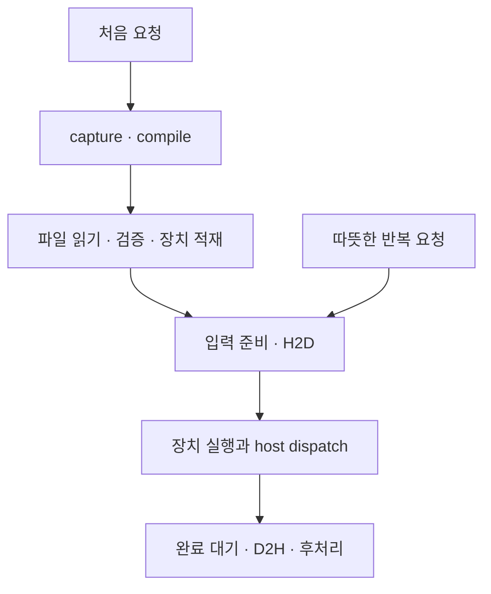
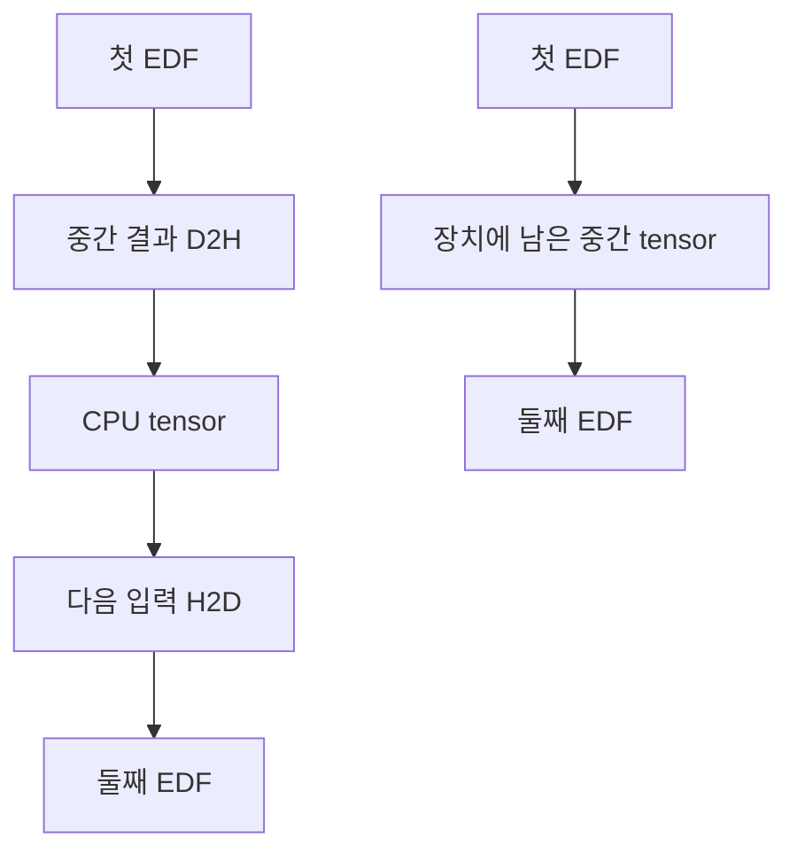
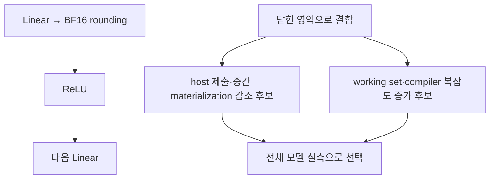

# 07. 최적화의 축과 우선순위

**먼저 정확한 실행 경로와 측정 범위를 고정하고, 가장 큰 비용부터 줄인다.** TCL의 한 축을 잘 배치하는 일과 요청마다 가중치를 다시 올리지 않는 일은 둘 다 중요하지만 서로 다른 문제다. NPU 사용률이 낮다는 관측 하나만으로 원인을 “TCL 축을 잘못 이해했다”로 결론낼 수 없다.

> **FuryNo5의 해석**  
> 이 장의 작업 순서는 공식 필수 규격이 아니라 FuryNo5 관점의 개발 지침이다. 지연시간, 처리량, 최초 응답, 메모리, 컴파일 시간 중 무엇이 목표인지에 따라 순서를 바꿀 수 있다. 공식 하드웨어 제약과 현재 코드의 동작은 출처를 따로 표시한다.

## 최적화의 “축”은 두 뜻이 있다

첫째는 **tensor axis**다. `[B,M,K]`의 배치 축 B, 행 축 M, 수축 축 K처럼 계산 의미를 설명한다. 둘째는 **성능을 바꾸는 요인**이다. 전송, 배치, fusion, 병렬성, cache 등이 이에 해당한다. 물리 mapping은 논리 축을 Chip·Cluster·Slice·Lane·Time·Packet 등에 배치한다. 축 크기만 맞아도 값은 계산할 수 있지만, 어떤 순서로 읽고 어느 장치 자원에서 줄이는지가 비용을 바꾼다. [공식 mapping 설명](https://developer.furiosa.ai/furiosa-opt/book/mapping-tensors/index.html)

| 성능 요인 | 잘 설계했을 때 | 흔히 느려지는 형태 | 관측할 것 |
|---|---|---|---|
| 의미·정밀도 | 필요한 계산만 정확히 수행 | FP32(Floating Point 32-bit)를 몰래 BF16(BFloat16)로 바꿔 속도만 비교 | 원본 기준 오차, 중간 dtype |
| 입력 shape·bucket | 실제 요청 분포에 맞는 준비된 형상 | 작은 입력도 큰 bucket에 과도한 padding | 유효 원소/처리 원소 비율 |
| layout·축 순서 | 다음 연산에 맞는 연속 접근 | 반복 transpose·packing·gather | 전송 bytes, layout kernel 시간 |
| 메모리 상주·재사용 | weight·중간값을 가능한 범위에서 유지 | 요청/레이어마다 Host↔Device 왕복 | H2D/D2H 횟수·bytes |
| fusion·분할 | 경계 비용과 working set의 균형 | 지나치게 작은 EDF 또는 너무 큰 단일 kernel | launch 수, 메모리 peak, compiler 결과 |
| PE(Processing Element)·병렬성 | 형상에 맞는 자원 사용 | 작은 일에 모든 자원을 배정하거나 shard 불균형 | 장치별 작업·대기 시간 |
| 호스트 제출·동기화 | 필요한 의존성만 기다림 | 매 연산의 CPU readback·직렬 제출 | trace의 빈 구간, host span |
| 컴파일·적재 cache | 같은 계약·weight·프로그램 재사용 | 같은 요청마다 컴파일·load 반복 | cold/warm 차이, cache hit |
| serving 정책 | 목적에 맞는 batch와 admission | 대기열 증가·큰 batch의 tail latency | p50/p95, 처리량, queue 시간 |

이 표는 원인을 찾는 분류다. “항상 fusion을 최대로” 또는 “항상 PE를 8개” 같은 고정 답을 만들기 위한 표가 아니다.

## 먼저 시간을 네 개로 나눈다



H2D(Host to Device)는 호스트에서 장치로, D2H(Device to Host)는 그 반대로 이동하는 것이다. “모델이 198초 걸린다”는 관측은 초기 적재인지, 첫 compile인지, 요청 지연인지부터 나눠야 한다. 이 그림의 항목은 계측 구간이며, 비동기 overlap이 있으면 단순 합이 실제 wall time과 일치하지 않을 수 있다.

| 측정값 | 포함 범위 | 용도 |
|---|---|---|
| cold 준비 | capture·compile·검증·적재를 각각 기록 | 개발 속도와 배포 시작 시간 |
| warm 요청 | 실제 사용자 입력부터 완료된 결과까지 | 제품 체감 지연 |
| resident 실행 | 이미 장치에 있는 입력에서 완료된 장치 결과까지 | kernel/dispatch 최적화 |
| 장치 task 합계 | trace에 나타난 task별 시간의 합 | 일이 많이 든 kernel 후보 찾기 |

병렬 task의 시간 합은 wall time이 아니다. FuryNo5의 `rank_hotspots`도 이를 명시한다. 겹쳐 실행된 두 task가 각각 10 µs라고 해서 요청이 20 µs 걸렸다고 계산하면 안 된다. [hotspot 집계기](https://github.com/smallstep-zzz/FuryNo5/blob/bba9efea8201aec48150514a35d0b637d29d107e/tplmachine/profile_hotspots.py#L7-L16)

## 권장 순서: 의미 → 경로 → 경계 → kernel → 운영

1. **정확성을 고정한다.** 원본 모델·입력·허용오차·state reset·SDK 버전을 먼저 정한다.
2. **어디서 실행했는지 확인한다.** 공식 NPU trace와 CPU route, 누락된 step을 확인한다.
3. **요청마다 반복하는 준비를 없앤다.** 컴파일, weight packing, 적재를 실행 루프 밖으로 옮긴다.
4. **큰 데이터 이동과 host 경계를 줄인다.** 불필요한 CPU readback과 중간 tensor materialization을 찾는다.
5. **fusion·layout·shape를 함께 비교한다.** 한 kernel의 이득이 다른 kernel의 packing 비용을 키우지 않는지 본다.
6. **병목 kernel의 mapping·tile·schedule을 다듬는다.** 공식 compiler/opt 도구의 근거를 확인한다.
7. **batch·동시 요청·다중 장치 정책을 조정한다.** 최종 목표의 p95와 처리량으로 판단한다.

이 순서는 **이미 지원되는 모델의 warm 추론**에서 시작하기 좋은 기본값이다. 메모리에 올라가지 않는다면 3번 이전에 분할/working set부터, 첫 시작 시간이 목표라면 compiler cache·load부터, 긴 배치 계산이 압도적이라면 6번부터 집중할 수 있다. 개발자의 목표를 기계의 최대 연산량 지표로 대체하지 않는다.

<!-- interactive:optimization -->

## 사례 A: 요청마다 새 session을 만들면 kernel 개선이 묻힌다

다음 두 함수는 같은 package와 요청을 사용한다. 호환 fxbX 설치본에서 기존에 생성한 package와 외부 weights를 전달하는 코드다.

```python
from fxbx import GraphFXB

def repeated_load(package, weights, requests):
    outputs = []
    for inputs in requests:
        with GraphFXB(package, weights=weights) as runtime:
            outputs.append(runtime.predict(inputs))
    return outputs

def reuse_loaded_runtime(package, weights, requests):
    outputs = []
    with GraphFXB(package, weights=weights) as runtime:
        for inputs in requests:
            outputs.append(runtime.predict(inputs))
    return outputs
```

두 번째는 session 수명을 요청 밖으로 옮긴다. 변화의 목적은 파일 검증·준비·장치 context·가중치 적재의 반복을 줄이는 것이다. 정확한 어떤 단계가 재사용되는지는 선택한 adapter와 cache 상태에 따라 달라지므로 실측한다. state가 있는 모델에서는 요청 간 상태를 공유할지 `reset()`할지 명시해야 한다. [검증된 GraphFXB 사용 예](https://github.com/smallstep-zzz/FuryNo5/blob/bba9efea8201aec48150514a35d0b637d29d107e/examples/native_execution_plan.py)

더 깊은 개선은 중간 tensor가 CPU로 나오는 것을 줄이는 것이다. 다만 `predict`가 CPU 결과를 반환하는 경로를 사용하면서 “전송을 모두 제거했다”고 쓰면 안 된다. 입력·출력 API 경계를 유지한 최적화인지, 장치 상주 실행 API로 바꾼 최적화인지 구별한다.



DMA(Direct Memory Access)는 CPU가 bytes를 하나씩 옮기지 않고 전송 엔진이 이동을 처리한다는 뜻이다. **전송이 무료라는 뜻은 아니다.** 공식 opt 문서는 host↔HBM용 PCIe(Peripheral Component Interconnect Express) DMA와 장치 내부 tensor DMA를 별개로 설명하고, host 왕복을 줄이고 데이터를 재사용하도록 안내한다. [DMA Engine](https://developer.furiosa.ai/furiosa-opt/book/moving-tensors/dma-engine.html)

## 사례 B: 축 순서를 바꾸면 계산량이 같아도 이동이 달라진다

행렬곱 `C[M,N] = sum_K A[M,K] * B[K,N]`에서 K는 reduction 축이고 M/N은 출력에 남는 축이다. 수학적 의미와 실제 연속 저장 순서는 따로 확인한다. `B`를 한 번 전치해 보관하는 것과 호출 때마다 전치·복사하는 것은 같지 않다.

개념적인 BF16 입력·FP32 출력 행렬곱의 최소 데이터량을 단순화하면 다음과 같다.

```text
계산량 ≈ 2 × M × N × K FLOPs
입력·출력을 한 번씩만 이동한다고 가정한 bytes
      ≈ 2MK + 2KN + 4MN
연산 집약도 ≈ FLOPs / bytes
```

이 식은 **교육용 하한 모델**이다. padding, 중간값, cache miss, 반복 fetch, 별도 packing은 제외한다. M이 아주 작으면 큰 weight를 읽는 비용에 비해 계산량이 작아질 수 있다. M을 늘리면 weight를 공유하는 효과가 있지만, 배치를 모으는 대기시간과 working set도 늘어난다. 이를 throughput만 보고 결정하면 짧은 요청의 지연이 나빠질 수 있다.

Rust vISA(virtual Instruction Set Architecture)의 `m![H,W]`와 `m![W,H]`는 인접한 값의 물리 접근 순서를 달리한다. tile 표현은 locality 분포를 바꾸지만 tile을 넣었다는 사실만으로 빠른 것은 아니다. 실제 layout을 바꿀 때 필요한 복사까지 비용에 넣는다. [Mapping Tensors](https://developer.furiosa.ai/furiosa-opt/book/mapping-tensors/index.html)

공식 메모리 성능 문서는 정렬, bank 충돌, 분산 접근을 주요 제약으로 다룬다. 이 수준에서는 처리량 저하뿐 아니라 잘못된 접근 패턴이 장치 오류를 일으킬 수 있다. 따라서 물리 mapping은 합법성 확인 후 변경한다. 여기서는 특정 표의 배수를 모든 모델의 예측값으로 사용하지 않는다. [Memory Performance](https://developer.furiosa.ai/furiosa-opt/book/moving-tensors/memory-performance.html)

## 사례 C: fusion은 경계를 줄이지만 최대 크기가 정답은 아니다



FuryNo5의 작은 BF16 영역 생성기는 원래 연산마다 있던 반올림 경계를 남긴다. 중간 write 경계를 없애면 단순한 수학적 결합도 원본과 다른 수치를 만들 수 있기 때문이다. 영역 admission 상한과 compiler ABI 검사를 통과한 경우에만 결합 후보를 사용하고, 거절되면 개별 NPU 경로를 유지한다. [tcl_region.py](https://github.com/smallstep-zzz/FuryNo5/blob/bba9efea8201aec48150514a35d0b637d29d107e/tplmachine/tcl_region.py) · [영역 검증](https://github.com/smallstep-zzz/FuryNo5/blob/bba9efea8201aec48150514a35d0b637d29d107e/docs/NATIVE_REGION_VALIDATION.md)

이때 “여러 EDF를 이어 실행한다”, “여러 계산을 하나의 새 EDF로 컴파일한다”, “런타임이 sequence로 묶어 제출한다”는 서로 다른 최적화다. 파일을 이어 붙인다고 하나의 물리 kernel이 되는 것은 아니다. 어느 경계가 줄었는지 trace와 산출물로 확인한다.

## 보존된 실측: 작은 영역의 이득이 전체 승인으로 이어지지 않은 예

FuryNo5 저장소의 **2026-11-08** 실험은 BF16 hidden 128, intermediate 256의 작은 gated MLP(Multi-Layer Perceptron)를 사용했다. 선택한 영역의 평균은 76.43→72.59 µs로 약 5.01% 줄었다. 하지만 이를 두 block짜리 작은 합성 모델에 넣은 최종 비교는 다음과 같았다.

| 두 block 합성 모델 | 평균 완료 시간 | 반복 호출 수 |
|---|---:|---:|
| baseline | 172.19 µs | 6,390 |
| packed 선택안 | 164.99 µs | 7,200 |
| 3-program 분할 대조군 | 296.76 µs | 4,020 |

각 항목은 30개 측정 block이다. 이 시간은 resident 입력을 사용하고 Python dispatch와 stream 완료를 포함하며, compile·load·정적 packing·H2D·profiling·D2H를 제외했다. 전체 개선은 **4.18%**로 보고서의 5% 배포 기준에 못 미쳐 baseline을 유지했다. 이 표는 이번 집필에서 새로 측정한 결과가 아니다. 보존된 raw block JSON을 재집계해 수치를 확인했다. [실험 설명](https://github.com/smallstep-zzz/FuryNo5/blob/bba9efea8201aec48150514a35d0b637d29d107e/docs/RUNTIME_SELECTION.md) · [원시 측정 block](https://github.com/smallstep-zzz/FuryNo5/blob/bba9efea8201aec48150514a35d0b637d29d107e/docs/validation/runtime-selection-20261108/repeated_blocks.json) · [영역 선택 기록](https://github.com/smallstep-zzz/FuryNo5/blob/bba9efea8201aec48150514a35d0b637d29d107e/docs/validation/runtime-selection-20261108/decision.json)

교훈은 “분할은 항상 나쁘다”가 아니다. 이 조건에서는 해당 분할이 느렸고, 지역적 최적화의 이득도 전체 기준에는 부족했다. 다른 shape·메모리 한계·입출력 API에서는 다시 비교해야 한다.

## compiler 시간과 실행 시간을 동시에 관리한다

실행 성능을 높이는 더 큰 탐색이 compiler 시간을 늘릴 수 있다. 반대로 빨리 컴파일하려고 과도하게 나누면 매 요청의 launch 비용이 늘 수 있다. 사용자에게 한 번 제공할 artifact인지, 하루에 수십 번 새 모델을 만들지에 따라 총비용이 달라진다.

```text
운영 전체 비용의 비교
= 1회 compile + 1회 load + 반복 요청 수 × warm 요청 시간
```

이 식도 서비스 정책을 생각하기 위한 모델이다. 재시작·cache hit·동시 실행·에너지 비용은 필요에 맞게 추가한다. FuryNo5는 반복 계약의 cache, 제한된 병렬 compile, 정확한 recipe replay로 불필요한 재컴파일을 줄인다. speculative fusion이 거절되어도 성공한 개별 EDF를 버릴 필요가 없도록 증거를 보존한다. [컴파일 품질](https://github.com/smallstep-zzz/FuryNo5/blob/bba9efea8201aec48150514a35d0b637d29d107e/docs/COMPILE_QUALITY.md)

## 추정치를 실측치로 바꾸지 않는 법

SDK 2026.5.0b0 release note는 `furiosa-tcc --evaluate-tcl`을 EDF 생성 없는 cycle 비용 추정 도구로 소개한다. 설치된 2026.4 환경에 이 옵션이 있다고 가정하지 말고 `--help`를 확인한다. cycle estimate는 최적화 후보를 줄이는 데 유용하지만, host 지연·입출력·queue를 포함한 wall time이 아니다. [2026.5 beta 변경](https://developer.furiosa.ai/v2026.5.0b4/en/whatsnew/release-2026.5.0b0.html)

FuryNo5 `official_tools.evaluate`는 결과에 `source_kind="compiler_estimate"`, `hardware_measured=False`, `selector_label_eligible=False`를 붙인다. 단위가 cycles인 예측과 ns인 실측을 한 순위표에 그냥 섞지 않는다. 예측으로 후보를 좁힌 뒤 원본 baseline을 남기고, 수치·trace를 통과한 실측으로 선택한다. [추정치 adapter](https://github.com/smallstep-zzz/FuryNo5/blob/bba9efea8201aec48150514a35d0b637d29d107e/tplmachine/official_tools.py#L37-L65) · [의미 기반 최적화 정책](https://github.com/smallstep-zzz/FuryNo5/blob/bba9efea8201aec48150514a35d0b637d29d107e/docs/SEMANTIC_TUNING.md)

## 다음 최적화를 고르는 질문

한 번의 비교에서 계약·측정 범위·목표를 고정하고 다음을 묻는다.

- 처음만 느린가, 반복도 느린가?
- CPU route가 있는가, NPU가 다음 host 제출을 기다리는가?
- 고유 EDF가 많은가, 같은 EDF 호출이 많은가?
- 큰 bytes를 움직이는가, 작은 kernel을 너무 자주 호출하는가?
- 다음 연산이 현재 output layout을 그대로 소비하는가?
- 더 작은 bucket이 실제 요청을 충분히 커버하는가?
- 평균만 나아졌는가, p95와 수치·상태 반복도 유지되는가?

답이 나오는 다음 실험 하나를 고른다. 모든 PE·tile·bucket 조합을 한꺼번에 탐색하는 것보다, 가장 큰 불확실성을 줄이는 계측이 먼저다.

## 출처

| 자료 | 확인 범위 |
|---|---|
| [공식 Mapping Tensors](https://developer.furiosa.ai/furiosa-opt/book/mapping-tensors/index.html) | 논리 축·물리 순서·전송 비용 |
| [공식 Memory Performance](https://developer.furiosa.ai/furiosa-opt/book/moving-tensors/memory-performance.html) | 정렬·bank·접근 분산 |
| [공식 DMA Engine](https://developer.furiosa.ai/furiosa-opt/book/moving-tensors/dma-engine.html) | host 전송과 장치 내부 전송 |
| [FuryNo5 hotspot 집계](https://github.com/smallstep-zzz/FuryNo5/blob/bba9efea8201aec48150514a35d0b637d29d107e/tplmachine/profile_hotspots.py) | task work 합과 wall time의 구분 |
| [보존된 runtime 실험](https://github.com/smallstep-zzz/FuryNo5/blob/bba9efea8201aec48150514a35d0b637d29d107e/docs/RUNTIME_SELECTION.md) | 작은 모델의 전체 성능 판정 |
| [FuryNo5 semantic tuning](https://github.com/smallstep-zzz/FuryNo5/blob/bba9efea8201aec48150514a35d0b637d29d107e/docs/SEMANTIC_TUNING.md) | 후보 생성·실측 선택·서빙 분리 |
| [2026.5 beta release note](https://developer.furiosa.ai/v2026.5.0b4/en/whatsnew/release-2026.5.0b0.html) | evaluate-tcl 버전 범위 |

