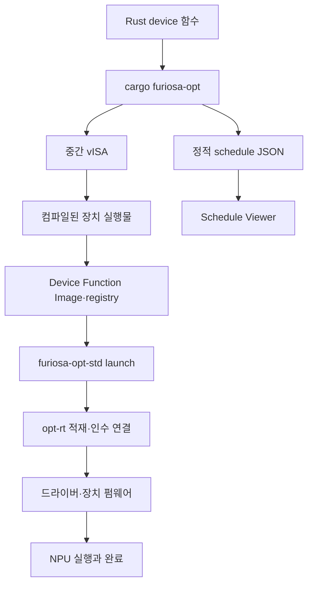
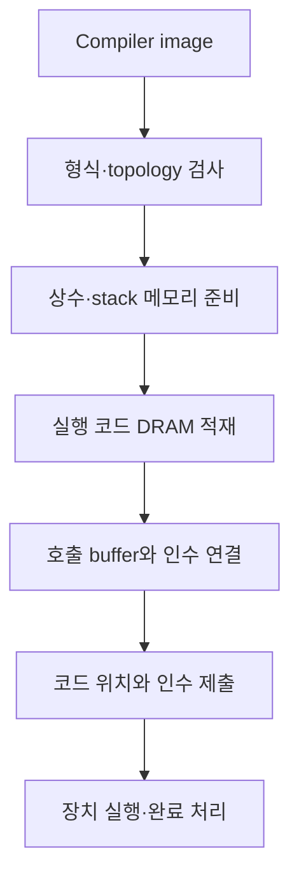

# eISA 확인과 vISA 실전: furiosa-opt로 내부를 읽는다

사용자가 요청한 **eISA의 공식 풀네임과 독립적인 공개 실행 API는 이번 조사에서 확인하지 못했다.** `furiosa-opt` 공개 문서가 직접 프로그래밍 대상으로 설명하는 이름은 **vISA(Virtual Instruction Set Architecture)**다. ISA(Instruction Set Architecture)는 명령어 집합 구조를 뜻한다. eISA가 vISA의 다른 이름이라고 단정하지 않고, 확인 가능한 vISA·컴파일·실행·관찰 경로를 이 장에서 다룬다. [공식 프로그래밍 문서](https://github.com/furiosa-ai/furiosa-opt/blob/3d43bc9d20f324af60e3006c3f1541938d7f5097/docs/src/introduction.md)

> **재현 기준** · 이 장의 소스는 `furiosa-opt` commit `3d43bc9d20f324af60e3006c3f1541938d7f5097`이다. 같은 commit의 base template은 `furiosa-opt-std = "0.10"`을 요구한다. 오래된 0.8.x 예제·포럼 답변과 섞지 않는다. 공개 프로젝트는 실험적 소프트웨어이며 API 변경을 전제로 버전을 기록한다. [template 의존성](https://github.com/furiosa-ai/furiosa-opt/blob/3d43bc9d20f324af60e3006c3f1541938d7f5097/base-template/Cargo.toml.liquid)

## 1. TCL보다 어떤 결정을 더 표현하는가

TCL(Tensor Contraction Language)에서는 논리 축과 연산의 의미를 표현하고 컴파일러에 맡기는 부분이 많다. vISA에서는 텐서를 어느 메모리에 놓고, 축을 어느 하드웨어 차원에 배치하고, 어느 엔진 경로로 흘릴지를 더 구체적으로 쓴다. 모든 레지스터의 원시 바이트를 직접 관리해야 하는 수준과도 다르다. [TCL과 vISA의 공개 소개](https://furiosa.ai/developers), [vISA 소개](https://github.com/furiosa-ai/furiosa-opt/blob/3d43bc9d20f324af60e3006c3f1541938d7f5097/docs/src/introduction.md)

| 결정 | TCL에서 읽는 지점 | vISA에서 읽는 지점 |
|---|---|---|
| 수식 | contraction·pointwise·reduce | 동일한 텐서 의미를 구체적 엔진 연산으로 구성 |
| 배치 | 논리 축과 compiler lowering | `Chip/Cluster/Slice/Lane/Element` mapping |
| 시간 반복 | 특수화한 shape와 컴파일 결과 | `Time/Packet`, loop, unroll |
| 메모리 이동 | compiler가 만든 이동 | `to_dm`, `to_hbm`, fetch, commit |
| 겹침 | compiler 스케줄 결과 | main/sub context에 노출한 의존성 |

vISA는 성능이 중요한 작은 구간의 가설을 직접 실험할 때 유용하다. 모델 전체를 먼저 Rust로 다시 작성해야만 사용할 수 있다는 뜻은 아니다. 한편 TCL로 생성된 임의 EDF를 Rust vISA 원본으로 복원하거나 그대로 schedule JSON으로 변환하는 보편적인 공개 절차는 확인되지 않았다.

## 2. 컴파일 도구와 실행 런타임

**vISA는 컴파일 과정에서 다루는 중간 표현이며, 그 텍스트를 NPU에 전달해서 곧바로 실행하는 경로가 아니다.** 공식 도구는 중간 vISA를 dump하는 기능과 커널을 컴파일하는 기능을 구분하고, 검증 문서는 최종 장치 실행물을 EDF(Executable Device Format)라고 부른다. 공개 opt 소스에서는 이 실행 단계에 사용하는 구체적인 객체로 compiler image와 device executable을 확인할 수 있다. [중간 vISA 출력](https://github.com/furiosa-ai/furiosa-opt/blob/3d43bc9d20f324af60e3006c3f1541938d7f5097/docs/src/tools/kernel-optimizer.md), [컴파일된 EDF의 실행](https://github.com/furiosa-ai/furiosa-opt/blob/3d43bc9d20f324af60e3006c3f1541938d7f5097/docs/src/quick-start/kernel-validation.md), [공개 실행물 계약](https://github.com/furiosa-ai/furiosa-opt/blob/3d43bc9d20f324af60e3006c3f1541938d7f5097/furiosa-opt-abi/README.md)



그림의 “컴파일된 장치 실행물”은 문서에서 EDF로 설명하는 단계다. **그 다음에 나오는 opt Device Function Image의 직렬화 형식을 SDK Python의 `.edf`와 바이트 단위로 같다고 표시한 그림은 아니다.** IR(Intermediate Representation), 컴파일 결과, 이를 host 프로그램에 연결하는 image·registry, 실제 장치 적재를 구분하기 위해 나누어 그렸다. TCL/`furiosa-tcc` 경로와 Rust/opt 경로가 모두 NPU 실행물을 만든다는 사실만으로 서로의 loader를 교환할 수는 없다.

`cargo`는 Rust의 빌드·의존성 도구다. `cargo-furiosa-opt`는 이 도구를 감싸 NPU build와 커널 사전 컴파일을 수행한다. 일반 `cargo run`은 CPU backend이고 `cargo furiosa-opt run`은 NPU backend다. CPU build가 성공했다고 NPU mapping까지 검증된 것은 아니다. [Kernel Optimizer](https://github.com/furiosa-ai/furiosa-opt/blob/3d43bc9d20f324af60e3006c3f1541938d7f5097/docs/src/tools/kernel-optimizer.md)

### 공개 소스에서 보는 코드와 컨테이너의 차이

다음 표는 **이 장의 고정 opt 커밋**에서 직접 확인한 구조다. 이것을 SDK EDF 전체 포맷의 명세로 확장하지 않는다. magic은 파일·버퍼 앞부분에 두어 어떤 형식인지 식별하는 값이며, 아래 이름은 이 구현의 구분자다.

| 공개 객체 | 포함하거나 참조하는 것 | 역할 |
|---|---|---|
| `image::Image`, `image::Parts` | topology, executable, 선택적인 weight bytes, stack 요구량, 인수 slot, 입출력 관계, profile·SRAM 정보 | compiler가 만든 함수 이미지를 runtime이 이해하도록 구성 |
| `executable::Executable` | chunk·cluster별 코드 위치·길이·진입점과 실제 code bytes | 펌웨어가 적재·실행할 장치 코드 컨테이너 |
| `registry::Entry` | 함수 경로, const-generic key, image 참조 | host 실행 프로그램에서 호출할 함수의 컴파일 이미지를 찾음 |

`Image`는 `FOP2` 식별자와 bincode로 직렬화한 구조를 읽고, 내부 `Executable`은 별도의 `FOE1` 식별자와 chunk 표를 읽는다. 따라서 **이 공개 opt 실행물은 아무 메타데이터도 없는 raw instruction 배열로 설명할 수 없다.** 코드와 그 코드를 어떻게 배치·호출할지 설명하는 정보가 나뉜다. `Image::parse()`는 decode 결과, topology, cluster 수, 인수 slot 등 해당 형식의 계약을 검사한다. [image.rs](https://github.com/furiosa-ai/furiosa-opt/blob/3d43bc9d20f324af60e3006c3f1541938d7f5097/furiosa-opt-abi/src/image.rs), [executable.rs](https://github.com/furiosa-ai/furiosa-opt/blob/3d43bc9d20f324af60e3006c3f1541938d7f5097/furiosa-opt-abi/src/executable.rs), [registry.rs](https://github.com/furiosa-ai/furiosa-opt/blob/3d43bc9d20f324af60e3006c3f1541938d7f5097/furiosa-opt-abi/src/registry.rs)

이것은 **SDK `.edf`도 FOP2·FOE1을 사용한다거나 ELF(Executable and Linkable Format)라는 증거가 아니다.** 같은 “바이너리”라는 분류 안에서도 직렬화 schema, ABI(Application Binary Interface), 장치 프로토콜은 달라질 수 있다. SDK의 `ir.Runnable.from_serialized_edf()` 및 `Runnable(...).to(device)` 경계는 [4장](04-tcl-edf.md)의 별도 경로로 읽는다.

### 파일이 준비된 뒤 runtime이 추가하는 것

`registry/load/mod.rs::load()`는 image를 읽은 뒤 실제 device topology와 맞는지 비교한다. 필요한 weight bytes가 있으면 장치 버퍼를 할당하고 올리며, compiler가 요청한 stack을 준비한다. 이어서 signature와 slot 관계를 보관하는 `Binder`를 만들고 `Function::load()`를 호출한다. **컴파일된 실행물이 있어도 현재 장치의 메모리와 인수는 여기서 구체화된다.** [컴파일 이미지 적재](https://github.com/furiosa-ai/furiosa-opt/blob/3d43bc9d20f324af60e3006c3f1541938d7f5097/furiosa-opt-rt/src/registry/load/mod.rs)

다음은 원본의 `unsafe` 블록에 있는 호출 부분이다. `device`, `executable`, `sram_end`, `capacity`, `binder`는 위 로더에서 준비한 값이다. 실행 코드의 bytes와 **호출 인수를 연결할 함수**를 함께 전달하는 점을 읽으면 된다.

```rust
Function::load(
    device,
    executable.bytes(),
    sram_end as usize,
    capacity,
    move |args, arguments| binder.bind(args, arguments),
)
.await
```

[출처: `registry::load` 호출부](https://github.com/furiosa-ai/furiosa-opt/blob/3d43bc9d20f324af60e3006c3f1541938d7f5097/furiosa-opt-rt/src/registry/load/mod.rs)

`Function::load()`는 실행 bytes를 각 chip의 DRAM(Dynamic Random Access Memory)에 staging하고 반복 호출에 필요한 인수 slot을 준비한다. 실행 호출마다 binder가 실제 buffer를 연결하고, `function/table.rs`가 해당 device 주소를 inline 인수 또는 별도 operand table로 표현한다. 마지막으로 driver는 코드가 올라간 위치·길이·token과 준비된 인수를 cluster별 mailbox로 제출한다. [실행 코드 적재](https://github.com/furiosa-ai/furiosa-opt/blob/3d43bc9d20f324af60e3006c3f1541938d7f5097/furiosa-opt-rt/src/function/mod.rs), [인수 주소 표현](https://github.com/furiosa-ai/furiosa-opt/blob/3d43bc9d20f324af60e3006c3f1541938d7f5097/furiosa-opt-rt/src/function/table.rs), [실제 제출](https://github.com/furiosa-ai/furiosa-opt/blob/3d43bc9d20f324af60e3006c3f1541938d7f5097/furiosa-opt-rt/src/driver/mod.rs)



여기서 staging은 장치가 사용할 코드·데이터를 정해진 메모리 위치에 준비하는 것이다. binding은 이번 호출의 buffer를 컴파일된 함수가 기대하는 인수에 연결하는 것이다. 둘 다 “TCL 또는 Rust 원본을 다시 컴파일한다”는 뜻은 아니다. 이미 resident인 코드를 재사용해도 다음 호출에 쓸 buffer와 완료 상태의 관리는 남는다.

### Relocation이라는 단어를 정확하게 사용하기

Relocation은 미리 고정할 수 없었던 주소 참조를 실제 배치에 맞게 연결·수정하는 과정이다. 이 조사에서는 다음 세 가지를 구분한다.

| 경계 | 공개 근거에서 확인한 수준 |
|---|---|
| Host 실행 파일의 registry 참조 | `registry::Ref`의 path·key·image 주소를 linker relocation이 채운다고 소스에 명시돼 있다. |
| 매 launch의 실제 device buffer 주소 | `Binder`와 operand table이 호출자의 buffer를 인수로 연결하는 구현을 확인했다. 이를 곧바로 코드 명령어 relocation이라고 부르지 않는다. |
| SDK `.edf` 내부의 device-code relocation | SDK loader가 어떤 재배치표를 읽거나 어떤 명령 바이트를 패치하는지는 이번 공개 근거로 확인하지 못했다. 존재하지 않는다고 단정하지도 않는다. |

host registry의 section과 참조는 [registry.rs](https://github.com/furiosa-ai/furiosa-opt/blob/3d43bc9d20f324af60e3006c3f1541938d7f5097/furiosa-opt-abi/src/registry.rs), device 인수 준비는 [table.rs](https://github.com/furiosa-ai/furiosa-opt/blob/3d43bc9d20f324af60e3006c3f1541938d7f5097/furiosa-opt-rt/src/function/table.rs)를 확인한다. “바이너리이므로 어떤 주소에서나 즉시 실행된다”와 “매번 source를 다시 컴파일한다” 사이에는 이런 적재·주소 연결 과정이 있다.

### 이미지 형식과 장치 프로토콜도 버전 계약이다

0.10.0 changelog는 새 image format을 쓰므로 해당 release로 프로그램을 재컴파일하라고 명시한다. 따라서 같은 Rust 함수 이름·수식·shape라도 오래된 compiler image가 새 runtime과 호환된다고 가정하면 안 된다. [0.10.0 변경 기록](https://github.com/furiosa-ai/furiosa-opt/blob/3d43bc9d20f324af60e3006c3f1541938d7f5097/CHANGES.md)

또한 공개 opt bootloader 설명은 서명된 bootloader가 host가 준비한 firmware image를 검증한 뒤 scratchpad로 복사해 진입한다고 밝힌다. **부트로더·펌웨어 이미지와 사용자 커널의 실행 이미지는 서로 다른 역할**이다. SDK 경로와 opt 경로가 같은 RNGD를 사용한다는 이유만으로 동일한 초기화·제출 프로토콜 또는 동시 장치 사용을 보장하지 않는다. 공개 ABI는 compiler image, executable, boot request, ring·doorbell을 별도 계약으로 구분한다. [Bootloader의 역할](https://github.com/furiosa-ai/furiosa-opt/blob/3d43bc9d20f324af60e3006c3f1541938d7f5097/furiosa-opt-rt/bootloader/README.md), [공개 ABI 구성](https://github.com/furiosa-ai/furiosa-opt/blob/3d43bc9d20f324af60e3006c3f1541938d7f5097/furiosa-opt-abi/README.md)

## 3. 공식 template로 첫 실행

Linux x86-64, matching Rust toolchain, 필요한 cross compiler 및 NPU 드라이버를 준비한다. 아래 설치 명령은 공식 Quick Start의 경로다. 배포된 compiler와 template 의존성이 일치하는지 반드시 확인하고, 실험 기록에는 `Cargo.lock`과 compiler version을 함께 보관한다. [Setup and Tooling](https://developer.furiosa.ai/furiosa-opt/book/quick-start/setup-and-tooling.html)

```bash
rustup toolchain install nightly-2026-05-01
cargo +nightly-2026-05-01 install cargo-binstall
cargo +nightly-2026-05-01 binstall cargo-furiosa-opt
cargo install cargo-generate
cargo generate furiosa-ai/furiosa-opt base-template
```

생성한 프로젝트 디렉터리에서 실행한다. template을 기본 branch에서 가져온 경우 이 핸드북 commit 이후 바뀔 수 있으므로, 생성된 소스·의존성을 앞의 기준과 비교한다.

```bash
# CPU 의미 비교
cargo test --release --bin constant_add

# NPU용 커널 컴파일
cargo furiosa-opt compile constant_add_kernel

# 실제 NPU에서 값 비교
cargo furiosa-opt test --release --bin constant_add

# 실행 프로그램
cargo furiosa-opt run --release --bin constant_add
```

대상 binary와 test는 template의 `src/constant_add.rs`에 있다. 원래 input의 각 원소에 1을 더한 CPU reference와 NPU 결과를 비교한다. Rust 정수 overflow 의미까지 일치시켜야 하므로 임의의 Python 정수 계산과 동일시하지 않는다. [공식 constant_add host/test](https://github.com/furiosa-ai/furiosa-opt/blob/3d43bc9d20f324af60e3006c3f1541938d7f5097/base-template/src/constant_add.rs)

## 4. 코드 한 조각으로 mapping을 읽는다

공식 constant-add kernel의 핵심은 다음 배치다.

```rust
axes![A = 2048];
pub type Chip = m![1];
pub type Cluster = m![1 # 2];
pub type Slice = m![A / 8 # 256];
```

`A/8`은 축을 8개 단위로 나눈 위치이고 `A%8`은 그 단위 안의 위치다. `#256`은 물리 차원의 범위를 맞추는 padding 표기다. 이 예에서는 한 active cluster의 256 slice에 각 8개의 i32가 배치된다. 다음에 나오는 `fetch`, `collect`, `vector_fxp`, `commit`은 이 배치에 맞춰 데이터를 흘리고 저장한다. [공식 kernel 원문](https://github.com/furiosa-ai/furiosa-opt/blob/3d43bc9d20f324af60e3006c3f1541938d7f5097/base-template/src/kernel/constant_add_kernel.rs)

`m![]`은 NumPy shape를 다른 문법으로 쓴 것만은 아니다. 예를 들어 같은 총 2048개라도 slice에 256개를 쓰는 배치와 하나의 slice에서 긴 시간 반복을 하는 배치는 병렬성이 달라진다. **논리 값의 동일성, 주소 배치의 합법성, 충분한 자원 활용**을 각각 확인해야 한다.

## 5. 제출과 완료 대기 분리

선택한 commit의 `launch.rs`에는 `Prepared`, `.submit()`, `Submitted`, `.await`가 구분되어 있다. 첫 launch의 이미지 로딩을 앞당기는 `function.load(&device)`와 기존 output storage를 사용하는 `.output(&mut out)`도 있다. [현재 launch 구현](https://github.com/furiosa-ai/furiosa-opt/blob/3d43bc9d20f324af60e3006c3f1541938d7f5097/furiosa-opt-std/src/runtime/launch.rs)

아래 코드는 공식 template의 host 함수 안에서 input HBM을 준비한 뒤 사용하는 **호출 부분**이다. `constant_add_kernel`, `device`, `in_hbm`은 앞선 template에서 정의된 값이다.

```rust
let pending = launch(constant_add_kernel, (&mut device, &in_hbm)).submit();
// 결과 버퍼에 접근하지 않는 호스트 준비 작업을 이 사이에 배치할 수 있다.
let result_hbm = pending.await?;
```

제출했다고 모든 커널이 장치에서 병렬 실행된다는 뜻은 아니다. 같은 자원과 의존성을 공유하면 대기해야 한다. 이 구분은 호스트 준비를 겹치는지, NPU 내부 연산을 겹치는지 분석할 때 중요하다. 2026년 10월 포럼에서 보고된 0.8.1의 고정 spin·제출 API 제약은 역사적 기록이다. 현재 소스에 이미 구현된 API를 아직 미구현이라고 쓰면 안 된다. [0.8.1 당시 질문과 공식 답변](https://forums.furiosa.ai/t/furiosa-opt-v0-8-1-launch-host-cpu-cpu-2/479)

## 6. 스케줄을 눈으로 확인한다

```bash
cargo furiosa-opt compile --help
cargo furiosa-opt compile constant_add_kernel --dump-visa constant-add.visa
cargo furiosa-opt compile constant_add_kernel --dump-schedule constant-add.schedule.json
cargo install furiosa-schedule-viewer
furiosa-schedule-viewer --host 127.0.0.1 --port 9254
```

생성된 schedule JSON을 viewer에 넣는다. 함수 filter가 여러 함수를 고르면 완전한 Rust 경로로 하나만 지정한다. Viewer는 텐서 수명, 연결된 연산, context, 자원 점유를 보여준다. **이 그림은 정적 컴파일 스케줄이며 실제 요청의 처리량이나 수치 정확성을 측정하지 않는다.** [Schedule Viewer](https://github.com/furiosa-ai/furiosa-opt/blob/3d43bc9d20f324af60e3006c3f1541938d7f5097/docs/src/tools/schedule-viewer.md)

읽는 순서는 다음과 같다. 먼저 마지막으로 끝나는 구간을 찾고, 그 구간을 막은 원인이 데이터 의존인지 공유 자원인지 확인한다. 그 다음 대기하는 동안 다른 context가 무엇을 하는지 본다. 마지막으로 한 가지 변경을 제안하고 같은 workload로 다시 컴파일·실행한다. [공식 진단 절차](https://github.com/furiosa-ai/furiosa-opt/blob/3d43bc9d20f324af60e3006c3f1541938d7f5097/docs/src/scheduling/diagnosis.md)

`constant-add.visa`는 compiler 중간 표현을 관찰하는 파일이고, `constant-add.schedule.json`은 정적 스케줄을 관찰하는 파일이다. 둘 중 하나가 생겼다고 runtime이 적재할 최종 실행물까지 생성·검증됐다고 결론 내리지 않는다. **중간 표현 생성, 전체 컴파일 성공, 이미지 적재 성공, 실제 값 비교**를 각각 기록한다. 공개 kernel validation도 이 검증 수준들을 분리한다. [검증 단계](https://github.com/furiosa-ai/furiosa-opt/blob/3d43bc9d20f324af60e3006c3f1541938d7f5097/docs/src/quick-start/kernel-validation.md)

| 어디에서 멈췄는가 | 다음에 볼 근거 |
|---|---|
| 커널 translation·검증 거절 | shape·mapping·engine 제약과 compiler 진단 |
| 중간 vISA는 보이지만 전체 컴파일 실패 | 뒤쪽 변환의 오류 원문·선택한 filter·compiler 버전. 중간 파일 존재만으로 성공 판정하지 않음 |
| image 적재 거절 | image/runtime 버전, topology, 요구 메모리와 ABI |
| 실행은 되지만 값이 틀림 | CPU reference, 자료형·layout·stride·alias·완료 순서 |
| 값은 맞지만 느림 | 정적 schedule의 가설을 host·전송·실제 warm 실행 측정과 대조 |

이 책은 확인한 고정 소스와 현재 페이지 본문에 있는 `--dump-visa`, `--dump-schedule`을 실습에 사용한다. 검색 색인이나 다른 버전에서 보이는 IR 단계·추가 dump 옵션을 현재 설치본에서 쓸 수 있다고 가정하지 않는다. 정확한 내부 pass 순서는 공개된 구현과 compiler 진단이 증명하는 범위까지만 설명한다. [해당 커밋의 CLI 명세](https://github.com/furiosa-ai/furiosa-opt/blob/3d43bc9d20f324af60e3006c3f1541938d7f5097/docs/src/tools/kernel-optimizer.md)

**`MIR → vISA → LIR → EDF`라는 구체적 전개를 이 고정 소스에서 직접 검증했다고 쓰지는 않는다.** 검색 색인에는 이 설명이 나타났지만 실제로 대조한 페이지 본문·고정 문서에는 같은 단계표가 없었다. 공개 `cargo-furiosa-opt`의 driver 진입점도 실제 translator 대신 바이너리 설치 안내를 출력하는 stub이고, 일부 lowering은 별도 prebuilt 라이브러리를 연결한다. 이는 그 단계가 존재하지 않는다는 결론이 아니라, **이번 문서에서 근거를 확보한 범위의 한계**다. 추후 동일 버전의 공식 원문·진단 산출물을 확보하면 세부 단계표를 갱신할 수 있다. [driver 진입점](https://github.com/furiosa-ai/furiosa-opt/blob/3d43bc9d20f324af60e3006c3f1541938d7f5097/cargo-furiosa-opt/src/driver.rs) · [lowering 라이브러리 연결](https://github.com/furiosa-ai/furiosa-opt/blob/3d43bc9d20f324af60e3006c3f1541938d7f5097/furiosa-opt-lower/build.rs)

## 7. 사례 A: 다음 가중치 준비를 현재 계산과 겹치기

가중치 그룹을 하나씩 준비한 후 계산하고 기다리는 loop는 다음 그룹의 준비가 늦게 보일 수 있다. 두 반복을 같은 scheduling unit에 노출하거나 작은 정적 loop를 `#[unroll]`하면 compiler가 겹침을 선택할 기회가 생긴다. 무조건 unroll하면 IR 크기와 컴파일 비용이 늘 수 있다.

| 공식 문서의 동일 20-group 예제 | 정적 schedule makespan |
|---|---:|
| 일반 rolled loop | 19,106 cycles |
| 두 단계를 드러낸 software pipeline | 15,477 cycles |
| 전체 unroll | 15,086 cycles |

이 수치는 **Furiosa 문서의 특정 예제 결과**다. FuryNo5 모델의 새 측정치가 아니며, 15,086 cycles를 사용자 환경의 밀리초로 바로 변환하지 않는다. TRF(Tensor Register File) double buffering도 두 절반이 bank를 공유하므로 의존성과 경쟁이 남는다. [공식 tuning 사례](https://developer.furiosa.ai/furiosa-opt/book/scheduling/tuning.html)

## 8. 사례 B: gather와 scatter에서 인덱스 단위를 맞추기

embedding 같은 lookup에서는 `행 번호`와 `바이트 offset`을 섞으면 값이나 주소가 틀린다. 공개 DMA API는 `by_byte_offsets`와 `by_positions`를 구분한다. 후자는 SPM(Scratchpad Memory)의 위치 인덱스를 받는다. BF16 행의 길이가 128이면 한 행은 256 bytes이므로 행 3의 시작은 768 bytes다. 이 계산은 단순 예시이며 실제 tensor mapping·정렬 조건까지 충족해야 한다. [Gather·Scatter 계약](https://developer.furiosa.ai/furiosa-opt/book/moving-tensors/dma-engine.html#gather-and-scatter)

FuryNo5의 int32 입력 검사, embedding contraction과 projection 연결을 읽을 때도 **ID의 의미·단위·범위**부터 확인한다. 잘못된 인덱스를 CPU에서 검사하는 것은 장치의 embedding 계산을 CPU로 옮기는 것이 아니다.

## 9. 사례 C: transpose가 만드는 이동을 줄이기

두 커널이 서로 다른 layout을 기대하면 중간 변환이 필요할 수 있다. vISA에서 입력·출력 mapping을 직접 비교해, 앞 커널의 commit 배치를 다음 커널의 fetch가 원하는 배치에 맞추는 실험을 할 수 있다. 다만 view의 이름만 바꿔 값을 잘못 해석하는 것을 최적화라고 부르면 안 된다. DMA로 새 값 배치를 만드는 경우와 실제 이동 없는 reshape의 성립 조건을 구분한다. [Moving Tensors](https://github.com/furiosa-ai/furiosa-opt/blob/3d43bc9d20f324af60e3006c3f1541938d7f5097/docs/src/moving-tensors/index.md)

## 10. 사례 D: TCL hot path를 vISA로 실험하기

FuryNo5에서 느린 영역을 찾았다면 먼저 연산 의미·shape·dtype·입출력 계약을 고정한다. 그 영역의 vISA 후보를 만들고 CPU reference, compiler mapping 검사, NPU 값 비교, 정적 schedule, 실제 warm latency를 순서대로 비교한다. 선택한 후보가 빨라도 모델 전체의 호출·변환 비용을 포함해야 통합 효과를 판단할 수 있다.

`furiosa.torch._module.visa.compile_from_visa`를 통한 Python 연결은 버전 확인이 특히 필요하다. 포럼의 2026-10-13 공식 답변은 당시 예제가 내부 전용이며 공개 SDK에 포함되지 않았다고 밝혔다. 이후 버전에서의 지원 여부는 설치된 wheel과 release 근거로 재확인해야 한다. **그 함수를 누구나 설치해 즉시 호출할 수 있다고 이 핸드북은 주장하지 않는다.** 공개 Rust 직접 실행 경로는 위 절차대로 별도로 사용할 수 있다. [compile_from_visa 접근 제약](https://forums.furiosa.ai/t/furiosa-opt-compile-from-visa-furiosa-torch/487)

## 11. 두 경로를 연결하려면 무엇부터 검증하는가

다음은 **TCL/SDK 경로와 Rust/opt 경로의 연결을 연구하기 위한 제안**이다. 현재 교차 로딩이나 혼합 실행을 구현·실측했다는 보고가 아니다. 문서에서 둘 다 EDF라는 용어를 쓴다는 이유만으로 동일한 파일 형식·ABI·runtime·firmware 프로토콜을 공유한다고 결론 내릴 수 없기 때문이다.

| 순서 | 진행할 작업 | 다음 단계로 넘어갈 근거 |
|---|---|---|
| 1. 계산 의미 고정 | Add 또는 MatMul 하나를 두 경로에서 작성하고 shape·dtype·입출력 값을 같게 둔다. | 두 CPU reference가 같은 수식을 계산하며 오차 기준이 명확함 |
| 2. 각자 컴파일 | compiler·SDK·runtime 버전, 소스와 실행물 해시, topology·입출력 메타데이터를 기록한다. | 각 경로가 자신의 컴파일·형식 검사를 통과함 |
| 3. loader 경계 확인 | 공식 호환 근거를 우선 찾는다. 필요하면 허가된 개발 장비의 격리된 프로세스에서 해당 버전 loader의 거절·허용 조건을 검사한다. | 파일 형식과 ABI에 대한 구체적인 호환 근거. magic 수정이나 검증 우회로 성공을 만들지 않음 |
| 4. 독립 NPU 검증 | 각 경로를 독립적으로 실행하여 여러 입력의 수치와 실제 NPU Task를 확인한다. | 하나의 loader 성공을 계산 정확성과 혼동하지 않은 결과 |
| 5. buffer·완료 계약 | shape 외에 stride, 물리 layout, 정렬, 소유권, alias, 쓰기 권한, 완료·해제 순서를 대조한다. | 하나의 runtime이 다른 runtime의 buffer를 사용하는 지원된 방법, 또는 명시적인 전송 경계 |
| 6. 혼합 계획 | 앞 단계가 충족된 경우에만 서로 다른 실행기를 연결하고 각 step의 제출·전송·동기화를 계획에 표시한다. | 반복 실행·오류·상태 갱신까지 포함한 정확성 및 전체 요청 성능 |

3단계에서 호환이 확인되지 않으면 그 상태를 결과로 남긴다. 두 경로가 각자 정확하게 동작하는 것만으로 하나의 runtime에 섞어 넣을 수 있는 것은 아니다. 5단계에서 명시적 복사가 필요하다면 그 비용까지 포함해 vISA로 바꾼 영역의 이득을 평가한다. 이 순서는 프로젝트가 선택한 검증 우선순위이며 모델과 서비스의 요구에 따라 달라질 수 있다. 공개 opt에서 실제로 검사하는 image topology와 인수 binding은 [loader](https://github.com/furiosa-ai/furiosa-opt/blob/3d43bc9d20f324af60e3006c3f1541938d7f5097/furiosa-opt-rt/src/registry/load/mod.rs), [function](https://github.com/furiosa-ai/furiosa-opt/blob/3d43bc9d20f324af60e3006c3f1541938d7f5097/furiosa-opt-rt/src/function/mod.rs)을 참고한다.

## 출처

| 근거 | 확인한 내용 |
|---|---|
| [공식 vISA 소개](https://github.com/furiosa-ai/furiosa-opt/blob/3d43bc9d20f324af60e3006c3f1541938d7f5097/docs/src/introduction.md) | 공개 명칭·역할·실험적 상태 |
| [Kernel Optimizer](https://github.com/furiosa-ai/furiosa-opt/blob/3d43bc9d20f324af60e3006c3f1541938d7f5097/docs/src/tools/kernel-optimizer.md) | compiler·CPU/NPU·dump CLI |
| [template host/test](https://github.com/furiosa-ai/furiosa-opt/blob/3d43bc9d20f324af60e3006c3f1541938d7f5097/base-template/src/constant_add.rs) | 실행·CPU reference 비교 |
| [template kernel](https://github.com/furiosa-ai/furiosa-opt/blob/3d43bc9d20f324af60e3006c3f1541938d7f5097/base-template/src/kernel/constant_add_kernel.rs) | mapping과 vector pipeline |
| [launch.rs](https://github.com/furiosa-ai/furiosa-opt/blob/3d43bc9d20f324af60e3006c3f1541938d7f5097/furiosa-opt-std/src/runtime/launch.rs) | submit·await·선로딩·출력 재사용 |
| [Schedule Viewer](https://github.com/furiosa-ai/furiosa-opt/blob/3d43bc9d20f324af60e3006c3f1541938d7f5097/docs/src/tools/schedule-viewer.md) | 정적 관찰의 범위 |
| [Scheduling Tuning](https://developer.furiosa.ai/furiosa-opt/book/scheduling/tuning.html) | double buffering·unroll 사례 |
| [포럼 479](https://forums.furiosa.ai/t/furiosa-opt-v0-8-1-launch-host-cpu-cpu-2/479) | 구버전 host 제출 병목 |
| [포럼 487](https://forums.furiosa.ai/t/furiosa-opt-compile-from-visa-furiosa-torch/487) | 당시 Python bridge 공개 여부 |
| [Kernel Validation](https://github.com/furiosa-ai/furiosa-opt/blob/3d43bc9d20f324af60e3006c3f1541938d7f5097/docs/src/quick-start/kernel-validation.md) | 중간 표현·정적 검증·EDF 실행·수치 검증의 구분 |
| [Image 구조](https://github.com/furiosa-ai/furiosa-opt/blob/3d43bc9d20f324af60e3006c3f1541938d7f5097/furiosa-opt-abi/src/image.rs) · [Executable 구조](https://github.com/furiosa-ai/furiosa-opt/blob/3d43bc9d20f324af60e3006c3f1541938d7f5097/furiosa-opt-abi/src/executable.rs) | 공개 opt의 컨테이너·메타데이터·코드 경계 |
| [Registry](https://github.com/furiosa-ai/furiosa-opt/blob/3d43bc9d20f324af60e3006c3f1541938d7f5097/furiosa-opt-abi/src/registry.rs) | host 실행 파일의 image 참조와 relocation |
| [Image loader](https://github.com/furiosa-ai/furiosa-opt/blob/3d43bc9d20f324af60e3006c3f1541938d7f5097/furiosa-opt-rt/src/registry/load/mod.rs) | topology·상수·stack·signature 준비 |
| [Function loader](https://github.com/furiosa-ai/furiosa-opt/blob/3d43bc9d20f324af60e3006c3f1541938d7f5097/furiosa-opt-rt/src/function/mod.rs) | 코드 DRAM staging·호출 수명 |
| [Operand table](https://github.com/furiosa-ai/furiosa-opt/blob/3d43bc9d20f324af60e3006c3f1541938d7f5097/furiosa-opt-rt/src/function/table.rs) · [Driver submit](https://github.com/furiosa-ai/furiosa-opt/blob/3d43bc9d20f324af60e3006c3f1541938d7f5097/furiosa-opt-rt/src/driver/mod.rs) | 실제 주소 연결과 cluster 제출 |
| [0.10.0 changelog](https://github.com/furiosa-ai/furiosa-opt/blob/3d43bc9d20f324af60e3006c3f1541938d7f5097/CHANGES.md) | 새 image format·재컴파일 조건 |
| [Bootloader](https://github.com/furiosa-ai/furiosa-opt/blob/3d43bc9d20f324af60e3006c3f1541938d7f5097/furiosa-opt-rt/bootloader/README.md) | firmware 준비와 사용자 kernel 실행의 경계 |
