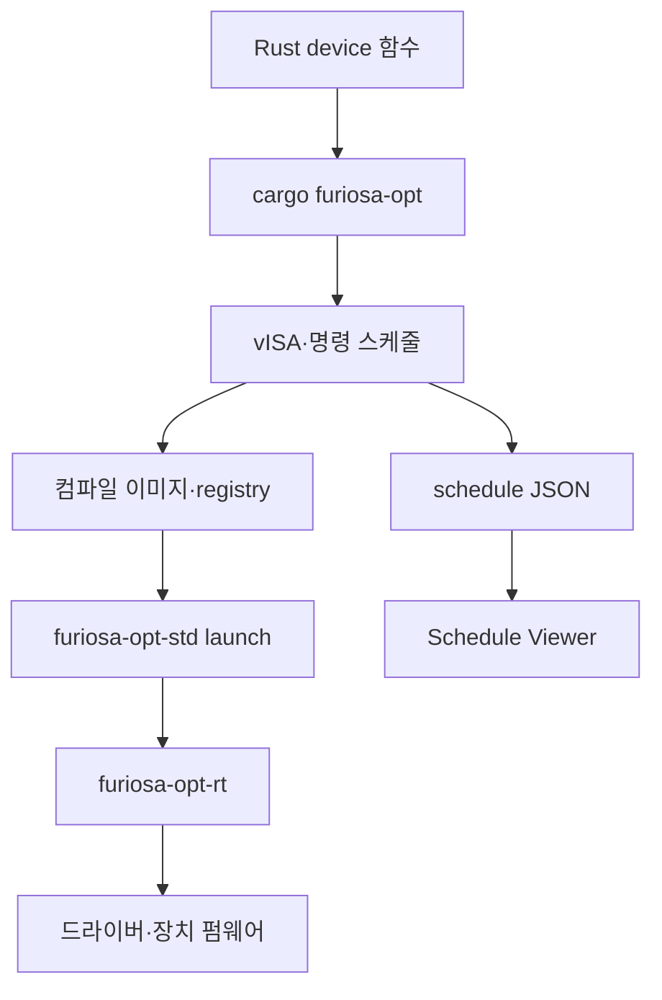

# eISA 확인과 vISA 실전: furiosa-opt로 내부를 읽는다

사용자가 요청한 **eISA의 공식 풀네임과 독립적인 공개 실행 API는 이번 조사에서 확인하지 못했다.** `furiosa-opt` 공개 문서가 직접 프로그래밍 대상으로 설명하는 이름은 **vISA(Virtual Instruction Set Architecture)**다. ISA(Instruction Set Architecture)는 명령어 집합 구조를 뜻한다. eISA가 vISA의 다른 이름이라고 단정하지 않고, 확인 가능한 vISA·컴파일·실행·관찰 경로를 이 장에서 다룬다. [공식 프로그래밍 문서](https://github.com/furiosa-ai/furiosa-opt/blob/3d43bc9d20f324af60e3006c3f1541938d7f5097/docs/src/introduction.md)

> **재현 기준** · 이 장의 소스는 `furiosa-opt` commit `3d43bc9d20f324af60e3006c3f1541938d7f5097`이다. 같은 commit의 base template은 `furiosa-opt-std = "0.10"`을 요구한다. 오래된 0.8.x 예제·포럼 답변과 섞지 않는다. 공개 프로젝트는 실험적 소프트웨어이며 API 변경을 전제로 버전을 기록한다. [template 의존성](https://github.com/furiosa-ai/furiosa-opt/blob/3d43bc9d20f324af60e3006c3f1541938d7f5097/base-template/Cargo.toml.liquid)

## 1. TCL보다 어떤 결정을 더 표현하는가

TCL(Tensor Contraction Language)에서는 논리 축과 연산의 의미를 표현하고 컴파일러에 맡기는 부분이 많다. vISA에서는 텐서를 어느 메모리에 놓고, 축을 어느 하드웨어 차원에 배치하고, 어느 엔진 경로로 흘릴지를 더 구체적으로 쓴다. 모든 레지스터의 원시 바이트를 직접 관리해야 하는 수준과도 다르다. [TCL과 vISA의 공개 소개](https://furiosa.ai/developers), [vISA 소개](https://github.com/furiosa-ai/furiosa-opt/blob/3d43bc9d20f324af60e3006c3f1541938d7f5097/docs/src/introduction.md)

| 결정 | TCL에서 읽는 지점 | vISA에서 읽는 지점 |
|---|---|---|
| 수식 | contraction·pointwise·reduce | 동일한 텐서 의미를 구체적 엔진 연산으로 구성 |
| 배치 | 논리 축과 compiler lowering | `Chip/Cluster/Slice/Lane/Element` mapping |
| 시간 반복 | 특수화한 shape와 컴파일 결과 | `Time/Packet`, loop, unroll |
| 메모리 이동 | compiler가 만든 이동 | `to_dm`, `to_hbm`, fetch, commit |
| 겹침 | compiler 스케줄 결과 | main/sub context에 노출한 의존성 |

vISA는 성능이 중요한 작은 구간의 가설을 직접 실험할 때 유용하다. 모델 전체를 먼저 Rust로 다시 작성해야만 사용할 수 있다는 뜻은 아니다. 한편 TCL로 생성된 임의 EDF를 Rust vISA 원본으로 복원하거나 그대로 schedule JSON으로 변환하는 보편적인 공개 절차는 확인되지 않았다.

## 2. 컴파일 도구와 실행 런타임



`cargo`는 Rust의 빌드·의존성 도구다. `cargo-furiosa-opt`는 이 도구를 감싸 NPU build와 커널 사전 컴파일을 수행한다. 일반 `cargo run`은 CPU backend이고 `cargo furiosa-opt run`은 NPU backend다. CPU build가 성공했다고 NPU mapping까지 검증된 것은 아니다. [Kernel Optimizer](https://github.com/furiosa-ai/furiosa-opt/blob/3d43bc9d20f324af60e3006c3f1541938d7f5097/docs/src/tools/kernel-optimizer.md)

## 3. 공식 template로 첫 실행

Linux x86-64, matching Rust toolchain, 필요한 cross compiler 및 NPU 드라이버를 준비한다. 아래 설치 명령은 공식 Quick Start의 경로다. 배포된 compiler와 template 의존성이 일치하는지 반드시 확인하고, 실험 기록에는 `Cargo.lock`과 compiler version을 함께 보관한다. [Setup and Tooling](https://developer.furiosa.ai/furiosa-opt/book/quick-start/setup-and-tooling.html)

```bash
rustup toolchain install nightly-2026-05-01
cargo +nightly-2026-05-01 install cargo-binstall
cargo +nightly-2026-05-01 binstall cargo-furiosa-opt
cargo install cargo-generate
cargo generate furiosa-ai/furiosa-opt base-template
```

생성한 프로젝트 디렉터리에서 실행한다. template을 기본 branch에서 가져온 경우 이 핸드북 commit 이후 바뀔 수 있으므로, 생성된 소스·의존성을 앞의 기준과 비교한다.

```bash
# CPU 의미 비교
cargo test --release --bin constant_add

# NPU용 커널 컴파일
cargo furiosa-opt compile constant_add_kernel

# 실제 NPU에서 값 비교
cargo furiosa-opt test --release --bin constant_add

# 실행 프로그램
cargo furiosa-opt run --release --bin constant_add
```

대상 binary와 test는 template의 `src/constant_add.rs`에 있다. 원래 input의 각 원소에 1을 더한 CPU reference와 NPU 결과를 비교한다. Rust 정수 overflow 의미까지 일치시켜야 하므로 임의의 Python 정수 계산과 동일시하지 않는다. [공식 constant_add host/test](https://github.com/furiosa-ai/furiosa-opt/blob/3d43bc9d20f324af60e3006c3f1541938d7f5097/base-template/src/constant_add.rs)

## 4. 코드 한 조각으로 mapping을 읽는다

공식 constant-add kernel의 핵심은 다음 배치다.

```rust
axes![A = 2048];
pub type Chip = m![1];
pub type Cluster = m![1 # 2];
pub type Slice = m![A / 8 # 256];
```

`A/8`은 축을 8개 단위로 나눈 위치이고 `A%8`은 그 단위 안의 위치다. `#256`은 물리 차원의 범위를 맞추는 padding 표기다. 이 예에서는 한 active cluster의 256 slice에 각 8개의 i32가 배치된다. 다음에 나오는 `fetch`, `collect`, `vector_fxp`, `commit`은 이 배치에 맞춰 데이터를 흘리고 저장한다. [공식 kernel 원문](https://github.com/furiosa-ai/furiosa-opt/blob/3d43bc9d20f324af60e3006c3f1541938d7f5097/base-template/src/kernel/constant_add_kernel.rs)

`m![]`은 NumPy shape를 다른 문법으로 쓴 것만은 아니다. 예를 들어 같은 총 2048개라도 slice에 256개를 쓰는 배치와 하나의 slice에서 긴 시간 반복을 하는 배치는 병렬성이 달라진다. **논리 값의 동일성, 주소 배치의 합법성, 충분한 자원 활용**을 각각 확인해야 한다.

## 5. 제출과 완료 대기 분리

선택한 commit의 `launch.rs`에는 `Prepared`, `.submit()`, `Submitted`, `.await`가 구분되어 있다. 첫 launch의 이미지 로딩을 앞당기는 `function.load(&device)`와 기존 output storage를 사용하는 `.output(&mut out)`도 있다. [현재 launch 구현](https://github.com/furiosa-ai/furiosa-opt/blob/3d43bc9d20f324af60e3006c3f1541938d7f5097/furiosa-opt-std/src/runtime/launch.rs)

아래 코드는 공식 template의 host 함수 안에서 input HBM을 준비한 뒤 사용하는 **호출 부분**이다. `constant_add_kernel`, `device`, `in_hbm`은 앞선 template에서 정의된 값이다.

```rust
let pending = launch(constant_add_kernel, (&mut device, &in_hbm)).submit();
// 결과 버퍼에 접근하지 않는 호스트 준비 작업을 이 사이에 배치할 수 있다.
let result_hbm = pending.await?;
```

제출했다고 모든 커널이 장치에서 병렬 실행된다는 뜻은 아니다. 같은 자원과 의존성을 공유하면 대기해야 한다. 이 구분은 호스트 준비를 겹치는지, NPU 내부 연산을 겹치는지 분석할 때 중요하다. 2026년 10월 포럼에서 보고된 0.8.1의 고정 spin·제출 API 제약은 역사적 기록이다. 현재 소스에 이미 구현된 API를 아직 미구현이라고 쓰면 안 된다. [0.8.1 당시 질문과 공식 답변](https://forums.furiosa.ai/t/furiosa-opt-v0-8-1-launch-host-cpu-cpu-2/479)

## 6. 스케줄을 눈으로 확인한다

```bash
cargo furiosa-opt compile constant_add_kernel --dump-visa constant-add.visa
cargo furiosa-opt compile constant_add_kernel --dump-schedule constant-add.schedule.json
cargo install furiosa-schedule-viewer
furiosa-schedule-viewer --host 127.0.0.1 --port 9254
```

생성된 schedule JSON을 viewer에 넣는다. 함수 filter가 여러 함수를 고르면 완전한 Rust 경로로 하나만 지정한다. Viewer는 텐서 수명, 연결된 연산, context, 자원 점유를 보여준다. **이 그림은 정적 컴파일 스케줄이며 실제 요청의 처리량이나 수치 정확성을 측정하지 않는다.** [Schedule Viewer](https://github.com/furiosa-ai/furiosa-opt/blob/3d43bc9d20f324af60e3006c3f1541938d7f5097/docs/src/tools/schedule-viewer.md)

읽는 순서는 다음과 같다. 먼저 마지막으로 끝나는 구간을 찾고, 그 구간을 막은 원인이 데이터 의존인지 공유 자원인지 확인한다. 그 다음 대기하는 동안 다른 context가 무엇을 하는지 본다. 마지막으로 한 가지 변경을 제안하고 같은 workload로 다시 컴파일·실행한다. [공식 진단 절차](https://github.com/furiosa-ai/furiosa-opt/blob/3d43bc9d20f324af60e3006c3f1541938d7f5097/docs/src/scheduling/diagnosis.md)

## 7. 사례 A: 다음 가중치 준비를 현재 계산과 겹치기

가중치 그룹을 하나씩 준비한 후 계산하고 기다리는 loop는 다음 그룹의 준비가 늦게 보일 수 있다. 두 반복을 같은 scheduling unit에 노출하거나 작은 정적 loop를 `#[unroll]`하면 compiler가 겹침을 선택할 기회가 생긴다. 무조건 unroll하면 IR 크기와 컴파일 비용이 늘 수 있다.

| 공식 문서의 동일 20-group 예제 | 정적 schedule makespan |
|---|---:|
| 일반 rolled loop | 19,106 cycles |
| 두 단계를 드러낸 software pipeline | 15,477 cycles |
| 전체 unroll | 15,086 cycles |

이 수치는 **Furiosa 문서의 특정 예제 결과**다. FuryNo5 모델의 새 측정치가 아니며, 15,086 cycles를 사용자 환경의 밀리초로 바로 변환하지 않는다. TRF(Tensor Register File) double buffering도 두 절반이 bank를 공유하므로 의존성과 경쟁이 남는다. [공식 tuning 사례](https://developer.furiosa.ai/furiosa-opt/book/scheduling/tuning.html)

## 8. 사례 B: gather와 scatter에서 인덱스 단위를 맞추기

embedding 같은 lookup에서는 `행 번호`와 `바이트 offset`을 섞으면 값이나 주소가 틀린다. 공개 DMA API는 `by_byte_offsets`와 `by_positions`를 구분한다. 후자는 SPM(Scratchpad Memory)의 위치 인덱스를 받는다. BF16 행의 길이가 128이면 한 행은 256 bytes이므로 행 3의 시작은 768 bytes다. 이 계산은 단순 예시이며 실제 tensor mapping·정렬 조건까지 충족해야 한다. [Gather·Scatter 계약](https://developer.furiosa.ai/furiosa-opt/book/moving-tensors/dma-engine.html#gather-and-scatter)

FuryNo5의 int32 입력 검사, embedding contraction과 projection 연결을 읽을 때도 **ID의 의미·단위·범위**부터 확인한다. 잘못된 인덱스를 CPU에서 검사하는 것은 장치의 embedding 계산을 CPU로 옮기는 것이 아니다.

## 9. 사례 C: transpose가 만드는 이동을 줄이기

두 커널이 서로 다른 layout을 기대하면 중간 변환이 필요할 수 있다. vISA에서 입력·출력 mapping을 직접 비교해, 앞 커널의 commit 배치를 다음 커널의 fetch가 원하는 배치에 맞추는 실험을 할 수 있다. 다만 view의 이름만 바꿔 값을 잘못 해석하는 것을 최적화라고 부르면 안 된다. DMA로 새 값 배치를 만드는 경우와 실제 이동 없는 reshape의 성립 조건을 구분한다. [Moving Tensors](https://github.com/furiosa-ai/furiosa-opt/blob/3d43bc9d20f324af60e3006c3f1541938d7f5097/docs/src/moving-tensors/index.md)

## 10. 사례 D: TCL hot path를 vISA로 실험하기

FuryNo5에서 느린 영역을 찾았다면 먼저 연산 의미·shape·dtype·입출력 계약을 고정한다. 그 영역의 vISA 후보를 만들고 CPU reference, compiler mapping 검사, NPU 값 비교, 정적 schedule, 실제 warm latency를 순서대로 비교한다. 선택한 후보가 빨라도 모델 전체의 호출·변환 비용을 포함해야 통합 효과를 판단할 수 있다.

`furiosa.torch._module.visa.compile_from_visa`를 통한 Python 연결은 버전 확인이 특히 필요하다. 포럼의 2026-10-13 공식 답변은 당시 예제가 내부 전용이며 공개 SDK에 포함되지 않았다고 밝혔다. 이후 버전에서의 지원 여부는 설치된 wheel과 release 근거로 재확인해야 한다. **그 함수를 누구나 설치해 즉시 호출할 수 있다고 이 핸드북은 주장하지 않는다.** 공개 Rust 직접 실행 경로는 위 절차대로 별도로 사용할 수 있다. [compile_from_visa 접근 제약](https://forums.furiosa.ai/t/furiosa-opt-compile-from-visa-furiosa-torch/487)

## 출처

| 근거 | 확인한 내용 |
|---|---|
| [공식 vISA 소개](https://github.com/furiosa-ai/furiosa-opt/blob/3d43bc9d20f324af60e3006c3f1541938d7f5097/docs/src/introduction.md) | 공개 명칭·역할·실험적 상태 |
| [Kernel Optimizer](https://github.com/furiosa-ai/furiosa-opt/blob/3d43bc9d20f324af60e3006c3f1541938d7f5097/docs/src/tools/kernel-optimizer.md) | compiler·CPU/NPU·dump CLI |
| [template host/test](https://github.com/furiosa-ai/furiosa-opt/blob/3d43bc9d20f324af60e3006c3f1541938d7f5097/base-template/src/constant_add.rs) | 실행·CPU reference 비교 |
| [template kernel](https://github.com/furiosa-ai/furiosa-opt/blob/3d43bc9d20f324af60e3006c3f1541938d7f5097/base-template/src/kernel/constant_add_kernel.rs) | mapping과 vector pipeline |
| [launch.rs](https://github.com/furiosa-ai/furiosa-opt/blob/3d43bc9d20f324af60e3006c3f1541938d7f5097/furiosa-opt-std/src/runtime/launch.rs) | submit·await·선로딩·출력 재사용 |
| [Schedule Viewer](https://github.com/furiosa-ai/furiosa-opt/blob/3d43bc9d20f324af60e3006c3f1541938d7f5097/docs/src/tools/schedule-viewer.md) | 정적 관찰의 범위 |
| [Scheduling Tuning](https://developer.furiosa.ai/furiosa-opt/book/scheduling/tuning.html) | double buffering·unroll 사례 |
| [포럼 479](https://forums.furiosa.ai/t/furiosa-opt-v0-8-1-launch-host-cpu-cpu-2/479) | 구버전 host 제출 병목 |
| [포럼 487](https://forums.furiosa.ai/t/furiosa-opt-compile-from-visa-furiosa-torch/487) | 당시 Python bridge 공개 여부 |
