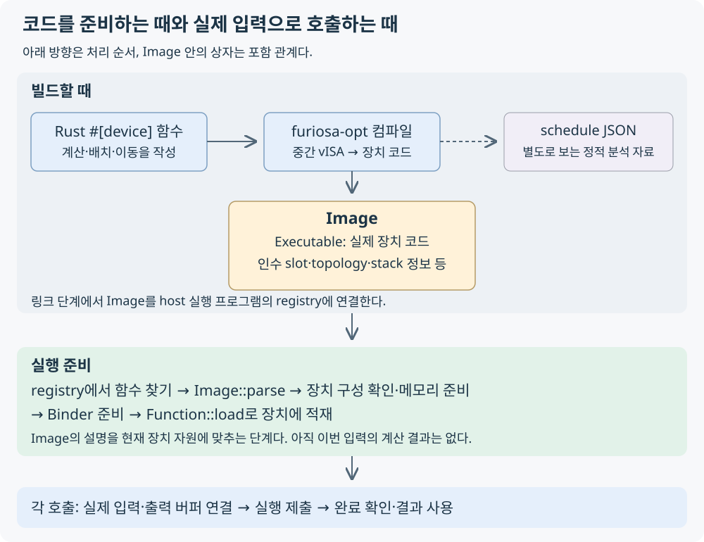
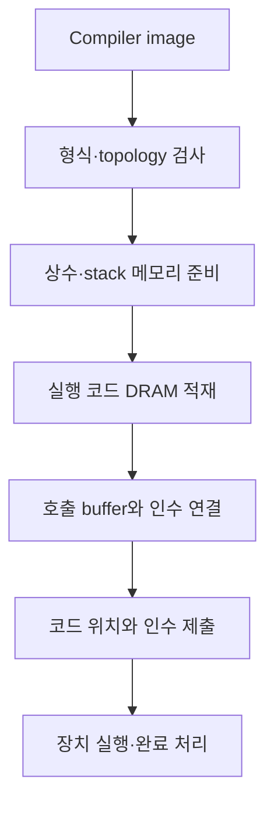

# 저수준 프로그래밍: vISA와 furiosa-opt

[07장](07-optimization.md)에서 데이터 이동이나 배치를 개선할 필요를 찾았다면, 그 부분을 더 직접 지정해 볼 수 있다. 여기서는 TCL 대신 공개 furiosa-opt 도구를 사용한다. 계산식은 `x+1`로 두고, 값이 놓이는 위치와 이동 순서에 집중하자.

배열의 37번 원소를 읽으려면 그 값이 저장된 위치를 알아야 한다. NPU에서는 값이 여러 chip·PE·slice에 나뉘어 놓일 수 있어, 배열의 번호만으로 실제 위치가 정해지지 않는다. 이 둘의 대응을 나타내는 것이 매핑(mapping)이다.

2×3 배열에서 주소를 구하는 법을 확인한 뒤, 공식 `constant_add` 예제의 정수 2,048개로 넓힌다. 그중 37번 원소가 어느 위치에 놓이고, 어떤 경로를 거쳐 38이 되는지 따라가겠다.

> 명칭과 버전 · ISA(Instruction Set Architecture)는 명령어 집합 구조다. 공개 프로그래밍 문서의 이름은 vISA(Virtual Instruction Set Architecture)다. eISA라는 명칭을 이 공개 API의 동의어로 사용하지 않는다. 이 장에서 사용하는 코드와 도구는 vISA 경로다. 이 장은 `furiosa-opt` commit `3d43bc9d20f324af60e3006c3f1541938d7f5097`과 `furiosa-opt-std = "0.10"` template을 기준으로 한다. [공식 소개](https://github.com/furiosa-ai/furiosa-opt/blob/3d43bc9d20f324af60e3006c3f1541938d7f5097/docs/src/introduction.md), [template 의존성](https://github.com/furiosa-ai/furiosa-opt/blob/3d43bc9d20f324af60e3006c3f1541938d7f5097/base-template/Cargo.toml.liquid)

## 1. 같은 행렬을 두 저장 순서로 표현한다

논리 행렬이 `[[0,1,2],[10,11,12]]`라고 하자. 행 우선이면 한 행을 연속으로 저장하므로 버퍼는 `[0,1,2,10,11,12]`다. 열 우선이면 한 열을 먼저 저장하므로 `[0,10,1,11,2,12]`다. 논리 값은 같지만 저장 위치가 다르다.

```python
# CPU의 일반 리스트로 mapping의 의미를 확인한다. NPU API가 아니다.
row_major = [0, 1, 2, 10, 11, 12]
column_major = [0, 10, 1, 11, 2, 12]
H, W = 2, 3                       # H는 행 축의 길이, W는 열 축의 길이
for h in range(H):
    for w in range(W):
        row_offset = h * W + w     # 행 하나를 건너뛰면 원소 W개만큼 이동한다.
        col_offset = w * H + h     # 열 하나를 건너뛰면 원소 H개만큼 이동한다.
        assert row_major[row_offset] == column_major[col_offset]
```

| 논리 좌표 | 값 | 행 우선 원소 위치 `h×3+w` | 열 우선 원소 위치 `w×2+h` |
|---|---:|---:|---:|
| `(0,0)` | 0 | 0 | 0 |
| `(0,1)` | 1 | 1 | 2 |
| `(1,0)` | 10 | 3 | 1 |
| `(1,2)` | 12 | 5 | 5 |

여기서 **shape**는 `(2,3)`이라는 축의 길이, **layout**은 행 우선·열 우선 같은 저장 규칙이다. Stride는 한 축을 한 칸 이동할 때의 저장 간격이다. 이 행 우선 배열의 stride는 원소 단위로 `(3,1)`이다. 실제 바이트 주소는 `버퍼 시작 주소 + 원소 위치 × 원소당 바이트 수`로 구한다. mapping은 이 규칙을 표현하며 실제 버퍼 시작 주소를 그 자체에 저장하는 것은 아니다.

공식 Rust mapping 표현에서는 아래처럼 이름 있는 축과 순서를 지정한다. 이는 mapping 문법을 설명하는 조각이며, 아직 장치의 cluster·slice에 배치한 커널은 아니다.

```rust
use furiosa_opt_std::prelude::*;
axes![H = 2, W = 3];              // 논리 좌표의 이름과 길이
pub type RowMajor = m![H, W];    // W가 안쪽: 물리 위치 p를 H=p/3, W=p%3으로 해석
pub type ColumnMajor = m![W, H]; // H가 안쪽: 물리 위치 p를 W=p/2, H=p%2으로 해석
```

`m![]`의 Rust 타입은 **물리 위치에서 어떤 논리 좌표를 읽는지**를 표현한다. 따라서 이미 행 우선으로 저장된 버퍼를 그대로 두고 타입 이름만 열 우선으로 바꾸면 같은 행렬이 되지 않는다. 좌표 `(0,1)`에서 원래의 1 대신 물리 위치 2의 값 2를 읽게 된다. 필요한 데이터 이동 또는 성립하는 view 변환을 구분해야 한다. [공식 Mapping Expressions](https://github.com/furiosa-ai/furiosa-opt/blob/3d43bc9d20f324af60e3006c3f1541938d7f5097/docs/src/mapping-tensors/mapping-expressions.md)

**Reshape**는 원소 수를 유지하면서 차원 길이를 다시 묶는 것이고, **transpose(전치)는** 좌표 축을 교환하는 것이다. 예를 들어 `[0,1,2,10,11,12]`를 `(3,2)`로 reshape하면 `[[0,1],[2,10],[11,12]]`다. 원래 행렬을 transpose한 `[[0,10],[1,11],[2,12]]`와 값의 좌표가 다르다. 저수준 코드에서도 이름이나 shape를 바꾸는 것과 실제 원소를 올바른 위치로 옮기는 것을 구분해야 한다.

## 2. 논리 축과 물리 자원의 이름을 구분한다

배열의 ‘몇 번째 행·열인가’와 장치의 ‘어느 처리 구획인가’는 다른 질문이다. A·H·W 같은 축 이름은 배열 안의 값을 찾는 데 쓰고, Chip·Cluster·PE·Slice·Lane은 그 값을 저장하거나 계산할 장치 위치를 구분한다.

아래 표는 장치 위치의 포함 관계다. 배열의 0번 축을 장치의 0번 slice로 자동 대응시키는 규칙은 아니다. 개발자나 컴파일러가 대응 방법을 정해야 한다.

| 단위 | 이 장에서 필요한 의미 | 고정 공개 문서의 관계 |
|---|---|---|
| Chip | NPU 칩 | 사용할 칩 수는 실행 구성에 따라 결정 |
| Cluster | 칩 안의 PE 묶음 | 칩당 2개 |
| PE(Processing Element) | 계산·메모리 자원 묶음 | cluster당 4개 |
| Slice | PE 안에서 데이터를 나누고 계산하는 더 작은 단위 | PE당 64개, cluster당 256개 |
| Lane | 수축 연산과 TRF 배치에 쓰는 slice 내부의 세부 병렬 차원 | TRF의 slice당 8개 lane |

같은 수를 여러 번 곱한다면 계산기 가까이에 두고 다시 읽는 편이 유리할 수 있다. **TRF**는 이런 텐서 연산용 값을 보관하는 하드웨어 레지스터 묶음이다. 디스크 파일은 아니다.

DM 배열에서는 Chip·Cluster·Slice·Element로 위치를 구분하고, TRF에는 Lane 차원도 있다. **Element는 선택한 구획 안의 저장 칸**, Lane은 더 작은 병렬 배치 차원이다. 둘 다 숫자가 8이라고 같은 대상을 뜻하지는 않는다. [공간·시간 차원의 공식 정의](https://github.com/furiosa-ai/furiosa-opt/blob/3d43bc9d20f324af60e3006c3f1541938d7f5097/docs/src/mapping-tensors/spatial-temporal-dimensions.md)

장치 tensor의 타입은 어느 물리 단위에 어떤 논리 좌표를 놓는지 표현한다. 실제 메모리를 소유하고 주소를 관리하는 것은 storage 객체와 런타임이다. 값을 놓는 규칙을 맞췄다고 저장 공간 할당까지 끝났다고 생각하면 안 된다.

## 3. 2,048개 정수를 256개 slice에 나누어 놓는다

먼저 8개 값을 두 보관 구획에 네 개씩 놓는 작은 예를 생각하자. 0~3번은 첫 구획, 4~7번은 둘째 구획에 둔다. 5번 값의 위치는 ‘구획 1, 그 안의 칸 1’이다. `5//4=1`, `5%4=1`로 구한다.

아래 실제 예제도 같은 나눗셈 원리를 사용하되 구획의 크기와 수가 다르다. 원소를 8개씩 묶어 256개 slice에 놓는다. 작은 예는 좌표 계산용이며 장치의 최소 저장 단위를 뜻하지 않는다.

공식 `constant_add_kernel`은 모든 정수에 1을 더한다. 다음은 **설명 주석을 추가한 mapping 선언 발췌**다. 전체 실행 파일은 뒤의 공식 template에서 만든다.

```rust
axes![A = 2048];                  // 논리 배열의 길이: 2048개 i32 정수
pub type Chip = m![1];            // 이 커널의 칩 차원은 하나다.
pub type Cluster = m![1 # 2];     // 한 cluster에 유효 값을 두고 물리 범위는 2로 맞춘다.
pub type Slice = m![A / 8 # 256]; // 논리 인덱스 A를 8개씩 묶어 256 slice에 나눈다.
```

이후 DM의 slice 내부 원소 배치는 `m![A % 8]`이다. 나눗셈의 몫 `a // 8`은 slice 번호, 나머지 `a % 8`은 그 slice 안의 원소 위치다. 각 slice에 8개씩 저장하므로 `256×8=2048`개를 담는다. [공식 kernel 원문](https://github.com/furiosa-ai/furiosa-opt/blob/3d43bc9d20f324af60e3006c3f1541938d7f5097/base-template/src/kernel/constant_add_kernel.rs)

| 논리 인덱스 a | active cluster | slice `a//8` | cluster 안 PE `slice//64` | slice 안 Element `a%8` |
|---:|---:|---:|---:|---:|
| 0 | 0 | 0 | 0 | 0 |
| 7 | 0 | 0 | 0 | 7 |
| 8 | 0 | 1 | 0 | 0 |
| 37 | 0 | 4 | 0 | 5 |
| 1023 | 0 | 127 | 1 | 7 |
| 2047 | 0 | 255 | 3 | 7 |

이제 “37번 원소가 어디에 있는가”에 답할 수 있다. 이 mapping에서는 **chip 0, active cluster 0, slice 4의 Element 5**다. 이 좌표만으로 전체 바이트 주소를 임의 계산해 드라이버에 넣지는 않는다. 실제 주소·정렬·할당은 해당 tensor storage의 계약을 따른다.

### `#`는 0을 채우라는 명령이 아니다

유효한 데이터는 한 구획만 쓰는데, 표현해야 할 장치 범위는 두 구획인 경우가 있다. `m![1 # 2]`는 이런 범위를 맞추는 표기다. 실제 값이 있는 위치 하나와 남는 위치 하나를 구분한다.

여기서 `#`를 썼다고 남는 메모리에 0을 쓰는 작업이 실행되는 것은 아니다. 뒤 계산이 남는 위치를 읽는다면 무엇을 읽어야 하는지 별도로 정해야 한다. 예를 들어 합산에서 제외할 위치인지, 중립값을 채울 위치인지가 필요하다. [Padding의 의미](https://github.com/furiosa-ai/furiosa-opt/blob/3d43bc9d20f324af60e3006c3f1541938d7f5097/docs/src/mapping-tensors/mapping-expressions.md)

이 예에서 `A/8=256`이므로 `#256`으로 추가되는 slice는 없다. `Cluster`의 `#2`에서는 유효하지 않은 cluster 위치 하나를 표현한다.

또한 한 active cluster를 사용한다는 표현은 “런타임이 칩의 절반을 독립적으로 예약하여 다른 프로그램과 안전하게 공유한다”는 보장이 아니다. **계산의 유효 배치와 장치 자원 예약 단위**를 구분한다. 같은 2,048개를 한 slice에 긴 시간에 걸쳐 처리하도록 바꾸는 것도 단순한 이름 변경이 아니다. 적합한 저장·전송·엔진 제약을 새로 만족해야 한다.

## 4. 저장된 값이 계산 경로로 흘러가는 과정

HBM(High Bandwidth Memory)은 큰 장치 메모리이고, DM은 계산에 가까운 칩 내부 메모리다. DMA는 CPU가 각 원소를 복사하는 대신 전송 엔진이 데이터를 옮기는 방식이다. CPU↔HBM 전송과 HBM↔DM 전송을 구분한다. Fetch는 DM 값을 Tensor Unit의 계산 흐름으로 읽고, **Commit**은 계산 결과를 DM에 기록한다.

`constant_add_kernel`의 첫 이동은 HBM 입력을 앞 절의 DM mapping으로 옮기는 것이다. 아래는 해당 함수 안에서 사용하는 한 줄에 설명 주석을 추가한 발췌다. `input`, `device`, `Cluster`, `Slice`, `A`는 template의 선언을 사용한다.

```rust
// 입력의 논리 값은 유지하며 HBM -> DM으로 이동한다. slice당 A%8, 즉 8개 원소다.
let dm = input.to_dm::<Cluster, Slice, m![A % 8]>(&mut device.tdma);
```

### Time과 Packet은 무엇을 세는가

DM에 정지해 있는 배열을 계산 엔진에 공급할 때는 **몇 차례에 걸쳐, 한 차례에 얼마씩 줄지** 정한다. `Time`은 전달 반복의 순서이고, `Packet`은 그 반복에서 한 slice에 전달되는 원소 묶음이다. 이때 time step 하나가 항상 하드웨어 한 clock cycle과 같다는 뜻은 아니다. 패킷을 읽는 데 여러 접근이 필요할 수 있다. [Fetch Engine](https://github.com/furiosa-ai/furiosa-opt/blob/3d43bc9d20f324af60e3006c3f1541938d7f5097/docs/src/moving-tensors/fetch-engine.md)

공식 예제는 `fetch::<m![1], m![A % 8]>()`를 사용한다. 한 번의 논리 전달 반복에서 각 active slice의 i32 8개를 읽는다. i32 하나는 4 bytes이므로 패킷은 32 bytes다. **Collect**는 뒤 엔진이 받는 32-byte 단위인 flit에 맞게 패킷을 정리한다. 이 예의 패킷은 이미 32 bytes여서 그 단위에 맞는다. 일반적으로 Collect는 작은 패킷에 padding을 더하거나 큰 패킷을 여러 단위로 나눌 수 있다. [Collect Engine](https://github.com/furiosa-ai/furiosa-opt/blob/3d43bc9d20f324af60e3006c3f1541938d7f5097/docs/src/computing-tensors/collect-engine.md)

### 한 slice에 16개가 있고 한 번에 8개씩 보낸다면

Time이 1인 예만 보면 시간 방향에 배치한다는 말이 잘 드러나지 않는다. 이번에는 논리 원소 4,096개를 256개 slice에 16개씩 놓고, slice마다 8개씩 두 번 보낸다고 가정하자. **아래는 좌표를 검산하기 위한 교육용 mapping 모형**이다. 이 변경을 넣은 Rust 커널이 compiler·메모리 제약을 통과했다거나 NPU에서 실행됐다고 주장하지 않는다.

논리 원소 번호 a를 `a = 16×slice + 8×time + packet_position`으로 나눈다. 여기서 `time`은 0·1 두 번의 전달, `packet_position`은 그때 전달하는 8개 안의 위치 0~7이다.

| slice | time | packet 위치 0~7에 들어가는 논리 원소 | 그 slice의 DM Element 위치 |
|---:|---:|---|---|
| 0 | 0 | 0, 1, …, 7 | 0~7 |
| 0 | 1 | 8, 9, …, 15 | 8~15 |
| 4 | 0 | 64, 65, …, 71 | 0~7 |
| 4 | 1 | 72, 73, …, 79 | 8~15 |

예를 들어 a=77은 slice 4의 Element 13에 있다. 그 원소가 흐를 때는 두 번째 전달인 time 1의 packet 위치 5에 들어간다. time 0에 slice 4만 동작한다는 뜻은 아니다. 각 slice가 자기 첫 묶음을 공급하는 반복과 다음 묶음을 공급하는 반복을 구분한 것이다.

```python
# 좌표 분해의 검산이다. NPU API 호출이나 clock cycle 예측이 아니다.
a = 77
slice_id = a // 16                       # 원소 16개를 한 slice에 둔다: 4
element = a % 16                         # 해당 slice 안의 저장 위치: 13
time_index = element // 8                # 8개씩 보낼 때 몇 번째 묶음인가: 1
packet_position = element % 8            # 그 묶음의 어느 원소인가: 5
assert (slice_id, time_index, packet_position) == (4, 1, 5)
assert 16 * slice_id + 8 * time_index + packet_position == a
```

저장 위치를 나타내는 `Element=13`과 한 전달 안의 `Packet 위치=5`는 이렇게 다른 좌표다. 또한 두 번의 전달이 곧 2 clock cycles라는 뜻도 아니다. 실제 읽기 폭·패킷 처리·뒤 엔진의 대기까지 고려한 스케줄이 필요하다. [공식 공간·시간 차원의 구분](https://github.com/furiosa-ai/furiosa-opt/blob/3d43bc9d20f324af60e3006c3f1541938d7f5097/docs/src/mapping-tensors/spatial-temporal-dimensions.md)

다시 원래의 A=2,048, slice마다 8개, Time=1인 공식 template로 돌아온다. 읽기 쉽게 입력값을 `input[a]=a`라고 정한 **설명용 추적**을 하자. 실제 template의 시험 입력은 난수다.

| 단계 | a=37의 위치·상태 | 값이 바뀌는가? |
|---|---|---|
| Host 입력 | CPU 버퍼의 논리 37번 원소 | `37` |
| HBM 준비 | 장치의 HBM 입력 tensor | 이동만 하므로 `37` |
| `to_dm` | slice 4, Element 5 | 이동만 하므로 `37` |
| Fetch·Collect | slice 4의 첫 전달, 패킷 안 위치 5 | 표현·흐름을 맞추며 `37` 유지 |
| Vector Engine | 정수 덧셈 연산에 상수 1 전달 | `38`로 변경 |
| Commit | slice 4의 출력 DM 위치 | 결과 `38` 기록 |
| `to_hbm`·`to_host` | HBM 결과를 거쳐 CPU에서 확인 | `38` 확인 |

Vector Engine은 패킷 원소에 정수·부동소수점 등의 벡터 연산을 적용하는 계산 엔진이다. 공식 예제의 `vector_fxp(FxpBinaryOp::AddFxp, 1)`이 여기서 실제 `+1`을 수행한다. 그 전후의 `vector_init`, `vector_final`은 벡터 계산의 상태·단계를 맞추고, `commit_trim`·`commit`은 요구한 출력 배치로 DM에 기록하도록 연결한다. 함수 이름을 순서만 외우기보다 **이동인지, 표현 변환인지, 수치 계산인지, 저장인지**를 구분해 읽는다. [완전한 constant-add kernel](https://github.com/furiosa-ai/furiosa-opt/blob/3d43bc9d20f324af60e3006c3f1541938d7f5097/base-template/src/kernel/constant_add_kernel.rs)

## 5. TCL과 vISA가 컴파일러에 전달하는 정보

행렬곱을 작성할 때 ‘어느 축의 숫자를 곱해서 더할까’까지만 적고 구체적인 저장 위치는 컴파일러에 맡길 수 있다. TCL은 이런 방식에 가깝다.

vISA 경로에서는 같은 계산을 어느 메모리에 두고, 어떻게 옮겨 계산기에 공급할지 더 직접 표현한다. 선택할 수 있는 부분이 늘지만, 그만큼 배치와 이동이 맞는지 확인할 책임도 늘어난다. NPU의 모든 원시 명령을 손으로 적는다는 뜻은 아니다. [TCL과 vISA의 공개 소개](https://furiosa.ai/developers) · [vISA 소개](https://github.com/furiosa-ai/furiosa-opt/blob/3d43bc9d20f324af60e3006c3f1541938d7f5097/docs/src/introduction.md)

| 결정 | TCL에서 읽는 지점 | vISA에서 읽는 지점 |
|---|---|---|
| 수식 | contraction·pointwise·reduce | 동일한 텐서 의미를 구체적 엔진 연산으로 구성 |
| 배치 | 논리 축과 compiler lowering | `Chip/Cluster/Slice/Lane/Element` mapping |
| 시간 반복 | 특수화한 shape와 컴파일 결과 | `Time/Packet`, 반복문과 반복문 펼치기(unroll) |
| 메모리 이동 | compiler가 만든 이동 | `to_dm`, `to_hbm`, fetch, commit |
| 겹침 | compiler 스케줄 결과 | main/sub 실행 흐름에 노출한 의존성 |

vISA는 성능이 중요한 작은 구간의 가설을 직접 실험할 때 유용하다. 모델 전체를 먼저 Rust로 다시 작성해야만 사용할 수 있다는 뜻은 아니다. 한편 TCL로 생성된 임의 EDF를 Rust vISA 원본으로 복원하거나 그대로 schedule JSON으로 변환하는 보편적인 공개 절차는 확인되지 않았다.

### vISA에서 컴파일된 실행물까지

vISA는 계산과 이동을 컴파일러가 다루는 표현이다. 작성한 설명은 다시 컴파일되어 장치 실행물로 바뀌어야 한다. vISA 텍스트를 NPU에 바로 보내 실행하지는 않는다.

중간 vISA가 만들어져도 장치에 적재할 준비가 끝난 것은 아니다. 컴파일러는 장치 코드를 생성하고, 그 코드와 메모리 연결 정보를 Image에 담는다. 링크 단계는 이 Image를 host 실행 프로그램의 registry에 연결한다. registry는 호출할 함수를 찾는 표이고, Image는 그 함수의 실행에 필요한 묶음이다. [중간 vISA 출력](https://github.com/furiosa-ai/furiosa-opt/blob/3d43bc9d20f324af60e3006c3f1541938d7f5097/docs/src/tools/kernel-optimizer.md) · [Image의 구성](https://github.com/furiosa-ai/furiosa-opt/blob/3d43bc9d20f324af60e3006c3f1541938d7f5097/furiosa-opt-abi/src/image.rs) · [registry의 역할](https://github.com/furiosa-ai/furiosa-opt/blob/3d43bc9d20f324af60e3006c3f1541938d7f5097/furiosa-opt-rt/src/registry/mod.rs)

<figure class="diagram">

<figcaption>Image는 실행 코드와 메모리 연결 정보를 담는다. registry는 host 프로그램에서 그 Image를 찾게 해 준다. <a href="../assets/diagrams/opt-program-lifecycle.svg" target="_blank" rel="noopener">그림 크게 보기</a></figcaption>
</figure>

그림에서 장치 코드는 Image **안에 포함된다**. ‘EDF 파일을 만든 다음 별도의 Image 파일로 변환한다’는 공정으로 읽으면 안 된다. 공식 검증 문서는 컴파일된 장치 실행물을 EDF라고 설명하지만, 그 명칭만으로 TCL/SDK의 `.edf`와 같은 바이트 형식이라고 판단할 수는 없다. 이 장은 공개 opt의 Image와 그것을 읽는 로더를 기준으로 설명한다. [공식 검증 절차의 EDF 설명](https://github.com/furiosa-ai/furiosa-opt/blob/3d43bc9d20f324af60e3006c3f1541938d7f5097/docs/src/quick-start/kernel-validation.md) · [로더 구현](https://github.com/furiosa-ai/furiosa-opt/blob/3d43bc9d20f324af60e3006c3f1541938d7f5097/furiosa-opt-rt/src/registry/load/mod.rs)

이때 컴파일은 실행 방법을 만드는 단계이고, 적재(load)는 그 결과를 현재 장치 자원에 준비하는 단계다. 실행할 입력 값은 호출 시 다시 연결한다.

`cargo`는 Rust의 빌드·의존성 도구다. `cargo-furiosa-opt`는 이 도구를 감싸 NPU build와 커널 사전 컴파일을 수행한다. 일반 `cargo run`은 CPU backend이고 `cargo furiosa-opt run`은 NPU backend다. CPU build가 성공했다고 NPU mapping까지 검증된 것은 아니다. [Kernel Optimizer](https://github.com/furiosa-ai/furiosa-opt/blob/3d43bc9d20f324af60e3006c3f1541938d7f5097/docs/src/tools/kernel-optimizer.md)

## 6. 공식 template로 컴파일·실행·정답 비교

### 먼저 네 가지 버전을 각각 확인한다

Python 프로젝트에서 Python 버전·설치한 명령 도구·라이브러리 버전을 따로 확인하듯, 여기서도 숫자 하나로 환경을 대표할 수 없다. **Template은** 소스 파일을 만드는 틀이고, **compiler는** 그 소스를 NPU 실행물로 바꾸는 설치된 프로그램이다. `furiosa-opt-std`는 프로젝트가 사용하는 Rust 라이브러리다. Rust toolchain은 프로그램을 빌드하는 Rust compiler·Cargo 등의 도구 묶음이며, opt compiler도 그 Rust compiler의 내부 인터페이스에 연결된다.

이 장의 기준 commit `3d43bc9d20f324af60e3006c3f1541938d7f5097`은 이번 재검토에서 조회한 공식 `v0.10.0` 태그와 같다. 해당 소스의 compiler package와 std crate는 각각 `0.10.0`이고, template은 std에 `"0.10"`이라는 **허용 버전 범위**를 선언한다. 따라서 아래에서는 compiler 배포와 template을 따로 고정한다. std와 compiler의 숫자가 같다는 이유만으로 모든 조합이 호환된다는 규칙을 만든 것은 아니다. [태그가 가리키는 commit](https://api.github.com/repos/furiosa-ai/furiosa-opt/git/ref/tags/v0.10.0) · [compiler package·배포 위치](https://github.com/furiosa-ai/furiosa-opt/blob/3d43bc9d20f324af60e3006c3f1541938d7f5097/cargo-furiosa-opt/Cargo.toml) · [std package](https://github.com/furiosa-ai/furiosa-opt/blob/3d43bc9d20f324af60e3006c3f1541938d7f5097/furiosa-opt-std/Cargo.toml)

| 확인 대상 | 이 장에서 선택하는 기준 | 내 환경에서 읽을 관측값 |
|---|---|---|
| Template 소스 | 전체 commit `3d43bc9d…`의 `base-template` | 아래 생성 명령의 `--revision`과 보관한 원본 commit. 생성 프로젝트의 새 Git HEAD와 혼동하지 않음 |
| Compiler 배포 | 공식 `cargo-furiosa-opt` **0.10.0** 배포물 | 설치 완료 로그·`cargo install --list`의 package 버전, 실제로 선택되는 실행 파일 경로 |
| Rust toolchain | **`nightly-2026-05-01`** | 프로젝트의 `rust-toolchain.toml`, `rustup show active-toolchain`, `rustc -Vv` |
| 프로젝트 라이브러리 | 원본 template의 `furiosa-opt-std = "0.10"`; 이 실습에서는 `=0.10.0`으로 좁힘 | 프로젝트에서 생성한 `Cargo.lock`과 `cargo metadata`의 실제 `name`·`version`·`source` |

Rust compiler의 내부 ABI(Application Binary Interface)에 연결되는 도구이므로 공식 문서는 지정 nightly를 요구한다. Linux x86-64의 Ubuntu 22.04 이상, host 빌드 도구·`libclang`, NPU build용 AArch64 cross compiler도 필요하다. 실제 NPU 실행에는 SDK와 장치 드라이버가 추가로 필요하다. 14장의 별도 preview 모델 조합을 이 일반 kernel 실습의 설치 기준으로 가져오지 않는다. [고정 버전 설치 전제](https://github.com/furiosa-ai/furiosa-opt/blob/3d43bc9d20f324af60e3006c3f1541938d7f5097/docs/src/quick-start/setup-and-tooling.md) · [template toolchain](https://github.com/furiosa-ai/furiosa-opt/blob/3d43bc9d20f324af60e3006c3f1541938d7f5097/base-template/rust-toolchain.toml)

### Compiler와 template을 고정해서 프로젝트를 만든다

다음은 위 host 전제가 준비된 Linux의 Bash에서 실행할 명령이다. `cargo-binstall`은 이미 빌드된 배포물을 설치하고, `cargo-generate`는 template에서 새 프로젝트를 만든다. 두 보조 도구의 실제 설치 버전도 뒤의 설치 목록에 남긴다. NPU compiler의 공개 `main.rs`는 설치 안내를 출력하는 stub이므로, 이 compiler를 `cargo install --git ...`로 바꿔 설치한다고 같은 배포물이 만들어지지는 않는다. [공개 compiler 진입점](https://github.com/furiosa-ai/furiosa-opt/blob/3d43bc9d20f324af60e3006c3f1541938d7f5097/cargo-furiosa-opt/src/main.rs)

```bash
# tee로 로그를 남길 때 설치 명령의 실패를 놓치지 않도록 한다.
set -o pipefail
# 공식 compiler가 요구하는 nightly를 준비한다.
rustup toolchain install nightly-2026-05-01
cargo +nightly-2026-05-01 install cargo-binstall
# @0.10.0은 compiler 배포 버전이다. 버전을 생략해 최신 배포를 선택하지 않는다.
cargo +nightly-2026-05-01 binstall cargo-furiosa-opt@0.10.0 2>&1 | tee opt-compiler-install.log
cargo install cargo-generate
# branch 이름 대신 전체 commit을 지정하고, 그 안의 base-template을 사용한다.
cargo generate --git https://github.com/furiosa-ai/furiosa-opt \
  --revision 3d43bc9d20f324af60e3006c3f1541938d7f5097 \
  --name opt-constant-add base-template
cd opt-constant-add
# 설치 로그도 생성한 프로젝트와 함께 보관한다.
cp ../opt-compiler-install.log .
```

`@버전`과 `--revision`은 각각 설치기와 생성기의 옵션이다. 실제 설치에서는 compiler archive의 이름 `cargo-furiosa-opt-v0.10.0-x86_64-unknown-linux-gnu.tgz`와 설치한 package 버전을 로그에서 대조한다. 공식 release에 이 배포물이 존재한다는 것은 확인했지만, 이 집필 환경에서 설치를 실행한 기록은 아니다. [공식 v0.10.0 배포](https://github.com/furiosa-ai/furiosa-opt/releases/tag/v0.10.0) · [Binstall 버전 선택](https://github.com/cargo-bins/cargo-binstall/blob/17717041b8b8d177fd061e56dc8c40abe41120f2/crates/bin/src/args.rs#L55-L76) · [Generate의 revision·name 옵션](https://github.com/cargo-generate/cargo-generate/blob/165d2fe0b0d3f4872058a091b2a6201f2bc2e23e/src/args.rs#L237-L278)

### 허용 범위와 실제 선택된 라이브러리를 구분한다

`Cargo.toml`의 `"0.10"`은 `0.10.0` 한 개를 뜻하지 않고 `0.10.x` 범위를 허용한다. 새 프로젝트의 `[dependencies]`에서 **기존 std 한 줄만** 다음과 같이 바꿔 이 실습의 직접 의존성을 고정한다. 아래는 파일 전체가 아니다. [Cargo 버전 범위·정확한 버전 표기](https://doc.rust-lang.org/cargo/reference/specifying-dependencies.html)

```toml
# 생성된 Cargo.toml의 [dependencies] 안에서 기존 std 줄을 교체한다.
furiosa-opt-std = "=0.10.0"
```

std가 사용하는 다른 라이브러리까지 선택한 결과는 **`Cargo.lock`에** 남는다. 새로운 프로젝트에서 한 번 만들고 이후에는 함께 보관한다. 이미 실험한 프로젝트의 lockfile을 다시 만들면 선택 버전이 바뀔 수 있다. 공식 저장소 루트의 `Cargo.lock`은 그 저장소 전체 workspace용이므로 생성 프로젝트의 lockfile 대신 복사하지 않는다. [Lockfile 생성·갱신 의미](https://doc.rust-lang.org/cargo/commands/cargo-generate-lockfile.html)

```bash
# 생성한 새 프로젝트에서만 실행한다. 아직 NPU를 열거나 kernel을 실행하지 않는다.
cargo generate-lockfile
# 실제 선택된 라이브러리 정보를 JSON으로 저장한다. --locked는 lockfile 변경을 거절한다.
cargo metadata --locked --format-version 1 > cargo-metadata.json
# 설치된 명령 도구 목록과 현재 Rust를 기록한다.
cargo install --list > installed-tools.txt
rustup show active-toolchain > active-toolchain.txt
rustc -Vv > rustc-version.txt
# PATH에 같은 이름이 여럿 있으면, 설치 로그와 먼저 선택되는 경로를 대조한다.
type -a cargo-furiosa-opt furiosa-opt-driver > compiler-paths.txt
```

`installed-tools.txt`에서는 `cargo-furiosa-opt v0.10.0` package와 두 실행 파일 이름을 찾는다. 이 목록은 설치 기록이므로, `compiler-paths.txt`가 다른 경로의 오래된 바이너리를 먼저 가리키면 같은 환경이라고 판단하지 않는다. 기본 Binstall 설치는 Cargo의 설치 기록을 갱신한다. 직접 복사하거나 별도 설치 경로를 썼다면 그 설치 출처·버전을 추가로 남겨야 한다. [Cargo 설치 목록](https://doc.rust-lang.org/cargo/commands/cargo-install.html#option-cargo-install---list) · [Binstall의 설치 기록 갱신](https://github.com/cargo-bins/cargo-binstall/blob/17717041b8b8d177fd061e56dc8c40abe41120f2/crates/binstalk-manifests/src/crates_manifests.rs#L145-L168)

라이브러리는 명령 도구 목록이 아니라 다음처럼 `cargo-metadata.json`에서 읽는다. 이 코드는 표준 Python으로 기존 JSON만 읽는다.

```python
import json
from pathlib import Path

metadata = json.loads(Path("cargo-metadata.json").read_text())
# std의 직접 버전과 image/runtime 계약에 가까운 의존성을 나란히 관찰한다.
names = {"furiosa-opt-std", "furiosa-opt-abi", "furiosa-opt-rt"}
for package in metadata["packages"]:
    if package["name"] in names:
        # source는 받은 곳의 식별자다. 이를 compiler 버전이라고 해석하지 않는다.
        print(package["name"], package["version"], package["source"])
```

앞에서 고정한 std는 `0.10.0`이어야 한다. 기준 저장소의 lockfile에는 std·ABI·runtime이 각각 `0.10.0`으로 기록되어 있으므로 나란히 비교할 수 있다. 생성 프로젝트에서 다른 의존성이 선택되면 그 정확한 버전·source를 보관하고 변경 내용을 확인한다. **세 숫자의 일치는 관측 결과이지, compiler 호환성이나 NPU 정답의 증명이 아니다.** `Cargo.toml`·실제 `Cargo.lock`·template 원본 commit·설치 로그를 함께 보관해야 다음 실험자가 같은 입력 조건으로 돌아올 수 있다. [기준 workspace lockfile](https://github.com/furiosa-ai/furiosa-opt/blob/3d43bc9d20f324af60e3006c3f1541938d7f5097/Cargo.lock) · [Metadata의 name·version·source 계약](https://doc.rust-lang.org/cargo/commands/cargo-metadata.html)

진행 여부도 이 관측값으로 정한다. 설치한 배포물과 PATH의 실행 파일을 연결하지 못하거나 지정 nightly·std·lockfile을 확인하지 못했다면 **NPU 컴파일·실행 전에 해당 설치 항목부터 해결**한다. ABI·runtime이 기준과 다른 버전으로 선택됐다면 그 변경의 호환 근거를 먼저 확인하고 다른 조합이라는 사실을 기록한다. 기준을 확인한 뒤 아래 CPU 비교 → NPU 컴파일 → NPU 정답 비교로 진행하며, 실제 성공은 각 단계의 결과로 판단한다.

### 같은 기록으로 CPU 비교와 NPU 검증을 순서대로 한다

생성한 프로젝트 디렉터리에서 실행한다. CPU 비교는 수치 의미, NPU 컴파일은 실제 mapping·compiler 계약, NPU test는 장치 실행 결과를 각각 확인한다.

```bash
# 재현에 사용할 lockfile을 기록한다. 이것은 설치·실행 성공 판정이 아니다.
sha256sum Cargo.lock > cargo-lock.sha256
# CPU에서 모든 출력 값을 비교한다. --locked는 의존성 변경을 허용하지 않는다.
cargo test --locked --release --bin constant_add

# NPU용 kernel 컴파일. 이 직접 compile 명령의 공식 문법에 임의 옵션을 더하지 않는다.
cargo furiosa-opt compile constant_add_kernel
# 직접 compile 이후에도 같은 의존성 기록인지 확인한다.
sha256sum --check cargo-lock.sha256

# 실제 NPU에서 값 비교. test/run의 Cargo 인수는 wrapper가 그대로 전달한다.
cargo furiosa-opt test --locked --release --bin constant_add

# 실행 프로그램. 값 전체의 검증은 바로 위 test가 맡는다.
cargo furiosa-opt run --locked --release --bin constant_add
```

대상 binary와 test는 template의 `src/constant_add.rs`에 있다. CPU reference(비교 기준)는 input의 각 원소에 1을 더한 값이다. 공식 test는 NPU 결과를 CPU로 가져온 뒤 모든 원소를 비교한다. 일반 `run`은 커널 실행 메시지를 출력하므로 값 검증에는 위 `test`가 필요하다. 이 test는 `wrapping_add(1)`을 사용한다. i32의 최대값을 넘어가면 32비트 범위 안에서 순환하는 정수 의미를 맞추려는 것이다. 크기가 무제한인 일반 Python 정수의 `+1`과 모든 입력에서 같다고 보면 안 된다. 이 원고 작성 환경에서는 Rust 컴파일·NPU 실행을 새로 수행하지 않았다. [공식 constant_add host/test](https://github.com/furiosa-ai/furiosa-opt/blob/3d43bc9d20f324af60e3006c3f1541938d7f5097/base-template/src/constant_add.rs)

## 7. 제출과 완료를 분리해 호스트 작업을 겹친다

CPU의 비동기 작업과 마찬가지로 **submit(제출)과** **completion(완료)은** 다른 시점이다. 제출 뒤 CPU가 다른 준비를 할 수 있어도 NPU의 결과가 이미 기록되었다는 뜻은 아니다. Rust의 `.await`는 해당 비동기 결과가 준비될 때까지 다음 의존 작업으로 진행하지 않게 한다.

선택한 commit의 `launch.rs`에는 `Prepared`, `.submit()`, `Submitted`, `.await`가 구분되어 있다. 첫 launch의 이미지 로딩을 앞당기는 `function.load(&device)`와 기존 output storage를 사용하는 `.output(&mut out)`도 있다. [현재 launch 구현](https://github.com/furiosa-ai/furiosa-opt/blob/3d43bc9d20f324af60e3006c3f1541938d7f5097/furiosa-opt-std/src/runtime/launch.rs)

아래 코드는 공식 template의 host 함수 안에서 input HBM을 준비한 뒤 사용할 수 있도록 설명 주석을 붙인 **호출 부분**이다. `constant_add_kernel`, `device`, `in_hbm`은 앞선 template에서 정의된 값이다.

```rust
// 준비한 장치 함수와 HBM 입력을 연결해 실행 요청을 제출한다.
let pending = launch(constant_add_kernel, (&mut device, &in_hbm)).submit();
// 결과 버퍼에 접근하지 않는 호스트 준비 작업을 이 사이에 배치할 수 있다.
// 완료를 확인한 뒤에만 결과 HBM tensor를 사용한다. ?는 실행 오류를 전파한다.
let result_hbm = pending.await?;
```

제출했다고 모든 커널이 장치에서 병렬 실행된다는 뜻은 아니다. 같은 자원과 의존성을 공유하면 대기해야 한다. 이 구분은 호스트 준비를 겹치는지, NPU 내부 연산을 겹치는지 분석할 때 중요하다. 2026년 10월 포럼에서 보고된 0.8.1의 고정 spin·제출 API 제약은 역사적 기록이다. 현재 소스에 이미 구현된 API를 아직 미구현이라고 쓰면 안 된다. [0.8.1 당시 질문과 공식 답변](https://forums.furiosa.ai/t/furiosa-opt-v0-8-1-launch-host-cpu-cpu-2/479)

## 8. 스케줄에서 데이터 대기와 자원 대기를 구분한다

스케줄은 계산·전송을 언제 진행하고 무엇을 기다릴지 정한다. **Context**는 여기서 장치의 실행 흐름을 구분하는 말이며 OS 스레드를 생성하는 API가 아니다. 공개 compiler는 같은 흐름 안의 순서와 공유 자원·메모리 의존성을 보존한다.

| 실행 흐름 | 맡는 일의 예 | 다른 흐름과 겹칠 조건 |
|---|---|---|
| `device.main` | 주 Tensor Unit 경로에서 Fetch·계산·Commit | 필요한 입력이 준비되고 공유 자원이 충돌하지 않음 |
| `device.sub` | 일부 엔진 경로를 이용한 레지스터 데이터 준비 | 같은 엔진·메모리를 먼저 쓰는 작업과 충돌하지 않음 |
| `device.tdma` | HBM·DM 등 메모리 사이의 전송 | 아직 읽고 있는 버퍼를 덮어쓰지 않음 |

예를 들어 현재 DM 버퍼 A를 읽어 계산하면서 다음 입력을 **다른 버퍼 B**로 옮기면 겹칠 여지가 있다. 반대로 다음 입력을 A에 덮어쓰면 현재 계산이 바뀐 데이터를 읽을 수 있으므로 앞의 읽기가 끝나야 한다. CPU 코드에도 있는 read-after-write(쓰기 뒤 읽기), write-after-read(읽기 뒤 쓰기) 의존성이다. 실행 흐름이 다르다는 이유만으로 이를 무시할 수 없다. [공식 Schedule](https://github.com/furiosa-ai/furiosa-opt/blob/3d43bc9d20f324af60e3006c3f1541938d7f5097/docs/src/scheduling/schedule.md)

이 가설이 컴파일 결과에 반영되었는지 다음 명령으로 확인한다.

```bash
# 설치된 compiler의 옵션 이름을 확인한다.
cargo furiosa-opt compile --help
# 중간 계산 표현을 파일로 관찰한다. 이 파일을 NPU가 직접 실행하지는 않는다.
cargo furiosa-opt compile constant_add_kernel --dump-visa constant-add.visa
# 컴파일러가 배치한 연산·전송의 정적 스케줄을 저장한다.
cargo furiosa-opt compile constant_add_kernel --dump-schedule constant-add.schedule.json
# viewer를 실행한 다음 위 JSON을 연다. 실제 장치 측정 trace는 아니다.
cargo install furiosa-schedule-viewer
furiosa-schedule-viewer --host 127.0.0.1 --port 9254
```

생성된 schedule JSON을 viewer에 넣는다. 함수 filter가 여러 함수를 고르면 완전한 Rust 경로로 하나만 지정한다. Viewer는 값이 필요한 동안 유지되는 텐서 수명, 연결된 연산, context, 자원 점유를 보여준다. 빈 구간을 보았을 때 입력이 아직 오지 않았는지, 이전 작업이 같은 자원을 쓰는지 구분한다. **이 그림은 정적 컴파일 스케줄이며 실제 요청의 처리량이나 수치 정확성을 측정하지 않는다.** [Schedule Viewer](https://github.com/furiosa-ai/furiosa-opt/blob/3d43bc9d20f324af60e3006c3f1541938d7f5097/docs/src/tools/schedule-viewer.md)

읽는 순서는 다음과 같다. 먼저 마지막으로 끝나는 구간을 찾고, 그 구간을 막은 원인이 데이터 의존인지 공유 자원인지 확인한다. 그 다음 대기하는 동안 다른 context가 무엇을 하는지 본다. 마지막으로 한 가지 변경을 제안하고 같은 workload로 다시 컴파일·실행한다. [공식 진단 절차](https://github.com/furiosa-ai/furiosa-opt/blob/3d43bc9d20f324af60e3006c3f1541938d7f5097/docs/src/scheduling/diagnosis.md)

`constant-add.visa`는 compiler 중간 표현을 관찰하는 파일이고, `constant-add.schedule.json`은 정적 스케줄을 관찰하는 파일이다. 둘 중 하나가 생겼다고 runtime이 적재할 최종 실행물까지 생성·검증됐다고 결론 내리지 않는다. **중간 표현 생성, 전체 컴파일 성공, 이미지 적재 성공, 실제 값 비교**를 각각 기록한다. 공개 kernel validation도 이 검증 수준들을 분리한다. [검증 단계](https://github.com/furiosa-ai/furiosa-opt/blob/3d43bc9d20f324af60e3006c3f1541938d7f5097/docs/src/quick-start/kernel-validation.md)

| 어디에서 멈췄는가 | 다음에 볼 근거 |
|---|---|
| 커널 translation·검증 거절 | shape·mapping·engine 제약과 compiler 진단 |
| 중간 vISA는 보이지만 전체 컴파일 실패 | 뒤쪽 변환의 오류 원문·선택한 filter·compiler 버전. 중간 파일 존재만으로 성공 판정하지 않음 |
| image 적재 거절 | image/runtime 버전, topology, 요구 메모리와 ABI |
| 실행은 되지만 값이 틀림 | CPU reference, 자료형·layout·stride·alias·완료 순서 |
| 값은 맞지만 느림 | 정적 schedule의 가설을 host·전송·실제 warm 실행 측정과 대조 |

이 책은 확인한 고정 소스와 현재 페이지 본문에 있는 `--dump-visa`, `--dump-schedule`을 실습에 사용한다. 검색 색인이나 다른 버전에서 보이는 IR 단계·추가 dump 옵션을 현재 설치본에서 쓸 수 있다고 가정하지 않는다. 정확한 내부 pass 순서는 공개된 구현과 compiler 진단이 증명하는 범위까지만 설명한다. [해당 커밋의 CLI 명세](https://github.com/furiosa-ai/furiosa-opt/blob/3d43bc9d20f324af60e3006c3f1541938d7f5097/docs/src/tools/kernel-optimizer.md)

공개 driver 진입점은 실제 translator 대신 바이너리 설치 안내를 출력하는 stub이며, 일부 lowering은 별도 prebuilt 라이브러리를 연결한다. 따라서 내부 pass의 정확한 순서를 이 소스만으로 복원할 수는 없다. 여기서는 공개된 vISA·컴파일 이미지·런타임 경계를 사용한다. [driver 진입점](https://github.com/furiosa-ai/furiosa-opt/blob/3d43bc9d20f324af60e3006c3f1541938d7f5097/cargo-furiosa-opt/src/driver.rs) · [lowering 라이브러리 연결](https://github.com/furiosa-ai/furiosa-opt/blob/3d43bc9d20f324af60e3006c3f1541938d7f5097/furiosa-opt-lower/build.rs)

## 9. 작은 구간부터 실험하는 네 가지 사례

### A. 다음 가중치 준비와 현재 계산을 겹치기

같은 가중치를 사용해 계산할 때 다음 묶음을 미리 준비하면 계산 엔진이 기다리는 시간을 줄일 기회가 있다. **Double buffering**은 현재 계산이 읽는 저장 공간과 다음 데이터를 받는 저장 공간을 둘로 나누어 이 수명 충돌을 줄이는 방법이다. 추가 공간이 필요하고, 둘이 같은 메모리 bank(병렬 접근 통로)에 몰리면 경쟁은 남는다.

가중치 그룹을 하나씩 준비한 후 계산하고 기다리는 loop는 다음 그룹의 준비가 늦게 보일 수 있다. 두 반복을 같은 scheduling unit에 노출하거나 작은 정적 loop를 `#[unroll]`하면 compiler가 겹침을 선택할 기회가 생긴다. 무조건 unroll하면 IR 크기와 컴파일 비용이 늘 수 있다.

| 공식 문서의 동일 20-group 예제 | 정적 스케줄의 처음부터 마지막 완료까지 |
|---|---:|
| 일반 rolled loop | 19,106 cycles |
| 두 단계를 드러낸 software pipeline | 15,477 cycles |
| 전체 unroll | 15,086 cycles |

이 수치는 **Furiosa 문서의 특정 예제 결과**다. FuryNo5 모델의 새 측정치가 아니며, 15,086 cycles를 사용자 환경의 밀리초로 바로 변환하지 않는다. TRF(Tensor Register File) double buffering도 두 절반이 bank를 공유하므로 의존성과 경쟁이 남는다. [공식 tuning 사례](https://developer.furiosa.ai/furiosa-opt/book/scheduling/tuning.html)

### B. Gather·scatter의 인덱스 단위를 맞추기

**Gather**는 인덱스로 지정한 여러 위치에서 값을 모아 읽는 작업, **scatter**는 지정한 여러 위치로 값을 흩어 쓰는 작업이다. 예를 들어 embedding 표에서 토큰 ID 3의 특징 행을 읽을 때, 숫자 3이 행 번호인지 바이트 위치인지부터 구분해야 한다.

embedding 같은 lookup에서는 `행 번호`와 `바이트 offset`을 섞으면 값이나 주소가 틀린다. 공개 DMA API는 `by_byte_offsets`와 `by_positions`를 구분한다. BF16 행의 길이가 128이면 한 행은 256 bytes이므로 행 3의 시작은 768 bytes다. 이 계산은 단순 예시이며 실제 tensor mapping·정렬 조건까지 충족해야 한다. [Gather·Scatter의 고정 계약](https://github.com/furiosa-ai/furiosa-opt/blob/3d43bc9d20f324af60e3006c3f1541938d7f5097/docs/src/moving-tensors/dma-engine.md#gather-and-scatter)

FuryNo5의 int32 입력 검사, embedding contraction과 projection 연결을 읽을 때도 **ID의 의미·단위·범위**부터 확인한다. 잘못된 인덱스를 CPU에서 검사하는 것은 장치의 embedding 계산을 CPU로 옮기는 것이 아니다.

```python
# 연속 행 우선 배열이라고 가정한 주소 계산 예다. 실제 DMA 호출 코드는 아니다.
row_id = 3
features_per_row = 128
bytes_per_bf16 = 2                         # BF16(BFloat16) 원소 하나는 2 bytes다.
byte_offset = row_id * features_per_row * bytes_per_bf16
assert byte_offset == 768                   # 기준 주소로부터 768 bytes 떨어진 위치
```

| 잘못 섞기 쉬운 숫자 | 뜻 |
|---|---|
| 3 | 논리 행 번호 |
| 384 | 원소 단위 offset: `3×128` |
| 768 | 바이트 단위 offset: `384×2` |

두 API가 가리키는 값을 실제 배열 관계로 연결해 보자. 표의 shape가 `[I,P]`라면 I는 조회할 행의 축, P는 선택한 행에서 함께 읽을 특징값의 축이다. 인덱스 목록은 `[D]`이며 D는 **요청한 조회 목록의 길이**다. `position[d]`는 그 목록의 d번째 조회가 선택한 I축 좌표다. 따라서 결과는 `[D,P]`이고 `result[d,p] = table[position[d],p]`가 된다.

| 목록의 위치 d | `position[d]` | 실제로 읽는 대상 | BF16·P=128일 때 byte offset |
|---:|---:|---|---:|
| 0 | 3 | `table[3,0:128]` | 768 |
| 1 | 1 | `table[1,0:128]` | 256 |

`by_positions`의 index tensor가 SPM(Scratchpad Memory)에 있다는 것은 **숫자 3·1을 저장한 목록의 위치**다. 조회 대상인 `table`은 여전히 HBM에 있다. 반면 `by_byte_offsets`는 HBM에 저장한 index tensor의 값으로 768·256을 받는다. offset의 기준은 해당 table 또는 view의 시작 주소이며, 그 값은 I축 byte stride의 정수배여야 한다. 즉 position과 byte offset은 같은 조회를 다른 단위와 다른 index 저장 위치로 표현한다. [인덱스 단위·형식의 공개 구현](https://github.com/furiosa-ai/furiosa-opt/blob/3d43bc9d20f324af60e3006c3f1541938d7f5097/furiosa-opt-std/src/tensor/memory/dma/gather.rs#L209-L334)

SPM 경로에는 추가 배치 계약이 있다. 이 버전에서 인덱스 목록은 각 사용 cluster의 PE 0에 모여 있어야 하며 `IdxPe=m![1 # 4]`로 표현한다. `Domain`은 index가 **정의된 좌표들**이다. index tensor의 cluster mapping에 이름 있는 축 CL이 있으면 cluster마다 다른 목록이므로 `Domain=m![CL,D]`; 이름 있는 cluster 축 없이 한 목록을 사용하면 `Domain=m![D]`다. PE 번호 자체는 Domain에 넣지 않는다. Domain은 인덱스 숫자가 선택하는 I축과도 다르다. [SPM domain과 PE 배치 계약](https://github.com/furiosa-ai/furiosa-opt/blob/3d43bc9d20f324af60e3006c3f1541938d7f5097/docs/src/moving-tensors/dma-engine.md#a-gathers-domain-from-an-spm-index)

다음은 공식 `gather_spm`에서 **설명 주석을 추가한 짧은 발췌**다. 주변 선언과 index를 DM에서 SPM으로 옮기는 단계는 생략했으므로 독립 실행 예제가 아니다. 원본은 I=612, D=512, P=128, CL=2이며 `index_spm`의 타입은 `SpmTensor<i32, m![1], m![CL], m![1 # 4], m![D]>`다.

```rust
table
    .gather::<m![I], m![P]>()             // index 숫자는 I축 위치를 고르고, P 특징을 함께 읽는다.
    .by_positions::<m![CL, D]>(&index_spm) // cluster마다 D개인 SPM 목록의 좌표를 선언한다.
    .to_dm(&mut device.tdma)             // 선택된 값들을 목적 DM 배치로 이동한다.
```

이렇게 I·P·Domain·index의 메모리 배치를 정했을 때 position 3이 “행 3”이 된다. 숫자 3만으로 임의 tensor의 행을 알아내는 API는 아니다. Scatter는 같은 인덱스 관계를 반대로 사용해 `destination[position[d],p] = updates[d,p]`로 기록한다. [공식 gather·scatter 예제](https://github.com/furiosa-ai/furiosa-opt/blob/3d43bc9d20f324af60e3006c3f1541938d7f5097/docs/src/moving-tensors/dma-engine.md#gather-and-scatter)

### C. 앞 출력과 뒤 입력의 배치를 맞추기

두 커널이 서로 다른 layout을 기대하면 중간 변환이 필요할 수 있다. vISA에서 입력·출력 mapping을 직접 비교해, 앞 커널의 commit 배치를 다음 커널의 fetch가 원하는 배치에 맞추는 실험을 할 수 있다. 다만 view의 이름만 바꿔 값을 잘못 해석하는 것을 최적화라고 부르면 안 된다. DMA로 새 값 배치를 만드는 경우와 실제 이동 없는 reshape의 성립 조건을 구분한다. [Moving Tensors](https://github.com/furiosa-ai/furiosa-opt/blob/3d43bc9d20f324af60e3006c3f1541938d7f5097/docs/src/moving-tensors/index.md)

1절의 행 우선 버퍼 `[0,1,2,10,11,12]`와 열 우선 버퍼 `[0,10,1,11,2,12]`를 떠올리면 된다. 앞 커널이 다음 커널의 요구 순서로 결과를 직접 기록할 수 있다면 별도 변환을 줄일 후보가 된다. 반면 출력 이름이나 축 annotation만 바꾸고 원소 위치를 유지하면 다른 행렬을 읽는 오류가 된다. 출력 배치 변경이 앞 커널을 더 느리게 하는지도 전체 시간에 포함한다.

### D. TCL의 느린 영역을 vISA로 재현하기

FuryNo5에서 느린 영역을 찾았다면 먼저 연산 의미·shape·dtype·입출력 계약을 고정한다. 그 영역의 vISA 후보를 만들고 CPU reference, compiler mapping 검사, NPU 값 비교, 정적 schedule, 실제 warm latency를 순서대로 비교한다. 선택한 후보가 빨라도 모델 전체의 호출·변환 비용을 포함해야 통합 효과를 판단할 수 있다.

`furiosa.torch._module.visa.compile_from_visa`를 통한 Python 연결은 버전 확인이 특히 필요하다. 포럼의 2026-10-13 공식 답변은 당시 예제가 내부 전용이며 공개 SDK에 포함되지 않았다고 밝혔다. 이후 버전에서의 지원 여부는 설치된 wheel과 release 근거로 재확인해야 한다. **그 함수를 누구나 설치해 즉시 호출할 수 있다고 이 핸드북은 주장하지 않는다.** 공개 Rust 직접 실행 경로는 위 절차대로 별도로 사용할 수 있다. [compile_from_visa 접근 제약](https://forums.furiosa.ai/t/furiosa-opt-compile-from-visa-furiosa-torch/487)

## 10. 더 아래로 읽기: 컴파일 이미지와 런타임 적재

### 코드 바이트와 실행 이미지의 차이

CPU 실행 파일도 기계어 명령만 있는 배열이 아니라 적재할 영역과 연결 정보가 필요하다. 공개 opt 경로의 **Device Function Image**도 컴파일된 코드와 이를 호출하는 데 필요한 정보를 묶는다. 아래 용어를 먼저 정리한다.

| 용어 | 이 로더 문맥의 의미 |
|---|---|
| Topology | 함수가 기대하는 칩·PE의 구성 |
| Executable | 실제 장치 코드와 코드 구간·진입 위치를 담는 객체 |
| Stack 요구량 | 실행 중 임시 작업 공간을 준비하기 위한 크기 정보 |
| Argument slot | 호출의 인수를 놓는 자리와 연결 규칙 |
| Registry | host 프로그램이 함수 이름·특수화 조건으로 컴파일 이미지를 찾는 표 |
| Binder | 이번 호출의 실제 버퍼·값을 그 인수 자리에 연결하는 객체 |

다음 표는 **이 장의 고정 opt 커밋**에서 직접 확인한 구조다. 이것을 SDK EDF 전체 포맷의 명세로 확장하지 않는다. magic은 파일·버퍼 앞부분에 두어 어떤 형식인지 식별하는 값이며, 아래 이름은 이 구현의 구분자다.

| 공개 객체 | 포함하거나 참조하는 것 | 역할 |
|---|---|---|
| `image::Image`, `image::Parts` | topology, executable, 선택적인 weight bytes, stack 요구량, 인수 slot, 입출력 관계, profile·SRAM(Static Random Access Memory) 정보 | compiler가 만든 함수 이미지를 runtime이 이해하도록 구성 |
| `executable::Executable` | chunk·cluster별 코드 위치·길이·진입점과 실제 code bytes | 펌웨어가 적재·실행할 장치 코드 컨테이너 |
| `registry::Entry` | 함수 경로, const-generic key, image 참조 | host 실행 프로그램에서 호출할 함수의 컴파일 이미지를 찾음 |

`Image`는 `FOP2` 식별자와 bincode로 직렬화한 구조를 읽고, 내부 `Executable`은 별도의 `FOE1` 식별자와 chunk 표를 읽는다. 따라서 **이 공개 opt 실행물은 아무 메타데이터도 없는 raw instruction 배열로 설명할 수 없다.** 코드와 그 코드를 어떻게 배치·호출할지 설명하는 정보가 나뉜다. `Image::parse()`는 decode 결과, topology, cluster 수, 인수 slot 등 해당 형식의 계약을 검사한다. [image.rs](https://github.com/furiosa-ai/furiosa-opt/blob/3d43bc9d20f324af60e3006c3f1541938d7f5097/furiosa-opt-abi/src/image.rs), [executable.rs](https://github.com/furiosa-ai/furiosa-opt/blob/3d43bc9d20f324af60e3006c3f1541938d7f5097/furiosa-opt-abi/src/executable.rs), [registry.rs](https://github.com/furiosa-ai/furiosa-opt/blob/3d43bc9d20f324af60e3006c3f1541938d7f5097/furiosa-opt-abi/src/registry.rs)

이것은 SDK `.edf`도 FOP2·FOE1을 사용한다거나 ELF(Executable and Linkable Format)라는 증거가 아니다. 같은 “바이너리”라는 분류 안에서도 직렬화 schema, ABI(Application Binary Interface), 장치 프로토콜은 달라질 수 있다. SDK의 `ir.Runnable.from_serialized_edf()` 및 `Runnable(...).to(device)` 경계는 [4장](04-tcl-edf.md)의 별도 경로로 읽는다.

### 파일이 준비된 뒤 runtime이 추가하는 것

파일을 읽었다고 실행 준비가 끝난 것은 아니다. 현재 장치의 메모리를 확보하고, 파일 안의 프로그램과 이번 호출의 입력을 연결해야 한다.

공개 opt의 `registry/load/mod.rs::load()`는 먼저 실행 이미지가 현재 장치 구성과 맞는지 확인한다. 필요한 고정 데이터와 작업용 stack 공간을 준비한 다음 `Binder`와 `Function::load()`를 사용한다. 여기서 **Binder는 프로그램의 인수 자리에 실제 값을 연결하기 위한 정보**를 보관한다.

예를 들어 ‘첫 인수는 입력 배열’이라는 파일 속 설명과 ‘이번 입력이 놓인 장치 버퍼’는 다르다. 런타임이 둘을 연결해야 호출할 수 있다. [컴파일 이미지 적재](https://github.com/furiosa-ai/furiosa-opt/blob/3d43bc9d20f324af60e3006c3f1541938d7f5097/furiosa-opt-rt/src/registry/load/mod.rs)

다음은 원본의 `unsafe` 블록에 있는 호출 부분에 설명 주석을 추가한 발췌다. 독립 실행 코드가 아니다. `device`, `executable`, `sram_end`, `capacity`, `binder`는 위 로더에서 준비한 값이다. 실행 코드의 bytes와 **호출 인수를 연결할 함수**를 함께 전달하는 점을 읽으면 된다.

```rust
Function::load(
    device,
    executable.bytes(), // 이미 컴파일된 코드 bytes를 전달한다.
    sram_end as usize,
    capacity,
    // 호출할 때 실제 buffer를 준비된 인수 규칙에 맞춰 연결한다.
    move |args, arguments| binder.bind(args, arguments),
)
.await // 비동기 적재가 완료될 때까지 기다린다.
```

[출처: `registry::load` 호출부](https://github.com/furiosa-ai/furiosa-opt/blob/3d43bc9d20f324af60e3006c3f1541938d7f5097/furiosa-opt-rt/src/registry/load/mod.rs)

`Function::load()`는 실행 bytes를 각 chip의 DRAM(Dynamic Random Access Memory)에 staging하고 반복 호출에 필요한 인수 slot을 준비한다. 실행 호출마다 binder가 실제 buffer를 연결하고, `function/table.rs`가 해당 device 주소를 inline 인수 또는 별도 operand table로 표현한다. 마지막으로 driver는 코드가 올라간 위치·길이·token과 준비된 인수를 cluster별 mailbox로 제출한다. [실행 코드 적재](https://github.com/furiosa-ai/furiosa-opt/blob/3d43bc9d20f324af60e3006c3f1541938d7f5097/furiosa-opt-rt/src/function/mod.rs), [인수 주소 표현](https://github.com/furiosa-ai/furiosa-opt/blob/3d43bc9d20f324af60e3006c3f1541938d7f5097/furiosa-opt-rt/src/function/table.rs), [실제 제출](https://github.com/furiosa-ai/furiosa-opt/blob/3d43bc9d20f324af60e3006c3f1541938d7f5097/furiosa-opt-rt/src/driver/mod.rs)



여기서 staging은 장치가 사용할 코드·데이터를 정해진 메모리 위치에 준비하는 것이다. binding은 이번 호출의 buffer를 컴파일된 함수가 기대하는 인수에 연결하는 것이다. 둘 다 “TCL 또는 Rust 원본을 다시 컴파일한다”는 뜻은 아니다. 이미 resident인 코드를 재사용해도 다음 호출에 쓸 buffer와 완료 상태의 관리는 남는다.

### Relocation이라는 단어를 정확하게 사용하기

컴파일할 때는 나중에 어느 메모리 주소에 적재될지 모를 수 있다. 적재한 위치에 맞춰 주소 참조를 연결하거나 수정하는 처리를 **relocation**이라고 한다.

다만 파일을 읽는 모든 일을 relocation이라고 부르지는 않는다. 아래에서는 파일 내용 해석, 실제 코드 적재, 주소 참조의 연결을 나누어 본다.

| 경계 | 공개 근거에서 확인한 수준 |
|---|---|
| Host 실행 파일의 registry 참조 | `registry::Ref`의 path·key·image 주소를 linker relocation이 채운다고 소스에 명시돼 있다. |
| 매 launch의 실제 device buffer 주소 | `Binder`와 operand table이 호출자의 buffer를 인수로 연결하는 구현을 확인했다. 이를 곧바로 코드 명령어 relocation이라고 부르지 않는다. |
| SDK `.edf` 내부의 device-code relocation | SDK loader가 어떤 재배치표를 읽거나 어떤 명령 바이트를 패치하는지는 이번 공개 근거로 확인하지 못했다. 존재하지 않는다고 단정하지도 않는다. |

host registry의 section과 참조는 [registry.rs](https://github.com/furiosa-ai/furiosa-opt/blob/3d43bc9d20f324af60e3006c3f1541938d7f5097/furiosa-opt-abi/src/registry.rs), device 인수 준비는 [table.rs](https://github.com/furiosa-ai/furiosa-opt/blob/3d43bc9d20f324af60e3006c3f1541938d7f5097/furiosa-opt-rt/src/function/table.rs)를 확인한다. “바이너리이므로 어떤 주소에서나 즉시 실행된다”와 “매번 source를 다시 컴파일한다” 사이에는 이런 적재·주소 연결 과정이 있다.

### 이미지 형식과 장치 프로토콜도 버전 계약이다

0.10.0 changelog는 새 image format을 쓰므로 해당 release로 프로그램을 재컴파일하라고 명시한다. 따라서 같은 Rust 함수 이름·수식·shape라도 오래된 compiler image가 새 runtime과 호환된다고 가정하면 안 된다. [0.10.0 변경 기록](https://github.com/furiosa-ai/furiosa-opt/blob/3d43bc9d20f324af60e3006c3f1541938d7f5097/CHANGES.md)

또한 공개 opt bootloader 설명은 서명된 bootloader가 host가 준비한 firmware image를 검증한 뒤 scratchpad로 복사해 진입한다고 밝힌다. **부트로더·펌웨어 이미지와 사용자 커널의 실행 이미지는 서로 다른 역할**이다. SDK 경로와 opt 경로가 같은 RNGD를 사용한다는 이유만으로 동일한 초기화·제출 프로토콜 또는 동시 장치 사용을 보장하지 않는다. 공개 ABI는 compiler image, executable, boot request, ring·doorbell을 별도 계약으로 구분한다. [Bootloader의 역할](https://github.com/furiosa-ai/furiosa-opt/blob/3d43bc9d20f324af60e3006c3f1541938d7f5097/furiosa-opt-rt/bootloader/README.md), [공개 ABI 구성](https://github.com/furiosa-ai/furiosa-opt/blob/3d43bc9d20f324af60e3006c3f1541938d7f5097/furiosa-opt-abi/README.md)

## 11. SDK와 opt 경로를 연결하려면 확인할 것

다음은 **TCL/SDK 경로와 Rust/opt 경로의 연결을 연구하기 위한 제안**이다. 현재 교차 로딩이나 혼합 실행을 구현·실측했다는 보고가 아니다. 문서에서 둘 다 EDF라는 용어를 쓴다는 이유만으로 동일한 파일 형식·ABI·runtime·firmware 프로토콜을 공유한다고 결론 내릴 수 없기 때문이다.

| 순서 | 진행할 작업 | 다음 단계로 넘어갈 근거 |
|---|---|---|
| 1. 계산 의미 고정 | Add 또는 MatMul 하나를 두 경로에서 작성하고 shape·dtype·입출력 값을 같게 둔다. | 두 CPU reference가 같은 수식을 계산하며 오차 기준이 명확함 |
| 2. 각자 컴파일 | compiler·SDK·runtime 버전, 소스와 실행물 해시, topology·입출력 메타데이터를 기록한다. | 각 경로가 자신의 컴파일·형식 검사를 통과함 |
| 3. loader 경계 확인 | 공식 호환 근거를 우선 찾는다. 필요하면 허가된 개발 장비의 격리된 프로세스에서 해당 버전 loader의 거절·허용 조건을 검사한다. | 파일 형식과 ABI에 대한 구체적인 호환 근거. magic 수정이나 검증 우회로 성공을 만들지 않음 |
| 4. 독립 NPU 검증 | 각 경로를 독립적으로 실행하여 여러 입력의 수치와 실제 NPU Task를 확인한다. | 하나의 loader 성공을 계산 정확성과 혼동하지 않은 결과 |
| 5. buffer·완료 계약 | shape 외에 stride, 물리 layout, 정렬, 소유권, alias, 쓰기 권한, 완료·해제 순서를 대조한다. | 하나의 runtime이 다른 runtime의 buffer를 사용하는 지원된 방법, 또는 명시적인 전송 경계 |
| 6. 혼합 계획 | 앞 단계가 충족된 경우에만 서로 다른 실행기를 연결하고 각 step의 제출·전송·동기화를 계획에 표시한다. | 반복 실행·오류·상태 갱신까지 포함한 정확성 및 전체 요청 성능 |

3단계에서 호환이 확인되지 않으면 그 상태를 결과로 남긴다. 두 경로가 각자 정확하게 동작하는 것만으로 하나의 runtime에 섞어 넣을 수 있는 것은 아니다. 5단계에서 명시적 복사가 필요하다면 그 비용까지 포함해 vISA로 바꾼 영역의 이득을 평가한다. 이 순서는 프로젝트가 선택한 검증 우선순위이며 모델과 서비스의 요구에 따라 달라질 수 있다. 공개 opt에서 실제로 검사하는 image topology와 인수 binding은 [loader](https://github.com/furiosa-ai/furiosa-opt/blob/3d43bc9d20f324af60e3006c3f1541938d7f5097/furiosa-opt-rt/src/registry/load/mod.rs), [function](https://github.com/furiosa-ai/furiosa-opt/blob/3d43bc9d20f324af60e3006c3f1541938d7f5097/furiosa-opt-rt/src/function/mod.rs)을 참고한다.

## 출처

| 근거 | 확인한 내용 |
|---|---|
| [공식 vISA 소개](https://github.com/furiosa-ai/furiosa-opt/blob/3d43bc9d20f324af60e3006c3f1541938d7f5097/docs/src/introduction.md) | 공개 명칭·역할·실험적 상태 |
| [Kernel Optimizer](https://github.com/furiosa-ai/furiosa-opt/blob/3d43bc9d20f324af60e3006c3f1541938d7f5097/docs/src/tools/kernel-optimizer.md) | compiler·CPU/NPU·dump CLI |
| [고정 설치 전제](https://github.com/furiosa-ai/furiosa-opt/blob/3d43bc9d20f324af60e3006c3f1541938d7f5097/docs/src/quick-start/setup-and-tooling.md) · [v0.10.0 배포](https://github.com/furiosa-ai/furiosa-opt/releases/tag/v0.10.0) | host·Rust ABI 전제, compiler 배포의 선택 |
| [Compiler manifest](https://github.com/furiosa-ai/furiosa-opt/blob/3d43bc9d20f324af60e3006c3f1541938d7f5097/cargo-furiosa-opt/Cargo.toml) · [Template manifest](https://github.com/furiosa-ai/furiosa-opt/blob/3d43bc9d20f324af60e3006c3f1541938d7f5097/base-template/Cargo.toml.liquid) | compiler 버전·배포 asset 규칙과 std 허용 범위의 구분 |
| [Binstall 인수](https://github.com/cargo-bins/cargo-binstall/blob/17717041b8b8d177fd061e56dc8c40abe41120f2/crates/bin/src/args.rs) · [Generate 인수](https://github.com/cargo-generate/cargo-generate/blob/165d2fe0b0d3f4872058a091b2a6201f2bc2e23e/src/args.rs) | 설치 버전·template revision 고정 |
| [Cargo 버전 요구](https://doc.rust-lang.org/cargo/reference/specifying-dependencies.html) · [Cargo metadata](https://doc.rust-lang.org/cargo/commands/cargo-metadata.html) | 허용 범위와 실제 선택된 package·version·source의 구분 |
| [template host/test](https://github.com/furiosa-ai/furiosa-opt/blob/3d43bc9d20f324af60e3006c3f1541938d7f5097/base-template/src/constant_add.rs) | 실행·CPU reference 비교 |
| [template kernel](https://github.com/furiosa-ai/furiosa-opt/blob/3d43bc9d20f324af60e3006c3f1541938d7f5097/base-template/src/kernel/constant_add_kernel.rs) | mapping과 vector pipeline |
| [launch.rs](https://github.com/furiosa-ai/furiosa-opt/blob/3d43bc9d20f324af60e3006c3f1541938d7f5097/furiosa-opt-std/src/runtime/launch.rs) | submit·await·선로딩·출력 재사용 |
| [Schedule Viewer](https://github.com/furiosa-ai/furiosa-opt/blob/3d43bc9d20f324af60e3006c3f1541938d7f5097/docs/src/tools/schedule-viewer.md) | 정적 관찰의 범위 |
| [Scheduling Tuning](https://developer.furiosa.ai/furiosa-opt/book/scheduling/tuning.html) | double buffering·unroll 사례 |
| [포럼 479](https://forums.furiosa.ai/t/furiosa-opt-v0-8-1-launch-host-cpu-cpu-2/479) | 구버전 host 제출 병목 |
| [포럼 487](https://forums.furiosa.ai/t/furiosa-opt-compile-from-visa-furiosa-torch/487) | 당시 Python bridge 공개 여부 |
| [Kernel Validation](https://github.com/furiosa-ai/furiosa-opt/blob/3d43bc9d20f324af60e3006c3f1541938d7f5097/docs/src/quick-start/kernel-validation.md) | 중간 표현·정적 검증·EDF 실행·수치 검증의 구분 |
| [Image 구조](https://github.com/furiosa-ai/furiosa-opt/blob/3d43bc9d20f324af60e3006c3f1541938d7f5097/furiosa-opt-abi/src/image.rs) · [Executable 구조](https://github.com/furiosa-ai/furiosa-opt/blob/3d43bc9d20f324af60e3006c3f1541938d7f5097/furiosa-opt-abi/src/executable.rs) | 공개 opt의 컨테이너·메타데이터·코드 경계 |
| [Registry](https://github.com/furiosa-ai/furiosa-opt/blob/3d43bc9d20f324af60e3006c3f1541938d7f5097/furiosa-opt-abi/src/registry.rs) | host 실행 파일의 image 참조와 relocation |
| [Image loader](https://github.com/furiosa-ai/furiosa-opt/blob/3d43bc9d20f324af60e3006c3f1541938d7f5097/furiosa-opt-rt/src/registry/load/mod.rs) | topology·상수·stack·signature 준비 |
| [Function loader](https://github.com/furiosa-ai/furiosa-opt/blob/3d43bc9d20f324af60e3006c3f1541938d7f5097/furiosa-opt-rt/src/function/mod.rs) | 코드 DRAM staging·호출 수명 |
| [Operand table](https://github.com/furiosa-ai/furiosa-opt/blob/3d43bc9d20f324af60e3006c3f1541938d7f5097/furiosa-opt-rt/src/function/table.rs) · [Driver submit](https://github.com/furiosa-ai/furiosa-opt/blob/3d43bc9d20f324af60e3006c3f1541938d7f5097/furiosa-opt-rt/src/driver/mod.rs) | 실제 주소 연결과 cluster 제출 |
| [0.10.0 changelog](https://github.com/furiosa-ai/furiosa-opt/blob/3d43bc9d20f324af60e3006c3f1541938d7f5097/CHANGES.md) | 새 image format·재컴파일 조건 |
| [Bootloader](https://github.com/furiosa-ai/furiosa-opt/blob/3d43bc9d20f324af60e3006c3f1541938d7f5097/furiosa-opt-rt/bootloader/README.md) | firmware 준비와 사용자 kernel 실행의 경계 |
| [Mapping Expressions](https://github.com/furiosa-ai/furiosa-opt/blob/3d43bc9d20f324af60e3006c3f1541938d7f5097/docs/src/mapping-tensors/mapping-expressions.md) | 물리 위치→논리 좌표, 순서·padding 의미 |
| [Spatial and Temporal Dimensions](https://github.com/furiosa-ai/furiosa-opt/blob/3d43bc9d20f324af60e3006c3f1541938d7f5097/docs/src/mapping-tensors/spatial-temporal-dimensions.md) | 공간 단위 수·Element와 Lane·Time/Packet |
| [Fetch Engine](https://github.com/furiosa-ai/furiosa-opt/blob/3d43bc9d20f324af60e3006c3f1541938d7f5097/docs/src/moving-tensors/fetch-engine.md) · [Collect Engine](https://github.com/furiosa-ai/furiosa-opt/blob/3d43bc9d20f324af60e3006c3f1541938d7f5097/docs/src/computing-tensors/collect-engine.md) | DM 읽기·패킷 전달·32-byte flit 정규화 |
| [Schedule](https://github.com/furiosa-ai/furiosa-opt/blob/3d43bc9d20f324af60e3006c3f1541938d7f5097/docs/src/scheduling/schedule.md) | context·자원 경쟁·메모리 의존성 |
| [DMA Gather·Scatter](https://github.com/furiosa-ai/furiosa-opt/blob/3d43bc9d20f324af60e3006c3f1541938d7f5097/docs/src/moving-tensors/dma-engine.md#gather-and-scatter) | position·byte offset·Domain·index 저장 배치 |
| [Gather 구현](https://github.com/furiosa-ai/furiosa-opt/blob/3d43bc9d20f324af60e3006c3f1541938d7f5097/furiosa-opt-std/src/tensor/memory/dma/gather.rs) | HBM·SPM 인덱스 타입과 단위·배치 검사 |
