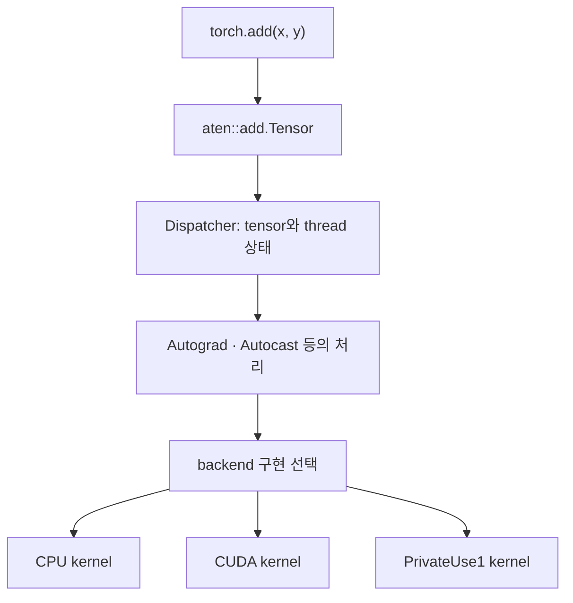
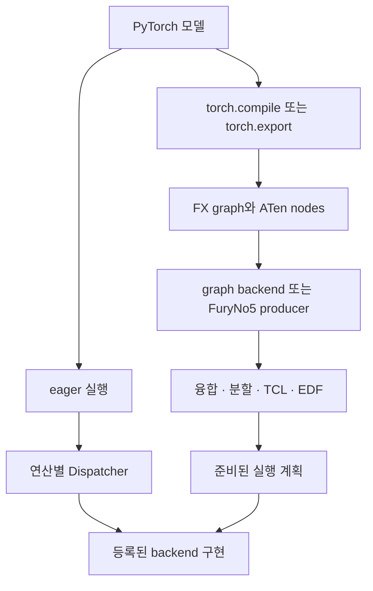

# 09. Torch에서 ATen, 그리고 장치 구현까지

**ATen(A Tensor Library)은 PyTorch의 텐서 연산 계층이고, Dispatcher는 지금 호출한 연산의 실행 구현을 고르는 계층이다.** ATen은 RNGD의 명령어 집합이 아니다. 같은 `aten::mm`도 CPU(Central Processing Unit), GPU(Graphics Processing Unit), NPU(Neural Processing Unit)에서 전혀 다른 코드로 실행될 수 있다. 이 구분이 있어야 “ATen을 지원한다”는 말이 무엇을 보장하는지 정확하게 판단할 수 있다. [PyTorch ATen](https://docs.pytorch.org/cppdocs/api/aten/index.html)

> **이 장의 기준**  
> 인터페이스 설명은 PyTorch 공식 자료, 숫자는 PyTorch **v2.10.0** 소스와 FuryNo5가 보존한 **Torch 2.10.0+cpu / furiosa-torch 2026.4.0** 스냅샷을 사용한다. 최신 설치본의 숫자는 아래 스크립트로 다시 센다. 문서 작성 환경에는 Torch와 NPU가 없으므로 여기의 예제를 RNGD에서 새로 실행했다고 주장하지 않는다.

## 왜 ATen이 만들어졌는가

초기 Torch 계열에는 CPU용 TH(TorcH), CUDA(Compute Unified Device Architecture)용 THC(TorcH Cuda) 등 여러 저수준 라이브러리가 있었다. PyTorch 팀은 내부 구조를 재설계하면서 Python API(Application Programming Interface)와 닮은 C++ 텐서 API를 제공하는 ATen을 만들었다. 2018년 회고는 ATen을 독립 사용도 가능한 C++11 라이브러리로 설명한다. 따라서 “여러 하드웨어가 동일한 연산 의미에 대응할 수 있게 한다”는 설명은 오늘날의 역할에 맞지만, **새 하드웨어용 명령어 표만 만들기 위해 탄생했다는 역사 설명은 지나친 단순화**다. [초기 저수준 라이브러리 설명](https://github.com/zdevito/ATen/blob/master/aten/src/README.md) · [PyTorch 팀의 2018년 회고](https://pytorch.org/blog/a-year-in/)

지금은 `native_functions.yaml`에 연산의 스키마와 관련 정보가 들어가고, 코드 생성기가 C++ 선언·Python 바인딩·dispatch 연결 코드를 만든다. 모델 개발자는 `torch.add`를 사용하고, 장치 개발자는 그 연산의 의미를 지키는 backend 구현을 연결한다. 등록 경계가 있으므로 Python 함수마다 하드웨어별 분기를 넣지 않아도 된다. [Dispatcher 내부 구조](https://docs.pytorch.org/devlogs/dispatcher/2026-04-16-how-does-the-dispatcher-work/)

## 다섯 단어를 구분하자

| 용어 | 예 | 실제 의미 |
|---|---|---|
| Python 함수 | `torch.add(x, y)` | 사용자가 호출하는 표면 API |
| 연산 묶음, operator packet | `aten::add` | 같은 기본 이름에 속한 overload 집합 |
| overload와 schema | `aten::add.Tensor` | 인수·반환·변경/alias 계약까지 정한 호출 형태 |
| backend kernel | CPU add, PrivateUse1 add | 해당 dispatch key에서 연산을 수행하는 구현 |
| 장치 명령·EDF | RNGD 실행 프로그램 | 컴파일 후 장치가 처리하는 수준의 산출물 |

스키마의 예인 `add.Tensor(Tensor self, Tensor other, *, Scalar alpha=1) -> Tensor`는 텐서끼리 더하는 계약이다. `add.Scalar`는 두 번째 인수가 스칼라인 다른 overload다. `add.out`은 결과 버퍼를 받는 형태이므로 메모리 변경 계약도 다르다. **이들을 하나로 세는 표와 별개로 세는 표의 개수를 비교하면 안 된다.** [고정된 native_functions.yaml](https://github.com/pytorch/pytorch/blob/449b1768410104d3ed79d3bcfe4ba1d65c7f22c0/aten/src/ATen/native/native_functions.yaml)

## eager 호출에서는 어떤 일이 일어나는가



Dispatcher는 입력 텐서의 dispatch key와 현재 스레드의 상태를 함께 보고 실행할 구현을 고른다. 자동 미분·혼합 정밀도·배치 변환 같은 처리가 먼저 개입한 뒤, 다음 구현으로 다시 dispatch할 수도 있다. CPU 텐서를 주었다면 등록된 CPU 구현으로 가는 것이 정상이다. NPU 장치를 뜻하는 key를 가진 텐서라면 해당 장치 구현을 찾는다. [PyTorch 확장 노트](https://docs.pytorch.org/docs/stable/notes/extending.html)

**Dispatcher가 호출될 때마다 TCL(Tensor Contraction Language)을 생성하거나 컴파일하는 것은 아니다.** Dispatcher의 역할은 구현 선택이다. 선택된 backend가 이미 준비된 커널을 실행할지, 캐시를 확인할지, 최초 호출에 컴파일할지는 backend 정책이다. FuryNo5의 명시적 준비 경로는 준비 함수에서 컴파일하고, 실행 함수에서는 준비된 callable을 사용한다. [FuryNo5 aten_runtime.py](https://github.com/smallstep-zzz/FuryNo5/blob/bba9efea8201aec48150514a35d0b637d29d107e/tplmachine/aten_runtime.py#L210-L276)

또한 Python 함수 한 개와 ATen 한 개, ATen 한 개와 EDF 한 개는 일대일 관계가 아니다. 복합 함수는 여러 연산으로 분해될 수 있고, compiler는 여러 연산을 한 실행 영역으로 합칠 수 있다. `view`처럼 조건에 따라 메타데이터만 바뀌는 연산도 있다. graph capture와 backend lowering을 분리해서 읽어야 한다. [PyTorch export](https://docs.pytorch.org/docs/stable/user_guide/torch_compiler/export.html)

## 장치별 구현은 어떻게 등록하는가

C++ backend의 등록 모양은 다음과 같다. **구조를 보여주는 발췌이며, 이것만으로 새로운 장치를 완성하는 코드는 아니다.** 실제 backend에는 텐서 할당, 복사, 장치 guard, 스트림, 수명 처리 등도 필요하다.

```cpp
// backend_add는 별도로 구현해야 하는 실제 장치 함수다.
TORCH_LIBRARY_IMPL(aten, PrivateUse1, m) {
    m.impl("add.Tensor", TORCH_FN(backend_add));
}
```

`aten`은 기존 연산 namespace, `PrivateUse1`은 외부 장치 backend용 dispatch key, `add.Tensor`는 연결 대상이다. 새로운 연산 정의와 기존 연산의 구현 등록은 다르다. PyTorch는 `TORCH_LIBRARY`와 `TORCH_LIBRARY_IMPL`, Python의 `torch.library`를 통해 이 경계를 제공한다. [C++ 등록 API](https://docs.pytorch.org/cppdocs/api/library/registration.html) · [새 backend 통합](https://docs.pytorch.org/tutorials/advanced/privateuseone.html)

다음은 NPU 없이도 등록과 호출의 차이를 볼 수 있는 **CPU 교육용 예제**다. 기존 `aten::add`를 바꾸지 않고, 새 namespace에 연산을 만든다.

```python
import torch

lib = torch.library.Library("handbook_demo", "DEF")
lib.define("plus_one(Tensor x) -> Tensor")

def cpu_impl(x):
    return x + 1

def meta_impl(x):
    # 실제 값 계산 없이 출력의 shape/dtype을 알려준다.
    return torch.empty_like(x)

lib.impl("plus_one", cpu_impl, "CPU")
lib.impl("plus_one", meta_impl, "Meta")

x = torch.tensor([2.0, 4.0])
print(torch.ops.handbook_demo.plus_one(x))  # tensor([3., 5.])
```

`Meta` 구현은 출력 메타데이터를 전달하기 위한 것이다. Meta가 있다고 NPU 계산이 구현된 것은 아니다. custom operator를 `torch.compile`·export와 함께 쓰려면 실제 연산과 FakeTensor/Meta 결과의 shape·dtype·stride 계약도 맞아야 한다. 장치 구현 함수 안에서 같은 장치의 동일 연산을 그대로 다시 호출하면 재귀가 생길 수 있으므로, 실제 커널 호출 또는 올바른 redispatch 설계가 필요하다. [torch.library 2.10](https://docs.pytorch.org/docs/2.10/library.html)

## CPU 폴백은 누가 결정하는가

PrivateUse1 backend는 미구현 연산을 CPU로 보내는 fallback 함수를 **등록할 수 있다**. 공식 튜토리얼도 fallback 등록 코드를 별도로 제시한다. 이것은 PyTorch의 확장 수단이지, 모든 NPU가 EDF를 찾지 못하면 자동 CPU 실행을 한다는 보장이 아니다. fallback이 없거나 backend 정책이 오류를 선택하면 예외가 발생할 수 있다. [PrivateUse1 fallback](https://docs.pytorch.org/tutorials/advanced/privateuseone.html)

FuryNo5의 공개 `optimize(..., fallback="error")`는 `"error"` 이외 값을 거부한다. 제한된 준비 경로는 `furiosa.torch.config.set_cpu_fallback(False)`도 설정한다. 선택적 CPU 기준 구현을 등록하는 `allow_cpu_reference`는 명시적 비교 기능이며, NPU에서 실패한 실행을 자동으로 CPU에 보내는 규칙이 아니다. [공개 진입점](https://github.com/smallstep-zzz/FuryNo5/blob/bba9efea8201aec48150514a35d0b637d29d107e/tclmachine/__init__.py#L18-L23) · [준비된 연산 등록](https://github.com/smallstep-zzz/FuryNo5/blob/bba9efea8201aec48150514a35d0b637d29d107e/tplmachine/aten_runtime.py#L59-L119)

## torch.compile backend와 Dispatcher backend는 다르다



`torch.compile`의 custom backend는 graph와 example input을 받아 실행 callable을 반환한다. AOTAutograd(Ahead-of-Time Autograd)를 사용하는 경로는 더 작은 함수형 ATen 집합을 backend 경계로 사용할 수 있다. 반면 `torch.library` 등록은 특정 연산과 dispatch key의 구현을 연결한다. 둘은 함께 쓸 수 있지만, “torch.compile backend 등록 = 모든 ATen의 NPU 구현 등록”은 아니다. [Custom Backends](https://docs.pytorch.org/docs/main/user_guide/torch_compiler/torch.compiler_custom_backends.html)

FuryNo5도 두 경로를 구분한다. `optimize`는 제한된 연산을 준비한 후 복사한 FX graph를 custom op로 바꾼다. `export_model`은 더 넓은 의미 규칙과 실행 계획 생성기를 사용해 파일을 생산한다. 두 함수의 지원 범위가 같다고 추정하지 않는다. [aten_runtime.py](https://github.com/smallstep-zzz/FuryNo5/blob/bba9efea8201aec48150514a35d0b637d29d107e/tplmachine/aten_runtime.py) · [execution_plan.py](https://github.com/smallstep-zzz/FuryNo5/blob/bba9efea8201aec48150514a35d0b637d29d107e/tplmachine/execution_plan.py)

## ATen은 몇 개이며 어떤 종류가 있는가

이번 조사에서 **PyTorch v2.10.0의 native_functions.yaml에 직접 선언된 schema는 2,666개, 기본 연산명은 1,542개**였다. 정규식 `^- func: (.+)$`로 선언을 수집하고, 괄호 앞 이름의 첫 점 이후를 overload로 분리해 집계했다. 이 숫자는 YAML의 명시적 선언 수다. 빌드 시 생성되는 variant, 설치된 확장, 등록 상태를 포함한 런타임 목록과 같다는 주장이 아니다. [집계한 파일·고정 commit](https://github.com/pytorch/pytorch/blob/449b1768410104d3ed79d3bcfe4ba1d65c7f22c0/aten/src/ATen/native/native_functions.yaml)

| 집계 대상 | 기준 | 수 |
|---|---|---:|
| native YAML의 기본 연산명 | PyTorch v2.10.0 고정 소스 | 1,542 |
| native YAML의 overload 포함 선언 | 같은 파일의 명시적 `func` 항목 | 2,666 |
| Core ATen 기본 연산명 | 보존된 Torch 2.10.0+cpu 설치본 | 163 |
| Core ATen overload | 같은 설치본의 `torch.Tag.core` | 192 |
| 그중 FuryNo5 추론 검토 대상 | 역전파 전용 7개 제외 | 185 |

Core ATen은 다른 연산을 구성하는 데 사용할 수 있는 더 작은 함수형 집합이다. 전체 ATen과 동일하지 않으며, 공식 문서도 계속 변하는 집합이라고 설명한다. FuryNo5의 192개 숫자는 저장된 목록과 해시가 있는 특정 시점의 관측이다. [Core IR(Intermediate Representation)](https://docs.pytorch.org/docs/main/user_guide/torch_compiler/torch.compiler_ir.html) · [고정 baseline.json](https://github.com/smallstep-zzz/FuryNo5/blob/bba9efea8201aec48150514a35d0b637d29d107e/docs/validation/core-aten-20261110/baseline.json)

| 의미 계열 | 대표 연산 | 포팅에서 확인할 계약 |
|---|---|---|
| 텐서 생성·복사 | empty, zeros, clone, copy | 초기화·소유권·장치 간 이동 |
| 모양·배치 | view, reshape, permute, expand | stride, alias, 실제 복사 필요 여부 |
| 원소별 계산 | add, mul, relu, exp | broadcasting, dtype promotion, 특수값 |
| 축약 | sum, mean, amax | reduction 축, 누산 dtype, 순서 |
| 수축·선형대수 | mm, bmm, matmul | batch 축과 축약 축, weight layout |
| 인덱싱·갱신 | gather, scatter, index_select | 인덱스 범위·중복·변경 의미 |
| 신경망 복합 연산 | convolution, norm, attention | 분해 전 의미·정밀도 경계 |
| 특수 영역 | sparse, FFT, linalg, random, backward | 저장형식·결정성·추론 범위 |

이 표는 학습을 위한 의미 분류이며 PyTorch의 공식 상호배타적 분류표는 아니다. 모든 계열이 RNGD에 구현되었다는 뜻도 아니다.

## 설치본에서 재현하는 방법

[aten_inventory.py](../examples/aten_inventory.py)는 등록된 ATen overload, 기본 이름, schema, Core 태그를 서로 구분해 JSON(JavaScript Object Notation)에 저장한다. `torch._C`와 overload의 내부 속성을 사용하는 **진단 도구**이므로 Torch 업그레이드 후 다시 확인한다.

```bash
python examples/aten_inventory.py --out aten-inventory.json

# 실제 backend를 import한 뒤의 목록을 별도로 관측하려면:
python examples/aten_inventory.py --import-module furiosa.torch \
  --out aten-inventory-with-furiosa.json
```

FuryNo5 안에는 Core 집합에 특화된 동일 목적의 진입점도 있다.

```bash
python -m tplmachine.research.core_aten snapshot --out core-baseline.json
```

실제 모델이 사용하는 목록은 전체 ATen 수와 별도로 뽑는다. 작은 모델에서 다음 코드를 적용하면 graph target을 직접 볼 수 있다.

```python
import torch
model = torch.nn.Linear(8, 4).eval().requires_grad_(False)
ep = torch.export.export(model, (torch.randn(2, 8),), strict=False)
for node in ep.graph.nodes:
    if node.op == "call_function":
        print(node.name, node.target, node.meta.get("val"))
```

모델 수, 관측 node 수, 지원 overload 수, 검증한 shape/dtype 수를 각각 기록하면 과장된 “지원율”을 피할 수 있다. 다음 장은 이 호출 경계를 FuryNo5 코드의 실제 파일에 연결한다.

## 다른 하드웨어가 같은 경계를 사용하는 방법

장치 연산을 `PrivateUse1`에 등록하는 방법 외에도 `torch.compile` 그래프를 받거나, Hugging Face 모델 어댑터를 통해 컴파일·적재를 연결하는 방법이 있다. Ascend, Rebellions, AWS Neuron, Tenstorrent가 이 경계를 어떻게 사용하는지는 [18장 다른 NPU의 PyTorch 지원 방식](18-npu-ecosystems.md)에서 공식 자료와 코드를 비교한다. 같은 Torch API를 호출해도 내부 컴파일 산출물과 CPU 폴백 정책은 backend마다 다르다.

## 출처

| 자료 | 이 장에서 확인한 내용 |
|---|---|
| [ATen C++ 설명](https://docs.pytorch.org/cppdocs/api/aten/index.html) | 정식 명칭과 텐서 라이브러리 역할 |
| [2018년 PyTorch 회고](https://pytorch.org/blog/a-year-in/) | ATen 내부 재설계 역사 |
| [PyTorch v2.10.0 선언 파일](https://github.com/pytorch/pytorch/blob/449b1768410104d3ed79d3bcfe4ba1d65c7f22c0/aten/src/ATen/native/native_functions.yaml) | 1,542 이름·2,666 명시적 schema 재집계 |
| [Dispatcher DevLog](https://docs.pytorch.org/devlogs/dispatcher/2026-04-16-how-does-the-dispatcher-work/) | key·코드 생성·실행 구현 선택 |
| [PrivateUse1](https://docs.pytorch.org/tutorials/advanced/privateuseone.html) | 장치 구현과 fallback의 명시적 등록 |
| [torch.library 2.10](https://docs.pytorch.org/docs/2.10/library.html) | Python 등록·Meta/FakeTensor 계약 |
| [Core ATen IR](https://docs.pytorch.org/docs/main/user_guide/torch_compiler/torch.compiler_ir.html) | 축소된 함수형 집합 |
| [FuryNo5 Core snapshot 구현](https://github.com/smallstep-zzz/FuryNo5/blob/bba9efea8201aec48150514a35d0b637d29d107e/tplmachine/research/core_aten.py) | 목록·버전·증거 구분 |

FuryNo5 소스 링크는 조사 시점에 비공개 저장소였으므로 열람 권한이 필요하다.

