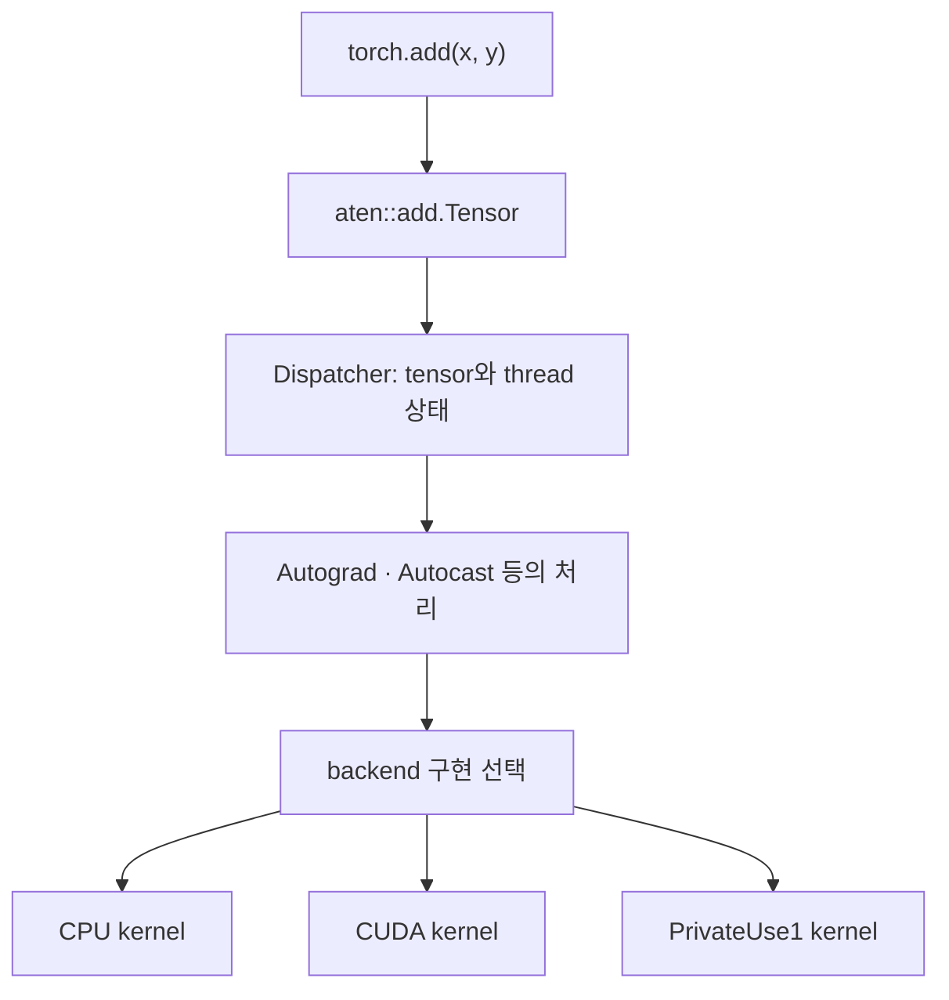
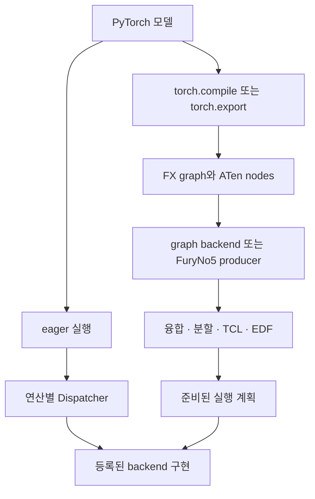

# 09. Torch 함수 호출이 장치의 계산으로 이어지는 과정

Python에서 `torch.add(x, y)`를 호출했을 때 CPU 코드가 실행될지 NPU 코드가 실행될지는 누가 결정할까? 이 장은 **함수 이름, 함수의 호출 계약, 실제 구현, 모델 전체의 컴파일**을 나누어 답한다. C의 함수 포인터 표를 떠올려도 좋다. 호출할 계산의 이름은 같아도 인수의 장치에 따라 다른 구현을 선택할 수 있다. 다만 PyTorch는 자동 미분 같은 부가 처리도 선택하므로 실제 과정은 단순한 장치별 `switch`보다 복잡하다.

NPU(Neural Processing Unit)는 신경망 계산용 장치이고, 이 책의 대상은 Furiosa의 RNGD다. **ATen(A Tensor Library)은** PyTorch가 텐서 계산을 표현하는 공통 연산 계층이다. ATen 연산은 CPU(Central Processing Unit)의 기계어도 RNGD의 장치 명령어도 아니다. `더한다`, `행렬곱을 한다`는 계산 의미를 정해 두고, 장치별 구현이 그 의미를 수행한다. [ATen의 공식 역할](https://docs.pytorch.org/cppdocs/api/aten/index.html)

> **확인 범위** · API(Application Programming Interface)는 PyTorch 공식 자료를, 개수는 v2.10.0 고정 소스와 저장된 Torch 2.10.0+cpu / furiosa-torch 2026.4.0 기록을 사용한다. 아래 예제는 호출 구조를 설명하기 위한 코드이며 이번 집필 환경에는 PyTorch와 RNGD가 없어 실행하지 않았다. 수치가 적힌 주석은 식에서 예상되는 값이다.

## 먼저 두 개의 작은 배열을 더해 보자

텐서(tensor)는 값의 배열과 그 배열을 해석하는 정보를 함께 가진 객체다. `shape`는 축별 길이, `dtype`은 원소 자료형, `device`는 값이 놓인 장치를 뜻한다. 아래 `x`와 `y`는 길이 2인 FP32(Floating Point 32-bit) CPU 텐서다.

```python
import torch

x = torch.tensor([2.0, 4.0], dtype=torch.float32)   # CPU, shape [2], FP32
y = torch.tensor([10.0, 20.0], dtype=torch.float32) # 같은 위치끼리 더할 두 번째 배열
z = torch.add(x, y, alpha=2)  # 각 i에 대해 x[i] + 2*y[i]; shape [2] 유지
print(z)  # 식의 예상값: tensor([22., 44.]); 원래 x와 y는 바꾸지 않는다.
```

이 호출의 계산은 `x + 2*y`다. 프로그램이 전달하는 것은 두 배열만이 아니다. 연산 이름 `add`, 두 인수가 tensor라는 사실, 추가 인수 `alpha=2`, 두 tensor가 CPU에 있다는 정보도 전달된다. 이후 구현을 고르는 **dispatcher(디스패처)가** 이 호출을 CPU의 덧셈 구현에 연결한다. dispatcher는 C에서 함수 포인터를 골라 호출하는 역할에 가깝고, 덧셈의 계산식 자체를 정의하는 계층과는 구분된다. [Dispatcher의 선택 과정](https://docs.pytorch.org/devlogs/dispatcher/2026-04-16-how-does-the-dispatcher-work/)

| 단계 | 이 예에서 가지고 있는 정보 | 아직 결정하지 않은 것 |
|---|---|---|
| Python 호출 | `torch.add(x, y, alpha=2)` | 실제 장치 구현 |
| ATen 호출 계약 | 두 tensor를 더하고 두 번째에 2를 곱함 | 어떤 기계어·장치 프로그램을 쓸지 |
| Dispatcher 선택 | 입력이 CPU tensor이며 적용할 부가 처리가 무엇인지 | 선택한 구현 내부의 최적화 |
| CPU 구현 실행 | 배열 원소를 읽고 결과를 계산 | 이 호출에는 NPU 컴파일이 필요하지 않음 |
| 반환 | shape `[2]`, FP32, CPU tensor | 반환값이 맞는 것과 다른 장치 지원은 별개 |

## schema와 overload는 함수 선언을 읽듯 이해한다

**schema(스키마)는** 연산의 함수 선언에 해당한다. 이름, 인수 이름·자료형·기본값, 반환 자료형을 적고, 필요한 경우 어느 인수를 변경하는지와 결과가 기존 메모리를 공유하는지도 표현한다. 데이터베이스 schema가 저장할 데이터의 구조를 정하듯, 여기서는 호출이 지켜야 할 구조를 정한다.

`add.Tensor(Tensor self, Tensor other, *, Scalar alpha=1) -> Tensor`를 왼쪽부터 읽으면, tensor 두 개를 받고 `alpha`라는 스칼라 옵션을 가진 뒤 tensor 하나를 반환한다는 뜻이다. Python의 `*` 뒤 인수는 이름을 붙여 전달한다. 여기의 `Tensor`와 `Scalar`는 특정 하드웨어의 자료형이 아니라 호출 인수의 종류다.

**overload(오버로드)는** 기본 이름이 같지만 인수 형태가 다른 함수다. `add.Tensor`는 tensor와 tensor, `add.Scalar`는 tensor와 수 하나를 더한다. `add.out`은 결과를 담을 버퍼를 호출자가 주므로 메모리 변경 계약도 다르다. **operator packet(연산 묶음)은** 이 overload들을 `aten::add`라는 기본 이름 아래 모아 놓은 것이다. [고정된 schema 선언](https://github.com/pytorch/pytorch/blob/449b1768410104d3ed79d3bcfe4ba1d65c7f22c0/aten/src/ATen/native/native_functions.yaml)

| 구분 | 이 예의 이름 | 익숙한 개념으로 읽으면 |
|---|---|---|
| 사용자 함수 | `torch.add` | Python에서 노출한 함수 |
| namespace와 기본 이름 | `aten::add` | 라이브러리 이름과 함수 이름 |
| 특정 overload | `aten::add.Tensor` | 인수 종류가 확정된 함수 선언 |
| backend kernel | CPU의 add 구현 | 그 선언을 실제로 수행하는 함수 몸체 |
| NPU 실행 프로그램 | 해당 backend가 준비한 EDF(Executable Device Format) 등 | 장치가 실행할 컴파일 결과 |

여기서 **kernel(커널)은** 계산을 수행하는 구현 단위라는 뜻이다. 운영체제 커널과 같은 말이 아니다. CPU backend에서는 C++ 함수일 수 있고, NPU backend에서는 준비된 장치 프로그램을 호출하는 함수일 수 있다. 하나의 ATen 연산을 지원한다는 말은 schema의 의미와 메모리 계약을 지키는 구현이 있다는 뜻이다. 이름만 같은 함수를 등록하는 것으로 끝나지 않는다.


## eager 실행에서 Dispatcher가 고르는 것



**eager 실행**은 연산을 호출하는 흐름에 따라 곧바로 실행하는 방식이다. **dispatch key**는 어떤 종류의 처리를 적용할지 고르는 표식이다. 입력 tensor는 장치와 표현에 관련된 표식을 갖고, 현재 스레드는 자동 미분·자동 형변환처럼 활성화된 처리 상태를 가질 수 있다. Dispatcher는 이 정보를 함께 보고 실행할 구현을 고른다. 자동 미분·혼합 정밀도·배치 변환 같은 처리가 먼저 개입한 뒤, 다음 구현으로 다시 dispatch할 수도 있다. Autograd는 미분을 위한 계산 기록, Autocast는 정해진 정책에 따라 연산 자료형을 선택하는 처리다. 이 단계가 끝난 뒤 다음 key의 구현을 호출하는 것을 redispatch라고 한다. CPU 텐서를 주었다면 등록된 CPU 구현으로 가는 것이 정상이다. NPU 장치를 뜻하는 key를 가진 텐서라면 해당 장치 구현을 찾는다. [PyTorch 확장 노트](https://docs.pytorch.org/docs/stable/notes/extending.html)

**Dispatcher가 호출될 때마다 TCL(Tensor Contraction Language)을 생성하거나 컴파일하는 것은 아니다.** TCL은 NPU에서 계산할 텐서 연산을 compiler에 설명하는 언어다. EDF(Executable Device Format)는 그 계산을 장치에서 실행하도록 컴파일한 바이너리다. Dispatcher의 역할은 구현 선택이다. 선택된 backend가 이미 준비된 커널을 실행할지, 캐시를 확인할지, 최초 호출에 컴파일할지는 backend 정책이다. FuryNo5의 명시적 준비 경로는 준비 함수에서 컴파일하고, 실행 함수에서는 준비된 callable을 사용한다. [FuryNo5 aten_runtime.py](https://github.com/smallstep-zzz/FuryNo5/blob/bba9efea8201aec48150514a35d0b637d29d107e/tplmachine/aten_runtime.py#L210-L276)

또한 Python 함수 한 개와 ATen 한 개, ATen 한 개와 EDF 한 개는 일대일 관계가 아니다. 복합 함수는 여러 연산으로 분해될 수 있고, compiler는 여러 연산을 한 실행 영역으로 합칠 수 있다. `view`처럼 조건에 따라 메타데이터만 바뀌는 연산도 있다. 뒤에서 설명할 graph capture는 호출 관계를 자료구조로 얻는 과정이고, lowering은 그 표현을 특정 backend가 실행할 수 있는 더 구체적인 표현으로 바꾸는 과정이다. 둘을 분리해서 읽어야 한다. [PyTorch export](https://docs.pytorch.org/docs/stable/user_guide/torch_compiler/export.html)

## 장치별 구현은 어떻게 등록하는가

등록(registration)은 “이 연산과 처리 표식이 선택되면 이 함수를 호출하라”는 연결을 dispatcher의 표에 넣는 작업이다. C++ backend의 등록 모양은 다음과 같다. **설명 주석을 추가한 등록 구조의 예이며, 이것만으로 새로운 장치를 완성하는 코드는 아니다.** 실제 backend에는 텐서 할당, 복사, 장치 guard, 스트림, 수명 처리 등도 필요하다.

```cpp
// aten 연산 중 외부 장치용 PrivateUse1 key가 선택될 때의 구현을 등록한다.
TORCH_LIBRARY_IMPL(aten, PrivateUse1, m) {
    // add.Tensor라는 호출 계약에 별도로 작성한 backend_add 함수 주소를 연결한다.
    m.impl("add.Tensor", TORCH_FN(backend_add));
}
```

`aten`은 기존 연산 namespace, `PrivateUse1`은 외부 장치 backend가 사용할 수 있도록 남겨 둔 dispatch key, `add.Tensor`는 연결 대상이다. 위 코드에서 `backend_add`는 생략한 함수 몸체이며 tensor를 받아 그 장치에서 계산한 tensor를 반환하도록 별도로 구현해야 한다. `m.impl` 한 줄은 구현을 제공하는 작업이 아니라 구현 주소를 연결하는 작업이다. 새로운 연산 정의와 기존 연산의 구현 등록은 다르다. PyTorch는 `TORCH_LIBRARY`와 `TORCH_LIBRARY_IMPL`, Python의 `torch.library`를 통해 이 경계를 제공한다. [C++ 등록 API](https://docs.pytorch.org/cppdocs/api/library/registration.html) · [새 backend 통합](https://docs.pytorch.org/tutorials/advanced/privateuseone.html)

다음은 NPU 없이도 등록과 호출의 차이를 볼 수 있는 **CPU 교육용 예제**다. 기존 `aten::add`를 바꾸지 않고, 새 namespace에 연산을 만든다.

```python
import torch

# 새 namespace를 정의한다. lib 객체를 유지해야 등록의 수명도 유지된다.
lib = torch.library.Library("handbook_demo", "DEF")
lib.define("plus_one(Tensor x) -> Tensor")  # tensor 하나를 받아 하나를 돌려주는 선언

def cpu_impl(x):
    return x + 1  # 모든 원소에 1을 더한 새 tensor; shape·dtype은 이 FP32 예에서 유지

def meta_impl(x):
    # Meta 입력에는 실제 값이 없다. 값 계산 없이 출력의 shape·dtype을 돌려준다.
    return torch.empty_like(x)

lib.impl("plus_one", cpu_impl, "CPU")    # CPU 입력일 때 실제 값을 계산할 함수
lib.impl("plus_one", meta_impl, "Meta")  # 컴파일 준비 중 출력 정보를 알려 줄 함수

x = torch.tensor([2.0, 4.0], dtype=torch.float32)  # CPU, [2]
print(torch.ops.handbook_demo.plus_one(x))  # 예상 tensor([3., 5.]); 이 줄에서 실제 호출
```

앞 코드에서 `lib.define`은 함수 선언을 만들고 `lib.impl`은 그 선언의 CPU·Meta 구현을 연결한다. 마지막 `torch.ops.handbook_demo.plus_one(x)`가 실제 호출이다. 새 namespace를 정의하므로 같은 이름의 정의를 여러 번 실행하지 않도록 새 Python 프로세스에서 실행한다. `lib` 객체를 보관하는 이유는 등록의 수명도 유지해야 하기 때문이다.

**metadata(메타데이터)는** tensor의 값 자체가 아닌 shape·dtype·stride 같은 설명 정보다. `Meta` 구현은 실제 원소를 더하지 않고 출력이 어떤 tensor여야 하는지 알려준다. **FakeTensor**도 컴파일 준비 중 실제 장치 계산 없이 tensor 성질을 추적하기 위한 수단이다. Meta가 있다고 NPU 계산이 구현된 것은 아니다. custom operator를 `torch.compile`·export와 함께 쓰려면 실제 연산과 FakeTensor/Meta 결과의 shape·dtype·stride 계약도 맞아야 한다. 장치 구현 함수 안에서 같은 장치의 동일 연산을 그대로 다시 호출하면 재귀가 생길 수 있으므로, 실제 커널 호출 또는 올바른 redispatch 설계가 필요하다. [torch.library 2.10](https://docs.pytorch.org/docs/2.10/library.html)

## CPU 폴백은 누가 결정하는가

PrivateUse1 backend는 미구현 연산을 CPU로 보내는 fallback 함수를 **등록할 수 있다**. 공식 튜토리얼도 fallback 등록 코드를 별도로 제시한다. 이것은 PyTorch의 확장 수단이지, 모든 NPU가 EDF를 찾지 못하면 자동 CPU 실행을 한다는 보장이 아니다. fallback이 없거나 backend 정책이 오류를 선택하면 예외가 발생할 수 있다. [PrivateUse1 fallback](https://docs.pytorch.org/tutorials/advanced/privateuseone.html)

FuryNo5의 공개 `optimize(..., fallback="error")`는 `"error"` 이외 값을 거부한다. 제한된 준비 경로는 `furiosa.torch.config.set_cpu_fallback(False)`도 설정한다. 선택적 CPU 기준 구현을 등록하는 `allow_cpu_reference`는 명시적 비교 기능이며, NPU에서 실패한 실행을 자동으로 CPU에 보내는 규칙이 아니다. [공개 진입점](https://github.com/smallstep-zzz/FuryNo5/blob/bba9efea8201aec48150514a35d0b637d29d107e/tclmachine/__init__.py#L18-L23) · [준비된 연산 등록](https://github.com/smallstep-zzz/FuryNo5/blob/bba9efea8201aec48150514a35d0b637d29d107e/tplmachine/aten_runtime.py#L59-L119)

## shape 변경과 전치는 값의 의미부터 확인한다

그래프에는 덧셈뿐 아니라 tensor의 모양을 바꾸는 연산도 등장한다. **reshape**는 원소 수를 유지하면서 같은 논리적 원소열을 새로운 shape로 읽는 연산이다. **transpose(전치)는** 지정한 두 축을 맞바꾼다. 두 연산의 출력 shape가 같을 때도 숫자가 놓이는 위치는 다를 수 있다.

```python
import torch

m = torch.tensor([[1, 2, 3], [4, 5, 6]])  # shape [2,3]: 2행, 3열, 총 6개 값
r = m.reshape(3, 2)       # 원소열 1,2,3,4,5,6을 한 행에 2개씩 읽는다.
t = m.transpose(0, 1)    # 축 0(행)과 축 1(열)을 교환: t[j,i] = m[i,j]
print(r.tolist())        # 예상 [[1,2], [3,4], [5,6]]; shape [3,2]
print(t.tolist())        # 예상 [[1,4], [2,5], [3,6]]; shape [3,2]
```

이 예에서 `r[0,1]=2`, `t[0,1]=4`다. 따라서 compiler가 두 연산을 출력 shape만 보고 교체하면 계산 의미를 바꾸게 된다. `reshape(4,2)`는 6개 원소를 8개 자리로 배치하려 하므로 성립하지 않는다. `-1`을 축 하나에 넣으면 전체 원소 수를 맞추는 길이를 추론할 수 있지만, 원소가 새로 생기지는 않는다.

저장 방식도 구분해야 한다. **view**는 별도 값 저장소를 만들지 않고 기존 저장소를 다른 shape·stride로 읽는 객체다. stride는 축을 따라 한 칸 이동할 때 저장소에서 몇 원소를 건너뛰는지 나타낸다. 일반적인 strided tensor의 전치는 저장소를 공유한다. `reshape`는 가능한 경우 view를 만들고 그렇지 않으면 복사할 수 있으므로 항상 공짜라고 가정하면 안 된다. NPU 규칙은 shape와 함께 stride·복사·alias(저장소 공유) 계약도 확인해야 한다. [reshape의 의미와 view/복사 조건](https://docs.pytorch.org/docs/2.10/generated/torch.reshape.html) · [transpose의 축 교환과 저장소](https://docs.pytorch.org/docs/2.10/generated/torch.transpose.html)

## 함수 호출들을 그래프로 저장하면 무엇이 달라지는가



앞에서는 한 번의 덧셈을 봤다. 모델 전체를 최적화하려면 여러 호출 사이의 관계가 필요하다. **capture(캡처)는** Python 모델과 예제 입력에서 연산·값·의존 관계를 추출하는 과정이다. **FX graph**는 PyTorch가 그 관계를 담는 자료구조다. node는 입력, 함수 호출, 출력 등을 나타내고, 한 node가 다른 node를 인수로 쓰면 데이터 의존 간선이 생긴다. C compiler의 중간 표현과 비슷하게 읽을 수 있다. 여기서는 최종 값 대신 “어떤 계산으로 값을 만드는지”를 다룬다.

이후 장에서도 사용할 모델을 `Linear(8,12) → ReLU → Linear(12,8)`로 정하자. Linear는 입력 행마다 weight를 곱하고 bias를 더하며, ReLU(Rectified Linear Unit)는 음수 원소를 0으로 바꾼다. 입력 `[4,8]`은 길이 8의 입력 4개다.

여기서 `@`는 행렬곱이다. 왼쪽 행과 오른쪽 열의 같은 위치를 곱해 더하므로 `[M,K] @ [K,N]`은 `[M,N]`을 만든다. 첫 Linear의 weight는 출력 특징 12개가 각각 계수 8개를 가지므로 `[12,8]`이다. 따라서 `w0.T`로 전치한 `[8,12]`를 오른쪽에 두어 `x[4,8] @ w0.T[8,12]`를 계산한다. 첫 결과는 `h[0,0] = x[0,0]*w0[0,0] + … + x[0,7]*w0[0,7] + b0[0]`이다. `b0[12]`를 결과 `[4,12]`의 각 행에 똑같이 더하는 자동 확장을 **broadcasting**이라고 한다. [Linear의 수식과 parameter shape](https://docs.pytorch.org/docs/2.10/generated/torch.nn.Linear.html)

아래는 값의 연결을 설명한 표이고 자동 생성되는 node 이름이나 분해 개수를 보장하는 출력 예시는 아니다.

| 논리 값 | 만드는 계산 | shape | 어디에서 오는가 |
|---|---|---|---|
| `x` | 사용자 입력 | `[4,8]` | 호출 인수 |
| `w0`, `b0` | 첫 Linear의 weight·bias | `[12,8]`, `[12]` | 모델 parameter |
| `h` | `x @ w0.T + b0` | `[4,12]` | 첫 연산 결과 |
| `a` | `relu(h)` | `[4,12]` | `h`에 의존 |
| `w2`, `b2` | 마지막 Linear의 weight·bias | `[8,12]`, `[8]` | 모델 parameter |
| `y` | `a @ w2.T + b2` | `[4,8]` | 반환값 |

그래프가 있으면 compiler는 `h`를 만드는 연산과 사용하는 연산을 함께 검토할 수 있다. 여러 node를 한 실행 단위로 묶는 **fusion(연산 결합)**, 반대로 지원되는 작은 연산으로 나누는 decomposition을 선택할 수 있다. `torch.export`의 결과인 **ExportedProgram**은 graph와 입력·출력 서명, parameter 연결, 제약을 함께 보존하는 객체다. Python 모델 자체도, 이미 만들어진 NPU 바이너리도 아니다. [export의 역할](https://docs.pytorch.org/docs/stable/user_guide/torch_compiler/export.html)

### 대표 입력의 숫자도 그래프에 고정되는가

일반적인 tensor 입력의 **원소 값은 실행 때 다시 공급**한다. 예를 들어 `forward(x)`가 `x * 2 + 1`이면 캡처할 때 사용한 `x`가 모두 0이더라도, 얻은 프로그램에 같은 계약의 1을 넣으면 3을 계산해야 한다. 저장하는 것은 `x → 곱하기 2 → 더하기 1`의 관계다. 반면 이 식의 Python 상수 `2`, `1`과 정적으로 선택한 계산 경로는 그래프 표현의 일부가 된다. 같은 shape라고 임의의 Python 코드까지 항상 안전하게 재사용할 수 있다는 뜻은 아니다. [고정 버전 export의 입력·제약 설명](https://github.com/pytorch/pytorch/blob/449b1768410104d3ed79d3bcfe4ba1d65c7f22c0/torch/export/__init__.py#L175-L203)

| `forward`에 있는 표현 | 캡처 때 결정할 수 있는 것 | 다른 호출에 적용할 때 확인할 것 |
|---|---|---|
| `return x * 2 + 1` | 연산 순서, 상수 2·1, 입력의 shape·dtype | 원소 값이 달라져도 같은 입력 계약이면 같은 식을 계산한다. |
| `if x.shape[0] == 4: return x + 1` / `else: return x - 1` | 기본 정적 캡처에서 대표 입력의 첫 축이 4라는 조건과 그 경로 | 첫 축 8의 입력을 같은 정적 프로그램에 넣지 않는다. 동적 shape는 별도로 선언하고 제약을 만족해야 한다. |
| `if x.sum() > 0: return x + 1` / `else: return x - 1` | 분기 조건이 매 호출의 원소 값에 달려 있어 shape만으로 선택할 수 없다. | 이 Python `if`가 그대로 export된다고 가정하지 않는다. 지원되는 제어 흐름 표현으로 모델을 바꾸거나 분기 경계를 밖에 두고 별도 검토한다. |

마지막 경우의 문제는 합계를 계산할 수 없다는 것이 아니라, **아직 들어오지 않은 값에 따라 Python 실행 경로가 바뀐다는 것**이다. `strict=False`는 캡처 방법의 옵션이며 이 문제를 자동 해결하는 보증이 아니다. 실제 실패 여부와 메시지는 코드·버전에 따라 확인한다. PyTorch의 동적 shape를 선언할 수 있다는 사실도 FuryNo5의 현재 정적 커널이 임의 크기를 받는다는 의미로 이어지지 않는다. [strict 옵션의 계약](https://github.com/pytorch/pytorch/blob/449b1768410104d3ed79d3bcfe4ba1d65c7f22c0/torch/export/__init__.py#L236-L244) · [FuryNo5 정적 입력 검사](https://github.com/smallstep-zzz/FuryNo5/blob/bba9efea8201aec48150514a35d0b637d29d107e/tplmachine/aten.py)

| 시점 | 이 예제에서 보유하는 정보 | 아직 계산하지 않은 것 |
|---|---|---|
| 캡처 | `x[4,8]`, parameter 연결, `h → a → y` 계산 관계 | 미래 호출의 다른 `x`에 대한 결과 |
| FuryNo5 컴파일 | 정적 shape·dtype·stride와 연산 의미로 만든 EDF | 그 EDF에 다음 호출의 입력을 넣은 결과 |
| 실행 | 이번 `x`의 실제 원소 값과 연결된 가중치 | 실행이 끝나야 `y`를 얻는다. |

13장의 `x_second = x + 0.25` 검사는 이 구분을 확인한다. 입력 계약은 유지하면서 숫자를 바꾸어, 첫 대표 입력의 답을 재사용하는 오류가 없는지 검사하는 것이다.

`torch.compile`의 custom backend는 graph와 example input을 받아 실행 callable을 반환한다. callable은 Python에서 함수처럼 호출할 수 있는 객체다. AOTAutograd(Ahead-of-Time Autograd)를 사용하는 경로는 더 작은 함수형 ATen 집합을 backend 경계로 사용할 수 있다. 이처럼 **graph backend**는 여러 연산으로 구성된 함수 전체를 받아 최적화한다. 반면 **Dispatcher backend**에 대한 `torch.library` 등록은 특정 연산과 dispatch key의 구현을 연결한다. 둘은 함께 쓸 수 있지만, “torch.compile backend 등록 = 모든 ATen의 NPU 구현 등록”은 아니다. [Custom Backends](https://docs.pytorch.org/docs/main/user_guide/torch_compiler/torch.compiler_custom_backends.html)

FuryNo5도 두 경로를 구분한다. `optimize`는 제한된 연산을 준비한 후 복사한 FX graph를 custom op로 바꾼다. `export_model`은 더 넓은 의미 규칙과 실행 계획 생성기를 사용해 파일을 생산한다. 두 함수의 지원 범위가 같다고 추정하지 않는다. [aten_runtime.py](https://github.com/smallstep-zzz/FuryNo5/blob/bba9efea8201aec48150514a35d0b637d29d107e/tplmachine/aten_runtime.py) · [execution_plan.py](https://github.com/smallstep-zzz/FuryNo5/blob/bba9efea8201aec48150514a35d0b637d29d107e/tplmachine/execution_plan.py)

## 왜 ATen이 만들어졌는가

초기 Torch 계열에는 CPU용 TH(TorcH), CUDA(Compute Unified Device Architecture)용 THC(TorcH Cuda) 등 여러 저수준 라이브러리가 있었다. PyTorch 팀은 내부 구조를 재설계하면서 Python API(Application Programming Interface)와 닮은 C++ 텐서 API를 제공하는 ATen을 만들었다. 2018년 회고는 ATen을 독립 사용도 가능한 C++11 라이브러리로 설명한다. 따라서 “여러 하드웨어가 동일한 연산 의미에 대응할 수 있게 한다”는 설명은 오늘날의 역할에 맞지만, **새 하드웨어용 명령어 표만 만들기 위해 탄생했다는 역사 설명은 지나친 단순화**다. [초기 저수준 라이브러리 설명](https://github.com/zdevito/ATen/blob/master/aten/src/README.md) · [PyTorch 팀의 2018년 회고](https://pytorch.org/blog/a-year-in/)

지금은 `native_functions.yaml`에 연산의 스키마와 관련 정보가 들어가고, 코드 생성기가 C++ 선언·Python 바인딩·dispatch 연결 코드를 만든다. 모델 개발자는 `torch.add`를 사용하고, 장치 개발자는 그 연산의 의미를 지키는 backend 구현을 연결한다. 등록 경계가 있으므로 Python 함수마다 하드웨어별 분기를 넣지 않아도 된다. [Dispatcher 내부 구조](https://docs.pytorch.org/devlogs/dispatcher/2026-04-16-how-does-the-dispatcher-work/)

## ATen은 몇 개이며 어떤 종류가 있는가

이번 조사에서 **PyTorch v2.10.0의 native_functions.yaml에 직접 선언된 schema는 2,666개, 기본 연산명은 1,542개**였다. 정규식 `^- func: (.+)$`로 선언을 수집하고, 괄호 앞 이름의 첫 점 이후를 overload로 분리해 집계했다. 이 숫자는 YAML의 명시적 선언 수다. 빌드 시 생성되는 variant, 설치된 확장, 등록 상태를 포함한 런타임 목록과 같다는 주장이 아니다. [집계한 파일·고정 commit](https://github.com/pytorch/pytorch/blob/449b1768410104d3ed79d3bcfe4ba1d65c7f22c0/aten/src/ATen/native/native_functions.yaml)

| 집계 대상 | 기준 | 수 |
|---|---|---:|
| native YAML의 기본 연산명 | PyTorch v2.10.0 고정 소스 | 1,542 |
| native YAML의 overload 포함 선언 | 같은 파일의 명시적 `func` 항목 | 2,666 |
| Core ATen 기본 연산명 | 보존된 Torch 2.10.0+cpu 설치본 | 163 |
| Core ATen overload | 같은 설치본의 `torch.Tag.core` | 192 |
| 그중 FuryNo5 추론 검토 대상 | 역전파 전용 7개 제외 | 185 |

Core ATen은 다른 연산을 구성하는 데 사용할 수 있는 더 작은 함수형 집합이다. 전체 ATen과 동일하지 않으며, 공식 문서도 계속 변하는 집합이라고 설명한다. FuryNo5의 192개 숫자는 저장된 목록과 해시가 있는 특정 시점의 관측이다. [Core IR(Intermediate Representation)](https://docs.pytorch.org/docs/main/user_guide/torch_compiler/torch.compiler_ir.html) · [고정 baseline.json](https://github.com/smallstep-zzz/FuryNo5/blob/bba9efea8201aec48150514a35d0b637d29d107e/docs/validation/core-aten-20261110/baseline.json)

| 의미 계열 | 대표 연산 | 포팅에서 확인할 계약 |
|---|---|---|
| 텐서 생성·복사 | empty, zeros, clone, copy | 초기화·소유권·장치 간 이동 |
| 모양·배치 | view, reshape, permute, expand | stride, alias, 실제 복사 필요 여부 |
| 원소별 계산 | add, mul, relu, exp | broadcasting, dtype promotion(입력 자료형을 공통 계산 자료형으로 맞춤), 특수값 |
| 축약(reduction: 여러 값을 합·평균·최댓값 등으로 줄임) | sum, mean, amax | 어느 축의 값을 모으는지, 누산 dtype·순서 |
| 수축·선형대수 | mm, bmm, matmul | batch 축과 축약 축, weight layout |
| 인덱싱·갱신 | gather, scatter, index_select | 인덱스 범위·중복·변경 의미 |
| 신경망 복합 연산 | convolution, norm, attention | 분해 전 의미·정밀도 경계 |
| 특수 영역 | sparse, FFT(Fast Fourier Transform), linalg, random, backward | 저장형식·결정성·추론 범위 |

이 표는 학습을 위한 의미 분류이며 PyTorch의 공식 상호배타적 분류표는 아니다. 모든 계열이 RNGD에 구현되었다는 뜻도 아니다.

## 설치본에서 재현하는 방법

[aten_inventory.py](../examples/aten_inventory.py)는 등록된 ATen overload, 기본 이름, schema, Core 태그를 서로 구분해 JSON(JavaScript Object Notation)에 저장한다. `torch._C`와 overload의 내부 속성을 사용하는 **진단 도구**이므로 Torch 업그레이드 후 다시 확인한다.

```bash
# 설치된 PyTorch의 버전·기본 이름·overload·schema 목록을 JSON으로 기록한다.
python examples/aten_inventory.py --out aten-inventory.json

# 실제 backend를 import하여 추가 등록이 반영된 목록을 별도 파일로 관측한다.
python examples/aten_inventory.py --import-module furiosa.torch \
  --out aten-inventory-with-furiosa.json
```

FuryNo5 안에는 Core 집합에 특화된 동일 목적의 진입점도 있다.

```bash
# FuryNo5의 Core 기준 목록을 기록한다. NPU 지원 검증을 실행하는 명령은 아니다.
python -m tplmachine.research.core_aten snapshot --out core-baseline.json
```

실제 모델이 사용하는 목록은 전체 ATen 수와 별도로 뽑는다. 다음 완성 예제를 [inspect_tiny_fx.py](../examples/inspect_tiny_fx.py)로 저장하면 **입력 자리의 역할과 연산 사이의 연결**을 함께 읽을 수 있다. PyTorch가 필요하며 NPU를 사용하지 않는다. 이 집필 환경에서는 PyTorch 실행을 하지 않았으므로, 아래의 설명 표를 이 스크립트의 실제 출력 로그로 취급하지 않는다.

```python
import torch

def main():
    model = torch.nn.Sequential(
        torch.nn.Linear(8, 12),  # 입력 [4,8] → [4,12]
        torch.nn.ReLU(),        # 음수만 0으로 바꾸며 [4,12] 유지
        torch.nn.Linear(12, 8), # [4,12] → [4,8]
    ).eval().requires_grad_(False)
    x = torch.randn(4, 8)  # CPU FP32 대표 입력; BF16 장치 컴파일 예제와 구분한다.
    ep = torch.export.export(model, (x,), strict=False)

    for spec in ep.graph_signature.input_specs:
        # arg.name은 그래프의 입력 자리, target은 연결할 parameter 이름이다.
        # USER_INPUT의 target은 보통 None이며, PARAMETER는 '0.weight' 등이다.
        name = getattr(spec.arg, "name", repr(spec.arg))
        print("INPUT", name, spec.kind.name, "target=", spec.target)

    for node in ep.graph.nodes:
        value = node.meta.get("val")  # 계산 결과가 아니라 캡처 중 추적한 tensor 정보
        shape = tuple(value.shape) if isinstance(value, torch.Tensor) else None
        print("NODE", node.op, node.name, node.target, "shape=", shape)
        print("  args=", node.args, "kwargs=", node.kwargs)  # 선행 node 참조와 상수

    x_second = x + 0.25  # shape [4,8]은 그대로 두고 입력의 숫자만 바꾼다.
    with torch.no_grad():
        actual = ep.module()(x_second)  # parameter를 다시 연결한 CPU 실행 module
        expected = model(x_second)     # 같은 가중치의 원본 Python 모델
    torch.testing.assert_close(actual, expected)
    print("changed-input CPU comparison passed")  # 위 비교가 실제 통과한 경우에만 출력

if __name__ == "__main__":
    main()
```

`placeholder`는 외부에서 값을 받아야 하는 자리, `call_function`은 연산 호출, `output`은 반환할 값을 나타낸다. `node.target`은 호출할 연산이고, `node.args`와 `node.kwargs`에 다른 node가 들어 있으면 **그 node가 만든 값을 인수로 사용**한다. 일반 Python의 함수 인수 목록과 같은 순서로 읽으면 된다. `node.meta["val"]`은 분석 중 얻은 tensor 정보이지 이미 NPU로 계산한 출력이 아니다.

다음은 실제 로그가 아니라 **node 이름을 `x`, `w0`, `h` 등으로 줄인 교육용 재구성**이다. 먼저 `INPUT` 줄로 placeholder의 출처를 찾고, 다음으로 `NODE`의 `args`를 따라간다. 입력 순서와 자동 이름은 설치 버전에서 위 코드로 확인한다.

| 짧게 부른 입력 자리 | `input_specs`의 kind | `target`이 가리키는 것 | 호출자가 직접 넘기는가 |
|---|---|---|---|
| `w0`, `b0` | `PARAMETER` | `0.weight`, `0.bias` | `ep.module()`이 모델 상태에 연결한다. |
| `w2`, `b2` | `PARAMETER` | `2.weight`, `2.bias` | 위와 같다. |
| `x` | `USER_INPUT` | 모델 parameter가 아니므로 `None` | `ep.module()(x_second)`의 인수다. |

| 만드는 값 | node 종류·호출 대상 | 순서 있는 인수 참조 | 이 줄을 읽은 뜻 |
|---|---|---|---|
| `h` | `call_function`, `aten.linear.default` | `(x, w0, b0)` | 사용자 입력과 첫 weight·bias로 `[4,12]`를 만든다. |
| `a` | `call_function`, `aten.relu.default` | `(h,)` | 바로 위의 결과를 받아 음수만 0으로 바꾼다. |
| `y` | `call_function`, `aten.linear.default` | `(a, w2, b2)` | ReLU 결과와 둘째 weight·bias로 `[4,8]`를 만든다. |
| 함수 출력 | `output` | `((y,),)` | 그래프의 출력 tensor가 `y`임을 기록한다. |

따라서 사용자 입력이 하나여도 이 예제의 parameter 네 개가 입력 자리로 분리되면 placeholder는 다섯 개다. `ep.graph`는 이 다섯 입력의 관계를 드러내고, `ep.module()`은 parameter를 다시 묶어 사용자 입력 하나로 호출할 수 있게 한다. 실제 그래프에 decomposition이 적용되었다면 `linear` 대신 더 작은 연산들이 보일 수 있으므로, 그때도 `target`과 인수 참조로 같은 의존 관계를 따라간다. [그래프 입력 서명과 parameter 분리 계약](https://github.com/pytorch/pytorch/blob/449b1768410104d3ed79d3bcfe4ba1d65c7f22c0/torch/export/graph_signature.py#L165-L180)

모델 수, 관측 node 수, 지원 overload 수, 검증한 shape/dtype 수를 각각 기록하면 과장된 “지원율”을 피할 수 있다. 다음 장은 이 호출 경계를 FuryNo5 코드의 실제 파일에 연결한다.

## 다른 하드웨어가 같은 경계를 사용하는 방법

장치 연산을 `PrivateUse1`에 등록하는 방법 외에도 `torch.compile` 그래프를 받거나, Hugging Face 모델 어댑터를 통해 컴파일·적재를 연결하는 방법이 있다. Ascend, Rebellions, AWS Neuron, Tenstorrent가 이 경계를 어떻게 사용하는지는 [18장 다른 NPU의 PyTorch 지원 방식](18-npu-ecosystems.md)에서 공식 자료와 코드를 비교한다. 같은 Torch API를 호출해도 내부 컴파일 산출물과 CPU 폴백 정책은 backend마다 다르다.

## 출처

| 자료 | 이 장에서 확인한 내용 |
|---|---|
| [export 입력·제약](https://github.com/pytorch/pytorch/blob/449b1768410104d3ed79d3bcfe4ba1d65c7f22c0/torch/export/__init__.py), [그래프 입력 서명](https://github.com/pytorch/pytorch/blob/449b1768410104d3ed79d3bcfe4ba1d65c7f22c0/torch/export/graph_signature.py) | 대표 입력의 값·shape 구분, parameter와 사용자 입력 자리 |
| [reshape 2.10](https://docs.pytorch.org/docs/2.10/generated/torch.reshape.html), [transpose 2.10](https://docs.pytorch.org/docs/2.10/generated/torch.transpose.html), [Linear 2.10](https://docs.pytorch.org/docs/2.10/generated/torch.nn.Linear.html) | 원소 재해석·축 교환·행렬곱과 bias 계약 |
| [ATen C++ 설명](https://docs.pytorch.org/cppdocs/api/aten/index.html) | 정식 명칭과 텐서 라이브러리 역할 |
| [2018년 PyTorch 회고](https://pytorch.org/blog/a-year-in/) | ATen 내부 재설계 역사 |
| [PyTorch v2.10.0 선언 파일](https://github.com/pytorch/pytorch/blob/449b1768410104d3ed79d3bcfe4ba1d65c7f22c0/aten/src/ATen/native/native_functions.yaml) | 1,542 이름·2,666 명시적 schema 재집계 |
| [Dispatcher DevLog](https://docs.pytorch.org/devlogs/dispatcher/2026-04-16-how-does-the-dispatcher-work/) | key·코드 생성·실행 구현 선택 |
| [PrivateUse1](https://docs.pytorch.org/tutorials/advanced/privateuseone.html) | 장치 구현과 fallback의 명시적 등록 |
| [torch.library 2.10](https://docs.pytorch.org/docs/2.10/library.html) | Python 등록·Meta/FakeTensor 계약 |
| [Core ATen IR](https://docs.pytorch.org/docs/main/user_guide/torch_compiler/torch.compiler_ir.html) | 축소된 함수형 집합 |
| [FuryNo5 Core snapshot 구현](https://github.com/smallstep-zzz/FuryNo5/blob/bba9efea8201aec48150514a35d0b637d29d107e/tplmachine/research/core_aten.py) | 목록·버전·증거 구분 |

FuryNo5 소스 링크는 조사 시점에 비공개 저장소였으므로 열람 권한이 필요하다.

