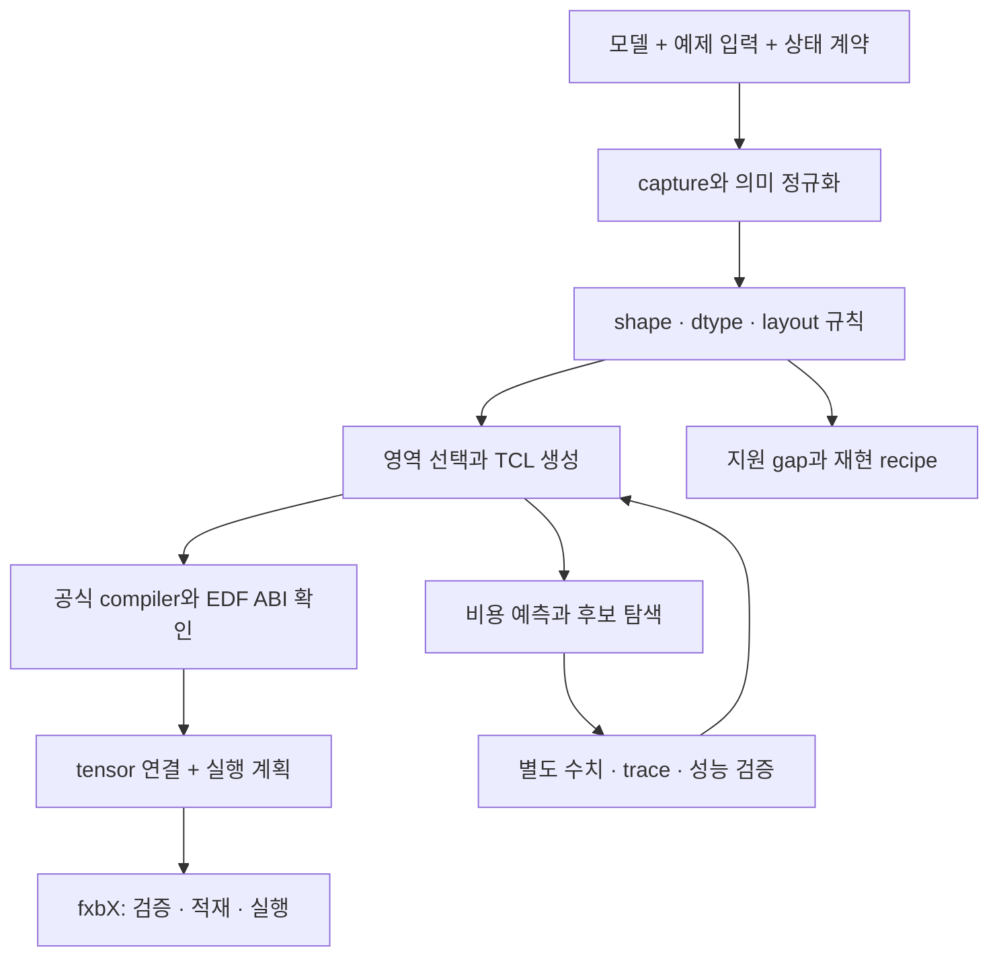

# 10. FuryNo5의 현재 구조와 지원 범위

**FuryNo5는 PyTorch 그래프의 의미를 해석해 재사용 가능한 TCL과 EDF, 실행 계획을 만드는 생산자이며, 아직 모든 ATen 연산을 구현한 범용 backend는 아니다.** 프로젝트의 목표와 특정 입력에서 확인된 실행 증거를 분리해야 개발자가 어떤 부분을 확장해야 할지 알 수 있다. README도 전체 모델의 자동 이식 완료를 주장하지 않으며, 명시적으로 선택하는 실행 backend와 분석 코어를 구분한다. [README](https://github.com/smallstep-zzz/FuryNo5/blob/bba9efea8201aec48150514a35d0b637d29d107e/README.md)

> **코드 기준**  
> 2026-11-19에 확인한 `smallstep-zzz/FuryNo5`의 commit `bba9efea8201aec48150514a35d0b637d29d107e`. 저장소는 조사 당시 비공개였다. 아래 함수·스니펫은 이 소스의 동작을 설명하며, 모든 경로를 이번 집필에서 NPU로 재검증한 것은 아니다.

## 프로젝트를 세 부분으로 읽자

| 부분 | 입력 | 결과 | 보장하지 않는 것 |
|---|---|---|---|
| 분석·탐색 코어 | 연산 DAG(Directed Acyclic Graph), 자원·메모리 모델, 비용 근거 | 합법성 검사, 후보 순위, 예측 보고서 | 실제 RNGD instruction 실행·전체 물리 비용 정확도 |
| 모델 생산 경로 | frozen PyTorch 모델, 예제 입력, 선택적 상태 계약 | TCL, genuine EDF, 명시적 실행 계획, 패키지 | 생성만으로 전체 모델 수치·성능 승인 |
| 명시적 실행 연결 | 준비된 callable 또는 검증된 계획·산출물 | SDK 실행, fxbX 소비 | forward 중 무제한 탐색·자동 CPU 모델 폴백 |

분석 코어에서 합성 자원 충돌을 줄여 예측 시간이 절반이 되더라도 실기기 속도가 두 배가 된 것은 아니다. 반대로 실행 경로가 genuine EDF를 만들었다고 시뮬레이터의 비용 예측까지 검증된 것은 아니다. 각 결과의 `hardware_measured`, `source_kind`, 환경 지문을 함께 읽는다. [설계](https://github.com/smallstep-zzz/FuryNo5/blob/bba9efea8201aec48150514a35d0b637d29d107e/docs/ARCHITECTURE.md) · [IR(Intermediate Representation) 정의](https://github.com/smallstep-zzz/FuryNo5/blob/bba9efea8201aec48150514a35d0b637d29d107e/tplmachine/ir.py)



그림에서 fxbX의 역할은 준비된 계약을 소비하는 것이다. FuryNo5가 누락된 연산 규칙을 정의하고 컴파일하므로, fxbX 실행 중 다시 생산자를 불러 미지원 연산을 고치는 구조로 설명하면 안 된다. [Native 실행 책임](https://github.com/smallstep-zzz/FuryNo5/blob/bba9efea8201aec48150514a35d0b637d29d107e/docs/NATIVE_EXECUTION_PLAN.md)

## 이름과 import 경로

제품명은 **FuryNo5**다. 과거 TCLMachine과의 호환 때문에 배포 패키지와 내부 폴더에 `tplmachine`, 공개 facade에 `tclmachine`이 남아 있다. 이것은 문서에서 다른 프로젝트를 의미하는 것이 아니다. 코드 예제를 실제로 실행하려면 현재 존재하는 import 경로를 그대로 써야 한다. [공개 facade](https://github.com/smallstep-zzz/FuryNo5/blob/bba9efea8201aec48150514a35d0b637d29d107e/tclmachine/__init__.py)

공개 진입점의 중요한 차이는 다음과 같다.

| API | 사용하는 때 | 현재 성격 |
|---|---|---|
| `tclmachine.optimize` | 작은 정적 BF16(BFloat16) 수축 그래프를 명시적으로 준비 | 제한된 opt-in custom op 경로 |
| `tclmachine.export_model` | 모델 그래프를 파일로 생산 | 다중 EDF·tensor 연결·상태 계약 |
| `tclmachine.export_program` | 이름 있는 여러 entry를 하나의 프로그램으로 생산 | 공유 불변 가중치와 명시적 상태 |
| `tclmachine.build_verified_model` | 파일 생성 뒤 독립 소비자 검증까지 요구 | 변경 입력·CPU 기준·공식 trace·새 프로세스 replay |
| `tclmachine.load_plan` | 실측 후 확정한 선택을 실행 | sealed decision만 소비 |
| `tclmachine.plan_regions` | 비용 근거로 영역 조합 탐색 | 실행 승인이 아닌 offline 제안 |
| `tclmachine.prepare_model_direct` | 공개 SDK 컴파일 경로를 직접 활용 | 별도 직접/분할 실행 경로 |

`export_model`이 더 많은 의미 계열을 처리한다고 해서 `optimize`의 등록 범위가 자동으로 늘지는 않는다. 어떤 경로를 고쳤는지를 PR(Pull Request)과 문서에 반드시 적는다.

## 개발자가 따라갈 파일 지도

아래 순서는 읽기 순서이기도 하다. 각 파일의 실제 위치는 고정 commit 링크에서 확인할 수 있다.

| 파일과 주요 진입점 | 책임 | 여기서 풀어야 할 질문 |
|---|---|---|
| [tclmachine/__init__.py](https://github.com/smallstep-zzz/FuryNo5/blob/bba9efea8201aec48150514a35d0b637d29d107e/tclmachine/__init__.py) | 공개 호출 경계 | 사용자가 어떤 작업을 명시적으로 요청했는가 |
| [graph_capture.py · capture_for_export](https://github.com/smallstep-zzz/FuryNo5/blob/bba9efea8201aec48150514a35d0b637d29d107e/tplmachine/graph_capture.py#L188-L195) | export·정규화 | 원본 의미가 보존되었는가 |
| [edf_export.py · bind_exported](https://github.com/smallstep-zzz/FuryNo5/blob/bba9efea8201aec48150514a35d0b637d29d107e/tplmachine/edf_export.py) | 입력·가중치·출력 바인딩 | 어떤 값이 어느 ABI(Application Binary Interface) 인수인가 |
| [aten.py · plan_aten_call](https://github.com/smallstep-zzz/FuryNo5/blob/bba9efea8201aec48150514a35d0b637d29d107e/tplmachine/aten.py#L94-L133) | 제한된 수축 후보 규칙 | 정적 shape·dtype·stride 계약에 맞는가 |
| [pointwise_rules.py](https://github.com/smallstep-zzz/FuryNo5/blob/bba9efea8201aec48150514a35d0b637d29d107e/tplmachine/pointwise_rules.py) | 원소별 의미·broadcasting·TCL | 같은 의미 계열을 공통으로 해결하는가 |
| [reduction_rules.py](https://github.com/smallstep-zzz/FuryNo5/blob/bba9efea8201aec48150514a35d0b637d29d107e/tplmachine/reduction_rules.py) | 축약 축·출력 형식 | 어느 축을 줄이고 무엇으로 누산하는가 |
| [compiler_registry.py](https://github.com/smallstep-zzz/FuryNo5/blob/bba9efea8201aec48150514a35d0b637d29d107e/tplmachine/compiler_registry.py) | 의미 계열→컴파일 함수·소스 의존성 | 어떤 변경이 캐시를 무효화하는가 |
| [execution_plan.py · export_model](https://github.com/smallstep-zzz/FuryNo5/blob/bba9efea8201aec48150514a35d0b637d29d107e/tplmachine/execution_plan.py#L331-L355) | 영역·컴파일 작업·계획 조립 | 값과 EDF를 어떤 순서로 연결하는가 |
| [tcl_compiler.py · compile_source](https://github.com/smallstep-zzz/FuryNo5/blob/bba9efea8201aec48150514a35d0b637d29d107e/tplmachine/tcl_compiler.py#L158-L234) | 공식 컴파일·캐시·EDF 계약 | 산출물이 정확한 source/SDK와 일치하는가 |
| [compile_job.py](https://github.com/smallstep-zzz/FuryNo5/blob/bba9efea8201aec48150514a35d0b637d29d107e/tplmachine/compile_job.py) | subprocess·시간제한·실패 증거 | compiler 거절과 환경 종료를 구분했는가 |
| [aten_runtime.py](https://github.com/smallstep-zzz/FuryNo5/blob/bba9efea8201aec48150514a35d0b637d29d107e/tplmachine/aten_runtime.py) | 준비된 custom op 등록·복사한 FX graph 수정 | 실행 때 준비되지 않은 계약을 거부하는가 |
| [verified_build.py / verified_worker.py](https://github.com/smallstep-zzz/FuryNo5/blob/bba9efea8201aec48150514a35d0b637d29d107e/tplmachine/verified_build.py) | 생산자와 독립된 소비자 검증 | 컴파일 없이 다시 로드되어 올바르게 실행되는가 |

## 첫 단계: 후보 생성은 실행이 아니다

`aten.py`의 현재 `RULES`에는 `mm`, `bmm`, `matmul`, `linear`의 제한된 수축 후보가 들어 있다. 동일 파일은 BF16, 정적 양의 shape, 지원 rank, contiguous stride, 정확한 축 크기를 검사한다. 규칙이 맞으면 `AtenCandidate`에 의미·입출력·TCL source를 담는다. 파일 상단도 이것이 하드웨어 지원 인증표가 아니라고 명시한다. [실제 규칙](https://github.com/smallstep-zzz/FuryNo5/blob/bba9efea8201aec48150514a35d0b637d29d107e/tplmachine/aten.py#L40-L66)

```python
# SDK/NPU를 건드리지 않고 후보와 차단 이유를 읽는 예제.
import torch
from tplmachine.aten import plan_exported

class Product(torch.nn.Module):
    def forward(self, a, b):
        return torch.mm(a, b)

a = torch.randn(4, 8, dtype=torch.bfloat16)
b = torch.randn(8, 6, dtype=torch.bfloat16)
ep = torch.export.export(Product().eval(), (a, b), strict=False)
report = plan_exported(ep)
print(report["candidate_count"])
print(report["npu_execution"])          # not_run
print(report["full_graph_executable"])  # False
```

여기에서 실패했다고 다중 EDF producer 전체가 같은 연산을 처리하지 못한다고 단정하지 않는다. `execution_plan.py`는 원소별·축약·layout·공간 연산 등 다른 의미 계열 생성기도 사용한다. 반대로 후보 source가 생겨도 컴파일 성공, ABI 일치, 수치 통과는 아직 남아 있다.

## 두 번째 단계: 준비한 그래프만 dispatch한다

`register_prepared`의 핵심은 **기존 `aten` 전역 구현을 덮어쓰지 않는 것**이다. 새로운 `tclmachine` namespace에 이름이 고유한 연산을 만들고, 준비된 실행 함수를 PrivateUse1에 연결한다.

```python
# aten_runtime.py의 실제 핵심 발췌
library = torch.library.Library('tclmachine', 'FRAGMENT')
library.define(f'{name}({schema_args}) -> Tensor')
library.impl(name, implementation, 'PrivateUse1')
library.impl(name, meta, 'Meta')
```

그다음 `optimize`가 복사한 graph에서 해당 node의 target을 새 op로 바꾼다. 함수 호출을 준비하는 시점에는 커널을 컴파일하지만, `PreparedGraph.__call__`은 준비된 module만 호출한다. 같은 계약은 준비 중 cache로 공유하며, close하면 소유한 등록을 해제한다. [등록과 rewrite 구현](https://github.com/smallstep-zzz/FuryNo5/blob/bba9efea8201aec48150514a35d0b637d29d107e/tplmachine/aten_runtime.py#L104-L119) · [준비 과정](https://github.com/smallstep-zzz/FuryNo5/blob/bba9efea8201aec48150514a35d0b637d29d107e/tplmachine/aten_runtime.py#L210-L276)

이 방식은 “일반적인 Torch의 모든 함수를 호출하기만 하면 FuryNo5가 자동 개입한다”와 다르다. 사용자가 지원 범위의 그래프에 `optimize`를 명시적으로 적용해야 한다.

## 세 번째 단계: 전체 파일을 생산하는 경로

`export_model`은 모델을 캡처하고, 입력·상태를 연결하고, 의미 규칙으로 영역을 정하고, 고유 커널만 컴파일한다. 성공하면 `execution-plan.json`과 패키지를 만들지만 반환 상태는 **`built_not_runtime_validated`**다. 이 이름 그대로 받아들이는 것이 중요하다. [결과 생성부](https://github.com/smallstep-zzz/FuryNo5/blob/bba9efea8201aec48150514a35d0b637d29d107e/tplmachine/execution_plan.py#L1287-L1300)

```python
# 호환 SDK와 FuryNo5/fxbX 설치본에서 실행할 생산 예제.
import torch
from tclmachine import export_model

def main():
    model = torch.nn.Sequential(
        torch.nn.Linear(8, 12),
        torch.nn.ReLU(),
        torch.nn.Linear(12, 8),
    ).bfloat16().eval().requires_grad_(False)
    x = torch.randn(4, 8, dtype=torch.bfloat16)

    result = export_model(
        model, (x,), "tiny.fxbx",
        compile_workers=2,
    )
    print(result["status"])
    print(result["regions"], result["unique_kernels"])
    print(result["timings_s"])

if __name__ == "__main__":
    main()
```

이 예제는 `.py` 파일로 저장해 실행한다. 병렬 컴파일은 `spawn`으로 자식 프로세스를 만들 수 있으므로 `__main__` 보호가 필요하다. 이미 출력 파일이나 `.plan` 디렉터리가 있는 경로를 덮어쓰지 않는다. 수정 후 비교 실험은 새로운 출력 경로를 쓴다. 생성된 파일을 검증하는 완전한 과정은 포팅 장에서 다룬다. [컴파일 작업 실행](https://github.com/smallstep-zzz/FuryNo5/blob/bba9efea8201aec48150514a35d0b637d29d107e/tplmachine/execution_plan.py)

## “모든 ATen 지원”을 어떻게 판단할 것인가

소스에 남은 **2026-11-10 Core 기준선**은 다음과 같다. 이 표는 현재 모든 코드의 최종 지원율이 아니라, 당시 동일한 분모와 증거 규칙으로 만든 상태표다. 후속 수정으로 성공한 사례를 이 표에 임의로 더하지 않는다.

| Core overload 상태 | 개수 | 올바른 해석 |
|---|---:|---|
| 작은 그래프 NPU·수치 증거 있음 | 13 | 검증된 특정 입력 조건이 있음 |
| metadata 승인만 있음 | 7 | compiler·NPU·정확성 성공은 미확인 |
| 직접 규칙·계약 차단 관측 | 20 | 현재 producer의 조건/규칙에서 실패 |
| 미확인 | 145 | 관측·검증하지 않은 계약 |
| 역전파 전용 제외 | 7 | 프로젝트의 추론 범위 밖 |
| 합계 | 192 | 고정 Core overload 목록 |

13개 중 6개는 다른 입력 조건에서는 실패도 관측되었다. 이 사실은 모순이 아니다. 연산 이름 하나가 아니라 **overload × shape × dtype × stride × 속성 × 상태 × SDK**가 지원 계약이기 때문이다. 예를 들어 contiguous BF16 행렬곱 성공은 비연속 FP32(Floating Point 32-bit) broadcast 행렬곱 성공을 보장하지 않는다. [기계식 coverage.json](https://github.com/smallstep-zzz/FuryNo5/blob/bba9efea8201aec48150514a35d0b637d29d107e/docs/validation/core-aten-20261110/coverage.json)

최신 지원 상태를 만들 때는 `core_aten snapshot/report`로 분모와 corpus를 고정하고, trace·수치·반복 실행이 있는 증거만 승계한다. 단순 `metadata_admitted`를 NPU 지원으로 승격하지 않는 코드가 이미 있다. [지원표 생성기](https://github.com/smallstep-zzz/FuryNo5/blob/bba9efea8201aec48150514a35d0b637d29d107e/tplmachine/research/core_aten.py)

## 새 연산을 추가할 때 지켜야 할 경계

가장 먼저 실패 이유를 **모델 이름 대신 의미 계약**으로 표현한다. “모델 A가 실패한다”를 “FP32의 비연속 마지막 축을 가진 reduction에서 출력 stride 계약이 없다”로 바꾸면 다른 모델에도 쓰이는 수정을 할 수 있다.

1. `graph_capture`에서 이미 의미가 틀렸는지 확인한다.
2. 바인딩·alias·layout 문제라면 그 경계를 고친다.
3. 기존 의미 계열이 있으면 해당 `*_rules.py`의 허용 조건과 TCL 생성기를 확장한다.
4. 신규 계열일 때만 `compiler_registry.py`에 함수와 source 의존성을 등록한다.
5. 작은 정상·경계·거부 사례에서 CPU 의미, 컴파일 ABI, NPU 수치와 trace를 확인한다.
6. 영향을 받은 모델만 다시 preflight하고, 마지막에 파일의 독립 소비자 replay를 수행한다.

이 순서는 현재 저장소의 수정 가이드와 맞춰 구성했다. 허용오차를 바꾸거나 모델명 예외로 통과시키면 지원 범위가 늘어난 것이 아니라 계약이 달라진 것이다. [수정 가이드](https://github.com/smallstep-zzz/FuryNo5/blob/bba9efea8201aec48150514a35d0b637d29d107e/docs/REPAIR_GUIDE.md)

## 출처

| 자료 | 확인 범위 |
|---|---|
| [README](https://github.com/smallstep-zzz/FuryNo5/blob/bba9efea8201aec48150514a35d0b637d29d107e/README.md) | 목표·분석 코어·미구현 경계 |
| [ATen 후보 규칙](https://github.com/smallstep-zzz/FuryNo5/blob/bba9efea8201aec48150514a35d0b637d29d107e/tplmachine/aten.py) | 정적 BF16 수축 admission |
| [준비 실행 경로](https://github.com/smallstep-zzz/FuryNo5/blob/bba9efea8201aec48150514a35d0b637d29d107e/tplmachine/aten_runtime.py) | custom namespace 등록과 forward 경계 |
| [계획 생성기](https://github.com/smallstep-zzz/FuryNo5/blob/bba9efea8201aec48150514a35d0b637d29d107e/tplmachine/execution_plan.py) | 다중 EDF·계획·생성 상태 |
| [Core 지원 기준선](https://github.com/smallstep-zzz/FuryNo5/blob/bba9efea8201aec48150514a35d0b637d29d107e/docs/CORE_ATEN_WORKFLOW.md) | 과거 snapshot의 분모와 증거 단계 |
| [독립 소비자 검증](https://github.com/smallstep-zzz/FuryNo5/blob/bba9efea8201aec48150514a35d0b637d29d107e/tplmachine/verified_worker.py) | 생산자 import·재컴파일 차단·NPU trace |

