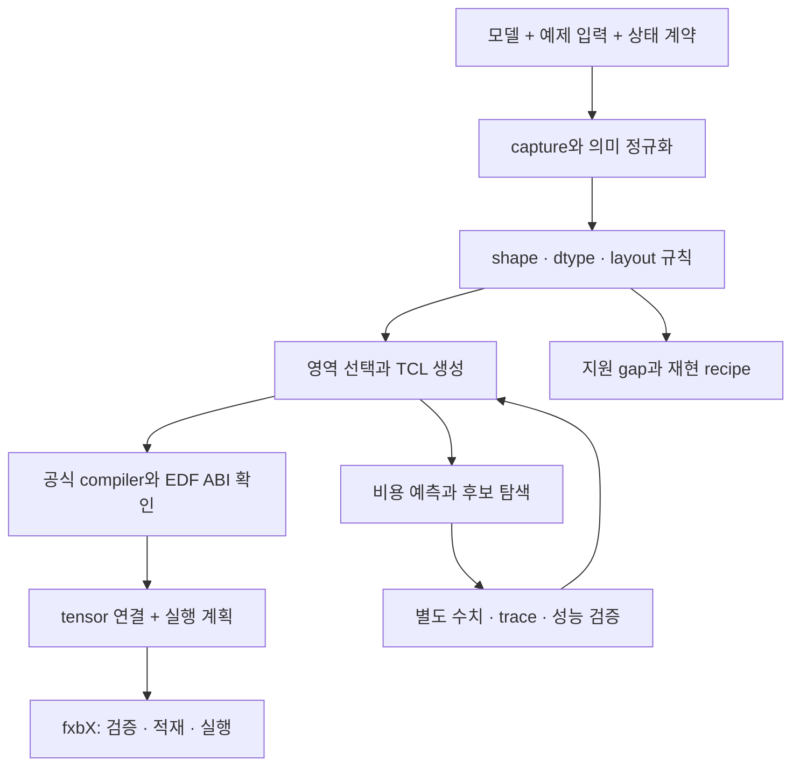

# 10. 작은 모델 하나로 읽는 FuryNo5의 구조

Python 모델을 NPU(Neural Processing Unit)에서 실행하려면 `forward()`의 계산을 장치용 프로그램으로 만들고, 그 프로그램에 입력·가중치를 연결해야 한다. **FuryNo5는 이 준비를 맡는 생산자(producer)다**. 실제 RNGD 코드 생성은 Furiosa의 compiler에 맡기고, 만들어진 파일을 읽어 실행하는 소비자(consumer)는 SDK(Software Development Kit) 런타임이나 fxbX다. C 소스를 컴파일한 뒤 별도 실행기가 바이너리를 적재하는 흐름과 비슷하지만, 여기서는 여러 텐서 프로그램의 연결 계획도 함께 필요하다.

먼저 작은 모델이 어떤 자료구조와 파일로 바뀌는지 따라가자. 그다음 실제 파일·함수와 지원 범위를 읽으면, “후보를 만들었다”, “컴파일했다”, “NPU에서 정답을 확인했다”가 서로 다른 결과라는 점도 자연스럽게 드러난다. FuryNo5는 모든 ATen(A Tensor Library) 연산을 완성한 범용 backend가 아니며 README도 전체 모델 자동 이식 완료를 주장하지 않는다. [프로젝트의 현재 범위](https://github.com/smallstep-zzz/FuryNo5/blob/bba9efea8201aec48150514a35d0b637d29d107e/README.md)

> **코드와 검증 기준** · FuryNo5 commit `bba9efea8201aec48150514a35d0b637d29d107e`를 2026-11-19에 확인했다. 소스 링크는 비공개 저장소 열람 권한이 필요할 수 있다. 이 장은 구현을 읽어 설명하며 집필 환경에서 새 NPU 실행·수치·성능 검증을 하지 않았다.

## 공통 예제: 8개 특징을 받아 8개 값을 돌려주는 모델

여기서 사용할 모델은 `Linear(8,12) → ReLU → Linear(12,8)`이다. Linear는 각 입력 행에 행렬곱과 bias 덧셈을 적용한다. ReLU(Rectified Linear Unit)는 음수 값을 0으로 바꾼다. 입력 `x`의 shape `[4,8]`은 8개 특징으로 이루어진 사례 4개를 한 번에 처리한다는 뜻이다. shape는 축별 길이이며 dtype은 원소 자료형이다. 이 예제는 BF16(BFloat16)을 사용한다.

행렬곱 `A @ B`는 A의 행과 B의 열에서 대응 원소를 곱해 더한다. `[M,K] @ [K,N]`에서 합쳐지는 K가 같아야 결과 `[M,N]`을 얻는다. `Linear(8,12)`의 weight `W[12,8]`에는 출력 특징 하나당 계수 8개가 한 행에 있다. 이를 전치한 `W.T[8,12]`를 사용하므로 `x[4,8] @ W.T[8,12]`는 `[4,12]`다. `bias[12]`는 각 출력 행에 같은 12개 값을 더하는 **broadcasting**으로 적용한다. 예를 들어 첫 원소는 `x[0,0]*W[0,0] + … + x[0,7]*W[0,7] + bias[0]`이다. 이 전치는 숫자 위치의 의미를 바꾸는 축 교환이다. `reshape`는 원소 수를 유지하며 같은 논리적 원소열을 새 shape로 읽는 연산이므로 이 전치를 대체할 수 없다. [Linear의 규격](https://docs.pytorch.org/docs/2.10/generated/torch.nn.Linear.html)

| 논리 값 | shape | 계산 또는 공급자 | 파일을 다시 읽을 때 필요한가 |
|---|---|---|---|
| `x` | `[4,8]` | 호출자가 매번 전달 | 예, 요청 입력 |
| 첫 weight·bias | `[12,8]`, `[12]` | `model.state_dict()`의 `0.weight`, `0.bias` | 예, 외부 가중치 |
| `h` | `[4,12]` | 첫 Linear 결과 | 실행 중 생성 |
| `a` | `[4,12]` | `relu(h)` | 실행 중 생성 |
| 마지막 weight·bias | `[8,12]`, `[8]` | `2.weight`, `2.bias` | 예, 외부 가중치 |
| `y` | `[4,8]` | 마지막 Linear 결과 | 호출자에게 반환 |

**parameter**는 weight·bias처럼 모델이 보유한 학습 대상 tensor다. 추론용으로 frozen한다는 것은 이번 준비·실행에서 학습과 gradient 계산을 요구하지 않도록 고정한다는 뜻이다. `eval()`은 dropout·BatchNorm 같은 층을 평가 모드로 바꾸고, `requires_grad_(False)`는 parameter의 미분 추적을 끈다. 두 호출은 목적이 다르다. `.bfloat16()`은 자료형 변경이므로 실제 모델에서는 그 변경에 따른 정확도도 검증해야 한다.

같은 shape의 tensor라도 메모리 해석이 다를 수 있다. **stride**는 한 축에서 원소 하나 이동할 때 저장소에서 건너뛰는 원소 수다. 행이 연속으로 저장된 `[4,8]` 입력의 stride는 `[8,1]`이다. **contiguous**는 해당 순서로 빈틈없이 이어진 배치를 뜻한다. 전치된 view처럼 메모리를 공유하되 stride가 다른 입력을 같은 커널에 무조건 넣을 수는 없다. FuryNo5 규칙은 이런 조건도 함께 검사한다. [입력 계약 검사](https://github.com/smallstep-zzz/FuryNo5/blob/bba9efea8201aec48150514a35d0b637d29d107e/tplmachine/edf_export.py#L33-L109)

## 이 모델이 어떤 객체와 파일로 바뀌는가

**capture(캡처)는** 모델의 호출 관계를 graph라는 자료구조로 얻는 과정이다. graph node는 계산이나 입력을 나타내고, 간선은 앞 계산의 결과를 뒤 계산이 사용한다는 뜻이다. **region(영역)은** 함께 컴파일할 연산 묶음이다. **kernel(커널)은** 그 계산을 실행할 구현 단위이며, 같은 계약의 kernel 하나를 여러 위치에서 재사용할 수 있다. 아래 단계의 이름은 저장소가 하는 일을 설명하며, 예제에서 region이나 EDF가 항상 3개 생긴다는 뜻은 아니다.

| 단계 | 입력 → 결과 | 이번 모델에서 의미하는 것 |
|---|---|---|
| 캡처 | Python module·예제 입력 → `ExportedProgram` | Linear·ReLU의 연결과 입력 조건을 추출 |
| 규칙·영역 선택 | graph·tensor 정보 → 컴파일 요청 | 지원하는 shape·dtype인지, 어디까지 묶을지 결정 |
| 계산 표현 생성 | 요청 → TCL 문자열 또는 SDK compiler 입력 | `h`, `a`, `y`를 계산하는 의미를 표현 |
| 컴파일 | 계산 표현 → EDF bytes | RNGD에서 실행할 장치 프로그램 생성 |
| 계획 조립 | EDF 계약·값 연결 → 실행계획 JSON | 어떤 weight·입력·중간값으로 각 프로그램을 호출할지 기록 |
| 포장 | 실행계획·EDF → `.fxbx` 패키지 | 다른 프로세스에 전달할 파일 생성 |
| 소비 | 패키지·외부 weight·`x` → `y` | fxbX가 검사·적재·실행 |

TCL(Tensor Contraction Language)은 텐서 계산을 compiler에 설명하는 언어이고, EDF(Executable Device Format)는 컴파일된 장치 프로그램이다. JSON(JavaScript Object Notation) 실행계획에는 코드 대신 값의 이름과 연결이 들어간다. **export**는 여기서 메모리의 모델을 다른 단계가 사용할 객체·파일로 내보내는 작업을 뜻한다. `torch.export`가 만드는 객체와 FuryNo5 `export_model`이 만드는 패키지는 서로 다른 단계의 export다.

## 이름과 import 경로

제품명은 **FuryNo5**다. 과거 TCLMachine과의 호환 때문에 배포 패키지와 내부 폴더에 `tplmachine`, 외부에서 부르는 얇은 함수 계층인 공개 facade에 `tclmachine`이 남아 있다. 이것은 문서에서 다른 프로젝트를 의미하는 것이 아니다. 코드 예제를 실제로 실행하려면 현재 존재하는 import 경로를 그대로 써야 한다. [공개 facade](https://github.com/smallstep-zzz/FuryNo5/blob/bba9efea8201aec48150514a35d0b637d29d107e/tclmachine/__init__.py)

공개 진입점의 중요한 차이는 다음과 같다.

| API | 사용하는 때 | 현재 성격 |
|---|---|---|
| `tclmachine.optimize` | 작은 정적 BF16 수축 그래프를 현재 프로세스에서 준비 | 사용자가 선택한 graph에 새 연산을 연결해 호출 |
| `tclmachine.export_model` | 모델 그래프를 파일로 생산 | 다중 EDF·tensor 연결·상태 계약 |
| `tclmachine.export_program` | `forward` 등 이름 붙은 실행 입구(entry) 여러 개를 묶음 | 공유 불변 가중치와 명시적 상태 |
| `tclmachine.build_verified_model` | 파일 생성 뒤 독립 소비자 검증까지 요구 | 변경 입력·CPU 기준·공식 trace·새 프로세스 replay |
| `tclmachine.load_plan` | 측정 후 선택을 확정한 계획을 읽음 | 확정 기록만 사용하고 실행 중 새 후보를 탐색하지 않음 |
| `tclmachine.plan_regions` | 실행 전 비용 근거로 영역 조합 탐색 | 계산한 후보 제안이며 NPU 성공 증거는 아님 |
| `tclmachine.prepare_model_direct` | 공개 SDK 컴파일 경로를 직접 활용 | 별도 직접/분할 실행 경로 |

사용자가 결정할 첫 질문은 **지금 프로세스 안에서 호출할 객체가 필요한가, 다른 프로세스로 옮길 파일이 필요한가**다. 전자는 `optimize`, 후자는 `export_model`을 살펴본다. 각각 다른 구현 경로이므로 `export_model`이 더 많은 의미 계열을 처리한다고 해서 `optimize`의 등록 범위가 자동으로 늘지는 않는다. 어떤 경로를 고쳤는지를 PR(Pull Request)과 문서에 반드시 적는다.

## 첫 단계: 후보 생성은 실행이 아니다

**규칙(rule)은** “이 연산의 이 입력 조건을 어떤 계산으로 표현할 수 있는가”를 판정하는 코드다. 규칙이 통과하면 compiler에 시도할 후보를 만들 수 있지만, 아직 compiler 성공이나 장치 정답은 모른다. **수축(contraction)은** 행렬곱처럼 원소를 곱한 뒤 공통 축을 따라 더하는 계산이다. `aten.py`의 현재 `RULES`에는 `mm`, `bmm`, `matmul`, `linear`의 제한된 수축 후보가 들어 있다. 동일 파일은 BF16, 정적 양의 shape, 지원 rank(축의 개수), contiguous stride, 정확한 축 크기를 검사한다. 규칙이 맞으면 `AtenCandidate`에 의미·입출력·TCL source를 담는다. 파일 상단도 이것이 하드웨어 지원 인증표가 아니라고 명시한다. [실제 규칙](https://github.com/smallstep-zzz/FuryNo5/blob/bba9efea8201aec48150514a35d0b637d29d107e/tplmachine/aten.py#L40-L66)

```python
# 후보 분석 경로다. EDF 컴파일이나 NPU 추론을 요청하지 않는다.
import torch
from tplmachine.aten import plan_exported

class Product(torch.nn.Module):
    def forward(self, a, b):
        return torch.mm(a, b)  # [2,3] @ [3,2] → [2,2]; 공통 축 3에서 곱을 합한다.

a = torch.tensor([[1, -2, 3], [-4, 5, -6]], dtype=torch.bfloat16)  # 왼쪽 [2,3]
b = torch.tensor([[1, 0], [0, 1], [1, 1]], dtype=torch.bfloat16)    # 오른쪽 [3,2]
ep = torch.export.export(Product().eval(), (a, b), strict=False)  # 위치 인수 2개로 캡처
report = plan_exported(ep)  # 그래프의 연산·입력 조건을 규칙과 대조한 보고서
print(report["candidate_count"])       # 컴파일을 시도할 수 있는 후보 수
print(report["npu_execution"])          # not_run: 실제 장치 출력은 아직 없음
print(report["full_graph_executable"])  # False: 전체 그래프 실행 승인이 아님
```

이 코드는 전체 MLP(Multilayer Perceptron)를 준비하기 전에 행렬곱 하나만 조사한다. `a`는 `[2,3]`, `b`는 `[3,2]`이고 식의 예상 출력은 `[[4,1],[-10,-1]]`이다. 첫 원소는 `1*1 + (-2)*0 + 3*1 = 4`, 둘째 원소는 `1*0 + (-2)*1 + 3*1 = 1`로 구한다. 하지만 코드에서는 `a @ b`의 NPU 결과를 구하지 않는다. `torch.export.export`가 만든 객체를 `plan_exported`에 주어 후보 수와 분석 상태를 읽는다. `npu_execution=not_run`과 `full_graph_executable=False`는 바로 그 경계를 나타낸다.

여기에서 실패했다고 다중 EDF producer 전체가 같은 연산을 처리하지 못한다고 단정하지 않는다. `execution_plan.py`는 원소별·축약·layout·공간 연산 등 다른 의미 계열 생성기도 사용한다. 반대로 후보 source가 생겨도 컴파일 성공, ABI(Application Binary Interface: 실행 코드와 호출자가 합의한 인수 순서·자료형·배치) 일치, 수치 통과는 아직 남아 있다.

## 두 번째 단계: 준비한 그래프만 dispatch한다

이제 후보를 실제로 컴파일해 현재 프로세스에서 부를 함수로 만들려면 준비 단계가 필요하다. **준비된 callable**은 shape·dtype 계약과 컴파일 결과를 이미 가진 호출 객체다. **dispatch**는 연산 호출을 그 구현 함수에 연결하는 일이다. `register_prepared`의 핵심은 **기존 `aten` 전역 구현을 덮어쓰지 않는 것**이다. 새로운 `tclmachine` namespace에 이름이 고유한 연산을 만들고, 준비된 실행 함수를 외부 장치용 선택 표식인 `PrivateUse1`에 연결한다. `Meta`에는 실제 계산 없이 출력 shape·dtype를 알려주는 함수를 연결한다.

```python
# aten_runtime.py의 핵심: 설명 주석을 추가한 발췌, 주변 함수·변수 정의는 생략.
library = torch.library.Library('tclmachine', 'FRAGMENT')  # 새 연산을 붙일 namespace
library.define(f'{name}({schema_args}) -> Tensor')  # 고유 이름과 입력·출력 함수 선언
library.impl(name, implementation, 'PrivateUse1')  # 실제 NPU 실행 callable 연결
library.impl(name, meta, 'Meta')  # 계산 없이 출력 shape·dtype만 설명하는 함수 연결
```

위 네 줄은 내부 함수의 발췌이며 독립 실행 예제가 아니다. `name`은 준비 과정에서 만든 고유 연산명, `schema_args`는 입력 tensor들의 함수 선언, `implementation`은 준비된 장치 프로그램을 호출하는 함수, `meta`는 출력 정보만 만드는 함수다. `Library(..., 'FRAGMENT')`는 같은 namespace에 구현 조각을 추가할 때 사용하는 등록 객체다.

그다음 `optimize`가 복사한 graph에서 해당 node의 target, 즉 호출 대상을 새 op로 바꾼다. 예컨대 원래 `aten.mm(a,b)`를 가리키던 node가 이 입력 계약으로 준비한 `tclmachine` 연산을 가리키게 된다. 원래 Python의 모든 `torch.mm` 호출을 바꾸는 작업은 아니다. 준비 시 컴파일 결과와 입력 조건을 저장하지만, `PreparedGraph.__call__`은 준비된 module만 호출한다. 같은 계약은 준비 중 cache(이미 준비한 결과를 다시 쓰는 저장소)로 공유하며, close하면 소유한 등록을 해제한다. [등록과 rewrite 구현](https://github.com/smallstep-zzz/FuryNo5/blob/bba9efea8201aec48150514a35d0b637d29d107e/tplmachine/aten_runtime.py#L104-L119) · [준비 과정](https://github.com/smallstep-zzz/FuryNo5/blob/bba9efea8201aec48150514a35d0b637d29d107e/tplmachine/aten_runtime.py#L210-L276)

이 방식은 “일반적인 Torch의 모든 함수를 호출하기만 하면 FuryNo5가 자동 개입한다”와 다르다. 사용자가 지원 범위의 그래프에 `optimize`를 명시적으로 적용해야 한다.

## 세 번째 단계: 전체 파일을 생산하는 경로

이번에는 다시 `[4,8]` 입력을 가진 전체 MLP로 돌아온다. `model`은 계산 방법과 weight를 가진 Python 객체, `(x,)`는 입력이 한 개임을 나타내는 tuple, `"tiny.fxbx"`는 출력 파일 경로다. 출력 패키지에 외부 weight의 연결 계약을 담는 것과 weight 값 자체를 모두 넣는 것은 다르므로 실행 때는 해당 weight를 별도로 제공한다.

`export_model`은 모델을 캡처하고, 입력·상태를 연결하고, 의미 규칙으로 영역을 정하고, 고유 커널만 컴파일한다. 성공하면 `execution-plan.json`과 패키지를 만들지만 반환 상태는 **`built_not_runtime_validated`다**. 이 이름 그대로 받아들이는 것이 중요하다. [결과 생성부](https://github.com/smallstep-zzz/FuryNo5/blob/bba9efea8201aec48150514a35d0b637d29d107e/tplmachine/execution_plan.py#L1287-L1300)

```python
# 호환 SDK와 FuryNo5/fxbX 설치본에서 실행할 생산 예제.
import torch
from tclmachine import export_model

def main():
    model = torch.nn.Sequential(
        torch.nn.Linear(8, 12),  # x[4,8] → h[4,12]; W[12,8]을 전치해 곱한다.
        torch.nn.ReLU(),        # 음수만 0으로 바꾸고 shape [4,12]는 유지한다.
        torch.nn.Linear(12, 8), # [4,12] → y[4,8]
    ).bfloat16().eval().requires_grad_(False)  # BF16 가중치, 추론 모드, 학습 제외
    x = torch.randn(4, 8, dtype=torch.bfloat16)  # 가중치와 dtype을 맞춘 CPU 대표 입력

    result = export_model(
        model, (x,), "tiny.fxbx",  # 모델·입력 하나의 tuple·새 출력 경로
        compile_workers=2,  # CPU 컴파일 worker 수; 장치 개수가 아니다.
    )
    print(result["status"])  # 생성 상태이며 실제 추론 결과가 아니다.
    print(result["regions"], result["unique_kernels"])  # 영역 수와 고유 컴파일 결과 수
    print(result["timings_s"])  # 생산 단계별 소요 시간(초); warm 추론 지연이 아니다.

if __name__ == "__main__":  # spawn한 worker에서 전체 작업이 재실행되는 것을 막는다.
    main()
```

이 예제는 `.py` 파일로 저장해 실행한다. 병렬 컴파일은 `spawn`으로 자식 프로세스를 만들 수 있으므로 `__main__` 보호가 필요하다. 성공한 호출의 `result`는 출력 tensor가 아니라 생산 보고서다. `regions`는 계획의 영역 수, `unique_kernels`는 서로 다른 컴파일 결과 수, `timings_s`는 생산 단계별 시간이다. 같은 kernel을 여러 번 사용할 수 있으므로 이 수들을 같다고 가정하지 않는다. `tiny.fxbx.plan`은 준비와 진단 산출물을 보관하는 디렉터리이며 `tiny.fxbx`는 전달용 패키지다. 이미 출력 파일이나 `.plan` 디렉터리가 있는 경로를 덮어쓰지 않는다. 수정 후 비교 실험은 새로운 출력 경로를 쓴다. 생성된 파일을 검증하는 완전한 과정은 포팅 장에서 다룬다. [컴파일 작업 실행](https://github.com/smallstep-zzz/FuryNo5/blob/bba9efea8201aec48150514a35d0b637d29d107e/tplmachine/execution_plan.py)

## “모든 ATen 지원”을 어떻게 판단할 것인가

**지원 범위**는 연산 이름 목록만으로 나타낼 수 없다. overload는 같은 기본 이름 아래 인수 형태가 다른 함수이고, 같은 overload도 shape·dtype·stride·속성에 따라 다른 구현이 필요하다. 아래 **Core**는 PyTorch가 작은 공통 집합으로 구분한 연산들이며 전체 ATen과 같지 않다.

소스에 남은 **2026-11-10 Core 기준선**은 다음과 같다. 이 표는 현재 모든 코드의 최종 지원율이 아니라, 당시 동일한 분모와 증거 규칙으로 만든 상태표다. 후속 수정으로 성공한 사례를 이 표에 임의로 더하지 않는다.

| Core overload 상태 | 개수 | 올바른 해석 |
|---|---:|---|
| 작은 그래프 NPU·수치 증거 있음 | 13 | 검증된 특정 입력 조건이 있음 |
| metadata 승인만 있음 | 7 | compiler·NPU·정확성 성공은 미확인 |
| 직접 규칙·계약 차단 관측 | 20 | 현재 producer의 조건/규칙에서 실패 |
| 미확인 | 145 | 관측·검증하지 않은 계약 |
| 역전파 전용 제외 | 7 | 프로젝트의 추론 범위 밖 |
| 합계 | 192 | 고정 Core overload 목록 |

13개 중 6개는 다른 입력 조건에서는 실패도 관측되었다. 이 사실은 모순이 아니다. 연산 이름 하나가 아니라 **overload × shape × dtype × stride × 속성 × 상태 × SDK**가 지원 계약이기 때문이다. 예를 들어 contiguous BF16 행렬곱 성공은 비연속 FP32(Floating Point 32-bit) broadcast 행렬곱 성공을 보장하지 않는다. [기계식 coverage.json](https://github.com/smallstep-zzz/FuryNo5/blob/bba9efea8201aec48150514a35d0b637d29d107e/docs/validation/core-aten-20261110/coverage.json)

최신 지원 상태를 만들 때는 `core_aten snapshot/report`로 분모와 corpus를 고정하고, trace·수치·반복 실행이 있는 증거만 승계한다. 단순 `metadata_admitted`를 NPU 지원으로 승격하지 않는 코드가 이미 있다. [지원표 생성기](https://github.com/smallstep-zzz/FuryNo5/blob/bba9efea8201aec48150514a35d0b637d29d107e/tplmachine/research/core_aten.py)

## 프로젝트를 세 부분으로 읽자

| 부분 | 입력 | 결과 | 보장하지 않는 것 |
|---|---|---|---|
| 분석·탐색 코어 | 연산 DAG(Directed Acyclic Graph), 자원·메모리 모델, 비용 근거 | 합법성 검사, 후보 순위, 예측 보고서 | 실제 RNGD instruction 실행·전체 물리 비용 정확도 |
| 모델 생산 경로 | frozen PyTorch 모델, 예제 입력, 선택적 상태 계약 | TCL, genuine EDF, 명시적 실행 계획, 패키지 | 생성만으로 전체 모델 수치·성능 승인 |
| 명시적 실행 연결 | 준비된 callable 또는 검증된 계획·산출물 | SDK 실행, fxbX 소비 | forward 중 무제한 탐색·자동 CPU 모델 폴백 |

이제 파일을 만드는 흐름을 보았으므로, 같은 저장소 안의 분석 기능과 실행 기능을 구분할 수 있다. 표의 DAG(Directed Acyclic Graph)는 순환 없는 의존 그래프이며, 비용 예측은 실제 장치 실행을 대신하는 모델이다. 분석 코어에서 합성 자원 충돌을 줄여 예측 시간이 절반이 되더라도 실기기 속도가 두 배가 된 것은 아니다. 반대로 실행 경로가 genuine EDF를 만들었다고 시뮬레이터의 비용 예측까지 검증된 것은 아니다. `hardware_measured`는 장치에서 측정한 값인지, `source_kind`는 예측·기록 중 어디에서 얻었는지를 알려준다. 환경 지문은 SDK·compiler 등 결과의 조건을 식별하는 정보다. 이를 함께 읽어야 예측치를 실측으로 오해하지 않는다. [설계](https://github.com/smallstep-zzz/FuryNo5/blob/bba9efea8201aec48150514a35d0b637d29d107e/docs/ARCHITECTURE.md) · [IR(Intermediate Representation) 정의](https://github.com/smallstep-zzz/FuryNo5/blob/bba9efea8201aec48150514a35d0b637d29d107e/tplmachine/ir.py)



그림에서 fxbX의 역할은 준비된 계약을 소비하는 것이다. FuryNo5가 누락된 연산 규칙을 정의하고 컴파일하므로, fxbX 실행 중 다시 생산자를 불러 미지원 연산을 고치는 구조로 설명하면 안 된다. [Native 실행 책임](https://github.com/smallstep-zzz/FuryNo5/blob/bba9efea8201aec48150514a35d0b637d29d107e/docs/NATIVE_EXECUTION_PLAN.md)

## 개발자가 따라갈 파일 지도

아래 표는 앞의 값·객체·파일 변환을 구현한 위치다. 처음부터 모두 열 필요는 없다. 예를 들어 입력 계약이 막히면 `edf_export.py`, 준비된 호출이 잘못 연결되면 `aten_runtime.py`를 확인한다. ABI(Application Binary Interface)는 컴파일된 프로그램과 호출자가 합의한 인수 순서·자료형·배치의 계약이다. 각 파일의 실제 위치는 고정 commit 링크에서 확인할 수 있다.

| 파일과 주요 진입점 | 책임 | 여기서 풀어야 할 질문 |
|---|---|---|
| [tclmachine/__init__.py](https://github.com/smallstep-zzz/FuryNo5/blob/bba9efea8201aec48150514a35d0b637d29d107e/tclmachine/__init__.py) | 공개 호출 경계 | 사용자가 어떤 작업을 명시적으로 요청했는가 |
| [graph_capture.py · capture_for_export](https://github.com/smallstep-zzz/FuryNo5/blob/bba9efea8201aec48150514a35d0b637d29d107e/tplmachine/graph_capture.py#L188-L195) | export·정규화 | 원본 의미가 보존되었는가 |
| [edf_export.py · bind_exported](https://github.com/smallstep-zzz/FuryNo5/blob/bba9efea8201aec48150514a35d0b637d29d107e/tplmachine/edf_export.py) | 입력·가중치·출력 바인딩 | 어떤 값이 어느 ABI(Application Binary Interface) 인수인가 |
| [aten.py · plan_aten_call](https://github.com/smallstep-zzz/FuryNo5/blob/bba9efea8201aec48150514a35d0b637d29d107e/tplmachine/aten.py#L94-L133) | 제한된 수축 후보 규칙 | 정적 shape·dtype·stride 계약에 맞는가 |
| [pointwise_rules.py](https://github.com/smallstep-zzz/FuryNo5/blob/bba9efea8201aec48150514a35d0b637d29d107e/tplmachine/pointwise_rules.py) | 원소별 의미·broadcasting·TCL | 같은 의미 계열을 공통으로 해결하는가 |
| [reduction_rules.py](https://github.com/smallstep-zzz/FuryNo5/blob/bba9efea8201aec48150514a35d0b637d29d107e/tplmachine/reduction_rules.py) | 축약 축·출력 형식 | 어느 축을 줄이고 무엇으로 누산하는가 |
| [compiler_registry.py](https://github.com/smallstep-zzz/FuryNo5/blob/bba9efea8201aec48150514a35d0b637d29d107e/tplmachine/compiler_registry.py) | 의미 계열→컴파일 함수·소스 의존성 | 어떤 변경이 캐시를 무효화하는가 |
| [execution_plan.py · export_model](https://github.com/smallstep-zzz/FuryNo5/blob/bba9efea8201aec48150514a35d0b637d29d107e/tplmachine/execution_plan.py#L331-L355) | 영역·컴파일 작업·계획 조립 | 값과 EDF를 어떤 순서로 연결하는가 |
| [tcl_compiler.py · compile_source](https://github.com/smallstep-zzz/FuryNo5/blob/bba9efea8201aec48150514a35d0b637d29d107e/tplmachine/tcl_compiler.py#L158-L234) | 공식 컴파일·캐시·EDF 계약 | 산출물이 정확한 source/SDK와 일치하는가 |
| [compile_job.py](https://github.com/smallstep-zzz/FuryNo5/blob/bba9efea8201aec48150514a35d0b637d29d107e/tplmachine/compile_job.py) | subprocess·시간제한·실패 증거 | compiler 거절과 환경 종료를 구분했는가 |
| [aten_runtime.py](https://github.com/smallstep-zzz/FuryNo5/blob/bba9efea8201aec48150514a35d0b637d29d107e/tplmachine/aten_runtime.py) | 준비된 custom op 등록·복사한 FX graph 수정 | 실행 때 준비되지 않은 계약을 거부하는가 |
| [verified_build.py / verified_worker.py](https://github.com/smallstep-zzz/FuryNo5/blob/bba9efea8201aec48150514a35d0b637d29d107e/tplmachine/verified_build.py) | 생산자와 독립된 소비자 검증 | 컴파일 없이 다시 로드되어 올바르게 실행되는가 |

## 새 연산을 추가할 때 지켜야 할 경계

가장 먼저 실패 이유를 **모델 이름 대신 의미 계약**으로 표현한다. alias는 서로 다른 tensor가 같은 저장소를 공유하는 관계이고, mutation은 기존 값을 제자리에서 바꾸는 동작이다. shape만 맞춰 복사하면 이런 의미가 사라질 수 있어 별도 검토한다. “모델 A가 실패한다”를 “FP32의 비연속 마지막 축을 가진 reduction에서 출력 stride 계약이 없다”로 바꾸면 다른 모델에도 쓰이는 수정을 할 수 있다.

1. `graph_capture`에서 이미 의미가 틀렸는지 확인한다.
2. 바인딩·alias·layout 문제라면 그 경계를 고친다.
3. 기존 의미 계열이 있으면 해당 `*_rules.py`의 허용 조건과 TCL 생성기를 확장한다.
4. 신규 계열일 때만 `compiler_registry.py`에 함수와 source 의존성을 등록한다.
5. 작은 정상·경계·거부 사례에서 CPU 의미, 컴파일 ABI, NPU 수치와 trace를 확인한다.
6. 영향을 받은 모델만 다시 preflight하고, 마지막에 파일의 독립 소비자 replay를 수행한다.

이 순서는 현재 저장소의 수정 가이드와 맞춰 구성했다. 허용오차를 바꾸거나 모델명 예외로 통과시키면 지원 범위가 늘어난 것이 아니라 계약이 달라진 것이다. [수정 가이드](https://github.com/smallstep-zzz/FuryNo5/blob/bba9efea8201aec48150514a35d0b637d29d107e/docs/REPAIR_GUIDE.md)

## 출처

| 자료 | 확인 범위 |
|---|---|
| [PyTorch Linear 2.10](https://docs.pytorch.org/docs/2.10/generated/torch.nn.Linear.html) | 가중치 shape·전치·행렬곱·bias의 의미 |
| [README](https://github.com/smallstep-zzz/FuryNo5/blob/bba9efea8201aec48150514a35d0b637d29d107e/README.md) | 목표·분석 코어·미구현 경계 |
| [ATen 후보 규칙](https://github.com/smallstep-zzz/FuryNo5/blob/bba9efea8201aec48150514a35d0b637d29d107e/tplmachine/aten.py) | 정적 BF16 수축 admission |
| [준비 실행 경로](https://github.com/smallstep-zzz/FuryNo5/blob/bba9efea8201aec48150514a35d0b637d29d107e/tplmachine/aten_runtime.py) | custom namespace 등록과 forward 경계 |
| [계획 생성기](https://github.com/smallstep-zzz/FuryNo5/blob/bba9efea8201aec48150514a35d0b637d29d107e/tplmachine/execution_plan.py) | 다중 EDF·계획·생성 상태 |
| [Core 지원 기준선](https://github.com/smallstep-zzz/FuryNo5/blob/bba9efea8201aec48150514a35d0b637d29d107e/docs/CORE_ATEN_WORKFLOW.md) | 과거 snapshot의 분모와 증거 단계 |
| [독립 소비자 검증](https://github.com/smallstep-zzz/FuryNo5/blob/bba9efea8201aec48150514a35d0b637d29d107e/tplmachine/verified_worker.py) | 생산자 import·재컴파일 차단·NPU trace |

