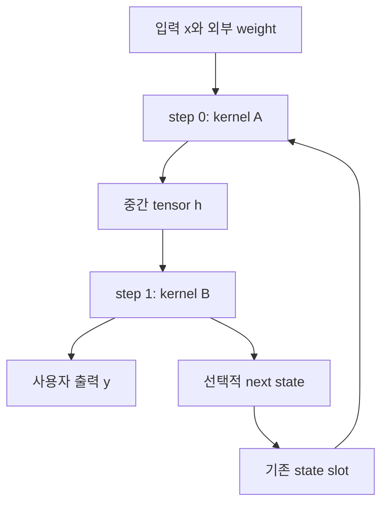

# 11. FuryNo5의 ATen → TCL → EDF → 실행 계획을 따라가기

**FuryNo5는 모델의 계산 의미와 입출력 연결을 결정하고, 실제 RNGD 코드 생성은 공식 compiler에 맡긴다.** 이 장은 `export_model` 호출 한 번이 어떤 파일을 거쳐 산출물을 만드는지 설명한다. 아래 경로는 commit `bba9efea8201aec48150514a35d0b637d29d107e`의 실제 코드 기준이다. 앞 장의 제한된 `optimize` custom op 경로와 구분한다.

## 1. 캡처: Python 모델을 추론 그래프로 고정한다

출발점은 `tclmachine.export_model`이고 실질 구현은 `tplmachine/execution_plan.py`다. 먼저 `graph_capture.capture_for_export`가 `torch.no_grad()` 아래에서 `torch.export.export(..., strict=False)`를 호출한다. 이미 `ExportedProgram`이면 다시 모델을 실행해 캡처하지 않고 정규화로 간다. [capture_for_export](https://github.com/smallstep-zzz/FuryNo5/blob/bba9efea8201aec48150514a35d0b637d29d107e/tplmachine/graph_capture.py#L188-L195)

```python
# graph_capture.py의 핵심 발췌
with torch.no_grad():
    exported = torch.export.export(model, tuple(inputs), strict=False)
return normalize_exported(exported, preserve_layer_norm=preserve_layer_norm)
```

`strict=False`를 “어떤 Python 코드도 반드시 캡처한다”로 해석하면 안 된다. 그래프에 나타나는 데이터 의존 제어 흐름, 상태 변경, alias, 입력 계약의 한계는 여전히 검토해야 한다. FuryNo5의 정규화는 eval dropout, 알려진 guard, 필요한 public decomposition 등을 좁게 처리한다. 모든 연산을 무조건 가장 작은 primitive로 풀지는 않는다. [정규화 코드](https://github.com/smallstep-zzz/FuryNo5/blob/bba9efea8201aec48150514a35d0b637d29d107e/tplmachine/graph_capture.py#L83-L127)

여기서 **decomposition(분해)**은 복합 연산을 더 기본적인 연산으로 표현하는 것이다. 수학적으로 같아 보여도 중간 dtype, 반올림 위치, mask 처리, alias 의미가 달라질 수 있다. `build_verified_model`은 최종 계획용 그래프를 원본 CPU 결과와 비교하는 검사를 추가한다. 일반 `export_model` 호출만으로 그 수치 검사가 완료된 것은 아니다. [검증 producer](https://github.com/smallstep-zzz/FuryNo5/blob/bba9efea8201aec48150514a35d0b637d29d107e/tplmachine/verified_build.py)

## 2. 바인딩과 사전검사: 값이 무엇인지 먼저 확정한다

`bind_exported`는 평평한 tensor tuple인 사용자 입력과, export에서 분리된 parameter·buffer를 연결한다. 비영속 buffer는 `exported.constants`에서 읽지만, 임의의 상수나 Python 상태를 모두 바인딩하는 것은 아니다. 그 밖의 입력 종류는 별도 binder가 필요하다는 오류를 낸다. 이 경로의 tensor는 CPU에 있고 contiguous하며 양의 정적 차원을 가져야 한다. shape가 같아도 인수 순서나 stride가 다르면 같은 ABI(Application Binary Interface)가 아니다. 정적 상태를 사용하는 모델은 실행계획의 `state_inputs`와 `state_updates`로 명시하며, 일반 사용자 입력과 구분한다. [바인딩 구현](https://github.com/smallstep-zzz/FuryNo5/blob/bba9efea8201aec48150514a35d0b637d29d107e/tplmachine/edf_export.py#L33-L109) · [계획 옵션](https://github.com/smallstep-zzz/FuryNo5/blob/bba9efea8201aec48150514a35d0b637d29d107e/tplmachine/execution_plan.py#L355-L408)

다음 호출은 컴파일 전에 규칙·바인딩 차단을 찾아내는 데 쓴다.

```python
# model은 eval 상태이며 모든 parameter가 frozen이어야 한다.
from tclmachine import export_model

report = export_model(
    model, example_inputs, "preflight-only.fxbx",
    preflight_only=True,
)
print(report["status"])       # 통과하면 admitted_not_compiled
print(report["compilation"])  # not_run
print(report["npu_execution"])  # not_run
```

preflight 중 SDK를 이용한 실제 NPU 실행은 요청하지 않는다. 그러나 설치된 producer와 matching fxbX package는 필요할 수 있다. 규칙에 막히면 `EXECUTION_RULE_GAP`을 던지고, `.plan/preflight.json`, `failure-groups.json`, `operator-inventory.json`에 이유를 남긴다. **앞선 값이 없어 후속 node를 연결하지 못한 오류와 실제 규칙 부재를 따로 기록**하므로 미해결 node 수가 모두 독립 커널 개발 과제는 아니다. [진단 생성부](https://github.com/smallstep-zzz/FuryNo5/blob/bba9efea8201aec48150514a35d0b637d29d107e/tplmachine/execution_plan.py#L1140-L1193)

## 3. 의미 계열을 선택한다

`compiler_registry.py`는 모델 이름 대신 의미 계열을 컴파일 함수에 연결한다. 실제 등록의 일부는 다음과 같다.

```python
# compiler_registry.py에서 발췌
SEMANTIC_COMPILERS = {
    'pointwise': ('pointwise_rules', 'compile_pointwise'),
    'reduction': ('reduction_rules', 'compile_reduction'),
    'softmax': ('softmax_rules', 'compile_softmax'),
    'batched_matmul': ('batched_matmul', 'compile_batched_matmul'),
    # 나머지 계열은 원본 파일 참조
}
```

공통 함수 계약은 `compile_*(specs, attrs, *, artifact_root) -> EDF contract`다. `specs`에는 shape·dtype·stride, `attrs`에는 축·상수 인수 등 연산 속성이 들어간다. 예를 들어 reduction은 축 목록과 `keepdim`을 검사하고, pointwise는 broadcasting과 dtype 계약을 확인한다. 모델 ID나 Python class 이름을 여기의 분기 기준으로 쓰지 않는다. [등록표](https://github.com/smallstep-zzz/FuryNo5/blob/bba9efea8201aec48150514a35d0b637d29d107e/tplmachine/compiler_registry.py) · [축약 규칙](https://github.com/smallstep-zzz/FuryNo5/blob/bba9efea8201aec48150514a35d0b637d29d107e/tplmachine/reduction_rules.py)

파일 이름이나 docstring만 보고 정밀도를 단정하지 않는 것도 중요하다. 예를 들어 현재 reduction 생성기는 `mean`의 중간 결과를 FP32로 두고, `sum`에서는 요청한 출력 dtype을 생성 코드에 반영한다. “모든 reduction이 무조건 FP32 누산”처럼 한 문장으로 뭉개지 말고, 실제 emitted TCL과 컴파일 결과의 dtype 경계를 확인해야 한다.

## 4. TCL을 생성한다: 축의 이름이 계산 의미를 보존한다

먼저 **compiler 진입점에 분기가 있다**. `edf_export.export_edf()`는 설치 환경에 `furiosa.native_common.compiler.compile`이 있으면 `target_ir='edf'`로 호출한다. 해당 import를 사용할 수 없을 때만 `tcl_edf.export_single_aten()`으로 간다. SDK compiler가 실패했다고 CPU로 넘어가거나 모든 실패를 TCL로 재시도하는 코드는 아니다. native 경로도 정확히 한 개의 `CompiledGraph`와 `is_edf() == True`를 요구한다. 아래 설명은 Python TCL 및 생성된 TCL 텍스트를 사용하는 경로이며, 모든 단일 EDF가 반드시 이 경로로 만들어진다는 뜻은 아니다. [실제 compiler 선택](https://github.com/smallstep-zzz/FuryNo5/blob/bba9efea8201aec48150514a35d0b637d29d107e/tplmachine/edf_export.py#L171-L215)

단일 수축 경로는 `tcl_edf.export_single_aten`에서 적절한 Python TCL kernel과 구체적인 축 크기를 선택한다. `M`, `N`, `K`는 단순 변수 이름이 아니라 어느 차원을 유지하고 축약하는지 설명하는 축이다. Linear weight가 `[N,K]`인지 일반 mm의 오른쪽 입력이 `[K,N]`인지가 출력 ABI에 영향을 준다.

```python
# tcl_edf.py의 실제 specialization 부분
specialized = tcl.specialize_kernel(kernel, dimensions)
source = (
    specialized if isinstance(specialized, tcl.Kernel)
    else tcl.Kernel.from_edsl(specialized)
).dsl
```

이후 `compile_source(source, base_contract, ...)`로 보낸다. 따라서 “TCL은 Python이니 compiler에 .py를 그대로 던진다”가 아니라, **Python eDSL(embedded Domain-Specific Language) 표현을 구체화하고 TCL 표현을 얻는 경로**가 존재한다. 다른 의미 계열은 검증된 메타데이터에서 TCL 텍스트를 직접 생성하기도 한다. 둘 모두 최종 compiler와 EDF 계약 검사를 공유한다. [단일 EDF 경로](https://github.com/smallstep-zzz/FuryNo5/blob/bba9efea8201aec48150514a35d0b637d29d107e/tplmachine/tcl_edf.py#L113-L120)

여러 연산을 합치는 `tcl_region.emit_region`은 제한된 SSA(Static Single Assignment) 형태를 사용한다. 각 결과는 고유 이름으로 한 번 정의되고, 사용하기 전에 입력이나 선행 결과로 존재해야 한다. 이 생성기의 현재 허용 범위는 BF16의 mm/bmm/linear/add/ReLU, 최대 8개 연산과 입출력 합 16개, 생성 tensor 크기 합 64 MiB다. 이 64 MiB는 **논리적인 admission 제한**이며 물리 HBM(High Bandwidth Memory) 점유 측정치가 아니다. [영역 생성기](https://github.com/smallstep-zzz/FuryNo5/blob/bba9efea8201aec48150514a35d0b637d29d107e/tplmachine/tcl_region.py#L35-L107)

## 5. compiler 호출: 진짜 EDF를 만든다

`compile_source`는 `furiosa-tcc --version`과 Torch·SDK(Software Development Kit) package 버전을 기록한다. 현재 producer의 기본 target은 `renegade-8pe`이고, 공식 compiler cache는 끈 채 FuryNo5 자신의 검증된 산출물 cache를 관리한다. `--no-compiler-cache`가 곧 “재사용 없음”을 뜻하지는 않는다. [compile_source](https://github.com/smallstep-zzz/FuryNo5/blob/bba9efea8201aec48150514a35d0b637d29d107e/tplmachine/tcl_compiler.py#L158-L234)

실제 subprocess의 명령 구성은 다음과 같다.

```python
# compile_job.py에서 발췌
command = [
    'furiosa-tcc', *flags,
    '--output', str(attempt / 'model.edf'),
    str(attempt / 'source.tc'),
]
```

동일 경로를 터미널에서 읽으면 다음 형태다. **이미 생성·검토한 source.tc를 대상으로 하는 명령**이며 Python eDSL 원본 파일을 대입하지 않는다.

```bash
furiosa-tcc --target-npu renegade-8pe --no-compiler-cache \
  --output model.edf source.tc
```

실제 작업은 `source.tc`, `compile.log`, `result.json`을 보존한다. 현재 소스의 기본 compiler timeout은 무제한이며 `FURYNO5_COMPILE_TIMEOUT_S`에 양의 초를 주면 제한한다. 예전 문서의 고정 timeout 값을 현재 동작으로 옮기지 않는다. timeout, signal 종료, 환경 오류, 결정적인 compiler 거절은 서로 다른 결과다. [컴파일 작업 관리](https://github.com/smallstep-zzz/FuryNo5/blob/bba9efea8201aec48150514a35d0b637d29d107e/tplmachine/compile_job.py#L39-L106)

## 6. EDF가 생긴 뒤에도 ABI를 검사한다

`tcl_compiler._verify_abi`는 공식 `sdk.ir.Runnable.from_serialized_edf`로 EDF bytes를 읽는다. 실제 입출력 개수와 `expected_num_fusion == 8`을 검사하고 shape 표현을 기록한다.

```python
# tcl_compiler.py에서 발췌
edf_loader = sdk.ir.Runnable.from_serialized_edf
runnable = edf_loader(raw)
```

이 단계의 기본 계약은 `arity_verified=True`, `logical_to_physical_metadata="unknown"`이다. 별도의 명시적 ABI reader가 모든 metadata를 확인한 경우에만 그 부분을 verified로 올린다. 즉 기본 코드가 입출력 개수를 확인했다고 해서 논리 stride와 물리 메모리 배치의 모든 관계까지 증명했다는 뜻은 아니다. 또한 이 로더 검사만으로 NPU 실행·수치 검증이 된 것은 아니다. [ABI 검증](https://github.com/smallstep-zzz/FuryNo5/blob/bba9efea8201aec48150514a35d0b637d29d107e/tplmachine/tcl_compiler.py#L112-L136)

## 7. 두 종류의 cache가 재컴파일을 줄인다

| cache | 키에 포함되는 핵심 정보 | 아끼는 작업 | 검증 |
|---|---|---|---|
| typed kernel index | 의미 계열·specs·속성·영향받는 source·SDK/compiler | 동일한 의미 계약의 생성/컴파일 | scope 비교와 EDF SHA-256 |
| exact TCL source index | 정확한 source·base contract·compiler 문맥·mesh | 서로 다른 상위 경로가 만든 같은 TCL의 재컴파일 | source 계약·크기·해시·공식 loader ABI |

`compiler_sources(kind)`는 특정 계열의 코드 생성에 영향을 주는 파일만 지문에 포함한다. 관계없는 문서나 다른 규칙을 고쳤다고 모든 EDF를 다시 만들 필요가 없도록 하기 위함이다. 반대로 공통 helper 변경을 목록에서 빼먹으면 오래된 EDF를 잘못 재사용할 수 있다. **cache hit는 성능 최적화이면서 정확성 계약**이다. [typed cache](https://github.com/smallstep-zzz/FuryNo5/blob/bba9efea8201aec48150514a35d0b637d29d107e/tplmachine/execution_plan.py#L76-L143) · [source 의존성](https://github.com/smallstep-zzz/FuryNo5/blob/bba9efea8201aec48150514a35d0b637d29d107e/tplmachine/compiler_registry.py#L30-L52)

손상된 index나 사라진 산출물은 원래 recipe로 복구할 수 있다. 하지만 기존 EDF bytes의 checksum이 달라졌다면 정상 cache miss처럼 묵살하지 않는다. 검증된 정확한 compiler 거절만 별도 저장하며, 단순 timeout이나 환경 오류를 영구 미지원으로 바꾸지 않는다. [cache 구현](https://github.com/smallstep-zzz/FuryNo5/blob/bba9efea8201aec48150514a35d0b637d29d107e/tplmachine/tcl_compiler.py#L48-L109) · [거절 분류](https://github.com/smallstep-zzz/FuryNo5/blob/bba9efea8201aec48150514a35d0b637d29d107e/tplmachine/compile_job.py#L68-L96)

## 8. 실행 계획: EDF에 tensor의 연결을 더한다



EDF 목록만으로는 어느 커널의 어느 출력이 다음 입력인지, 가중치가 어디서 오는지 알 수 없다. 계획은 `tensors`, `kernels`, `entries`를 결합한다. `entries["forward"]`에는 입력, 순서 있는 steps, 출력, 상태 갱신이 들어간다. 각 step은 kernel key와 tensor ID로 입출력을 연결한다. [계획 조립부](https://github.com/smallstep-zzz/FuryNo5/blob/bba9efea8201aec48150514a35d0b637d29d107e/tplmachine/execution_plan.py#L1227-L1283)

아래 코드는 **실제 산출물을 읽는 예제**다. 손으로 가짜 manifest를 만들어 실행하기보다 producer가 만든 계획을 먼저 확인한다.

```python
import json
from pathlib import Path

plan = json.loads(
    Path("tiny.fxbx.plan/execution-plan.json").read_text()
)
entry = plan["entries"]["forward"]
for index, step in enumerate(entry["steps"]):
    key = step["kernel"]
    kernel = plan["kernels"][key]
    print(index, key, step["inputs"], "->", step["outputs"])
    print("EDF:", kernel["edf_sha256"])
print("state updates:", entry["state_updates"])
```

같은 EDF를 여러 step이 재사용할 수 있으므로 고유 EDF 개수와 실행 호출 횟수는 다르다. 정적 값 준비와 NPU compute도 `execution_kind`로 구분한다. 이름 있는 여러 entry를 묶는 `execution_program.py`는 공유 weight와 state 계약을 확인한다. 이 계약이 있다는 이유만으로 동적 KV(Key/Value) paging 또는 외부 serving engine의 buffer ABI와 호환된다고 보장하지 않는다. [다중 entry 생산자](https://github.com/smallstep-zzz/FuryNo5/blob/bba9efea8201aec48150514a35d0b637d29d107e/tplmachine/execution_program.py)

## 9. 최적화가 들어가는 자리와 실패 시 처리

FuryNo5는 의미가 맞는 작은 닫힌 영역을 결합하고, 명시적 layout 경계를 생성하며, 반복 shape의 EDF를 재사용한다. compiler는 그 결과를 받아 물리 타일링과 schedule을 결정한다. producer의 영역 분할과 compiler의 장치 타일링은 같은 최적화가 아니다. [영역 검증 문서](https://github.com/smallstep-zzz/FuryNo5/blob/bba9efea8201aec48150514a35d0b637d29d107e/docs/NATIVE_REGION_VALIDATION.md)

선택적 fusion의 컴파일이나 ABI 확인이 실패하면 기존 개별 **NPU** 계획으로 돌아가는 경로가 있다. 이것은 CPU fallback이 아니다. 개별 커널도 실패하면 오류가 유지된다. 일부 결정적 실패에는 bounded split retry가 있지만, 임의의 미지원 연산을 항상 해결하는 만능 분할기는 아니다. [fusion 실패 처리](https://github.com/smallstep-zzz/FuryNo5/blob/bba9efea8201aec48150514a35d0b637d29d107e/tplmachine/execution_plan.py#L1211-L1226) · [분할 재시도](https://github.com/smallstep-zzz/FuryNo5/blob/bba9efea8201aec48150514a35d0b637d29d107e/tplmachine/execution_plan.py#L331-L353)

| 판단 | 증거 파일 | 다음 행동 |
|---|---|---|
| 규칙이 막힘 | preflight·operator inventory | 의미 계열/바인딩 수정 |
| compile이 오래 걸림 | compile-status·attempt result·log | 정확한 recipe 하나 재현 |
| EDF를 다시 만들고 있음 | compile scope·source-cache key | 환경/소스/계약 변화 확인 |
| 파일은 만들어졌음 | result: built_not_runtime_validated | 독립 replay·수치·trace 확인 |
| NPU는 실행되지만 느림 | stage trace·warm wall time | 07장 순서로 병목 최적화 |

`built_not_runtime_validated`에서 `verified`까지의 거리를 줄이는 것이 다음 개발의 중요한 목표다. 생성 코드의 양보다 **재현 가능한 계약, 올바른 캐시, 실행 경계의 관측 가능성**이 범용 포팅을 지속 가능하게 만든다.

## 컴파일러의 공통 원리와 새로운 최적화 후보

이 장은 FuryNo5의 구체적인 호출 파일과 캐시를 추적한다. 그 안에서 최종 장치 컴파일러가 해결해야 하는 형상·자료형 검사, lowering, 메모리·스케줄·코드 생성은 [03장](03-driver-runtime.md)에 정리했다. EDF 바이너리의 역직렬화와 장치 적재는 [04장](04-tcl-edf.md), 공개 opt의 compiler image·인수 바인딩은 [08장](08-eisa-visa.md)과 구분해 읽는다.

상위 모델을 미리 변환하거나 고수준 연산의 의미를 유지해 새로운 lowering 후보를 만드는 연구는 [19장](19-model-optimization.md)에 이어진다. 그 후보의 성공을 기존 cache와 섞지 않으려면 변환 규칙·모델 revision·shape·dtype·품질 조건을 캐시 식별에 함께 반영해야 한다.

## 출처

| 자료 | 확인 범위 |
|---|---|
| [graph_capture.py](https://github.com/smallstep-zzz/FuryNo5/blob/bba9efea8201aec48150514a35d0b637d29d107e/tplmachine/graph_capture.py) | 추론 캡처·의미 정규화 |
| [edf_export.py](https://github.com/smallstep-zzz/FuryNo5/blob/bba9efea8201aec48150514a35d0b637d29d107e/tplmachine/edf_export.py) | 입력 바인딩 한계·native compiler/TCL 분기 |
| [tcl_edf.py](https://github.com/smallstep-zzz/FuryNo5/blob/bba9efea8201aec48150514a35d0b637d29d107e/tplmachine/tcl_edf.py) | Python TCL specialization |
| [tcl_region.py](https://github.com/smallstep-zzz/FuryNo5/blob/bba9efea8201aec48150514a35d0b637d29d107e/tplmachine/tcl_region.py) | 작은 SSA 영역 생성·정밀도 경계 |
| [tcl_compiler.py](https://github.com/smallstep-zzz/FuryNo5/blob/bba9efea8201aec48150514a35d0b637d29d107e/tplmachine/tcl_compiler.py) | 정확한 source cache·loader ABI |
| [compile_job.py](https://github.com/smallstep-zzz/FuryNo5/blob/bba9efea8201aec48150514a35d0b637d29d107e/tplmachine/compile_job.py) | subprocess 명령·실패 증거 |
| [execution_plan.py](https://github.com/smallstep-zzz/FuryNo5/blob/bba9efea8201aec48150514a35d0b637d29d107e/tplmachine/execution_plan.py) | 영역·병렬 compiler·실행 계획·fallback 구분 |
| [컴파일 품질 관리](https://github.com/smallstep-zzz/FuryNo5/blob/bba9efea8201aec48150514a35d0b637d29d107e/docs/COMPILE_QUALITY.md) | 실제 수치 검증과 실패 재현 정책 |

소스 링크는 열람 권한이 필요할 수 있다. 물리 메모리 배치·전체 모델 수치·실기기 성능은 별도 검증 범위다.

