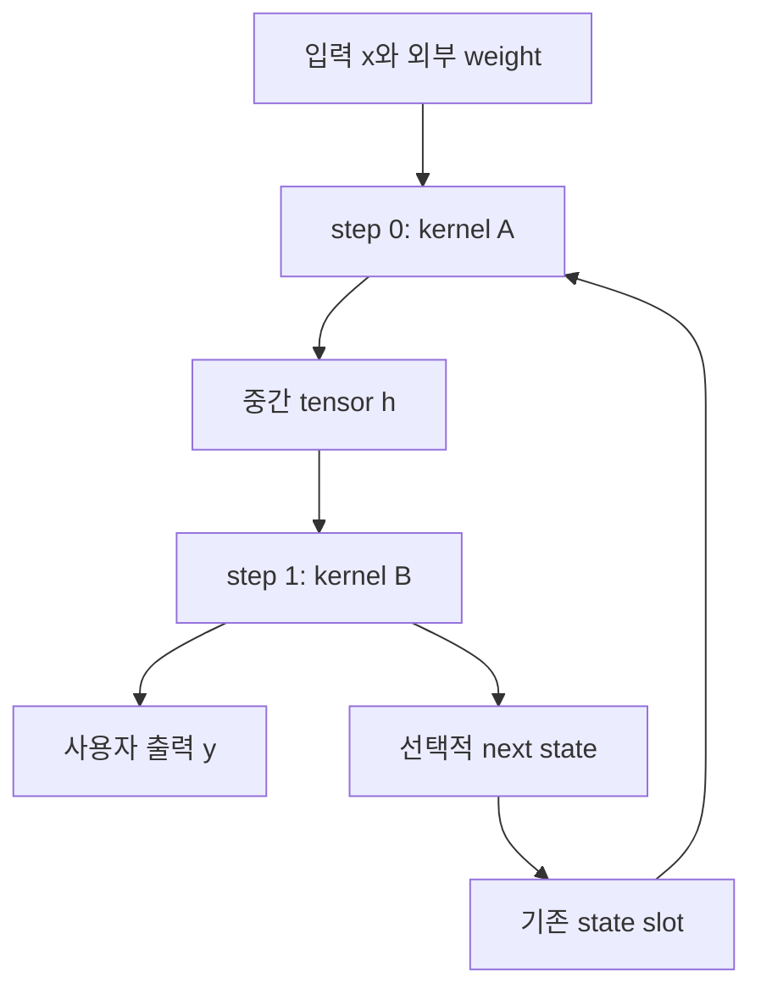

# 11. 모델이 TCL·EDF·실행계획으로 바뀌는 과정

> **전체 경로에서의 위치**
>
> 모델에서 계산의 연결을 얻고, 장치 프로그램과 실행에 필요한 설명을 만드는 단계다. 만들어진 묶음을 읽어 실행하는 과정은 [12장](12-fxbx.md)으로 이어진다.

이 장에서는 **하나의 입력이 각 단계에서 어떤 객체나 파일이 되는지** 따라간다. 일반적인 C 빌드가 소스·object file·실행 파일을 구분하듯, FuryNo5의 준비 과정도 Python 모델, 연산 graph, TCL 소스, EDF, 실행계획을 구분해야 한다. 하나가 만들어졌다고 다음 단계까지 성공한 것은 아니다.

예제는 `Linear(8,12) → ReLU → Linear(12,8)`이다. 입력 `x`는 shape `[4,8]`, 첫 Linear 결과 `h`와 ReLU 결과 `a`는 `[4,12]`, 최종 출력 `y`는 `[4,8]`이다. shape는 축별 길이, BF16(BFloat16)은 이 예제 원소의 자료형이다. Linear는 `입력 @ weight.T + bias`, ReLU(Rectified Linear Unit)는 음수를 0으로 바꾸는 연산이다. weight·bias는 모델이 가진 parameter이며 실행 시 입력과 함께 필요하다.

수식을 먼저 풀어 보자. 행렬곱의 한 원소는 왼쪽의 한 행과 오른쪽의 한 열을 짝지어 곱하고 더한 값이다. `[4,8] @ [8,12]`에서 8개 곱을 합쳐 출력 원소 하나를 만들고, 그 원소들을 4행·12열에 배치한다. 첫 Linear의 `weight`는 `[12,8]`이므로 행과 열을 맞바꾸는 **전치** `.T`를 적용해 `[8,12]`로 읽는다. `bias[12]`는 각 출력 행에 같은 값들을 더하는 **broadcasting**으로 적용된다. 따라서 첫 출력 `h[0,0]`에는 `x`의 0번 행과 `weight`의 0번 행에서 얻은 8개 곱의 합, 그리고 `bias[0]`가 들어간다. 단순히 원소열을 다른 크기로 읽는 `reshape`로 이 전치를 대체하면 원소 대응이 달라진다. [Linear의 공식 계산 계약](https://docs.pytorch.org/docs/2.10/generated/torch.nn.Linear.html)

FuryNo5의 `export_model`은 이런 계산을 분석하는 생산자다. 여기서 export는 메모리의 모델을 다음 단계가 읽을 객체·파일로 내보내는 작업을 뜻한다. TCL(Tensor Contraction Language)은 계산 의미를 compiler에 전달하는 텐서 언어, EDF(Executable Device Format)는 RNGD에서 실행할 컴파일 결과다. **실행계획**은 어느 EDF에 어떤 입력·가중치·중간값을 넘길지 적은 자료구조다. 최종 패키지는 이 파일들을 실행 소비자인 fxbX에 전달한다. [계획 생산자](https://github.com/smallstep-zzz/FuryNo5/blob/bba9efea8201aec48150514a35d0b637d29d107e/tplmachine/execution_plan.py)

| 단계 | 앞 단계에서 받는 것 | 새로 만드는 것 | 이 단계만으로 알 수 없는 것 |
|---|---|---|---|
| 캡처·정규화 | 모델·예제 입력 | 계산 관계를 담은 graph | NPU 지원 여부 |
| 바인딩·사전검사 | graph·tensor 정보 | 순서 있는 값 연결과 컴파일 요청 | compiler 성공 |
| 컴파일 | TCL 또는 SDK(Software Development Kit) compiler 입력 | EDF bytes·진단 | 실제 출력 정확도 |
| 계약 검사·계획 조립 | EDF·값 연결 | 실행계획과 패키지 | 장치에서의 실제 지연 |
| 별도 소비자 검증 | 패키지·weight·새 입력 | 출력·실행 기록 | 검증하지 않은 다른 shape의 지원 |

> **구현 기준** · FuryNo5 commit `bba9efea8201aec48150514a35d0b637d29d107e`. 아래 설명은 이 버전의 소스와 호출 계약을 기준으로 한다. 이름과 shape를 보여주는 설명 표는 실제 산출물의 모든 필드를 복제한 manifest(패키지의 파일·버전·계약 설명서)가 아니다.

## 1. 캡처: Python 모델을 추론 그래프로 고정한다

모델이 `덧셈 → ReLU` 순서로 계산한다면, 준비 단계는 덧셈 결과가 ReLU로 전달된다는 관계를 얻어야 한다. Python 코드를 분석해 이런 계산 연결을 자료구조로 만드는 일이 **캡처(capture)다**.

PyTorch의 FX graph가 계산의 점과 연결을 담고, `ExportedProgram`은 여기에 입력·출력 조건과 가중치 연결 등도 함께 담는다. 지금 한 번 나온 숫자 답을 저장하는 일과는 다르다.

FuryNo5의 `tclmachine.export_model`이 이 준비를 시작한다. 실제 소스의 `capture_for_export`는 `torch.export.export(..., strict=False)`를 호출한 뒤 다음 단계가 사용할 형태로 정리한다. [capture_for_export](https://github.com/smallstep-zzz/FuryNo5/blob/bba9efea8201aec48150514a35d0b637d29d107e/tplmachine/graph_capture.py#L188-L195)

아래는 `capture_for_export` **함수 몸체에 설명 주석을 추가한 발췌**다. `model`은 호출자가 준 module, `inputs`는 예제 tensor 목록, `normalize_exported`는 같은 파일에 정의된 정규화 함수다. 완성된 독립 스크립트가 아니므로 이 발췌만 실행하지 않는다.

```python
# graph_capture.py 함수 내부: 주변 함수 정의와 기존 ExportedProgram 분기는 생략했다.
with torch.no_grad():  # 캡처할 때 미분 그래프 기록을 요구하지 않는다.
    exported = torch.export.export(
        model, tuple(inputs), strict=False,  # module과 순서 있는 예제 인수로 그래프를 만든다.
    )
# 정규화한 ExportedProgram을 반환한다. preserve_layer_norm은 해당 연산 보존 정책이다.
return normalize_exported(exported, preserve_layer_norm=preserve_layer_norm)
```

정규화(normalization)는 같은 의미를 가진 표현을 뒤 단계가 다루기 쉬운 형태로 맞추는 과정이다. 예제의 weight는 graph 바깥의 숨은 Python 객체로만 두지 않고 연결 가능한 입력으로 구분하고, 연산 간의 `h → a → y` 의존 관계를 보존해야 한다. node 이름은 compiler가 붙일 수 있으므로 이름 문자열 자체보다 그 node의 입력과 계산 의미를 읽는다.

`strict=False`를 “어떤 Python 코드도 반드시 캡처한다”로 해석하면 안 된다. 그래프에 나타나는 데이터 의존 제어 흐름, 상태 변경, alias(서로 다른 tensor가 같은 저장소를 공유하는 관계), 입력 계약의 한계는 여전히 검토해야 한다. FuryNo5의 정규화는 평가 모드에서 계산이 필요 없는 dropout, 확인 가능한 조건 검사인 guard, 필요한 공개 decomposition 등을 좁게 처리한다. 모든 연산을 무조건 가장 작은 primitive로 풀지는 않는다. [정규화 코드](https://github.com/smallstep-zzz/FuryNo5/blob/bba9efea8201aec48150514a35d0b637d29d107e/tplmachine/graph_capture.py#L83-L127)

여기서 **decomposition(분해)은** 복합 연산을 더 기본적인 연산으로 표현하는 것이다. 수학적으로 같아 보여도 중간 dtype, 반올림 위치, mask(계산에 참여할 위치를 정하는 값) 처리, alias 의미가 달라질 수 있다. `build_verified_model`은 최종 계획용 그래프를 원본 CPU 결과와 비교하는 검사를 추가한다. 일반 `export_model` 호출만으로 그 수치 검사가 완료된 것은 아니다. [검증 producer](https://github.com/smallstep-zzz/FuryNo5/blob/bba9efea8201aec48150514a35d0b637d29d107e/tplmachine/verified_build.py)

## 2. 바인딩과 사전검사: 값이 무엇인지 먼저 확정한다

함수 `multiply(x, weight)`를 호출하려면 첫 자리에 이번 입력을, 둘째 자리에 곱할 가중치를 넣어야 한다. 그래프에도 같은 연결이 필요하다. 어느 인수 자리에 어느 값을 넣을지 정하는 일이 **바인딩(binding)이다**.

크기가 같아도 사용자 입력과 모델 가중치는 역할이 다르다. 아래 표는 이 모델의 값이 어디서 오는지 나눈다. 입력 하나를 담은 tuple은 `(x,)`로 만든다. `tuple(x)`는 배열의 행들을 여러 인수로 나눌 수 있어 같은 뜻이 아니다.

| 값 | 공급 경로 | 현재 예제의 검사 정보 |
|---|---|---|
| `x` | 사용자 입력 tuple | BF16, CPU, shape `[4,8]`, contiguous stride `[8,1]` |
| 첫 weight | `state_dict`의 `0.weight` | shape `[12,8]`, dtype·stride·이름 연결 |
| 첫 bias | `0.bias` | shape `[12]`, 해당 Linear의 bias |
| `h`, `a` | 앞선 연산의 결과 | 후속 연산 전에 만들어질 값 |
| `y` | 모델 반환 | graph 출력과 실행계획 출력의 일치 |

stride는 축별로 다음 원소까지 건너뛰는 저장소 원소 수다. contiguous는 정해진 축 순서로 빈틈없이 저장된 상태다. 예제 입력의 논리 데이터 크기는 `4 × 8 × 2 = 64 bytes`지만 이것이 장치 할당 크기까지 64 bytes라는 뜻은 아니다. 물리 배치·정렬은 컴파일 결과의 계약으로 확인해야 한다.

모델에는 사용자 입력, 가중치, 실행 사이에 보관할 배열이 함께 있을 수 있다. 학습으로 조정하는 parameter와 별도로 모델에 등록한 배열을 **buffer**라고 부른다. 입력 목록을 연결할 때 이 역할을 구분해야 한다.

`bind_exported`는 사용자 입력 tuple과 export에서 분리된 parameter·buffer를 연결한다. 비영속 buffer는 `exported.constants`에서 읽는다. 임의의 Python 상태를 모두 자동 연결하는 것은 아니며, 지원하지 않는 입력 종류는 별도 처리가 필요하다는 오류를 낸다.

이 경로의 tensor는 CPU에 있고 연속으로 저장되어야 하며, 길이가 양의 정적 값이어야 한다. ‘같은 shape’만으로 통과하는 것이 아니라 저장 순서와 인수 순서도 맞춰야 한다. 상태를 쓰는 모델은 실행계획의 `state_inputs`·`state_updates`로 이전 값과 다음 값을 명시한다. [바인딩 구현](https://github.com/smallstep-zzz/FuryNo5/blob/bba9efea8201aec48150514a35d0b637d29d107e/tplmachine/edf_export.py#L33-L109) · [계획 옵션](https://github.com/smallstep-zzz/FuryNo5/blob/bba9efea8201aec48150514a35d0b637d29d107e/tplmachine/execution_plan.py#L355-L408)

다음은 **preflight(사전검사)** 호출이다. 컴파일할 입력을 받아 의미 규칙과 바인딩이 갖추어졌는지 먼저 점검한다. 새 작업 디렉터리에서 실행하는 예이며 호환되는 FuryNo5·fxbX 설치가 필요하다. 성공하더라도 반환값은 수치 출력이 아니라 진단 보고서다.

```python
import torch
from tclmachine import export_model

model = torch.nn.Sequential(
    torch.nn.Linear(8, 12),  # [4,8] → [4,12]; 전치한 weight와 곱하고 bias를 더한다.
    torch.nn.ReLU(),        # 음수를 0으로 바꾸며 [4,12] 유지
    torch.nn.Linear(12, 8), # [4,12] → [4,8]
).bfloat16().eval().requires_grad_(False)  # BF16 가중치로 바꾸고 추론용으로 고정한다.
x = torch.randn(4, 8, dtype=torch.bfloat16)  # CPU·연속 배열·동일 dtype의 대표 입력
report = export_model(
    model, (x,), "preflight-only.fxbx",  # 입력은 tensor 한 개, 경로는 새 이름을 쓴다.
    preflight_only=True,  # 지원 규칙·값 연결을 진단하며 컴파일은 진행하지 않는다.
)
print(report["status"])         # 통과하면 admitted_not_compiled: 아직 컴파일하지 않음
print(report["compilation"])    # not_run
print(report["npu_execution"])  # not_run: 장치 수치 결과가 없음을 명시
```

preflight 중 SDK를 이용한 실제 NPU 실행은 요청하지 않는다. 그러나 설치된 producer와 matching fxbX package는 필요할 수 있다. 규칙에 막히면 `EXECUTION_RULE_GAP`을 던지고, `.plan/preflight.json`, `failure-groups.json`, `operator-inventory.json`에 이유를 남긴다. **앞선 값이 없어 후속 node를 연결하지 못한 오류와 실제 규칙 부재를 따로 기록**한다. 예를 들어 `h` 생성이 막혔다면 ReLU와 마지막 Linear도 값을 받을 수 없지만, 이것이 세 종류의 미지원 연산을 새로 발견했다는 뜻은 아니다. 따라서 미해결 node 수가 모두 독립 커널 개발 과제는 아니다. [진단 생성부](https://github.com/smallstep-zzz/FuryNo5/blob/bba9efea8201aec48150514a35d0b637d29d107e/tplmachine/execution_plan.py#L1140-L1193)

### 예외가 나서 report를 받지 못했을 때

`report = export_model(...)`의 오른쪽에서 예외가 나면 `report`를 새로 배정하는 줄까지 도달하지 않는다. 따라서 `print(report["status"])`를 이어서 시도하지 말고, 예외의 `details=...` 경로나 출력 이름에서 작업 디렉터리를 찾는다. 위 이름이면 `preflight-only.fxbx.plan/`이다. 패키지 본체가 없어도 이 디렉터리에 실패까지의 진단은 남을 수 있다. 캡처나 환경 확인에서 더 일찍 실패하면 세 JSON이 모두 존재하지 않을 수도 있다.

| 파일 | 먼저 읽을 필드 | 답하려는 질문 |
|---|---|---|
| `preflight.json` | `status`, `code`, `first_failures` | 어느 단계에서 멈췄으며 처음 관찰한 실패는 무엇인가? |
| `failure-groups.json` | 각 항목의 `category`, `op`, `reason`, `occurrences` | 같은 연산·이유의 실패가 몇 번 반복되며, 원인 후보인가 후속 연결 실패인가? |
| `operator-inventory.json` | `nodes`의 `node`, `operator`, `admission`, `admission_reason`, `inputs` | 해당 node가 어떤 입력 계약으로 검사되었는가? |

[read_preflight.py](../examples/read_preflight.py)는 기존 진단 파일을 읽는 완성된 표준 Python 예제다. 컴파일이나 NPU 실행을 다시 요청하지 않는다. `python read_preflight.py preflight-only.fxbx.plan`처럼 실행한다.

```python
import argparse
import json
from pathlib import Path

def read_optional(path):
    if not path.is_file():
        return None  # 파일 없음은 성공 판정이 아니다. 더 이른 실패일 수 있다.
    return json.loads(path.read_text(encoding="utf-8"))

def main():
    parser = argparse.ArgumentParser()
    parser.add_argument("work", type=Path)  # 실패 메시지 또는 출력 이름에서 찾은 .plan 경로
    work = parser.parse_args().work
    summary = read_optional(work / "preflight.json")
    groups = read_optional(work / "failure-groups.json")
    inventory = read_optional(work / "operator-inventory.json")

    if summary is None:
        print("preflight.json 없음: 원래 예외와 캡처·환경 단계를 먼저 확인하세요.")
    else:
        print("STATUS", summary.get("status"), "CODE", summary.get("code"))
        for row in summary.get("first_failures", []):
            print("FIRST", row["node"], row["op"], row["category"], row["reason"])

    if groups is None:
        print("failure-groups.json 없음: 이 파일만으로 규칙 통과 여부를 판단하지 않습니다.")
    else:
        # 원인 후보를 먼저 읽고, 입력을 받지 못해 따라 실패한 항목은 별도로 읽는다.
        for category in ("rule_or_contract_gap", "binding_dependency"):
            for row in groups:
                if row.get("category") == category:
                    print("GROUP", category, row["op"], row["occurrences"], row["reason"])

    if inventory is not None:
        for row in inventory.get("nodes", []):
            if row.get("admission") in ("rule_or_contract_gap", "binding_dependency"):
                print("NODE", row["node"], row["operator"], row["admission"])
                print("  inputs=", row.get("inputs"), "reason=", row.get("admission_reason"))

if __name__ == "__main__":
    main()
```

다음 세 줄은 실제 장치 로그가 아닌 **분류 필드의 의미를 보여주는 교육용 재구성**이다. 특정 ATen 연산이 이 조건에서 실패한다고 예측하는 예가 아니다.

| 가상 node 관계 | 기록된 `category` | 독자가 내릴 수 있는 판단 |
|---|---|---|
| `n0`가 값 `h`를 만들려다 규칙 검사에서 중단 | `rule_or_contract_gap` | `n0`의 `op`, 입력 계약, `reason`을 먼저 조사한다. 규칙 없음과 지원 조건 불일치도 구분한다. |
| `n1`은 `h`를 받아 값 `a`를 만들어야 함 | `binding_dependency` | 메시지 `upstream tensor binding unavailable`은 앞선 `h`를 연결할 수 없다는 뜻이다. |
| `n2`는 `a`를 받아야 함 | `binding_dependency` | `n1`의 결과가 없어서 막혔다. 이것만으로 `n2`용 새 커널이 필요하다고 결론짓지 않는다. |

`first_failures`는 첫 여덟 항목만 담고, 요약의 `failure_groups`도 상위 32개까지만 담는다. 반면 별도의 `failure-groups.json`에는 중복 제거한 모든 그룹을 쓴다. **그룹의 첫 항목과 발생 횟수는 원인 분석의 출발점이며 전체 의존 그래프 자체는 아니다.** 09장의 `node.args` 또는 원본 graph로 `n0 → n1 → n2` 연결을 확인하고, 첫 원인을 수정한 뒤 사전검사를 다시 수행해 독립적인 후속 문제를 확인한다. [실제 분류·요약 범위](https://github.com/smallstep-zzz/FuryNo5/blob/bba9efea8201aec48150514a35d0b637d29d107e/tplmachine/execution_plan.py#L1140-L1175) · [연산 inventory 필드](https://github.com/smallstep-zzz/FuryNo5/blob/bba9efea8201aec48150514a35d0b637d29d107e/tplmachine/operator_catalog.py#L15-L31)

## 3. 의미 계열을 선택한다

배열의 각 칸에 1을 더하는 계산과, 한 행의 숫자를 모두 더해 하나로 만드는 계산은 처리 방법이 다르다. FuryNo5는 이런 계산 종류를 나눠 담당 컴파일 함수에 연결한다. 같은 원리를 공유하는 묶음을 이 장에서는 **의미 계열**이라고 부른다.

pointwise는 각 칸을 독립적으로 처리하고, reduction은 여러 칸을 합·최댓값 등으로 모은다. contraction은 행렬곱처럼 대응값을 곱한 뒤 더한다. `compiler_registry.py`의 registry는 이 종류와 함수를 연결한 Python 등록표다.

```python
# compiler_registry.py: 의미 계열 → (불러올 module, 호출할 함수)의 등록표 일부
SEMANTIC_COMPILERS = {
    'pointwise': ('pointwise_rules', 'compile_pointwise'),  # 원소별 계산
    'reduction': ('reduction_rules', 'compile_reduction'),  # 지정 축의 합·평균 등
    'softmax': ('softmax_rules', 'compile_softmax'),  # 축을 따라 정규화된 비율 계산
    'batched_matmul': ('batched_matmul', 'compile_batched_matmul'),  # 여러 행렬곱 묶음
    # 나머지 계열은 생략했다. 이 dictionary 자체가 수치를 계산하지는 않는다.
}
```

위 tuple은 값을 계산한 결과가 아니다. 앞 문자열은 불러올 module, 뒤 문자열은 그 module의 함수 이름이다. 공통 함수 계약은 `compile_*(specs, attrs, *, artifact_root) -> EDF contract`다. `artifact_root`는 생성 파일을 보관할 디렉터리, 반환하는 contract는 EDF와 그 입출력을 설명하는 dictionary다. `specs`에는 shape·dtype·stride, `attrs`에는 축·상수 인수 등 연산 속성이 들어간다. 예를 들어 reduction은 축 목록과 `keepdim`을 검사하고, pointwise는 broadcasting과 dtype 계약을 확인한다. 예제의 ReLU는 입력 `[4,12]`를 같은 shape로 내보내는 원소별 계산이다. 반면 `sum(dim=1, keepdim=True)`를 구현하려면 어떤 축을 없애는지까지 알아야 출력 `[4,1]`을 정할 수 있다. 모델 ID나 Python class 이름을 여기의 분기 기준으로 쓰지 않는 이유는 서로 다른 모델도 같은 계산 계약을 재사용할 수 있기 때문이다. [등록표](https://github.com/smallstep-zzz/FuryNo5/blob/bba9efea8201aec48150514a35d0b637d29d107e/tplmachine/compiler_registry.py) · [축약 규칙](https://github.com/smallstep-zzz/FuryNo5/blob/bba9efea8201aec48150514a35d0b637d29d107e/tplmachine/reduction_rules.py)

축약의 인자를 실제 숫자로 읽어 보자. 축 0은 행, 축 1은 열이다. `dim=1`로 합하면 각 행의 열 방향 값을 더한다. `keepdim=True`는 합친 축을 길이 1로 남겨, 뒤에서 broadcasting할 때 축 위치를 유지하는 옵션이다. 다음은 FuryNo5 지원을 시험하는 코드가 아니라 **PyTorch 계산 의미를 확인하는 CPU 예제**다.

```python
import torch

values = torch.tensor([[1, 2, 3], [4, 5, 6]], dtype=torch.bfloat16)  # [2,3]
row_sum = torch.sum(
    values, dim=1, keepdim=True,  # 열 3개를 행마다 더하고 결과 축을 [2,1]로 남긴다.
    dtype=torch.float32,  # 먼저 FP32로 변환한 뒤 합한다. 값의 자료형을 명시하는 cast다.
)
flat_sum = torch.sum(values, dim=1, keepdim=False)  # 같은 합이지만 축을 제거해 [2]
print(row_sum.tolist(), tuple(row_sum.shape))   # 예상 [[6.0], [15.0]], (2,1)
print(flat_sum.tolist(), tuple(flat_sum.shape)) # 예상 [6.0, 15.0], (2,)
```

두 결과의 합은 같아도 shape가 달라 다음 연산에서 맞춰야 할 축이 달라진다. **cast**는 원소 자료형을 바꾸는 일이다. 작은 정수 예제에서는 값이 그대로지만 일반 부동소수점에서는 변환·누산 순서가 반올림에 영향을 준다. 그러므로 `dim`, `keepdim`, `dtype`는 캐시나 컴파일 요청에서 버려도 되는 장식이 아니다. [sum의 축·keepdim·dtype 계약](https://docs.pytorch.org/docs/2.10/generated/torch.sum.html)

파일 이름이나 docstring만 보고 정밀도를 단정하지 않는 것도 중요하다. 예를 들어 현재 reduction 생성기는 `mean`의 중간 결과를 FP32로 두고, `sum`에서는 요청한 출력 dtype을 생성 코드에 반영한다. “모든 reduction이 무조건 FP32 누산”처럼 한 문장으로 뭉개지 말고, 실제 emitted TCL과 컴파일 결과의 dtype 경계를 확인해야 한다.

## 4. TCL을 생성한다: 축의 이름이 계산 의미를 보존한다

예제의 첫 Linear는 `h[m,n] = sum_k(x[m,k] * weight[n,k]) + bias[n]`으로 쓸 수 있다. `M=4`는 처리할 입력 수, `K=8`은 곱한 뒤 합칠 특징 수, `N=12`는 출력 특징 수다. compiler는 단순히 곱셈과 덧셈이 많이 있다는 것보다 **어느 축을 유지하고 어느 축을 합치는지** 알 때 장치 계산을 구성하기 쉽다. TCL은 이런 의미를 표현한다.

### node 하나가 컴파일 요청으로 바뀌는 중간 값

연결을 확인하기 위해 첫 `Linear(8,12)`만 떼어 낸 정적 BF16 모델을 생각하자. 입력은 `x[4,8]`, 가중치는 `weight[12,8]`, bias는 `[12]`다. 이 절에서는 **bias 있는 Linear 하나를 독립 region으로 처리하는 소스 경로**를 따라간다. 원래 MLP 전체에서는 Linear와 ReLU가 함께 선택되거나 더 큰 region으로 묶일 수 있으므로, 전체 모델이 언제나 이 한 경로로 분할된다는 주장은 아니다.

| 단계·함수 | 넘겨지는 실제 종류 | 이 작은 사례의 내용 |
|---|---|---|
| FX node → `lower_aten_node` | `node.target`, `node.args`, 각 입력의 `meta["val"]` | `aten.linear.default`, `(x, weight, bias)` 참조 |
| → `AtenCandidate` | 연산 의미와 `TensorSpec` 목록 | `kind="linear"`, 입력 `[4,8]`·`[12,8]`·`[12]`, 출력 `[4,12]` |
| → producer의 group·요청 | `kind`, `specs`, operand 이름, output 이름 | 각 spec의 `shape`, `dtype="bfloat16"`, stride `[8,1]`·`[8,1]`·`[1]`; 이 단순 Linear의 별도 `attrs`는 없음 |
| → `_compile_kernel` | shape·dtype로 만든 임시 tensor tuple | 원본 weight 값을 복사하지 않은 메타데이터용 인수 세 개; `Region.forward(*v)`는 `functional.linear(*v)` |
| → `export_edf` | 그 작은 `Region`의 `ExportedProgram`과 임시 입력 | 한 EDF를 만드는 compiler 경계. 아래에서 native/TCL 경로가 갈린다. |
| TCL 분기 → kernel·dimensions | Python TCL kernel 객체와 dictionary | bias가 있으므로 `research.tcl_linear.linear_bias`; `{"M":4,"K":8,"N":12}` |
| → `source`·`base_contract` | TCL 문자열과 인수 계약 dictionary | 구체화한 계산 표현과 `(x, weight, bias)` 순서를 함께 `compile_source`에 전달 |

여기서 중요한 차이는 `specs`가 **값의 모양을 설명**하고 operand 이름이 **나중에 어느 값을 연결할지 설명**한다는 점이다. 컴파일 worker의 임시 tensor에는 실제 체크포인트 가중치를 실어 보내지 않는다. 만든 EDF를 실행할 때 계획의 parameter 연결을 통해 같은 shape의 실제 weight를 받는다. `AtenCandidate.source`도 후보 분석용 표현이며, 그것이 곧바로 모든 경로에서 최종 `source.tc`가 되는 것은 아니다. [node에서 후보 생성](https://github.com/smallstep-zzz/FuryNo5/blob/bba9efea8201aec48150514a35d0b637d29d107e/tplmachine/aten.py#L94-L147) · [group 구성과 실제 요청 저장](https://github.com/smallstep-zzz/FuryNo5/blob/bba9efea8201aec48150514a35d0b637d29d107e/tplmachine/execution_plan.py#L1091-L1190)

앞 절의 `SEMANTIC_COMPILERS`는 모든 경로를 통과하는 중앙 실행 함수가 아니다. 이 고정 버전에서 `linear`는 그 등록표에 없으며 `_compile_kernel`의 기본 `Region` 경로를 사용한다. 반면 `kind="reduction"`이면 등록표가 선택한 `compile_reduction(specs, attrs, ...)`로 바로 간다. 다음은 차이를 만드는 실제 부분에 설명 주석을 추가한 발췌이며 독립 실행 파일이 아니다.

```python
# execution_plan.py의 _compile_kernel 내부: kind·specs·root 및 주변 분기는 생략했다.
class Region(torch.nn.Module):
    def forward(self, *v):
        # v[0]: x[M,K], v[1]: weight[N,K], v[2]가 있으면 bias[N]
        if kind in ('linear', 'linear_relu', 'batch_linear', 'batch_linear_relu'):
            y = torch.nn.functional.linear(*v)  # linear의 인수 순서를 그대로 보존한다.
            return torch.relu(y) if kind.endswith('_relu') else y

args = tuple(torch.empty(s['shape'], dtype=getattr(torch, s['dtype'])) for s in specs)
with torch.no_grad():
    ep = torch.export.export(Region(), args, strict=False)  # 선택된 작은 계산만 다시 표현한다.
# 실제 구현은 compile_candidate/retain_record로 실패 기록·cache 보관도 감싼다.
```

원래 MLP에서 Linear의 유일한 사용자가 ReLU이면 producer는 `linear_relu` 후보를 만들 수 있다. 이때 TCL 분기의 kernel 선택도 `linear_bias_relu` 등으로 달라진다. 개별 연산 지원표만 보지 말고 `compile-requests.json`의 `kind`와 요청 인수를 먼저 보는 이유다. [등록표와 기본 경로의 분기](https://github.com/smallstep-zzz/FuryNo5/blob/bba9efea8201aec48150514a35d0b637d29d107e/tplmachine/execution_plan.py#L137-L181) · [Linear·ReLU 후보 선택](https://github.com/smallstep-zzz/FuryNo5/blob/bba9efea8201aec48150514a35d0b637d29d107e/tplmachine/execution_plan.py#L1091-L1095)

먼저 **compiler 진입점에 분기가 있다**. `edf_export.export_edf()`는 설치 환경에 `furiosa.native_common.compiler.compile`이 있으면 `target_ir='edf'`로 호출한다. 해당 import를 사용할 수 없을 때만 `tcl_edf.export_single_aten()`으로 간다. SDK compiler가 실패했다고 CPU로 넘어가거나 모든 실패를 TCL로 재시도하는 코드는 아니다. native 경로도 정확히 한 개의 `CompiledGraph`와 `is_edf() == True`를 요구한다. 아래 설명은 Python TCL 및 생성된 TCL 텍스트를 사용하는 경로이며, 모든 단일 EDF가 반드시 이 경로로 만들어진다는 뜻은 아니다. [실제 compiler 선택](https://github.com/smallstep-zzz/FuryNo5/blob/bba9efea8201aec48150514a35d0b637d29d107e/tplmachine/edf_export.py#L171-L215)

단일 수축 경로는 `tcl_edf.export_single_aten`에서 적절한 Python TCL kernel과 구체적인 축 크기를 선택한다. `M`, `N`, `K`는 단순 변수 이름이 아니라 어느 차원을 유지하고 축약하는지 설명하는 축이다. Linear weight가 `[N,K]`인지 일반 mm의 오른쪽 입력이 `[K,N]`인지가 출력 ABI에 영향을 준다.

위 사례에서 `linear_bias`는 입력을 TCL의 `[M,K]`, `[N,K]`, `[N]`으로 선언하고 출력 `[M,N]`을 만든다. `operation.contract(..., to=[M,N])`가 공통 축 `K`를 축약하고, bias를 더한 뒤 출력 BF16으로 변환하는 kernel이다. 따라서 `dimensions`는 입력 숫자에서 추측한 값이 아니라 앞서 검사한 shape에서 얻는다. 별도 행렬 전치 tensor를 만들 필요 없이 weight의 축 이름으로 어떤 원소끼리 곱할지 표현한다. [선택할 kernel과 차원 dictionary](https://github.com/smallstep-zzz/FuryNo5/blob/bba9efea8201aec48150514a35d0b637d29d107e/tplmachine/tcl_edf.py#L93-L120) · [bias 있는 실제 Linear kernel](https://github.com/smallstep-zzz/FuryNo5/blob/bba9efea8201aec48150514a35d0b637d29d107e/tplmachine/research/tcl_linear.py#L8-L21)

여기서 **특수화(specialization)는** 축 이름만 있던 커널에 실제 차원 값을 넣는 과정이다. 아래의 `kernel`은 앞 분기에서 선택한 Python TCL 커널, `dimensions`는 첫 Linear라면 `{"M": 4, "K": 8, "N": 12}` 같은 dictionary다. 이 변수들은 이미 선택되어 있다는 전제이며, 다음은 설명 주석을 추가한 내부 발췌다.

```python
# tcl_edf.py: M=4, K=8, N=12처럼 구체적인 축 크기를 kernel에 대입한다.
specialized = tcl.specialize_kernel(kernel, dimensions)
source = (
    specialized if isinstance(specialized, tcl.Kernel)  # 이미 Kernel 표현이면 그대로 사용
    else tcl.Kernel.from_edsl(specialized)  # Python eDSL 표현을 Kernel 객체로 변환
).dsl  # compiler에 전달할 TCL 문자열; 행렬곱을 계산한 tensor가 아니다.
```

`source`는 계산한 tensor가 아니라 TCL 텍스트 문자열이다. `.dsl`은 그 텍스트를 얻는 속성이다. 이후 `compile_source(source, base_contract, ...)`로 보내며, `base_contract`에는 소스 바깥에서 유지해야 하는 입력·출력·가중치 연결 설명이 들어 있다. 따라서 “TCL은 Python이니 compiler에 .py를 그대로 던진다”가 아니라, **Python eDSL(embedded Domain-Specific Language) 표현을 구체화하고 TCL 표현을 얻는 경로**가 존재한다. 다른 의미 계열은 검증된 메타데이터에서 TCL 텍스트를 직접 생성하기도 한다. 둘 모두 최종 compiler와 EDF 계약 검사를 공유한다. [단일 EDF 경로](https://github.com/smallstep-zzz/FuryNo5/blob/bba9efea8201aec48150514a35d0b637d29d107e/tplmachine/tcl_edf.py#L113-L120)

**region(영역)은** 함께 컴파일하려는 연결된 연산 묶음이다. 예제에서 첫 Linear와 ReLU를 묶는 후보를 생각할 수 있지만 실제 producer의 선택·지원 검사를 통과해야 한다. 여러 연산을 하나의 장치 실행 단위로 결합하는 것을 fusion이라고 한다. `tcl_region.emit_region`은 제한된 SSA(Static Single Assignment) 형태를 사용한다. 각 결과는 고유 이름으로 한 번 정의되고, 사용하기 전에 입력이나 선행 결과로 존재해야 한다. 예제에서는 `h`를 덮어써 버리지 않고 `a = relu(h)`라는 별도 값으로 표현하므로 어느 연산이 어떤 값을 쓰는지 분명하다. 이 생성기의 현재 허용 범위는 BF16의 mm/bmm/linear/add/ReLU, 최대 8개 연산과 입출력 합 16개, 생성 tensor 크기 합 64 MiB(Mebibyte)다. 이 64 MiB는 **논리적인 admission 제한**이며 물리 HBM(High Bandwidth Memory) 점유 측정치가 아니다. [영역 생성기](https://github.com/smallstep-zzz/FuryNo5/blob/bba9efea8201aec48150514a35d0b637d29d107e/tplmachine/tcl_region.py#L35-L107)

## 5. compiler 호출: 진짜 EDF를 만든다

`compile_source`는 `furiosa-tcc --version`과 Torch·SDK package 버전을 기록한다. 현재 producer의 기본 target은 `renegade-8pe`이고, 공식 compiler cache는 끈 채 FuryNo5 자신의 검증된 산출물 cache를 관리한다. `--no-compiler-cache`가 곧 “재사용 없음”을 뜻하지는 않는다. [compile_source](https://github.com/smallstep-zzz/FuryNo5/blob/bba9efea8201aec48150514a35d0b637d29d107e/tplmachine/tcl_compiler.py#L158-L234)

subprocess는 Python 안의 함수 호출이 아니라 운영체제가 실행하는 별도 compiler 프로세스다. 아래의 `flags`는 target·cache 옵션 목록, `attempt`는 이번 시도의 파일을 보관할 경로 객체다. 명령 목록의 각 원소가 실제 실행 파일의 인수가 된다. 다음은 설명 주석을 추가한 발췌다.

```python
# compile_job.py: 실행할 compiler와 인수를 순서대로 구성한다.
command = [
    'furiosa-tcc', *flags,  # 실제 실행 파일 이름과 target·cache 옵션 목록을 펼친다.
    '--output', str(attempt / 'model.edf'),  # 생성할 장치 바이너리 경로
    str(attempt / 'source.tc'),  # 읽을 TCL 텍스트 경로
]
```

동일 경로를 터미널에서 읽으면 다음 형태다. **이미 생성·검토한 source.tc를 대상으로 하는 명령**이며 Python eDSL 원본 파일을 대입하지 않는다.

```bash
# 8 PE 대상 코드를 생성하며 공식 compiler cache는 끈다. FuryNo5의 별도 cache와 구분한다.
furiosa-tcc --target-npu renegade-8pe --no-compiler-cache \
  --output model.edf source.tc
```

compiler에 넘긴 `source.tc`, 표준 출력·오류를 보관한 `compile.log`, 성공·실패와 환경을 적은 `result.json`을 남긴다. 성공 시 생성한 `model.edf`는 텍스트 소스가 아니라 장치 프로그램의 bytes다. 소스와 오류를 함께 남겨야 실패한 모델 전체를 다시 실행하지 않고 같은 compiler 입력을 재현할 수 있다. 현재 소스의 기본 compiler timeout은 무제한이며 `FURYNO5_COMPILE_TIMEOUT_S`에 양의 초를 주면 제한한다. 예전 문서의 고정 timeout 값을 현재 동작으로 옮기지 않는다. timeout, signal 종료, 환경 오류, 결정적인 compiler 거절은 서로 다른 결과다. [컴파일 작업 관리](https://github.com/smallstep-zzz/FuryNo5/blob/bba9efea8201aec48150514a35d0b637d29d107e/tplmachine/compile_job.py#L39-L106)

## 6. EDF가 생긴 뒤에도 ABI를 검사한다

컴파일러가 ‘입력 두 개와 출력 하나’를 받는 EDF를 만들었는데 실행계획이 입력 하나만 전달하면 호출이 맞지 않는다. 파일 생성 뒤에도 인수의 개수와 장치 구성을 검사해야 하는 이유다. 이런 바이너리 호출 규약이 **ABI**다.

`_verify_abi`는 `sdk.ir.Runnable.from_serialized_edf`로 EDF를 해석해 입출력 개수와 `expected_num_fusion`을 확인한다. 저장한 바이트를 SDK 객체로 되돌리는 일이 **역직렬화(deserialization)다**. 이때 실제 NPU 계산까지 실행한 것은 아니다.

아래의 `raw`는 EDF 파일 bytes, `sdk`는 `furiosa.torch`다. 반환하는 `runnable`은 ABI를 조회할 수 있는 SDK 내부 실행 표현이며 여기에서 사용자 입력 `x`를 계산하지 않는다.

```python
# tcl_compiler.py에서 설명 주석을 추가한 발췌
edf_loader = sdk.ir.Runnable.from_serialized_edf  # EDF bytes를 해석할 공식 SDK 함수
runnable = edf_loader(raw)  # 컴파일된 표현을 복원한다. 이 줄은 사용자 x의 추론이 아니다.
```

arity는 인수 개수다. 입력이 몇 개인지 확인했다고 각 인수의 모든 물리 배치까지 증명되는 것은 아니므로, 이 단계의 기본 계약은 `arity_verified=True`, `logical_to_physical_metadata="unknown"`이다. 별도의 명시적 ABI reader가 모든 metadata를 확인한 경우에만 그 부분을 verified로 올린다. 즉 기본 코드가 입출력 개수를 확인했다고 해서 논리 stride와 물리 메모리 배치의 모든 관계까지 증명했다는 뜻은 아니다. 또한 이 로더 검사만으로 NPU 실행·수치 검증이 된 것은 아니다. [ABI 검증](https://github.com/smallstep-zzz/FuryNo5/blob/bba9efea8201aec48150514a35d0b637d29d107e/tplmachine/tcl_compiler.py#L112-L136)

## 7. 두 종류의 cache가 재컴파일을 줄인다

cache는 이미 계산한 비싼 결과를 다시 쓰는 저장소다. 여기서는 모델 출력이 아니라 **컴파일된 EDF**를 저장한다. **cache key**는 “어떤 요청에 대한 결과인가”를 구분하는 식별자다. 모델 이름만 key로 쓰면 입력 크기나 compiler가 바뀌어도 잘못된 EDF를 재사용할 수 있다.

예를 들어 첫 Linear의 입력을 `[4,8]`에서 `[8,8]`로 바꾸면 batch 축이 달라진다. 반대로 같은 계약으로 외부 weight 값만 바꾸는 경우에는 컴파일 결과를 재사용할 수 있도록 설계할 수 있다. 단, 특정 상수·buffer 값에 의존해 계산을 고정한 경우는 별도 조건이다. 무조건 모든 weight를 key에 넣거나 무조건 모든 값을 무시하는 방식 둘 다 목적과 맞지 않을 수 있다.

| cache | 키에 포함되는 핵심 정보 | 아끼는 작업 | 검증 |
|---|---|---|---|
| typed kernel index | 의미 계열·specs·속성·영향받는 source·SDK/compiler | 동일한 의미 계약의 생성/컴파일 | scope 비교와 EDF SHA-256 |
| exact TCL source index | 정확한 source·base contract·compiler 문맥·mesh | 서로 다른 상위 경로가 만든 같은 TCL의 재컴파일 | source 계약·크기·해시·공식 loader ABI |

typed kernel index는 의미·자료형·shape가 정해진 요청을 찾는 1차 색인이고, exact TCL source index는 최종 생성 문자열과 compiler 조건이 같은지를 보는 색인이다. dictionary의 key로 긴 내용을 그대로 쓰는 대신 정규화한 내용을 SHA-256(Secure Hash Algorithm 256-bit)으로 요약한다. 이 해시는 저장된 EDF bytes가 바뀌었는지 확인하는 checksum에도 사용된다.

`compiler_sources(kind)`는 특정 계열의 코드 생성에 영향을 주는 파일만 지문에 포함한다. 관계없는 문서나 다른 규칙을 고쳤다고 모든 EDF를 다시 만들 필요가 없도록 하기 위함이다. 반대로 공통 helper 변경을 목록에서 빼먹으면 오래된 EDF를 잘못 재사용할 수 있다. **cache hit는 성능 최적화이면서 정확성 계약**이다. [typed cache](https://github.com/smallstep-zzz/FuryNo5/blob/bba9efea8201aec48150514a35d0b637d29d107e/tplmachine/execution_plan.py#L76-L143) · [source 의존성](https://github.com/smallstep-zzz/FuryNo5/blob/bba9efea8201aec48150514a35d0b637d29d107e/tplmachine/compiler_registry.py#L30-L52)

동일 요청을 여러 compiler worker가 동시에 만들지 않도록 파일 잠금도 사용한다. 이는 데이터베이스에서 같은 레코드를 동시에 갱신할 때 충돌을 막는 것과 비슷한 역할이다. 손상된 index나 사라진 산출물은 원래 recipe로 복구할 수 있다. 하지만 기존 EDF bytes의 checksum이 달라졌다면 정상 cache miss처럼 묵살하지 않는다. 검증된 정확한 compiler 거절만 별도 저장하며, 단순 timeout이나 환경 오류를 영구 미지원으로 바꾸지 않는다. [cache 구현](https://github.com/smallstep-zzz/FuryNo5/blob/bba9efea8201aec48150514a35d0b637d29d107e/tplmachine/tcl_compiler.py#L48-L109) · [거절 분류](https://github.com/smallstep-zzz/FuryNo5/blob/bba9efea8201aec48150514a35d0b637d29d107e/tplmachine/compile_job.py#L68-L96)

## 8. 실행 계획: EDF에 tensor의 연결을 더한다

EDF가 함수 몸체라면 실행계획은 **어느 함수를 어떤 인수로 호출하고 결과를 어디에 연결할지** 적은 호출 목록이다. 예제 MLP를 설명용으로 세 단계로 나누면 다음과 같다. 실제 producer는 연산을 결합할 수 있으므로 이 표의 단계 수·이름을 실제 파일에 그대로 요구하지 않는다.

| 설명용 step | 읽는 값 | 쓰는 값 | 이 단계 후 뒤에서 필요한 값 |
|---|---|---|---|
| 첫 Linear | `x`, 첫 weight·bias | `h[4,12]` | `h` |
| ReLU | `h` | `a[4,12]` | `a` |
| 마지막 Linear | `a`, 마지막 weight·bias | `y[4,8]` | 반환할 `y` |

실행기는 tensor ID를 실제 객체에 대응시키는 표를 유지할 수 있다. `h`를 만든 뒤 `h` ID가 가리키는 객체를 ReLU의 인수로 넣고, 결과를 `a` ID에 연결하는 식이다. EDF 파일 이름만으로는 이 의미를 복원할 수 없으므로 연결 정보를 저장한다. 아래 그림의 state 순환은 상태를 쓰는 다른 모델의 **다음 호출**로 넘어가는 연결이다. 이번 MLP에는 그 상태가 없다.



EDF 목록만으로는 어느 커널의 어느 출력이 다음 입력인지, 가중치가 어디서 오는지 알 수 없다. 계획은 `tensors`, `kernels`, `entries`를 결합한다. `entries["forward"]`에는 입력, 순서 있는 steps, 출력, 상태 갱신이 들어간다. 각 step은 kernel key와 tensor ID로 입출력을 연결한다. [계획 조립부](https://github.com/smallstep-zzz/FuryNo5/blob/bba9efea8201aec48150514a35d0b637d29d107e/tplmachine/execution_plan.py#L1227-L1283)

아래 코드는 앞 장 또는 13장에서 `tiny.fxbx`를 성공적으로 만든 뒤, 그 옆에 보존한 `tiny.fxbx.plan/execution-plan.json`을 읽는 예제다. **새 모델을 컴파일하거나 NPU를 실행하지 않는다.** `kernels`는 kernel key로 EDF 계약을 찾는 표, `entries`는 `forward`처럼 이름 붙은 호출 입구의 표, `steps`는 해당 입구의 호출 순서다. 손으로 가짜 manifest를 만들어 실행하기보다 producer가 만든 계획을 먼저 확인한다.

```python
import json
from pathlib import Path

plan = json.loads(
    Path("tiny.fxbx.plan/execution-plan.json").read_text()  # 생산자가 남긴 JSON을 사전으로 읽는다.
)
entry = plan["entries"]["forward"]  # 여러 실행 입구 중 forward의 순서를 선택한다.
for index, step in enumerate(entry["steps"]):
    key = step["kernel"]  # 이번 step이 호출할 kernel의 ID
    kernel = plan["kernels"][key]  # ID로 EDF 계약을 찾는다.
    print(index, key, step["inputs"], "->", step["outputs"])  # tensor 값이 아니라 연결 ID들
    print("EDF:", kernel["edf_sha256"])  # 동일한 bytes를 가리키는지 확인할 해시
print("state updates:", entry["state_updates"])  # 다음 호출에 남길 상태 연결; 이번 MLP는 없음
```

코드의 `step["inputs"]`와 `step["outputs"]`는 tensor의 실제 값이 아니라 연결 ID 목록이다. `edf_sha256`은 어떤 바이너리를 가리키는지 확인하는 식별 정보다. `state_updates`는 호출 후 다음 상태로 바꿀 연결이며 stateless 모델에서는 갱신할 상태가 없다.

같은 EDF를 여러 step이 재사용할 수 있으므로 고유 EDF 개수와 실행 호출 횟수는 다르다. `execution_kind`는 고정된 값을 준비한 작업과 실제 NPU 계산을 구분한다. 준비된 상수를 받았다는 사실을 새 입력에 대한 NPU 계산 증거로 세지 않기 위해서다. 이름 있는 여러 entry를 묶는 `execution_program.py`는 공유 weight와 state 계약을 확인한다. 이 계약이 있다는 이유만으로 동적 KV(Key/Value) paging 또는 외부 serving engine의 buffer ABI와 호환된다고 보장하지 않는다. [다중 entry 생산자](https://github.com/smallstep-zzz/FuryNo5/blob/bba9efea8201aec48150514a35d0b637d29d107e/tplmachine/execution_program.py)

## 9. 최적화가 들어가는 자리와 실패 시 처리

`a=add(x,b)` 다음에 `y=relu(a)`를 계산한다고 하자. 이 둘을 한 묶음으로 보려면 바깥에서 필요한 x·b와 바깥으로 내보낼 y가 분명해야 한다. 이런 입출력이 명확한 계산 묶음이 **닫힌 영역**이다.

FuryNo5는 어떤 연산들을 이런 영역으로 묶을지 정한다. 장치 컴파일러는 그 안의 큰 배열을 몇 개씩 처리하고 어디에 배치할지 더 구체적으로 정한다. 모델에서 묶음을 고르는 일과 장치 작업 조각을 고르는 일은 서로 다른 선택이다. [영역 검증 문서](https://github.com/smallstep-zzz/FuryNo5/blob/bba9efea8201aec48150514a35d0b637d29d107e/docs/NATIVE_REGION_VALIDATION.md)

선택적 fusion의 컴파일이나 ABI 확인이 실패하면 기존 개별 **NPU** 계획으로 돌아가는 경로가 있다. 이것은 CPU fallback이 아니다. 개별 커널도 실패하면 오류가 유지된다. 일부 결정적 실패에는 bounded split retry, 즉 정해진 한도 안에서 영역을 더 작게 나누어 다시 컴파일하는 경로가 있지만, 임의의 미지원 연산을 항상 해결하는 만능 분할기는 아니다. [fusion 실패 처리](https://github.com/smallstep-zzz/FuryNo5/blob/bba9efea8201aec48150514a35d0b637d29d107e/tplmachine/execution_plan.py#L1211-L1226) · [분할 재시도](https://github.com/smallstep-zzz/FuryNo5/blob/bba9efea8201aec48150514a35d0b637d29d107e/tplmachine/execution_plan.py#L331-L353)

| 판단 | 증거 파일 | 다음 행동 |
|---|---|---|
| 규칙이 막힘 | preflight·operator inventory | 의미 계열/바인딩 수정 |
| compile이 오래 걸림 | compile-status·attempt result·log | 정확한 recipe 하나 재현 |
| EDF를 다시 만들고 있음 | compile scope·source-cache key | 환경/소스/계약 변화 확인 |
| 파일은 만들어졌음 | result: built_not_runtime_validated | 독립 replay·수치·trace 확인 |
| NPU는 실행되지만 느림 | stage trace·warm wall time | 07장 순서로 병목 최적화 |

`built_not_runtime_validated`에서 `verified`까지의 거리를 줄이는 것이 다음 개발의 중요한 목표다. 생성 코드의 양보다 **재현 가능한 계약, 올바른 캐시, 실행 경계의 관측 가능성**이 범용 포팅을 지속 가능하게 만든다.

## 컴파일러의 공통 원리와 새로운 최적화 후보

이 장은 FuryNo5의 구체적인 호출 파일과 캐시를 추적한다. 그 안에서 최종 장치 컴파일러가 해결해야 하는 형상·자료형 검사, lowering, 메모리·스케줄·코드 생성은 [03장](03-driver-runtime.md)에 정리했다. EDF 바이너리의 역직렬화와 장치 적재는 [04장](04-tcl-edf.md), 공개 opt의 compiler image·인수 바인딩은 [08장](08-eisa-visa.md)과 구분해 읽는다.

상위 모델을 미리 변환하거나 고수준 연산의 의미를 유지해 새로운 lowering 후보를 만드는 연구는 [19장](19-model-optimization.md)에 이어진다. 그 후보의 성공을 기존 cache와 섞지 않으려면 변환 규칙·모델 revision·shape·dtype·품질 조건을 캐시 식별에 함께 반영해야 한다.

## 출처

| 자료 | 확인 범위 |
|---|---|
| [operator_catalog.py](https://github.com/smallstep-zzz/FuryNo5/blob/bba9efea8201aec48150514a35d0b637d29d107e/tplmachine/operator_catalog.py), [bias Linear kernel](https://github.com/smallstep-zzz/FuryNo5/blob/bba9efea8201aec48150514a35d0b637d29d107e/tplmachine/research/tcl_linear.py) | 진단 행의 필드, 실제 kernel 선택 이후의 계산 |
| [Linear 2.10](https://docs.pytorch.org/docs/2.10/generated/torch.nn.Linear.html), [sum 2.10](https://docs.pytorch.org/docs/2.10/generated/torch.sum.html) | 행렬곱·전치·bias와 축약·자료형 변환의 의미 |
| [graph_capture.py](https://github.com/smallstep-zzz/FuryNo5/blob/bba9efea8201aec48150514a35d0b637d29d107e/tplmachine/graph_capture.py) | 추론 캡처·의미 정규화 |
| [edf_export.py](https://github.com/smallstep-zzz/FuryNo5/blob/bba9efea8201aec48150514a35d0b637d29d107e/tplmachine/edf_export.py) | 입력 바인딩 한계·native compiler/TCL 분기 |
| [tcl_edf.py](https://github.com/smallstep-zzz/FuryNo5/blob/bba9efea8201aec48150514a35d0b637d29d107e/tplmachine/tcl_edf.py) | Python TCL specialization |
| [tcl_region.py](https://github.com/smallstep-zzz/FuryNo5/blob/bba9efea8201aec48150514a35d0b637d29d107e/tplmachine/tcl_region.py) | 작은 SSA 영역 생성·정밀도 경계 |
| [tcl_compiler.py](https://github.com/smallstep-zzz/FuryNo5/blob/bba9efea8201aec48150514a35d0b637d29d107e/tplmachine/tcl_compiler.py) | 정확한 source cache·loader ABI |
| [compile_job.py](https://github.com/smallstep-zzz/FuryNo5/blob/bba9efea8201aec48150514a35d0b637d29d107e/tplmachine/compile_job.py) | subprocess 명령·실패 증거 |
| [execution_plan.py](https://github.com/smallstep-zzz/FuryNo5/blob/bba9efea8201aec48150514a35d0b637d29d107e/tplmachine/execution_plan.py) | 영역·병렬 compiler·실행 계획·fallback 구분 |
| [컴파일 품질 관리](https://github.com/smallstep-zzz/FuryNo5/blob/bba9efea8201aec48150514a35d0b637d29d107e/docs/COMPILE_QUALITY.md) | 실제 수치 검증과 실패 재현 정책 |

소스 링크는 열람 권한이 필요할 수 있다. 물리 메모리 배치·전체 모델 수치·실기기 성능은 별도 검증 범위다.

