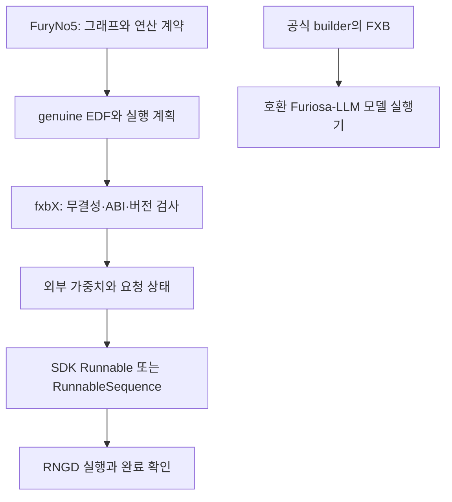
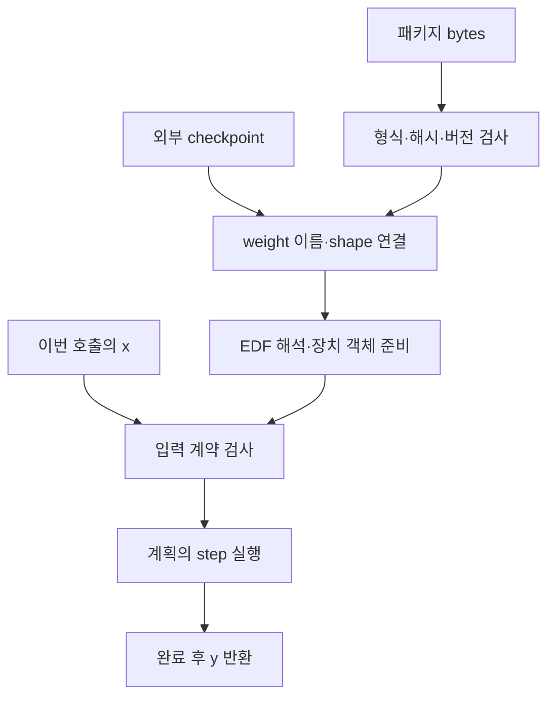

# 12. fxbX: 다른 프로세스가 모델을 다시 실행하려면

Python에서 모델을 만든 프로세스를 종료하면 `model` 객체, 중간 tensor, 장치 메모리 주소, 준비된 호출 객체도 함께 사라진다. 디스크에 컴파일 결과만 남겼다면 다른 프로세스는 무엇을 해야 할까? **fxbX는 저장한 실행 파일과 연결 설명을 읽고, 현재 프로세스의 가중치·입력·장치 객체를 연결해 실행하는 프로젝트**다.

배포용 **package(패키지)는** 필요한 파일을 묶은 전달 단위다. 프로그램 설치 파일이나 아카이브를 생각하면 된다. **manifest(매니페스트)는** 묶음 안에 어떤 파일이 있고 어떤 조건에서 써야 하는지 적은 설명서다. 실행계획은 한 단계 더 구체적이다. 어떤 계산에 어떤 tensor를 넘기고 그 결과를 어디에 연결할지를 적는다. 파일 목록과 함수 호출 목록은 역할이 다르다.

이 장은 fxbX commit `03d993b4d1b36cdda209d61bbf447434c174b401`와 FuryNo5 `bba9efea8201aec48150514a35d0b637d29d107e`를 기준으로 한다. fxbX는 공식 FXB(Furiosa Executable Bundle)를 대신하는 공식 표준이 아니다. 초기 패키지 형식과 최신 실행계획 형식을 모두 다루므로 뒤에서 어느 파일을 어느 reader가 읽는지 나눈다. 집필 환경에서는 새 RNGD 실행을 하지 않았다. [현재 프로젝트 범위](https://github.com/smallstep-zzz/fxbX/blob/03d993b4d1b36cdda209d61bbf447434c174b401/README.md)

## 먼저 같은 작은 모델을 다시 실행하는 상황을 보자

예제는 `Linear(8,12) → ReLU → Linear(12,8)`이다. 길이 8의 입력 4개를 담은 `x[4,8]`을 주면 첫 Linear와 ReLU가 `[4,12]` 중간값을 만들고 마지막 Linear가 `y[4,8]`을 반환한다. Linear는 weight와의 행렬곱에 bias를 더하고, ReLU(Rectified Linear Unit)는 음수를 0으로 바꾼다.

행렬곱 `@`는 왼쪽 행과 오른쪽 열의 대응 원소를 곱해 더한다. 첫 층의 가중치 `W[12,8]`은 출력 특징 12개 각각의 계수 8개를 담으므로, `W.T`로 축을 맞바꾼 `[8,12]`를 사용한다. 결과 `x[4,8] @ W.T[8,12]`의 shape는 `[4,12]`이고, bias `[12]`를 모든 행에 똑같이 더한다. 이 **broadcasting**을 포함한 계산이 `Linear(8,12)`의 계약이다. 두 번째 층도 같은 방식으로 12개 특징을 8개로 바꾼다. 패키지를 읽는 쪽이 weight의 행·열 의미를 바꾸거나 bias를 다른 축에 연결하면 파일이 정상이어도 잘못된 모델을 실행한다. [Linear의 계산과 weight shape](https://docs.pytorch.org/docs/2.10/generated/torch.nn.Linear.html)

FuryNo5가 만드는 **EDF(Executable Device Format)는** RNGD NPU(Neural Processing Unit)에서 계산할 장치 바이너리다. 이는 Python의 모델 객체와 다르다. 실행 소비자는 파일 bytes를 해석하고 장치 자원을 준비하는 **loader(로더)를** 통해 계산 가능한 객체를 만든다. 메모리에서 객체를 파일로 저장하는 직렬화와 그 반대인 역직렬화도 이 경계에서 등장한다. [EDF 정의](https://developer.furiosa.ai/furiosa-opt/book/quick-start/kernel-validation.html), [실행 소비자](https://github.com/smallstep-zzz/fxbX/blob/03d993b4d1b36cdda209d61bbf447434c174b401/fxbex/execution_fxb.py)

| 다른 프로세스가 알아야 할 것 | 예제에서의 값 | 저장·공급하는 곳 |
|---|---|---|
| 어떤 계산 코드인가 | Linear·ReLU를 구현한 EDF들 | 패키지의 EDF 파일 |
| 입력을 어떻게 연결하는가 | 첫 결과 `h`를 ReLU에, 그 결과 `a`를 마지막 Linear에 | 실행계획 |
| weight 값은 무엇인가 | `0.weight`, `0.bias`, `2.weight`, `2.bias` | 이 예제 경로에서는 외부 checkpoint |
| 이번 요청 값은 무엇인가 | `x[4,8]` | 호출자가 전달 |
| 실행 환경이 맞는가 | SDK(Software Development Kit)·장치 구성·입출력 계약 | manifest·계획·실제 환경의 대조 |
| 이번 프로세스의 주소는 무엇인가 | 실제 버퍼와 실행 객체 | 적재 때 새로 준비 |

checkpoint는 모델의 학습된 weight·buffer 값을 저장한 파일이다. **외부 가중치**란 이 값이 패키지와 별도로 공급된다는 뜻이다. 패키지가 완전하지 않다는 뜻은 아니지만, 실행할 때 맞는 weight를 반드시 연결해야 한다. 다른 숫자로 임의 초기화한 같은 구조의 모델은 같은 checkpoint를 복구한 것이 아니다.

FuryNo5는 그래프를 분석해 이러한 EDF와 연결 계획을 생산한다. 그래프는 계산과 값의 의존 관계를 node와 간선으로 담은 자료구조다. fxbX는 이미 정해진 계획을 소비한다. 패키지를 찾는 카탈로그는 FuryAwesome이고, 준비·진단·검증·게시 작업을 연결하는 도구 모음은 FHA(Furiosa-Hug-Anything)다. 카탈로그의 등록 가능 형식과 FHA 자동 게시기의 허용 형식은 다르며 이 경계는 [13장](13-porting-fha.md)에서 다룬다.

## 1. 공식 FXB가 부족했다는 말의 정확한 뜻

공식 FXB는 모델 가중치, tokenizer, configuration과 분리된 컴파일 결과 묶음이다. 여기서 architecture fingerprint는 hidden size·head 수·정밀도처럼 컴파일된 프로그램의 구조를 결정하는 설정을 요약한 식별자다. checkpoint의 모든 weight 값과 같은 개념이 아니다. 가중치가 달라도 이 식별자와 실행 조건이 맞으면 재사용할 수 있다. 그러므로 “공식 FXB는 여러 EDF를 담지 못한다”거나 “가중치를 넣을 수 없어 쓸모없다”는 것이 프로젝트의 출발점은 아니다. **커스텀 그래프의 호출 순서와 상태 관리 방법을 공식 모델 런타임이 이해하는가**가 실제 경계다. 호스트는 NPU를 제어하는 CPU 측 프로그램이며, 모델 런타임은 요청을 받아 계산·상태·반환을 관리하는 실행기다. [공식 FXB 설명](https://developer.furiosa.ai/v2026.4.0/en/furiosa_llm/fxb.html)

예를 들어 임의 Torch 모델을 `linear → relu → linear`로 분리해 EDF를 만들었다고 하자. 실행기는 첫 커널의 출력이 두 번째 커널의 어느 입력인지, 가중치를 언제 올리는지, 마지막 결과를 어느 이름으로 돌려줄지 알아야 한다. LLM(Large Language Model)이라면 여기에 prefill(입력 토큰을 처음 처리), decode(다음 토큰을 순차 생성), KV(Key–Value) cache(앞 토큰의 attention 계산에 쓸 key·value tensor를 저장), 요청별 상태, 토큰 선택 정책까지 더해진다. 커널 파일을 ZIP에 넣는 것만으로 이 의미가 생성되지는 않는다. FuryNo5는 그래프를 해석하고 실행 계획을 만들며, fxbX는 그 계획을 검사·적재·실행한다. [실행 계획 생산자](https://github.com/smallstep-zzz/FuryNo5/blob/bba9efea8201aec48150514a35d0b637d29d107e/tplmachine/execution_plan.py) · [소비자](https://github.com/smallstep-zzz/fxbX/blob/03d993b4d1b36cdda209d61bbf447434c174b401/fxbex/execution_fxb.py)

## 2. 현재 공존하는 세 가지 산출물

**schema(스키마)는** 파일의 필드·자료형·버전 규칙이다. 데이터베이스의 테이블 정의처럼 reader와 writer가 같은 규칙을 알아야 한다. 확장자는 사람이 파일을 구분하는 이름의 일부이고 schema는 내부 구조다. 이름을 `.fxb`로 바꾸었다고 공식 실행계약으로 변환되지는 않는다.

| 산출물 | 핵심 내용 | 실행 주체 | 공식 Furiosa-LLM에 바로 전달 가능한가 |
|---|---|---|---|
| 공식 builder의 `.fxb` | 공식 manifest, 커널별 EDF, bucket | 호환 Furiosa-LLM | 모델 architecture·버전·실행 조건이 맞아야 함 |
| 초기 `.fxbx` 또는 `.fxbex` | `FXB_EX` schema 1, 실행·메모리 계획, 호출을 연결하는 adapter, SDK Runnable 등이 가능 | fxbX `Session`과 adapter | 이 포맷 자체는 공식 FXB가 아님 |
| FuryNo5 커스텀 execution-plan 패키지 | 실제 EDF, 공식 컨테이너 구조를 따르는 manifest, `fxbex.provenance.json` 안의 계획 | `GraphFXB`가 선택하는 `ExecutionFXB` | fxbX 전용 의미 계약이므로 임의 모델 자동 지원을 뜻하지 않음 |

표의 SDK(Software Development Kit) Runnable은 SDK가 관리하는 실행 객체다. adapter는 패키지의 입력·실행 방법을 해당 runtime 호출로 연결하는 코드다. 초기 `FXB_EX`의 version 1과 최신 `tclmachine.execution-plan.v1`의 숫자 1도 서로 다른 schema의 버전이므로 같은 포맷으로 읽으면 안 된다.

현 생산자는 커스텀 계획의 출력에 `.fxb`와 `.fxbx`를 모두 허용한다. 따라서 **파일 내부 schema와 해당 consumer를 확인하는 것이 확장자 확인보다 중요하다.** 내부 `fxbex`, `tplmachine`, `tclmachine` 문자열은 호환성과 소스 위치를 보존한 이름이다. 사용자에게 보이는 프로젝트 이름은 fxbX와 FuryNo5를 사용한다. [출력 suffix 검사](https://github.com/smallstep-zzz/FuryNo5/blob/bba9efea8201aec48150514a35d0b637d29d107e/tplmachine/fxb_export/model_export.py) · [초기 schema 검사](https://github.com/smallstep-zzz/fxbX/blob/03d993b4d1b36cdda209d61bbf447434c174b401/fxbex/package.py)



## 3. “공식 방식을 따른다”와 “공식 지원이다”는 다른 주장이다

writer는 파일을 작성하는 쪽, reader는 읽는 쪽이다. 여기서 native writer라는 이름은 공식 컨테이너의 구조를 사용하는 writer를 뜻하며, 임의 모델이 공식 런타임에 등록되었다는 뜻은 아니다. fxbX의 native writer는 `manifest.json`, `edfs/`, 컴파일러 identity, 외부 가중치라는 공식 배포 구조를 가능한 한 활용한다. 커스텀 실행 의미는 별도 producer metadata에 기록한다. 이 방식으로 공식 검사 도구가 읽는 아카이브를 만들 수 있다는 사실과, 특정 모델을 공식 LLM runner가 실행한다는 사실은 각각 검증해야 한다. [native container 검사](https://github.com/smallstep-zzz/fxbX/blob/03d993b4d1b36cdda209d61bbf447434c174b401/fxbex/native_fxb.py) · [FuryNo5 native export](https://github.com/smallstep-zzz/FuryNo5/blob/bba9efea8201aec48150514a35d0b637d29d107e/tplmachine/fxb_export/model_export.py)

SDK 내부 바이너리와 직렬화 계약은 버전 의존적이다. `Runnable.serialize()`로 만든 blob을 raw EDF라고 이름 붙이거나, 실제 architecture와 다른 이름을 manifest에 적어 registry를 통과시키면 안 된다. 현재 소비자는 EDF의 SHA-256(Secure Hash Algorithm 256-bit) 해시, 입력·출력 ABI(Application Binary Interface), fusion 계약을 확인한다. 해시는 파일 bytes가 기대한 것과 같은지 확인하는 값이고, ABI는 인수 순서·자료형·배치가 컴파일된 코드와 일치하는지에 관한 계약이다. 무결성은 파일이 바뀌지 않았다는 증거이며 수치 정확도 증거는 아니다. ELF(Executable and Linkable Format) 계열 장치 프로그램, EDF, SDK 직렬화 Runnable은 서로 다른 수준의 산출물이다. 각각에 맞는 loader가 필요하다. [EDF loader와 ABI 비교](https://github.com/smallstep-zzz/fxbX/blob/03d993b4d1b36cdda209d61bbf447434c174b401/fxbex/execution_fxb.py#L392-L407)

## 4. 패키지 안에 무엇이 있는가

우선 초기 형식을 보자. `FXB_EX` schema 1은 아래 네 파일을 필수로 요구한다. 이 목록은 최신 execution-plan 아카이브의 필수 파일 목록으로 재사용하면 안 된다. 실제 필수 항목 선언에 설명 주석을 추가한 발췌다.

```python
REQUIRED = (
    'execution_plan.json',  # 어느 계산을 어떤 인수로 호출할지
    'weights_index.json',   # 가중치 이름과 저장 위치를 어떻게 대응시킬지
    'memory_plan.json',     # 논리 메모리를 어떻게 계획했는지
    'runtime_config.json',  # 어느 runtime 설정을 요구하는지
)
```

[출처: package.py](https://github.com/smallstep-zzz/fxbX/blob/03d993b4d1b36cdda209d61bbf447434c174b401/fxbex/package.py#L10-L10)

네 파일은 각각 `계산을 어떻게 호출하는가`, `weight가 어디에 있는가`, `논리 메모리를 어떻게 나누는가`, `어떤 runtime 설정을 쓰는가`라는 질문에 답한다. Python tuple `REQUIRED`는 검사기가 빠진 파일을 찾기 위해 사용하는 이름 목록이다. 이 발췌가 패키지를 만드는 완성 코드인 것은 아니다.

`manifest.json`에는 파일별 크기와 checksum, 모델 출처, runtime adapter, standalone 여부, 호환성 정보가 있다. checksum은 파일 내용 변경을 검사하는 요약 값이다. standalone은 이 형식에서 필요한 weight와 실행 연결을 패키지 안에 포함해 외부 파일 경로에 의존하지 않는다는 계약이다. `weights_index.json`은 내부 가중치와 외부 가중치를 구별하며, standalone 패키지에서는 외부 경로를 허용하지 않는다. `memory_plan.json`은 논리 메모리 계획이다. 이 수치를 드라이버 allocator overhead까지 포함한 물리 HBM(High Bandwidth Memory) 실측값으로 읽으면 안 된다. [무결성 검사](https://github.com/smallstep-zzz/fxbX/blob/03d993b4d1b36cdda209d61bbf447434c174b401/fxbex/package.py) · [메모리 계산](https://github.com/smallstep-zzz/fxbX/blob/03d993b4d1b36cdda209d61bbf447434c174b401/fxbex/memory.py)

이 장의 작은 MLP(Multilayer Perceptron)가 사용하는 새 execution-plan 계열은 공식 컨테이너와 비슷하게 `manifest.json`, `edfs/`를 두고, 커스텀 실행 설명을 `fxbex.provenance.json`에 기록한다. provenance는 이 파일을 어떤 생산자가 어떤 계약으로 만들었는지에 관한 metadata(설명 정보)다. 그 안의 계획은 `tclmachine.execution-plan.v1/v2` schema를 사용한다.

실행계획은 크게 세 표로 읽으면 된다. `tensors`는 값의 이름과 shape·dtype(원소 자료형)·stride(축별 저장소 간격)·역할, `kernels`는 호출할 EDF와 계약, `entries`는 `forward`처럼 이름 있는 실행 입구와 step 순서를 담는다. 아래 값 이름은 이해를 위한 예이고 실제 ID는 생산자가 정한다.

| 설명용 호출 | 입력 ID에 연결할 것 | 출력 ID | 이어지는 사용 |
|---|---|---|---|
| 첫 Linear kernel | `x`, `w0`, `b0` | `h` | ReLU의 입력 |
| ReLU kernel | `h` | `a` | 마지막 Linear의 입력 |
| 마지막 Linear kernel | `a`, `w2`, `b2` | `y` | `forward`의 반환값 |

실제 컴파일에서 두 연산이 결합되면 표의 두 행을 한 kernel이 맡을 수도 있다. 계획을 읽는 이유는 실행기가 그 선택을 다시 추측하지 않게 하기 위해서다. 계획에 tensor의 shape·stride·dtype·역할, kernel의 EDF 해시와 입출력 ABI, entry별 steps, 상태 update를 담는다. v2는 frozen buffer guard도 포함한다. buffer는 학습 parameter와 별도로 모델에 등록한 tensor 값이고, guard는 허용된 조건을 실행 전에 검사하는 장치다. 특정 buffer 값에 의존해 컴파일했다면 같은 shape만으로 재사용을 허용할 수 없기 때문이다. 모델의 수치 의미를 바꾸는 buffer 변경을 실행 전에 발견하려는 장치다. [계획 검증](https://github.com/smallstep-zzz/fxbX/blob/03d993b4d1b36cdda209d61bbf447434c174b401/fxbex/execution_fxb.py#L132-L257)

## 5. loader가 실제로 하는 일

`GraphFXB`는 사용자가 부르는 생성 API다. Python의 `__new__`는 객체를 만드는 단계에서 어떤 종류의 객체를 반환할지 고를 수 있다. `GraphFXB.__new__`는 producer metadata에 `execution_plan`이 있는지 보고 `ExecutionFXB`로 보낸다. 여기서는 그래프 안에 어떤 모델 이름이 적혔는지보다 저장된 계획 형식을 본다. `execution_plan`이 있으면 그 계약을 해석하는 `ExecutionFXB` 객체를 만든다. 모델 이름으로 YOLO나 Qwen을 특별 대우하는 분기는 아니다. 이후 외부 가중치와 tensor metadata를 검사하고, 장치 설정을 맞추고, EDF를 SDK loader로 읽는다. [분기 코드](https://github.com/smallstep-zzz/fxbX/blob/03d993b4d1b36cdda209d61bbf447434c174b401/fxbex/graph_fxb.py#L137-L159)

아래는 `ExecutionFXB._load`의 핵심 호출에 설명 주석을 추가한 발췌다. `sdk`는 `furiosa.torch`, `raw`는 검사한 EDF bytes다. `from_serialized_edf`가 반환하는 `program`은 파일 내용을 SDK가 해석한 실행 표현이며, 이 세 줄만으로 요청 입력을 계산한 결과가 생기는 것은 아니다. 이 몇 줄만 독립 실행하면 앞뒤 검증과 가중치 바인딩이 빠지므로, 사용자 코드는 다음 절의 `GraphFXB` API를 사용한다.

```python
sdk.set_fusion(8)  # 이 consumer에서 검증한 8 PE 결합 설정; NPU 카드 8개가 아니다.
sdk.set_mesh_kind(sdk.MeshKind.Single())  # 검증한 단일 mesh 구성을 지정한다.
program = sdk.ir.Runnable.from_serialized_edf(raw)  # EDF bytes → SDK 내부 실행 표현
```

[출처: ExecutionFXB._load](https://github.com/smallstep-zzz/fxbX/blob/03d993b4d1b36cdda209d61bbf447434c174b401/fxbex/execution_fxb.py#L392-L407)

현 검증 범위는 `furiosa:0`, fusion 8, `MeshKind.Single()`이다. `furiosa:0`은 선택한 장치 식별자이고, 여기의 fusion 8은 8개 PE(Processing Element)를 사용하는 장치 실행 구성이다. `Single`은 이 consumer가 요구하는 mesh 구성이다. 여러 연산을 하나의 kernel로 합치는 graph fusion과 구분한다. CPU(Central Processing Unit) fallback을 끄고 확인한 다음 장치 실행체를 적재한다. 상태 변경 후 오류가 난 세션은 정상 결과를 보장할 수 없어 실패 상태로 관리한다. 이 검증은 “카드를 아무 수나 붙이면 자동 분산”하는 기능이 아니다. [device와 fallback 검사](https://github.com/smallstep-zzz/fxbX/blob/03d993b4d1b36cdda209d61bbf447434c174b401/fxbex/execution_fxb.py#L307-L422)

## 6. 계획이 있어도 모든 적재 작업이 사라지지는 않는다



저장된 계획은 graph capture·분해·의존성 추론·커널 컴파일을 재실행할 필요를 줄인다. 그래도 해시 검사, 버전 검사, EDF 역직렬화, 장치 버퍼 할당, 가중치 업로드, runtime object 생성, 요청 상태 준비는 남는다. `ExecutionFXB` 생성자도 마지막 사용 위치를 계산해 임시 tensor를 해제할 step 목록을 만든다. 이는 저장된 그래프에서 **런타임 bookkeeping을 파생**하는 일이며, EDF만 보고 원본 모델의 실행 의미를 복원하는 일이 아니다. [생성자와 last-use 처리](https://github.com/smallstep-zzz/fxbX/blob/03d993b4d1b36cdda209d61bbf447434c174b401/fxbex/execution_fxb.py#L307-L352)

**last use(마지막 사용 위치)를** 작은 모델에 적용해 보자. 설명용 세 단계에서는 `h`가 ReLU에 전달된 뒤 더 이상 필요하지 않고, `a`는 마지막 Linear 이후 필요하지 않다. 다른 분기에서 다시 쓰지 않는다는 것을 계획에서 알면 논리적으로 임시 객체를 놓을 시점을 정할 수 있다. 실제 장치 버퍼 재사용·해제 시점은 SDK 실행·완료 계약도 따라야 하므로 이 표만으로 물리 메모리 사용량이 결정되지는 않는다.

**stateless**는 호출을 마친 뒤 다음 호출로 넘길 내부 상태 갱신이 없는 경우다. 이번 MLP가 그런 예다. 현재 소스에는 stateless entry를 SDK `RunnableSequence`로 묶는 최적화가 있다. 이는 준비된 여러 호출의 연결을 SDK 실행 객체 하나에 구성하는 방법이다. 상태 update가 있거나 논리 예산으로 전체 중간 tensor 보유를 감당할 수 없으면 해당 sequence 경로를 건너뛴다. sidecar는 주 패키지에 덧붙는 보조 산출물이다. 호환되는 merged-runnable sidecar, 즉 여러 실행 구간을 미리 결합해 둔 보조 파일이 있으면 연속 구간을 더 묶을 수 있고, 없거나 해시·ABI가 달라지면 기본 EDF 경로를 사용한다. 이 선택에서 `_RunnableSequenceBuilder`, `_inner` 같은 내부 API를 사용하므로 안정된 공개 ABI라고 설명해서는 안 된다. [sequence 구성](https://github.com/smallstep-zzz/fxbX/blob/03d993b4d1b36cdda209d61bbf447434c174b401/fxbex/execution_fxb.py#L423-L474) · [sidecar 검사](https://github.com/smallstep-zzz/fxbX/blob/03d993b4d1b36cdda209d61bbf447434c174b401/fxbex/execution_fxb.py#L476-L520)

**Python 호출을 줄이는 sequence 구성과 컴파일러가 연산을 융합하는 kernel fusion도 다르다.** 예를 들어 Python이 kernel 세 개를 차례로 호출하던 부분을 SDK sequence 한 번으로 제출한다고 해서 세 EDF가 자동으로 하나의 새로운 EDF가 되는 것은 아니다. 전자는 호스트 호출의 반복을 줄일 수 있고, 후자는 장치 실행·중간 데이터 이동 자체를 바꾼다. 성능 결과는 둘을 구분해 측정해야 한다.

## 7. 검사와 실행 예

아래 네 명령은 **초기 `FXB_EX` 형식**의 `model.fxbx`를 이미 가지고 있을 때 쓰는 CLI(Command-Line Interface) 예다. `doctor`는 환경, `inspect`는 패키지 설명, `validate --integrity-only`는 파일의 무결성, `describe`는 입력·출력 계약을 조사한다. 새 execution-plan 형식에 같은 검사기가 적용된다고 가정하지 않는다.

```bash
fxbx doctor                              # Python·SDK 등의 환경을 점검한다.
fxbx inspect model.fxbx                   # 초기 FXB_EX 패키지의 설명을 읽는다.
fxbx validate model.fxbx --integrity-only  # 파일 무결성을 검사한다. 추론 실행이 아니다.
fxbx describe model.fxbx                  # 선언된 입력·출력 계약을 확인한다.
```

`validate`는 추론을 실행하지 않는다. `describe`는 package가 선언한 입출력 의미를 보여준다. “텐서 shape를 안다”와 “이미지·텍스트의 전후처리를 안다”도 다르므로 modality와 adapter 계약이 필요하다. [CLI 구현](https://github.com/smallstep-zzz/fxbX/blob/03d993b4d1b36cdda209d61bbf447434c174b401/fxbex/cli.py) · [입출력 schema](https://github.com/smallstep-zzz/fxbX/blob/03d993b4d1b36cdda209d61bbf447434c174b401/fxbex/schema.py)

커스텀 execution-plan 패키지는 버전에 따라 위 초기 포맷 검사 명령에 맞지 않을 수 있다. 다음 코드는 해당 형식의 reader를 명시한다. 입력은 완성된 `tiny.fxbx` 파일 경로이고 출력은 계획 dictionary다. 이 코드는 컴파일·추론을 실행하지 않으므로 패키지가 어떤 호출을 계획했는지 먼저 확인할 수 있다.

```python
from fxbex.execution_fxb import read_execution_plan

plan = read_execution_plan("tiny.fxbx")  # 아카이브에서 계획을 읽는다. NPU를 호출하지 않는다.
print(plan["schema"])                   # 소비자가 해석해야 할 실행 계획 형식·버전
print(list(plan["entries"]))            # forward 등 호출할 수 있는 실행 입구 이름
print("kernels:", len(plan["kernels"])) # 고유 kernel 계약 수; 실행 step 수와는 다를 수 있다.
```

실제 실행에는 패키지 밖의 weight 값과 이번 입력이 필요하다. 다음 예제는 13장의 생산 스크립트가 만든 **같은 작업 디렉터리의** `tiny.fxbx`, `tiny-state.pt`, `tiny-cases.pt`를 사용한다. 새 모델을 임의 초기화하지 않고 파일에 저장한 동일 weight와 검증 입력을 읽는다. `weights_only=True`는 tensor와 기본 자료형 중심으로 체크포인트를 읽는 옵션이다.

```python
import torch
from fxbx import GraphFXB

# 생성할 때 사용한 동일 가중치를 CPU tensor로 읽는다. 임의 초기화로 대체하지 않는다.
weights = torch.load("tiny-state.pt", map_location="cpu", weights_only=True)
cases = torch.load("tiny-cases.pt", map_location="cpu", weights_only=True)
x = cases["inputs"][0]           # 첫 비교 입력: BF16 [4,8]
expected = cases["expected"][0]  # 같은 가중치로 계산해 저장한 CPU 출력 [4,8]
with GraphFXB("tiny.fxbx", weights=weights) as runtime:  # 가중치와 계획을 연결·적재한다.
    actual, = runtime.predict((x,))  # 입력 하나를 담은 tuple → 출력 하나 [4,8]
# 절대 오차 atol과 상대 오차 rtol을 적용한다. 일반 모델의 품질 기준은 별도로 정한다.
torch.testing.assert_close(actual, expected, atol=0.02, rtol=0.02)
```

`weights`는 이름에서 tensor로 가는 dictionary다. `predict((x,))`의 tuple은 입력 한 개라는 뜻이고, `actual, = ...`는 출력 한 개를 꺼낸다. `with` 블록은 실행 세션의 수명을 묶는다. 출력이 맞으면 이 표본의 수치 비교를 통과한 것이며, NPU가 계산했다는 독립 증거는 task trace로 확인한다. 허용오차는 이 작은 BF16 예제를 위한 값이고 다른 모델의 품질 기준은 별도로 정해야 한다. [가중치·입출력 계약](https://github.com/smallstep-zzz/fxbX/blob/03d993b4d1b36cdda209d61bbf447434c174b401/docs/CHECKPOINT_WEIGHTS.md)

대형 checkpoint에서 CPU에 모델 전체를 만드는 부담을 줄이려면 execution-plan 경로의 `SafeTensorWeights`를 사용할 수 있다. 이 loader는 weight 파일의 이름·shape·dtype를 담은 header부터 확인하고 필요한 tensor 단위로 읽으므로, Python 모델 전체를 복구하는 작업과 분리할 수 있다. 반면 legacy single-EDF 경로에서는 지원하지 않는다고 명시적으로 거절한다. `names`를 사용할 경우 plan target과 checkpoint tensor 이름을 정확히 대응시켜야 한다. [가중치 계약과 예제](https://github.com/smallstep-zzz/fxbX/blob/03d993b4d1b36cdda209d61bbf447434c174b401/docs/CHECKPOINT_WEIGHTS.md)

## 8. 배포 성공을 판단하는 순서

지금까지의 순서를 다시 작은 모델에 적용하면, `패키지 bytes가 맞음`, `weight·bias 네 tensor가 올바른 입력에 연결됨`, `x[4,8]로 실행됨`, `y[4,8]의 수치가 맞음`은 각각 다른 확인이다. 수치가 같아도 CPU에서 계산했다면 목표한 NPU 실행을 증명한 것이 아니므로, 장치의 계산 task와 계획 step을 연결한 실행 기록이 필요하다.

무결성 통과 → SDK·ABI 일치 → 가중치 계약 통과 → 변경 입력의 수치 대조 → 공식 NPU(Neural Processing Unit)의 Task 증거 → 새로운 프로세스에서 재적재 → 상태 reset·반복 요청 → 전체 모델 품질·성능 순서로 근거를 쌓는다. 아카이브 생성 성공을 이 모든 항목의 대체 증거로 쓰지 않는다. 이것은 FuryNo5/fxbX의 개발 권장 절차이며 애플리케이션의 신뢰도·지연 요구에 따라 검사 강도는 달라질 수 있다. [검증을 분리하는 생산자](https://github.com/smallstep-zzz/FuryNo5/blob/bba9efea8201aec48150514a35d0b637d29d107e/tplmachine/fxb_export/model_export.py)

## 출처

| 근거 | 확인 위치 |
|---|---|
| 작은 모델의 행렬 계산 | [PyTorch Linear 2.10](https://docs.pytorch.org/docs/2.10/generated/torch.nn.Linear.html) |
| 공식 FXB의 범위와 호환성 | [SDK 2026.4.0 FXB](https://developer.furiosa.ai/v2026.4.0/en/furiosa_llm/fxb.html) |
| 초기 포맷, CLI, tensor 계약 | [package.py](https://github.com/smallstep-zzz/fxbX/blob/03d993b4d1b36cdda209d61bbf447434c174b401/fxbex/package.py), [cli.py](https://github.com/smallstep-zzz/fxbX/blob/03d993b4d1b36cdda209d61bbf447434c174b401/fxbex/cli.py), [schema.py](https://github.com/smallstep-zzz/fxbX/blob/03d993b4d1b36cdda209d61bbf447434c174b401/fxbex/schema.py) |
| GraphFXB와 ExecutionFXB 실행 경로 | [graph_fxb.py](https://github.com/smallstep-zzz/fxbX/blob/03d993b4d1b36cdda209d61bbf447434c174b401/fxbex/graph_fxb.py), [execution_fxb.py](https://github.com/smallstep-zzz/fxbX/blob/03d993b4d1b36cdda209d61bbf447434c174b401/fxbex/execution_fxb.py) |
| 스트리밍 가중치 | [CHECKPOINT_WEIGHTS.md](https://github.com/smallstep-zzz/fxbX/blob/03d993b4d1b36cdda209d61bbf447434c174b401/docs/CHECKPOINT_WEIGHTS.md) |
| 최신 산출물 이름과 생산자 계약 | [model_export.py](https://github.com/smallstep-zzz/FuryNo5/blob/bba9efea8201aec48150514a35d0b637d29d107e/tplmachine/fxb_export/model_export.py) — FuryNo5 저장소 접근 권한 필요 |

