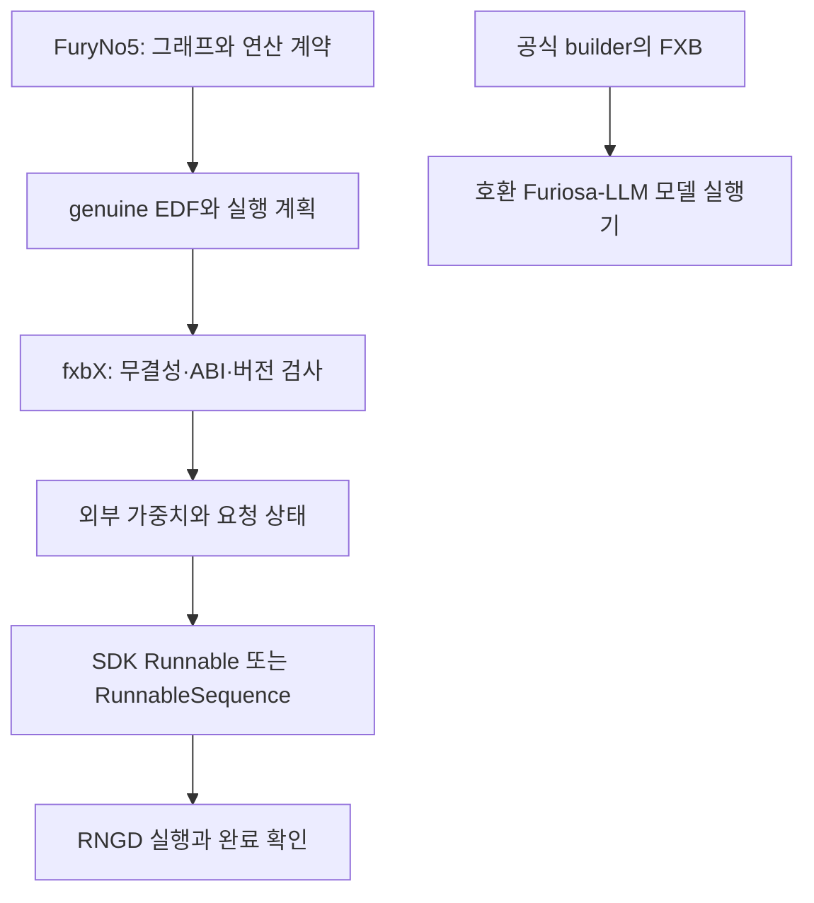

# fxbX: 실행에 필요한 계약을 함께 배포한다

FuryNo5가 연산을 컴파일해도 소비자에게는 “무슨 바이너리를 어떤 입력으로 어떤 순서에 실행할지”가 남는다. **fxbX는 이 계약과 실행기를 함께 제공하는 프로젝트다.** 공식 FXB(Furiosa Executable Bundle)를 대신하는 공식 표준은 아니다. 현재 소스에는 초기 SDK(Software Development Kit) Runnable 패키지와 실제 EDF(Executable Device Format, 컴파일된 장치 실행 바이너리)를 담는 실행 계획 패키지가 함께 있으므로, 확장자만 보고 내부를 추정하면 안 된다. 이 장은 fxbX 커밋 `03d993b`와 FuryNo5 `bba9efe`를 기준으로 한다. [fxbX README](https://github.com/smallstep-zzz/fxbX/blob/03d993b4d1b36cdda209d61bbf447434c174b401/README.md) · [포맷 판별 코드](https://github.com/smallstep-zzz/fxbX/blob/03d993b4d1b36cdda209d61bbf447434c174b401/fxbex/graph_fxb.py) · [EDF 공식 정의](https://developer.furiosa.ai/furiosa-opt/book/quick-start/kernel-validation.html)

이 패키지를 찾고 사용법을 공유하는 카탈로그는 **FuryAwesome**, FuryNo5·fxbX와 진단·검증·게시 도구를 연결해 포팅 작업을 진행하는 쪽은 **FHA(Furiosa-Hug-Anything)**다. 카탈로그에 등록 가능한 패키지와 현재 FHA 자동 게시기가 허용하는 포맷은 범위가 다르므로 [13장의 역할·게시 조건](13-porting-fha.md)을 함께 읽는다.

## 1. 공식 FXB가 부족했다는 말의 정확한 뜻

공식 FXB는 모델 가중치, tokenizer, configuration과 분리된 컴파일 결과 묶음이다. 가중치가 달라도 architecture fingerprint와 실행 조건이 맞으면 재사용할 수 있다. 그러므로 “공식 FXB는 여러 EDF를 담지 못한다”거나 “가중치를 넣을 수 없어 쓸모없다”는 것이 프로젝트의 출발점은 아니다. **커스텀 그래프의 호스트 실행 의미를 공식 모델 런타임이 이해하는가**가 실제 경계다. [공식 FXB 설명](https://developer.furiosa.ai/v2026.4.0/en/furiosa_llm/fxb.html)

예를 들어 임의 Torch 모델을 `linear → relu → linear`로 분리해 EDF를 만들었다고 하자. 실행기는 첫 커널의 출력이 두 번째 커널의 어느 입력인지, 가중치를 언제 올리는지, 마지막 결과를 어느 이름으로 돌려줄지 알아야 한다. LLM(Large Language Model)이라면 여기에 prefill, decode, KV(Key–Value) cache, 요청별 상태, 토큰 선택 정책까지 더해진다. 커널 파일을 ZIP에 넣는 것만으로 이 의미가 생성되지는 않는다. FuryNo5는 그래프를 해석하고 실행 계획을 만들며, fxbX는 그 계획을 검사·적재·실행한다. [실행 계획 생산자](https://github.com/smallstep-zzz/FuryNo5/blob/bba9efea8201aec48150514a35d0b637d29d107e/tplmachine/execution_plan.py) · [소비자](https://github.com/smallstep-zzz/fxbX/blob/03d993b4d1b36cdda209d61bbf447434c174b401/fxbex/execution_fxb.py)

## 2. 현재 공존하는 세 가지 산출물

| 산출물 | 핵심 내용 | 실행 주체 | 공식 Furiosa-LLM에 바로 전달 가능한가 |
|---|---|---|---|
| 공식 builder의 `.fxb` | 공식 manifest, 커널별 EDF, bucket | 호환 Furiosa-LLM | 모델 architecture·버전·실행 조건이 맞아야 함 |
| 초기 `.fxbx` 또는 `.fxbex` | `FXB_EX` schema 1, 실행 계획·메모리 계획·adapter, SDK Runnable 등이 가능 | fxbX `Session`과 adapter | 이 포맷 자체는 공식 FXB가 아님 |
| FuryNo5 커스텀 execution-plan 패키지 | genuine EDF, native 스타일 manifest, `fxbex.provenance.json` 안의 계획 | `GraphFXB`가 선택하는 `ExecutionFXB` | fxbX 전용 의미 계약이므로 임의 모델 자동 지원을 뜻하지 않음 |

현 생산자는 커스텀 계획의 출력에 `.fxb`와 `.fxbx`를 모두 허용한다. 따라서 **파일 내부 schema와 해당 consumer를 확인하는 것이 확장자 확인보다 중요하다.** 내부 `fxbex`, `tplmachine`, `tclmachine` 문자열은 호환성과 소스 위치를 보존한 이름이다. 사용자에게 보이는 프로젝트 이름은 fxbX와 FuryNo5를 사용한다. [출력 suffix 검사](https://github.com/smallstep-zzz/FuryNo5/blob/bba9efea8201aec48150514a35d0b637d29d107e/tplmachine/fxb_export/model_export.py) · [초기 schema 검사](https://github.com/smallstep-zzz/fxbX/blob/03d993b4d1b36cdda209d61bbf447434c174b401/fxbex/package.py)



## 3. “공식 방식을 따른다”와 “공식 지원이다”는 다른 주장이다

fxbX의 native writer는 `manifest.json`, `edfs/`, 컴파일러 identity, 외부 가중치라는 공식 배포 구조를 가능한 한 활용한다. 커스텀 실행 의미는 별도 producer metadata에 기록한다. 이 방식으로 공식 검사 도구가 읽는 아카이브를 만들 수 있다는 사실과, 특정 모델을 공식 LLM runner가 실행한다는 사실은 각각 검증해야 한다. [native container 검사](https://github.com/smallstep-zzz/fxbX/blob/03d993b4d1b36cdda209d61bbf447434c174b401/fxbex/native_fxb.py) · [FuryNo5 native export](https://github.com/smallstep-zzz/FuryNo5/blob/bba9efea8201aec48150514a35d0b637d29d107e/tplmachine/fxb_export/model_export.py)

SDK 내부 바이너리와 직렬화 계약은 버전 의존적이다. `Runnable.serialize()`로 만든 blob을 raw EDF라고 이름 붙이거나, 실제 architecture와 다른 이름을 manifest에 적어 registry를 통과시키면 안 된다. 현재 소비자는 EDF의 SHA-256, 입력·출력 ABI(Application Binary Interface), fusion 계약을 확인한다. ELF(Executable and Linkable Format) 계열 장치 프로그램, EDF, SDK 직렬화 Runnable은 서로 다른 수준의 산출물이다. 각각에 맞는 loader가 필요하다. [EDF loader와 ABI 비교](https://github.com/smallstep-zzz/fxbX/blob/03d993b4d1b36cdda209d61bbf447434c174b401/fxbex/execution_fxb.py#L392-L407)

## 4. 패키지 안에 무엇이 있는가

초기 `FXB_EX` schema 1은 아래 네 파일을 필수로 요구한다. 실제 필수 항목을 선언한 짧은 소스 발췌다.

```python
REQUIRED = (
    'execution_plan.json', 'weights_index.json',
    'memory_plan.json', 'runtime_config.json',
)
```

[출처: package.py](https://github.com/smallstep-zzz/fxbX/blob/03d993b4d1b36cdda209d61bbf447434c174b401/fxbex/package.py#L10-L10)

`manifest.json`에는 파일별 크기와 checksum, 모델 출처, runtime adapter, standalone 여부, 호환성 정보가 있다. `weights_index.json`은 내부 가중치와 외부 가중치를 구별하며, standalone 패키지에서는 외부 경로를 허용하지 않는다. `memory_plan.json`은 논리 메모리 계획이다. 이 수치를 드라이버 allocator overhead까지 포함한 물리 HBM(High Bandwidth Memory) 실측값으로 읽으면 안 된다. [무결성 검사](https://github.com/smallstep-zzz/fxbX/blob/03d993b4d1b36cdda209d61bbf447434c174b401/fxbex/package.py) · [메모리 계산](https://github.com/smallstep-zzz/fxbX/blob/03d993b4d1b36cdda209d61bbf447434c174b401/fxbex/memory.py)

새 execution-plan 계열은 `tclmachine.execution-plan.v1/v2`를 읽는다. 계획에 tensor의 shape·stride·dtype·역할, kernel의 EDF 해시와 입출력 ABI, entry별 steps, 상태 update를 담는다. v2는 frozen buffer guard도 포함한다. 특정 buffer 값에 의존해 컴파일했다면 같은 shape만으로 재사용을 허용할 수 없기 때문이다. 모델의 수치 의미를 바꾸는 buffer 변경을 실행 전에 발견하려는 장치다. [계획 검증](https://github.com/smallstep-zzz/fxbX/blob/03d993b4d1b36cdda209d61bbf447434c174b401/fxbex/execution_fxb.py#L132-L257)

## 5. loader가 실제로 하는 일

`GraphFXB.__new__`는 producer metadata에 `execution_plan`이 있는지 보고 `ExecutionFXB`로 보낸다. 모델 이름으로 YOLO나 Qwen을 특별 대우하는 분기는 아니다. 이후 외부 가중치와 tensor metadata를 검사하고, 장치 설정을 맞추고, EDF를 SDK loader로 읽는다. [분기 코드](https://github.com/smallstep-zzz/fxbX/blob/03d993b4d1b36cdda209d61bbf447434c174b401/fxbex/graph_fxb.py#L137-L159)

아래는 `ExecutionFXB._load`의 핵심 호출을 발췌한 것이다. 이 몇 줄만 독립 실행하면 앞뒤 검증과 가중치 바인딩이 빠지므로, 사용자 코드는 다음 절의 `GraphFXB` API를 사용한다.

```python
sdk.set_fusion(8)
sdk.set_mesh_kind(sdk.MeshKind.Single())
program = sdk.ir.Runnable.from_serialized_edf(raw)
```

[출처: ExecutionFXB._load](https://github.com/smallstep-zzz/fxbX/blob/03d993b4d1b36cdda209d61bbf447434c174b401/fxbex/execution_fxb.py#L392-L407)

현 검증 범위는 `furiosa:0`, fusion 8, `MeshKind.Single()`이다. CPU(Central Processing Unit) fallback을 끄고 확인한 다음 장치 실행체를 적재한다. 상태 변경 후 오류가 난 세션은 정상 결과를 보장할 수 없어 실패 상태로 관리한다. 이 검증은 “카드를 아무 수나 붙이면 자동 분산”하는 기능이 아니다. [device와 fallback 검사](https://github.com/smallstep-zzz/fxbX/blob/03d993b4d1b36cdda209d61bbf447434c174b401/fxbex/execution_fxb.py#L307-L422)

## 6. 계획이 있어도 모든 적재 작업이 사라지지는 않는다

저장된 계획은 graph capture·분해·의존성 추론·커널 컴파일을 재실행할 필요를 줄인다. 그래도 해시 검사, 버전 검사, EDF 역직렬화, 장치 버퍼 할당, 가중치 업로드, runtime object 생성, 요청 상태 준비는 남는다. `ExecutionFXB` 생성자도 마지막 사용 위치를 계산해 임시 tensor를 해제할 step 목록을 만든다. 이는 저장된 그래프에서 **런타임 bookkeeping을 파생**하는 일이며, EDF만 보고 원본 모델의 실행 의미를 복원하는 일이 아니다. [생성자와 last-use 처리](https://github.com/smallstep-zzz/fxbX/blob/03d993b4d1b36cdda209d61bbf447434c174b401/fxbex/execution_fxb.py#L307-L352)

현재 소스에는 stateless entry를 SDK `RunnableSequence`로 묶는 최적화가 있다. 상태 update가 있거나 논리 예산으로 전체 중간 tensor 보유를 감당할 수 없으면 해당 sequence 경로를 건너뛴다. 호환되는 merged-runnable sidecar가 있으면 연속 구간을 더 묶을 수 있고, 없거나 해시·ABI가 달라지면 기본 EDF 경로를 사용한다. 이 선택에서 `_RunnableSequenceBuilder`, `_inner` 같은 내부 API를 사용하므로 안정된 공개 ABI라고 설명해서는 안 된다. [sequence 구성](https://github.com/smallstep-zzz/fxbX/blob/03d993b4d1b36cdda209d61bbf447434c174b401/fxbex/execution_fxb.py#L423-L474) · [sidecar 검사](https://github.com/smallstep-zzz/fxbX/blob/03d993b4d1b36cdda209d61bbf447434c174b401/fxbex/execution_fxb.py#L476-L520)

**Python dispatch를 줄이는 sequence 구성과 컴파일러가 연산을 융합하는 kernel fusion도 다르다.** 전자는 호스트 호출의 반복을 줄일 수 있고, 후자는 장치 실행·중간 데이터 이동 자체를 바꾼다. 성능 결과는 둘을 구분해 측정해야 한다.

## 7. 검사와 실행 예

초기 `FXB_EX` 패키지는 CLI(Command-Line Interface)로 다음과 같이 확인한다.

```bash
fxbx doctor
fxbx inspect model.fxbx
fxbx validate model.fxbx --integrity-only
fxbx describe model.fxbx
```

`validate`는 추론을 실행하지 않는다. `describe`는 package가 선언한 입출력 의미를 보여준다. “텐서 shape를 안다”와 “이미지·텍스트의 전후처리를 안다”도 다르므로 modality와 adapter 계약이 필요하다. [CLI 구현](https://github.com/smallstep-zzz/fxbX/blob/03d993b4d1b36cdda209d61bbf447434c174b401/fxbex/cli.py) · [입출력 schema](https://github.com/smallstep-zzz/fxbX/blob/03d993b4d1b36cdda209d61bbf447434c174b401/fxbex/schema.py)

커스텀 execution-plan 패키지는 버전에 따라 위 초기 포맷 검사 명령에 맞지 않을 수 있다. 다음 코드는 해당 형식의 reader를 명시한다.

```python
from fxbex.execution_fxb import read_execution_plan

plan = read_execution_plan("tiny.fxbx")
print(plan["schema"])
print(list(plan["entries"]))
print("kernels:", len(plan["kernels"]))
```

실제 실행에서는 외부 가중치와 입력을 전달한다. `model`과 `x`는 13장의 동일한 작은 모델과 입력이다.

```python
from fxbx import GraphFXB

with GraphFXB("tiny.fxbx", weights=model.state_dict()) as runtime:
    actual, = runtime.predict((x,))
```

대형 checkpoint에서 CPU에 모델 전체를 만드는 부담을 줄이려면 execution-plan 경로의 `SafeTensorWeights`를 사용할 수 있다. 이 loader는 header부터 확인하고 tensor 단위로 읽으며, legacy single-EDF 경로에서는 지원하지 않는다고 명시적으로 거절한다. `names`를 사용할 경우 plan target과 checkpoint tensor 이름을 정확히 대응시켜야 한다. [가중치 계약과 예제](https://github.com/smallstep-zzz/fxbX/blob/03d993b4d1b36cdda209d61bbf447434c174b401/docs/CHECKPOINT_WEIGHTS.md)

## 8. 배포 성공을 판단하는 순서

무결성 통과 → SDK·ABI 일치 → 가중치 계약 통과 → 변경 입력의 수치 대조 → 공식 NPU(Neural Processing Unit)의 Task 증거 → 새로운 프로세스에서 재적재 → 상태 reset·반복 요청 → 전체 모델 품질·성능 순서로 근거를 쌓는다. 아카이브 생성 성공을 이 모든 항목의 대체 증거로 쓰지 않는다. 이것은 FuryNo5/fxbX의 개발 권장 절차이며 애플리케이션의 신뢰도·지연 요구에 따라 검사 강도는 달라질 수 있다. [검증을 분리하는 생산자](https://github.com/smallstep-zzz/FuryNo5/blob/bba9efea8201aec48150514a35d0b637d29d107e/tplmachine/fxb_export/model_export.py)

## 출처

| 근거 | 확인 위치 |
|---|---|
| 공식 FXB의 범위와 호환성 | [SDK 2026.4.0 FXB](https://developer.furiosa.ai/v2026.4.0/en/furiosa_llm/fxb.html) |
| 초기 포맷, CLI, tensor 계약 | [package.py](https://github.com/smallstep-zzz/fxbX/blob/03d993b4d1b36cdda209d61bbf447434c174b401/fxbex/package.py), [cli.py](https://github.com/smallstep-zzz/fxbX/blob/03d993b4d1b36cdda209d61bbf447434c174b401/fxbex/cli.py), [schema.py](https://github.com/smallstep-zzz/fxbX/blob/03d993b4d1b36cdda209d61bbf447434c174b401/fxbex/schema.py) |
| GraphFXB와 ExecutionFXB 실행 경로 | [graph_fxb.py](https://github.com/smallstep-zzz/fxbX/blob/03d993b4d1b36cdda209d61bbf447434c174b401/fxbex/graph_fxb.py), [execution_fxb.py](https://github.com/smallstep-zzz/fxbX/blob/03d993b4d1b36cdda209d61bbf447434c174b401/fxbex/execution_fxb.py) |
| 스트리밍 가중치 | [CHECKPOINT_WEIGHTS.md](https://github.com/smallstep-zzz/fxbX/blob/03d993b4d1b36cdda209d61bbf447434c174b401/docs/CHECKPOINT_WEIGHTS.md) |
| 최신 산출물 이름과 생산자 계약 | [model_export.py](https://github.com/smallstep-zzz/FuryNo5/blob/bba9efea8201aec48150514a35d0b637d29d107e/tplmachine/fxb_export/model_export.py) — FuryNo5 저장소 접근 권한 필요 |

