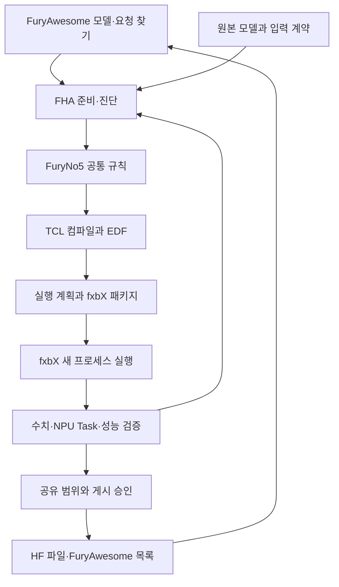
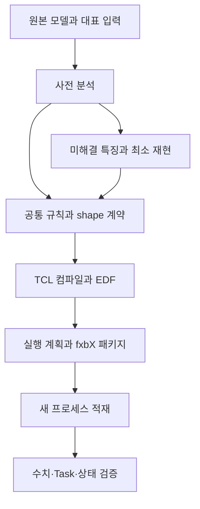

# 13. 모델 파일을 실행 가능한 패키지로 포팅하기

Python에서 모델을 실행할 때는 모델 클래스, 가중치, 입력 tensor가 같은 프로세스에 있다. NPU(Neural Processing Unit)로 옮겨 다른 프로세스에서 실행하려면 이 정보를 분리해서 전달해야 한다. **포팅(porting)은** 파일 확장자를 바꾸는 작업이 아니라, 원래 계산의 의미를 보존하면서 대상 장치가 받아들이는 연산·입출력·실행 순서로 바꾸고 검증하는 작업이다.

이 장의 목표는 작은 `Linear → ReLU → Linear` 모델로 세 질문에 답하는 것이다. “어떤 가중치와 입력으로 컴파일했는가?”, “다른 프로세스가 무엇을 읽어 실행하는가?”, “원래 모델과 같은 계산을 했다는 근거가 무엇인가?” 처음에는 아래 파일의 역할을 구분하면 된다.

| 전달할 정보 | 이 장의 예제 파일 | 받는 쪽에서 사용하는 방법 |
|---|---|---|
| 모델의 계산 구조와 장치 실행 코드 | `tiny.fxbx` | fxbX가 실행 순서와 EDF(Executable Device Format)를 읽음 |
| 학습으로 정해진 tensor 값 | `tiny-state.pt` | 가중치 이름을 패키지의 입력 슬롯에 연결 |
| 비교할 입력과 원래 모델의 출력 | `tiny-cases.pt` | 같은 입력을 넣고 출력이 허용오차 안에서 일치하는지 검사 |

EDF는 장치에서 수행할 계산을 담은 산출물이다. **실행 계획**은 어느 EDF에 어느 tensor를 넣고 그 출력을 다음 어디에 연결할지 적은 자료구조다. **패키지**는 이런 코드와 설명 자료를 함께 전달하는 파일이며, **manifest**는 안에 어떤 파일과 버전·규격이 있는지 기록한 목록이다. **schema**는 그 목록의 필드·자료형·버전 규칙이고, **계산 그래프(graph)는** 입력·계산·출력의 의존 관계를 node와 간선으로 표현한 자료구조다. 체크포인트의 가중치만으로는 실행 순서와 장치 코드가 생기지 않는다. 반대로 이 예제의 패키지만 있어도 별도로 요구하는 가중치가 없으면 원래 모델을 재현할 수 없다. [최소 모델의 생성·가중치 전달](https://github.com/smallstep-zzz/FuryNo5/blob/bba9efea8201aec48150514a35d0b637d29d107e/examples/native_execution_plan.py) · [fxbX의 실행 계획 소비](https://github.com/smallstep-zzz/fxbX/blob/03d993b4d1b36cdda209d61bbf447434c174b401/fxbex/execution_fxb.py)

**FHA(Furiosa-Hug-Anything)는 FuryAwesome·FuryNo5·fxbX를 연결해 모델 포팅을 돕는 도구 모음이다.** FuryAwesome에서 배포된 모델과 포팅 요청을 찾고, FuryNo5에 공통 연산 구현·실행 계획·패키지 생성을 맡기며, fxbX로 적재·실행을 확인한다. 검증된 결과를 공유할 때는 HF(Hugging Face) 파일 배포와 FuryAwesome 카탈로그 등록을 연결한다. 각 도구의 책임과 현재 연결 범위를 알아야 실패한 부분을 고칠 수 있다. [FHA 포팅 skill](https://github.com/smallstep-zzz/Furiosa-Hug-Anything/blob/8fc675f488763bef7c779ee037e8393ddd9f856a/skills/rngd-model-porting/SKILL.md) · [FuryAwesome 소개](https://github.com/smallstep-zzz/furyawesome/blob/c668ecbceac2bedd04c6e539c1a5509a404a464d/README.md)

이 장의 예제는 조회한 커밋의 API(Application Programming Interface)에 맞춰 작성했다. FuryAwesome은 `c668ecb`, FHA는 `8fc675f`를 2026-11-19에 다시 확인했다. **편집 환경에는 RNGD가 없으므로 아래 코드를 이번 작업에서 NPU(Neural Processing Unit) 실측한 것은 아니다.** 저장소의 기존 검증 결과와 독자의 새 실행 결과는 구분한다. FuryNo5와 FHA 소스 링크는 저장소 접근 권한이 필요하다.

## 1. 네 도구가 맡는 책임

| 도구 | 실제 책임 | 다음 단계에 전달하는 것 |
|---|---|---|
| **FuryAwesome** | 모델 카탈로그, 사용법·다운로드 연결, 포팅 요청의 출발점 | 원본 모델·릴리스 식별자, 환경·검증 범위, HF 링크, 요청 정보 |
| **FHA** | 모델 준비, 실패 진단, 작업 조율, 독립 검증, 게시 절차 | 대표 입력과 재현 사례, 컴파일 요청, 검증 보고서, 검토된 게시 메타데이터 |
| **FuryNo5** | 재사용 가능한 연산 규칙, TCL(Tensor Contraction Language) 기반 컴파일 연결, 실행 계획과 패키지 생성 | EDF, 입출력·가중치·상태를 연결한 실행 계획, fxbX에서 사용할 패키지 |
| **fxbX** | 패키지와 실행 계획 적재, 가중치 연결, 실행·반복 호출 | 실제 출력, 실행 기록, 적재·호환 오류 |

FuryAwesome의 카탈로그 데이터가 연산 구현이나 컴파일러를 대신하지는 않는다. FHA 역시 별도 커널을 모델마다 복제하는 방식보다 FuryNo5의 공통 규칙을 보완하도록 구성되어 있다. TCL은 행렬곱·축약 같은 계산 의미를 컴파일러에 설명하는 언어다. 공식 컴파일러가 TCL을 EDF로 만드는 과정과 fxbX가 이를 실행하는 과정은 앞 장들의 장치·런타임 계약을 따른다. [역할 분담](https://github.com/smallstep-zzz/Furiosa-Hug-Anything/blob/8fc675f488763bef7c779ee037e8393ddd9f856a/docs/FHA_ROLE_TRANSITION.md) · [FHA의 실제 위임](https://github.com/smallstep-zzz/Furiosa-Hug-Anything/blob/8fc675f488763bef7c779ee037e8393ddd9f856a/forge_fxbex/native.py)

다음은 도구를 함께 사용하는 전체 흐름이다. 검증에 실패하면 입력 계약이나 공통 규칙으로 돌아간다. 마지막 공유 단계는 패키지 형식과 게시 도구의 지원 범위를 확인한 뒤 진행한다. 현재 구현의 구체적인 경계는 10절에서 다룬다.



이 그림은 단일 명령의 내부 호출 순서를 뜻하지 않는다. **이미 등록된 모델은 사용법대로 바로 재사용할 수 있고, 새로운 모델은 진단·규칙 수정·전체 모델 검증이 추가된다.** 사용 가능한 모델의 발견부터 실패 수정과 재배포까지를 연결한 개발 흐름이다.

## 2. FuryAwesome에서 모델을 찾고 FHA로 요청을 정리한다

[FuryAwesome](https://furyawesome.softandsweet5.chatgpt.site/)의 첫 역할은 모델을 찾는 것이다. 카탈로그의 원본은 `model-catalog/<category>.json`이며, `scripts/catalog_store.py`가 이를 이용해 README 표, CLI(Command Line Interface)용 `catalog.json`·`models/*.json`, 웹용 `place-catalog.json`을 함께 만든다. 웹은 GitHub의 웹 카탈로그를 읽으며, 모델 파일은 HF의 고정 commit URL로 연결한다. GitHub 카탈로그에는 모델 바이너리를 넣지 않는다. [분류·출력 생성 코드](https://github.com/smallstep-zzz/furyawesome/blob/c668ecbceac2bedd04c6e539c1a5509a404a464d/scripts/catalog_store.py#L133-L193) · [웹 카탈로그 읽기](https://github.com/smallstep-zzz/furyawesome/blob/c668ecbceac2bedd04c6e539c1a5509a404a464d/site/dist/catalog.js)

모델을 선택하면 용도뿐 아니라 **SDK(Software Development Kit)·runtime 버전, 입력 범위, 별도 가중치 필요 여부, 검증된 실행 방법**을 확인한다. 아래는 해당 모델의 의존성과 SDK를 준비한 환경에서 실행할 수 있는 등록 모델의 예다. `fetch`는 다운로드이며, `run --sample`에서 샘플 추론을 수행한다. [FuryAwesome 실행 안내](https://github.com/smallstep-zzz/furyawesome/blob/c668ecbceac2bedd04c6e539c1a5509a404a464d/README.md)

```bash
fxbx doctor                             # 현재 Python·SDK·장치 환경을 점검한다.
fxbx fetch FLUX.2-klein-4B               # 등록된 배포 파일을 내려받는다.
fxbx run FLUX.2-klein-4B --sample        # 동봉된 샘플 입력으로 실제 추론을 요청한다.
```

모든 등록 모델이 같은 설치·호출 계약을 가진 것은 아니다. 예를 들어 `all-MiniLM-L6-v2`의 등록 예는 배치 1·최대 16토큰의 BF16(Bfloat16) 임베딩이며, 별도 가중치와 동봉된 Python 실행 파일을 사용한다. NPU가 만든 은닉 상태에 호스트가 마스크 평균과 정규화를 적용하는 범위도 안내한다. 최신 Depth Anything V2 Small 사용법은 체크포인트를 연결하는 `fxbx>=0.9.3` 경로를 요구한다. 따라서 다른 모델의 명령이나 오래된 생성 템플릿의 runtime 버전을 그대로 적용하지 않는다. [MiniLM 사용법](https://github.com/smallstep-zzz/furyawesome/blob/c668ecbceac2bedd04c6e539c1a5509a404a464d/usage/all-minilm-l6-v2.md) · [Depth Anything 사용법](https://github.com/smallstep-zzz/furyawesome/blob/c668ecbceac2bedd04c6e539c1a5509a404a464d/usage/depth-anything-v2-small-hf.md)

필요한 모델이 없으면 FuryAwesome의 요청 화면에서 GitHub issue 초안을 만들 수 있다. 사용자가 GitHub에서 내용을 확인하고 제출하는 흐름이며, 요청 등록이 곧 컴파일 작업 실행은 아니다. FHA에는 이 요청들을 읽어 모델 계열별로 묶고 우선순위를 계산하는 코드가 있다. 다음 명령은 FHA checkout에서 인증된 GitHub CLI `gh`를 사용하며, 원격 issue를 수정하지 않는다. [요청 화면의 동작](https://github.com/smallstep-zzz/furyawesome/blob/c668ecbceac2bedd04c6e539c1a5509a404a464d/CONTRIBUTING.md) · [요청 수집·CLI 구현](https://github.com/smallstep-zzz/Furiosa-Hug-Anything/blob/8fc675f488763bef7c779ee037e8393ddd9f856a/forge_fxbex/requests.py)

```bash
# 원격 요청을 읽어 최대 5개로 요약한다. 원격 issue를 수정하지 않는다.
python -m forge_fxbex requests --repository smallstep-zzz/furyawesome --limit 5
python -m forge_fxbex requests --cached --limit 5  # 저장한 보고서에서 다시 읽는다.
# OWNER/MODEL은 실제 보고서의 family 값으로 바꾼다.
python -m forge_fxbex requests --cached --model 'hf:OWNER/MODEL'
```

마지막 줄의 `hf:OWNER/MODEL`은 첫 명령의 `family` 값을 넣을 자리다. 기본 저장 위치는 `reports/furyawesome-requests.json`이며, `--cached`는 이 결과를 읽는다. `--repository`를 생략하면 현재 코드가 관리하는 두 요청 저장소를 조회하므로 각각의 읽기 권한이 필요하다. 우선순위는 요청 수·반응·난이도를 이용한 보조 지표이고, `difficulty.basis=name_estimate`는 이름에서 추정한 값이다. 실제 graph 지원이나 NPU 적재 가능성을 입증하지 않는다. 개발자는 요청한 variant·원본 revision·대표 입력과 난이도 근거를 확인한 뒤 포팅 대상을 정한다. [집계와 난이도 판단](https://github.com/smallstep-zzz/Furiosa-Hug-Anything/blob/8fc675f488763bef7c779ee037e8393ddd9f856a/forge_fxbex/requests.py#L151-L231)

## 3. 포팅의 입력은 모델 이름보다 넓다

### 작은 모델이 실제로 계산하는 것

입력 `x`의 shape가 `[4,8]`이라는 것은 **샘플 4개를 행에 놓고 각 샘플의 특징 8개를 열에 놓았다**는 뜻이다. `Linear(8,12)`는 각 행의 특징 8개를 출력 특징 12개로 바꾼다. 가중치 `W`의 shape는 `[12,8]`이다. 가중치의 한 행이 출력 특징 하나를 계산하는 계수 8개를 갖는다.

행렬곱 `A @ B`는 A의 한 행과 B의 한 열에서 같은 위치의 원소를 곱해 더한다. `[M,K] @ [K,N]`의 결과는 `[M,N]`이며 가운데 크기 K가 같아야 한다. 그래서 이 층은 `x @ W.T + b`를 계산한다. `W.T`는 행과 열을 맞바꾸는 **전치(transpose)로** `[8,12]`가 되어 곱셈이 가능해진다. bias `b[12]`는 출력의 모든 행에 같은 12개 값을 더한다. 이 자동 확장이 **broadcasting**이며 bias를 4번 학습한다는 뜻은 아니다. 첫 출력값 하나는 `x[0,0]*W[0,0] + … + x[0,7]*W[0,7] + b[0]`이다. [PyTorch Linear의 계산과 가중치 규격](https://docs.pytorch.org/docs/2.10/generated/torch.nn.Linear.html)

| 단계 | 계산 | 입력 → 출력 shape | 값의 의미 |
|---|---|---|---|
| 첫 Linear | `h = x @ W0.T + b0` | `[4,8] → [4,12]` | 각 샘플을 12개 특징으로 변환 |
| ReLU(Rectified Linear Unit) | `a = max(h, 0)` | `[4,12] → [4,12]` | 각 원소가 음수면 0으로 바꾸고 양수는 유지 |
| 둘째 Linear | `y = a @ W2.T + b2` | `[4,12] → [4,8]` | 최종 특징 8개를 계산 |

모델 객체를 만든 시점에는 이 계산식과 무작위 초기 가중치가 존재한다. `model(x)`가 실제 CPU 값을 계산하고, `export_model(model, (x,), ...)`은 이 구조와 대표 입력 규격을 바탕으로 장치 실행 산출물을 만든다. 두 호출은 반환값부터 다르다. 앞은 tensor, 뒤는 생성 상태와 산출물 위치 등을 담은 보고서다.

### 크기뿐 아니라 자료형과 저장 순서도 계약이다

**dtype(data type)은** 각 원소의 저장·계산 자료형이다. 이 예제의 BF16(Bfloat16)은 16비트 부동소수점이므로 FP32(Float32) 값을 바꾸면 반올림이 생길 수 있다. **stride**는 각 축의 인덱스가 1 증가할 때 저장 공간에서 몇 원소 이동하는지 나타낸다. 일반적인 연속 배열 `x[4,8]`은 stride `[8,1]`이다. **contiguous**는 요구하는 순서대로 원소가 연속해 놓인 상태다. 같은 숫자와 shape를 갖더라도 전치로 얻은 view는 stride가 다를 수 있다. 따라서 shape만 같다고 같은 커널 입력 계약이라고 판단하지 않는다.

포팅 계약에는 원본 모델 revision, configuration, 실제 입력 shape·dtype·stride, 전후처리, mask 의미, 가변 길이 정책, 상태 변화가 들어간다. 예를 들어 같은 `aten.mm`이라도 BF16(Bfloat16) contiguous 행렬과 FP32(Float32) 비연속 view는 같은 시험이 아니다. 연산 이름이 같아도 크기·배치·메모리 계약이 달라지면 기존 EDF를 사용할 수 있는지 다시 판단해야 한다. [FHA feature 정의](https://github.com/smallstep-zzz/Furiosa-Hug-Anything/blob/8fc675f488763bef7c779ee037e8393ddd9f856a/docs/AUTOMATED_PORTING.md) · [FuryNo5 입력 검사](https://github.com/smallstep-zzz/FuryNo5/blob/bba9efea8201aec48150514a35d0b637d29d107e/tplmachine/execution_plan.py)

| 먼저 고정할 항목 | 예 | 왜 필요한가 |
|---|---|---|
| 원본 | HF repository와 commit | 가중치·설정 변경을 성능 변경과 분리 |
| 실제 작업 | 이미지 분류, 임베딩, decoder 한 step | 출력과 상태의 의미 결정 |
| 입력 규격 | `[4,8]`, BF16, contiguous | 컴파일과 ABI(Application Binary Interface: 실행 코드와 호출자가 합의한 입출력 규격) 선택 |
| 정확도 기준 | 절대·상대 오차, 과제별 품질 | 더 빠르지만 다른 계산인 결과 배제 |
| 장치 환경 | SDK·TCC(Tensor Contraction Compiler)·driver·PE 결합·장치 구성 | EDF와 runtime 호환 |
| 측정 범위 | 첫 적재 / warm 호출 / 전체 요청 | 비용 누락 방지 |

## 4. 준비: 서로 맞는 소스를 설치한다

공식 SDK(Software Development Kit)와 드라이버가 동작하는 Linux 환경에서 각 프로젝트의 호환 버전을 맞춘다. `pip install fxbx`가 최신 GitHub의 모든 기능을 포함한다고 가정하지 않는다. 아래는 이미 내려받은 세 checkout을 같은 SDK Python에 연결하는 **개발 환경 예**다. 의존성 설치를 생략하므로 필요한 SDK와 Python 패키지는 사전에 준비해야 한다. [FHA 설치 안내](https://github.com/smallstep-zzz/Furiosa-Hug-Anything/blob/8fc675f488763bef7c779ee037e8393ddd9f856a/README.md) · [fxbX 패키지 설정](https://github.com/smallstep-zzz/fxbX/blob/03d993b4d1b36cdda209d61bbf447434c174b401/pyproject.toml)

```bash
# -e는 checkout의 코드를 연결한다. --no-deps는 이미 준비한 SDK 의존성 설치를 생략한다.
python -m pip install --no-deps -e ./FuryNo5
python -m pip install --no-deps -e ./fxbX
python -m pip install --no-deps -e ./Furiosa-Hug-Anything

fxbx doctor  # 패키지 import와 장치 환경 확인은 별개다.
python -c "import tclmachine, fxbx, forge_fxbex; print('imports OK')"
python -m forge_fxbex.native --help  # 현재 설치본에서 지원하는 CLI 인수를 확인한다.
```

SDK의 Python 환경과 CLI가 사용하는 Python이 다르면 import 성공과 실제 실행이 갈릴 수 있다. 먼저 `python -m pip show furiosa-torch furiosa-tcc fxbx`로 같은 interpreter에서 확인한다. 패키지가 있다고 장치가 열린다는 뜻도 아니므로 driver 상태는 3장의 점검 절차로 확인한다.

## 5. 작은 모델을 생성하고 새 프로세스에서 실행한다

다음은 저장소의 `examples/native_execution_plan.py`를 바탕으로 파일 전달과 두 입력 검증을 드러낸 학습용 예제다. **현재 편집 환경에서는 실행하지 않았으며**, 같은 SDK와 RNGD가 준비된 환경에서 따라 할 코드다. 모델은 MLP(Multilayer Perceptron), 즉 여러 선형 층과 비선형 함수를 이어 놓은 구조다. 먼저 파일을 만드는 `tiny_port.py`, 다음으로 파일만 받아 실행하는 `verify_tiny.py`를 작성한다. [FuryNo5 원래 예제](https://github.com/smallstep-zzz/FuryNo5/blob/bba9efea8201aec48150514a35d0b637d29d107e/examples/native_execution_plan.py) · [export_model 옵션](https://github.com/smallstep-zzz/FuryNo5/blob/bba9efea8201aec48150514a35d0b637d29d107e/tplmachine/execution_plan.py#L355-L381)

실습 파일: [tiny_port.py](../examples/porting/tiny_port.py), [verify_tiny.py](../examples/porting/verify_tiny.py). 같은 작업 디렉터리에 두고 아래 순서로 실행한다.

### 5.1 생산자: 모델·가중치·대표 입력을 고정한다

`eval()`은 추론 동작을 선택하며, `requires_grad_(False)`는 이 예제의 parameter에 기울기를 요구하지 않도록 한다. `bfloat16()`은 가중치 dtype을 바꾸므로 입력도 BF16으로 맞춘다. **대표 입력**은 값 자체뿐 아니라 이번 컴파일에 사용할 shape·dtype·stride를 알려 주는 예시다. `x`와 `x_second`는 규격이 같고 값만 달라, 한 번 만든 산출물이 입력 변화에 반응하는지 검사한다.

```python
# tiny_port.py — 호환 SDK와 RNGD가 있는 환경의 생산 스크립트
import torch
import tclmachine


def main():
    torch.manual_seed(42)  # 무작위 초기 가중치와 입력을 다시 만들 수 있게 고정한다.
    model = torch.nn.Sequential(
        torch.nn.Linear(8, 12),  # x[4,8] @ W0.T[8,12] + b0[12] → h[4,12]
        torch.nn.ReLU(),        # 음수를 0으로 바꾸며 shape [4,12]는 유지한다.
        torch.nn.Linear(12, 8), # a[4,12] @ W2.T[12,8] + b2[8] → y[4,8]
    ).bfloat16().eval().requires_grad_(False)  # BF16 가중치, 추론 모드, 학습 제외
    x = torch.randn(4, 8, dtype=torch.bfloat16)  # CPU의 입력 4행 × 특징 8개
    x_second = x + torch.full_like(x, 0.25)  # 모든 입력 원소에 0.25를 더한 두 번째 사례
    inputs = [x, x_second]  # 두 사례는 동일한 shape·dtype을 유지한다.
    with torch.no_grad():  # 참조 계산에 미분 그래프를 만들지 않는다.
        expected = [model(value) for value in inputs]  # 각각 CPU 출력 [4,8]

    # 패키지가 별도로 요구할 가중치와, 동일 값 비교에 쓸 입력·정답을 보존한다.
    torch.save(model.state_dict(), "tiny-state.pt")
    torch.save({"inputs": inputs, "expected": expected}, "tiny-cases.pt")

    preflight = tclmachine.export_model(
        model, (x,), "tiny-preflight.fxbx",  # (x,)는 입력 tensor 하나를 담은 tuple
        preflight_only=True,  # 지원 진단만 수행하며 EDF 컴파일·실행은 하지 않는다.
    )
    print("preflight:", preflight)  # 사전 분석 보고서이며 추론 출력이 아니다.
    report = tclmachine.export_model(
        model, (x,), "tiny.fxbx",  # 계산 구조·입력 계약으로 패키지를 생성한다.
        compile_workers=4,  # CPU 컴파일 작업의 병렬 worker 수; NPU 개수가 아니다.
    )
    print("export:", report)  # 생성 상태·region·kernel 수·소요 시간을 확인한다.


if __name__ == "__main__":  # spawn된 worker가 전체 생산 작업을 다시 시작하지 않게 한다.
    main()
```

컴파일 worker는 `spawn` 방식으로 Python 프로세스를 새로 띄운다. 새 프로세스가 이 파일을 import해도 `main()`을 다시 호출하지 않도록 마지막 보호문을 유지한다. notebook cell에서 부분 실행하기보다 파일로 실행하는 예제다. 사전 분석에서 `admitted_not_compiled`가 나와도 EDF 생성에 성공했다는 뜻은 아니다. 생성 보고서의 `built_not_runtime_validated`도 실제 모델 추론 검증 전이라는 뜻이다. [worker 생성과 상태 반환](https://github.com/smallstep-zzz/FuryNo5/blob/bba9efea8201aec48150514a35d0b637d29d107e/tplmachine/execution_plan.py)

| 단계 후 남는 것 | 읽는 방법 | 아직 증명하지 않은 것 |
|---|---|---|
| `tiny-state.pt` | 이름 → parameter tensor의 사전 | 원본 학습 모델의 품질 |
| `tiny-cases.pt` | 두 입력 `[4,8]`과 두 CPU 출력 `[4,8]` | NPU 출력 일치 |
| 사전 분석 보고서 | 미지원 규칙·계약·의존성 확인 | 실제 컴파일 성공 |
| `tiny.fxbx`와 `tiny.fxbx.plan/` | 패키지와 별도 분석용 실행 계획 | 새 프로세스 추론·상태·성능 |

출력 경로가 이미 있으면 새 실험 디렉터리나 이름을 사용한다. 소스의 생성 경로는 기존 산출물을 조용히 덮어쓰는 용도로 설계되지 않았다.

### 5.2 소비자: 가중치와 패키지를 다시 연결한다

다음 파일은 위 스크립트가 종료된 뒤 별도 명령으로 실행한다. 이 코드에서는 원래 `Sequential` 객체를 다시 만들지 않는다. 실행 순서는 패키지에서, 실제 가중치 값은 `tiny-state.pt`에서 얻는다. `GraphFXB`라는 공개 이름으로 열더라도 실행 계획 형식은 내부에서 `ExecutionFXB` 경로로 연결된다. [fxbX 적재 분기와 실행](https://github.com/smallstep-zzz/fxbX/blob/03d993b4d1b36cdda209d61bbf447434c174b401/fxbex/graph_fxb.py) · [실행 계획 런타임](https://github.com/smallstep-zzz/fxbX/blob/03d993b4d1b36cdda209d61bbf447434c174b401/fxbex/execution_fxb.py)

```python
# verify_tiny.py — 위에서 생성한 세 파일을 같은 작업 디렉터리에서 읽는다.
import torch
from fxbx import GraphFXB


def main():
    # CPU에 가중치 tensor를 적재한다. 이것 자체는 CPU 모델 추론이 아니다.
    weights = torch.load("tiny-state.pt", map_location="cpu", weights_only=True)
    cases = torch.load("tiny-cases.pt", map_location="cpu", weights_only=True)
    with GraphFXB("tiny.fxbx", weights=weights) as runner:
        for index, (x, expected) in enumerate(zip(cases["inputs"], cases["expected"])):
            actual, = runner.predict((x,))  # 입력 tuple → 출력 tuple; 출력 하나 [4,8]을 꺼낸다.
            torch.testing.assert_close(
                actual, expected, atol=0.02, rtol=0.02,  # 작은 BF16 예제의 비교 기준
            )
            print("numerical comparison passed:", index)
    # with 블록을 나가면 runner가 보유한 실행 자원을 정리한다.


if __name__ == "__main__":
    main()
```

```bash
python tiny_port.py    # 패키지·가중치·비교 입력 파일을 생성하고 종료한다.
python verify_tiny.py  # 새 Python 프로세스가 파일을 읽어 두 입력을 비교한다.
```

`atol`은 값이 0에 가까울 때도 허용하는 **절대 오차**, `rtol`은 기준 값의 크기에 비례하는 **상대 오차**다. 여기의 `0.02`를 실제 모델의 품질 기준으로 복사하지 않는다. 출력 범위·누산 정밀도와 과제 품질을 고려해 기준을 먼저 정한다. 두 비교가 통과해도 모든 입력이나 큰 모델 전체가 검증된 것은 아니다. **CPU 참조 값을 만드는 단계와 NPU를 실행하는 단계를 분리했고, 같은 가중치와 입력을 사용했다**는 의미다. [assert_close의 오차 조건](https://docs.pytorch.org/docs/2.10/testing.html#torch.testing.assert_close)

NPU Task가 계획의 step에 대응하는지와 CPU 모델 fallback이 없었는지는 profiler와 실행 경로 감사로 확인한다. 이 짧은 소비자 예제는 프로세스 재적재를 보여 주지만, 생산자 import나 컴파일 호출을 강제로 차단하는 강화 검증까지 구현하지 않는다. 저장소의 독립 검증 worker와 17장의 절차로 이 증거를 더한다. [FuryNo5 독립 검증 worker](https://github.com/smallstep-zzz/FuryNo5/blob/bba9efea8201aec48150514a35d0b637d29d107e/tplmachine/verified_worker.py)

### 저장된 체크포인트 파일에서 시작하기

이미 학습한 모델 파일을 포팅할 때도 같은 경로를 사용한다. 다음은 `tiny_port.py`의 `main()` 안에서 `x`를 만든 뒤 넣을 대체 export 부분이다. 앞에서 저장한 `tiny-state.pt`를 읽으며, 자신의 체크포인트가 있으면 같은 역할의 경로를 지정한다. `map_location="cpu"`는 가중치를 우선 호스트에 적재하고, `weights_only=True`는 tensor와 기본 자료형 중심으로 역직렬화 범위를 제한한다. [PyTorch 2.10 torch.load](https://docs.pytorch.org/docs/2.10/generated/torch.load.html)

```python
# 가중치 파일에는 forward 구조가 없으므로 원래와 같은 층 구성을 먼저 만든다.
restored = torch.nn.Sequential(
    torch.nn.Linear(8, 12), torch.nn.ReLU(), torch.nn.Linear(12, 8),
).bfloat16().eval().requires_grad_(False)  # 입력·가중치 BF16, 출력 [4,8]
state = torch.load("tiny-state.pt", map_location="cpu", weights_only=True)
restored.load_state_dict(state, strict=True)  # 이름·shape가 맞는 기존 가중치로 교체한다.
report = tclmachine.export_model(
    restored, (x,), "tiny-from-checkpoint.fxbx",  # x[4,8]의 규격으로 새 패키지를 만든다.
    compile_workers=4,  # 앞 절과 같은 __main__ 보호문 안에서 호출한다.
)
```

`state_dict`에는 parameter와 등록된 buffer(학습 대상 parameter와 별도로 모델 상태에 보관하는 tensor)가 들어가므로 원본 architecture와 forward 구현은 별도로 있어야 한다. 여기서는 파일을 만든 모델과 같은 layer·차원을 선언하고 `strict=True`로 parameter 이름의 누락·추가를 오류로 드러낸다. shape 불일치도 해결한 뒤 export해야 한다. BF16은 이 Tiny MLP의 입력·가중치 계약이며 모든 모델을 무조건 BF16으로 바꾸라는 뜻이 아니다. [PyTorch 모델 저장·적재 안내](https://docs.pytorch.org/tutorials/beginner/saving_loading_models.html)

새 체크포인트의 검증 입력과 참조 출력도 `restored`를 이용해 다시 저장한다. 소비자는 `GraphFXB("tiny-from-checkpoint.fxbx", weights=state)`처럼 해당 체크포인트와 패키지를 짝지어 읽는다. 이전 무작위 가중치로 계산한 참조 출력과 비교하면 모델이 달라져 검증 의미가 없어진다. 이 커스텀 export 경로의 `.fxbx`는 실행 계획과 EDF를 전달하며, 원본 가중치 파일의 역할까지 자동으로 대체하지 않는다. 원본 architecture·가중치 revision·입력 계약을 함께 보관해야 다시 적재하고 검증할 수 있다. [가중치 전달 API 예제](https://github.com/smallstep-zzz/FuryNo5/blob/bba9efea8201aec48150514a35d0b637d29d107e/examples/native_execution_plan.py)



## 6. FHA를 경유해 같은 역할을 호출한다

**bridge**는 한 라이브러리의 호출을 다른 라이브러리의 API(Application Programming Interface)로 연결하는 얇은 함수다. C 함수가 다른 동적 라이브러리의 함수를 호출하는 것과 비슷하다. FHA의 bridge는 모델과 옵션을 받아 FuryNo5에 전달하고 보고서를 돌려준다. 여기서 `model`은 앞 절의 Torch module, `output`은 출력 경로, `options`는 입력 예시·동시 작업 수 등의 keyword 인자 사전이다. 다음은 `forge_fxbex/native.py` 함수 내부에서 **설명 주석을 추가한 발췌**이며 주변 함수 정의와 옵션 정규화는 생략했다.

```python
# 함수 내부: 실제 패키지 생산자를 다른 이름 export로 import한다.
from tplmachine.fxb_export.model_export import build_model as export
# model·경로·키워드 옵션을 전달하고 생산자의 보고서를 그대로 반환한다.
return export(model, output, **options)
```

[출처: FHA native.build_model](https://github.com/smallstep-zzz/Furiosa-Hug-Anything/blob/8fc675f488763bef7c779ee037e8393ddd9f856a/forge_fxbex/native.py#L22-L31)

Python에서 앞 절의 `main()` 안에 있는 `model`과 `x`를 그대로 사용하면 다음과 같이 호출한다. 아래는 그 함수 안에 넣을 대체 export 부분이며 독립적인 완성 스크립트가 아니다. FHA의 병렬 컴파일에도 같은 `__main__` 보호가 필요하다.

```python
from forge_fxbex.native import build_model

report = build_model(
    model, "tiny-via-fha.fxbx",  # 계산 구조와 산출물 경로
    example_inputs=(x,),  # CPU의 BF16 tensor [4,8] 하나를 담은 tuple
    concurrency=4,  # 위임할 CPU 컴파일 작업 수
)
print(report["status"])  # 실행 결과 tensor가 아니라 생산 상태를 확인한다.
```

이 함수의 분기를 이해해야 한다. 문자열이나 경로를 넘기면 공식 architecture-aware builder에 위임한다. 실제 Torch module과 `example_inputs`를 넘기면 FuryNo5의 커스텀 graph 경로를 사용한다. 따라서 **미지원 HF 모델 ID를 CLI에 넣었다고 자동으로 모든 미지원 연산을 구현해 주는 것은 아니다.** [생산자 분기](https://github.com/smallstep-zzz/FuryNo5/blob/bba9efea8201aec48150514a35d0b637d29d107e/tplmachine/fxb_export/model_export.py#L31-L118)

### 실제 모델이 keyword 입력과 사전 출력을 쓸 때

원래 호출이 `original_model(features=x, mask=m)`이고 `{"logits": ..., "masked_features": ...}`를 반환한다고 하자. 이 Python 인터페이스의 이름과 사전 구조를 그대로 장치 인수 순서로 가정하면 안 된다. FuryNo5의 `bind_exported`는 **위치 인수로 주는 평평한 tensor tuple과 일치하는 입력 구조**를 요구한다. 그래서 먼저 작은 wrapper, 즉 원본 모델을 보관하고 호출 형태만 바꾸는 `nn.Module`을 만든다. 어떤 출력을 남길지도 여기서 명시한다. [입력 구조·tensor 바인딩 검사](https://github.com/smallstep-zzz/FuryNo5/blob/bba9efea8201aec48150514a35d0b637d29d107e/tplmachine/edf_export.py#L54-L104)

다음 완성 예제를 [tensor_adapter.py](../examples/porting/tensor_adapter.py)로 저장한다. **목적은 CPU에서 호출 계약이 보존되는지 확인하는 것**이다. Hugging Face의 모든 반환형을 자동 처리하는 도구도, 이 예제 전체의 NPU 지원을 검증한 기록도 아니다. 실제 프로젝트에서는 `OriginalModel` 생성 자리를 이미 올바르게 로드한 자신의 모델 객체로 바꾼다.

```python
import torch

class OriginalModel(torch.nn.Module):
    def __init__(self):
        super().__init__()
        self.projection = torch.nn.Linear(8, 3, bias=False)  # weight [3,8]

    def forward(self, *, features, mask):
        # * 뒤의 인수는 keyword로 받는다. 두 입력 모두 BF16 [2,8]이다.
        masked = features * mask  # 같은 위치끼리 곱함; mask=0인 위치의 값을 0으로 만든다.
        logits = self.projection(masked)  # [2,8] → [2,3]
        return {"logits": logits, "masked_features": masked}  # 원래 Python 반환 구조

class TensorAdapter(torch.nn.Module):
    def __init__(self, original):
        super().__init__()
        self.original = original  # 원본 module을 등록된 자식으로 보관한다.

    def forward(self, features, mask):
        result = self.original(features=features, mask=mask)  # 원본 keyword 호출 복원
        return result["logits"]  # 장치 계약에는 [2,3] tensor 하나만 내보내기로 선택한다.

def representative_component():
    original = OriginalModel().bfloat16().eval().requires_grad_(False)
    adapter = TensorAdapter(original).eval().requires_grad_(False)
    features = torch.ones(2, 8, dtype=torch.bfloat16)
    mask = torch.tensor(
        [[1, 1, 1, 1, 0, 0, 0, 0], [1, 0, 1, 0, 1, 0, 1, 0]],
        dtype=torch.bfloat16,
    )  # features와 같은 [2,8]; broadcasting을 요구하지 않는 작은 계약
    return adapter, (features, mask), {}  # 위치 인수 순서를 고정하고 kwargs는 비운다.

def main():
    adapter, args, kwargs = representative_component()
    features, mask = args
    with torch.no_grad():
        expected = adapter.original(features=features, mask=mask)["logits"]
        actual = adapter(*args, **kwargs)  # 원본과 동일 weight·입력으로 wrapper를 비교한다.
    torch.testing.assert_close(actual, expected)
    print("output shape:", tuple(actual.shape))  # (2,3), dict에서 선택한 logits만 남는다.
    print("original weights:", list(adapter.original.state_dict()))
    print("adapter weights:", list(adapter.state_dict()))

if __name__ == "__main__":
    main()
```

이 예에서 원본의 가중치 이름은 `projection.weight`, wrapper의 이름은 `original.projection.weight`가 된다. 새 가중치를 만드는 것이 아니라 자식 module의 경로가 붙는 것이다. **어느 module을 export했는지와 어느 module의 `state_dict()`를 제공하는지를 맞춘다.** wrapper를 export했는데 원본의 이름 사전을 그대로 소비자에 주면 같은 tensor 값이어도 target 이름 연결이 어긋난다. 실제 출력의 가중치 이름은 위 두 `print`로 확인한다. [자식 module 경로를 붙이는 state_dict 구현](https://github.com/pytorch/pytorch/blob/449b1768410104d3ed79d3bcfe4ba1d65c7f22c0/torch/nn/modules/module.py#L2264-L2271)

| 단계 | 이 예제의 코드·자료 | 전달되는 의미 |
|---|---|---|
| 원래 모델 | `adapter.original(features=features, mask=mask)` | 이름 있는 인수 두 개, 사전 출력 두 항목 |
| wrapper 호출 | `adapter(features, mask)` | 순서 있는 tensor 두 개, `logits[2,3]` tensor 하나 |
| 생산자 인수 | `export_model(adapter, args, "adapted.fxbx", ...)` 또는 FHA `build_model(..., example_inputs=args)` | 0번 입력은 features, 1번은 mask인 정적 계약 |
| 가중치 보관 | `adapter.state_dict()` | `original.projection.weight`라는 계획 target에 맞는 이름 |
| 패키지 실행 | `with GraphFXB(..., weights=해당_가중치) as runtime` 안에서 `runtime.predict(args)` | 실행계획 출력 tuple의 첫 tensor가 `logits`; 사전으로 자동 복원하지 않음 |

생산자를 시험하려면 `from tclmachine import export_model`을 추가한 뒤 위 `main()` 안에서 `export_model(adapter, args, "adapted-preflight.fxbx", preflight_only=True)`를 먼저 호출하고 11장의 진단을 확인한다. 이는 실제 패키지 생산을 생략하는 사전검사이며, 호출 형태를 고쳤다고 연산·dtype 지원까지 통과하는 것은 아니다. 최종 생산·소비자 검증은 앞의 Tiny와 같은 절차로 수행한다. 이번 문서 수정에서는 이 PyTorch CPU 예제와 NPU 경로를 실행하지 않았다.

뒤의 FHA factory가 `(module, args, kwargs)`를 받는다고 해서 이 변환을 자동 수행하는 것도 아니다. `compiler_engine.feature_probe.extract`는 factory 결과를 `torch.export.export(model.eval(), args, kwargs)`에 전달해 **특징 조사용 그래프**를 얻는다. 반면 패키지 생산자의 binder는 위의 위치 인수 tensor 계약을 별도로 검사한다. 같은 wrapper를 양쪽에 쓰려면 `tensor_adapter:representative_component`를 factory로 지정하면 된다. 그러면 특징 조사와 생산에서 같은 입력 순서를 사용할 수 있지만, 특징별 synthetic probe의 통과도 전체 모델 통과와는 구분해야 한다. [factory의 실제 호출](https://github.com/smallstep-zzz/Furiosa-Hug-Anything/blob/8fc675f488763bef7c779ee037e8393ddd9f856a/compiler_engine/feature_probe.py#L29-L60) · [캠페인에서 특징 조사와 통합 실행의 분리](https://github.com/smallstep-zzz/Furiosa-Hug-Anything/blob/8fc675f488763bef7c779ee037e8393ddd9f856a/tools/port_model.py#L22-L58)

```bash
# ./hf-assets는 공식 builder가 architecture를 지원하는 모델의 설정·가중치 경로다.
# -o는 새 출력 파일, --concurrency는 생산 작업의 동시성 옵션이다.
python -m forge_fxbex.native build-model ./hf-assets \
  -o ./registered-model.fxb --concurrency 4

# manifest와 실제 EDF가 이미 있는 디렉터리를 포장하고 내부 설명을 검사한다.
python -m forge_fxbex.native build ./native-source -o ./repacked.fxb
python -m forge_fxbex.native inspect ./repacked.fxb
```

`native-source`는 `manifest.json`과 참조된 EDF를 갖춘 디렉터리다. 여기에 임의 Torch checkpoint나 serialized Runnable을 넣으면 native EDF export와 같은 뜻이 되지 않는다. [FHA CLI 정의](https://github.com/smallstep-zzz/Furiosa-Hug-Anything/blob/8fc675f488763bef7c779ee037e8393ddd9f856a/forge_fxbex/native.py)

## 7. 실제 모델로 확장할 때는 경계를 찾는다

전체 모델이 막히면 operator 이름 목록만 수집하는 것보다 실패하는 **정확한 특징**을 뽑는다. 입력 tensor의 shape·dtype·stride, scalar attribute, alias·mutation, mask, 원본 layer 위치를 보관한다. 같은 특징이 여러 layer에 반복되면 한 번의 공통 구현과 검증으로 연결하되, 서로 다른 shape를 같은 성공으로 묶지 않는다. [특징 추출·중복 제거 절차](https://github.com/smallstep-zzz/Furiosa-Hug-Anything/blob/8fc675f488763bef7c779ee037e8393ddd9f856a/docs/AUTOMATED_PORTING.md)

예를 들어 `torch.mm(a, b)`가 실패했다고 하자. `a[2,3] @ b[3,2]`는 수학적으로 정의되지만, 지원 규칙이 BF16 연속 배열만 허용하면 FP32 입력이나 전치 view는 다른 계약이다. 다음 표처럼 **값의 의미**, **장치에 건네는 규격**, **실패 단계**를 분리해야 수정 지점이 드러난다.

| 관측 | 먼저 확인할 내용 | 성급하게 하면 안 되는 수정 |
|---|---|---|
| `a[2,3] @ b[2,3]` | 가운데 차원 3과 2가 불일치 | 컴파일러만 고치려 하기; 원래 수식부터 확인 |
| `b.T` 뒤 shape는 맞지만 지원 진단 실패 | 전치 후 stride와 contiguous 요구 | shape가 같다고 값을 `reshape`로 재배열해 대체하기 |
| FP32 → BF16 변경 후 수치 차이 | 자료형 변환에서 생긴 반올림과 누산 오차 | 허용오차만 크게 늘려 통과시키기 |
| 작은 kernel은 성공하지만 모델 적재 실패 | package schema·가중치 이름·ABI | 이미 맞는 TCL 계산을 다시 작성하기 |

`reshape`는 원소 개수를 유지하면서 같은 논리적 원소열을 새 차원으로 읽는 작업이고, 전치는 축의 역할을 바꾸는 작업이다. 예를 들어 `[[1,2,3],[4,5,6]]`을 `reshape(3,2)`하면 `[[1,2],[3,4],[5,6]]`, 전치하면 `[[1,4],[2,5],[3,6]]`이다. shape가 `[3,2]`로 같아도 값의 위치가 다르므로 두 연산을 바꾸어 쓰면 모델 의미가 달라진다. `contiguous()`로 필요한 복사본을 만드는 비용 역시 측정 대상이다. [reshape](https://docs.pytorch.org/docs/2.10/generated/torch.reshape.html) · [transpose](https://docs.pytorch.org/docs/2.10/generated/torch.transpose.html)

attention(입력 위치 사이의 관련도를 계산해 값을 섞는 연산)이 실패하면 transpose layout, softmax mask, gather index 범위, reduction 누산 순서 중 어느 계약이 막혔는지 좁힌다. **mask**는 참여시키지 않을 위치를 표시하는 값, **gather**는 인덱스로 원소를 골라오는 연산, **reduction**은 여러 원소를 합·최댓값 같은 더 작은 결과로 줄이는 연산이다. 이들은 같은 입력 shape에서도 값의 해석과 계산 순서를 바꿀 수 있다. 작은 **fixture**(실패를 반복 재현할 수 있게 고정한 함수·입력·기대 결과)가 통과하면 실제 가중치가 있는 block, 마지막으로 전체 모델을 검사한다. 이 순서는 FuryNo5의 공통성 목표를 유지하면서 장애 원인을 작게 만드는 개발 권장 순서다.

## 8. FHA가 자동화하는 것과 사람·LLM이 판단할 것

| 단계 | 주 실행자 | 저장할 결과 |
|---|---|---|
| export와 feature 추출 | 코드 | 원본 위치를 가진 feature 목록 |
| SDK 선언·기존 규칙 대조 | 코드 | 후보와 확인되지 않은 지원 경계 |
| 반복 특징 묶기 | 코드 | 대표 fixture와 영향받는 layer |
| 새 TCL·분해 선택 | 개발자 또는 LLM(Large Language Model) | 의미·정밀도·layout을 설명한 변경 |
| CPU 컴파일 작업 | 제한된 병렬 worker | compile 결과와 재사용 identity |
| NPU 검증 | 장치 소유권을 확보한 worker | 수치 비교, Task trace, fallback 감사 |
| 모델 통합·배포 판단 | 결과 집계와 개발자 | 전체 모델 품질·상태·속도·재적재 |

현재 FHA의 기본 방향은 공통 rule 개발의 소유권을 FuryNo5에 두고, 자신은 유지보수·통합·검증을 담당하는 것이다. 과거 모델별 adapter와 실험 파일은 호환 경로로 남아 있다. 모든 특징마다 LLM을 호출하는 방식은 비용도 커지고 이미 검증된 동작의 일관성도 해칠 수 있으므로, 미해결 의미나 실측 병목에 집중한다. [역할 전환](https://github.com/smallstep-zzz/Furiosa-Hug-Anything/blob/8fc675f488763bef7c779ee037e8393ddd9f856a/docs/FHA_ROLE_TRANSITION.md)

자동화 도구에는 “어떤 모델을 어떤 입력으로 만들까?”를 알려 줄 함수가 필요하다. **factory**는 호출될 때 그 객체를 만들어 반환하는 함수이며, 여기서는 `(module, args, kwargs)`를 반환한다. `args`는 위치 인자 tuple, `kwargs`는 이름 있는 인자 사전이다. 도구가 나중에 `module(*args, **kwargs)`와 같은 호출을 구성할 수 있도록 전달한다.

아래 명령의 `my_adapter:representative_component`는 `my_adapter.py` 파일의 `representative_component()` 함수를 가리킨다. 저장소에 이미 있는 모델 이름이 아니므로 사용자가 자신의 원본 모델·입력 준비 코드를 이 함수에 넣어야 한다. 앞 절의 Tiny 모델이라면 `module`은 그 Sequential, `args`는 `(x,)`, `kwargs`는 빈 사전 `{}`에 대응한다. 여기서는 명령의 입력 계약을 설명하며 임의 HF 모델을 불러오는 factory 구현을 생략했다.

```bash
# 현재 디렉터리의 my_adapter.py를 import할 수 있게 하고 사용자가 작성한 factory를 고른다.
# 보고서 경로, CPU worker 수 2, CPU thread 예산 8을 지정한다. --execute는 실제 작업 시작이다.
PYTHONPATH=. python tools/port_model.py \
  --model my-model --factory my_adapter:representative_component \
  --output reports/my-model-001 --cpu-workers 2 --cpu-budget 8 --execute

PYTHONPATH=. python tools/porting_queue.py status  # 저장된 작업 대기열 상태를 읽는다.
```

`--execute`는 실제 컴파일·검증 작업을 시작한다. CPU budget은 CPU thread 배분이며 RAM 보증이 아니다. NPU 작업을 여러 CPU compile worker와 같은 방식으로 동시에 실행하면 trace와 메모리 사용이 섞이므로, 현재 FHA는 공유 장치 잠금을 이용해 검증을 직렬화한다. PE(Processing Element, 장치의 처리 단위) 8개를 fusion(장치 실행 단위로 결합)한다고 독립 NPU 8개가 되는 것은 아니다. [명령과 자원 계약](https://github.com/smallstep-zzz/Furiosa-Hug-Anything/blob/8fc675f488763bef7c779ee037e8393ddd9f856a/docs/AUTOMATED_PORTING.md)

### 포팅 skill은 코드 경로를 고르는 절차다

FHA의 `skills/rngd-model-porting/SKILL.md`는 코딩 에이전트가 어떤 도구를 선택하고 어떤 증거를 확인할지 정한다. 하나의 실패 연산이나 shape를 고칠 때는 FuryNo5의 직접 진단·최소 재현 경로를 사용하고, 여러 모델의 준비·평가 이력을 관리할 때만 별도 캠페인 도구를 선택한다. 패키지 적재 실패는 먼저 FHA·fxbX의 적재 계약에서 조사한다. 모든 실패를 새로운 TCL 커널 개발로 연결하지 않는다. [skill의 경로 선택](https://github.com/smallstep-zzz/Furiosa-Hug-Anything/blob/8fc675f488763bef7c779ee037e8393ddd9f856a/skills/rngd-model-porting/SKILL.md#L24-L39)

skill은 **FuryNo5가 패키지와 실행 계약을 만들고, FHA가 준비·검증·게시를 조율하며, fxbX가 새 SDK 프로세스에서 실행하도록** 역할을 명시한다. 실제 수정은 실패 재현 → 공통 규칙 또는 어댑터 수정 → 최소 검증 → 원래 모델 재검증 순서로 진행한다. 이 문서를 에이전트에 전달하는 것 자체가 모델 지원을 보장하지 않으며, 게시가 이미 결정되지 않았다면 검증된 산출물과 공유 범위를 준비한 후 한 번 확인하도록 되어 있다. [수정 절차와 실행·전달 조건](https://github.com/smallstep-zzz/Furiosa-Hug-Anything/blob/8fc675f488763bef7c779ee037e8393ddd9f856a/skills/rngd-model-porting/SKILL.md#L77-L139)

## 9. 완료의 정의를 보고서에 남긴다

정적 모델에서는 입출력 변경, 반복 호출, 새 프로세스 재적재가 핵심이다. **상태 모델**은 이전 호출에서 만든 값을 다음 호출에 다시 사용하는 모델이다. 언어 모델의 KV(Key–Value) cache는 앞 토큰의 attention용 key·value tensor를 보관하는 예다. 이런 모델에서는 두 요청의 상태가 섞이지 않는지, reset이 원래 의미를 복구하는지, prefill(입력 토큰들을 처음 처리하는 단계)과 decode(다음 토큰을 순차 생성하는 단계)가 같은 상태 규격을 쓰는지까지 필요하다. 입력 길이 하나가 통과했다고 모델 configuration의 전체 문맥 길이가 검증된 것은 아니다. [요청 상태 처리](https://github.com/smallstep-zzz/fxbX/blob/03d993b4d1b36cdda209d61bbf447434c174b401/fxbex/execution_fxb.py) · [FHA native 전환 경계](https://github.com/smallstep-zzz/Furiosa-Hug-Anything/blob/8fc675f488763bef7c779ee037e8393ddd9f856a/docs/NATIVE_FXB_TRANSITION.md)

보고서에는 다음을 별도로 기록한다.

- **생성:** 어떤 graph·bucket·dtype에서 EDF와 계획을 만들었는가.
- **수치:** 어떤 실제 입력·가중치와 허용오차로 비교했는가.
- **실행:** NPU Task가 계획의 실행 step과 연결되는가.
- **호환:** SDK·driver·compiler·commit·가중치 revision이 무엇인가.
- **성능:** 최초 컴파일, 첫 적재, warm 요청, 전체 요청을 어떻게 나눴는가.
- **미해결:** 모델 전체 지원, 가변 shape, 서빙 동시성 중 무엇이 남았는가.

FHA가 이 기록을 자동으로 모으는 목적은 실패를 감추는 데 있지 않다. 다음 개발자가 어느 layer의 어느 계약을 수정해야 하는지 바로 재현하게 만드는 데 있다.

## 10. 검증한 결과를 HF와 FuryAwesome에 공유한다

### 구현된 연결과 현재 게시기의 범위

FHA에는 `forge_fxbex.workflow.finish_export()`라는 공통 완료 함수가 있다. 게시를 요청하면 `publish.py`가 HF에 파일을 올리고, `furyawesome.py:sync_catalog()`가 공개 메타데이터를 카탈로그에 반영한다. 후자는 FuryAwesome의 `scripts/catalog_store.py`를 검토된 commit에 고정해 불러온다. 분류 원본과 README·CLI·웹 인덱스를 하나의 GitHub commit으로 갱신하므로 목록들을 따로 편집할 필요가 없다. [완료 함수](https://github.com/smallstep-zzz/Furiosa-Hug-Anything/blob/8fc675f488763bef7c779ee037e8393ddd9f856a/forge_fxbex/workflow.py) · [카탈로그 연결 코드](https://github.com/smallstep-zzz/Furiosa-Hug-Anything/blob/8fc675f488763bef7c779ee037e8393ddd9f856a/forge_fxbex/furyawesome.py#L206-L239)

`sync_catalog()`가 분류 카탈로그 경로를 선택하는 핵심을 **설명 주석을 추가한 발췌**로 보자. `payload`는 모델 이름·배포 파일 URL·버전·검증 범위 등을 담은 게시 메타데이터 사전이다. `_snapshot()`은 현재 원격 카탈로그의 파일 목록과 commit 정보를 읽는다. 즉 입력은 모델 tensor가 아니라 목록의 한 행에 들어갈 정보다. `_categorized_changes()`는 공유 카탈로그 함수의 `changes_for()`를 호출하고, 뒤의 `_commit()`이 실제 GitHub 변경을 반영한다. 이 코드는 컴파일이나 추론을 호출하지 않는다. [실제 호출 연결](https://github.com/smallstep-zzz/Furiosa-Hug-Anything/blob/8fc675f488763bef7c779ee037e8393ddd9f856a/forge_fxbex/furyawesome.py#L215-L239)

```python
# forge_fxbex/furyawesome.py: sync_catalog() 함수 내부의 분류 카탈로그 분기
path, new = record(payload)  # 게시 메타데이터를 검증·정규화해 경로와 새 항목을 만든다.
root, branch, head, tree, files = _snapshot()  # 현재 카탈로그의 파일과 버전 정보를 읽는다.
if "place-catalog.json" in files or any(p.startswith("model-catalog/") for p in files):
    # 분류 원본과 README·CLI·웹 인덱스의 변경 내용을 한 묶음으로 계산한다.
    changes = _categorized_changes(root, files, new, path)
```

**카탈로그가 받아들이는 패키지와 FHA 자동 게시기가 받아들이는 패키지는 현재 범위가 다르다.** 조회한 구현을 기준으로 구분하면 다음과 같다.

| 경로 | 확인한 동작 | 개발자가 확인할 경계 |
|---|---|---|
| 앞 절의 실행 계획 `tiny.fxbx` | FuryNo5 생성 → `GraphFXB` 적재·실행 | 이 파일을 아래 기존 게시 명령에 그대로 넘길 수 없음 |
| FHA의 `publish.py` | `.fxbex` 파일, `FXB_EX` 형식, schema version 1만 허용 | standalone 가중치, 포함된 실행 어댑터 또는 `runnable_dag`, 샘플 입출력 계약 요구 |
| FuryAwesome 카탈로그 | 고정 HF URL의 `.fxbx`·`.fxbex` 메타데이터 모두 수용 | 카탈로그 등록 검사 자체는 패키지 실행이나 새 연산 지원을 검사하지 않음 |

게시기의 `manifest()`와 `publish()`가 위 조건을 직접 검사한다. 따라서 새 실행 계획 패키지의 확장자만 `.fxbex`로 바꾸는 것은 해결책이 아니다. 현재 자동 게시 경로를 확장하려면 실행 계획·별도 체크포인트·샘플·버전 계약에 맞는 게시 adapter와 검증을 추가해야 한다. FuryAwesome에 실행 계획 모델이 존재한다는 사실을 FHA의 모든 형식 자동 게시가 완성됐다는 뜻으로 해석하지 않는다. [게시기 입력 검사](https://github.com/smallstep-zzz/Furiosa-Hug-Anything/blob/8fc675f488763bef7c779ee037e8393ddd9f856a/forge_fxbex/publish.py#L49-L59) · [standalone·어댑터 검사](https://github.com/smallstep-zzz/Furiosa-Hug-Anything/blob/8fc675f488763bef7c779ee037e8393ddd9f856a/forge_fxbex/publish.py#L171-L180) · [카탈로그 형식 검사](https://github.com/smallstep-zzz/furyawesome/blob/c668ecbceac2bedd04c6e539c1a5509a404a464d/scripts/catalog_store.py#L36-L65)

### 기존 standalone 패키지의 실제 게시 명령

다음은 앞 절의 Tiny 패키지가 아니라 **이미 새 프로세스에서 검증한 기존 형식 `verified-model.fxbex`를** 위한 예다. 첫 명령은 로컬 완료만 명시한다. 두 번째는 게시 메타데이터 초안을 만들며 업로드하지 않는다. 생성한 JSON에서 원본 HF repository·40자리 revision, 배포 버전·SDK, 원본과 패키지의 라이선스, 해당 파일 SHA-256에 연결된 검토·승인 정보를 확인한 뒤 마지막 명령을 실행한다. [CLI 분기](https://github.com/smallstep-zzz/Furiosa-Hug-Anything/blob/8fc675f488763bef7c779ee037e8393ddd9f856a/forge_fxbex/__main__.py) · [게시 메타데이터 검증](https://github.com/smallstep-zzz/Furiosa-Hug-Anything/blob/8fc675f488763bef7c779ee037e8393ddd9f856a/forge_fxbex/publish.py#L109-L132)

```bash
# 검증한 기존 FXB_EX v1 파일의 로컬 완료를 기록한다. 공개 게시를 하지 않는다.
python -m forge_fxbex finalize --source ./verified-model.fxbex --publish no
python -m forge_fxbex publish ./verified-model.fxbex --prepare  # 게시 메타데이터 초안만 생성

# verified-model.fxbex.publish.json을 검토한 뒤 실제 공개 게시를 요청한다.
python -m forge_fxbex publish ./verified-model.fxbex \
  --metadata ./verified-model.fxbex.publish.json
```

마지막 명령은 인증된 HF 계정과 FuryAwesome 쓰기 권한을 사용해 실제 공개 게시를 수행하며 대화형 확인을 거친다. 이미 같은 패키지와 범위의 게시가 승인된 자동화에서만 `--yes`로 대화형 확인을 생략한다. 이 옵션은 파일 해시와 라이선스 검토 조건을 없애지 않는다. `--no-catalog`는 HF 업로드를 유지하면서 FuryAwesome 갱신만 제외한다. 새 바이트를 기존 릴리스에 덮어쓰지 않고, 실패한 목적지는 `.publication-state.json`의 완료 기록을 이용해 재시도한다. [게시·재시도 구현](https://github.com/smallstep-zzz/Furiosa-Hug-Anything/blob/8fc675f488763bef7c779ee037e8393ddd9f856a/forge_fxbex/publish.py#L195-L288)

현재 코드에서 OpenFury Hub는 기본적으로 FuryAwesome을 읽는 뷰어로 취급한다. 오래된 Hub API(Application Programming Interface) 등록은 `OPENFURY_LEGACY_HUB_API=1`로 명시한 경우에만 사용하는 호환 경로다. 같은 commit의 `docs/PUBLISHING.md`에는 이전 Hub API 흐름도 남아 있으므로, 이 장의 기본 공유 경로는 실제 코드에 맞춰 **HF 파일 배포 + FuryAwesome 메타데이터**로 설명한다. [현재 기본 동작](https://github.com/smallstep-zzz/Furiosa-Hug-Anything/blob/8fc675f488763bef7c779ee037e8393ddd9f856a/forge_fxbex/publish.py#L214-L218)

### 실행 계획 패키지의 카탈로그 등록

새 실행 계획 `.fxbx`를 공유하려면 패키지, 원본 가중치 연결, 대표 입력·출력, 실행 예제와 검증 범위를 해당 패키지에 맞춰 준비해야 한다. 검토 후 HF에 배포한 **고정 commit URL과 정확한 파일 SHA-256**을 공개 메타데이터로 만들면 FuryAwesome 카탈로그에 등록할 수 있다. 이 작업은 앞의 legacy 게시기를 통과한 것으로 간주하지 않는다. 현재 카탈로그의 MiniLM 항목도 `adapter=execution_plan`, `weights_mode=external`를 명시한다. [실제 등록 메타데이터](https://github.com/smallstep-zzz/furyawesome/blob/c668ecbceac2bedd04c6e539c1a5509a404a464d/model-catalog/embedding.json)

`reviewed-publication.json`은 바이너리가 아니라 **카탈로그 등록 함수 `record(payload)`가 받을 한 항목**이다. 이 함수는 최상위에 `schema_version`, `model`, `release`만 허용하고, 아래 model·release 필드도 빠짐없이 정확히 요구한다. model·release의 값은 모두 문자열이다. 다음은 이미 공개된 MiniLM 카탈로그 항목에서 `entry` 내부를 읽은 JSON 예시다. **이 식별자·버전·해시는 기존 MiniLM 배포의 기록이며, Tiny나 자신의 모델에 복사해 새 게시를 요청하는 값이 아니다.** 이번 수정에서는 해당 원격 바이너리를 다시 실행하거나 해시를 재측정하지 않았다. [검사 함수의 허용 필드](https://github.com/smallstep-zzz/furyawesome/blob/c668ecbceac2bedd04c6e539c1a5509a404a464d/scripts/catalog_store.py#L36-L64) · [이 예시의 원본 항목](https://github.com/smallstep-zzz/furyawesome/blob/c668ecbceac2bedd04c6e539c1a5509a404a464d/model-catalog/embedding.json)

```json
{
  "schema_version": 1,
  "model": {
    "name": "all-MiniLM-L6-v2",
    "short_description": "최대 16토큰 문장 임베딩 인코더",
    "readme": "최대 16토큰 문장 임베딩 인코더. 별도 가중치와 동봉 Python 예제로 재실행할 수 있습니다. [사용법](https://huggingface.co/softandsweet/sentence-transformers-all-minilm-l6-v2-rngd-fxbx/blob/2720858d12c28d73aedb6b78e9a23b2518b81d43/USAGE.md)",
    "category": "Other",
    "source_repo": "sentence-transformers/all-MiniLM-L6-v2",
    "source_revision": "1110a243fdf4706b3f48f1d95db1a4f5529b4d41",
    "source_license": "Apache-2.0",
    "package_license": "Apache-2.0",
    "cover_url": ""
  },
  "release": {
    "version": "2026.4.0-embed16-fxbx1",
    "target": "Furiosa RNGD",
    "precision": "BF16",
    "sdk_version": "2026.4.0",
    "runtime_version": "0.8.3",
    "adapter": "execution_plan",
    "weights_mode": "external",
    "artifact_url": "https://huggingface.co/softandsweet/sentence-transformers-all-minilm-l6-v2-rngd-fxbx/resolve/ab271a57c4b195b8a2820254f0c08bc6840a35a5/all-MiniLM-L6-v2.fxbx",
    "author_sha256": "d060ad42ac0ef293ee3e67608b087c16ecc06a4098c1ecba7289d3ed56040824"
  }
}
```

JSON에 없는 별도 검증 필드를 임의로 추가하면 strict allowlist에 걸린다. 필요한 검증 범위·입력 조건·weight 연결은 `model.readme`의 설명과 그 안에서 가리키는 고정 버전 사용 문서·보고서에 싣는다. 원본 `model-catalog/embedding.json`은 항목 목록이며 각 행이 `entry`와 `published_on`을 감싼다. `add` 입력에는 **그 바깥 목록이나 게시 날짜가 아니라 위의 publication 객체 한 개**를 제공한다.

| 필드 | 자기 모델에서는 어디에서 값을 얻는가 | 검사와 해석의 경계 |
|---|---|---|
| `schema_version` | 카탈로그 publication 형식의 숫자 1 | 패키지의 `execution-plan.v1/v2`와 별개다. |
| `model.name`, `short_description`, `readme` | 실제 모델명, 용도, 고정 사용법·검증 기록 | 지원한 shape와 실행·미실행 범위를 한국어로 적는다. |
| `model.category`, `cover_url` | 표시용 분류·이미지 URL; 예시는 `Other`와 빈 문자열 | 저장 분류는 `add --category embedding` 같은 별도 선택으로 결정할 수 있다. |
| `model.source_repo`, `source_revision` | 원본 모델 저장소와 실제 사용한 40자리 commit | 게시할 HF artifact 저장소의 commit과 혼동하지 않는다. |
| `model.source_license`, `package_license` | 원본 모델과 배포 패키지에 적용되는 라이선스 | 둘 다 확인하며 다른 예제의 라이선스를 그대로 쓰지 않는다. |
| `release.version`, `target`, `precision` | 자기 산출물의 릴리스 이름, 목표 장치, 실제 정밀도 | 여기의 문자열을 바꾼다고 바이너리나 품질이 바뀌지 않는다. |
| `release.sdk_version`, `runtime_version` | 생산·검증에 사용한 실제 환경 | 위 MiniLM 값은 새 설치의 권장 버전 안내가 아니다. |
| `release.adapter`, `weights_mode` | 이 경로라면 `execution_plan`, `external` | 실행계획 소비자와 외부 weight가 필요함을 표시한다. |
| `release.artifact_url`, `author_sha256` | HF의 40자리 고정 revision을 포함한 resolve URL, 최종 `.fxbx` bytes의 SHA-256 | `record`는 형식만 검사한다. 실제 다운로드 bytes와 해시 대조·NPU 검증은 별도로 한다. |

Tiny의 세 파일을 이 계약에 대응시키면 `tiny.fxbx`의 고정 URL·해시는 `release.artifact_url`·`author_sha256`에 들어간다. `tiny-state.pt`와 `tiny-cases.pt`에는 각각 전용 필드가 없다. 함께 배포한 고정 `USAGE.md`에서 두 파일의 경로·해시, `verify_tiny.py` 실행 방법, `weights=...`의 target 이름을 설명하고 그 문서를 `model.readme`에서 연결한다. 외부 원본 checkpoint를 그대로 쓰는 실제 모델이라면 그 revision과 tensor 이름 연결도 사용 문서에 명시한다. 이 메타데이터로 weight나 테스트 파일이 자동 포함되지는 않는다.

앞의 legacy `publish --prepare` 초안에는 `hf_namespace`, `model`, `release`, `license_review`, `license_files`가 들어간다. 반면 위 publication은 `schema_version`, `model`, `release`만 받으며, `release`에 고정 `artifact_url`·`author_sha256`이 추가된다. 그래서 prepare 초안을 그대로 `catalog_store.py add`에 넘기지 않는다. [두 JSON 사이의 실제 생성 단계](https://github.com/smallstep-zzz/Furiosa-Hug-Anything/blob/8fc675f488763bef7c779ee037e8393ddd9f856a/forge_fxbex/publish.py#L61-L78) · [게시 후 publication 조립](https://github.com/smallstep-zzz/Furiosa-Hug-Anything/blob/8fc675f488763bef7c779ee037e8393ddd9f856a/forge_fxbex/publish.py#L263-L264) 새 execution-plan 바이너리를 legacy 게시기가 검증해 주는 방법도 아니다. 파일 bytes·가중치·사용법·검증 범위를 검토한 뒤 **자기 항목의 값으로 작성한** `reviewed-publication.json`을 다음 로컬 명령에 넘긴다. 다음은 FuryAwesome checkout에서 실행할 문서 예이며 이번 문서 작업에서 실행하거나 원격 게시하지 않았다.

```bash
# 검토한 메타데이터를 embedding 분류에 추가하고 파생 목록 파일을 함께 갱신한다.
python scripts/catalog_store.py add ../reviewed-publication.json --category embedding
python scripts/catalog_store.py check  # 분류 원본과 파생 목록의 일관성을 확인한다.
python scripts/validate_catalog.py     # 등록 메타데이터 규칙을 검사한다. 추론은 하지 않는다.
git diff -- README.md model-catalog catalog.json models place-catalog.json  # 로컬 변경 검토
```

변경 내용을 함께 commit하고 관리자가 게시하거나 PR(Pull Request)로 검토받는다. 로컬 `add`만 실행하면 공개 사이트가 바뀌지 않는다. 반영된 GitHub 카탈로그는 웹에서 다시 읽으므로 모델 하나를 추가할 때마다 사이트를 재배포할 필요는 없다. FHA의 `python -m forge_fxbex.furyawesome sync ./reviewed-publication.json`은 같은 등록을 인증된 관리자의 GitHub에 직접 반영하는 구현된 경로다. 이 명령은 로컬 검사와 달리 **원격 카탈로그에 commit을 작성**한다. [수동·자동 등록 계약](https://github.com/smallstep-zzz/furyawesome/blob/c668ecbceac2bedd04c6e539c1a5509a404a464d/CONTRIBUTING.md) · [sync 진입점](https://github.com/smallstep-zzz/Furiosa-Hug-Anything/blob/8fc675f488763bef7c779ee037e8393ddd9f856a/forge_fxbex/furyawesome.py#L293-L310)

### 게시 영수증은 NPU 검증 결과와 별개다

게시 코드의 `registered`는 선택한 게시 목적지의 전달이 끝났다는 의미다. `pending`이나 종료 코드 3은 전달이 남았음을 뜻하고, `--publish no`의 종료 코드 0은 명시적인 로컬 완료다. 추론 성공을 나타내는 값으로 바꾸어 읽지 않는다. 실제로 샘플 계약 검사 함수 `validate_example()`는 검사 성공 후에도 다음처럼 실행 여부를 별도로 남긴다. [완료 상태 처리](https://github.com/smallstep-zzz/Furiosa-Hug-Anything/blob/8fc675f488763bef7c779ee037e8393ddd9f856a/forge_fxbex/workflow.py) · [샘플 검사 구현](https://github.com/smallstep-zzz/Furiosa-Hug-Anything/blob/8fc675f488763bef7c779ee037e8393ddd9f856a/forge_fxbex/publication_checks.py#L1-L18)

```json
{"sample_contract": "passed", "inference": "not_executed"}
```

첫 필드는 샘플 파일과 선언된 입출력 규격 검사 통과, 둘째 필드는 추론 미실행을 뜻한다. JSON에는 표준 주석 문법이 없으므로 필드의 의미를 코드 밖에서 설명했다.

카탈로그·다운로드 무결성, 새 프로세스에서의 NPU 실행, 수치·과제 품질, 유용한 성능은 각각 근거를 남긴다. 이 구분이 있어야 다음 사용자가 FuryAwesome에서 모델을 찾았을 때 어디까지 재사용할 수 있는지 판단할 수 있다.

## 출처

| 근거 | 확인 위치 |
|---|---|
| factory와 wrapper 이름 계약 | [feature_probe.py](https://github.com/smallstep-zzz/Furiosa-Hug-Anything/blob/8fc675f488763bef7c779ee037e8393ddd9f856a/compiler_engine/feature_probe.py), [PyTorch state_dict 재귀](https://github.com/pytorch/pytorch/blob/449b1768410104d3ed79d3bcfe4ba1d65c7f22c0/torch/nn/modules/module.py#L2264-L2271) |
| FuryAwesome 소개와 모델별 실행 | [README](https://github.com/smallstep-zzz/furyawesome/blob/c668ecbceac2bedd04c6e539c1a5509a404a464d/README.md), [MiniLM](https://github.com/smallstep-zzz/furyawesome/blob/c668ecbceac2bedd04c6e539c1a5509a404a464d/usage/all-minilm-l6-v2.md), [Depth Anything](https://github.com/smallstep-zzz/furyawesome/blob/c668ecbceac2bedd04c6e539c1a5509a404a464d/usage/depth-anything-v2-small-hf.md) |
| 카탈로그 분류·생성과 웹 읽기 | [catalog_store.py](https://github.com/smallstep-zzz/furyawesome/blob/c668ecbceac2bedd04c6e539c1a5509a404a464d/scripts/catalog_store.py), [catalog.js](https://github.com/smallstep-zzz/furyawesome/blob/c668ecbceac2bedd04c6e539c1a5509a404a464d/site/dist/catalog.js), [기여 안내](https://github.com/smallstep-zzz/furyawesome/blob/c668ecbceac2bedd04c6e539c1a5509a404a464d/CONTRIBUTING.md) |
| 포팅 요청 수집과 skill 흐름 | [requests.py](https://github.com/smallstep-zzz/Furiosa-Hug-Anything/blob/8fc675f488763bef7c779ee037e8393ddd9f856a/forge_fxbex/requests.py), [SKILL.md](https://github.com/smallstep-zzz/Furiosa-Hug-Anything/blob/8fc675f488763bef7c779ee037e8393ddd9f856a/skills/rngd-model-porting/SKILL.md) |
| 게시기의 실제 수용 범위와 완료 조건 | [publish.py](https://github.com/smallstep-zzz/Furiosa-Hug-Anything/blob/8fc675f488763bef7c779ee037e8393ddd9f856a/forge_fxbex/publish.py), [workflow.py](https://github.com/smallstep-zzz/Furiosa-Hug-Anything/blob/8fc675f488763bef7c779ee037e8393ddd9f856a/forge_fxbex/workflow.py), [publication_checks.py](https://github.com/smallstep-zzz/Furiosa-Hug-Anything/blob/8fc675f488763bef7c779ee037e8393ddd9f856a/forge_fxbex/publication_checks.py) |
| FHA에서 FuryAwesome를 갱신하는 연결 | [furyawesome.py](https://github.com/smallstep-zzz/Furiosa-Hug-Anything/blob/8fc675f488763bef7c779ee037e8393ddd9f856a/forge_fxbex/furyawesome.py), [실행 계획 모델 등록 사례](https://github.com/smallstep-zzz/furyawesome/blob/c668ecbceac2bedd04c6e539c1a5509a404a464d/model-catalog/embedding.json) |
| 최소 모델과 export API | [native_execution_plan.py](https://github.com/smallstep-zzz/FuryNo5/blob/bba9efea8201aec48150514a35d0b637d29d107e/examples/native_execution_plan.py), [execution_plan.py](https://github.com/smallstep-zzz/FuryNo5/blob/bba9efea8201aec48150514a35d0b637d29d107e/tplmachine/execution_plan.py) |
| Linear·차원 변환·수치 비교 | [Linear 2.10](https://docs.pytorch.org/docs/2.10/generated/torch.nn.Linear.html), [reshape 2.10](https://docs.pytorch.org/docs/2.10/generated/torch.reshape.html), [transpose 2.10](https://docs.pytorch.org/docs/2.10/generated/torch.transpose.html), [assert_close](https://docs.pytorch.org/docs/2.10/testing.html#torch.testing.assert_close) |
| 체크포인트 적재와 state_dict | [torch.load 2.10](https://docs.pytorch.org/docs/2.10/generated/torch.load.html), [Saving and Loading Models](https://docs.pytorch.org/tutorials/beginner/saving_loading_models.html) |
| 공식 모델과 커스텀 Torch 분기 | [model_export.py](https://github.com/smallstep-zzz/FuryNo5/blob/bba9efea8201aec48150514a35d0b637d29d107e/tplmachine/fxb_export/model_export.py) |
| FHA의 실제 위임·CLI | [native.py](https://github.com/smallstep-zzz/Furiosa-Hug-Anything/blob/8fc675f488763bef7c779ee037e8393ddd9f856a/forge_fxbex/native.py) |
| 자동화와 fixture·queue 경계 | [AUTOMATED_PORTING.md](https://github.com/smallstep-zzz/Furiosa-Hug-Anything/blob/8fc675f488763bef7c779ee037e8393ddd9f856a/docs/AUTOMATED_PORTING.md) |
| 현재 역할 | [FHA_ROLE_TRANSITION.md](https://github.com/smallstep-zzz/Furiosa-Hug-Anything/blob/8fc675f488763bef7c779ee037e8393ddd9f856a/docs/FHA_ROLE_TRANSITION.md) |
| 배포·검증의 의미 | [NATIVE_FXB_TRANSITION.md](https://github.com/smallstep-zzz/Furiosa-Hug-Anything/blob/8fc675f488763bef7c779ee037e8393ddd9f856a/docs/NATIVE_FXB_TRANSITION.md) |

FuryNo5와 FHA 링크는 비공개 저장소 접근 권한이 필요하다. 코드 스니펫은 이 장에 필요한 부분만 제시했으며 SDK 자체를 재배포하지 않는다.

