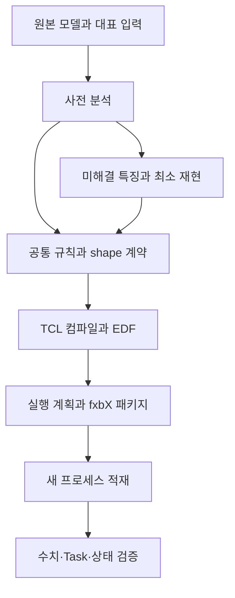

# 모델 포팅 실습과 Furiosa-Hug-Anything의 역할

**FuryNo5는 공통 연산과 실행 계획을 만들고, fxbX는 패키지를 적재·실행하며, FHA(Furiosa-Hug-Anything)는 포팅 절차와 검증을 연결한다.** 세 프로젝트를 하나의 “마법 변환기”로 생각하면 미지원 모델을 발견했을 때 수정할 위치를 찾기 어렵다. 이 장은 작은 Torch 모델로 생산자와 소비자 경계를 확인한 뒤 실제 Hugging Face 모델로 넓히는 순서를 다룬다. [FHA 역할 전환](https://github.com/smallstep-zzz/Furiosa-Hug-Anything/blob/8fc675f488763bef7c779ee037e8393ddd9f856a/docs/FHA_ROLE_TRANSITION.md)

예제는 조회한 커밋의 API(Application Programming Interface)에 맞춰 작성했다. 본 핸드북 편집 환경에는 RNGD가 없으므로 **아래 코드를 이번 작업에서 NPU(Neural Processing Unit) 실측한 것은 아니다.** 저장소의 기존 하드웨어 검증과 독자의 새 실행 결과는 구분한다. FuryNo5와 FHA 소스 링크는 저장소 접근 권한이 필요하다.

## 1. 포팅의 입력은 모델 이름보다 넓다

포팅 계약에는 원본 모델 revision, configuration, 실제 입력 shape·dtype·stride, 전후처리, mask 의미, 가변 길이 정책, 상태 변화가 들어간다. 예를 들어 같은 `aten.mm`이라도 BF16(Bfloat16) contiguous 행렬과 FP32(Float32) 비연속 view는 같은 시험이 아니다. 연산 이름이 같아도 크기·배치·메모리 계약이 달라지면 기존 EDF를 사용할 수 있는지 다시 판단해야 한다. [FHA feature 정의](https://github.com/smallstep-zzz/Furiosa-Hug-Anything/blob/8fc675f488763bef7c779ee037e8393ddd9f856a/docs/AUTOMATED_PORTING.md) · [FuryNo5 입력 검사](https://github.com/smallstep-zzz/FuryNo5/blob/bba9efea8201aec48150514a35d0b637d29d107e/tplmachine/execution_plan.py)

| 먼저 고정할 항목 | 예 | 왜 필요한가 |
|---|---|---|
| 원본 | HF repository와 commit | 가중치·설정 변경을 성능 변경과 분리 |
| 실제 작업 | 이미지 분류, 임베딩, decoder 한 step | 출력과 상태의 의미 결정 |
| 입력 규격 | `[4,8]`, BF16, contiguous | 컴파일과 ABI 선택 |
| 정확도 기준 | 절대·상대 오차, 과제별 품질 | 더 빠르지만 다른 계산인 결과 배제 |
| 장치 환경 | SDK·TCC·driver·fusion·mesh | EDF와 runtime 호환 |
| 측정 범위 | 첫 적재 / warm 호출 / 전체 요청 | 비용 누락 방지 |

## 2. 준비: 서로 맞는 소스를 설치한다

공식 SDK(Software Development Kit)와 드라이버가 동작하는 Linux 환경에서 각 프로젝트의 호환 버전을 맞춘다. `pip install fxbx`가 최신 GitHub의 모든 기능을 포함한다고 가정하지 않는다. 아래는 이미 내려받은 세 checkout을 같은 SDK Python에 연결하는 **개발 환경 예**다. 의존성 설치를 생략하므로 필요한 SDK와 Python 패키지는 사전에 준비해야 한다. [FHA 설치 안내](https://github.com/smallstep-zzz/Furiosa-Hug-Anything/blob/8fc675f488763bef7c779ee037e8393ddd9f856a/README.md) · [fxbX 패키지 설정](https://github.com/smallstep-zzz/fxbX/blob/03d993b4d1b36cdda209d61bbf447434c174b401/pyproject.toml)

```bash
python -m pip install --no-deps -e ./FuryNo5
python -m pip install --no-deps -e ./fxbX
python -m pip install --no-deps -e ./Furiosa-Hug-Anything

fxbx doctor
python -c "import tclmachine, fxbx, forge_fxbex; print('imports OK')"
python -m forge_fxbex.native --help
```

SDK의 Python 환경과 CLI가 사용하는 Python이 다르면 import 성공과 실제 실행이 갈릴 수 있다. 먼저 `python -m pip show furiosa-torch furiosa-tcc fxbx`로 같은 interpreter에서 확인한다. 패키지가 있다고 장치가 열린다는 뜻도 아니므로 driver 상태는 3장의 점검 절차로 확인한다.

## 3. 작은 모델을 끝까지 통과시킨다

다음은 저장소의 `examples/native_execution_plan.py`와 같은 종류의 작은 MLP(Multilayer Perceptron)다. 학습 가능한 parameter를 그대로 넘기지 않고 추론용으로 고정한다. `preflight_only`는 컴파일과 NPU 할당 없이 지원 진단을 기록하는 경로다. 사전 분석과 실제 export의 출력 이름은 새 경로를 사용한다. [공식 프로젝트 예제](https://github.com/smallstep-zzz/FuryNo5/blob/bba9efea8201aec48150514a35d0b637d29d107e/examples/native_execution_plan.py) · [export_model 옵션](https://github.com/smallstep-zzz/FuryNo5/blob/bba9efea8201aec48150514a35d0b637d29d107e/tplmachine/execution_plan.py#L355-L381)

```python
# tiny_port.py — 호환 SDK와 RNGD가 있는 개발 환경에서 실행
import torch
import tclmachine
from fxbx import GraphFXB


def main():
    torch.manual_seed(42)
    model = torch.nn.Sequential(
        torch.nn.Linear(8, 12),
        torch.nn.ReLU(),
        torch.nn.Linear(12, 8),
    ).bfloat16().eval().requires_grad_(False)
    x = torch.randn(4, 8, dtype=torch.bfloat16)

    preflight = tclmachine.export_model(
        model, (x,), "tiny-preflight.fxbx", preflight_only=True,
    )
    print("preflight:", preflight)
    report = tclmachine.export_model(
        model, (x,), "tiny.fxbx", compile_workers=4,
    )
    print("export:", report)

    with torch.no_grad():
        expected = model(x)
    with GraphFXB("tiny.fxbx", weights=model.state_dict()) as runner:
        actual, = runner.predict((x,))

    torch.testing.assert_close(actual, expected, atol=0.02, rtol=0.02)
    print("tiny numerical comparison passed")


if __name__ == "__main__":
    main()
```

```bash
python tiny_port.py
```

컴파일 worker는 `spawn` 방식의 별도 process를 사용한다. 따라서 전체 실행을 `main()` 안에 두고 위 보호문을 유지한다. notebook cell을 그대로 복사 실행하는 대신 `.py` 파일로 실행하는 예제다. [worker 생성 코드](https://github.com/smallstep-zzz/FuryNo5/blob/bba9efea8201aec48150514a35d0b637d29d107e/tplmachine/execution_plan.py#L286-L286)

이 예제의 `0.02`는 이 작은 BF16 확인을 위한 값이다. 모델 전체의 합격 기준으로 복사하지 않는다. 허용오차는 출력 범위·누산 방식·과제 품질을 고려해 미리 정해야 한다. 코드가 끝났다는 사실은 수치 비교 통과를 뜻하며, CPU 모델 fallback이 없었다는 독립 증거는 공식 profiler의 NPU Task와 실행 경로 감사로 더해야 한다. 반복 실행 시 기존 산출물을 덮어쓰지 않도록 새 출력 이름이나 새 실험 디렉터리를 사용한다.

### 저장된 체크포인트 파일에서 시작하기

이미 학습한 모델 파일을 포팅할 때도 같은 경로를 사용한다. 다음 9줄은 앞 예제의 `main()` 안에서 `model`과 `x`를 만든 뒤 넣는 대체 export 부분이다. 첫 줄은 파일을 만드는 시연이며, 자신이 만든 `state_dict` 체크포인트가 이미 있다면 생략하고 그 파일 경로를 사용한다. `map_location="cpu"`는 가중치를 우선 호스트에 적재하고, `weights_only=True`는 tensor와 기본 자료형 중심으로 역직렬화 범위를 제한한다. [PyTorch 2.10 torch.load](https://docs.pytorch.org/docs/2.10/generated/torch.load.html)

```python
torch.save(model.state_dict(), "tiny-state.pt")
restored = torch.nn.Sequential(
    torch.nn.Linear(8, 12), torch.nn.ReLU(), torch.nn.Linear(12, 8),
).bfloat16().eval().requires_grad_(False)
state = torch.load("tiny-state.pt", map_location="cpu", weights_only=True)
restored.load_state_dict(state, strict=True)
report = tclmachine.export_model(
    restored, (x,), "tiny-from-checkpoint.fxbx", compile_workers=4,
)
```

`state_dict`에는 parameter와 등록된 buffer가 들어가므로 원본 architecture와 forward 구현은 별도로 있어야 한다. 여기서는 파일을 만든 모델과 같은 layer·차원을 선언하고 `strict=True`로 parameter 이름의 누락·추가를 오류로 드러낸다. shape 불일치도 해결한 뒤 export해야 한다. BF16은 이 Tiny MLP의 입력·가중치 계약이며 모든 모델을 무조건 BF16으로 바꾸라는 뜻이 아니다. [PyTorch 모델 저장·적재 안내](https://docs.pytorch.org/tutorials/beginner/saving_loading_models.html)

실행할 때는 앞 예제의 `GraphFXB` 부분을 `GraphFXB("tiny-from-checkpoint.fxbx", weights=restored.state_dict())`로 바꾸고 참조 출력도 `restored(x)`로 비교한다. 이 커스텀 export 경로의 `.fxbx`는 실행 계획과 EDF를 전달하며, 원본 가중치 파일의 역할까지 자동으로 대체하지 않는다. 원본 architecture·가중치 revision·입력 계약을 함께 보관해야 다시 적재하고 검증할 수 있다. [가중치 전달 API 예제](https://github.com/smallstep-zzz/FuryNo5/blob/bba9efea8201aec48150514a35d0b637d29d107e/examples/native_execution_plan.py)



## 4. FHA를 경유해 같은 역할을 호출한다

FHA의 bridge는 새로운 컴파일러를 구현하지 않는다. `forge_fxbex/native.py`의 실제 위임 부분은 다음과 같다.

```python
from tplmachine.fxb_export.model_export import build_model as export
return export(model, output, **options)
```

[출처: FHA native.build_model](https://github.com/smallstep-zzz/Furiosa-Hug-Anything/blob/8fc675f488763bef7c779ee037e8393ddd9f856a/forge_fxbex/native.py#L22-L31)

Python에서 앞 절의 `main()` 안에 있는 `model`과 `x`를 그대로 사용하면 다음과 같이 호출한다. 아래는 그 함수 안에 넣을 대체 export 부분이며 독립적인 완성 스크립트가 아니다. FHA의 병렬 컴파일에도 같은 `__main__` 보호가 필요하다.

```python
from forge_fxbex.native import build_model

report = build_model(
    model, "tiny-via-fha.fxbx",
    example_inputs=(x,), concurrency=4,
)
print(report["status"])
```

이 함수의 분기를 이해해야 한다. 문자열이나 경로를 넘기면 공식 architecture-aware builder에 위임한다. 실제 Torch module과 `example_inputs`를 넘기면 FuryNo5의 커스텀 graph 경로를 사용한다. 따라서 **미지원 HF 모델 ID를 CLI에 넣었다고 자동으로 모든 미지원 연산을 구현해 주는 것은 아니다.** [생산자 분기](https://github.com/smallstep-zzz/FuryNo5/blob/bba9efea8201aec48150514a35d0b637d29d107e/tplmachine/fxb_export/model_export.py#L31-L118)

```bash
# 공식 builder가 architecture를 지원하는 HF assets의 경로
python -m forge_fxbex.native build-model ./hf-assets   -o ./registered-model.fxb --concurrency 4

# genuine manifest와 EDF가 이미 준비된 native-source의 포장·검사
python -m forge_fxbex.native build ./native-source -o ./repacked.fxb
python -m forge_fxbex.native inspect ./repacked.fxb
```

`native-source`는 `manifest.json`과 참조된 EDF를 갖춘 디렉터리다. 여기에 임의 Torch checkpoint나 serialized Runnable을 넣으면 native EDF export와 같은 뜻이 되지 않는다. [FHA CLI 정의](https://github.com/smallstep-zzz/Furiosa-Hug-Anything/blob/8fc675f488763bef7c779ee037e8393ddd9f856a/forge_fxbex/native.py)

## 5. 실제 모델로 확장할 때는 경계를 찾는다

전체 모델이 막히면 operator 이름 목록만 수집하는 것보다 실패하는 **정확한 특징**을 뽑는다. 입력 tensor의 shape·dtype·stride, scalar attribute, alias·mutation, mask, 원본 layer 위치를 보관한다. 같은 특징이 여러 layer에 반복되면 한 번의 공통 구현과 검증으로 연결하되, 서로 다른 shape를 같은 성공으로 묶지 않는다. [특징 추출·중복 제거 절차](https://github.com/smallstep-zzz/Furiosa-Hug-Anything/blob/8fc675f488763bef7c779ee037e8393ddd9f856a/docs/AUTOMATED_PORTING.md)

예를 들어 attention 실패를 해결할 때 “Qwen 전용 우회 코드”부터 추가하는 대신 transpose layout, softmax mask, gather index 범위, reduction 누산 순서 중 어느 계약이 막혔는지 좁힌다. 작은 fixture가 통과하면 실제 가중치가 있는 block, 마지막으로 전체 모델을 검사한다. 이 순서는 FuryNo5의 공통성 목표를 유지하면서 장애 원인을 작게 만드는 개발 권장 순서다.

## 6. FHA가 자동화하는 것과 사람·LLM이 판단할 것

| 단계 | 주 실행자 | 저장할 결과 |
|---|---|---|
| export와 feature 추출 | 코드 | 원본 위치를 가진 feature 목록 |
| SDK 선언·기존 규칙 대조 | 코드 | 후보와 확인되지 않은 지원 경계 |
| 반복 특징 묶기 | 코드 | 대표 fixture와 영향받는 layer |
| 새 TCL·분해 선택 | 개발자 또는 LLM | 의미·정밀도·layout을 설명한 변경 |
| CPU 컴파일 작업 | 제한된 병렬 worker | compile 결과와 재사용 identity |
| NPU 검증 | 장치 소유권을 확보한 worker | 수치 비교, Task trace, fallback 감사 |
| 모델 통합·배포 판단 | 결과 집계와 개발자 | 전체 모델 품질·상태·속도·재적재 |

현재 FHA의 기본 방향은 공통 rule 개발의 소유권을 FuryNo5에 두고, 자신은 유지보수·통합·검증을 담당하는 것이다. 과거 모델별 adapter와 실험 파일은 호환 경로로 남아 있다. 모든 특징마다 LLM을 호출하는 방식은 비용도 커지고 이미 검증된 동작의 일관성도 해칠 수 있으므로, 미해결 의미나 실측 병목에 집중한다. [역할 전환](https://github.com/smallstep-zzz/Furiosa-Hug-Anything/blob/8fc675f488763bef7c779ee037e8393ddd9f856a/docs/FHA_ROLE_TRANSITION.md)

자동화 도구의 실제 진입점 예는 다음과 같다. `my_adapter:representative_component`는 사용자가 작성한 신뢰 가능한 factory이며 `(module, args, kwargs)`를 반환해야 한다. 이 이름은 저장소에 이미 존재하는 모델이 아니라 **자신의 factory를 넣을 자리**다.

```bash
PYTHONPATH=. python tools/port_model.py   --model my-model --factory my_adapter:representative_component   --output reports/my-model-001 --cpu-workers 2 --cpu-budget 8 --execute

PYTHONPATH=. python tools/porting_queue.py status
```

`--execute`는 실제 컴파일·검증 작업을 시작한다. CPU budget은 CPU thread 배분이며 RAM 보증이 아니다. NPU 작업을 여러 CPU compile worker와 같은 방식으로 동시에 실행하면 trace와 메모리 사용이 섞이므로, 현재 FHA는 공유 장치 잠금을 이용해 검증을 직렬화한다. PE(Processing Element) 8개를 fusion한다고 독립 NPU 8개가 되는 것은 아니다. [명령과 자원 계약](https://github.com/smallstep-zzz/Furiosa-Hug-Anything/blob/8fc675f488763bef7c779ee037e8393ddd9f856a/docs/AUTOMATED_PORTING.md)

## 7. 완료의 정의를 보고서에 남긴다

정적 모델에서는 입출력 변경, 반복 호출, 새 프로세스 재적재가 핵심이다. 상태 모델에서는 두 요청의 상태가 섞이지 않는지, reset이 원래 의미를 복구하는지, prefill과 decode가 같은 KV 계약을 쓰는지까지 필요하다. 입력 길이 하나가 통과했다고 모델 configuration의 전체 문맥 길이가 검증된 것은 아니다. [요청 상태 처리](https://github.com/smallstep-zzz/fxbX/blob/03d993b4d1b36cdda209d61bbf447434c174b401/fxbex/execution_fxb.py) · [FHA native 전환 경계](https://github.com/smallstep-zzz/Furiosa-Hug-Anything/blob/8fc675f488763bef7c779ee037e8393ddd9f856a/docs/NATIVE_FXB_TRANSITION.md)

보고서에는 다음을 별도로 기록한다.

- **생성:** 어떤 graph·bucket·dtype에서 EDF와 계획을 만들었는가.
- **수치:** 어떤 실제 입력·가중치와 허용오차로 비교했는가.
- **실행:** NPU Task가 계획의 실행 step과 연결되는가.
- **호환:** SDK·driver·compiler·commit·가중치 revision이 무엇인가.
- **성능:** 최초 컴파일, 첫 적재, warm 요청, 전체 요청을 어떻게 나눴는가.
- **미해결:** 모델 전체 지원, 가변 shape, 서빙 동시성 중 무엇이 남았는가.

FHA가 이 기록을 자동으로 모으는 목적은 실패를 감추는 데 있지 않다. 다음 개발자가 어느 layer의 어느 계약을 수정해야 하는지 바로 재현하게 만드는 데 있다.

## 출처

| 근거 | 확인 위치 |
|---|---|
| 최소 모델과 export API | [native_execution_plan.py](https://github.com/smallstep-zzz/FuryNo5/blob/bba9efea8201aec48150514a35d0b637d29d107e/examples/native_execution_plan.py), [execution_plan.py](https://github.com/smallstep-zzz/FuryNo5/blob/bba9efea8201aec48150514a35d0b637d29d107e/tplmachine/execution_plan.py) |
| 체크포인트 적재와 state_dict | [torch.load 2.10](https://docs.pytorch.org/docs/2.10/generated/torch.load.html), [Saving and Loading Models](https://docs.pytorch.org/tutorials/beginner/saving_loading_models.html) |
| 공식 모델과 커스텀 Torch 분기 | [model_export.py](https://github.com/smallstep-zzz/FuryNo5/blob/bba9efea8201aec48150514a35d0b637d29d107e/tplmachine/fxb_export/model_export.py) |
| FHA의 실제 위임·CLI | [native.py](https://github.com/smallstep-zzz/Furiosa-Hug-Anything/blob/8fc675f488763bef7c779ee037e8393ddd9f856a/forge_fxbex/native.py) |
| 자동화와 fixture·queue 경계 | [AUTOMATED_PORTING.md](https://github.com/smallstep-zzz/Furiosa-Hug-Anything/blob/8fc675f488763bef7c779ee037e8393ddd9f856a/docs/AUTOMATED_PORTING.md) |
| 현재 역할 | [FHA_ROLE_TRANSITION.md](https://github.com/smallstep-zzz/Furiosa-Hug-Anything/blob/8fc675f488763bef7c779ee037e8393ddd9f856a/docs/FHA_ROLE_TRANSITION.md) |
| 배포·검증의 의미 | [NATIVE_FXB_TRANSITION.md](https://github.com/smallstep-zzz/Furiosa-Hug-Anything/blob/8fc675f488763bef7c779ee037e8393ddd9f856a/docs/NATIVE_FXB_TRANSITION.md) |

FuryNo5와 FHA 링크는 비공개 저장소 접근 권한이 필요하다. 코드 스니펫은 이 장에 필요한 부분만 제시했으며 SDK 자체를 재배포하지 않는다.

