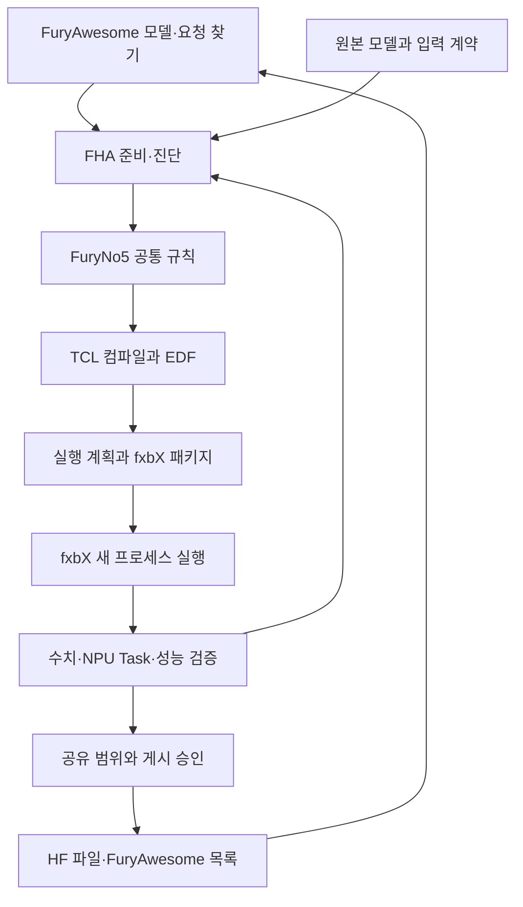
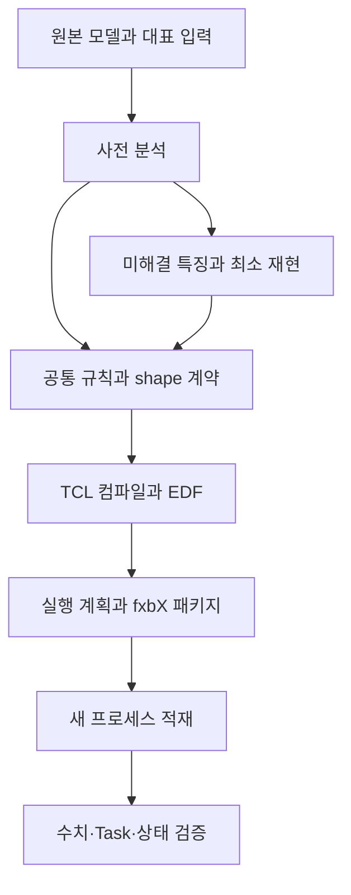

# 모델 포팅 실습과 FHA·FuryAwesome의 역할

**FHA(Furiosa-Hug-Anything)는 FuryAwesome·FuryNo5·fxbX를 연결해 모델 포팅을 돕는 도구 모음이다.** FuryAwesome에서 배포된 모델과 포팅 요청을 찾고, FuryNo5에 공통 연산 구현·실행 계획·패키지 생성을 맡기며, fxbX로 적재·실행을 확인한다. 검증된 결과를 공유할 때는 HF(Hugging Face) 파일 배포와 FuryAwesome 카탈로그 등록을 연결한다. 각 도구의 책임과 현재 연결 범위를 알아야 실패한 부분을 고칠 수 있다. [FHA 포팅 skill](https://github.com/smallstep-zzz/Furiosa-Hug-Anything/blob/8fc675f488763bef7c779ee037e8393ddd9f856a/skills/rngd-model-porting/SKILL.md) · [FuryAwesome 소개](https://github.com/smallstep-zzz/furyawesome/blob/c668ecbceac2bedd04c6e539c1a5509a404a464d/README.md)

이 장의 예제는 조회한 커밋의 API(Application Programming Interface)에 맞춰 작성했다. FuryAwesome은 `c668ecb`, FHA는 `8fc675f`를 2026-11-19에 다시 확인했다. **편집 환경에는 RNGD가 없으므로 아래 코드를 이번 작업에서 NPU(Neural Processing Unit) 실측한 것은 아니다.** 저장소의 기존 검증 결과와 독자의 새 실행 결과는 구분한다. FuryNo5와 FHA 소스 링크는 저장소 접근 권한이 필요하다.

## 1. 네 도구가 맡는 책임

| 도구 | 실제 책임 | 다음 단계에 전달하는 것 |
|---|---|---|
| **FuryAwesome** | 모델 카탈로그, 사용법·다운로드 연결, 포팅 요청의 출발점 | 원본 모델·릴리스 식별자, 환경·검증 범위, HF 링크, 요청 정보 |
| **FHA** | 모델 준비, 실패 진단, 작업 조율, 독립 검증, 게시 절차 | 대표 입력과 재현 사례, 컴파일 요청, 검증 보고서, 검토된 게시 메타데이터 |
| **FuryNo5** | 재사용 가능한 연산 규칙, TCL(Tensor Contraction Language) 기반 컴파일 연결, 실행 계획과 패키지 생성 | EDF, 입출력·가중치·상태를 연결한 실행 계획, fxbX에서 사용할 패키지 |
| **fxbX** | 패키지와 실행 계획 적재, 가중치 연결, 실행·반복 호출 | 실제 출력, 실행 기록, 적재·호환 오류 |

FuryAwesome의 카탈로그 데이터가 연산 구현이나 컴파일러를 대신하지는 않는다. FHA 역시 별도 커널을 모델마다 복제하는 방식보다 FuryNo5의 공통 규칙을 보완하도록 구성되어 있다. 공식 컴파일러가 TCL을 EDF로 만드는 과정과 fxbX가 이를 실행하는 과정은 앞 장들의 장치·런타임 계약을 따른다. [역할 분담](https://github.com/smallstep-zzz/Furiosa-Hug-Anything/blob/8fc675f488763bef7c779ee037e8393ddd9f856a/docs/FHA_ROLE_TRANSITION.md) · [FHA의 실제 위임](https://github.com/smallstep-zzz/Furiosa-Hug-Anything/blob/8fc675f488763bef7c779ee037e8393ddd9f856a/forge_fxbex/native.py)

다음은 도구를 함께 사용하는 전체 흐름이다. 검증에 실패하면 입력 계약이나 공통 규칙으로 돌아간다. 마지막 공유 단계는 패키지 형식과 게시 도구의 지원 범위를 확인한 뒤 진행한다. 현재 구현의 구체적인 경계는 10절에서 다룬다.



이 그림은 단일 명령의 내부 호출 순서를 뜻하지 않는다. **이미 등록된 모델은 사용법대로 바로 재사용할 수 있고, 새로운 모델은 진단·규칙 수정·전체 모델 검증이 추가된다.** 사용 가능한 모델의 발견부터 실패 수정과 재배포까지를 연결한 개발 흐름이다.

## 2. FuryAwesome에서 모델을 찾고 FHA로 요청을 정리한다

[FuryAwesome](https://furyawesome.softandsweet5.chatgpt.site/)의 첫 역할은 모델을 찾는 것이다. 카탈로그의 원본은 `model-catalog/<category>.json`이며, `scripts/catalog_store.py`가 이를 이용해 README 표, CLI(Command Line Interface)용 `catalog.json`·`models/*.json`, 웹용 `place-catalog.json`을 함께 만든다. 웹은 GitHub의 웹 카탈로그를 읽으며, 모델 파일은 HF의 고정 commit URL로 연결한다. GitHub 카탈로그에는 모델 바이너리를 넣지 않는다. [분류·출력 생성 코드](https://github.com/smallstep-zzz/furyawesome/blob/c668ecbceac2bedd04c6e539c1a5509a404a464d/scripts/catalog_store.py#L133-L193) · [웹 카탈로그 읽기](https://github.com/smallstep-zzz/furyawesome/blob/c668ecbceac2bedd04c6e539c1a5509a404a464d/site/dist/catalog.js)

모델을 선택하면 용도뿐 아니라 **SDK(Software Development Kit)·runtime 버전, 입력 범위, 별도 가중치 필요 여부, 검증된 실행 방법**을 확인한다. 아래는 해당 모델의 의존성과 SDK를 준비한 환경에서 실행할 수 있는 등록 모델의 예다. `fetch`는 다운로드이며, `run --sample`에서 샘플 추론을 수행한다. [FuryAwesome 실행 안내](https://github.com/smallstep-zzz/furyawesome/blob/c668ecbceac2bedd04c6e539c1a5509a404a464d/README.md)

```bash
fxbx doctor
fxbx fetch FLUX.2-klein-4B
fxbx run FLUX.2-klein-4B --sample
```

모든 등록 모델이 같은 설치·호출 계약을 가진 것은 아니다. 예를 들어 `all-MiniLM-L6-v2`의 등록 예는 배치 1·최대 16토큰의 BF16(Bfloat16) 임베딩이며, 별도 가중치와 동봉된 Python 실행 파일을 사용한다. NPU가 만든 은닉 상태에 호스트가 마스크 평균과 정규화를 적용하는 범위도 안내한다. 최신 Depth Anything V2 Small 사용법은 체크포인트를 연결하는 `fxbx>=0.9.3` 경로를 요구한다. 따라서 다른 모델의 명령이나 오래된 생성 템플릿의 runtime 버전을 그대로 적용하지 않는다. [MiniLM 사용법](https://github.com/smallstep-zzz/furyawesome/blob/c668ecbceac2bedd04c6e539c1a5509a404a464d/usage/all-minilm-l6-v2.md) · [Depth Anything 사용법](https://github.com/smallstep-zzz/furyawesome/blob/c668ecbceac2bedd04c6e539c1a5509a404a464d/usage/depth-anything-v2-small-hf.md)

필요한 모델이 없으면 FuryAwesome의 요청 화면에서 GitHub issue 초안을 만들 수 있다. 사용자가 GitHub에서 내용을 확인하고 제출하는 흐름이며, 요청 등록이 곧 컴파일 작업 실행은 아니다. FHA에는 이 요청들을 읽어 모델 계열별로 묶고 우선순위를 계산하는 코드가 있다. 다음 명령은 FHA checkout에서 인증된 GitHub CLI `gh`를 사용하며, 원격 issue를 수정하지 않는다. [요청 화면의 동작](https://github.com/smallstep-zzz/furyawesome/blob/c668ecbceac2bedd04c6e539c1a5509a404a464d/CONTRIBUTING.md) · [요청 수집·CLI 구현](https://github.com/smallstep-zzz/Furiosa-Hug-Anything/blob/8fc675f488763bef7c779ee037e8393ddd9f856a/forge_fxbex/requests.py)

```bash
python -m forge_fxbex requests --repository smallstep-zzz/furyawesome --limit 5
python -m forge_fxbex requests --cached --limit 5
python -m forge_fxbex requests --cached --model 'hf:OWNER/MODEL'
```

마지막 줄의 `hf:OWNER/MODEL`은 첫 명령의 `family` 값을 넣을 자리다. 기본 저장 위치는 `reports/furyawesome-requests.json`이며, `--cached`는 이 결과를 읽는다. `--repository`를 생략하면 현재 코드가 관리하는 두 요청 저장소를 조회하므로 각각의 읽기 권한이 필요하다. 우선순위는 요청 수·반응·난이도를 이용한 보조 지표이고, `difficulty.basis=name_estimate`는 이름에서 추정한 값이다. 실제 graph 지원이나 NPU 적재 가능성을 입증하지 않는다. 개발자는 요청한 variant·원본 revision·대표 입력과 난이도 근거를 확인한 뒤 포팅 대상을 정한다. [집계와 난이도 판단](https://github.com/smallstep-zzz/Furiosa-Hug-Anything/blob/8fc675f488763bef7c779ee037e8393ddd9f856a/forge_fxbex/requests.py#L151-L231)

## 3. 포팅의 입력은 모델 이름보다 넓다

포팅 계약에는 원본 모델 revision, configuration, 실제 입력 shape·dtype·stride, 전후처리, mask 의미, 가변 길이 정책, 상태 변화가 들어간다. 예를 들어 같은 `aten.mm`이라도 BF16(Bfloat16) contiguous 행렬과 FP32(Float32) 비연속 view는 같은 시험이 아니다. 연산 이름이 같아도 크기·배치·메모리 계약이 달라지면 기존 EDF를 사용할 수 있는지 다시 판단해야 한다. [FHA feature 정의](https://github.com/smallstep-zzz/Furiosa-Hug-Anything/blob/8fc675f488763bef7c779ee037e8393ddd9f856a/docs/AUTOMATED_PORTING.md) · [FuryNo5 입력 검사](https://github.com/smallstep-zzz/FuryNo5/blob/bba9efea8201aec48150514a35d0b637d29d107e/tplmachine/execution_plan.py)

| 먼저 고정할 항목 | 예 | 왜 필요한가 |
|---|---|---|
| 원본 | HF repository와 commit | 가중치·설정 변경을 성능 변경과 분리 |
| 실제 작업 | 이미지 분류, 임베딩, decoder 한 step | 출력과 상태의 의미 결정 |
| 입력 규격 | `[4,8]`, BF16, contiguous | 컴파일과 ABI 선택 |
| 정확도 기준 | 절대·상대 오차, 과제별 품질 | 더 빠르지만 다른 계산인 결과 배제 |
| 장치 환경 | SDK·TCC·driver·fusion·mesh | EDF와 runtime 호환 |
| 측정 범위 | 첫 적재 / warm 호출 / 전체 요청 | 비용 누락 방지 |

## 4. 준비: 서로 맞는 소스를 설치한다

공식 SDK(Software Development Kit)와 드라이버가 동작하는 Linux 환경에서 각 프로젝트의 호환 버전을 맞춘다. `pip install fxbx`가 최신 GitHub의 모든 기능을 포함한다고 가정하지 않는다. 아래는 이미 내려받은 세 checkout을 같은 SDK Python에 연결하는 **개발 환경 예**다. 의존성 설치를 생략하므로 필요한 SDK와 Python 패키지는 사전에 준비해야 한다. [FHA 설치 안내](https://github.com/smallstep-zzz/Furiosa-Hug-Anything/blob/8fc675f488763bef7c779ee037e8393ddd9f856a/README.md) · [fxbX 패키지 설정](https://github.com/smallstep-zzz/fxbX/blob/03d993b4d1b36cdda209d61bbf447434c174b401/pyproject.toml)

```bash
python -m pip install --no-deps -e ./FuryNo5
python -m pip install --no-deps -e ./fxbX
python -m pip install --no-deps -e ./Furiosa-Hug-Anything

fxbx doctor
python -c "import tclmachine, fxbx, forge_fxbex; print('imports OK')"
python -m forge_fxbex.native --help
```

SDK의 Python 환경과 CLI가 사용하는 Python이 다르면 import 성공과 실제 실행이 갈릴 수 있다. 먼저 `python -m pip show furiosa-torch furiosa-tcc fxbx`로 같은 interpreter에서 확인한다. 패키지가 있다고 장치가 열린다는 뜻도 아니므로 driver 상태는 3장의 점검 절차로 확인한다.

## 5. 작은 모델을 끝까지 통과시킨다

다음은 저장소의 `examples/native_execution_plan.py`와 같은 종류의 작은 MLP(Multilayer Perceptron)다. 학습 가능한 parameter를 그대로 넘기지 않고 추론용으로 고정한다. `preflight_only`는 컴파일과 NPU 할당 없이 지원 진단을 기록하는 경로다. 사전 분석과 실제 export의 출력 이름은 새 경로를 사용한다. [FuryNo5 예제](https://github.com/smallstep-zzz/FuryNo5/blob/bba9efea8201aec48150514a35d0b637d29d107e/examples/native_execution_plan.py) · [export_model 옵션](https://github.com/smallstep-zzz/FuryNo5/blob/bba9efea8201aec48150514a35d0b637d29d107e/tplmachine/execution_plan.py#L355-L381)

```python
# tiny_port.py — 호환 SDK와 RNGD가 있는 개발 환경에서 실행
import torch
import tclmachine
from fxbx import GraphFXB


def main():
    torch.manual_seed(42)
    model = torch.nn.Sequential(
        torch.nn.Linear(8, 12),
        torch.nn.ReLU(),
        torch.nn.Linear(12, 8),
    ).bfloat16().eval().requires_grad_(False)
    x = torch.randn(4, 8, dtype=torch.bfloat16)

    preflight = tclmachine.export_model(
        model, (x,), "tiny-preflight.fxbx", preflight_only=True,
    )
    print("preflight:", preflight)
    report = tclmachine.export_model(
        model, (x,), "tiny.fxbx", compile_workers=4,
    )
    print("export:", report)

    with torch.no_grad():
        expected = model(x)
    with GraphFXB("tiny.fxbx", weights=model.state_dict()) as runner:
        actual, = runner.predict((x,))

    torch.testing.assert_close(actual, expected, atol=0.02, rtol=0.02)
    print("tiny numerical comparison passed")


if __name__ == "__main__":
    main()
```

```bash
python tiny_port.py
```

컴파일 worker는 `spawn` 방식의 별도 process를 사용한다. 따라서 전체 실행을 `main()` 안에 두고 위 보호문을 유지한다. notebook cell을 그대로 복사 실행하는 대신 `.py` 파일로 실행하는 예제다. [worker 생성 코드](https://github.com/smallstep-zzz/FuryNo5/blob/bba9efea8201aec48150514a35d0b637d29d107e/tplmachine/execution_plan.py#L286-L286)

이 예제의 `0.02`는 이 작은 BF16 확인을 위한 값이다. 모델 전체의 합격 기준으로 복사하지 않는다. 허용오차는 출력 범위·누산 방식·과제 품질을 고려해 미리 정해야 한다. 코드가 끝났다는 사실은 수치 비교 통과를 뜻하며, CPU 모델 fallback이 없었다는 독립 증거는 공식 profiler의 NPU Task와 실행 경로 감사로 더해야 한다. 반복 실행 시 기존 산출물을 덮어쓰지 않도록 새 출력 이름이나 새 실험 디렉터리를 사용한다.

### 저장된 체크포인트 파일에서 시작하기

이미 학습한 모델 파일을 포팅할 때도 같은 경로를 사용한다. 다음 9줄은 앞 예제의 `main()` 안에서 `model`과 `x`를 만든 뒤 넣는 대체 export 부분이다. 첫 줄은 파일을 만드는 시연이며, 자신이 만든 `state_dict` 체크포인트가 이미 있다면 생략하고 그 파일 경로를 사용한다. `map_location="cpu"`는 가중치를 우선 호스트에 적재하고, `weights_only=True`는 tensor와 기본 자료형 중심으로 역직렬화 범위를 제한한다. [PyTorch 2.10 torch.load](https://docs.pytorch.org/docs/2.10/generated/torch.load.html)

```python
torch.save(model.state_dict(), "tiny-state.pt")
restored = torch.nn.Sequential(
    torch.nn.Linear(8, 12), torch.nn.ReLU(), torch.nn.Linear(12, 8),
).bfloat16().eval().requires_grad_(False)
state = torch.load("tiny-state.pt", map_location="cpu", weights_only=True)
restored.load_state_dict(state, strict=True)
report = tclmachine.export_model(
    restored, (x,), "tiny-from-checkpoint.fxbx", compile_workers=4,
)
```

`state_dict`에는 parameter와 등록된 buffer가 들어가므로 원본 architecture와 forward 구현은 별도로 있어야 한다. 여기서는 파일을 만든 모델과 같은 layer·차원을 선언하고 `strict=True`로 parameter 이름의 누락·추가를 오류로 드러낸다. shape 불일치도 해결한 뒤 export해야 한다. BF16은 이 Tiny MLP의 입력·가중치 계약이며 모든 모델을 무조건 BF16으로 바꾸라는 뜻이 아니다. [PyTorch 모델 저장·적재 안내](https://docs.pytorch.org/tutorials/beginner/saving_loading_models.html)

실행할 때는 앞 예제의 `GraphFXB` 부분을 `GraphFXB("tiny-from-checkpoint.fxbx", weights=restored.state_dict())`로 바꾸고 참조 출력도 `restored(x)`로 비교한다. 이 커스텀 export 경로의 `.fxbx`는 실행 계획과 EDF를 전달하며, 원본 가중치 파일의 역할까지 자동으로 대체하지 않는다. 원본 architecture·가중치 revision·입력 계약을 함께 보관해야 다시 적재하고 검증할 수 있다. [가중치 전달 API 예제](https://github.com/smallstep-zzz/FuryNo5/blob/bba9efea8201aec48150514a35d0b637d29d107e/examples/native_execution_plan.py)



## 6. FHA를 경유해 같은 역할을 호출한다

FHA의 bridge는 새로운 컴파일러를 구현하지 않는다. `forge_fxbex/native.py`의 실제 위임 부분은 다음과 같다.

```python
from tplmachine.fxb_export.model_export import build_model as export
return export(model, output, **options)
```

[출처: FHA native.build_model](https://github.com/smallstep-zzz/Furiosa-Hug-Anything/blob/8fc675f488763bef7c779ee037e8393ddd9f856a/forge_fxbex/native.py#L22-L31)

Python에서 앞 절의 `main()` 안에 있는 `model`과 `x`를 그대로 사용하면 다음과 같이 호출한다. 아래는 그 함수 안에 넣을 대체 export 부분이며 독립적인 완성 스크립트가 아니다. FHA의 병렬 컴파일에도 같은 `__main__` 보호가 필요하다.

```python
from forge_fxbex.native import build_model

report = build_model(
    model, "tiny-via-fha.fxbx",
    example_inputs=(x,), concurrency=4,
)
print(report["status"])
```

이 함수의 분기를 이해해야 한다. 문자열이나 경로를 넘기면 공식 architecture-aware builder에 위임한다. 실제 Torch module과 `example_inputs`를 넘기면 FuryNo5의 커스텀 graph 경로를 사용한다. 따라서 **미지원 HF 모델 ID를 CLI에 넣었다고 자동으로 모든 미지원 연산을 구현해 주는 것은 아니다.** [생산자 분기](https://github.com/smallstep-zzz/FuryNo5/blob/bba9efea8201aec48150514a35d0b637d29d107e/tplmachine/fxb_export/model_export.py#L31-L118)

```bash
# 공식 builder가 architecture를 지원하는 HF assets의 경로
python -m forge_fxbex.native build-model ./hf-assets   -o ./registered-model.fxb --concurrency 4

# genuine manifest와 EDF가 이미 준비된 native-source의 포장·검사
python -m forge_fxbex.native build ./native-source -o ./repacked.fxb
python -m forge_fxbex.native inspect ./repacked.fxb
```

`native-source`는 `manifest.json`과 참조된 EDF를 갖춘 디렉터리다. 여기에 임의 Torch checkpoint나 serialized Runnable을 넣으면 native EDF export와 같은 뜻이 되지 않는다. [FHA CLI 정의](https://github.com/smallstep-zzz/Furiosa-Hug-Anything/blob/8fc675f488763bef7c779ee037e8393ddd9f856a/forge_fxbex/native.py)

## 7. 실제 모델로 확장할 때는 경계를 찾는다

전체 모델이 막히면 operator 이름 목록만 수집하는 것보다 실패하는 **정확한 특징**을 뽑는다. 입력 tensor의 shape·dtype·stride, scalar attribute, alias·mutation, mask, 원본 layer 위치를 보관한다. 같은 특징이 여러 layer에 반복되면 한 번의 공통 구현과 검증으로 연결하되, 서로 다른 shape를 같은 성공으로 묶지 않는다. [특징 추출·중복 제거 절차](https://github.com/smallstep-zzz/Furiosa-Hug-Anything/blob/8fc675f488763bef7c779ee037e8393ddd9f856a/docs/AUTOMATED_PORTING.md)

예를 들어 attention 실패를 해결할 때 “Qwen 전용 우회 코드”부터 추가하는 대신 transpose layout, softmax mask, gather index 범위, reduction 누산 순서 중 어느 계약이 막혔는지 좁힌다. 작은 fixture가 통과하면 실제 가중치가 있는 block, 마지막으로 전체 모델을 검사한다. 이 순서는 FuryNo5의 공통성 목표를 유지하면서 장애 원인을 작게 만드는 개발 권장 순서다.

## 8. FHA가 자동화하는 것과 사람·LLM이 판단할 것

| 단계 | 주 실행자 | 저장할 결과 |
|---|---|---|
| export와 feature 추출 | 코드 | 원본 위치를 가진 feature 목록 |
| SDK 선언·기존 규칙 대조 | 코드 | 후보와 확인되지 않은 지원 경계 |
| 반복 특징 묶기 | 코드 | 대표 fixture와 영향받는 layer |
| 새 TCL·분해 선택 | 개발자 또는 LLM | 의미·정밀도·layout을 설명한 변경 |
| CPU 컴파일 작업 | 제한된 병렬 worker | compile 결과와 재사용 identity |
| NPU 검증 | 장치 소유권을 확보한 worker | 수치 비교, Task trace, fallback 감사 |
| 모델 통합·배포 판단 | 결과 집계와 개발자 | 전체 모델 품질·상태·속도·재적재 |

현재 FHA의 기본 방향은 공통 rule 개발의 소유권을 FuryNo5에 두고, 자신은 유지보수·통합·검증을 담당하는 것이다. 과거 모델별 adapter와 실험 파일은 호환 경로로 남아 있다. 모든 특징마다 LLM을 호출하는 방식은 비용도 커지고 이미 검증된 동작의 일관성도 해칠 수 있으므로, 미해결 의미나 실측 병목에 집중한다. [역할 전환](https://github.com/smallstep-zzz/Furiosa-Hug-Anything/blob/8fc675f488763bef7c779ee037e8393ddd9f856a/docs/FHA_ROLE_TRANSITION.md)

자동화 도구의 실제 진입점 예는 다음과 같다. `my_adapter:representative_component`는 사용자가 작성한 신뢰 가능한 factory이며 `(module, args, kwargs)`를 반환해야 한다. 이 이름은 저장소에 이미 존재하는 모델이 아니라 **자신의 factory를 넣을 자리**다.

```bash
PYTHONPATH=. python tools/port_model.py   --model my-model --factory my_adapter:representative_component   --output reports/my-model-001 --cpu-workers 2 --cpu-budget 8 --execute

PYTHONPATH=. python tools/porting_queue.py status
```

`--execute`는 실제 컴파일·검증 작업을 시작한다. CPU budget은 CPU thread 배분이며 RAM 보증이 아니다. NPU 작업을 여러 CPU compile worker와 같은 방식으로 동시에 실행하면 trace와 메모리 사용이 섞이므로, 현재 FHA는 공유 장치 잠금을 이용해 검증을 직렬화한다. PE(Processing Element) 8개를 fusion한다고 독립 NPU 8개가 되는 것은 아니다. [명령과 자원 계약](https://github.com/smallstep-zzz/Furiosa-Hug-Anything/blob/8fc675f488763bef7c779ee037e8393ddd9f856a/docs/AUTOMATED_PORTING.md)

### 포팅 skill은 코드 경로를 고르는 절차다

FHA의 `skills/rngd-model-porting/SKILL.md`는 코딩 에이전트가 어떤 도구를 선택하고 어떤 증거를 확인할지 정한다. 하나의 실패 연산이나 shape를 고칠 때는 FuryNo5의 직접 진단·최소 재현 경로를 사용하고, 여러 모델의 준비·평가 이력을 관리할 때만 별도 캠페인 도구를 선택한다. 패키지 적재 실패는 먼저 FHA·fxbX의 적재 계약에서 조사한다. 모든 실패를 새로운 TCL 커널 개발로 연결하지 않는다. [skill의 경로 선택](https://github.com/smallstep-zzz/Furiosa-Hug-Anything/blob/8fc675f488763bef7c779ee037e8393ddd9f856a/skills/rngd-model-porting/SKILL.md#L24-L39)

skill은 **FuryNo5가 패키지와 실행 계약을 만들고, FHA가 준비·검증·게시를 조율하며, fxbX가 새 SDK 프로세스에서 실행하도록** 역할을 명시한다. 실제 수정은 실패 재현 → 공통 규칙 또는 어댑터 수정 → 최소 검증 → 원래 모델 재검증 순서로 진행한다. 이 문서를 에이전트에 전달하는 것 자체가 모델 지원을 보장하지 않으며, 게시가 이미 결정되지 않았다면 검증된 산출물과 공유 범위를 준비한 후 한 번 확인하도록 되어 있다. [수정 절차와 실행·전달 조건](https://github.com/smallstep-zzz/Furiosa-Hug-Anything/blob/8fc675f488763bef7c779ee037e8393ddd9f856a/skills/rngd-model-porting/SKILL.md#L77-L139)

## 9. 완료의 정의를 보고서에 남긴다

정적 모델에서는 입출력 변경, 반복 호출, 새 프로세스 재적재가 핵심이다. 상태 모델에서는 두 요청의 상태가 섞이지 않는지, reset이 원래 의미를 복구하는지, prefill과 decode가 같은 KV 계약을 쓰는지까지 필요하다. 입력 길이 하나가 통과했다고 모델 configuration의 전체 문맥 길이가 검증된 것은 아니다. [요청 상태 처리](https://github.com/smallstep-zzz/fxbX/blob/03d993b4d1b36cdda209d61bbf447434c174b401/fxbex/execution_fxb.py) · [FHA native 전환 경계](https://github.com/smallstep-zzz/Furiosa-Hug-Anything/blob/8fc675f488763bef7c779ee037e8393ddd9f856a/docs/NATIVE_FXB_TRANSITION.md)

보고서에는 다음을 별도로 기록한다.

- **생성:** 어떤 graph·bucket·dtype에서 EDF와 계획을 만들었는가.
- **수치:** 어떤 실제 입력·가중치와 허용오차로 비교했는가.
- **실행:** NPU Task가 계획의 실행 step과 연결되는가.
- **호환:** SDK·driver·compiler·commit·가중치 revision이 무엇인가.
- **성능:** 최초 컴파일, 첫 적재, warm 요청, 전체 요청을 어떻게 나눴는가.
- **미해결:** 모델 전체 지원, 가변 shape, 서빙 동시성 중 무엇이 남았는가.

FHA가 이 기록을 자동으로 모으는 목적은 실패를 감추는 데 있지 않다. 다음 개발자가 어느 layer의 어느 계약을 수정해야 하는지 바로 재현하게 만드는 데 있다.

## 10. 검증한 결과를 HF와 FuryAwesome에 공유한다

### 구현된 연결과 현재 게시기의 범위

FHA에는 `forge_fxbex.workflow.finish_export()`라는 공통 완료 함수가 있다. 게시를 요청하면 `publish.py`가 HF에 파일을 올리고, `furyawesome.py:sync_catalog()`가 공개 메타데이터를 카탈로그에 반영한다. 후자는 FuryAwesome의 `scripts/catalog_store.py`를 검토된 commit에 고정해 불러온다. 분류 원본과 README·CLI·웹 인덱스를 하나의 GitHub commit으로 갱신하므로 목록들을 따로 편집할 필요가 없다. [완료 함수](https://github.com/smallstep-zzz/Furiosa-Hug-Anything/blob/8fc675f488763bef7c779ee037e8393ddd9f856a/forge_fxbex/workflow.py) · [카탈로그 연결 코드](https://github.com/smallstep-zzz/Furiosa-Hug-Anything/blob/8fc675f488763bef7c779ee037e8393ddd9f856a/forge_fxbex/furyawesome.py#L206-L239)

`sync_catalog()`가 분류 카탈로그 경로를 선택하는 핵심은 다음과 같다. `_categorized_changes()`는 공유 카탈로그 함수의 `changes_for()`를 호출하고, 뒤의 `_commit()`이 실제 GitHub 변경을 반영한다. 이 코드는 컴파일이나 추론을 호출하지 않는다. [실제 호출 연결](https://github.com/smallstep-zzz/Furiosa-Hug-Anything/blob/8fc675f488763bef7c779ee037e8393ddd9f856a/forge_fxbex/furyawesome.py#L215-L239)

```python
# forge_fxbex/furyawesome.py: sync_catalog()의 분류 카탈로그 분기
path, new = record(payload)
root, branch, head, tree, files = _snapshot()
if "place-catalog.json" in files or any(p.startswith("model-catalog/") for p in files):
    changes = _categorized_changes(root, files, new, path)
```

**카탈로그가 받아들이는 패키지와 FHA 자동 게시기가 받아들이는 패키지는 현재 범위가 다르다.** 조회한 구현을 기준으로 구분하면 다음과 같다.

| 경로 | 확인한 동작 | 개발자가 확인할 경계 |
|---|---|---|
| 앞 절의 실행 계획 `tiny.fxbx` | FuryNo5 생성 → `GraphFXB` 적재·실행 | 이 파일을 아래 기존 게시 명령에 그대로 넘길 수 없음 |
| FHA의 `publish.py` | `.fxbex` 파일, `FXB_EX` 형식, schema version 1만 허용 | standalone 가중치, 포함된 실행 어댑터 또는 `runnable_dag`, 샘플 입출력 계약 요구 |
| FuryAwesome 카탈로그 | 고정 HF URL의 `.fxbx`·`.fxbex` 메타데이터 모두 수용 | 카탈로그 등록 검사 자체는 패키지 실행이나 새 연산 지원을 검사하지 않음 |

게시기의 `manifest()`와 `publish()`가 위 조건을 직접 검사한다. 따라서 새 실행 계획 패키지의 확장자만 `.fxbex`로 바꾸는 것은 해결책이 아니다. 현재 자동 게시 경로를 확장하려면 실행 계획·별도 체크포인트·샘플·버전 계약에 맞는 게시 adapter와 검증을 추가해야 한다. FuryAwesome에 실행 계획 모델이 존재한다는 사실을 FHA의 모든 형식 자동 게시가 완성됐다는 뜻으로 해석하지 않는다. [게시기 입력 검사](https://github.com/smallstep-zzz/Furiosa-Hug-Anything/blob/8fc675f488763bef7c779ee037e8393ddd9f856a/forge_fxbex/publish.py#L49-L59) · [standalone·어댑터 검사](https://github.com/smallstep-zzz/Furiosa-Hug-Anything/blob/8fc675f488763bef7c779ee037e8393ddd9f856a/forge_fxbex/publish.py#L171-L180) · [카탈로그 형식 검사](https://github.com/smallstep-zzz/furyawesome/blob/c668ecbceac2bedd04c6e539c1a5509a404a464d/scripts/catalog_store.py#L36-L65)

### 기존 standalone 패키지의 실제 게시 명령

다음은 앞 절의 Tiny 패키지가 아니라 **이미 새 프로세스에서 검증한 기존 형식 `verified-model.fxbex`**를 위한 예다. 첫 명령은 로컬 완료만 명시한다. 두 번째는 게시 메타데이터 초안을 만들며 업로드하지 않는다. 생성한 JSON에서 원본 HF repository·40자리 revision, 배포 버전·SDK, 원본과 패키지의 라이선스, 해당 파일 SHA-256에 연결된 검토·승인 정보를 확인한 뒤 마지막 명령을 실행한다. [CLI 분기](https://github.com/smallstep-zzz/Furiosa-Hug-Anything/blob/8fc675f488763bef7c779ee037e8393ddd9f856a/forge_fxbex/__main__.py) · [게시 메타데이터 검증](https://github.com/smallstep-zzz/Furiosa-Hug-Anything/blob/8fc675f488763bef7c779ee037e8393ddd9f856a/forge_fxbex/publish.py#L109-L132)

```bash
python -m forge_fxbex finalize --source ./verified-model.fxbex --publish no
python -m forge_fxbex publish ./verified-model.fxbex --prepare

# verified-model.fxbex.publish.json을 검토한 뒤 공개 게시
python -m forge_fxbex publish ./verified-model.fxbex \
  --metadata ./verified-model.fxbex.publish.json
```

마지막 명령은 인증된 HF 계정과 FuryAwesome 쓰기 권한을 사용해 실제 공개 게시를 수행하며 대화형 확인을 거친다. 이미 같은 패키지와 범위의 게시가 승인된 자동화에서만 `--yes`로 대화형 확인을 생략한다. 이 옵션은 파일 해시와 라이선스 검토 조건을 없애지 않는다. `--no-catalog`는 HF 업로드를 유지하면서 FuryAwesome 갱신만 제외한다. 새 바이트를 기존 릴리스에 덮어쓰지 않고, 실패한 목적지는 `.publication-state.json`의 완료 기록을 이용해 재시도한다. [게시·재시도 구현](https://github.com/smallstep-zzz/Furiosa-Hug-Anything/blob/8fc675f488763bef7c779ee037e8393ddd9f856a/forge_fxbex/publish.py#L195-L288)

현재 코드에서 OpenFury Hub는 기본적으로 FuryAwesome을 읽는 뷰어로 취급한다. 오래된 Hub API(Application Programming Interface) 등록은 `OPENFURY_LEGACY_HUB_API=1`로 명시한 경우에만 사용하는 호환 경로다. 같은 commit의 `docs/PUBLISHING.md`에는 이전 Hub API 흐름도 남아 있으므로, 이 장의 기본 공유 경로는 실제 코드에 맞춰 **HF 파일 배포 + FuryAwesome 메타데이터**로 설명한다. [현재 기본 동작](https://github.com/smallstep-zzz/Furiosa-Hug-Anything/blob/8fc675f488763bef7c779ee037e8393ddd9f856a/forge_fxbex/publish.py#L214-L218)

### 실행 계획 패키지의 카탈로그 등록

새 실행 계획 `.fxbx`를 공유하려면 패키지, 원본 가중치 연결, 대표 입력·출력, 실행 예제와 검증 범위를 해당 패키지에 맞춰 준비해야 한다. 검토 후 HF에 배포한 **고정 commit URL과 정확한 파일 SHA-256**을 공개 메타데이터로 만들면 FuryAwesome 카탈로그에 등록할 수 있다. 이 작업은 앞의 legacy 게시기를 통과한 것으로 간주하지 않는다. 현재 카탈로그의 MiniLM 항목도 `adapter=execution_plan`, `weights_mode=external`를 명시한다. [실제 등록 메타데이터](https://github.com/smallstep-zzz/furyawesome/blob/c668ecbceac2bedd04c6e539c1a5509a404a464d/model-catalog/embedding.json)

다음 명령은 **FuryAwesome checkout**에서 수행하는 로컬 목록 변경이다. `reviewed-publication.json`은 위 계약으로 준비한 검토 완료 메타데이터이며, 바이너리 파일이 아니다.

```bash
python scripts/catalog_store.py add ../reviewed-publication.json --category embedding
python scripts/catalog_store.py check
python scripts/validate_catalog.py
git diff -- README.md model-catalog catalog.json models place-catalog.json
```

변경 내용을 함께 commit하고 관리자가 게시하거나 PR(Pull Request)로 검토받는다. 로컬 `add`만 실행하면 공개 사이트가 바뀌지 않는다. 반영된 GitHub 카탈로그는 웹에서 다시 읽으므로 모델 하나를 추가할 때마다 사이트를 재배포할 필요는 없다. FHA의 `python -m forge_fxbex.furyawesome sync ./reviewed-publication.json`은 같은 등록을 인증된 관리자의 GitHub에 직접 반영하는 구현된 경로다. 이 명령은 로컬 검사와 달리 **원격 카탈로그에 commit을 작성**한다. [수동·자동 등록 계약](https://github.com/smallstep-zzz/furyawesome/blob/c668ecbceac2bedd04c6e539c1a5509a404a464d/CONTRIBUTING.md) · [sync 진입점](https://github.com/smallstep-zzz/Furiosa-Hug-Anything/blob/8fc675f488763bef7c779ee037e8393ddd9f856a/forge_fxbex/furyawesome.py#L293-L310)

### 게시 영수증은 NPU 검증 결과와 별개다

게시 코드의 `registered`는 선택한 게시 목적지의 전달이 끝났다는 의미다. `pending`이나 종료 코드 3은 전달이 남았음을 뜻하고, `--publish no`의 종료 코드 0은 명시적인 로컬 완료다. 추론 성공을 나타내는 값으로 바꾸어 읽지 않는다. 실제로 샘플 계약 검사 함수 `validate_example()`는 검사 성공 후에도 다음처럼 실행 여부를 별도로 남긴다. [완료 상태 처리](https://github.com/smallstep-zzz/Furiosa-Hug-Anything/blob/8fc675f488763bef7c779ee037e8393ddd9f856a/forge_fxbex/workflow.py) · [샘플 검사 구현](https://github.com/smallstep-zzz/Furiosa-Hug-Anything/blob/8fc675f488763bef7c779ee037e8393ddd9f856a/forge_fxbex/publication_checks.py#L1-L18)

```json
{"sample_contract": "passed", "inference": "not_executed"}
```

카탈로그·다운로드 무결성, 새 프로세스에서의 NPU 실행, 수치·과제 품질, 유용한 성능은 각각 근거를 남긴다. 이 구분이 있어야 다음 사용자가 FuryAwesome에서 모델을 찾았을 때 어디까지 재사용할 수 있는지 판단할 수 있다.

## 출처

| 근거 | 확인 위치 |
|---|---|
| FuryAwesome 소개와 모델별 실행 | [README](https://github.com/smallstep-zzz/furyawesome/blob/c668ecbceac2bedd04c6e539c1a5509a404a464d/README.md), [MiniLM](https://github.com/smallstep-zzz/furyawesome/blob/c668ecbceac2bedd04c6e539c1a5509a404a464d/usage/all-minilm-l6-v2.md), [Depth Anything](https://github.com/smallstep-zzz/furyawesome/blob/c668ecbceac2bedd04c6e539c1a5509a404a464d/usage/depth-anything-v2-small-hf.md) |
| 카탈로그 분류·생성과 웹 읽기 | [catalog_store.py](https://github.com/smallstep-zzz/furyawesome/blob/c668ecbceac2bedd04c6e539c1a5509a404a464d/scripts/catalog_store.py), [catalog.js](https://github.com/smallstep-zzz/furyawesome/blob/c668ecbceac2bedd04c6e539c1a5509a404a464d/site/dist/catalog.js), [기여 안내](https://github.com/smallstep-zzz/furyawesome/blob/c668ecbceac2bedd04c6e539c1a5509a404a464d/CONTRIBUTING.md) |
| 포팅 요청 수집과 skill 흐름 | [requests.py](https://github.com/smallstep-zzz/Furiosa-Hug-Anything/blob/8fc675f488763bef7c779ee037e8393ddd9f856a/forge_fxbex/requests.py), [SKILL.md](https://github.com/smallstep-zzz/Furiosa-Hug-Anything/blob/8fc675f488763bef7c779ee037e8393ddd9f856a/skills/rngd-model-porting/SKILL.md) |
| 게시기의 실제 수용 범위와 완료 조건 | [publish.py](https://github.com/smallstep-zzz/Furiosa-Hug-Anything/blob/8fc675f488763bef7c779ee037e8393ddd9f856a/forge_fxbex/publish.py), [workflow.py](https://github.com/smallstep-zzz/Furiosa-Hug-Anything/blob/8fc675f488763bef7c779ee037e8393ddd9f856a/forge_fxbex/workflow.py), [publication_checks.py](https://github.com/smallstep-zzz/Furiosa-Hug-Anything/blob/8fc675f488763bef7c779ee037e8393ddd9f856a/forge_fxbex/publication_checks.py) |
| FHA에서 FuryAwesome를 갱신하는 연결 | [furyawesome.py](https://github.com/smallstep-zzz/Furiosa-Hug-Anything/blob/8fc675f488763bef7c779ee037e8393ddd9f856a/forge_fxbex/furyawesome.py), [실행 계획 모델 등록 사례](https://github.com/smallstep-zzz/furyawesome/blob/c668ecbceac2bedd04c6e539c1a5509a404a464d/model-catalog/embedding.json) |
| 최소 모델과 export API | [native_execution_plan.py](https://github.com/smallstep-zzz/FuryNo5/blob/bba9efea8201aec48150514a35d0b637d29d107e/examples/native_execution_plan.py), [execution_plan.py](https://github.com/smallstep-zzz/FuryNo5/blob/bba9efea8201aec48150514a35d0b637d29d107e/tplmachine/execution_plan.py) |
| 체크포인트 적재와 state_dict | [torch.load 2.10](https://docs.pytorch.org/docs/2.10/generated/torch.load.html), [Saving and Loading Models](https://docs.pytorch.org/tutorials/beginner/saving_loading_models.html) |
| 공식 모델과 커스텀 Torch 분기 | [model_export.py](https://github.com/smallstep-zzz/FuryNo5/blob/bba9efea8201aec48150514a35d0b637d29d107e/tplmachine/fxb_export/model_export.py) |
| FHA의 실제 위임·CLI | [native.py](https://github.com/smallstep-zzz/Furiosa-Hug-Anything/blob/8fc675f488763bef7c779ee037e8393ddd9f856a/forge_fxbex/native.py) |
| 자동화와 fixture·queue 경계 | [AUTOMATED_PORTING.md](https://github.com/smallstep-zzz/Furiosa-Hug-Anything/blob/8fc675f488763bef7c779ee037e8393ddd9f856a/docs/AUTOMATED_PORTING.md) |
| 현재 역할 | [FHA_ROLE_TRANSITION.md](https://github.com/smallstep-zzz/Furiosa-Hug-Anything/blob/8fc675f488763bef7c779ee037e8393ddd9f856a/docs/FHA_ROLE_TRANSITION.md) |
| 배포·검증의 의미 | [NATIVE_FXB_TRANSITION.md](https://github.com/smallstep-zzz/Furiosa-Hug-Anything/blob/8fc675f488763bef7c779ee037e8393ddd9f856a/docs/NATIVE_FXB_TRANSITION.md) |

FuryNo5와 FHA 링크는 비공개 저장소 접근 권한이 필요하다. 코드 스니펫은 이 장에 필요한 부분만 제시했으며 SDK 자체를 재배포하지 않는다.

