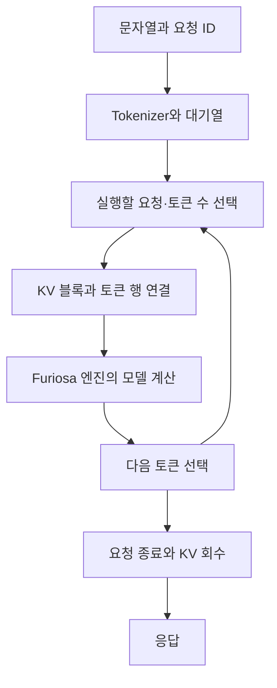

# vLLM으로 서빙하기: 요청 큐에서 NPU 실행까지

웹 서버에서 요청을 받으면 보통 작업을 큐에 넣고 worker가 처리한다. LLM(Large Language Model, 대규모 언어 모델) 서버도 여기서 시작하지만, 한 요청을 **여러 번의 모델 실행에 걸쳐 계속 이어간다**는 차이가 있다. 문장 전체를 한 번에 완성하는 대신 다음 토큰을 고르고, 그 토큰을 입력에 붙여 다음 계산을 하기 때문이다. 이 장에서는 요청 두 개가 들어왔을 때 어떤 상태를 보관하고 어떤 일을 NPU(Neural Processing Unit)에 보내야 하는지부터 따라간다.

그다음 실제 도구를 연결한다. **공식 furiosa-opt-vllm은 vLLM의 요청 관리와 Furiosa 엔진을 연결하는 서빙 경로이며, 임의의 fxbX 파일을 읽는 범용 loader는 아니다.** loader는 파일에서 실행 객체를 만드는 적재기다. 여기서 EDF는 장치에서 계산할 컴파일 결과 파일이고, 실행 계획은 어떤 EDF를 어떤 입출력·순서로 호출할지 적은 규격이다. FuryNo5가 만든 실행 계획을 이 서버에 연결하려면 파일 적재뿐 아니라 요청별 상태와 입출력 계약도 맞춰야 한다. 조회 기준은 2026-11-19, `furiosa-opt-models c982976`이다. [공식 저장소](https://github.com/furiosa-ai/furiosa-opt-models/blob/c982976100d18d7a9641d5a8c22b89cec4544049/README.md) · [엔진 구조](https://github.com/furiosa-ai/furiosa-opt-models/blob/c982976100d18d7a9641d5a8c22b89cec4544049/docs/design/architecture.md)

## 1. 한 문장을 처리하는 동안 무엇이 남는가

### 토큰과 배열에서 출발한다

사용자가 보낸 문자열을 tokenizer가 정수 목록으로 바꾼다. 이 정수 하나가 **토큰(token)을** 식별한다. 토큰은 모델의 어휘 단위이며 한 글자나 한 단어와 항상 같지는 않다. 다음 `[11, 12, 13]`은 설명용 토큰 ID이고 실제 Qwen tokenizer의 결과가 아니다.

모델은 각 토큰을 숫자 벡터로 바꾸어 여러 layer를 통과시킨다. **layer(층)는** 앞 계산의 출력을 다음 계산의 입력으로 받는 함수 단위다. 한 토큰의 벡터 길이를 4라고 단순화하면 토큰 세 개의 배열은 `[3,4]` 모양이다. 이 각 축의 길이 목록이 **shape**다. 여러 요청을 함께 처리하는 **batch(묶음)가** 두 개이고 각 요청에 토큰 세 자리를 마련하면 `[2,3,4]`, 즉 숫자 24개의 tensor가 된다. tensor는 여기서 다차원 배열을 뜻한다. 요청 길이가 다르면 빈 자리를 채우거나 유효한 토큰 행만 모으는 방법이 필요하다.

### Prefill과 decode는 하는 일이 다르다

**Prefill(입력 문맥 처리)은** 이미 주어진 토큰들을 모델에 통과시켜 첫 출력 토큰을 준비하는 단계다. 입력의 토큰들이 모두 알려져 있어 여러 위치의 계산을 묶을 수 있다. **Decode(토큰 생성 단계)에서는** 방금 선택한 출력 토큰을 다음 입력으로 넣고 다음 토큰을 선택한다. 한 요청의 아직 생성하지 않은 토큰을 미리 알 수 없으므로 이 단계들은 순서 의존성이 있다.

attention은 현재 위치가 앞의 어떤 위치를 참고할지 계산하는 연산이다. 현재 위치의 **Q(Query, 질의 벡터)와** 각 위치의 **K(Key, 비교용 벡터)로** 점수를 만들고, 점수를 가중치로 바꾸어 **V(Value, 내용 벡터)를** 섞는다. 이전 위치의 K·V를 매번 다시 계산하지 않도록 보관하는 것이 **KV(Key–Value) cache**다. 응답 문자열을 저장하는 일반 HTTP(Hypertext Transfer Protocol) 캐시와 달리, 모델 계산의 중간 배열을 저장한다. 모델·층·요청이 달라지면 같은 토큰 ID라도 이 배열을 함부로 재사용할 수 없다.

한 요청의 최대 출력이 두 토큰이라고 하자. 다음은 토큰 값과 시간에 대한 **설명용 예**다.

| 시점 | 모델에 넣는 토큰 | 이미 계산해 보관한 KV 위치 수 | 이번 결과 |
|---|---|---:|---|
| 요청 접수 | 아직 실행하지 않음 | 0 | 입력 `[11,12,13]` 대기 |
| prefill 완료 | `[11,12,13]` | 3 | 다음 토큰 `14` 선택 |
| 다음 decode 완료 | 새 토큰 `14` | 4 | 다음 토큰 `15` 선택 |
| 요청 종료 | 더 실행하지 않음 | 회수 가능 | 출력 `[14,15]` 반환 |

토큰 `14`를 선택한 순간 그 토큰의 KV가 이미 생긴 것은 아니다. 다음 모델 호출에서 `14`를 처리해야 해당 위치의 KV가 생긴다. 마지막 출력 `15` 뒤에 생성을 멈추면 그 토큰을 다시 모델에 넣을 필요도 없다. 이런 상태 전이를 알아야 “생성 토큰 수”와 “캐시에 계산된 토큰 수”를 혼동하지 않는다. 실제 플러그인이 scheduler의 요청과 cache 위치를 엔진 요청으로 바꾸는 코드도 이 경계를 다룬다. [요청 변환](https://github.com/furiosa-ai/furiosa-opt-models/blob/c982976100d18d7a9641d5a8c22b89cec4544049/integrations/furiosa-opt-vllm/furiosa_opt_vllm/generation/sequence.py)

### 요청 큐가 토큰마다 다시 기회를 주는 이유

vLLM은 이런 여러 요청의 진행 상태를 관리하는 추론·서빙 프레임워크다. scheduler는 실행할 요청과 토큰 수를 정하는 스케줄러이고, worker는 그 결정을 받아 장치 계산을 수행하는 실행 담당이다. 요청 전체가 끝날 때까지 고정된 묶음을 유지하면 짧은 요청이 끝난 뒤 그 자리가 놀 수 있다. **Continuous batching(진행 중 요청 묶음 갱신)은** 실행 단계 사이에 완료된 요청을 빼고 새 요청을 넣는 방식이다.

| 스케줄링 시점 | 요청 A | 요청 B | 요청 C | 큐 관리의 판단 |
|---|---|---|---|---|
| 1 | prefill | prefill | 아직 없음 | A·B의 cache 공간 확보 |
| 2 | decode 필요 | 종료됨 | 새로 도착 | B 공간 회수, C 수용 여부 판단 |
| 3 | decode 또는 종료 | 없음 | prefill 이후 decode | 남은 상태와 허용 계산량으로 다음 묶음 선택 |

이 표는 정책의 원리를 보여주며 모든 행이 하나의 EDF 호출에 들어간다는 뜻은 아니다. 실제 엔진은 prefill·decode의 지원 형태, 한 번에 처리할 토큰 행 수, 메모리 여유에 맞춰 호출을 나눈다. **단순히 HTTP thread 수를 늘리는 것과 진행 중 모델 상태를 안전하게 묶는 것은 다른 구현 과제다.** [vLLM 외부 장치 연결 구조](https://docs.vllm.ai/en/stable/design/plugin_system/) · [엔진과 프레임워크 경계](https://github.com/furiosa-ai/furiosa-opt-models/blob/c982976100d18d7a9641d5a8c22b89cec4544049/docs/engine/frameworks.md)

### Cache block과 컴파일 bucket을 분리한다

OS(Operating System)의 가상 메모리가 페이지 표로 주소를 연결하듯, KV도 논리 위치와 실제 저장 공간을 나눌 수 있다. 설명을 위해 **block(저장 블록)** 하나에 토큰 네 개의 KV가 들어간다고 하자. 요청 A의 block table이 `[2,7]`이면 토큰 위치 0~3은 물리 블록 2, 위치 4~7은 물리 블록 7에 저장한다. 요청 B는 다른 블록을 쓴다. 아래는 주소 대응 원리를 계산하는 Python이며 실제 SDK(Software Development Kit)의 API(Application Programming Interface)는 아니다.

```python
block_table = [2, 7]  # 요청 A가 소유한 물리 블록 번호
tokens_per_block = 4  # 한 블록에 저장할 토큰 위치 수
position = 5  # 0부터 센 논리 위치: 여섯 번째 토큰
physical_block = block_table[position // tokens_per_block]  # 몫 1 → 표의 두 번째 블록 7
slot_in_block = position % tokens_per_block  # 나머지 1 → 그 블록의 두 번째 자리
print(physical_block, slot_in_block)  # 7 1
```

입력 `position=5`는 “A의 여섯 번째 토큰”이고 출력 `(7,1)`은 “물리 블록 7의 두 번째 자리”다. **Paged attention**은 이런 블록 대응을 사용해 attention의 KV를 찾아 읽는 방식이다. 블록을 배정하는 코드와 그 배치를 이해하는 계산 커널이 함께 맞아야 한다. 실제 토큰당 바이트 수와 블록 크기·배치 순서는 엔진의 계약을 따른다.

반면 **bucket(컴파일 규격 묶음)은** “이 실행물은 이 정도 크기의 입력을 처리한다”는 계산 규격이다. 설명용 실행 규격이 토큰 행 1·4·8개라면 유효 행 3개를 처리할 때 4행 규격을 선택하고 1행을 padding(빈 자리 채우기)할 수 있다. 이 수는 위의 KV 블록 번호와 무관하다. **Row packing(행 모으기)은** 여러 요청의 유효 토큰 벡터를 실행 배열의 행에 배치하는 과정이고, **layout(메모리 배치)은** 그 논리적 행·열을 실제 메모리에서 어떤 순서로 저장하는지 뜻한다. 같은 shape라도 저장 순서가 다르면 엔진에 넘기는 주소 계산이 달라진다. [block·row 계약](https://github.com/furiosa-ai/furiosa-opt-models/blob/c982976100d18d7a9641d5a8c22b89cec4544049/docs/engine/python.md)

#### 모은 행을 다시 요청으로 돌려놓는다

A의 입력이 두 토큰, B의 입력이 한 토큰이고 4행 bucket을 골랐다고 하자. 값 배열만 이어 붙이면 “세 번째 행이 B의 첫 토큰”이라는 정보를 잃는다. 그래서 **행의 값과 함께 행의 소유자·논리 위치·유효성을 대응시켜야 한다.** 다음은 두 요청의 prefill만 묶는 교육용 배치다. 실제 엔진의 인자 순서나 메모리 ABI(Application Binary Interface)를 제시한 표는 아니다.

| 실행 배열의 행 | 요청 | 요청 안의 토큰 위치 | 유효한 행인가? | 참조할 KV block table | 다음 토큰 선택에 쓸 행인가? |
|---|---|---:|---|---|---|
| 0 | A | 0 | 예 | A의 `[2,7]` | 아니오: A에 뒤 토큰이 더 있음 |
| 1 | A | 1 | 예 | A의 `[2,7]` | 예: A의 마지막 입력 위치 |
| 2 | B | 0 | 예 | B의 `[4]` | 예: B의 마지막 입력 위치 |
| 3 | 없음 | 의미 없음 | 아니오: padding | 없음 | 아니오 |

행 2의 요청 내 위치는 2가 아니라 **0**이다. 따라서 B의 첫 KV를 B의 block table로 찾아야 한다. attention도 같은 요청에서 볼 수 있는 위치만 참고해야 하므로 A의 위치들과 B의 위치들을 하나의 긴 문장처럼 섞으면 안 된다. padding 행은 계산 규격을 맞추는 자리이며 유효 출력이나 KV 갱신으로 세지 않는다.

모델이 이 예에서 **각 행의 후보별 logits를 돌려준다**고 가정하자. A에는 행 1, B에는 행 2의 logits를 사용해 다음 토큰을 선택한다. [row_packing_demo.py](../examples/row_packing_demo.py)는 이 마지막 대응만 실행하는 순수 Python 예다. logits는 직접 만든 숫자이며 모델 추론 결과가 아니다.

```python
# 실행 행 → (요청 ID, 요청 안 위치, 유효 여부)의 교육용 대응표
rows = [("A", 0, True), ("A", 1, True), ("B", 0, True), (None, 0, False)]
logits = [
    [3.0, 1.0, 0.0],  # 행 0: A의 중간 위치이므로 다음 토큰 선택에는 쓰지 않는다.
    [0.0, 4.0, 1.0],  # 행 1: A의 마지막 입력 위치 → 후보 번호 1
    [5.0, 1.0, 0.0],  # 행 2: B의 마지막 입력 위치 → 후보 번호 0
    [99.0, 99.0, 99.0],  # 행 3: 큰 숫자가 있어도 padding이므로 제외한다.
]
last_row = {}
for row_index, (request_id, position, valid) in enumerate(rows):
    if not valid:
        continue
    previous = last_row.get(request_id)
    # 실행 배열의 마지막 행이 아니라, 요청별 가장 큰 논리 위치를 선택한다.
    if previous is None or position > rows[previous][1]:
        last_row[request_id] = row_index
next_candidate = {
    request_id: max(range(len(logits[row])), key=lambda j: logits[row][j])
    for request_id, row in last_row.items()
}
assert last_row == {"A": 1, "B": 2}
assert next_candidate == {"A": 1, "B": 0}
print(last_row, next_candidate)
```

입력의 행을 모으는 표와 출력의 행을 되돌리는 표가 같은 요청 ID를 공유한다. 실제 엔진이 마지막 행만 반환하거나 장치에서 곧바로 토큰을 선택하면 반환 형식은 달라지지만, 요청·위치·KV·출력을 연결해야 하는 문제는 남는다. 위 예는 prefill과 decode를 임의로 섞는 기능을 보장하지 않는다. 현 플러그인의 실제 행 구성과 반환 계약은 `generation/sequence.py`와 엔진 Python 문서에 정의되어 있다. [요청 변환 코드](https://github.com/furiosa-ai/furiosa-opt-models/blob/c982976100d18d7a9641d5a8c22b89cec4544049/integrations/furiosa-opt-vllm/furiosa_opt_vllm/generation/sequence.py) · [엔진의 rows·block 계약](https://github.com/furiosa-ai/furiosa-opt-models/blob/c982976100d18d7a9641d5a8c22b89cec4544049/docs/engine/python.md)

cache 용량도 계산해 볼 수 있다. **Head(헤드)는** attention이 서로 다른 벡터 묶음으로 정보를 비교하는 계산 단위다. 여기서는 K·V 벡터 묶음의 수를 KV head 수라고 부른다. 설명용으로 한 layer의 KV head가 2개, head당 벡터 길이가 4, 원소가 2바이트라면 토큰 하나는 `K와 V 2종 × head 2개 × 원소 4개 × 2바이트 = 32바이트`다. 토큰 3개는 96바이트이며 layer 수와 동시 요청 수가 늘면 그만큼 누적된다. 실제 모델의 head 수·dtype(원소 자료형)를 넣어야 실제 용량이 된다. 그래서 요청이 끝났을 때 cache를 회수하지 못하는 버그는 서버 메모리가 계속 증가하는 원인이 된다.



## 2. 공식 Furiosa-LLM과 무엇이 다른가

앞 절에서 서버가 해야 할 일을 보았으므로 실행기 선택의 차이를 읽을 수 있다. **모델 구조를 아는 실행기(architecture-aware runner)는** 설정 파일의 층 수·head 수를 읽고 어떤 가중치를 어떤 계산에 연결할지 알고 있다. **Registry(등록 목록)는** 지원 모델 이름과 그 구현을 연결한다. 실행 가능한 파일 하나가 있다는 사실만으로 그 파일의 상태를 vLLM이 배정한 KV 블록에 연결하는 방법까지 결정되지는 않는다.

HF(Hugging Face) assets는 모델 설정·tokenizer·checkpoint 같은 모델 자료를 가리킨다. 공식 FXB는 공식 실행기가 받아들이는 모델 배포 산출물이고, **fxbX는 우리 프로젝트의 비공식 확장 패키지**다. 확장자가 비슷해도 파일을 읽고 해석하는 소비자가 달라 서로 바꿔 넣을 수 없다.

| 경로 | 모델 실행의 중심 | 배포 계약 | FuryNo5 산출물과 현재 관계 |
|---|---|---|---|
| Furiosa-LLM | 공식 architecture-aware 모델 실행기 | HF assets + 호환 공식 FXB | 커스텀 계획을 자동 등록하는 공개 범용 연결은 확인되지 않음 |
| furiosa-opt-vllm | vLLM + Rust 기반 opt engine/model | 엔진에 컴파일된 model type + HF checkpoint | fxbX reader 없이 자체 registry·model 계약 사용 |
| fxbX `serve` | fxbX adapter와 자체 HTTP 처리 | fxbX package 계약 | 자체 실행 가능 모델에 대한 기존 경로 |
| 제안하는 fxbX-vLLM 연결 | vLLM worker ↔ fxbX execution session | 아래 7절의 추가 계약 필요 | 이 장에서는 설계 과제로 분류 |

HTTP(Hypertext Transfer Protocol) endpoint는 서버에서 요청을 받는 주소다. **OpenAI-compatible**은 그 주소와 요청·응답 형식을 해당 API와 맞춘다는 뜻이다. fxbX의 HTTP endpoint가 그 형태를 제공한다는 것과 vLLM의 scheduler가 fxbX를 사용한다는 것은 다르다. 현재 fxbX의 비스트리밍 endpoint는 공개 API 모양을 맞춘 서비스이며, 그 사실만으로 continuous batching, paged attention, 분산 KV를 얻지는 않는다. [fxbX HTTP 안내](https://github.com/smallstep-zzz/fxbX/blob/03d993b4d1b36cdda209d61bbf447434c174b401/README.md) · [현재 adapter](https://github.com/smallstep-zzz/fxbX/blob/03d993b4d1b36cdda209d61bbf447434c174b401/fxbex/hug_engine.py)

## 3. plugin이 등록되는 정확한 위치

C 프로그램이 함수 포인터를 등록 표에서 찾아 호출하는 구조를 떠올리면 된다. Python의 **entry point**는 패키지가 제공하는 기능의 이름과 import할 함수를 설치 메타데이터에 기록하는 장치다. vLLM은 자신의 platform plugin 그룹을 조회하고, Furiosa 플러그인의 등록 함수를 통해 해당 장치 구현을 선택한다. 공식 플러그인의 `pyproject.toml`은 다음 대응을 등록한다.

```toml
# vLLM이 조회하는 platform 등록 그룹과 Furiosa 등록 함수의 대응
[project.entry-points."vllm.platform_plugins"]
furiosa = "furiosa_opt_vllm:register"
```

[출처: 공식 plugin pyproject](https://github.com/furiosa-ai/furiosa-opt-models/blob/c982976100d18d7a9641d5a8c22b89cec4544049/integrations/furiosa-opt-vllm/pyproject.toml)

`platform.py`는 지원하지 않는 옵션을 초기에 검사하고 `FuriosaWorker`를 선택한다. `worker.py`는 엔진·모델을 적재하고 cache 용량·실행을 연결한다. `generation/sequence.py`는 scheduler output을 요청으로 묶고, `generation/__init__.py`와 `selection.py`는 device argmax와 host sampling을 구분한다. 디바이스가 처리한 결과를 vLLM이 이해하는 token·logprob·request 순서로 바꾸는 코드가 integration의 핵심이다. [platform](https://github.com/furiosa-ai/furiosa-opt-models/blob/c982976100d18d7a9641d5a8c22b89cec4544049/integrations/furiosa-opt-vllm/furiosa_opt_vllm/platform.py) · [worker](https://github.com/furiosa-ai/furiosa-opt-models/blob/c982976100d18d7a9641d5a8c22b89cec4544049/integrations/furiosa-opt-vllm/furiosa_opt_vllm/worker.py) · [generation](https://github.com/furiosa-ai/furiosa-opt-models/blob/c982976100d18d7a9641d5a8c22b89cec4544049/integrations/furiosa-opt-vllm/furiosa_opt_vllm/generation/__init__.py)


한 번의 실행 뒤 모델이 세 후보 토큰에 `[4.0, 2.0, -1.0]`을 냈다고 하자. 이 점수 배열이 **logits(정규화 전 점수)다**. **Argmax**는 가장 큰 점수의 위치를 고르는 연산이므로 첫 후보를 선택한다. 이것을 매번 적용하는 생성 정책이 **greedy decoding(최고 점수 선택)이다**. **Sampling(확률 추출)은** 점수를 확률로 변환한 뒤 그 분포에서 선택하므로, logits가 같아도 선택 결과가 달라질 수 있다. logprob는 선택 확률의 로그값이다.

그래서 플러그인은 “NPU가 토큰 ID 하나를 돌려줄지, 후보별 logits를 호스트로 돌려줄지”도 구분한다. host sampling이 있다는 이유만으로 모델 전체가 CPU로 fallback했다고 판단하면 안 된다. 모델의 큰 행렬 계산과 출력 선택 정책은 서로 다른 일이다. [출력 선택 구현](https://github.com/furiosa-ai/furiosa-opt-models/blob/c982976100d18d7a9641d5a8c22b89cec4544049/integrations/furiosa-opt-vllm/furiosa_opt_vllm/selection.py)

## 4. 재현 가능한 설치의 기준

현재 checkout은 아래 조합을 요구한다. “최신 pip 설치”보다 이 조합을 함께 보존하는 것이 중요하다.

| 항목 | 조회한 소스의 조건 |
|---|---|
| 호스트 | Linux x86_64 |
| RNGD driver | SDK 2026.4 이상 계열 |
| vLLM plugin | 0.1.0 |
| vLLM wheel | 0.31.0 CPU wheel |
| Python | 3.11 이상, 3.15 미만 |
| glibc | CPU wheel 때문에 2.39 이상 |
| compiler | Cargo.toml의 furiosa-opt-preview revision `9481ae2db8c465b9c7008dcfa787721982789d3e`와 맞는 snapshot |
| 도구 | uv, rustup, host C compiler, AArch64 cross-toolchain |

[설치 문서](https://github.com/furiosa-ai/furiosa-opt-models/blob/c982976100d18d7a9641d5a8c22b89cec4544049/docs/getting-started/installation.md) · [dependency 실제 값](https://github.com/furiosa-ai/furiosa-opt-models/blob/c982976100d18d7a9641d5a8c22b89cec4544049/integrations/furiosa-opt-vllm/pyproject.toml) · [compiler revision](https://github.com/furiosa-ai/furiosa-opt-models/blob/c982976100d18d7a9641d5a8c22b89cec4544049/Cargo.toml)

**Cross-toolchain**은 현재 호스트와 다른 CPU 구조의 실행 파일을 만드는 compiler·linker 묶음이다. 여기서 AArch64는 64-bit Arm 구조를 뜻한다. Python 패키지를 설치하는 과정에도 이런 별도 바이너리 빌드가 있으므로 Python 버전만 맞추는 것으로 설치 조건이 끝나지 않는다.

예전 SDK 환경에 이 dependency를 섞기보다 별도 virtual environment에서 사용한다. CPU wheel이라는 이름은 “모델 본체를 CPU에서 실행한다”는 뜻이 아니다. 이 플러그인은 vLLM의 host scheduler/sampling 기반을 사용하고 모델 본체는 Furiosa 엔진으로 보낸다.

### 요구 commit과 설치 버전은 같은 문자열이 아니다

공식 설치 문서의 `cargo binstall --git https://github.com/furiosa-ai/furiosa-opt-preview cargo-furiosa-opt`는 preview 기본 branch의 manifest를 읽는다. 문서를 나중에 재현할 때는 그 branch가 이동했을 수 있으므로, 여기서는 **고정 commit에서 읽은 manifest로 배포 바이너리를 고르는 방식**을 쓴다. `cargo-binstall`은 미리 빌드된 Rust 실행 파일을 설치하는 도구이며, 아래 `--manifest-path`는 로컬 `Cargo.toml`의 패키지·다운로드 메타데이터를 읽는 실제 옵션이다. `--git`과 함께 쓰지 않는다. [공식 설치 진입점](https://github.com/furiosa-ai/furiosa-opt-models/blob/c982976100d18d7a9641d5a8c22b89cec4544049/docs/getting-started/installation.md) · [binstall 인자 계약](https://github.com/cargo-bins/cargo-binstall/blob/17717041b8b8d177fd061e56dc8c40abe41120f2/crates/bin/src/args.rs) · [manifest 버전 선택](https://github.com/cargo-bins/cargo-binstall/blob/17717041b8b8d177fd061e56dc8c40abe41120f2/crates/binstalk/src/ops/resolve.rs)

이 snapshot에서 대조할 값은 다음과 같다. 아래는 저장소에서 읽은 값이며 이 문서 작성 환경에 compiler를 설치해 관측한 출력이 아니다.

| 식별자 | 고정 소스의 값 | 무엇을 식별하는가? |
|---|---|---|
| 모델 저장소 commit | `c982976100d18d7a9641d5a8c22b89cec4544049` | 모델·플러그인 코드 묶음 |
| 그 저장소가 요구하는 preview commit | `9481ae2db8c465b9c7008dcfa787721982789d3e` | `furiosa-opt-std`와 compiler snapshot의 기준 |
| 그 preview의 compiler package version | `0.9.0+g3a4b00bb` | 배포 바이너리와 설치 기록에서 대조할 버전 |
| 그 preview의 Rust toolchain | `nightly-2026-05-01` | compiler가 사용하는 Rust nightly |

즉 `9481ae…`와 `0.9.0+g3a4b00bb`가 문자열로 같아야 하는 것이 아니다. **첫 값의 commit에서 읽은 manifest가 두 번째 버전을 가리키는 연결**을 확인한다. 그 버전의 공개 release도 존재한다. preview의 `cargo-furiosa-opt/src/main.rs`는 설치 방법을 알리고 종료하는 stub이므로, 이 공개 저장소를 일반 `cargo install --git`로 소스 빌드하는 것을 배포 compiler 확보와 혼동하지 않는다. [고정 manifest](https://github.com/furiosa-ai/furiosa-opt-preview/blob/9481ae2db8c465b9c7008dcfa787721982789d3e/cargo-furiosa-opt/Cargo.toml) · [Rust toolchain](https://github.com/furiosa-ai/furiosa-opt-preview/blob/9481ae2db8c465b9c7008dcfa787721982789d3e/rust-toolchain.toml) · [배포 release](https://github.com/furiosa-ai/furiosa-opt-preview/releases/tag/v0.9.0%2Bg3a4b00bb) · [공개 stub](https://github.com/furiosa-ai/furiosa-opt-preview/blob/9481ae2db8c465b9c7008dcfa787721982789d3e/cargo-furiosa-opt/src/main.rs)

### 고정 manifest로 설치한 뒤 실제 호출 경로를 확인한다

앞 표의 OS·cross-toolchain·uv·rustup·cargo-binstall이 준비된 새 작업 디렉터리에서 실행한다. 아래 두 저장소는 이웃 디렉터리에 놓인다.

```bash
git clone https://github.com/furiosa-ai/furiosa-opt-models
cd furiosa-opt-models
git checkout c982976100d18d7a9641d5a8c22b89cec4544049
uv venv  # 이 조합을 위한 새 Python 환경을 만든다.
source .venv/bin/activate
git clone https://github.com/furiosa-ai/furiosa-opt-preview ../furiosa-opt-preview
git -C ../furiosa-opt-preview checkout 9481ae2db8c465b9c7008dcfa787721982789d3e
# 두 checkout의 실제 commit을 위 표와 대조한다.
git rev-parse HEAD
git -C ../furiosa-opt-preview rev-parse HEAD
rustup toolchain install nightly-2026-05-01
# --force는 기존 설치 기록이 있어도 이 manifest의 바이너리를 다시 설치한다.
cargo binstall --force \
  --manifest-path ../furiosa-opt-preview/cargo-furiosa-opt/Cargo.toml \
  cargo-furiosa-opt
# cargo-furiosa-opt v0.9.0+g3a4b00bb 항목이 있는지 확인한다.
cargo install --list
# 실제 실행되는 바이너리가 방금 설치한 경로인지 확인한다.
command -v cargo-furiosa-opt
```

`cargo install --list`는 Cargo 설치 기록의 패키지와 버전을 보여 준다. 반면 `command -v`는 현재 shell의 PATH에서 선택되는 실행 파일을 보여 준다. 기록이 맞아도 PATH 앞쪽의 다른 바이너리를 호출하면 다른 compiler를 쓰게 된다. 수동 복사 등으로 설치 기록이 없는 경우에는 이 목록만으로 버전을 증명할 수 없다. 확인할 수 없는 상태에서는 serving으로 넘어가지 않고 위의 고정 설치 경로부터 정리한다. [Cargo의 설치 목록·설치 위치 계약](https://doc.rust-lang.org/cargo/commands/cargo-install.html)

이후 같은 모델 저장소 루트와 가상환경에서 플러그인을 빌드한다. `--no-cache`는 uv의 이전 wheel cache를 읽지 않도록 하는 옵션이다. 이 절에서는 새 checkout·새 가상환경을 전제로 하며 기존 컴파일 결과의 재사용 여부를 숨기지 않는다.

```bash
# CARGO는 plugin 빌드가 호출할 compiler 진입점이다. -v로 빌드 과정을 확인한다.
CARGO=cargo-furiosa-opt uv pip install -v --no-cache --torch-backend cpu \
  ./integrations/furiosa-opt-vllm
# import 검사는 장치를 열지 않는다.
python -c "import furiosa_opt_engine as e; print(e.LoadOptions())"
```

[uv cache 옵션](https://docs.astral.sh/uv/reference/cli/) · [plugin 빌드·import 계약](https://github.com/furiosa-ai/furiosa-opt-models/blob/c982976100d18d7a9641d5a8c22b89cec4544049/docs/getting-started/installation.md)

### 성공 여부를 세 단계로 나누어 판정한다

| 관측 결과 | 알 수 있는 것 | 다음 행동 |
|---|---|---|
| 설치 기록이 위 버전이고 PATH도 해당 설치를 가리킴 | 의도한 compiler 배포본을 선택했는지 1차 대조함 | plugin의 실제 커널 빌드 로그 확인 |
| 빌드에 `this kernel was expanded by rev …, but the driver is rev …` 발생 | 커널을 전개한 compiler 측 revision과 실행 compiler 측 revision이 다름 | 두 checkout·설치 manifest·PATH를 맞추고 다시 빌드. serving으로 진행하지 않음 |
| 새 빌드 성공, engine import 성공 | 커널 빌드와 Python 엔진 적재 단계 통과 | 다음 절의 지원 모델로 실제 장치 실행 확인 |
| 장치를 열 때 RNGD driver 호환 오류 | 호스트 kernel driver·firmware 등 장치 stack의 호환성 문제 | 사용 SDK의 설치 조건과 장치 로그 확인 |

위 오류 문장의 `driver`는 **compiler driver**를 가리킨다. OS가 NPU를 관리하는 RNGD kernel driver의 `2026.4` 같은 버전과 같은 식별자가 아니다. 두 문제를 구별해야 compiler를 다시 설치해도 해결되지 않는 장치 적재 오류를 진단할 수 있다. plugin 설치는 engine과 model function을 컴파일하므로 시간이 걸리며, import 성공만으로 NPU 실행을 증명하지 않는다.

실제 과거 포럼 사례에서는 opt 0.8.1과 구형 RNGD driver 2026.3.1 조합이 장치를 열지 못했고 2026.4.0 driver가 필요하다고 안내했다. 이 사건을 현재 모든 버전의 호환표로 일반화하지 않는다. 이 절의 설치 명령은 공개 manifest·CLI·빌드 계약을 대조한 절차이며, 본 문서 작성 세션에서 SDK 설치나 NPU 실행을 수행한 기록은 아니다. [Furiosa 포럼](https://forums.furiosa.ai/t/furioa-opt-support-matrix-driver-version/464)

## 5. 먼저 지원 모델로 HTTP 왕복을 확인한다

공식 quickstart의 지원 예는 Qwen3-1.7B다. checkpoint 다운로드·접근 조건과 장치 메모리가 준비된 환경에서 실행한다. 이 명령은 모델 serving을 시작한다.

```bash
vllm serve Qwen/Qwen3-1.7B --host 127.0.0.1 --port 8000
```

서버는 위 터미널에서 요청을 기다린다. **다른 터미널**에서 아래 JSON 요청을 보내면 tokenizer → prefill → 반복 decode → 응답의 흐름을 확인할 수 있다. `max_tokens:12`는 새로 생성할 토큰의 상한이고, `temperature:0`은 여기서 최고 점수 토큰을 선택하는 설정이다. prompt의 글자 수가 생성 토큰 수와 같은 것은 아니다.

```bash
curl http://127.0.0.1:8000/v1/completions \
  -H 'Content-Type: application/json' \
  -d '{"model":"Qwen/Qwen3-1.7B","prompt":"The capital of Korea is","max_tokens":12,"temperature":0}'
```

[공식 quickstart](https://github.com/furiosa-ai/furiosa-opt-models/blob/c982976100d18d7a9641d5a8c22b89cec4544049/docs/getting-started/quickstart.md)

로그에는 선택된 platform, model type, compiled window·row 제한, cache 할당을 남긴다. 다음에는 한 요청의 수치·출력을 확인하고, 여러 동시 요청에서 잘못된 block 공유나 요청 취소 뒤의 상태 재사용이 없는지 검사한다. 이 단계에서 모델 생성이 되더라도 FuryNo5의 커스텀 package가 지원된 것은 아니다.

Python 진입점도 vLLM API를 사용한다. 아래에서는 문자열 목록 하나를 넣어 요청 결과 목록을 받는다. `outputs[0]`은 첫 입력 요청의 결과, 그 안의 `outputs[0].text`는 첫 생성 후보의 문자열이다. 이 예는 위와 동일한 지원 모델에 대한 사용 예이며 서버의 HTTP 요청 대신 같은 프레임워크를 Python에서 직접 호출한다.

```python
from vllm import LLM, SamplingParams

if __name__ == "__main__":
    model = LLM(model="Qwen/Qwen3-1.7B")  # 지원 모델의 설정·가중치를 적재한다.
    outputs = model.generate(
        ["The capital of Korea is"],  # 입력 문자열 목록: 요청 1개
        SamplingParams(temperature=0, max_tokens=12),  # 최고 점수 선택, 새 토큰 최대 12개
    )
    print(outputs[0].outputs[0].text)  # 첫 요청의 첫 생성 후보 문자열
```

## 6. 문서와 코드가 어긋난 부분도 기록한다

먼저 병렬성의 이름을 풀면 **DP(Data Parallelism)는** 모델 복제본마다 다른 요청을 처리하는 방식, **TP(Tensor Parallelism)는** 한 모델의 큰 tensor 계산을 여러 장치에 나누는 방식, **PP(Pipeline Parallelism)는** 앞 층과 뒤 층을 서로 다른 단계에 놓는 방식이다. node는 여기서 클러스터의 서버 한 대를 뜻한다. 여러 요청을 받는다는 것과 한 요청을 여러 장치가 나누어 계산한다는 것은 다르다.

이번 조사에서 같은 commit의 일부 문서가 구현을 따라오지 못한 부분을 확인했다. 따라서 기능표는 README 문장 하나만으로 결정하지 않았다.

| 쟁점 | 문서의 서술 | 코드·테스트에서 확인한 내용 |
|---|---|---|
| Data Parallelism(DP) | 옵션 문서에는 degree 1 | dense 모델의 독립 replica DP 경로와 DP=2 token test 존재 |
| sampling | framework 설명 일부는 greedy 이외 거절 | generation은 device argmax와 host logits sampling을 분기 |
| Pipeline Parallelism(PP)·여러 node | 미지원 | admission에서 PP=1, nnodes=1 요구 |
| Tensor Parallelism(TP) | 컴파일된 chip 수 | engine LoadOptions의 chips 선택으로 전달 |

DP가 무제한 지원된다는 뜻도 아니다. **Admission(수용 검사)은** 실행 전에 요청한 구성이 지원되는지 거르는 단계다. 현재 코드는 worker를 OS 프로세스로 나누는 multiprocessing backend를 요구한다. **Dense 모델**은 일반적인 층 계산을 모든 입력에 적용하고, **MoE(Mixture of Experts)는** 입력마다 선택한 전문가 부분망을 사용한다. **Speculative decoding**은 후보 토큰을 미리 제안한 뒤 본 모델로 검증하는 방식이며, **KV offload**는 KV 일부를 장치 밖 메모리에 옮겨 용량을 확보하는 방식이다. 현재 admission은 이러한 조합에 별도 제한을 건다. 테스트 파일이 존재한다는 사실을 이번 편집 환경의 실제 NPU 통과 결과로 바꾸어 쓰지 않는다. [옵션 문서](https://github.com/furiosa-ai/furiosa-opt-models/blob/c982976100d18d7a9641d5a8c22b89cec4544049/docs/serving/vllm.md) · [admission 실제 검사](https://github.com/furiosa-ai/furiosa-opt-models/blob/c982976100d18d7a9641d5a8c22b89cec4544049/integrations/furiosa-opt-vllm/furiosa_opt_vllm/admission.py) · [parallelism 테스트](https://github.com/furiosa-ai/furiosa-opt-models/blob/c982976100d18d7a9641d5a8c22b89cec4544049/integrations/furiosa-opt-vllm/tests/test_parallelism.py)

## 7. FuryNo5·fxbX를 붙이기 위해 남은 계약

다음은 **현재 구현 완료 주장이 아닌 개발 설계**다. vLLM을 재구현할 필요는 없지만, EDF를 호출하는 함수 하나만 등록해서도 충분하지 않다.

왜 계약이 여러 개 필요한지는 요청 B가 요청 A의 블록을 재사용하는 경우로 확인할 수 있다. A가 끝나서 블록 7을 반납했더라도, 새 B의 유효 길이와 block table을 A의 값으로 유지하면 B가 A의 문맥을 읽게 된다. 필요한 것은 단순히 EDF를 다시 실행하는 코드가 아니라 **요청 ID, 유효 길이, 소유 블록, 완료 후 회수 시점**을 함께 갱신하는 코드다. 오류나 취소에서도 같은 규칙이 지켜져야 한다. 아래 표는 그 연결을 개발할 때의 점검 대상이다. **ABI(Application Binary Interface)는** 커널에 전달하는 인자의 순서·자료형·크기 같은 호출 계약이다. **Backpressure(유입 조절)는** 처리할 공간이 없을 때 새 요청을 무한히 받아 메모리를 소모하는 대신 대기·거절을 적용하는 방식이다. **Accepted**는 작업 접수, **completed**는 실제 완료이므로 비동기 제출의 반환만 보고 최종 성공을 응답해서는 안 된다.


| 연결 지점 | 추가로 정의할 내용 | 합격 증거 |
|---|---|---|
| 모델 적재 | package hash, SDK·ABI, 외부 weights, entry 목록 | 새 프로세스·잘못된 버전 거절 |
| prefill/decode | 토큰·position·mask·row packing 규칙 | 여러 길이·batch의 reference 대조 |
| KV cache | block layout, layer/group별 dtype, 소유권 | 요청 교차·회수·재사용 검증 |
| 상태 | recurrent state·reset·cancel·재시작 | 요청 간 상태 독립 |
| 출력 | logits 또는 token, sampling 적용 위치 | greedy·sampling·logprobs 계약 |
| scheduler | 허용 batch·bucket 선택, padding·backpressure | TTFT·TPOT·throughput과 tail latency |
| 오류 | accepted와 completed 구별, 세션 실패 처리 | async 실패를 성공 응답으로 보고하지 않음 |

TTFT(Time To First Token)는 요청 접수부터 첫 토큰까지의 시간이고, TPOT(Time Per Output Token)는 첫 토큰 이후의 평균 토큰 간격을 나타내는 지표다. 예를 들어 첫 토큰이 70 ms, 네 번째이자 마지막 토큰이 100 ms에 도착하면 TTFT는 70 ms, 이후 세 간격의 평균은 `(100−70)/3 = 10 ms`다. **Throughput(처리량)은** 단위 시간에 완료한 요청이나 유효 토큰의 수다. 묶음을 키워 처리량이 늘어도 묶음이 찰 때까지 기다리느라 TTFT가 나빠질 수 있다. **Tail latency(꼬리 지연)는** 느린 요청 쪽의 지연이며 p99는 관측 요청의 99%가 그 이하에서 끝나는 지점을 뜻한다. 이 값들은 서로 다른 목표다. 첫 연결은 한 모델·한 shape 규격·greedy·한 장치에서 시작하고, cache 관리와 batch를 단계적으로 추가하는 편이 원인 추적에 유리하다. 이는 FuryNo5의 권장 개발 순서이며 사용하는 모델과 서비스 요구에 따라 달라질 수 있다.

기존 FHA(Furiosa-Hug-Anything, 포팅 과정을 조정하는 프로젝트) 조사에서도 checkpoint metadata 선검사·tensor별 적재 같은 설계는 현재 fxbX에 적용했지만, Rust preview engine과 vLLM plugin의 직접 ABI 연결은 별도 검증 과제로 남겼다. 11월 10일 기록을 최신 plugin의 기능 제한으로 그대로 인용하지 않고, **우리 프로젝트의 통합 상태를 설명하는 근거**로만 사용한다. [FHA 적용 기록](https://github.com/smallstep-zzz/Furiosa-Hug-Anything/blob/8fc675f488763bef7c779ee037e8393ddd9f856a/docs/FURIOSA_OPT_MODELS_ADOPTION_PLAN.md)

## 출처

| 자료 | 용도 |
|---|---|
| [vLLM plugin system](https://docs.vllm.ai/en/stable/design/plugin_system/) | 외부 platform/worker 등록 계약 |
| [공식 opt-models 설치](https://github.com/furiosa-ai/furiosa-opt-models/blob/c982976100d18d7a9641d5a8c22b89cec4544049/docs/getting-started/installation.md), [pyproject](https://github.com/furiosa-ai/furiosa-opt-models/blob/c982976100d18d7a9641d5a8c22b89cec4544049/integrations/furiosa-opt-vllm/pyproject.toml) | 실제 dependency·설치 |
| [architecture](https://github.com/furiosa-ai/furiosa-opt-models/blob/c982976100d18d7a9641d5a8c22b89cec4544049/docs/design/architecture.md), [engine Python](https://github.com/furiosa-ai/furiosa-opt-models/blob/c982976100d18d7a9641d5a8c22b89cec4544049/docs/engine/python.md) | 소유권·비동기 완료 |
| [admission](https://github.com/furiosa-ai/furiosa-opt-models/blob/c982976100d18d7a9641d5a8c22b89cec4544049/integrations/furiosa-opt-vllm/furiosa_opt_vllm/admission.py), [generation](https://github.com/furiosa-ai/furiosa-opt-models/blob/c982976100d18d7a9641d5a8c22b89cec4544049/integrations/furiosa-opt-vllm/furiosa_opt_vllm/generation/__init__.py) | 문서와 코드 대조 |
| [parallelism tests](https://github.com/furiosa-ai/furiosa-opt-models/blob/c982976100d18d7a9641d5a8c22b89cec4544049/integrations/furiosa-opt-vllm/tests/test_parallelism.py) | 구현된 제한적 병렬성 |
| [Furiosa driver 포럼](https://forums.furiosa.ai/t/furioa-opt-support-matrix-driver-version/464) | 과거 버전 호환 문제 |
| [FHA adoption 기록](https://github.com/smallstep-zzz/Furiosa-Hug-Anything/blob/8fc675f488763bef7c779ee037e8393ddd9f856a/docs/FURIOSA_OPT_MODELS_ADOPTION_PLAN.md) | 우리 통합 경계 — 접근 권한 필요 |
| [preview compiler manifest](https://github.com/furiosa-ai/furiosa-opt-preview/blob/9481ae2db8c465b9c7008dcfa787721982789d3e/cargo-furiosa-opt/Cargo.toml), [toolchain](https://github.com/furiosa-ai/furiosa-opt-preview/blob/9481ae2db8c465b9c7008dcfa787721982789d3e/rust-toolchain.toml) | 요구 revision→배포 버전·Rust nightly 대응 |
| [cargo-binstall args](https://github.com/cargo-bins/cargo-binstall/blob/17717041b8b8d177fd061e56dc8c40abe41120f2/crates/bin/src/args.rs), [버전 선택](https://github.com/cargo-bins/cargo-binstall/blob/17717041b8b8d177fd061e56dc8c40abe41120f2/crates/binstalk/src/ops/resolve.rs) | 로컬 manifest를 사용하는 설치 계약 |
| [Cargo install](https://doc.rust-lang.org/cargo/commands/cargo-install.html), [uv CLI](https://docs.astral.sh/uv/reference/cli/) | 설치 기록·경로·cache 검증 경계 |

