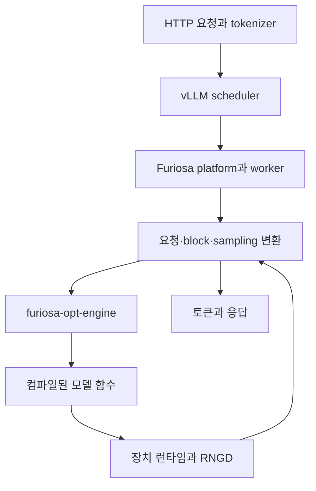

# vLLM으로 서빙하기: 공식 플러그인과 fxbX의 다음 경계

**공식 furiosa-opt-vllm은 사용할 수 있는 별도 서빙 경로다. 그러나 fxbX 파일을 그대로 넣는 범용 loader는 아니다.** vLLM이 요청과 KV(Key–Value) cache block을 관리하고, Furiosa 플러그인이 엔진 호출로 바꾸며, 엔진은 자신이 컴파일한 모델을 실행한다. FuryNo5의 임의 실행 계획을 연결하려면 이 사이의 계약을 구현해야 한다. 조회 기준은 2026-11-19, `furiosa-opt-models c982976`이다. [공식 저장소](https://github.com/furiosa-ai/furiosa-opt-models/blob/c982976100d18d7a9641d5a8c22b89cec4544049/README.md) · [엔진 구조](https://github.com/furiosa-ai/furiosa-opt-models/blob/c982976100d18d7a9641d5a8c22b89cec4544049/docs/design/architecture.md)

## 1. vLLM은 무엇을 담당하는가

vLLM은 LLM(Large Language Model) 추론과 서빙 프레임워크의 이름이다. 요청을 받고, 여러 sequence를 한 step에 배치하며, KV cache에 사용할 block을 정하고, 모델 결과로 다음 토큰을 고른다. 요청 처리·스케줄링과 모델의 수학 연산을 나눠야 같은 서빙 정책을 다른 하드웨어에서 사용할 수 있다. 외부 하드웨어는 platform plugin과 worker를 통해 연결한다. [vLLM plugin interface](https://docs.vllm.ai/en/stable/design/plugin_system/)

여기서 cache block은 이전 토큰의 attention용 K와 V를 저장하는 단위다. EDF bucket은 컴파일된 실행 규격을 고르는 단위다. 둘 다 실행 효율에 중요하지만 같은 개념이 아니다. block table은 요청의 논리적 위치를 cache 저장 위치로 대응시키고, bucket 또는 엔진의 compiled row envelope는 한 번에 실행 가능한 계산량을 제한한다. [요청과 block 변환](https://github.com/furiosa-ai/furiosa-opt-models/blob/c982976100d18d7a9641d5a8c22b89cec4544049/docs/engine/frameworks.md) · [엔진 request 예](https://github.com/furiosa-ai/furiosa-opt-models/blob/c982976100d18d7a9641d5a8c22b89cec4544049/docs/engine/python.md)



## 2. 공식 Furiosa-LLM과 무엇이 다른가

| 경로 | 모델 실행의 중심 | 배포 계약 | FuryNo5 산출물과 현재 관계 |
|---|---|---|---|
| Furiosa-LLM | 공식 architecture-aware 모델 실행기 | HF assets + 호환 공식 FXB | 커스텀 계획을 자동 등록하는 공개 범용 연결은 확인되지 않음 |
| furiosa-opt-vllm | vLLM + Rust 기반 opt engine/model | 엔진에 컴파일된 model type + HF checkpoint | fxbX reader 없이 자체 registry·model 계약 사용 |
| fxbX `serve` | fxbX adapter와 자체 HTTP 처리 | fxbX package 계약 | 자체 실행 가능 모델에 대한 기존 경로 |
| 제안하는 fxbX-vLLM 연결 | vLLM worker ↔ fxbX execution session | 아래 7절의 추가 계약 필요 | 이 장에서는 설계 과제로 분류 |

fxbX의 HTTP endpoint가 OpenAI-compatible 형태라는 것과 vLLM의 scheduler가 fxbX를 사용한다는 것은 다르다. 현재 fxbX의 비스트리밍 endpoint는 공개 API 모양을 맞춘 서비스이며, 그 사실만으로 continuous batching, paged attention, 분산 KV를 얻지는 않는다. [fxbX HTTP 안내](https://github.com/smallstep-zzz/fxbX/blob/03d993b4d1b36cdda209d61bbf447434c174b401/README.md) · [현재 adapter](https://github.com/smallstep-zzz/fxbX/blob/03d993b4d1b36cdda209d61bbf447434c174b401/fxbex/hug_engine.py)

## 3. plugin이 등록되는 정확한 위치

공식 플러그인의 `pyproject.toml`은 아래 Python entry point를 등록한다.

```toml
[project.entry-points."vllm.platform_plugins"]
furiosa = "furiosa_opt_vllm:register"
```

[출처: 공식 plugin pyproject](https://github.com/furiosa-ai/furiosa-opt-models/blob/c982976100d18d7a9641d5a8c22b89cec4544049/integrations/furiosa-opt-vllm/pyproject.toml)

`platform.py`는 지원하지 않는 옵션을 초기에 검사하고 `FuriosaWorker`를 선택한다. `worker.py`는 엔진·모델을 적재하고 cache 용량·실행을 연결한다. `generation/sequence.py`는 scheduler output을 요청으로 묶고, `generation/__init__.py`와 `selection.py`는 device argmax와 host sampling을 구분한다. 디바이스가 처리한 결과를 vLLM이 이해하는 token·logprob·request 순서로 바꾸는 코드가 integration의 핵심이다. [platform](https://github.com/furiosa-ai/furiosa-opt-models/blob/c982976100d18d7a9641d5a8c22b89cec4544049/integrations/furiosa-opt-vllm/furiosa_opt_vllm/platform.py) · [worker](https://github.com/furiosa-ai/furiosa-opt-models/blob/c982976100d18d7a9641d5a8c22b89cec4544049/integrations/furiosa-opt-vllm/furiosa_opt_vllm/worker.py) · [generation](https://github.com/furiosa-ai/furiosa-opt-models/blob/c982976100d18d7a9641d5a8c22b89cec4544049/integrations/furiosa-opt-vllm/furiosa_opt_vllm/generation/__init__.py)

## 4. 재현 가능한 설치의 기준

현재 checkout은 아래 조합을 요구한다. “최신 pip 설치”보다 이 조합을 함께 보존하는 것이 중요하다.

| 항목 | 조회한 소스의 조건 |
|---|---|
| 호스트 | Linux x86_64 |
| RNGD driver | SDK 2026.4 이상 계열 |
| vLLM plugin | 0.1.0 |
| vLLM wheel | 0.31.0 CPU wheel |
| Python | 3.11 이상, 3.15 미만 |
| glibc | CPU wheel 때문에 2.39 이상 |
| compiler | Cargo.toml의 furiosa-opt-preview revision `9481ae2db8c465b9c7008dcfa787721982789d3e`와 맞는 snapshot |
| 도구 | uv, rustup, host C compiler, AArch64 cross-toolchain |

[설치 문서](https://github.com/furiosa-ai/furiosa-opt-models/blob/c982976100d18d7a9641d5a8c22b89cec4544049/docs/getting-started/installation.md) · [dependency 실제 값](https://github.com/furiosa-ai/furiosa-opt-models/blob/c982976100d18d7a9641d5a8c22b89cec4544049/integrations/furiosa-opt-vllm/pyproject.toml) · [compiler revision](https://github.com/furiosa-ai/furiosa-opt-models/blob/c982976100d18d7a9641d5a8c22b89cec4544049/Cargo.toml)

예전 SDK 환경에 이 dependency를 섞기보다 별도 virtual environment에서 사용한다. CPU wheel이라는 이름은 “모델 본체를 CPU에서 실행한다”는 뜻이 아니다. 이 플러그인은 vLLM의 host scheduler/sampling 기반을 사용하고 모델 본체는 Furiosa 엔진으로 보낸다.

공식 설치 문서가 제시한 compiler 설치 진입점은 다음이다. `cargo-binstall`이 준비되어 있어야 한다. 이 명령은 preview 기본 branch의 snapshot을 받으므로, **고정한 모델 저장소의 Cargo revision과 맞는 compiler인지 확인해야 한다.** 나중에 재현할 때 해당 snapshot을 확보하지 못하면 임의 최신 compiler로 성공을 가정하지 않는다.

```bash
cargo binstall --git https://github.com/furiosa-ai/furiosa-opt-preview cargo-furiosa-opt
```

모델 저장소와 플러그인을 설치한다.

```bash
git clone https://github.com/furiosa-ai/furiosa-opt-models
cd furiosa-opt-models
git checkout c982976100d18d7a9641d5a8c22b89cec4544049
uv venv
source .venv/bin/activate
CARGO=cargo-furiosa-opt uv pip install --torch-backend cpu ./integrations/furiosa-opt-vllm
python -c "import furiosa_opt_engine as e; print(e.LoadOptions())"
```

마지막 import 검사는 장치를 열거나 모델을 실행하지 않는다. plugin 설치는 engine과 model function을 컴파일하므로 빌드 시간이 든다. compiler mismatch 메시지가 나면 revision을 맞추고 재시도한다. driver mismatch도 실제 사례가 있다. 포럼에서는 opt 0.8.1과 구형 driver 2026.3.1 조합이 장치를 열지 못했고 2026.4.0 driver가 필요하다고 안내했다. 이 과거 사건을 현재 모든 버전의 호환표로 일반화하지 않는다. [공식 설치 흐름](https://github.com/furiosa-ai/furiosa-opt-models/blob/c982976100d18d7a9641d5a8c22b89cec4544049/docs/getting-started/installation.md) · [Furiosa 포럼](https://forums.furiosa.ai/t/furioa-opt-support-matrix-driver-version/464)

## 5. 먼저 지원 모델로 HTTP 왕복을 확인한다

공식 quickstart의 지원 예는 Qwen3-1.7B다. checkpoint 다운로드·접근 조건과 장치 메모리가 준비된 환경에서 실행한다. 이 명령은 모델 serving을 시작한다.

```bash
vllm serve Qwen/Qwen3-1.7B --host 127.0.0.1 --port 8000
```

다른 터미널에서 작은 요청을 보낸다.

```bash
curl http://127.0.0.1:8000/v1/completions   -H 'Content-Type: application/json'   -d '{"model":"Qwen/Qwen3-1.7B","prompt":"The capital of Korea is","max_tokens":12,"temperature":0}'
```

[공식 quickstart](https://github.com/furiosa-ai/furiosa-opt-models/blob/c982976100d18d7a9641d5a8c22b89cec4544049/docs/getting-started/quickstart.md)

로그에는 선택된 platform, model type, compiled window·row 제한, cache 할당을 남긴다. 다음에는 한 요청의 수치·출력을 확인하고, 여러 동시 요청에서 잘못된 block 공유나 요청 취소 뒤의 상태 재사용이 없는지 검사한다. 이 단계에서 모델 생성이 되더라도 FuryNo5의 커스텀 package가 지원된 것은 아니다.

Python 진입점도 vLLM API를 그대로 사용한다. 아래 예는 위와 동일한 지원 모델에 대한 사용 예다.

```python
from vllm import LLM, SamplingParams

if __name__ == "__main__":
    model = LLM(model="Qwen/Qwen3-1.7B")
    outputs = model.generate(
        ["The capital of Korea is"],
        SamplingParams(temperature=0, max_tokens=12),
    )
    print(outputs[0].outputs[0].text)
```

## 6. 문서와 코드가 어긋난 부분도 기록한다

이번 조사에서 같은 commit의 일부 문서가 구현을 따라오지 못한 부분을 확인했다. 따라서 기능표는 README 문장 하나만으로 결정하지 않았다.

| 쟁점 | 문서의 서술 | 코드·테스트에서 확인한 내용 |
|---|---|---|
| Data Parallelism(DP) | 옵션 문서에는 degree 1 | dense 모델의 독립 replica DP 경로와 DP=2 token test 존재 |
| sampling | framework 설명 일부는 greedy 이외 거절 | generation은 device argmax와 host logits sampling을 분기 |
| Pipeline Parallelism(PP)·여러 node | 미지원 | admission에서 PP=1, nnodes=1 요구 |
| Tensor Parallelism(TP) | 컴파일된 chip 수 | engine LoadOptions의 chips 선택으로 전달 |

DP가 무제한 지원된다는 뜻도 아니다. 현재 admission은 multiprocessing backend를 요구하고 MoE(Mixture of Experts), speculative decoding, KV offload 조합 등에 별도 제한을 건다. 테스트 파일이 존재한다는 사실을 이번 편집 환경의 실제 NPU 통과 결과로 바꾸어 쓰지 않는다. [옵션 문서](https://github.com/furiosa-ai/furiosa-opt-models/blob/c982976100d18d7a9641d5a8c22b89cec4544049/docs/serving/vllm.md) · [admission 실제 검사](https://github.com/furiosa-ai/furiosa-opt-models/blob/c982976100d18d7a9641d5a8c22b89cec4544049/integrations/furiosa-opt-vllm/furiosa_opt_vllm/admission.py) · [parallelism 테스트](https://github.com/furiosa-ai/furiosa-opt-models/blob/c982976100d18d7a9641d5a8c22b89cec4544049/integrations/furiosa-opt-vllm/tests/test_parallelism.py)

## 7. FuryNo5·fxbX를 붙이기 위해 남은 계약

다음은 **현재 구현 완료 주장이 아닌 개발 설계**다. vLLM을 재구현할 필요는 없지만, EDF를 호출하는 함수 하나만 등록해서도 충분하지 않다.

| 연결 지점 | 추가로 정의할 내용 | 합격 증거 |
|---|---|---|
| 모델 적재 | package hash, SDK·ABI, 외부 weights, entry 목록 | 새 프로세스·잘못된 버전 거절 |
| prefill/decode | 토큰·position·mask·row packing 규칙 | 여러 길이·batch의 reference 대조 |
| KV cache | block layout, layer/group별 dtype, 소유권 | 요청 교차·회수·재사용 검증 |
| 상태 | recurrent state·reset·cancel·재시작 | 요청 간 상태 독립 |
| 출력 | logits 또는 token, sampling 적용 위치 | greedy·sampling·logprobs 계약 |
| scheduler | 허용 batch·bucket 선택, padding·backpressure | TTFT·TPOT·throughput과 tail latency |
| 오류 | accepted와 completed 구별, 세션 실패 처리 | async 실패를 성공 응답으로 보고하지 않음 |

TTFT(Time To First Token)는 첫 토큰 지연, TPOT(Time Per Output Token)는 이후 토큰당 시간이다. 이 둘과 요청 throughput은 같은 목표가 아니다. 첫 연결은 한 모델·한 shape 규격·greedy·한 장치에서 시작하고, cache 관리와 batch를 단계적으로 추가하는 편이 원인 추적에 유리하다. 이는 FuryNo5의 권장 개발 순서이며 사용하는 모델과 서비스 요구에 따라 달라질 수 있다.

기존 FHA 조사에서도 checkpoint metadata 선검사·tensor별 적재 같은 설계는 현재 fxbX에 적용했지만, Rust preview engine과 vLLM plugin의 직접 ABI 연결은 별도 검증 과제로 남겼다. 11월 10일 기록을 최신 plugin의 기능 제한으로 그대로 인용하지 않고, **우리 프로젝트의 통합 상태를 설명하는 근거**로만 사용한다. [FHA 적용 기록](https://github.com/smallstep-zzz/Furiosa-Hug-Anything/blob/8fc675f488763bef7c779ee037e8393ddd9f856a/docs/FURIOSA_OPT_MODELS_ADOPTION_PLAN.md)

## 출처

| 자료 | 용도 |
|---|---|
| [vLLM plugin system](https://docs.vllm.ai/en/stable/design/plugin_system/) | 외부 platform/worker 등록 계약 |
| [공식 opt-models 설치](https://github.com/furiosa-ai/furiosa-opt-models/blob/c982976100d18d7a9641d5a8c22b89cec4544049/docs/getting-started/installation.md), [pyproject](https://github.com/furiosa-ai/furiosa-opt-models/blob/c982976100d18d7a9641d5a8c22b89cec4544049/integrations/furiosa-opt-vllm/pyproject.toml) | 실제 dependency·설치 |
| [architecture](https://github.com/furiosa-ai/furiosa-opt-models/blob/c982976100d18d7a9641d5a8c22b89cec4544049/docs/design/architecture.md), [engine Python](https://github.com/furiosa-ai/furiosa-opt-models/blob/c982976100d18d7a9641d5a8c22b89cec4544049/docs/engine/python.md) | 소유권·비동기 완료 |
| [admission](https://github.com/furiosa-ai/furiosa-opt-models/blob/c982976100d18d7a9641d5a8c22b89cec4544049/integrations/furiosa-opt-vllm/furiosa_opt_vllm/admission.py), [generation](https://github.com/furiosa-ai/furiosa-opt-models/blob/c982976100d18d7a9641d5a8c22b89cec4544049/integrations/furiosa-opt-vllm/furiosa_opt_vllm/generation/__init__.py) | 문서와 코드 대조 |
| [parallelism tests](https://github.com/furiosa-ai/furiosa-opt-models/blob/c982976100d18d7a9641d5a8c22b89cec4544049/integrations/furiosa-opt-vllm/tests/test_parallelism.py) | 구현된 제한적 병렬성 |
| [Furiosa driver 포럼](https://forums.furiosa.ai/t/furioa-opt-support-matrix-driver-version/464) | 과거 버전 호환 문제 |
| [FHA adoption 기록](https://github.com/smallstep-zzz/Furiosa-Hug-Anything/blob/8fc675f488763bef7c779ee037e8393ddd9f856a/docs/FURIOSA_OPT_MODELS_ADOPTION_PLAN.md) | 우리 통합 경계 — 접근 권한 필요 |

