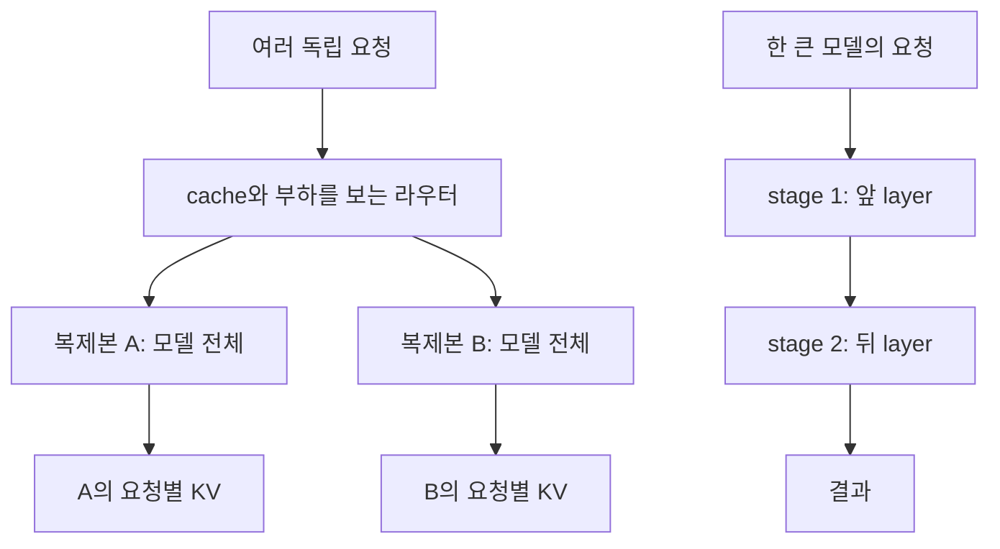

# 여러 NPU를 쓰는 설계: PE, 카드, 서버를 구분한다

**카드를 늘리기 전에 무엇을 나눌지 결정해야 한다.** 한 요청의 연산을 나눌지, 모델의 layer를 나눌지, 서로 다른 요청을 나눌지가 먼저다. FuryNo5·fxbX의 현재 커스텀 실행 계획은 한 장치의 fusion 8·Single 계약을 검사한다. 여러 카드를 꽂았다는 이유로 그 계획이 자동 분산되지는 않는다. 공식 Furiosa-LLM의 병렬성, 최신 opt-vLLM의 병렬성, 우리 프로젝트의 구현 상태도 서로 구분한다. [fxbX device 계약](https://github.com/smallstep-zzz/fxbX/blob/03d993b4d1b36cdda209d61bbf447434c174b401/fxbex/execution_fxb.py#L132-L162) · [공식 병렬성](https://developer.furiosa.ai/v2026.4.0/en/furiosa_llm/model-parallelism.html)

## 1. 같은 숫자 8이라도 의미가 다르다

| 용어 또는 옵션 | 의미 | 혼동하면 생기는 문제 |
|---|---|---|
| 한 RNGD 카드의 8 PE(Processing Element) | 카드 안의 처리 단위 | 독립 카드 8장으로 잘못 계산 |
| `set_fusion(8)` | 그 실행 규격의 PE 사용 계약 | 모델 복제본 8개를 만든다고 오해 |
| Furiosa-LLM `tensor_parallel_size` | TP(Tensor Parallelism) group의 PE 수 | 카드 수를 넣어 잘못 컴파일 |
| opt-vLLM `tensor_parallel_size` | 현 plugin에서 engine의 chip 수 선택으로 전달 | 공식 LLM의 PE 단위 설정을 복사 |
| 여러 호스트 | 네트워크로 연결한 별도 OS·메모리 공간 | 한 호스트의 HBM(High Bandwidth Memory)처럼 취급 |

공식 LLM은 TP를 FXB 컴파일 시 결정하고, serve에서 임의로 바꾸지 않는다. 공식 예에서 카드 네 장은 PE 32개이며 TP 8·PP(Pipeline Parallelism) 4·DP(Data Parallelism) 1 또는 TP 8·PP 2·DP 2로 나눈다. 이 조합을 opt-vLLM에 그대로 복사하면 안 된다. opt plugin은 `LoadOptions.chips(tensor_parallel_size)`로 연결한다. [공식 단위 설명](https://developer.furiosa.ai/v2026.4.0/en/furiosa_llm/model-parallelism.html) · [opt admission의 chips 연결](https://github.com/furiosa-ai/furiosa-opt-models/blob/c982976100d18d7a9641d5a8c22b89cec4544049/integrations/furiosa-opt-vllm/furiosa_opt_vllm/admission.py#L541-L558)

## 2. DP, TP, PP를 실제 데이터 이동으로 이해한다

DP는 모델 복제본에 서로 다른 요청을 보낸다. 복제본 사이에서 한 토큰의 중간 activation을 계속 교환할 필요가 적으므로 서비스 처리량을 키우는 첫 후보가 된다. 대신 각 복제본의 가중치·요청 상태·cache가 필요하다.

TP는 하나의 행렬 계산 등을 여러 처리 단위로 나눈다. 모델과 activation을 나눌 수 있지만 partial sum을 합치는 all-reduce, 잘린 결과를 모으는 all-gather 같은 통신이 연산 사이에 들어간다. 작은 batch에서 계산량이 작으면 이 통신이 상대적으로 커진다.

PP는 layer 구간을 stage로 나눈다. 한 요청은 stage를 순서대로 지나가고 여러 microbatch가 서로 다른 stage에 들어가면 처리량을 높일 수 있다. stage 계산량이 다르면 느린 stage 앞에서 대기하고, 빈 stage 시간인 pipeline bubble이 생긴다. [공식 TP·PP·DP 설명](https://developer.furiosa.ai/v2026.4.0/en/furiosa_llm/model-parallelism.html)



DP와 PP를 비교한 개념도다. 각 복제본 또는 stage 내부에서 TP를 적용할 수도 있다. 실제 지원 조합은 사용 중인 runtime·model build가 결정한다.

## 3. 현재 구현 상태를 분리한다

| 경로 | 확인된 범위 | 이 핸드북에서 완료로 취급하지 않는 것 |
|---|---|---|
| 공식 Furiosa-LLM | 공식 FXB 조건에 맞는 TP·PP·DP 설정 문서 | 임의 FuryNo5 graph 등록 |
| 공식 opt-vLLM `c982976` | compile된 chip 수의 TP, 조건부 dense DP | PP>1, context parallel>1, nnodes>1 |
| fxbX `ExecutionFXB` | `furiosa:0`, fusion8/Single, 요청별 상태 객체 | 범용 multi-device placement와 collective |
| FHA 검증 queue | CPU compile 병렬화, 관리되는 NPU 작업의 독점 실행 | PE 8개에 검증 job 8개 동시 실행 |
| 이 장의 cluster router | 설계 제안 | 구현·실측 완료 |

opt-vLLM의 문서 일부는 DP=1로 남아 있지만 실제 `admission.py`와 `test_parallelism.py`에는 dense 모델 독립 replica 구현이 있다. 다만 multiprocessing backend, MoE·speculative·offload 조합 제한을 지킨다. 테스트 코드 존재를 이 핸드북에서 새로 측정한 성공으로 표시하지 않는다. [opt 코드](https://github.com/furiosa-ai/furiosa-opt-models/blob/c982976100d18d7a9641d5a8c22b89cec4544049/integrations/furiosa-opt-vllm/furiosa_opt_vllm/admission.py) · [테스트](https://github.com/furiosa-ai/furiosa-opt-models/blob/c982976100d18d7a9641d5a8c22b89cec4544049/integrations/furiosa-opt-vllm/tests/test_parallelism.py) · [FHA queue 경계](https://github.com/smallstep-zzz/Furiosa-Hug-Anything/blob/8fc675f488763bef7c779ee037e8393ddd9f856a/docs/AUTOMATED_PORTING.md)

## 4. 먼저 요청 단위 분산을 검토한다

아래는 **FuryNo5 관점의 권장 우선순위**다. 일반 법칙이 아니며, 한 카드에 모델이 들어가지 않는다면 TP·PP가 먼저 필요할 수 있다.

1. 단일 카드의 수치·warm 지연·메모리를 먼저 기준선으로 남긴다.
2. 모델이 한 카드에 들어가고 요청이 독립적이면 복제본을 만든다.
3. 모델 적재 상태와 prefix cache를 보고 요청을 배정한다.
4. 한 카드 메모리가 부족하거나 단일 요청 지연이 목표이면 TP·PP를 검토한다.
5. 통신·장치 동기화·실패 복구까지 측정한 다음 여러 호스트로 넓힌다.

이 순서를 택하는 이유는 DP가 기존 한 카드 실행체를 보존하기 쉽기 때문이다. 반면 graph를 layer나 tensor별로 나누면 shape·layout·collective·buffer 수명·오류 전파 계약이 함께 바뀐다. 작은 EDF 한 개의 kernel 최적화와 분산 실행 계획 개발은 별도의 작업이다.

## 5. cache가 있는 서버를 고르는 방법

요청을 “지금 utilization이 가장 낮은 장치”에만 보내면 이미 적재된 가중치와 prefix cache를 버릴 수 있다. 필요한 모델이 없는 빈 장치는 수 초 이상의 적재를 시작할 수도 있지만, 약간 바쁜 장치에는 같은 모델과 앞부분 KV가 준비돼 있을 수 있다. 여기서 적재 시간의 크기는 모델·시스템 실측에 따라 달라지며 고정 상수로 간주하지 않는다.

공식 Furiosa-LLM의 DP router는 prefix locality와 active token load를 함께 평가한다. 이 정보는 replica별 가상 cache 기록을 이용하며 **라우팅 자체가 replica 간 KV를 옮기지는 않는다.** 한 process 내부 DP routing과 여러 server pod 사이 routing은 다른 계층이다. [공식 routing](https://developer.furiosa.ai/v2026.4.0/en/furiosa_llm/data-parallel-routing.html)

우리 cluster의 비용 모델을 만든다면 다음처럼 명시할 수 있다. 아래 함수는 **설계용 의사코드**이며 실제 fxbX API가 아니다. 각 시간은 운영 중 측정한 예측값이다.

```python
def estimated_finish_ms(worker, request):
    return (
        worker.queue_wait_ms(request)
        + worker.model_load_ms(request.model_revision)
        + worker.cache_restore_ms(request.prefix)
        + worker.prefill_ms(request.uncached_tokens(worker))
        + worker.decode_ms(request.expected_output_tokens)
    )

def choose_worker(workers, request):
    eligible = [w for w in workers if w.can_admit(request)]
    if not eligible:
        raise RuntimeError("대기열 또는 명시적 자원 부족 응답 필요")
    return min(eligible, key=lambda w: estimated_finish_ms(w, request))
```

`can_admit`는 단순 여유 메모리 검사만이 아니다. SDK·package hash·tokenizer·KV dtype·bucket 계약이 맞는지, 요청 상태가 그 장치에 묶여 있는지, 다른 작업의 잠금이 있는지도 검사한다. cache key에는 token prefix뿐 아니라 model revision과 실행 의미에 영향을 주는 설정이 들어가야 다른 모델의 KV를 재사용하지 않는다.

## 6. KV를 옮길지 다시 계산할지

KV를 다른 카드나 서버에 복사하면 prefill을 줄일 수 있지만, cache serialization·전송·재배치 비용이 든다. 일반적인 손익 조건은 다음과 같다.

**복원 총시간 < 같은 prefix를 재계산하는 시간**

전송 속도만 비교하지 않고 host staging, destination allocation, layout 변환, 완료 동기화를 포함한다. 공식 hierarchical prefix cache도 NPU resident cache와 host cache를 구별하며, host hit에는 NPU로의 복사가 필요하다. 이 기능의 local 두 tier가 여러 process 간 영속 공유 저장소라는 뜻은 아니다. 외부 shared cache는 별도 connector와 배포 구성이 필요하다. [공식 hierarchical cache](https://developer.furiosa.ai/v2026.4.0/en/furiosa_llm/hierarchical-prefix-caching.html)

반복되는 긴 system prompt가 많다면 cache locality가 유리할 수 있다. 요청들이 거의 다른 문맥이라면 부하 분산을 더 중시할 수 있다. 한 인기 prefix로 모든 요청이 한 복제본에 몰리면 cache hit가 높아도 tail latency는 나빠질 수 있으므로 둘을 함께 기록한다.

## 7. 공식 경로의 설정 예와 fxbX 개발 과제

다음은 **공식 Furiosa-LLM 모델에만** 적용하는 예다. 사용 모델의 compiled TP와 총 PE 배치를 먼저 맞춘다.

```bash
furiosa-llm serve furiosa-ai/Qwen3-4B-FP8   --data-parallel-size 2   --data-parallel-routing-policy scoring   --data-parallel-scoring-profile locality
```

[공식 routing CLI](https://developer.furiosa.ai/v2026.4.0/en/furiosa_llm/data-parallel-routing.html)

fxbX에 같은 기능을 추가하려면 다음 항목이 필요하다.

| 구현 항목 | 필요한 정보 |
|---|---|
| device placement | tensor·kernel·state가 어느 카드/PE group에 있는가 |
| transfer step | src/dst, byte layout, 완료 dependency |
| collective | reduction 순서, dtype, tensor partition |
| request admission | 장치별 peak memory와 queue 한도 |
| failure domain | 한 stage 실패 시 나머지 stage·KV 처리 |
| trace attribution | request→stage→EDF→Task의 대응 |
| artifact identity | shard 수·bucket·layout·compiler revision |

현재 `ExecutionFXB`의 단일 장치 조건을 제거하는 것은 이 기능들의 구현을 대신하지 않는다. 기능별로 최소 재현을 만들고, 두 요청·두 장치에서 상태 독립성과 완료 순서를 확인한 뒤 모델 전체로 확장해야 한다.

## 8. 무엇을 측정해야 확장이 성공한 것인가

최소한 1·2·4장 조건에서 total throughput, TTFT(Time To First Token), TPOT(Time Per Output Token), p95/p99 요청 지연, card별 memory, 통신 시간, cache hit·restore bytes를 기록한다. 모델·input distribution·동시성·정확도 기준은 고정한다. 같은 결과를 더 빨리 냈는지와 단순히 batch를 키워 더 오래 기다리게 했는지 구분한다.

확장 효율의 예는 `E_N = throughput_N / (N × throughput_1)`이다. 이것은 동일 요청분포에서의 비교식이며 미래 성능 예측값이 아니다. 단일 요청 지연이 목표라면 throughput 효율 대신 해당 요청의 완료시간과 통신 비중을 봐야 한다. FuryNo5의 다음 과제는 “NPU 여러 장을 인식한다”를 넘어 이 결과를 재현 가능하게 만드는 것이다.

## 출처

| 근거 | 확인 위치 |
|---|---|
| PE 단위 TP와 공식 PP·DP | [Model Parallelism](https://developer.furiosa.ai/v2026.4.0/en/furiosa_llm/model-parallelism.html) |
| cache locality와 token load | [Data-Parallel Routing](https://developer.furiosa.ai/v2026.4.0/en/furiosa_llm/data-parallel-routing.html) |
| NPU·host cache의 차이 | [Hierarchical Prefix Caching](https://developer.furiosa.ai/v2026.4.0/en/furiosa_llm/hierarchical-prefix-caching.html) |
| opt의 chip 단위와 제한 | [admission.py](https://github.com/furiosa-ai/furiosa-opt-models/blob/c982976100d18d7a9641d5a8c22b89cec4544049/integrations/furiosa-opt-vllm/furiosa_opt_vllm/admission.py), [parallelism tests](https://github.com/furiosa-ai/furiosa-opt-models/blob/c982976100d18d7a9641d5a8c22b89cec4544049/integrations/furiosa-opt-vllm/tests/test_parallelism.py) |
| fxbX의 현재 장치 경계 | [execution_fxb.py](https://github.com/smallstep-zzz/fxbX/blob/03d993b4d1b36cdda209d61bbf447434c174b401/fxbex/execution_fxb.py) |
| FHA 자원·동시성 경계 | [AUTOMATED_PORTING.md](https://github.com/smallstep-zzz/Furiosa-Hug-Anything/blob/8fc675f488763bef7c779ee037e8393ddd9f856a/docs/AUTOMATED_PORTING.md) — 접근 권한 필요 |

