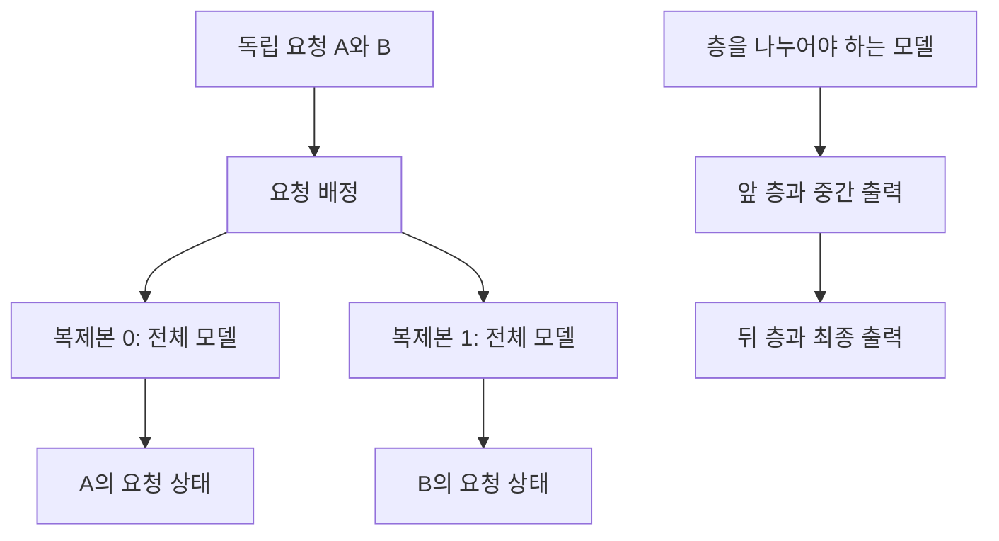

# 여러 NPU를 쓰는 설계: PE, 카드, 서버를 구분한다

> **전체 경로에서의 위치**
>
> 요청·모델 분할 → **복제·통신·장치별 상태** → 여러 NPU의 결과
>
> 한 장치 실행 위에 분산 책임을 더한다. PE 결합, 모델 병렬, 요청 복제는 나누는 대상이 다르다. [14장](14-serving-vllm.md)의 요청 상태가 어디에 놓이는지 확인하고 [17장](17-debugging.md)의 방법으로 확장 비용을 측정한다.

웹 서버의 worker를 두 개로 늘릴 때 먼저 확인하는 것은 작업이 독립적인지, 공유 상태가 있는지, 메모리가 두 배 필요한지다. NPU(Neural Processing Unit)를 늘릴 때도 같은 질문에서 시작한다. **서로 다른 요청을 나누는 방법, 한 행렬 계산을 나누는 방법, 모델의 층을 나누는 방법은 비용과 필요한 구현이 다르다.** 이 장은 작은 계산과 시간표로 그 차이를 먼저 확인한다. FuryNo5·fxbX의 현재 커스텀 실행 계획은 한 장치의 fusion 8·Single 계약을 검사한다. 여러 카드를 꽂았다는 이유로 그 계획이 자동 분산되지는 않는다. 공식 Furiosa-LLM의 병렬성, 최신 opt-vLLM의 병렬성, 우리 프로젝트의 구현 상태도 서로 구분한다. [fxbX device 계약](https://github.com/smallstep-zzz/fxbX/blob/03d993b4d1b36cdda209d61bbf447434c174b401/fxbex/execution_fxb.py#L132-L162) · [공식 병렬성](https://developer.furiosa.ai/v2026.4.0/en/furiosa_llm/model-parallelism.html)

## 1. 같은 숫자 8이라도 의미가 다르다

먼저 자원 단위를 정리하자. **호스트(host)는** 여기서 OS(Operating System)와 CPU(Central Processing Unit), 주 메모리를 가진 서버다. **카드(card)는** 그 서버에 장착한 RNGD 장치이며, **PE(Processing Element)는** 카드 안에서 계산을 담당하는 처리 단위다. 한 RNGD 카드의 PE는 8개다. 카드의 **HBM(High Bandwidth Memory)은** 계산에 사용할 가중치·입출력·중간값을 담는 장치 메모리다. 두 서버의 메모리는 같은 주소 공간이 아니므로 원격 자료를 사용하려면 통신이 필요하다. [공식 자원 단위](https://developer.furiosa.ai/v2026.4.0/en/furiosa_llm/model-parallelism.html)

**PE binding(PE 자원 연결)은** 어느 실행기나 작업에 어느 PE 집합을 사용할 수 있게 연결할지 정하는 자원 배치 문제다. OS의 CPU affinity가 실행할 코어 집합을 지정하는 것과 비교할 수 있지만, NPU 연산을 여러 PE로 나누는 방법까지 CPU thread처럼 자동 결정된다는 뜻은 아니다. **Fusion 8**은 이 실행 규격에서 PE 8개를 묶어 사용하는 설정이다. fxbX의 현재 소비자는 `fusion=8`과 `mesh=single`이라는 장치 배치 계약을 검사한다. `Single`은 SDK(Software Development Kit)의 해당 배치 설정 이름이며, “모델 복제본 8개”나 “서버 여러 대에 자동 분산”이라는 의미가 아니다. [현재 설정 검사](https://github.com/smallstep-zzz/fxbX/blob/03d993b4d1b36cdda209d61bbf447434c174b401/fxbex/execution_fxb.py#L132-L162)

**Tensor**는 다차원 배열이고 **shape**는 각 축 길이의 목록이다. 예를 들어 한 요청의 입력 세 값은 `[1,3]`, 두 요청의 세 값은 `[2,3]`인 행렬로 표현할 수 있다. **Layout**은 이 논리적 원소들의 실제 메모리 순서이고 **dtype**은 원소 자료형이다. 실행 그래프는 이런 배열을 받는 계산들을 연결한 순서·의존 관계다. EDF는 그 계산을 장치에서 수행할 컴파일 결과다.

이제 병렬성 이름을 붙이면 요청을 나누는 것은 DP(Data Parallelism), tensor 계산을 나누는 것은 TP(Tensor Parallelism), 층 구간을 나누는 것은 PP(Pipeline Parallelism)다. 아래 숫자는 어떤 API(Application Programming Interface)에 넣는지까지 함께 읽어야 한다.

| 용어 또는 옵션 | 의미 | 혼동하면 생기는 문제 |
|---|---|---|
| 한 RNGD 카드의 8 PE(Processing Element) | 카드 안의 처리 단위 | 독립 카드 8장으로 잘못 계산 |
| `set_fusion(8)` | 그 실행 규격의 PE 사용 계약 | 모델 복제본 8개를 만든다고 오해 |
| Furiosa-LLM `tensor_parallel_size` | TP(Tensor Parallelism) group의 PE 수 | 카드 수를 넣어 잘못 컴파일 |
| opt-vLLM `tensor_parallel_size` | 현 plugin에서 engine의 chip 수 선택으로 전달 | 공식 LLM의 PE 단위 설정을 복사 |
| 여러 호스트 | 네트워크로 연결한 별도 OS·메모리 공간 | 한 호스트의 HBM(High Bandwidth Memory)처럼 취급 |

공식 LLM은 TP를 FXB 컴파일 시 결정하고, serve에서 임의로 바꾸지 않는다. 공식 예에서 카드 네 장은 PE 32개이며 TP 8·PP(Pipeline Parallelism) 4·DP(Data Parallelism) 1 또는 TP 8·PP 2·DP 2로 나눈다. 이 조합을 opt-vLLM에 그대로 복사하면 안 된다. opt plugin은 `LoadOptions.chips(tensor_parallel_size)`로 연결한다. [공식 단위 설명](https://developer.furiosa.ai/v2026.4.0/en/furiosa_llm/model-parallelism.html) · [opt admission의 chips 연결](https://github.com/furiosa-ai/furiosa-opt-models/blob/c982976100d18d7a9641d5a8c22b89cec4544049/integrations/furiosa-opt-vllm/furiosa_opt_vllm/admission.py#L541-L558)

## 2. 요청·행렬·층을 각각 나누어 본다

### DP: 같은 실행기를 복제하고 요청을 나눈다

모델 하나가 한 카드에 들어가고 요청 A와 B가 독립적이라고 하자. 한 요청을 20 ms에 처리하는 실행기를 하나만 쓰면 순서대로 40 ms가 걸린다. 같은 실행기를 두 카드에 복제해 A와 B를 동시에 처리하면 이상적인 경우 둘 다 20 ms에 끝난다. 이 수는 **개념 설명용 가정**이며 실제 측정이 아니다. 배정·통신 비용이 있으면 더 걸린다.

| 자원 | 한 복제본 | 두 복제본 |
|---|---|---|
| 가중치 | 모델 전체 한 벌 | 각 카드에 모델 전체 한 벌 |
| 요청 처리 | A 다음 B | 카드 0은 A, 카드 1은 B |
| 요청 상태 | 해당 요청의 상태 | A·B의 상태를 서로 분리 |
| 기대 효과 | 기준선 | 독립 요청의 처리량 증가 |
| 자동으로 얻지 못하는 것 | — | 요청 A 자체의 계산 시간 절반 |

LLM(Large Language Model)의 **KV(Key–Value) cache**는 앞 토큰의 attention용 비교 벡터와 내용 벡터를 보관한 중간 상태다. A와 B의 문맥이 다르면 서로 다른 KV가 필요하다. DP 복제본을 늘리면 가중치뿐 아니라 각 요청의 이 상태를 담을 공간도 필요하다.

### TP: 같은 계산을 나누면 결과를 모으는 단계가 필요하다

작은 행렬곱을 직접 나누어 보자. 행렬의 **행(row)은** 가로로 놓인 값 묶음, **열(column)은** 같은 세로 위치의 묶음이다. 입력을 한 행으로 보면 shape `[1,2]`, 가중치 W는 `[2,2]`다. 곱셈의 맞닿는 길이 2가 같아야 하며, 출력의 각 값은 입력 행과 해당 가중치 열을 원소별로 곱한 뒤 더해 만든다. 이 곱셈 후 합이 내적이다. 입력 `x=[1,2]`와 가중치 `W=[[1,2],[3,4]]`의 곱은 `[1×1+2×3, 1×2+2×4] = [7,10]`이다. 입력 차원을 둘로 나누면 다음처럼 계산할 수 있다.

| 참여 장치 | 가진 입력과 가중치 조각 | 부분 결과 |
|---|---|---|
| 0 | `1 × [1,2]` | `[1,2]` |
| 1 | `2 × [3,4]` | `[6,8]` |
| 합치기 | 두 벡터의 원소별 합 | `[7,10]` |

계산을 반으로 나눴더라도 마지막 합은 남는다. **Reduction(축약)은** 여러 값을 합·최댓값 같은 규칙으로 하나의 결과로 모으는 연산이다. 여러 참여자가 결과를 합치고 모두 같은 결과를 받으면 **all-reduce**, 각자가 가진 서로 다른 조각을 모두에게 모아 주면 **all-gather**라고 부른다. 이런 여러 장치 사이의 공동 통신 연산이 **collective**다.

다른 분할도 가능하다. W의 열을 나누면 장치 0은 최종 출력 `[7]`, 장치 1은 `[10]`을 만든다. 뒤 연산이 전체 벡터를 요구하면 두 조각을 **concat(concatenation, 같은 축으로 이어 붙이기)해** `[7,10]`으로 모아야 한다. `[7]+[10]`을 원소별로 더해 `[17]`을 만드는 것과 다르다. 입력 축 분할은 부분 **합**을, 출력 축 분할은 서로 다른 출력 **조각**을 만들기 때문에 결합 방법도 다르다. 실제 모델은 이런 분할·모으기의 위치를 조절한다. **Activation(활성값)은** 층이 계산해 다음 층으로 넘기는 중간 tensor이고, TP는 가중치와 activation을 어떻게 나눌지도 정해야 한다. 작은 입력에서는 절약한 계산보다 통신·완료 대기의 비중이 커질 수 있다. [공식 TP 개념과 구성](https://developer.furiosa.ai/v2026.4.0/en/furiosa_llm/model-parallelism.html)

#### 부분합 뒤에 어떤 연산이 오는지 확인한다

“나중에 합치면 된다”는 판단은 다음 연산의 성질에 달려 있다. 두 장치가 **같은 출력 원소의 부분합** `-2`와 `3`을 만들었다고 하자. 뒤 연산이 ReLU(Rectified Linear Unit), 즉 `max(0,x)`로 음수는 0으로 바꾸고 양수는 유지하는 함수라면 다음 두 순서는 다르다.

| 순서 | 계산 | 결과 |
|---|---|---:|
| 먼저 부분합을 합치고 ReLU | `max(0, -2+3)` | 1 |
| 각 장치에서 ReLU 후 합치기 | `max(0,-2)+max(0,3)` | 3 |

음수 부분합 `-2`는 전체 출력에서 `3`을 상쇄하는 데 필요하다. 먼저 0으로 없애면 상쇄할 정보가 사라진다. ReLU처럼 입력에 따라 규칙이 달라져 일반적으로 `f(a+b)=f(a)+f(b)`가 성립하지 않는 연산을 **비선형 연산**이라고 부른다. 이 예에서는 합치는 완료 경계가 ReLU보다 앞에 있어야 같은 모델을 유지한다.

[tp_reduction_demo.py](../examples/tp_reduction_demo.py)는 숫자와 순서만 확인하는 순수 Python 예다. 분산 통신이나 RNGD를 실행하는 코드는 아니다.

```python
def relu(value):
    return max(0, value)  # 음수만 0으로 바꾸는 원소별 함수

partial_0, partial_1 = -2, 3  # 서로 다른 출력이 아니라 같은 원소에 더할 두 부분
correct = relu(partial_0 + partial_1)  # 먼저 완성한 출력 1에 ReLU 적용
wrong = relu(partial_0) + relu(partial_1)  # 음수 부분을 일찍 버려 결과가 3이 됨
assert (correct, wrong) == (1, 3)
print(correct, wrong)

# 반대로 두 값이 이미 완성된 서로 다른 출력 원소라면 원소별 처리 뒤 연결 가능
separate_outputs = [-2, 3]
processed_slices = [relu(separate_outputs[0]), relu(separate_outputs[1])]
assert processed_slices == [0, 3]  # 전체 벡터 [-2,3]에 원소별 ReLU한 것과 같다.
print(processed_slices)
```

아래 두 줄은 모양이 모두 길이 2이지만 의미가 다르다. `[-2,3]`이 **같은 원소를 위한 두 부분합**이면 합친 `[1]`이 실제 출력이고, **서로 다른 두 출력 조각**이면 연결한 `[-2,3]`이 실제 출력이다. 후자는 ReLU처럼 원소별로 독립인 함수를 각 조각에서 수행할 수 있다. 그러나 다음 함수가 전체 벡터의 합·평균 등에 의존하면 다시 전체 정보가 필요할 수 있다. 그래서 TP 설계는 모든 층에 같은 all-reduce를 붙이는 규칙이 아니라, 분할 축·부분 결과의 의미·다음 함수의 의존성을 함께 보존하는 작업이다.

### PP: 생산 라인처럼 서로 다른 요청이 다른 층에 머문다

모델의 앞 층을 stage 1, 뒤 층을 stage 2에 놓자. **Stage(단계)는** 한 장치 또는 장치 그룹이 맡는 연속된 층 구간이다. 각 단계에 10 ms가 걸리고 전송 비용은 무시하는 교육용 예에서 요청 A·B·C의 진행은 다음과 같다.

| 시간 | Stage 1 | Stage 2 | 완료된 요청 |
|---|---|---|---|
| 0~10 ms | A | 빈 상태 | 없음 |
| 10~20 ms | B | A | A가 20 ms에 완료 |
| 20~30 ms | C | B | B가 30 ms에 완료 |
| 30~40 ms | 빈 상태 | C | C가 40 ms에 완료 |

요청별로 20 ms씩 순차 처리하면 60 ms지만, 겹쳐 처리하면 40 ms다. 그래도 A 하나의 지연이 10 ms로 줄어든 것은 아니다. pipeline의 작은 작업 묶음을 **microbatch**라고 하고, 표의 빈 칸처럼 장치가 할 일이 없어 비는 시간을 **pipeline bubble**이라고 한다. 한 단계가 20 ms, 다른 단계가 5 ms라면 빠른 단계는 자주 기다린다.

같은 요청의 다음 생성 토큰은 앞 토큰의 출력에 의존하므로 A의 아직 생성되지 않은 토큰들을 독립 microbatch처럼 미리 채울 수는 없다. 여러 요청이나 이미 알려진 입력 부분 중 어떤 것을 겹칠 수 있는지 봐야 한다. PP도 stage 사이 activation 전송과 요청 순서 추적이 필요하다. [공식 PP·DP 설명](https://developer.furiosa.ai/v2026.4.0/en/furiosa_llm/model-parallelism.html)



각 DP 복제본 내부를 다시 TP·PP로 나누는 조합도 가능하다. 실제 지원 조합은 사용 중인 runtime과 컴파일 결과가 결정한다. 위의 시간과 2차원 행렬은 원리를 보여주는 예이며 해당 조합의 RNGD 실측을 주장하지 않는다.

## 3. 현재 구현 상태를 분리한다

아래 표의 **dense 모델**은 일반적인 층 계산을 전체 입력에 적용하는 모델이고, **MoE(Mixture of Experts)는** 입력마다 선택한 전문가 부분망을 쓰는 구조다. **Context parallelism**은 긴 입력 문맥의 위치 축을 나누는 병렬성이다. **Speculative decoding**은 다음 토큰 후보들을 미리 제안하고 본 모델로 검증하는 방식, **KV offload**는 KV를 장치 밖 메모리로 옮겨 장치 용량을 확보하는 방식이다. 각각 필요한 상태와 통신이 달라 DP 구현이 있다는 사실만으로 모든 조합을 지원하지 않는다.

| 경로 | 확인된 범위 | 이 핸드북에서 완료로 취급하지 않는 것 |
|---|---|---|
| 공식 Furiosa-LLM | 공식 FXB 조건에 맞는 TP·PP·DP 설정 문서 | 임의 FuryNo5 graph 등록 |
| 공식 opt-vLLM `c982976` | compile된 chip 수의 TP, 조건부 dense DP | PP>1, context parallel>1, nnodes>1 |
| fxbX `ExecutionFXB` | `furiosa:0`, fusion8/Single, 요청별 상태 객체 | 범용 multi-device placement와 collective |
| FHA 검증 queue | CPU compile 병렬화, 관리되는 NPU 작업의 독점 실행 | PE 8개에 검증 job 8개 동시 실행 |
| 이 장의 cluster router | 설계 제안 | 구현·실측 완료 |

opt-vLLM의 문서 일부는 DP=1로 남아 있지만 실제 `admission.py`와 `test_parallelism.py`에는 dense 모델 독립 replica 구현이 있다. 다만 multiprocessing backend, MoE·speculative·offload 조합 제한을 지킨다. 테스트 코드 존재를 이 핸드북에서 새로 측정한 성공으로 표시하지 않는다. [opt 코드](https://github.com/furiosa-ai/furiosa-opt-models/blob/c982976100d18d7a9641d5a8c22b89cec4544049/integrations/furiosa-opt-vllm/furiosa_opt_vllm/admission.py) · [테스트](https://github.com/furiosa-ai/furiosa-opt-models/blob/c982976100d18d7a9641d5a8c22b89cec4544049/integrations/furiosa-opt-vllm/tests/test_parallelism.py) · [FHA queue 경계](https://github.com/smallstep-zzz/Furiosa-Hug-Anything/blob/8fc675f488763bef7c779ee037e8393ddd9f856a/docs/AUTOMATED_PORTING.md)

## 4. 먼저 요청 단위 분산을 검토한다

아래는 **FuryNo5 관점의 권장 우선순위**다. 일반 법칙이 아니며, 한 카드에 모델이 들어가지 않는다면 TP·PP가 먼저 필요할 수 있다.

1. 단일 카드의 수치·warm 지연·메모리를 먼저 기준선으로 남긴다.
2. 모델이 한 카드에 들어가고 요청이 독립적이면 복제본을 만든다.
3. 모델 적재 상태와 prefix cache(공통 입력 앞부분의 KV)를 보고 요청을 배정한다.
4. 한 카드 메모리가 부족하거나 단일 요청 지연이 목표이면 TP·PP를 검토한다.
5. 통신·장치 동기화·실패 복구까지 측정한 다음 여러 호스트로 넓힌다.

이 순서를 택하는 이유는 DP가 기존 한 카드 실행체를 보존하기 쉽기 때문이다. 반면 graph를 layer나 tensor별로 나누면 shape·layout·collective·buffer 수명·오류 전파 계약이 함께 바뀐다. 작은 EDF 한 개의 kernel 최적화와 분산 실행 계획 개발은 별도의 작업이다.

## 5. cache가 있는 서버를 고르는 방법

요청을 “지금 utilization이 가장 낮은 장치”에만 보내면 이미 적재된 가중치와 prefix cache를 버릴 수 있다. 필요한 모델이 없는 빈 장치는 수 초 이상의 적재를 시작할 수도 있지만, 약간 바쁜 장치에는 같은 모델과 앞부분 KV가 준비돼 있을 수 있다. 여기서 적재 시간의 크기는 모델·시스템 실측에 따라 달라지며 고정 상수로 간주하지 않는다.

공식 Furiosa-LLM의 DP router는 prefix locality와 active token load를 함께 평가한다. 이 정보는 replica별 가상 cache 기록을 이용하며 **라우팅 자체가 replica 간 KV를 옮기지는 않는다.** 한 process 내부 DP routing과 여러 server pod(배포한 서버 실행 단위) 사이 routing은 다른 계층이다. [공식 routing](https://developer.furiosa.ai/v2026.4.0/en/furiosa_llm/data-parallel-routing.html)

숫자로 판단해 보자. 아래 시간은 모두 **라우팅 원리 설명용 예측값**이고 실제 서버의 측정치가 아니다. 요청의 출력 길이는 같다고 가정한다.

| 후보 | 큐 대기 | 모델 적재 | 미처리 입력 계산 | 출력 생성 | 예상 완료까지 |
|---|---:|---:|---:|---:|---:|
| A: 같은 모델·prefix가 있음 | 20 ms | 0 | 10 ms | 30 ms | 60 ms |
| B: 같은 모델, prefix 없음 | 0 | 0 | 50 ms | 30 ms | 80 ms |
| C: 모델부터 적재해야 함 | 0 | 200 ms | 50 ms | 30 ms | 280 ms |

**Prefix(공통 앞부분)는** 여러 요청이 공유하는 입력 토큰의 앞 구간이다. 그 구간의 KV가 있다면 **prefill(입력 문맥 계산)** 일부를 다시 하지 않아도 된다. 반대로 **decode(새 토큰 생성)** 시간은 생성할 길이에 좌우된다. 이 예에서는 바쁘지만 cache가 있는 A가 가장 빨리 끝난다. A의 큐가 100 ms로 늘면 B가 더 낫다. cache 적중률 하나만 최대화할 수 없는 이유다.

우리 cluster에서 **새 요청을 처음 배정하는** 비용 모델을 만든다면 다음처럼 명시할 수 있다. 아래 함수는 **설계용 의사코드**이며 실제 fxbX API가 아니다. 각 시간은 운영 중 측정한 예측값이다.

```python
def estimated_finish_ms(worker, request):
    return (
        worker.queue_wait_ms(request)  # 이미 대기·실행 중인 요청 때문에 기다릴 시간
        + worker.model_load_ms(request.model_revision)  # 맞는 가중치가 없으면 적재 비용
        + worker.cache_restore_ms(request.prefix)  # 외부에 둔 공통 앞부분 KV의 복원 비용
        + worker.prefill_ms(request.uncached_tokens(worker))  # 재사용하지 못한 입력 계산
        + worker.decode_ms(request.expected_output_tokens)  # 예상 출력 길이에 따른 생성
    )

def choose_worker(workers, request):
    # 아직 실행 상태를 갖지 않은 새 요청을 배정할 때 호출하는 설계용 함수다.
    # 메모리뿐 아니라 모델·상태·실행 규격이 맞는 후보만 남긴다.
    eligible = [w for w in workers if w.can_admit(request)]
    if not eligible:
        raise RuntimeError("대기열 또는 명시적 자원 부족 응답 필요")
    return min(eligible, key=lambda w: estimated_finish_ms(w, request))  # 예측 완료가 가장 빠른 후보
```

위 함수의 입력은 worker별 상태와 요청이고 출력은 예상 완료 시간이 가장 작은 worker다. 메서드 이름들은 우리가 구현해야 할 예측기의 자리이지 제공되는 fxbX 함수가 아니다. 생성 길이와 대기시간의 예측이 틀릴 수 있으므로 실제 완료시간으로 오차도 기록해야 한다.

`can_admit`는 단순 여유 메모리 검사만이 아니다. SDK·package hash·tokenizer·KV dtype·bucket 계약이 맞는지, 요청 상태가 그 장치에 묶여 있는지, 다른 작업의 잠금이 있는지도 검사한다. cache key에는 token prefix뿐 아니라 model revision과 실행 의미에 영향을 주는 설정이 들어가야 다른 모델의 KV를 재사용하지 않는다.

### 처음 고르는 복제본과 매번 고르는 실행 요청은 다르다

위 `choose_worker`는 이 설계에서 요청을 처음 받아 **모델 복제본을 정할 때** 사용한다. 14장의 continuous batching scheduler는 이미 그 복제본에 배정된 요청들 중 이번 계산에 참여할 요청·토큰을 고른다. 두 선택은 처리하는 큐와 상태의 범위가 다르다.

설명용 요청 R의 입력이 세 토큰이고 A에 배정됐다고 하자. 다음 표의 길이는 실제로 모델에 넣어 계산한 KV 위치 수이며, 아직 입력으로 다시 넣지 않은 마지막 출력 토큰은 포함하지 않는다.

| 시점 | 결정 담당 | 요청 R의 상태 | A/B 사이에서 다시 배정하는가? |
|---|---|---|---|
| 접수 | 신규 요청 router | 아직 R의 KV 없음. 후보 A·B 비교 | 여기서 A 선택 |
| prefill 완료 | A 내부 scheduler·engine | A에 입력 3위치의 KV, 첫 출력 토큰 선택 | 아니오 |
| 첫 decode | A 내부 scheduler·engine | 선택한 토큰 처리 뒤 A의 KV 길이 4 | 아니오. B가 지금 한가해져도 A 상태가 필요 |
| 다음 decode | A 내부 scheduler·engine | 같은 요청의 다음 위치로 계속 갱신 | 아니오 |
| 종료 | A의 요청 관리자 | R의 소유 상태 회수. 공유 cache의 별도 수명은 정책에 따름 | 다음 새 요청은 다시 후보 비교 가능 |

B가 같은 **공통 prefix**의 KV를 보유한다는 사실과, B가 R이 방금 생성한 토큰까지 포함한 **최신 요청 상태**를 보유한다는 사실도 다르다. 위 사례에서 B에 입력의 세 위치만 있다면 길이 4로 진행한 A의 상태를 대신할 수 없다. 위치 3의 KV와 현재 입력 토큰, 다음에 쓸 위치가 함께 맞아야 한다.

정말 진행 중 요청을 A에서 B로 옮기려면 **migration(실행 중 상태의 이주)를** 별도 동작으로 구현해야 한다. A의 진행 중 쓰기 완료를 확인하고, 요청의 KV·논리 길이·위치·생성 설정을 정해진 형식으로 내보내고, B에서 호환되는 메모리 배치로 복원한 뒤, 어느 쪽만 다음 토큰을 실행할지 소유권을 넘겨야 한다. 그 과정 없이 매 토큰마다 `min(...)`을 다시 호출하면 상태가 없는 장치나 오래된 상태를 가진 장치에 계산을 보낼 수 있다.

이 표는 신규 배정과 요청 내부 스케줄링을 구별하는 설계 예다. 공식 DP router 문서에서 확인한 것은 cache locality와 부하를 고려하는 배정이며, 그 라우팅 자체가 KV 이동을 수행하지 않는다는 범위다. **fxbX에 이런 다중 장치 요청 이주가 이미 구현됐다고 주장하지 않는다.** 다음 절의 복사 손익 계산은 별도 이주·cache 복원 기능을 검토할 때 필요한 비용 계산이다. [공식 router의 범위](https://developer.furiosa.ai/v2026.4.0/en/furiosa_llm/data-parallel-routing.html)

## 6. KV를 옮길지 다시 계산할지

KV를 다른 카드나 서버에 복사하면 prefill을 줄일 수 있지만, **serialization(전송할 바이트 표현으로 직렬화)**·전송·재배치 비용이 든다. 일반적인 손익 조건은 다음과 같다.

**복원 총시간 < 같은 prefix를 재계산하는 시간**

설명용으로 KV 512 MiB를 유효 대역폭 16 GiB/s로 전송하면 순수 전송만 `0.5/16초 = 31.25 ms`다. 목적지 할당 3 ms, 배치 변환 4 ms, 완료 확인 2 ms가 더 들면 40.25 ms다. 같은 prefix를 재계산하는 데 25 ms라면 복사보다 재계산이 빠르고, 100 ms라면 복사가 유리할 수 있다. 이 숫자는 용량·시간의 손익을 설명하는 계산이며 RNGD 연결 성능값이 아니다.

여기서 **layout(메모리 배치)** 변환은 논리 값의 저장 순서를 바꾸는 일이다. 2×2 배열 `[[a,b],[c,d]]`를 `[a,b,c,d]`로 저장한 곳에서 `[a,c,b,d]` 순서를 요구하는 곳으로 옮긴다면 주소만 넘길 수는 없다. **Host staging**은 전송 도중 호스트 메모리를 임시 경유하는 단계이고, 완료 동기화는 목적지가 값을 읽어도 되는 시점까지 기다리는 단계다.

전송 속도만 비교하지 않고 host staging, destination allocation, layout 변환, 완료 동기화를 포함한다. 공식 hierarchical prefix cache도 NPU resident cache와 host cache를 구별하며, host hit에는 NPU로의 복사가 필요하다. 여기서 **tier**는 NPU 메모리와 호스트 메모리처럼 비용·용량이 다른 저장 계층이다. 이 기능의 local 두 tier가 여러 process 간 영속 공유 저장소라는 뜻은 아니다. 외부 shared cache는 별도 connector와 배포 구성이 필요하다. [공식 hierarchical cache](https://developer.furiosa.ai/v2026.4.0/en/furiosa_llm/hierarchical-prefix-caching.html)

반복되는 긴 system prompt가 많다면 cache locality가 유리할 수 있다. 요청들이 거의 다른 문맥이라면 부하 분산을 더 중시할 수 있다. 한 인기 prefix로 모든 요청이 한 복제본에 몰리면 cache hit가 높아도 tail latency는 나빠질 수 있으므로 둘을 함께 기록한다.

## 7. 공식 경로의 설정 예와 fxbX 개발 과제

다음은 **공식 Furiosa-LLM 모델에만** 적용하는 예다. 사용 모델의 compiled TP와 총 PE 배치를 먼저 맞춘다.

```bash
# 지원 모델을 두 DP 복제본으로 실행하며, 공통 문맥의 재사용을 고려해 요청을 배정한다.
furiosa-llm serve furiosa-ai/Qwen3-4B-FP8 \
  --data-parallel-size 2 \
  --data-parallel-routing-policy scoring \
  --data-parallel-scoring-profile locality
```

[공식 routing CLI](https://developer.furiosa.ai/v2026.4.0/en/furiosa_llm/data-parallel-routing.html)

fxbX에 같은 기능을 추가하려면 다음 항목이 필요하다.

| 구현 항목 | 필요한 정보 |
|---|---|
| device placement | tensor·kernel·state가 어느 카드/PE group에 있는가 |
| transfer step | src/dst, byte layout, 완료 dependency |
| collective | reduction 순서, dtype, tensor partition |
| request admission | 장치별 peak memory와 queue 한도 |
| failure domain | 한 stage 실패 시 나머지 stage·KV 처리 |
| trace attribution | request→stage→EDF→Task의 대응 |
| artifact identity | shard 수·bucket·layout·compiler revision |

현재 `ExecutionFXB`의 단일 장치 조건을 제거하는 것은 이 기능들의 구현을 대신하지 않는다. 기능별로 최소 재현을 만들고, 두 요청·두 장치에서 상태 독립성과 완료 순서를 확인한 뒤 모델 전체로 확장해야 한다.

## 8. 무엇을 측정해야 확장이 성공한 것인가

최소한 1·2·4장 조건에서 total throughput(전체 처리량), TTFT(Time To First Token), TPOT(Time Per Output Token), p95/p99 요청 지연, card별 memory, 통신 시간, cache hit·restore bytes를 기록한다. 모델·input distribution·동시성·정확도 기준은 고정한다. 같은 결과를 더 빨리 냈는지와 단순히 batch를 키워 더 오래 기다리게 했는지 구분한다.

평균만 보면 일부 요청의 긴 대기가 숨겨진다. p95/p99는 관측 요청 중 각각 95%/99%가 그 이하에 완료되는 지연 경계다. TTFT는 요청 접수부터 첫 토큰까지, TPOT는 첫 토큰 뒤의 토큰 간격을 본다. 요청을 큰 batch로 만들기 위해 기다린 시간이 처리량과 함께 늘지 않았는지 확인한다.

확장 효율의 예는 `E_N = throughput_N / (N × throughput_1)`이다. 설명용으로 한 카드가 초당 100요청, 두 카드가 170요청, 네 카드가 240요청이면 효율은 각각 `170/200=0.85`, `240/400=0.60`이다. 처리량은 늘었지만 카드당 효과는 줄어든 것이다. 이것은 동일 요청분포에서의 비교식이며 미래 성능 예측값이 아니다. 단일 요청 지연이 목표라면 throughput 효율 대신 해당 요청의 완료시간과 통신 비중을 봐야 한다. FuryNo5의 다음 과제는 “NPU 여러 장을 인식한다”를 넘어 이 결과를 재현 가능하게 만드는 것이다.

## 출처

| 근거 | 확인 위치 |
|---|---|
| PE 단위 TP와 공식 PP·DP | [Model Parallelism](https://developer.furiosa.ai/v2026.4.0/en/furiosa_llm/model-parallelism.html) |
| cache locality와 token load | [Data-Parallel Routing](https://developer.furiosa.ai/v2026.4.0/en/furiosa_llm/data-parallel-routing.html) |
| NPU·host cache의 차이 | [Hierarchical Prefix Caching](https://developer.furiosa.ai/v2026.4.0/en/furiosa_llm/hierarchical-prefix-caching.html) |
| opt의 chip 단위와 제한 | [admission.py](https://github.com/furiosa-ai/furiosa-opt-models/blob/c982976100d18d7a9641d5a8c22b89cec4544049/integrations/furiosa-opt-vllm/furiosa_opt_vllm/admission.py), [parallelism tests](https://github.com/furiosa-ai/furiosa-opt-models/blob/c982976100d18d7a9641d5a8c22b89cec4544049/integrations/furiosa-opt-vllm/tests/test_parallelism.py) |
| fxbX의 현재 장치 경계 | [execution_fxb.py](https://github.com/smallstep-zzz/fxbX/blob/03d993b4d1b36cdda209d61bbf447434c174b401/fxbex/execution_fxb.py) |
| FHA 자원·동시성 경계 | [AUTOMATED_PORTING.md](https://github.com/smallstep-zzz/Furiosa-Hug-Anything/blob/8fc675f488763bef7c779ee037e8393ddd9f856a/docs/AUTOMATED_PORTING.md) — 접근 권한 필요 |

