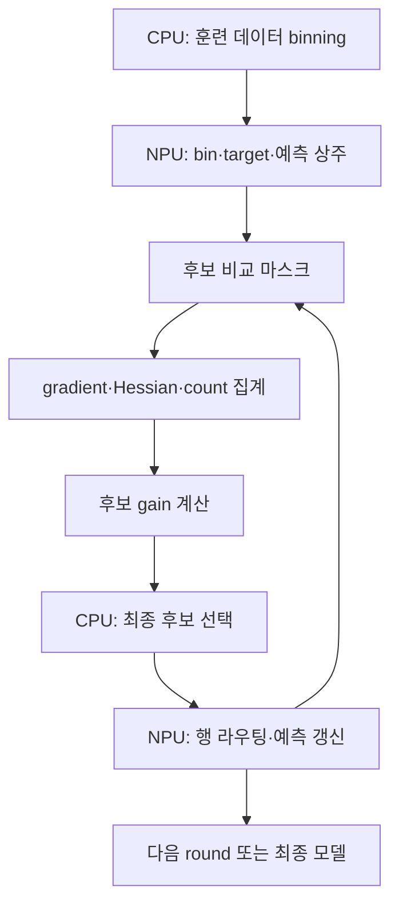

# FuryBoost 회고: NPU에 올린 뒤에도 CPU보다 느린 이유

큰 배열의 합계를 빠르게 구하는 장치가 있어도, 작은 합계 요청을 수백만 번 보내고 매번 완료를 기다리면 프로그램 전체는 느릴 수 있다. DB(Database)에서 행마다 원격 질의를 보내는 경우와, 데이터를 묶어 한 번에 집계하는 경우를 떠올리면 된다. **FuryBoost는 RNGD에서 학습을 실행했고 여러 구조 개선도 했지만, 기록된 HIGGS 비교에서는 멀티코어 XGBoost·LightGBM보다 느렸다.** 이 결과는 숨길 실패가 아니라 다음 최적화의 출발점이다. 전체 비용을 CPU(Central Processing Unit) 전처리, host 호출, EDF(컴파일된 장치 실행 파일) 실행, 동기화, 반복 상태로 나눠 보면 “큰 배열의 곱과 합을 잘 처리하는 장치”와 “빠른 tree boosting 학습기” 사이에 무엇이 남는지 알 수 있다. 이 장은 커밋 `62faf49`에 저장된 2026-11-19 측정기록을 재검토했다. **이번 핸드북 작업에서 새 NPU 시험을 수행한 것은 아니다.** [FuryBoost README](https://github.com/smallstep-zzz/FuryBoost/blob/62faf49a29cc40230ee3df271b8f91ad8488eb5d/README.md)

## 1. 무엇을 만들었는가

FuryBoost는 수치형 입력으로 두 범주를 구별하는 **이진분류** 또는 숫자 값을 예측하는 **회귀**를 위한 대칭 트리 Gradient Boosting 실험이다. **결정 트리**는 `특성 값 ≤ 경계값` 같은 질문을 따라가 최종 leaf(잎)에 저장된 값을 출력하는 모델이다. **Gradient Boosting**은 앞 모델의 오차를 줄이는 작은 트리를 차례로 더하는 학습 방법이다. XGBoost를 감싼 wrapper가 아니라 별도의 training loop와 NumPy 기준 구현, RNGD backend를 가진다. 한 깊이의 모든 leaf에 같은 특성·threshold를 적용하는 대칭 트리라는 점도 비교 해석에 중요하다. [설계](https://github.com/smallstep-zzz/FuryBoost/blob/62faf49a29cc40230ee3df271b8f91ad8488eb5d/docs/ARCHITECTURE.md) · [학습 루프](https://github.com/smallstep-zzz/FuryBoost/blob/62faf49a29cc40230ee3df271b8f91ad8488eb5d/furyboost/training.py)

### 네 행으로 학습 한 단계를 따라간다

구조를 이해하기 위해 **제곱 오차를 쓰는 회귀 문제**를 만든다. 아래는 HIGGS 실험의 원자료나 측정값이 아니라 설명용 숫자다. 특성 `x`로 목표값 `y`를 예측하고, 현재 예측은 모두 0이라고 하자.

| 행 | 특성 x | 정답 y | 현재 예측 | Gradient g | Hessian h |
|---|---:|---:|---:|---:|---:|
| 0 | 0.1 | 1 | 0 | −1 | 1 |
| 1 | 0.4 | 1 | 0 | −1 | 1 |
| 2 | 0.6 | 3 | 0 | −3 | 1 |
| 3 | 0.9 | 3 | 0 | −3 | 1 |

한 행의 손실을 `L = (예측−정답)² / 2`로 놓으면 **gradient(기울기)는** 예측을 바꿀 때 손실이 어느 방향으로 변하는지 나타내는 미분값 `g=예측−정답`이다. **Hessian(헤시안)은** 그 기울기의 변화율이며 이 예에서는 `h=1`이다. 실제 HIGGS 이진분류는 그 목적함수에 맞는 값을 사용한다. 여기의 회귀 식을 HIGGS 구현 식으로 바꿔 읽지 않는다.

후보 질문 `x≤0.5`를 적용하면 앞 두 행과 뒤 두 행으로 갈린다. 각 쪽의 기울기 합 G와 헤시안 합 H를 모으면 왼쪽은 `G=−1+(−1)=−2, H=1+1=2`, 오른쪽은 `G=−3+(−3)=−6, H=1+1=2`다. 수식으로 쓰는 `G=Σ g_i`의 **Σ(시그마)는** 해당 행들을 순회하며 g 값을 모두 더하라는 뜻으로, 코드의 `sum(...)`과 같다.

정규화 항을 생략한 이 단순 예에서 leaf가 보정할 값 `−G/H`는 각각 1과 3이다. 왜 헤시안으로 나누는지도 이 예에서 확인할 수 있다. 같은 leaf에 속한 두 예측을 모두 δ만큼 바꾸면 gradient 합은 `G+H×δ`가 된다. 왼쪽에서 이를 0으로 만드는 값은 `−2+2×δ=0`, 즉 δ=1이다. 일반 손실에서는 이차 근사와 규제항이 추가될 수 있으므로 이 간단한 식이 모든 boosting 설정의 전체 공식은 아니다. **Gain(분할 이득)은** 이렇게 나눴을 때 손실을 얼마나 더 줄일 수 있을지 평가하는 점수다. 학습기는 여러 특성·경계 후보의 통계를 모아 좋은 후보를 고른다.

#### 후보를 실제로 비교해 분할 이득을 계산한다

지금까지는 후보 `x≤0.5` 하나만 보았다. “좋은 후보를 고른다”는 단계에는 **같은 출발점에서 다른 경계도 평가하는 과정**이 필요하다. 같은 네 행에서 정규화·분할 벌점은 없고, 후보 평가 때의 보정값을 그대로 적용한다고 가정한다. 이 계산에서만 학습률은 1이며 다음 문단의 학습률 0.5와 구분한다.

분할하지 않고 네 행에 같은 값을 주면 최적 보정은 `−G/H=8/4=2`다. 손실은 각 행의 `(예측−정답)²/2`를 더하므로 `(1+1+1+1)/2=2`다. 이제 경계 0.2와 0.5를 시험한다.

| 후보 | 왼쪽·오른쪽 정답 | leaf 보정값 | 보정 뒤 손실 합 | 분할하지 않은 손실 2에서 줄인 양 |
|---|---|---|---:|---:|
| 분할 안 함 | `[1,1,3,3]` 한 묶음 | 2 | 2 | 0 |
| `x≤0.2` | `[1]` / `[1,3,3]` | 1 / `7/3` | `4/3≈1.3333` | `2/3≈0.6667` |
| `x≤0.5` | `[1,1]` / `[3,3]` | 1 / 3 | 0 | 2 |

0.2 후보의 오른쪽 보정값 `7/3`은 오른쪽 `G=−7,H=3`에서 나온다. 그쪽의 오차는 `4/3,−2/3,−2/3`이고, 제곱한 합의 절반이 `(16/9+4/9+4/9)/2=4/3`이다. 이 조건에서는 0.5의 gain이 가장 크다. **처음의 모두 0인 예측 손실 10과, 분할 없이 최적으로 보정한 손실 2를 혼동하지 않는다.** 위 표의 gain은 후자에서 추가로 줄어든 양이다.

[tree_split_gain_demo.py](../examples/tree_split_gain_demo.py)는 같은 비교를 순수 Python으로 실행한다. 각 후보에서 행을 나누는 부분은 선택 조건이고, `sum` 부분은 통계 집계이며, 마지막 `min`은 후보 선택이다.

```python
x = [0.1, 0.4, 0.6, 0.9]
targets = [1.0, 1.0, 3.0, 3.0]
gradients = [-y for y in targets]  # 현재 예측 0, 제곱 손실이므로 g=0-y
hessians = [1.0] * len(x)

def leaf_value(indices):
    g = sum(gradients[i] for i in indices)
    h = sum(hessians[i] for i in indices)
    return -g / h  # 이 예의 손실을 최소화하는 같은 leaf의 보정값

def loss(predictions):
    return sum((p - y) ** 2 / 2 for p, y in zip(predictions, targets))

parent = [leaf_value(range(len(x)))] * len(x)
parent_loss = loss(parent)  # 분할 없이 한 leaf로 보정한 손실 2
results = []
for threshold in (0.2, 0.5):
    left = [i for i, value in enumerate(x) if value <= threshold]
    right = [i for i, value in enumerate(x) if value > threshold]
    # 두 후보 모두 빈 leaf가 없다는 예제 조건 아래 계산한다.
    lv, rv = leaf_value(left), leaf_value(right)
    predictions = [lv if value <= threshold else rv for value in x]
    candidate_loss = loss(predictions)
    results.append((threshold, candidate_loss))
    print(threshold, round(candidate_loss, 6), round(parent_loss - candidate_loss, 6))
assert min(results, key=lambda item: item[1])[0] == 0.5
# 0.2 1.333333 0.666667
# 0.5 0.0 2.0
```

실제 FuryBoost에서는 많은 행·후보의 통계와 gain 계산을 NPU 쪽으로 보내고, 그 결과를 받아 CPU가 최종 후보를 고르는 경계가 있다. 이 toy 계산은 그 경계를 이해하기 위한 것이다. 실제 HIGGS의 이진분류 손실·규제·대칭 트리 제약을 이 회귀 계산으로 대체한 실험은 아니다. [후보 선택과 공통 학습 순서](https://github.com/smallstep-zzz/FuryBoost/blob/62faf49a29cc40230ee3df271b8f91ad8488eb5d/furyboost/training.py)

**Learning rate(학습률)는** 새 트리의 보정값을 현재 예측에 얼마나 반영할지 정하는 배율이다. 이를 0.5로 정해 새 트리 값을 절반만 더하면 예측은 `[0.5,0.5,1.5,1.5]`가 된다. 다음 트리는 이 **갱신된 예측**에서 gradient를 다시 구해야 한다. 이것이 **boosting round(트리를 하나 더하는 반복)** 사이의 순서 의존성이다. 트리 30개를 독립적인 30개 작업으로 동시에 계산할 수 없는 이유다. NPU로 옮기기 좋은 후보는 한 round 안에서 많은 행·분할 후보의 통계를 모으는 계산이다. [학습 순서의 구현](https://github.com/smallstep-zzz/FuryBoost/blob/62faf49a29cc40230ee3df271b8f91ad8488eb5d/furyboost/training.py)

### Binning과 histogram은 어떤 일을 줄이는가

**Threshold(경계값)를** 모든 서로 다른 실수 값에서 시험하면 후보가 많아진다. **Binning(구간 번호화)은** 값을 몇 개의 구간으로 나누어 정수 번호로 바꾸는 전처리다. 위 네 값을 경계 0.5로 나누면 `[0,0,1,1]`이다. **Histogram(구간별 집계)은** 각 구간 또는 후보에 해당하는 행의 통계를 모은 결과다. DB의 `GROUP BY`와 `SUM(gradient), SUM(hessian), COUNT(*)`에 대응시켜 생각할 수 있다.

```python
# 통계 집계의 뜻을 보여 주는 순수 Python. NPU 구현이 아니다.
bins = [0, 0, 1, 1]
gradients = [-1.0, -1.0, -3.0, -3.0]
hessians = [1.0, 1.0, 1.0, 1.0]
for bucket in (0, 1):
    rows = [i for i, b in enumerate(bins) if b == bucket]  # 같은 구간의 행 번호 선택
    print(bucket, sum(gradients[i] for i in rows),  # 선택한 행들의 기울기 합 G
          sum(hessians[i] for i in rows), len(rows))  # 헤시안 합 H와 행 수
# 0 -2.0 2.0 2
# 1 -6.0 2.0 2
```

입력은 행별 구간 번호와 통계이고, 출력은 각 구간의 G·H·행 수다. 실제로 이 통계를 만드는 방법은 여러 가지다. 후보마다 **mask(선택 여부 배열)를** 만들어 해당 행만 합칠 수도 있고, bin 통계를 만든 뒤 후보 경계까지 합칠 수도 있다. 같은 결과를 만드는 두 알고리즘의 메모리 이동·중간 배열·호출 수가 달라지므로 실제 장치에서 비교해야 한다. FuryBoost의 후속 개선과 실패한 후보는 바로 이 선택을 다룬다. [통계 알고리즘 비교](https://github.com/smallstep-zzz/FuryBoost/blob/62faf49a29cc40230ee3df271b8f91ad8488eb5d/docs/STRUCTURAL_OPTIMIZATION.md)

**대칭 트리**에서는 한 깊이의 모든 갈래에 같은 질문을 쓴다. 첫 깊이에 `x≤0.5`, 다음 깊이에 `z≤0.7`를 선택했다면 왼쪽·오른쪽 모두 둘째 질문은 같다. 일반 트리는 왼쪽에서 z를, 오른쪽에서 다른 특성을 시험할 수도 있다. 따라서 같은 “깊이 3, 트리 5개”라도 표현할 수 있는 함수와 학습 순서가 완전히 같지는 않다. 아래 CPU 비교를 해석할 때 이 차이를 유지한다. [대칭 트리 설계](https://github.com/smallstep-zzz/FuryBoost/blob/62faf49a29cc40230ee3df271b8f91ad8488eb5d/docs/ARCHITECTURE.md)

현재 구조의 역할은 아래와 같다. **Runnable**은 SDK에서 준비된 계산을 실행하는 객체이고, **Task**는 공식 trace에 기록되는 장치 작업이다. **Trace(실행 추적)는** 실제 작업의 시간·종류를 기록하므로 파일을 만들었다는 사실과 장치가 실행했다는 사실을 구분하는 데 사용한다.

| 파일 | 중요한 역할 |
|---|---|
| `furyboost/binning.py` | 학습 데이터의 분위수 경계와 정수 bin 생성 |
| `furyboost/training.py` | round·depth·분할·예측 갱신의 공통 순서 |
| `furyboost/tcl.py` | 통계·마스크·라우팅용 TCL(Tensor Contraction Language) 생성 |
| `furyboost/backends/rngd_engine.py` | FuryNo5 compiler/cache와 SDK Runnable 연결 |
| `furyboost/backends/numpy_engine.py` | CPU 수치 기준 |
| `furyboost/qualification.py` | 연산별 수치·공식 Task 검사 |
| `examples/benchmark_higgs.py` | HIGGS 공통 입력·학습·평가·시간 기록 |

[파일 안내와 구현 범위](https://github.com/smallstep-zzz/FuryBoost/blob/62faf49a29cc40230ee3df271b8f91ad8488eb5d/README.md)



CPU가 제어와 명시된 후보 선택을 맡는 것 자체는 fallback 증거가 아니다. NPU가 하기로 계약한 계산이 실패해 CPU 모델 연산으로 바뀌는 경로와 구분한다. FuryBoost는 CPU 역할을 보고서에 기록한다. 저장한 tree 모델의 일반 `predict`는 portable CPU 추론이므로 NPU 학습과 NPU 추론을 혼동해서도 안 된다. [backend·CPU 역할](https://github.com/smallstep-zzz/FuryBoost/blob/62faf49a29cc40230ee3df271b8f91ad8488eb5d/README.md) · [실행 보고](https://github.com/smallstep-zzz/FuryBoost/blob/62faf49a29cc40230ee3df271b8f91ad8488eb5d/reports/rngd-server3/higgs-dev2/parallel/t16.json)

## 2. 비교 조건: 같은 데이터라도 같은 알고리즘은 아니다

HIGGS는 앞 1,050만 행을 학습하고 마지막 50만 행을 평가한 기록이다. 입력은 28개 특성의 FP32(Float32)이며 원본 CSV 순서를 유지했다. 서버 CPU는 AMD EPYC 9354이고 벤치마크에 물리 코어 8개·논리 thread 16개가 허용됐다. RNGD는 한 장이었다. SDK는 furiosa-torch 2026.4.0, TCC 2026.4.1, CPU 비교는 XGBoost 3.2.0과 LightGBM 4.7.0이다. [데이터·환경·분할 원본](https://github.com/smallstep-zzz/FuryBoost/blob/62faf49a29cc40230ee3df271b8f91ad8488eb5d/reports/rngd-server3/higgs-dev2/README.md)

초기 비교는 tree 5개, 최대 depth 3, 최대 16 bins다. FuryBoost는 대칭 트리, XGBoost는 CPU hist, LightGBM은 leaf 제한과 column-wise histogram 설정을 사용했다. **따라서 시간·AUC·loss를 함께 보는 실용 비교이지, 동일 수학 연산만 바꾼 하드웨어 대결은 아니다.** AUC(Area Under the ROC(Receiver Operating Characteristic) Curve)는 분류 threshold 전체에서 양성과 음성의 순위 구별을 요약하며, accuracy와 다른 지표다.


표를 읽기 전에 지표의 방향을 정하자. **Accuracy(정확도)는** 정해진 판정 기준으로 맞힌 비율, **AUC**는 양성 표본에 음성보다 높은 점수를 주는 순위 구별 능력, **log loss(로그 손실)는** 정답에 얼마나 높은 확률을 줬는지 평가하는 손실이며 작을수록 좋다. 예를 들어 실제 양성에 0.9, 실제 음성에 0.8을 출력하면 순위는 맞지만 기준 0.5에서 둘 다 양성으로 판정하므로 정확도는 50%다. 이 두 표본의 순위 AUC는 1이 된다. 따라서 한 지표만 읽어 모델이 더 좋다고 결론 내리지 않는다. 이 두 표본은 지표 설명용이며 아래 HIGGS 평가값과 무관하다.

## 3. 5개 트리·깊이 3: 원본 입력 전체 학습

| 구현 | CPU 조건 | 학습 시간 | 평가 accuracy | AUC | Log loss |
|---|---|---:|---:|---:|---:|
| FuryBoost RNGD dev2 | binning 1 thread | 24.306 s | 64.2556% | 0.69591 | 0.66025 |
| FuryBoost NumPy dev2 | 1 thread | 143.862 s | 64.2556% | 0.69591 | 0.66025 |
| XGBoost CPU | 1 thread | 34.009 s | 63.6624% | 0.70648 | 0.65455 |
| XGBoost CPU | 16 threads | 4.731 s | 63.6624% | 0.70648 | 0.65455 |
| LightGBM CPU | 1 thread | 17.247 s | 63.6156% | 0.70004 | 0.65405 |
| LightGBM CPU | 16 threads | 3.091 s | 63.6156% | 0.70004 | 0.65405 |

각 모델은 별도 process에서 순차적으로 한 번 측정했다. 데이터 파일 변환 이후 모델별 준비·학습을 포함하며 예측·지표 계산은 타이머 밖이다. 이 표의 차이를 반복 측정 중앙값이나 통계적 우월성으로 해석하지 않는다. [RNGD 원본](https://github.com/smallstep-zzz/FuryBoost/blob/62faf49a29cc40230ee3df271b8f91ad8488eb5d/reports/rngd-server3/higgs-dev2/full/rngd.json) · [XGBoost16](https://github.com/smallstep-zzz/FuryBoost/blob/62faf49a29cc40230ee3df271b8f91ad8488eb5d/reports/rngd-server3/higgs-dev2/full/xgboost-16.json) · [LightGBM16](https://github.com/smallstep-zzz/FuryBoost/blob/62faf49a29cc40230ee3df271b8f91ad8488eb5d/reports/rngd-server3/higgs-dev2/full/lightgbm-16.json)

FuryBoost NumPy와 RNGD는 같은 split을 선택했고 50만 평가 예측의 최대 확률 차이는 `7.22×10⁻⁸`, 분류가 달라진 행은 0이었다. 이것은 자기 기준 구현에 대한 수치 일치 근거다. 다른 tree 구조를 만드는 XGBoost·LightGBM보다 품질이 높다는 증거는 아니다. [수치 비교 JSON](https://github.com/smallstep-zzz/FuryBoost/blob/62faf49a29cc40230ee3df271b8f91ad8488eb5d/reports/rngd-server3/higgs-dev2/full/comparison.json)

## 4. 병목 하나: CPU binning을 줄여도 남는 시간이 있다

RNGD 전체 24.306초 중 binning은 약 14.667초였다. 뒤의 16-thread 개선 측정에서는 binning이 1.821초, 전체 학습이 11.530초였다. 같은 평가 확률을 유지하면서 전처리를 병렬화한 효과다. 단일 thread 기준 후속 run의 전체 시간은 24.52초로, 위 표의 24.306초와 별도 실행이다. [병렬화 결과](https://github.com/smallstep-zzz/FuryBoost/blob/62faf49a29cc40230ee3df271b8f91ad8488eb5d/reports/rngd-server3/higgs-dev2/parallel/t16.json) · [구조 개선 설명](https://github.com/smallstep-zzz/FuryBoost/blob/62faf49a29cc40230ee3df271b8f91ad8488eb5d/docs/STRUCTURAL_OPTIMIZATION.md)

| RNGD dev2 조건 | 시간 | 포함 범위 |
|---|---:|---|
| 원본 입력, binning 16 threads | 11.530 s | 양자화·SDK 준비·학습 |
| BinnedDataset 준비 | 1.715 s | 재사용할 bin 생성만 |
| 준비된 데이터로 첫 fit | 9.458 s | 같은 process의 첫 학습 |
| 준비된 데이터로 둘째 fit | 6.573 s | warm 재학습 |
| 준비와 두 fit 합계 | 17.746 s | 한 번 준비해 두 번 학습 |

[준비 데이터 측정 JSON](https://github.com/smallstep-zzz/FuryBoost/blob/62faf49a29cc40230ee3df271b8f91ad8488eb5d/reports/rngd-server3/higgs-dev2/parallel/prepared16.json)

warm 6.573초만 원본 입력의 CPU 4.731/3.091초와 비교해 전체 성능 결론을 내리면 안 된다. 비용의 범위가 다르다. 그래도 전처리를 충분히 줄인 뒤에도 남는 NPU 호출·동기화 비용이 상당하다는 다음 조사 지점을 보여준다.


이 시점의 문제를 작은 비용 모형으로 보자. **설명용으로** 한 작업의 장치 계산이 4 μs, 호스트 제출·완료 확인이 6 μs이고 서로 겹치지 않는다고 하자. 작업 10,000개를 따로 실행하면 `10,000×(4+6)=100,000 μs`, 즉 100 ms다. 계산 10개를 한 호출로 묶어 계산 비용은 그대로 40 μs, 제출 비용은 6 μs라고 가정하면 `1,000×(40+6)=46 ms`가 된다. 컴파일 결과가 cache에 있어도 매 호출의 제출 비용은 남는다는 뜻이다.

실제로는 묶은 작업이 더 큰 중간 메모리를 쓰거나 계산 배치를 바꾸어 예상만큼 빨라지지 않을 수 있다. **Synchronization(동기화)은** 다음 단계가 안전하게 결과를 읽도록 완료를 기다리는 것이고, **host gap**은 추적 기록에서 장치 계산 사이에 호스트 준비 등으로 생긴 빈 구간이다. 이 구간을 측정해야 계산기 자체가 느린지, 계산기를 충분히 채우지 못한 것인지 구분할 수 있다. 아래 dev3/dev4는 단순 모형의 예상치가 아니라 이 호출 구조를 실제로 바꾸고 저장해 둔 별도 실험이다.

## 5. 최신 dev4: 호출 수를 줄인 효과와 여전히 남은 격차

후속 실험은 **tree 30개·depth 5**여서 앞 절의 5개·depth 3과 직접 이어 붙이지 않는다. dev3와 dev4를 같은 조건으로 재측정했고, 40만 행으로 예열한 뒤 1,050만 행을 학습했다. **Tile(작업 조각)은** 큰 배열을 한 번에 처리하기 좋은 부분으로 나눈 것이다. row tile 2,048은 행 2,048개씩, candidate tile 128은 분할 후보 128개씩 묶는다는 뜻이다. 둘을 함께 비교하면 논리적으로 `2,048×128=262,144`개의 선택 여부를 다룬다. 이것은 비교 자리 수이며 실제 저장 바이트 수는 자료형·표현에 달려 있다. 이 실험은 row tile 2,048, candidate tile 128, binning 16 threads, 비교 마스크 cache 한도 24,000 MiB였다. 각 버전의 전체 학습은 준비된 EDF로 한 번 측정했다. [paired 실험 조건](https://github.com/smallstep-zzz/FuryBoost/blob/62faf49a29cc40230ee3df271b8f91ad8488eb5d/reports/rngd-server3/grouped-histograms/README.md)

| 동일 조건 paired 비교 | dev3 | dev4 |
|---|---:|---:|
| 전체 fit | 218.147 s | 184.767 s |
| EDF 호출 | 3,548,364 | 2,317,884 |
| 평가 AUC | 0.76790903 | 0.76790903 |
| 평가 accuracy | 69.4698% | 69.4698% |
| 평가 log loss | 0.58500101 | 0.58500101 |


시간은 약 15.3%, 호출은 약 34.7% 줄었다. dev4는 조건이 맞으면 인접 후보 tile의 histogram을 같은 EDF에서 계산한다. 모든 tree split과 평가 확률이 일치했고 예측 파일의 해시도 같았다. **호출을 줄인 효과를 수치 의미를 유지한 상태로 확인한 실험**이다. [before](https://github.com/smallstep-zzz/FuryBoost/blob/62faf49a29cc40230ee3df271b8f91ad8488eb5d/reports/rngd-server3/grouped-histograms/before-full.json) · [after](https://github.com/smallstep-zzz/FuryBoost/blob/62faf49a29cc40230ee3df271b8f91ad8488eb5d/reports/rngd-server3/grouped-histograms/after-full.json) · [비교](https://github.com/smallstep-zzz/FuryBoost/blob/62faf49a29cc40230ee3df271b8f91ad8488eb5d/reports/rngd-server3/grouped-histograms/comparison.json)

동일 데이터·tree 수·depth로 남아 있는 별도 CPU 기록은 다음과 같다. dev3/dev4 paired 실험에 CPU를 함께 교차 측정한 것은 아니며 tree 알고리즘도 다르다.

| 별도 비교 기록 | CPU threads | fit | AUC | accuracy |
|---|---:|---:|---:|---:|
| XGBoost 3.2.0 | 16 | 55.801 s | 0.785386 | 71.0554% |
| LightGBM 4.7.0 | 16 | 7.924 s | 0.785286 | 71.0248% |
| FuryBoost dev4 | binning 16 | 184.767 s | 0.767909 | 69.4698% |

[30-tree XGBoost](https://github.com/smallstep-zzz/FuryBoost/blob/62faf49a29cc40230ee3df271b8f91ad8488eb5d/reports/rngd-server3/higgs-dev2/deep-30x5/xgboost.json) · [30-tree LightGBM](https://github.com/smallstep-zzz/FuryBoost/blob/62faf49a29cc40230ee3df271b8f91ad8488eb5d/reports/rngd-server3/higgs-dev2/deep-30x5/lightgbm.json)

이 기록에서는 최적화한 FuryBoost도 시간과 AUC 모두 CPU 비교군을 따라잡지 못했다. 이것을 “RNGD는 tree 학습에 원리적으로 불가능”하다고 일반화할 수는 없지만, 현재 구현이 경쟁력을 입증했다고 말할 수도 없다.

### 타일 조합 수가 EDF 호출 수로 이어지는 작은 예

위의 수백만 호출을 이해하려면 **프로그램 종류 수**, **그 프로그램을 호출한 횟수**, **호출 안에서 한 비교 수**를 나누어 세어야 한다. 다음은 실제 dev4 run의 수치를 역산하는 공식이 아니라, 반복문의 차원을 보여 주는 교육용 예다.

행 8개와 후보 6개가 있고 행 타일·후보 타일의 길이가 각각 2라고 하자. 행 타일은 4개, 후보 타일은 3개다. **한 타일 쌍을 한 EDF 호출로 처리한다는 가정**에서는 `4×3=12`번 호출하며, 한 호출 안에서 `2×2=4`개 비교를 하므로 전체 비교는 48개다. 반대로 인접한 후보 타일 세 개를 한 호출에 묶으면 행 타일마다 한 번, 총 4번 호출 안에 같은 48개 비교를 담을 수 있다.

| 교육용 방식 | 행 타일 수 | 한 행 타일당 호출 수 | 전체 호출 수 | 전체 행·후보 비교 수 |
|---|---:|---:|---:|---:|
| 후보 타일 하나씩 호출 | 4 | 3 | 12 | 48 |
| 후보 타일 세 개를 같은 호출로 묶음 | 4 | 1 | 4 | 48 |

[tile_call_count_demo.py](../examples/tile_call_count_demo.py)는 타일 범위를 리스트로 만들어 개수만 세는 순수 Python이다. EDF를 생성하거나 실행하지 않는다.

```python
row_tiles = [list(range(start, start + 2)) for start in range(0, 8, 2)]
candidate_tiles = [list(range(start, start + 2)) for start in range(0, 6, 2)]
separate_calls = [(rows, candidates) for rows in row_tiles for candidates in candidate_tiles]
# 한 행 타일에서 후보 타일 3개의 내용을 이어서 다루는 논리적 호출 목록
all_candidates = [c for tile in candidate_tiles for c in tile]
grouped_calls = [(rows, all_candidates) for rows in row_tiles]

def comparison_count(calls):
    return sum(len(rows) * len(candidates) for rows, candidates in calls)

assert len(separate_calls) == 12 and len(grouped_calls) == 4
assert comparison_count(separate_calls) == comparison_count(grouped_calls) == 48
print(len(separate_calls), len(grouped_calls), comparison_count(grouped_calls))  # 12 4 48
```

같은 모양의 EDF 하나를 12번 실행할 수도 있으므로 12회 호출이 12개의 서로 다른 프로그램을 뜻하지 않는다. 반대로 큰 호출 하나는 더 큰 임시 메모리나 긴 실행 시간을 요구할 수 있어 묶기만 하면 무조건 빠른 것도 아니다. 실제 학습에서는 round·깊이·통계 종류별 작업, cache 재사용, 라우팅·예측 갱신 등이 더해진다. 따라서 위의 작은 곱셈만으로 실제 **2,317,884회**를 재구성했다고 주장하지 않는다. dev4의 실측은 바로 위 paired 표이고, 이 표는 호출을 줄이는 원리를 설명한다. [실제 grouped histogram 조건](https://github.com/smallstep-zzz/FuryBoost/blob/62faf49a29cc40230ee3df271b8f91ad8488eb5d/reports/rngd-server3/grouped-histograms/README.md)

## 6. 실측과 장치 실행 증거를 구분한다

전체 benchmark JSON에는 `hardware_measured: false`와 “per-call trace 없이 실행한 결과는 독립 NPU 인증이 아니다”라는 설명이 있다. 성능 측정에서 profiler를 끈 run을 가리키므로, 그 값을 숨기고 “모든 호출을 공식 trace로 증명”했다고 적지 않는다. [전체 run JSON](https://github.com/smallstep-zzz/FuryBoost/blob/62faf49a29cc40230ee3df271b8f91ad8488eb5d/reports/rngd-server3/grouped-histograms/after-full.json)

별도 작은 dev4 trace run은 128 EDF 호출에 256 NPU Task, CPU fallback 경로 0개를 기록했다. 새 규격 최초 준비에는 31개 프로그램 중 23개 cache 재사용과 전체 EDF 준비 191.73초가 기록됐다. 이 최초 준비 시간은 warm 전체 학습 184.767초와 별도 비용이다. “22개 또는 31개 커널이 cache에 있다”와 “수백만 번의 runtime dispatch가 공짜다”는 다른 문제다. [trace와 준비 조건](https://github.com/smallstep-zzz/FuryBoost/blob/62faf49a29cc40230ee3df271b8f91ad8488eb5d/reports/rngd-server3/grouped-histograms/README.md)

## 7. 남겨둘 숙제와 우선순위

아래는 실측에서 도출한 **FuryNo5 개발 관점의 후속 제안**이며 완료된 기능 목록이 아니다.

| 우선 | 과제 | 먼저 확인할 것 |
|---|---|---|
| 1 | 같은 품질 목표의 CPU baseline | AUC 또는 loss를 맞춘 시간과 memory |
| 2 | host 호출·완료 대기 비용 분리 | EDF 수, stream sync 수, host gap |
| 3 | 깊이 내 가능한 통계 묶기 | workspace·캐시 여유와 동일 reduction 순서 |
| 4 | row routing·다음 통계 연결 | CPU split 결정이 필요한 경계만 유지 |
| 5 | 통계 알고리즘 재설계 | 후보별 mask vs bin별 집계의 메모리·시간 |
| 6 | 새 kernel·정밀도 경로 | FP32 기준의 split 안정성·누적 오차 |
| 7 | 여러 NPU | 한 장 최적화 후 병렬 가능한 데이터 축 |

bin별 histogram을 만들면 항상 빨라질 것 같지만 저장소의 작은 실험에서는 기존 threshold mask가 0.842 ms, bin별 mask 후 복원이 0.888 ms, 정렬 index gather 방식은 1.241 ms였다. index 생성 비용도 따로 있었다. 더 적은 메모리나 더 우아한 식이 그 규격의 더 빠른 실행을 자동으로 뜻하지 않는 사례다. [실험 비교](https://github.com/smallstep-zzz/FuryBoost/blob/62faf49a29cc40230ee3df271b8f91ad8488eb5d/docs/STRUCTURAL_OPTIMIZATION.md)

## 8. 재현할 때 쓸 진입점

호환 SDK(Software Development Kit)·FuryNo5와 기존 공유 NPU 잠금이 준비된 환경에서 진행한다.

```bash
furyboost doctor
furyboost emit-tcl -o tcl-review
furyboost qualify -o rngd-qualification --artifacts ./edf-cache
```

`doctor`는 필요한 실행 환경을 점검하는 출발점이다. `emit-tcl -o tcl-review`의 출력은 읽어 볼 TCL 소스와 입출력 계약이며, EDF 실행 성공을 뜻하지 않는다. `qualify`는 실제 장치 수치와 **trace(시간순 실행 기록)를** 확인하는 검증을 수행한다. 명령 종료 코드만 보지 말고 출력 보고서에서 어떤 규격이 실행됐고 수치 비교와 NPU Task가 확인됐는지 읽는다. HIGGS 파일이 준비됐다면 세부 옵션은 저장소의 재현 스크립트에서 확인한다.

```bash
python examples/benchmark_higgs.py --help
python examples/benchmark_higgs.py run events.npy rngd   --binning-threads 16 --artifacts ./edf-cache -o rngd-run.json
```

이 `run` 명령의 입력은 준비한 데이터 배열 `events.npy`, 선택한 `rngd` backend, 전처리 thread 수와 실행물 cache 경로다. 출력 `rngd-run.json`에는 이번 실행의 조건과 결과를 남긴다. 동일 이름의 파일이 과거 실험 결과라고 가정하지 말고 생성 시간과 설정을 확인한다.

[benchmark CLI](https://github.com/smallstep-zzz/FuryBoost/blob/62faf49a29cc40230ee3df271b8f91ad8488eb5d/examples/benchmark_higgs.py) · [전체 재현 조건](https://github.com/smallstep-zzz/FuryBoost/blob/62faf49a29cc40230ee3df271b8f91ad8488eb5d/reports/rngd-server3/higgs-dev2/README.md)

FuryBoost를 다음 실험에 재사용할 때는 tree 학습 자체와 FuryNo5의 일반 개선을 구분해 남긴다. kernel cache identity 비용, 연속 호출, 통계 fusion, host/device 완료 계측은 다른 모델에도 재사용 가능한 과제다. 반면 tree 구조와 split 탐색 알고리즘은 별도 모델 설계 문제다.

## 출처

| 자료 | 증거의 범위 |
|---|---|
| [README](https://github.com/smallstep-zzz/FuryBoost/blob/62faf49a29cc40230ee3df271b8f91ad8488eb5d/README.md), [ARCHITECTURE](https://github.com/smallstep-zzz/FuryBoost/blob/62faf49a29cc40230ee3df271b8f91ad8488eb5d/docs/ARCHITECTURE.md) | 현재 dev4 구현·지원 범위 |
| [HIGGS 조건](https://github.com/smallstep-zzz/FuryBoost/blob/62faf49a29cc40230ee3df271b8f91ad8488eb5d/reports/rngd-server3/higgs-dev2/README.md) | 데이터·환경·5-tree CPU 비교 |
| [원본 수치 비교](https://github.com/smallstep-zzz/FuryBoost/blob/62faf49a29cc40230ee3df271b8f91ad8488eb5d/reports/rngd-server3/higgs-dev2/full/comparison.json) | NumPy/RNGD 차이 |
| [병렬 binning](https://github.com/smallstep-zzz/FuryBoost/blob/62faf49a29cc40230ee3df271b8f91ad8488eb5d/reports/rngd-server3/higgs-dev2/parallel/t16.json), [prepared](https://github.com/smallstep-zzz/FuryBoost/blob/62faf49a29cc40230ee3df271b8f91ad8488eb5d/reports/rngd-server3/higgs-dev2/parallel/prepared16.json) | 초기 비용과 warm 비용 |
| [dev3/dev4 비교](https://github.com/smallstep-zzz/FuryBoost/blob/62faf49a29cc40230ee3df271b8f91ad8488eb5d/reports/rngd-server3/grouped-histograms/README.md) | paired 성능·trace·최초 준비 |
| [XGBoost30](https://github.com/smallstep-zzz/FuryBoost/blob/62faf49a29cc40230ee3df271b8f91ad8488eb5d/reports/rngd-server3/higgs-dev2/deep-30x5/xgboost.json), [LightGBM30](https://github.com/smallstep-zzz/FuryBoost/blob/62faf49a29cc40230ee3df271b8f91ad8488eb5d/reports/rngd-server3/higgs-dev2/deep-30x5/lightgbm.json) | 별도 CPU 30-tree 비교 |
| [STRUCTURAL_OPTIMIZATION](https://github.com/smallstep-zzz/FuryBoost/blob/62faf49a29cc40230ee3df271b8f91ad8488eb5d/docs/STRUCTURAL_OPTIMIZATION.md) | 개선 시도와 실패한 후보 |

FuryBoost 원본 저장소는 조회 시 비공개이며 링크 열람에는 권한이 필요하다. 위 표는 사용자 요청에 따라 원본 측정 기록의 조건과 핵심 수치를 옮긴 것이며 서버 식별자·개인 경로는 포함하지 않았다.

