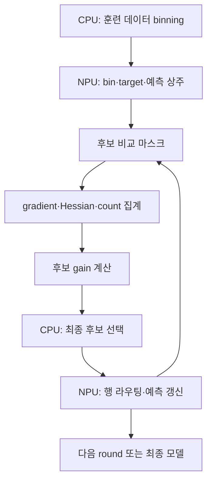
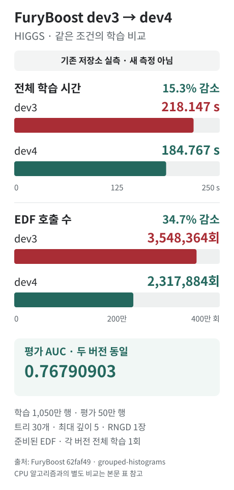

# FuryBoost 회고: NPU에 올린 뒤에도 CPU보다 느린 이유

**FuryBoost는 RNGD에서 학습을 실행했고 여러 구조 개선도 했지만, 기록된 HIGGS 비교에서는 멀티코어 XGBoost·LightGBM보다 느렸다.** 이 결과는 숨길 실패가 아니라 다음 최적화의 출발점이다. 전체 비용을 CPU(Central Processing Unit) 전처리, host 호출, EDF 실행, 동기화, 반복 상태로 나눠 보면 “행렬 수축을 잘하는 장치”와 “빠른 tree boosting 학습기” 사이에 무엇이 남는지 알 수 있다. 이 장은 커밋 `62faf49`에 저장된 2026-11-19 측정기록을 재검토했다. **이번 핸드북 작업에서 새 NPU 시험을 수행한 것은 아니다.** [FuryBoost README](https://github.com/smallstep-zzz/FuryBoost/blob/62faf49a29cc40230ee3df271b8f91ad8488eb5d/README.md)

## 1. 무엇을 만들었는가

FuryBoost는 수치형 이진분류·회귀를 위한 대칭 트리 Gradient Boosting 실험이다. XGBoost를 감싼 wrapper가 아니라 별도의 training loop와 NumPy 기준 구현, RNGD backend를 가진다. 한 깊이의 모든 leaf에 같은 특성·threshold를 적용하는 대칭 트리라는 점도 비교 해석에 중요하다. [설계](https://github.com/smallstep-zzz/FuryBoost/blob/62faf49a29cc40230ee3df271b8f91ad8488eb5d/docs/ARCHITECTURE.md) · [학습 루프](https://github.com/smallstep-zzz/FuryBoost/blob/62faf49a29cc40230ee3df271b8f91ad8488eb5d/furyboost/training.py)

학습은 이전 트리의 예측에서 gradient와 Hessian을 계산하고, 다음 트리가 이를 줄이도록 split을 선택한다. 그래서 boosting round는 앞 round 결과에 의존한다. 데이터가 많다고 트리 30개를 독립적으로 한 번에 계산할 수는 없다. NPU(Neural Processing Unit)로 옮기기 좋은 것은 한 round 안의 대규모 통계 집계이며, split 결정과 다음 상태 준비 사이의 순차 경계는 따로 줄여야 한다.

현재 구조의 역할은 아래와 같다.

| 파일 | 중요한 역할 |
|---|---|
| `furyboost/binning.py` | 학습 데이터의 분위수 경계와 정수 bin 생성 |
| `furyboost/training.py` | round·depth·분할·예측 갱신의 공통 순서 |
| `furyboost/tcl.py` | 통계·마스크·라우팅용 TCL(Tensor Contraction Language) 생성 |
| `furyboost/backends/rngd_engine.py` | FuryNo5 compiler/cache와 SDK Runnable 연결 |
| `furyboost/backends/numpy_engine.py` | CPU 수치 기준 |
| `furyboost/qualification.py` | 연산별 수치·공식 Task 검사 |
| `examples/benchmark_higgs.py` | HIGGS 공통 입력·학습·평가·시간 기록 |

[파일 안내와 구현 범위](https://github.com/smallstep-zzz/FuryBoost/blob/62faf49a29cc40230ee3df271b8f91ad8488eb5d/README.md)



CPU가 제어와 명시된 후보 선택을 맡는 것 자체는 fallback 증거가 아니다. NPU가 하기로 계약한 계산이 실패해 CPU 모델 연산으로 바뀌는 경로와 구분한다. FuryBoost는 CPU 역할을 보고서에 기록한다. 저장한 tree 모델의 일반 `predict`는 portable CPU 추론이므로 NPU 학습과 NPU 추론을 혼동해서도 안 된다. [backend·CPU 역할](https://github.com/smallstep-zzz/FuryBoost/blob/62faf49a29cc40230ee3df271b8f91ad8488eb5d/README.md) · [실행 보고](https://github.com/smallstep-zzz/FuryBoost/blob/62faf49a29cc40230ee3df271b8f91ad8488eb5d/reports/rngd-server3/higgs-dev2/parallel/t16.json)

## 2. 비교 조건: 같은 데이터라도 같은 알고리즘은 아니다

HIGGS는 앞 1,050만 행을 학습하고 마지막 50만 행을 평가한 기록이다. 입력은 28개 특성의 FP32(Float32)이며 원본 CSV 순서를 유지했다. 서버 CPU는 AMD EPYC 9354이고 벤치마크에 물리 코어 8개·논리 thread 16개가 허용됐다. RNGD는 한 장이었다. SDK는 furiosa-torch 2026.4.0, TCC 2026.4.1, CPU 비교는 XGBoost 3.2.0과 LightGBM 4.7.0이다. [데이터·환경·분할 원본](https://github.com/smallstep-zzz/FuryBoost/blob/62faf49a29cc40230ee3df271b8f91ad8488eb5d/reports/rngd-server3/higgs-dev2/README.md)

초기 비교는 tree 5개, 최대 depth 3, 최대 16 bins다. FuryBoost는 대칭 트리, XGBoost는 CPU hist, LightGBM은 leaf 제한과 column-wise histogram 설정을 사용했다. **따라서 시간·AUC·loss를 함께 보는 실용 비교이지, 동일 수학 연산만 바꾼 하드웨어 대결은 아니다.** AUC(Area Under the ROC(Receiver Operating Characteristic) Curve)는 분류 threshold 전체에서 양성과 음성의 순위 구별을 요약하며, accuracy와 다른 지표다.

## 3. 5개 트리·깊이 3: 원본 입력 전체 학습

| 구현 | CPU 조건 | 학습 시간 | 평가 accuracy | AUC | Log loss |
|---|---|---:|---:|---:|---:|
| FuryBoost RNGD dev2 | binning 1 thread | 24.306 s | 64.2556% | 0.69591 | 0.66025 |
| FuryBoost NumPy dev2 | 1 thread | 143.862 s | 64.2556% | 0.69591 | 0.66025 |
| XGBoost CPU | 1 thread | 34.009 s | 63.6624% | 0.70648 | 0.65455 |
| XGBoost CPU | 16 threads | 4.731 s | 63.6624% | 0.70648 | 0.65455 |
| LightGBM CPU | 1 thread | 17.247 s | 63.6156% | 0.70004 | 0.65405 |
| LightGBM CPU | 16 threads | 3.091 s | 63.6156% | 0.70004 | 0.65405 |

각 모델은 별도 process에서 순차적으로 한 번 측정했다. 데이터 파일 변환 이후 모델별 준비·학습을 포함하며 예측·지표 계산은 타이머 밖이다. 이 표의 차이를 반복 측정 중앙값이나 통계적 우월성으로 해석하지 않는다. [RNGD 원본](https://github.com/smallstep-zzz/FuryBoost/blob/62faf49a29cc40230ee3df271b8f91ad8488eb5d/reports/rngd-server3/higgs-dev2/full/rngd.json) · [XGBoost16](https://github.com/smallstep-zzz/FuryBoost/blob/62faf49a29cc40230ee3df271b8f91ad8488eb5d/reports/rngd-server3/higgs-dev2/full/xgboost-16.json) · [LightGBM16](https://github.com/smallstep-zzz/FuryBoost/blob/62faf49a29cc40230ee3df271b8f91ad8488eb5d/reports/rngd-server3/higgs-dev2/full/lightgbm-16.json)

FuryBoost NumPy와 RNGD는 같은 split을 선택했고 50만 평가 예측의 최대 확률 차이는 `7.22×10⁻⁸`, 분류가 달라진 행은 0이었다. 이것은 자기 기준 구현에 대한 수치 일치 근거다. 다른 tree 구조를 만드는 XGBoost·LightGBM보다 품질이 높다는 증거는 아니다. [수치 비교 JSON](https://github.com/smallstep-zzz/FuryBoost/blob/62faf49a29cc40230ee3df271b8f91ad8488eb5d/reports/rngd-server3/higgs-dev2/full/comparison.json)

## 4. 병목 하나: CPU binning을 줄여도 남는 시간이 있다

RNGD 전체 24.306초 중 binning은 약 14.667초였다. 뒤의 16-thread 개선 측정에서는 binning이 1.821초, 전체 학습이 11.530초였다. 같은 평가 확률을 유지하면서 전처리를 병렬화한 효과다. 단일 thread 기준 후속 run의 전체 시간은 24.52초로, 위 표의 24.306초와 별도 실행이다. [병렬화 결과](https://github.com/smallstep-zzz/FuryBoost/blob/62faf49a29cc40230ee3df271b8f91ad8488eb5d/reports/rngd-server3/higgs-dev2/parallel/t16.json) · [구조 개선 설명](https://github.com/smallstep-zzz/FuryBoost/blob/62faf49a29cc40230ee3df271b8f91ad8488eb5d/docs/STRUCTURAL_OPTIMIZATION.md)

| RNGD dev2 조건 | 시간 | 포함 범위 |
|---|---:|---|
| 원본 입력, binning 16 threads | 11.530 s | 양자화·SDK 준비·학습 |
| BinnedDataset 준비 | 1.715 s | 재사용할 bin 생성만 |
| 준비된 데이터로 첫 fit | 9.458 s | 같은 process의 첫 학습 |
| 준비된 데이터로 둘째 fit | 6.573 s | warm 재학습 |
| 준비와 두 fit 합계 | 17.746 s | 한 번 준비해 두 번 학습 |

[준비 데이터 측정 JSON](https://github.com/smallstep-zzz/FuryBoost/blob/62faf49a29cc40230ee3df271b8f91ad8488eb5d/reports/rngd-server3/higgs-dev2/parallel/prepared16.json)

warm 6.573초만 원본 입력의 CPU 4.731/3.091초와 비교해 전체 성능 결론을 내리면 안 된다. 비용의 범위가 다르다. 그래도 전처리를 충분히 줄인 뒤에도 남는 NPU 호출·동기화 비용이 상당하다는 다음 조사 지점을 보여준다.

## 5. 최신 dev4: 호출 수를 줄인 효과와 여전히 남은 격차

후속 실험은 **tree 30개·depth 5**여서 앞 절의 5개·depth 3과 직접 이어 붙이지 않는다. dev3와 dev4를 같은 조건으로 재측정했고, 40만 행으로 예열한 뒤 1,050만 행을 학습했다. row tile 2,048, candidate tile 128, binning 16 threads, 비교 마스크 cache 한도 24,000 MiB였다. 각 버전의 전체 학습은 준비된 EDF로 한 번 측정했다. [paired 실험 조건](https://github.com/smallstep-zzz/FuryBoost/blob/62faf49a29cc40230ee3df271b8f91ad8488eb5d/reports/rngd-server3/grouped-histograms/README.md)

| 동일 조건 paired 비교 | dev3 | dev4 |
|---|---:|---:|
| 전체 fit | 218.147 s | 184.767 s |
| EDF 호출 | 3,548,364 | 2,317,884 |
| 평가 AUC | 0.76790903 | 0.76790903 |
| 평가 accuracy | 69.4698% | 69.4698% |
| 평가 log loss | 0.58500101 | 0.58500101 |



시간은 약 15.3%, 호출은 약 34.7% 줄었다. dev4는 조건이 맞으면 인접 후보 tile의 histogram을 같은 EDF에서 계산한다. 모든 tree split과 평가 확률이 일치했고 예측 파일의 해시도 같았다. **호출을 줄인 효과를 수치 의미를 유지한 상태로 확인한 실험**이다. [before](https://github.com/smallstep-zzz/FuryBoost/blob/62faf49a29cc40230ee3df271b8f91ad8488eb5d/reports/rngd-server3/grouped-histograms/before-full.json) · [after](https://github.com/smallstep-zzz/FuryBoost/blob/62faf49a29cc40230ee3df271b8f91ad8488eb5d/reports/rngd-server3/grouped-histograms/after-full.json) · [비교](https://github.com/smallstep-zzz/FuryBoost/blob/62faf49a29cc40230ee3df271b8f91ad8488eb5d/reports/rngd-server3/grouped-histograms/comparison.json)

동일 데이터·tree 수·depth로 남아 있는 별도 CPU 기록은 다음과 같다. dev3/dev4 paired 실험에 CPU를 함께 교차 측정한 것은 아니며 tree 알고리즘도 다르다.

| 별도 비교 기록 | CPU threads | fit | AUC | accuracy |
|---|---:|---:|---:|---:|
| XGBoost 3.2.0 | 16 | 55.801 s | 0.785386 | 71.0554% |
| LightGBM 4.7.0 | 16 | 7.924 s | 0.785286 | 71.0248% |
| FuryBoost dev4 | binning 16 | 184.767 s | 0.767909 | 69.4698% |

[30-tree XGBoost](https://github.com/smallstep-zzz/FuryBoost/blob/62faf49a29cc40230ee3df271b8f91ad8488eb5d/reports/rngd-server3/higgs-dev2/deep-30x5/xgboost.json) · [30-tree LightGBM](https://github.com/smallstep-zzz/FuryBoost/blob/62faf49a29cc40230ee3df271b8f91ad8488eb5d/reports/rngd-server3/higgs-dev2/deep-30x5/lightgbm.json)

이 기록에서는 최적화한 FuryBoost도 시간과 AUC 모두 CPU 비교군을 따라잡지 못했다. 이것을 “RNGD는 tree 학습에 원리적으로 불가능”하다고 일반화할 수는 없지만, 현재 구현이 경쟁력을 입증했다고 말할 수도 없다.

## 6. 실측과 장치 실행 증거를 구분한다

전체 benchmark JSON에는 `hardware_measured: false`와 “per-call trace 없이 실행한 결과는 독립 NPU 인증이 아니다”라는 설명이 있다. 성능 측정에서 profiler를 끈 run을 가리키므로, 그 값을 숨기고 “모든 호출을 공식 trace로 증명”했다고 적지 않는다. [전체 run JSON](https://github.com/smallstep-zzz/FuryBoost/blob/62faf49a29cc40230ee3df271b8f91ad8488eb5d/reports/rngd-server3/grouped-histograms/after-full.json)

별도 작은 dev4 trace run은 128 EDF 호출에 256 NPU Task, CPU fallback 경로 0개를 기록했다. 새 규격 최초 준비에는 31개 프로그램 중 23개 cache 재사용과 전체 EDF 준비 191.73초가 기록됐다. 이 최초 준비 시간은 warm 전체 학습 184.767초와 별도 비용이다. “22개 또는 31개 커널이 cache에 있다”와 “수백만 번의 runtime dispatch가 공짜다”는 다른 문제다. [trace와 준비 조건](https://github.com/smallstep-zzz/FuryBoost/blob/62faf49a29cc40230ee3df271b8f91ad8488eb5d/reports/rngd-server3/grouped-histograms/README.md)

## 7. 남겨둘 숙제와 우선순위

아래는 실측에서 도출한 **FuryNo5 개발 관점의 후속 제안**이며 완료된 기능 목록이 아니다.

| 우선 | 과제 | 먼저 확인할 것 |
|---|---|---|
| 1 | 같은 품질 목표의 CPU baseline | AUC 또는 loss를 맞춘 시간과 memory |
| 2 | host 호출·완료 대기 비용 분리 | EDF 수, stream sync 수, host gap |
| 3 | 깊이 내 가능한 통계 묶기 | workspace·캐시 여유와 동일 reduction 순서 |
| 4 | row routing·다음 통계 연결 | CPU split 결정이 필요한 경계만 유지 |
| 5 | 통계 알고리즘 재설계 | 후보별 mask vs bin별 집계의 메모리·시간 |
| 6 | 새 kernel·정밀도 경로 | FP32 기준의 split 안정성·누적 오차 |
| 7 | 여러 NPU | 한 장 최적화 후 병렬 가능한 데이터 축 |

bin별 histogram을 만들면 항상 빨라질 것 같지만 저장소의 작은 실험에서는 기존 threshold mask가 0.842 ms, bin별 mask 후 복원이 0.888 ms, 정렬 index gather 방식은 1.241 ms였다. index 생성 비용도 따로 있었다. 더 적은 메모리나 더 우아한 식이 그 규격의 더 빠른 실행을 자동으로 뜻하지 않는 사례다. [실험 비교](https://github.com/smallstep-zzz/FuryBoost/blob/62faf49a29cc40230ee3df271b8f91ad8488eb5d/docs/STRUCTURAL_OPTIMIZATION.md)

## 8. 재현할 때 쓸 진입점

호환 SDK(Software Development Kit)·FuryNo5와 기존 공유 NPU 잠금이 준비된 환경에서 진행한다.

```bash
furyboost doctor
furyboost emit-tcl -o tcl-review
furyboost qualify -o rngd-qualification --artifacts ./edf-cache
```

`emit-tcl`은 TCL 소스·입출력 계약을 출력하며 EDF 실행 성공을 뜻하지 않는다. `qualify`가 실제 장치 수치와 trace를 확인한다. HIGGS 파일이 준비됐다면 세부 옵션은 저장소의 재현 스크립트에서 확인한다.

```bash
python examples/benchmark_higgs.py --help
python examples/benchmark_higgs.py run events.npy rngd   --binning-threads 16 --artifacts ./edf-cache -o rngd-run.json
```

[benchmark CLI](https://github.com/smallstep-zzz/FuryBoost/blob/62faf49a29cc40230ee3df271b8f91ad8488eb5d/examples/benchmark_higgs.py) · [전체 재현 조건](https://github.com/smallstep-zzz/FuryBoost/blob/62faf49a29cc40230ee3df271b8f91ad8488eb5d/reports/rngd-server3/higgs-dev2/README.md)

FuryBoost를 다음 실험에 재사용할 때는 tree 학습 자체와 FuryNo5의 일반 개선을 구분해 남긴다. kernel cache identity 비용, 연속 호출, 통계 fusion, host/device 완료 계측은 다른 모델에도 재사용 가능한 과제다. 반면 tree 구조와 split 탐색 알고리즘은 별도 모델 설계 문제다.

## 출처

| 자료 | 증거의 범위 |
|---|---|
| [README](https://github.com/smallstep-zzz/FuryBoost/blob/62faf49a29cc40230ee3df271b8f91ad8488eb5d/README.md), [ARCHITECTURE](https://github.com/smallstep-zzz/FuryBoost/blob/62faf49a29cc40230ee3df271b8f91ad8488eb5d/docs/ARCHITECTURE.md) | 현재 dev4 구현·지원 범위 |
| [HIGGS 조건](https://github.com/smallstep-zzz/FuryBoost/blob/62faf49a29cc40230ee3df271b8f91ad8488eb5d/reports/rngd-server3/higgs-dev2/README.md) | 데이터·환경·5-tree CPU 비교 |
| [원본 수치 비교](https://github.com/smallstep-zzz/FuryBoost/blob/62faf49a29cc40230ee3df271b8f91ad8488eb5d/reports/rngd-server3/higgs-dev2/full/comparison.json) | NumPy/RNGD 차이 |
| [병렬 binning](https://github.com/smallstep-zzz/FuryBoost/blob/62faf49a29cc40230ee3df271b8f91ad8488eb5d/reports/rngd-server3/higgs-dev2/parallel/t16.json), [prepared](https://github.com/smallstep-zzz/FuryBoost/blob/62faf49a29cc40230ee3df271b8f91ad8488eb5d/reports/rngd-server3/higgs-dev2/parallel/prepared16.json) | 초기 비용과 warm 비용 |
| [dev3/dev4 비교](https://github.com/smallstep-zzz/FuryBoost/blob/62faf49a29cc40230ee3df271b8f91ad8488eb5d/reports/rngd-server3/grouped-histograms/README.md) | paired 성능·trace·최초 준비 |
| [XGBoost30](https://github.com/smallstep-zzz/FuryBoost/blob/62faf49a29cc40230ee3df271b8f91ad8488eb5d/reports/rngd-server3/higgs-dev2/deep-30x5/xgboost.json), [LightGBM30](https://github.com/smallstep-zzz/FuryBoost/blob/62faf49a29cc40230ee3df271b8f91ad8488eb5d/reports/rngd-server3/higgs-dev2/deep-30x5/lightgbm.json) | 별도 CPU 30-tree 비교 |
| [STRUCTURAL_OPTIMIZATION](https://github.com/smallstep-zzz/FuryBoost/blob/62faf49a29cc40230ee3df271b8f91ad8488eb5d/docs/STRUCTURAL_OPTIMIZATION.md) | 개선 시도와 실패한 후보 |

FuryBoost 원본 저장소는 조회 시 비공개이며 링크 열람에는 권한이 필요하다. 위 표는 사용자 요청에 따라 원본 측정 기록의 조건과 핵심 수치를 옮긴 것이며 서버 식별자·개인 경로는 포함하지 않았다.

