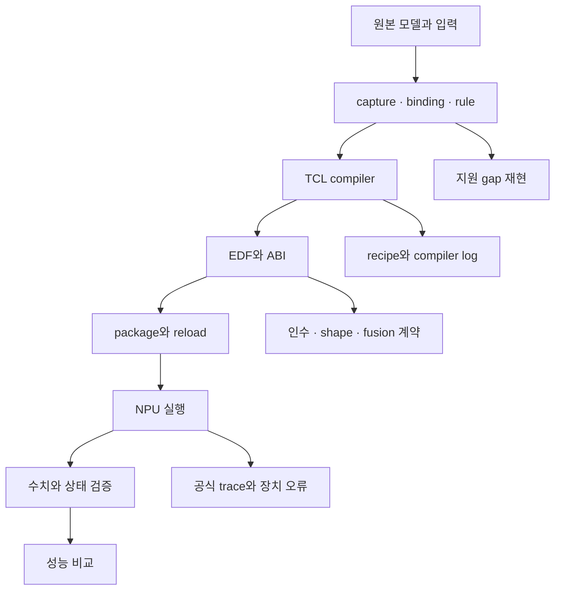

# 17. 실패와 비효율을 재현 가능한 증거로 바꾸기

**“안 된다”를 최초 실패 단계, 정확한 입력 계약, 산출물, 실행 증거로 나누면 고칠 파일이 보인다.** 이 장은 모델 전체를 매번 다시 돌리기보다, 현재 문제를 증명하는 최소 경로를 만드는 실습이다. 소스 기준은 FuryNo5 commit `bba9efea8201aec48150514a35d0b637d29d107e`이며, 명령을 실행할 환경의 SDK(Software Development Kit) 버전을 먼저 기록한다.

## 먼저 어느 층에서 실패했는지 구분한다



| 처음 실패한 지점 | 필요한 증거 | 우선 볼 코드 |
|---|---|---|
| capture | 최초 달라진 graph, 원본/변환 CPU 결과 | `graph_capture.py` |
| binding | 인수 순서, shape/dtype/stride/offset, state | `edf_export.py` |
| rule | 직접 차단 이유와 영향을 받은 node | 해당 `*_rules.py` |
| compile | 정확한 TCL, compiler version, exit/timeout, log | `compile_job.py` |
| ABI(Application Binary Interface) | 공식 EDF loader의 입출력 정보 | `tcl_compiler._verify_abi` |
| package | manifest·파일 해시·계획 연결 | producer와 fxbX consumer |
| runtime | expected step과 공식 Task, CPU route | `verified_worker.py` |
| numerical | 최초 오차 좌표, dtype, 허용오차, 입력 | 해당 의미 규칙과 oracle |
| performance | cold/warm 범위, 완료 기준, trace | `profile_hotspots.py` |

소스의 수정 진입점은 다음과 같다. NPU 작업을 시작하는 명령이 아니라, 해당 단계의 소유 파일과 점검 항목을 안내한다. [수정 가이드](https://github.com/smallstep-zzz/FuryNo5/blob/bba9efea8201aec48150514a35d0b637d29d107e/docs/REPAIR_GUIDE.md)

```bash
python -m tplmachine.repair route compile --kind fp32_contraction
```

## 실습 1. 환경 지문과 입력 계약을 남긴다

다음은 읽기 전용 정보 수집 예제다. `furiosa-smi`의 정보는 장치 존재·버전·상태를 파악하는 자료이며, 특정 모델이 NPU에서 실행되었다는 증거는 아니다.

```bash
python --version
furiosa-tcc --version
furiosa-tcc --help
furiosa-smi info --format json
```

package 버전은 다음처럼 수집한다. 설치되어 있지 않으면 없는 상태로 남긴다.

```python
import importlib.metadata as md
import json

versions = {}
for name in ("torch", "furiosa-torch", "furiosa-tcc", "fxbx", "tplmachine"):
    try:
        versions[name] = md.version(name)
    except md.PackageNotFoundError:
        versions[name] = None
print(json.dumps(versions, indent=2))
```

입력 tensor는 shape뿐 아니라 `dtype`, `stride()`, `storage_offset()`, `requires_grad`, 장치, 정적 속성을 함께 기록한다. 같은 `[1,128,128]`이라도 permutation의 view인지 contiguous 복사인지에 따라 규칙과 비용이 달라진다.

```python
def tensor_contract(x):
    return {
        "shape": list(x.shape),
        "dtype": str(x.dtype),
        "stride": list(x.stride()),
        "storage_offset": x.storage_offset(),
        "device": str(x.device),
        "requires_grad": x.requires_grad,
    }
```

이 계약은 모델/입력의 실제 값을 공개하지 않고도 실패 원인을 좁히는 데 도움이 된다. 정적 상수의 값에 따라 specialization했다면 값 해시와 그 guard도 필요하다. [계획의 계약·guard 관리](https://github.com/smallstep-zzz/FuryNo5/blob/bba9efea8201aec48150514a35d0b637d29d107e/tplmachine/execution_plan.py#L20-L38)

## 실습 2. 미해결 node를 독립 문제 수로 오해하지 않는다

`export_model(..., preflight_only=True)` 결과의 `operator-inventory.json`에는 metadata admission, 직접 규칙/계약 gap, 선행 binding dependency가 나뉘어 있다. 첫 `transpose` 결과를 만들지 못해 그 뒤 100개 node를 연결하지 못했다면, 101개 TCL을 새로 작성해야 한다는 뜻이 아니다.

```python
import json
from collections import Counter
from pathlib import Path

root = Path("model.fxbx.plan")
inventory = json.loads((root / "operator-inventory.json").read_text())
print(Counter(row["admission"] for row in inventory["nodes"]))

groups = json.loads((root / "failure-groups.json").read_text())
for row in sorted(groups, key=lambda x: -x["occurrences"])[:5]:
    print(row["op"], row["occurrences"], row["reason"])
```

이 예제는 해당 실패 파일이 있는 경우에 실행한다. 통과한 preflight에 `failure-groups.json`이 없는 것은 정상이다. source 위치·대표 shape·최초 직접 차단을 보고 공통 원인을 고친 후, 영향을 받은 모델만 다시 검사한다. [진단 생성부](https://github.com/smallstep-zzz/FuryNo5/blob/bba9efea8201aec48150514a35d0b637d29d107e/tplmachine/execution_plan.py#L1140-L1193)

## 실습 3. 느리거나 실패한 compiler 작업 하나만 재현한다

먼저 `compile-status.json`에서 실패한 kernel key를 고른다. 다음 명령은 보존된 요청을 조회하고, 선택한 요청 하나만 다시 컴파일하는 실제 CLI(Command-Line Interface)다.

```bash
# 먼저 작은 목록 확인
python -m tplmachine.compile_recipe model.fxbx.plan/compile-requests.json

# FAILED_KEY는 위 목록에 실제로 존재하는 키로 교체
python -m tplmachine.compile_recipe model.fxbx.plan/compile-requests.json \
  --key FAILED_KEY --output one-kernel-result.json
```

이 경로는 모델을 다시 다운로드하거나 전체 graph를 다시 캡처할 필요를 줄인다. `compiled_not_numerically_validated`는 ABI까지 컴파일 단계가 통과했다는 보고이며, NPU 정답 검증은 아직 남아 있다. [compile_recipe.py](https://github.com/smallstep-zzz/FuryNo5/blob/bba9efea8201aec48150514a35d0b637d29d107e/tplmachine/compile_recipe.py)

`compile-attempts`의 해당 attempt에는 `source.tc`, `compile.log`, `result.json`이 있다. 결과의 `last_stage`, `elapsed_s`, `returncode`, `timeout_s`를 같이 읽는다. 시간제한 종료를 “하드웨어 미지원”으로 캐시하지 않는다. 현재 기본 timeout이 무제한이므로 작업 예산이 필요한 경우 명시적으로 지정한다.

```bash
FURYNO5_COMPILE_TIMEOUT_S=1800 \
  python -m tplmachine.compile_recipe model.fxbx.plan/compile-requests.json \
  --key FAILED_KEY --output bounded-retry.json
```

여기서 1,800초는 이 예제의 작업 예산일 뿐 성공 예상시간이 아니다. 의미·정밀도를 바꿔 빨리 끝나게 하기 전에, 정확한 재현 source와 메모리·thread 경쟁을 확인한다. [compile_job.py](https://github.com/smallstep-zzz/FuryNo5/blob/bba9efea8201aec48150514a35d0b637d29d107e/tplmachine/compile_job.py)

## 실습 4. 실행 증거를 수집한다

다음 함수는 **이미 준비된 fxbX runtime**과 입력 tuple을 받아 공식 profiler로 한 요청을 기록한다. `FXBX_TRACE_STEPS`는 runtime을 만들기 전에 설정한다. profiler 활성화 시간은 성능 비교의 정답으로 사용하지 않는다.

```python
import os
from pathlib import Path
from furiosa.torch.profiler import Profiler

os.environ["FXBX_TRACE_STEPS"] = "1"

def record_one(runtime, inputs, trace_path="request-trace.json"):
    destination = Path(trace_path)
    if destination.exists():
        raise FileExistsError(destination)
    with Profiler(str(destination)):
        outputs = runtime.predict(inputs)
    return outputs
```

FuryNo5의 현재 검증기는 `execution_plan::forward::...` host span과 이에 대응하는 `::Task::execution_plan::...` 이름을 대조하고, `run_by_cpu` 이벤트를 확인한다. 예상한 step이 빠지거나 엉뚱한 step이 들어 있으면 증거 불완전으로 본다. 정적 상수 준비의 예외는 별도 분류한다. [실제 trace_evidence](https://github.com/smallstep-zzz/FuryNo5/blob/bba9efea8201aec48150514a35d0b637d29d107e/tplmachine/verified_worker.py#L21-L29)

다음 관측만으로는 충분하지 않다.

| 관측 | 확인되는 것 | 추가로 필요한 것 |
|---|---|---|
| `tensor.device == "furiosa:0"` | tensor의 장치 표기 | 실제 실행 task |
| SMI 사용률 상승 | 그 시간 장치 활동 | 내 요청/내 step과의 연결 |
| compiler 반환 성공 | 산출물 생성 | 실행·수치 |
| host launch span | 제출 시도 | 완료된 장치 task |
| CPU route 0 | 해당 collector가 그 이름을 못 봄 | 누락 step·collector 범위 확인 |

다른 adapter나 병합 실행 모드에서 trace 구조가 바뀌면 이름 규칙도 검토해야 한다. 텍스트 검색 결과를 하드웨어 인증으로 승격하지 않는다.

## 실습 5. trace에서 병목 후보를 찾는다

[trace_report.py](../examples/trace_report.py)는 계획과 trace를 받아 step 관측 누락, CPU route 표식, kernel별 task work를 요약한다.

```bash
python examples/trace_report.py \
  model.fxbx.plan/execution-plan.json request-trace.json \
  --entry forward --out trace-summary.json
```

이 도구는 **진단 도구**다. 숫자·tensor·파일 무결성 검사를 하지 않으므로 성공 인증서를 출력하지 않는다. trace의 시간 단위는 Chrome trace의 microsecond 규약과 현재 adapter의 형식을 전제로 한다. task 합에는 겹친 task가 중복 포함될 수 있다.

producer 설치본에서는 더 엄격한 해당 버전의 hotspot 기능을 사용할 수도 있다.

```python
import json
from pathlib import Path
from tplmachine.profile_hotspots import rank_hotspots

plan = json.loads(Path("model.fxbx.plan/execution-plan.json").read_text())
events = json.loads(Path("request-trace.json").read_text())
for row in rank_hotspots(plan, events, entry="forward", limit=5):
    print(row["kernel"], row["calls"], row["task_us"])
```

현재 함수는 상태 갱신이 있는 entry나 불완전한 timing coverage를 제한하고, CPU route가 관측되면 순위를 만들지 않는다. 결과의 `task_us`는 end-to-end latency 예측치가 아니다. [hotspot 구현](https://github.com/smallstep-zzz/FuryNo5/blob/bba9efea8201aec48150514a35d0b637d29d107e/tplmachine/profile_hotspots.py)

가장 느린 kernel key를 찾았다면 `compile-requests.json`의 같은 key로 의미 계열과 shape를 연결한다. 이후 TCL source, layout, 크기, 반복 횟수, 입출력 이동을 검토한다. 이름이 같은 EDF가 여러 입력에서 호출될 수 있으므로 단일 이벤트를 전체 모델 병목으로 일반화하지 않는다.

## 실습 6. trace와 별개로 완료 시간을 잰다

다음 함수는 **반환 시 실제 결과가 완료된 callable**을 측정한다. 일반 비동기 launch 함수에 그대로 사용하면 제출 시간만 측정하므로 부적절하다. fxbX의 CPU 결과를 반환하는 `predict` 경로처럼 완료가 확인되는 함수를 전달하거나, 장치 resident 경로의 공식 완료 대기를 callable 안에 넣는다.

```python
from time import perf_counter_ns
from statistics import median
from math import ceil

def measure_completed(call, *, warmup=5, repeats=30):
    for _ in range(warmup):
        call()
    samples = []
    for _ in range(repeats):
        start = perf_counter_ns()
        call()
        samples.append(perf_counter_ns() - start)
    ordered = sorted(samples)
    return {
        "median_ns": median(samples),
        "p95_ns": ordered[ceil(0.95 * len(ordered)) - 1],
        "samples_ns": samples,
        "scope": "callable must return completed outputs",
    }
```

30회는 튜토리얼 시작값이지 tail latency를 확정하기에 충분하다는 보장이 아니다. 짧은 kernel은 여러 호출을 한 block으로 묶어 측정 비용을 줄이고, A/B/B/A처럼 순서를 바꾸어 시스템 변화의 영향을 관찰한다. compile·profiling과 성능 측정을 같은 CPU 자원에서 동시에 수행하면 host contention이 섞일 수 있다. FuryNo5의 보존된 runtime 선택 실험도 준비와 측정 구간을 나누었다. [실측 프로토콜](https://github.com/smallstep-zzz/FuryNo5/blob/bba9efea8201aec48150514a35d0b637d29d107e/docs/RUNTIME_SELECTION.md)

## 실습 7. 수치 실패는 첫 경계에서 찾는다

원본 CPU 결과 → 정규화 CPU 결과 → 각 EDF의 NPU 결과 → 최종 package 결과 순서로 비교한다. 원본과 정규화 CPU가 이미 다르면 물리 NPU kernel부터 수정할 이유가 없다.

```python
# reference와 actual은 같은 shape/dtype 계약의 CPU tensor.
import torch

def error_report(reference, actual, *, atol, rtol):
    if reference.shape != actual.shape:
        return {"shape_mismatch": True}
    expected = reference.to(torch.float64)
    got = actual.to(torch.float64)
    error = (got - expected).abs()
    limit = atol + rtol * expected.abs()
    bad = (~torch.isfinite(got)) | (~torch.isfinite(expected)) | (error > limit)
    where = bad.nonzero()
    first = where[0].tolist() if where.numel() else None
    return {
        "outside_tolerance": int(bad.sum()),
        "max_abs_error": float(error.max()) if error.numel() else 0.0,
        "first_bad_index": first,
    }
```

이 예제는 유한 실수 결과를 기대하는 간단한 진단 정책이다. 정상 출력에 NaN/Inf가 허용되는 연산은 별도의 명시적 비교 정책이 필요하고, 정수·bool·인덱스는 정확한 일치를 확인한다. `max_abs_error` 하나만으로 실패 위치를 숨기거나, 관측 결과에 맞춰 허용오차를 자동으로 늘리지 않는다. [독립 출력 비교 구현](https://github.com/smallstep-zzz/FuryNo5/blob/bba9efea8201aec48150514a35d0b637d29d107e/tplmachine/verified_worker.py#L44-L48)

상태를 가진 모델은 첫 호출만 맞아서는 부족하다. 입력 변경, 반복 호출, reset 뒤 결과, state-only 출력 처리까지 확인한다. 고정 shape의 state slot 검증을 동적 KV(Key/Value) paging 검증과 동일시하지 않는다.

## furiosa-opt를 어디에 연결할 것인가

TCL 기반 문제는 먼저 보존된 TCL·compiler 로그·EDF trace로 좁힌다. `furiosa-opt`의 schedule/low-level dump는 해당 도구로 빌드되는 kernel이나 재현용 vISA(virtual Instruction Set Architecture) 구현의 병목을 조사할 때 사용한다. 임의의 SDK EDF를 넣으면 원래 Python/TCL과 모든 물리 schedule이 자동 복원된다고 가정하지 않는다.

FuryNo5의 `official_tools.capabilities()`는 설치된 `furiosa-tcc --help`에서 `--evaluate-tcl` 등 지원 옵션을 확인한다. 지원하는 경우의 cycle estimate와 NPU task 측정치를 구분해서 보존한다. eISA와 opt 도구의 구체적인 재현·schedule viewer 절차는 08장을 따른다. [capability probe](https://github.com/smallstep-zzz/FuryNo5/blob/bba9efea8201aec48150514a35d0b637d29d107e/tplmachine/official_tools.py#L13-L24) · [공식 도구 안내](https://developer.furiosa.ai/furiosa-opt/book/quick-start/setup-and-tooling.html)

## 좋은 실패 보고서의 최소 내용

한 문제당 다음 내용을 남기면 다음 개발자가 전체 모델을 다시 분석할 필요가 줄어든다.

- 원본 commit, SDK/compiler/driver, target·fusion·mesh.
- 최초 실패 단계와 원래 오류 메시지.
- operator overload와 입력 shape/dtype/stride/속성.
- 해당 source·recipe·EDF·plan의 경로와 해시.
- 실행한 검사, 통과한 범위, 아직 모르는 범위.
- 다음 실험 하나와 성공·실패를 가르는 고정 조건.

**문서 검증 상태:** 이 핸드북의 보조 스크립트는 정적 구문과 합성 진단 입력으로 확인한다. 기록된 과거 RNGD 결과는 원본 증거와 날짜를 붙인다. 이번 집필 환경에서 새 NPU 수치·성능 검증을 수행한 것은 아니다.

## 출처

| 자료 | 확인 범위 |
|---|---|
| [FuryNo5 수정 가이드](https://github.com/smallstep-zzz/FuryNo5/blob/bba9efea8201aec48150514a35d0b637d29d107e/docs/REPAIR_GUIDE.md) | 단계별 소유권과 재현 순서 |
| [compile_recipe.py](https://github.com/smallstep-zzz/FuryNo5/blob/bba9efea8201aec48150514a35d0b637d29d107e/tplmachine/compile_recipe.py) | 단일 커널 재현 CLI |
| [compile_job.py](https://github.com/smallstep-zzz/FuryNo5/blob/bba9efea8201aec48150514a35d0b637d29d107e/tplmachine/compile_job.py) | timeout·실패·원본 증거 |
| [verified_worker.py](https://github.com/smallstep-zzz/FuryNo5/blob/bba9efea8201aec48150514a35d0b637d29d107e/tplmachine/verified_worker.py) | 독립 소비자 수치·NPU trace 검사 |
| [profile_hotspots.py](https://github.com/smallstep-zzz/FuryNo5/blob/bba9efea8201aec48150514a35d0b637d29d107e/tplmachine/profile_hotspots.py) | 실제 plan-step timing 연결 |
| [공식 opt setup](https://developer.furiosa.ai/furiosa-opt/book/quick-start/setup-and-tooling.html) | kernel optimizer·schedule viewer 역할 |

