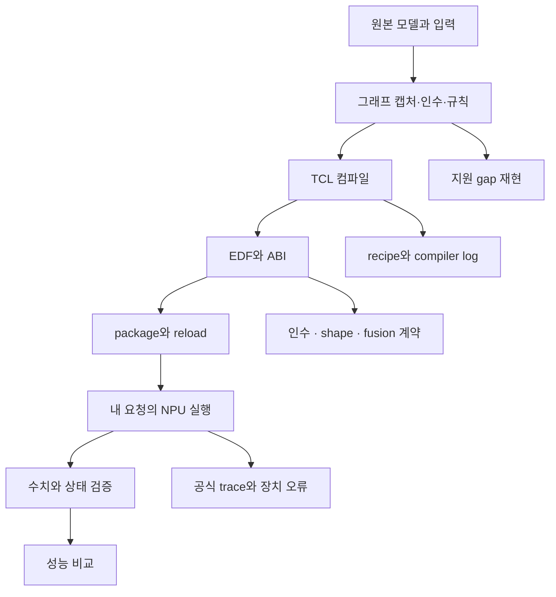

# 17. 실패와 비효율을 재현 가능한 증거로 바꾸기

일반 프로그램도 소스 파싱 실패, 링크 실패, 실행 중 예외, 잘못된 결과, 느린 실행을 구분해 디버깅한다. NPU(Neural Processing Unit) 프로그램도 마찬가지다. 다만 모델 변환·장치 컴파일·패키지 적재라는 경계가 더 있다. **“안 된다”를 최초 실패 단계, 정확한 입력 계약, 산출물, 실행 증거로 나누면 고칠 파일이 보인다.** 이 장은 모델 전체를 매번 다시 돌리기보다, 현재 문제를 증명하는 최소 경로를 만드는 실습이다. 소스 기준은 FuryNo5 commit `bba9efea8201aec48150514a35d0b637d29d107e`이며, 명령을 실행할 환경의 SDK(Software Development Kit) 버전을 먼저 기록한다.

## 먼저 어느 층에서 실패했는지 구분한다

작은 계산 `[1,2,3] @ [[1,0],[0,1],[1,1]] = [4,5]`를 NPU에 맡긴다고 하자. `@`는 행렬곱이고 입력 벡터를 한 행으로 보면 shape는 `[1,3]`, 가중치는 `[3,2]`, 출력은 `[1,2]`다. 첫 출력은 `1×1+2×0+3×1=4`, 둘째는 `1×0+2×1+3×1=5`처럼 입력 행과 가중치 열의 대응값을 곱해 더한다. **Shape**는 배열의 축별 길이, **dtype**는 원소의 자료형이다. 이 계산이 입력에서 출력까지 가는 동안 단계별로 다른 질문을 해야 한다.

| 단계 | 하는 일 | 이 예에서 확인할 것 |
|---|---|---|
| Capture, 그래프 캡처 | 실행할 연산과 데이터 의존성을 그래프로 기록 | 원본 행렬곱이 다른 연산으로 바뀌지 않았는가 |
| Binding, 인수 연결 | 모델의 값과 커널 입력 인수의 대응을 정함 | 입력과 가중치를 뒤바꾸지 않았는가 |
| Rule, 변환 규칙 | 해당 연산·자료형·배치를 구현할 방법을 선택 | 이 규격의 행렬곱을 표현하는 규칙이 있는가 |
| Compile, 컴파일 | TCL(Tensor Contraction Language)을 장치 실행물 EDF로 변환 | 정확한 소스가 해당 compiler에서 끝까지 통과했는가 |
| ABI 검사 | 바이너리를 호출할 때의 인수 순서·형식·크기를 검사 | 입력 `[1,3]`·가중치 `[3,2]`·출력 `[1,2]`가 맞는가 |
| Package와 reload | 실행물·순서·파일 관계를 묶고 새 프로세스에서 적재 | 만든 파일만으로 같은 계산을 다시 구성할 수 있는가 |
| 실행·수치 검사 | 장치 계산의 완료와 실제 값을 확인 | 내 요청의 NPU 작업이 있었으며 결과가 `[4,5]`인가 |
| 성능 검사 | 정한 구간의 완료 시간을 측정 | 준비가 끝난 호출과 최초 컴파일을 섞지 않았는가 |

ABI(Application Binary Interface)는 C의 함수 호출에서도 인수 타입·배치·호출 규칙을 맞추는 것과 같은 종류의 계약이다. 여기서 **binding은 데이터 인수 연결**을 뜻하며, 어느 PE(Processing Element) 자원을 사용할지 정하는 PE binding과 다른 문맥이다. **Runtime(실행기)은** 적재한 프로그램의 메모리·호출·완료를 관리한다. 단계를 나누는 이유는 앞 단계의 성공이 뒤 단계의 정답을 보장하지 않기 때문이다. 실행물 생성에 성공해도 결과가 `[4,6]`일 수 있고, 결과가 맞아도 작은 호출을 너무 많이 제출해 느릴 수 있다.



| 처음 실패한 지점 | 필요한 증거 | 우선 볼 코드 |
|---|---|---|
| capture | 최초 달라진 graph, 원본/변환 CPU 결과 | `graph_capture.py` |
| binding | 인수 순서, shape/dtype/stride/offset, state | `edf_export.py` |
| rule | 직접 차단 이유와 영향을 받은 node | 해당 `*_rules.py` |
| compile | 정확한 TCL, compiler version, exit/timeout, log | `compile_job.py` |
| ABI(Application Binary Interface) | 공식 EDF loader의 입출력 정보 | `tcl_compiler._verify_abi` |
| package | manifest·파일 해시·계획 연결 | producer와 fxbX consumer |
| runtime | expected step과 공식 Task, CPU route | `verified_worker.py` |
| numerical | 최초 오차 좌표, dtype, 허용오차, 입력 | 해당 의미 규칙과 oracle |
| performance | cold/warm 범위, 완료 기준, trace | `profile_hotspots.py` |

소스의 수정 진입점은 다음과 같다. NPU 작업을 시작하는 명령이 아니라, 해당 단계의 소유 파일과 점검 항목을 안내한다. [수정 가이드](https://github.com/smallstep-zzz/FuryNo5/blob/bba9efea8201aec48150514a35d0b637d29d107e/docs/REPAIR_GUIDE.md)

```bash
python -m tplmachine.repair route compile --kind fp32_contraction
```

## 실습 1. 환경 지문과 입력 계약을 남긴다

다음은 읽기 전용 정보 수집 예제다. `furiosa-smi`의 정보는 장치 존재·버전·상태를 파악하는 자료이며, 특정 모델이 NPU에서 실행되었다는 증거는 아니다.

```bash
python --version
furiosa-tcc --version
furiosa-tcc --help
furiosa-smi info --format json
```

package 버전은 다음처럼 수집한다. 설치되어 있지 않으면 없는 상태로 남긴다.

```python
import importlib.metadata as md
import json

versions = {}
for name in ("torch", "furiosa-torch", "furiosa-tcc", "fxbx", "tplmachine"):
    try:
        versions[name] = md.version(name)
    except md.PackageNotFoundError:
        versions[name] = None
print(json.dumps(versions, indent=2))
```

입력 tensor는 다차원 배열이다. 논리적으로 같은 2×2 배열이어도 메모리에 저장한 위치가 다를 수 있다. 그 배치가 **layout**이고, **stride**는 각 축으로 한 칸 이동할 때 저장소에서 몇 원소를 건너뛰는지 나타낸다. **Storage offset**은 원본 저장소의 시작에서 첫 원소까지의 거리다. C의 배열 주소 계산처럼, 원소 위치는 `offset + Σ(index[축] × stride[축])`로 정해진다. **Σ(시그마)는** 각 축에서 구한 항을 모두 더하라는 뜻이다. 두 축이면 `offset + 행번호×행stride + 열번호×열stride`다. stride와 offset은 바이트가 아니라 원소 단위이므로 바이트 주소를 구할 때는 dtype의 원소 크기를 곱한다.

다음은 PyTorch가 있는 CPU(Central Processing Unit) 환경에서 배열 주소를 관찰하는 예다. `arange(12)`는 0부터 11까지 값 12개를 만든다. **Reshape(모양 변경)는** 논리적 원소 순서를 유지하며 축 길이를 새로 정한다. `reshape(3,4)`는 이 12개 값을 3행·4열로 읽으므로 첫 행은 `[0,1,2,3]`이다. 전체 원소 수는 `12=3×4`로 같아야 하며, 이 예에서 `reshape(5,3)`은 15칸이 필요해 불가능하다. reshape는 배치에 따라 저장소를 공유하거나 복사할 수 있으므로 복사 없는 연산이라고 일괄 가정하지 않는다.

**Slice(부분 선택)는** 행·열의 일부를 고르는 것이고, **view**는 원본 저장소를 공유하는 배열 표현이다. 코드의 `1:`는 1번부터 끝까지, `1::2`는 1번부터 두 칸 간격으로 고른다. **Axis(축)의** 번호와 배열 인덱스는 0부터 센다. `contiguous()`는 필요할 때 새 저장소로 복사해 표준 연속 배치를 만든다.

```python
import torch

base = torch.arange(12, dtype=torch.float32).reshape(3, 4)  # [12] → [3,4], 값 순서 유지
view = base[1:, 1::2]   # axis 0의 행 1·2, axis 1의 열 1·3: 원본을 공유하는 [2,2]
packed = view.contiguous()  # 비연속 view를 복사해 [2,2]의 연속 저장소로 만든다.
for name, x in [("base", base), ("view", view), ("packed", packed)]:
    print(name, x.tolist(), tuple(x.shape), x.stride(), x.storage_offset())
```

| 배열 | 값 | Shape | Stride | Offset |
|---|---|---|---|---:|
| `base` | `[[0,1,2,3],[4,5,6,7],[8,9,10,11]]` | `[3,4]` | `[4,1]` | 0 |
| `view` | `[[5,7],[9,11]]` | `[2,2]` | `[4,2]` | 5 |
| `packed` | `[[5,7],[9,11]]` | `[2,2]` | `[2,1]` | 0 |

표는 코드가 의미하는 값·배치의 계산이다. `view[1,0]`은 원본 저장소의 `5+1×4+0×2=9`번 원소다. `packed[1,0]`은 새 저장소의 2번 원소이며 값은 똑같이 9다. 커널이 연속 배치만 지원하는데 shape가 같다는 이유로 view를 넘기면 잘못된 값을 읽거나 입력 검사에서 거절될 수 있다. **값 비교와 메모리 계약 검사는 둘 다 필요하다.**

**Transpose(전치)는** reshape와 구별한다. `base.reshape(4,3)`의 첫 행은 `[0,1,2]`지만, `base.transpose(0,1)`은 행·열 축을 교환하므로 첫 행이 `[0,4,8]`이다. 결과 shape는 둘 다 `[4,3]`이어도 어느 값이 어느 좌표에 있는지가 다르다. 전치는 종종 stride를 바꾼 view로 표현할 수 있지만, 다음 커널이 다른 연속 배치를 요구하면 실제 복사가 필요할 수 있다.

이제 아래 수집 함수가 왜 이 필드들을 기록하는지 알 수 있다. `requires_grad`는 그 tensor의 기울기를 추적할 대상으로 지정했는지 나타내며, `device`는 저장소가 CPU인지 장치인지 알려준다.

```python
def tensor_contract(x):
    return {
        "shape": list(x.shape),  # 각 축 길이: 논리적인 입력 크기
        "dtype": str(x.dtype),  # 원소의 수치 표현과 바이트 크기를 결정
        "stride": list(x.stride()),  # 축별 한 칸 이동에 필요한 원소 주소 간격
        "storage_offset": x.storage_offset(),  # 공유 저장소에서 첫 원소 위치
        "device": str(x.device),  # 값이 저장된 장치
        "requires_grad": x.requires_grad,  # 기울기 추적 대상 설정
    }
```

실제 재현에서는 `tensor_contract(view)`와 `tensor_contract(packed)`를 출력해 차이를 보고한다. 이 계약은 모델/입력의 실제 값을 공개하지 않고도 실패 원인을 좁히는 데 도움이 된다. **Specialization(특수화)은** shape나 상수값이 정해져 있다고 가정하고 그 경우에 맞는 실행물을 만드는 것이다. **Guard(가정 검사)는** 실행 전에 그 가정이 아직 맞는지 확인한다. 예를 들어 상수 scale이 2라고 접어 만든 커널에 scale 3을 넘기면 같은 shape라도 의미가 달라진다. 값에 따라 특수화했다면 값 해시와 검사 조건도 필요하다. [계획의 계약·guard 관리](https://github.com/smallstep-zzz/FuryNo5/blob/bba9efea8201aec48150514a35d0b637d29d107e/tplmachine/execution_plan.py#L20-L38)

## 실습 2. 미해결 node를 독립 문제 수로 오해하지 않는다

`export_model(..., preflight_only=True)` 결과의 `operator-inventory.json`에는 metadata admission, 직접 규칙/계약 gap, 선행 binding dependency가 나뉘어 있다. 첫 `transpose` 결과를 만들지 못해 그 뒤 100개 node를 연결하지 못했다면, 101개 TCL을 새로 작성해야 한다는 뜻이 아니다.


빌드 시스템에서 공통 헤더 하나가 없어 여러 파일의 컴파일이 실패하는 상황과 비슷하다. 모델의 graph는 연산을 정점, 값 전달을 간선으로 하는 의존 그래프다. **Node(노드)는** 연산 한 단위다. 다음 표에서 진짜로 먼저 고칠 곳은 n1이다.

| 노드 | 필요한 앞 결과 | 상태를 해석하는 방법 |
|---|---|---|
| n0: 입력 읽기 | 없음 | 통과 |
| n1: transpose | n0 | 이 입력 배치를 처리할 직접 규칙이 없음 |
| n2: matmul | n1 | n1의 결과가 없어 인수 연결을 진행하지 못함 |
| n3: 활성 함수 | n2 | 앞 결과를 기다리며 함께 막힘 |

**Transpose(전치)는** 배열 축의 순서를 바꾸는 연산이다. n1을 해결해 다시 분석했을 때 n2·n3도 통과할 수 있고, 그제야 별도의 진짜 문제가 드러날 수도 있다. 그래서 실패 개수만 더하지 말고 최초 직접 원인과 후속 의존 실패를 나눈다. 아래 코드는 분석 전에 실행하는 도구가 아니라, 이미 생성된 JSON 진단을 읽는 코드다.

```python
import json
from collections import Counter
from pathlib import Path

root = Path("model.fxbx.plan")
inventory = json.loads((root / "operator-inventory.json").read_text())  # 이미 수행한 preflight 결과
print(Counter(row["admission"] for row in inventory["nodes"]))  # 직접 거절과 의존 실패의 분포

groups = json.loads((root / "failure-groups.json").read_text())
# 같은 원인이 몇 번 관측됐는지 큰 순서로 5개만 살핀다.
for row in sorted(groups, key=lambda x: -x["occurrences"])[:5]:
    print(row["op"], row["occurrences"], row["reason"])
```

이 예제는 해당 실패 파일이 있는 경우에 실행한다. 통과한 preflight에 `failure-groups.json`이 없는 것은 정상이다. source 위치·대표 shape·최초 직접 차단을 보고 공통 원인을 고친 후, 영향을 받은 모델만 다시 검사한다. [진단 생성부](https://github.com/smallstep-zzz/FuryNo5/blob/bba9efea8201aec48150514a35d0b637d29d107e/tplmachine/execution_plan.py#L1140-L1193)

## 실습 3. 느리거나 실패한 compiler 작업 하나만 재현한다

먼저 `compile-status.json`에서 실패한 kernel key를 고른다. 다음 명령은 보존된 요청을 조회하고, 선택한 요청 하나만 다시 컴파일하는 실제 CLI(Command-Line Interface)다.

```bash
# 먼저 작은 목록 확인
python -m tplmachine.compile_recipe model.fxbx.plan/compile-requests.json

# FAILED_KEY는 위 목록에 실제로 존재하는 키로 교체
python -m tplmachine.compile_recipe model.fxbx.plan/compile-requests.json \
  --key FAILED_KEY --output one-kernel-result.json
```

이 경로는 모델을 다시 다운로드하거나 전체 graph를 다시 캡처할 필요를 줄인다. `compiled_not_numerically_validated`는 ABI까지 컴파일 단계가 통과했다는 보고이며, NPU 정답 검증은 아직 남아 있다. [compile_recipe.py](https://github.com/smallstep-zzz/FuryNo5/blob/bba9efea8201aec48150514a35d0b637d29d107e/tplmachine/compile_recipe.py)

`compile-attempts`의 해당 attempt에는 `source.tc`, `compile.log`, `result.json`이 있다. 결과의 `last_stage`, `elapsed_s`, `returncode`, `timeout_s`를 같이 읽는다. 시간제한 종료를 “하드웨어 미지원”으로 캐시하지 않는다. 현재 기본 timeout이 무제한이므로 작업 예산이 필요한 경우 명시적으로 지정한다.

```bash
FURYNO5_COMPILE_TIMEOUT_S=1800 \
  python -m tplmachine.compile_recipe model.fxbx.plan/compile-requests.json \
  --key FAILED_KEY --output bounded-retry.json
```

여기서 1,800초는 이 예제의 작업 예산일 뿐 성공 예상시간이 아니다. 의미·정밀도를 바꿔 빨리 끝나게 하기 전에, 정확한 재현 source와 메모리·thread 경쟁을 확인한다. [compile_job.py](https://github.com/smallstep-zzz/FuryNo5/blob/bba9efea8201aec48150514a35d0b637d29d107e/tplmachine/compile_job.py)

## 실습 4. 실행 증거를 수집한다

이제 **trace(시간순 실행 기록)를** 수집한다. profiler는 계산의 이름·시작·끝 등을 기록하는 계측기다. **Span**은 한 작업이 차지한 시간 구간이고, **NPU Task**는 장치 쪽 실행 작업의 기록이다. 호스트가 일을 제출한 span과 장치가 그 일을 실행한 Task는 다른 사건이다.

다음 함수는 **이미 준비된 fxbX runtime**과 입력 tuple을 받아 공식 profiler로 한 요청을 기록한다. `FXBX_TRACE_STEPS`는 runtime을 만들기 전에 설정한다. profiler 활성화 시간은 성능 비교의 정답으로 사용하지 않는다.

```python
import os
from pathlib import Path
from furiosa.torch.profiler import Profiler

os.environ["FXBX_TRACE_STEPS"] = "1"  # runtime 생성 전에 켜서 계획 step 이름을 남긴다.

def record_one(runtime, inputs, trace_path="request-trace.json"):
    destination = Path(trace_path)
    if destination.exists():
        raise FileExistsError(destination)
    with Profiler(str(destination)):  # 이 범위 안의 호스트·장치 작업을 기록
        outputs = runtime.predict(inputs)  # 해당 실행기의 완료·반환 계약을 따르는 입력 tuple
    return outputs
```

FuryNo5의 현재 검증기는 `execution_plan::forward::...` host span과 이에 대응하는 `::Task::execution_plan::...` 이름을 대조하고, `run_by_cpu` 이벤트를 확인한다. 예상한 step이 빠지거나 엉뚱한 step이 들어 있으면 증거 불완전으로 본다. 정적 상수 준비의 예외는 별도 분류한다. [실제 trace_evidence](https://github.com/smallstep-zzz/FuryNo5/blob/bba9efea8201aec48150514a35d0b637d29d107e/tplmachine/verified_worker.py#L21-L29)

다음 관측만으로는 충분하지 않다.

| 관측 | 확인되는 것 | 추가로 필요한 것 |
|---|---|---|
| `tensor.device == "furiosa:0"` | tensor의 장치 표기 | 실제 실행 task |
| SMI 사용률 상승 | 그 시간 장치 활동 | 내 요청/내 step과의 연결 |
| compiler 반환 성공 | 산출물 생성 | 실행·수치 |
| host launch span | 제출 시도 | 완료된 장치 task |
| CPU route 0 | 해당 collector가 그 이름을 못 봄 | 누락 step·collector 범위 확인 |

EDF 호출 하나가 언제나 Task 하나와 일대일 대응하는 것도 아니다. 여러 처리 단위의 작업이나 합쳐진 실행에 따라 기록 개수가 달라질 수 있으므로 예상한 실행 계획의 step과 해당 구현의 이름 규칙으로 연결한다.

다른 adapter나 병합 실행 모드에서 trace 구조가 바뀌면 이름 규칙도 검토해야 한다. 텍스트 검색 결과를 하드웨어 인증으로 승격하지 않는다.

## 실습 5. trace에서 병목 후보를 찾는다

[trace_report.py](../examples/trace_report.py)는 계획과 trace를 받아 step 관측 누락, CPU route 표식, kernel별 task work를 요약한다.

```bash
python examples/trace_report.py \
  model.fxbx.plan/execution-plan.json request-trace.json \
  --entry forward --out trace-summary.json
```

이 도구는 **진단 도구**다. 숫자·tensor·파일 무결성 검사를 하지 않으므로 성공 인증서를 출력하지 않는다. trace의 시간 단위는 Chrome trace의 microsecond 규약과 현재 adapter의 형식을 전제로 한다. task 합에는 겹친 task가 중복 포함될 수 있다.

producer 설치본에서는 더 엄격한 해당 버전의 hotspot 기능을 사용할 수도 있다.

```python
import json
from pathlib import Path
from tplmachine.profile_hotspots import rank_hotspots

plan = json.loads(Path("model.fxbx.plan/execution-plan.json").read_text())
events = json.loads(Path("request-trace.json").read_text())
for row in rank_hotspots(plan, events, entry="forward", limit=5):
    print(row["kernel"], row["calls"], row["task_us"])
```

현재 함수는 상태 갱신이 있는 entry나 불완전한 timing coverage를 제한하고, CPU route가 관측되면 순위를 만들지 않는다. 결과의 `task_us`는 end-to-end latency 예측치가 아니다. [hotspot 구현](https://github.com/smallstep-zzz/FuryNo5/blob/bba9efea8201aec48150514a35d0b637d29d107e/tplmachine/profile_hotspots.py)

가장 느린 kernel key를 찾았다면 `compile-requests.json`의 같은 key로 의미 계열과 shape를 연결한다. 이후 TCL source, layout, 크기, 반복 횟수, 입출력 이동을 검토한다. 이름이 같은 EDF가 여러 입력에서 호출될 수 있으므로 단일 이벤트를 전체 모델 병목으로 일반화하지 않는다.


### Task 시간의 합이 요청 지연이 아닌 이유

다음은 이해를 위한 가상 시간표다. 두 독립 Task가 일부 겹쳐 실행된다고 하자. 단위 μs는 마이크로초, 즉 100만 분의 1초다.

| 구간 | 시작 | 끝 | 자체 시간 |
|---|---:|---:|---:|
| 호스트 제출 | 0 | 10 | 10 μs |
| Task A | 10 | 50 | 40 μs |
| Task B | 20 | 60 | 40 μs |
| 결과 복사·반환 | 60 | 70 | 10 μs |

Task 시간의 합은 80 μs지만 두 Task가 겹친 30 μs를 두 번 센 값이다. 요청의 시작부터 결과 반환까지는 70 μs다. 따라서 `task_us` 순위는 계산량이 많이 관측된 후보를 찾는 자료이고, 그 Task를 줄였을 때 요청 시간이 정확히 그만큼 줄어든다는 예측은 아니다. 반대로 Task 사이에 큰 빈 구간이 있으면 호스트 준비·데이터 전송·완료 대기 같은 원인도 살핀다. 이 표는 실제 RNGD trace가 아니다.

## 실습 6. trace와 별개로 완료 시간을 잰다

다음 함수는 **반환 시 실제 결과가 완료된 callable**을 측정한다. 일반 비동기 launch 함수는 작업을 큐에 넣은 뒤 계산이 끝나기 전에 반환할 수 있다. 그런 함수에 그대로 사용하면 택배 접수 시간만 재고 배송 완료 시간이라고 부르는 셈이므로 부적절하다. fxbX의 CPU 결과를 반환하는 `predict` 경로처럼 완료가 확인되는 함수를 전달하거나, 장치 resident 경로의 공식 완료 대기를 callable 안에 넣는다.

```python
from time import perf_counter_ns
from statistics import median
from math import ceil

def measure_completed(call, *, warmup=5, repeats=30):
    if warmup < 0 or repeats < 1:
        raise ValueError("warmup >= 0, repeats >= 1 required")
    for _ in range(warmup):
        call()  # warm-up: 완료를 기다리되 아래 측정 표본에는 넣지 않는다.
    samples = []
    for _ in range(repeats):
        start = perf_counter_ns()  # 단조 증가하는 시계의 나노초 값
        call()  # 이 안에서 실제 결과 완료까지 기다려야 한다.
        samples.append(perf_counter_ns() - start)  # 접수만의 시간이 아닌 완료 구간
    ordered = sorted(samples)
    return {
        "median_ns": median(samples),  # 정렬했을 때 가운데인 대표값
        "p95_ns": ordered[ceil(0.95 * len(ordered)) - 1],  # 표본 기반 95백분위
        "samples_ns": samples,
        "scope": "callable must return completed outputs",
    }
```

함수의 입력은 인수가 없는 callable이고, 반환값은 nanosecond 단위 표본·중앙값·p95다. `warmup`은 최초 적재나 캐시 준비가 섞인 호출을 측정 표본에서 빼기 위해 먼저 호출하는 횟수다. 이것은 최초 비용을 없애는 것이 아니라 **warm 구간과 분리해서 기록**하는 것이다. p95는 정렬한 표본의 약 95%가 그 이하에 놓이는 지점이다.

30회는 튜토리얼 시작값이지 tail latency를 확정하기에 충분하다는 보장이 아니다. 짧은 kernel은 여러 호출을 한 block으로 묶어 측정 비용을 줄이고, A/B/B/A처럼 순서를 바꾸어 시스템 변화의 영향을 관찰한다. compile·profiling과 성능 측정을 같은 CPU 자원에서 동시에 수행하면 host contention이 섞일 수 있다. FuryNo5의 보존된 runtime 선택 실험도 준비와 측정 구간을 나누었다. [실측 프로토콜](https://github.com/smallstep-zzz/FuryNo5/blob/bba9efea8201aec48150514a35d0b637d29d107e/docs/RUNTIME_SELECTION.md)

## 실습 7. 수치 실패는 첫 경계에서 찾는다

원본 CPU 결과 → 정규화 CPU 결과 → 각 EDF의 NPU 결과 → 최종 package 결과 순서로 비교한다. 원본과 정규화 CPU가 이미 다르면 물리 NPU kernel부터 수정할 이유가 없다.


왜 절대·상대 허용오차를 함께 쓰는지도 작은 숫자로 볼 수 있다. `atol=0.001`, `rtol=0.0001`이면 한 원소의 허용 범위는 `0.001 + 0.0001×|기준값|`이다.

| 기준값 | 실제값 | 절대 차이 | 허용 범위 | 판정 |
|---:|---:|---:|---:|---|
| 0.001 | 0.002 | 0.001 | 0.0010001 | 범위 안 |
| 100 | 100.05 | 0.05 | 0.011 | 범위 밖 |

아래 함수에 이 두 원소를 넣으면 첫 실패 위치는 `[1]`이고 허용 범위 밖 원소 수는 1이다. 작은 기준값에서 상대오차만 사용하면 기준이 지나치게 엄격해질 수 있고, 큰 기준값에서 절대오차만 사용하면 규모를 반영하지 못한다. 허용오차는 결과를 본 뒤 합격하도록 늘리지 말고 계산 정밀도와 작업 품질에 맞춰 미리 정한다. 이것은 설명용 판정이며 모든 모델의 권장 허용오차가 아니다.

```python
# reference와 actual은 같은 shape/dtype 계약의 CPU tensor.
import torch

def error_report(reference, actual, *, atol, rtol):
    if reference.shape != actual.shape:
        return {"shape_mismatch": True}
    expected = reference.to(torch.float64)  # 오차 계산만 더 넓은 자료형으로 수행
    got = actual.to(torch.float64)  # 원래 계산에서 이미 잃은 정밀도를 복구하지는 않는다.
    error = (got - expected).abs()  # 원소별 절대 차이
    limit = atol + rtol * expected.abs()  # 절대 허용량 + 기준값 크기에 비례한 허용량
    bad = (~torch.isfinite(got)) | (~torch.isfinite(expected)) | (error > limit)  # NaN/Inf도 실패
    where = bad.nonzero()  # 실패한 원소의 다차원 좌표 목록
    first = where[0].tolist() if bool(bad.any()) else None  # 스칼라 실패의 좌표는 []
    return {
        "outside_tolerance": int(bad.sum()),
        "max_abs_error": float(error.max()) if error.numel() else 0.0,
        "first_bad_index": first,
    }
```

이 예제는 유한 실수 결과를 기대하는 간단한 진단 정책이다. 정상 출력에 NaN/Inf가 허용되는 연산은 별도의 명시적 비교 정책이 필요하고, 정수·bool·인덱스는 정확한 일치를 확인한다. 비교 코드의 float64 변환은 오차를 계산할 때의 추가 손실을 줄이기 위한 것이며, 원래 BF16(BFloat16) 등의 계산에서 사라진 정보를 되살리지 않는다. `max_abs_error` 하나만으로 실패 위치를 숨기거나, 관측 결과에 맞춰 허용오차를 자동으로 늘리지 않는다. [독립 출력 비교 구현](https://github.com/smallstep-zzz/FuryNo5/blob/bba9efea8201aec48150514a35d0b637d29d107e/tplmachine/verified_worker.py#L44-L48)

상태를 가진 모델은 첫 호출만 맞아서는 부족하다. 예를 들어 `state ← state+x`를 계산하는 모델에서 초기 state 0에 1, 2를 차례로 넣으면 결과는 1, 3이다. reset 뒤 다시 1을 넣으면 1이어야 하고, 별도 요청 B가 초기 state 0에 10을 넣으면 10이어야 한다. B가 13을 내면 A의 상태가 섞인 것이다. 입력 변경, 반복 호출, reset 뒤 결과, state-only 출력 처리까지 확인한다. **State slot**은 실행 계획이 이름과 크기를 정해 보관하는 상태 자리다. LLM의 KV(Key–Value) cache는 앞 토큰들의 attention용 중간값을 보관하며 길이가 늘고 요청마다 소유하는 블록도 달라질 수 있다. 고정 크기 상태 자리 하나가 맞게 갱신됐다는 검증을 동적인 KV 블록 배정·회수까지 검증한 것으로 해석하지 않는다.

## furiosa-opt를 어디에 연결할 것인가

TCL 기반 문제는 먼저 보존된 TCL·compiler 로그·EDF trace로 좁힌다. `furiosa-opt`의 schedule/low-level dump는 해당 도구로 빌드되는 kernel이나 재현용 vISA(virtual Instruction Set Architecture) 구현의 병목을 조사할 때 사용한다. 임의의 SDK EDF를 넣으면 원래 Python/TCL과 모든 물리 schedule이 자동 복원된다고 가정하지 않는다.

FuryNo5의 `official_tools.capabilities()`는 설치된 `furiosa-tcc --help`에서 `--evaluate-tcl` 등 지원 옵션을 확인한다. 지원하는 경우의 cycle estimate와 NPU task 측정치를 구분해서 보존한다. eISA와 opt 도구의 구체적인 재현·schedule viewer 절차는 08장을 따른다. [capability probe](https://github.com/smallstep-zzz/FuryNo5/blob/bba9efea8201aec48150514a35d0b637d29d107e/tplmachine/official_tools.py#L13-L24) · [공식 도구 안내](https://developer.furiosa.ai/furiosa-opt/book/quick-start/setup-and-tooling.html)


**Schedule(스케줄)은** 어떤 계산·메모리 이동을 언제, 어느 자원에서 수행할지 정한 순서다. 정적 schedule viewer는 compiler가 배치한 계획을 보여주고, profiler trace는 실제 실행에서 관측한 사건을 보여준다. 예를 들어 정적 계획에 계산 사이 빈칸이 있으면 의존성이나 자원 충돌을 조사할 수 있지만, 실제 서버의 요청 큐 대기시간을 그 정적 그림에서 읽을 수는 없다.

이미 `furiosa-opt` 방식으로 빌드되는 Rust 프로젝트에 `constant_add_kernel` 함수가 준비되어 있고 호환 도구가 설치되어 있다면, 다음은 해당 함수의 계획을 꺼내는 실제 명령이다. 임의 EDF 파일을 입력하는 명령이 아니다.

```bash
cargo furiosa-opt compile constant_add_kernel --dump-schedule constant-add.schedule.json
furiosa-schedule-viewer --host 127.0.0.1 --port 9254
```

첫 명령의 입력은 프로젝트 안의 함수 이름이고 출력은 `constant-add.schedule.json`이다. 두 번째는 로컬 viewer 서버를 연다. 브라우저에서 이 JSON을 열고 계산·전송의 의존 관계, 중간 tensor의 살아 있는 시간, 자원 점유를 읽는다. **Buffer lifetime(버퍼 수명)은** 값이 생성되어 마지막 소비가 끝날 때까지 보관해야 하는 구간이다. 동시에 살아 있는 큰 버퍼가 많으면 메모리 피크가 커진다. 계획에서 찾은 가설은 같은 입력의 실제 수치와 완료시간으로 다시 검증한다. [고정 CLI 문서](https://github.com/furiosa-ai/furiosa-opt/blob/3d43bc9d20f324af60e3006c3f1541938d7f5097/docs/src/tools/kernel-optimizer.md) · [Schedule Viewer](https://github.com/furiosa-ai/furiosa-opt/blob/3d43bc9d20f324af60e3006c3f1541938d7f5097/docs/src/tools/schedule-viewer.md)

## 좋은 실패 보고서의 최소 내용

한 문제당 다음 내용을 남기면 다음 개발자가 전체 모델을 다시 분석할 필요가 줄어든다.

- 원본 commit, SDK/compiler/driver, target·fusion·mesh.
- 최초 실패 단계와 원래 오류 메시지.
- operator overload와 입력 shape/dtype/stride/속성.
- 해당 source·recipe·EDF·plan의 경로와 해시.
- 실행한 검사, 통과한 범위, 아직 모르는 범위.
- 다음 실험 하나와 성공·실패를 가르는 고정 조건.

**문서 검증 상태:** 이 핸드북의 보조 스크립트는 정적 구문과 합성 진단 입력으로 확인한다. 기록된 과거 RNGD 결과는 원본 증거와 날짜를 붙인다. 이번 집필 환경에서 새 NPU 수치·성능 검증을 수행한 것은 아니다.

## 출처

| 자료 | 확인 범위 |
|---|---|
| [FuryNo5 수정 가이드](https://github.com/smallstep-zzz/FuryNo5/blob/bba9efea8201aec48150514a35d0b637d29d107e/docs/REPAIR_GUIDE.md) | 단계별 소유권과 재현 순서 |
| [compile_recipe.py](https://github.com/smallstep-zzz/FuryNo5/blob/bba9efea8201aec48150514a35d0b637d29d107e/tplmachine/compile_recipe.py) | 단일 커널 재현 CLI |
| [compile_job.py](https://github.com/smallstep-zzz/FuryNo5/blob/bba9efea8201aec48150514a35d0b637d29d107e/tplmachine/compile_job.py) | timeout·실패·원본 증거 |
| [verified_worker.py](https://github.com/smallstep-zzz/FuryNo5/blob/bba9efea8201aec48150514a35d0b637d29d107e/tplmachine/verified_worker.py) | 독립 소비자 수치·NPU trace 검사 |
| [profile_hotspots.py](https://github.com/smallstep-zzz/FuryNo5/blob/bba9efea8201aec48150514a35d0b637d29d107e/tplmachine/profile_hotspots.py) | 실제 plan-step timing 연결 |
| [공식 opt setup](https://developer.furiosa.ai/furiosa-opt/book/quick-start/setup-and-tooling.html) | kernel optimizer·schedule viewer 역할 |

