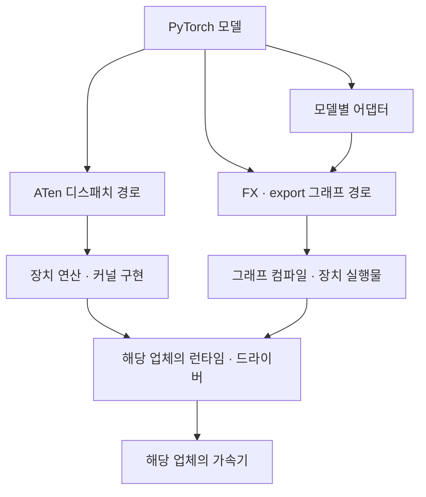
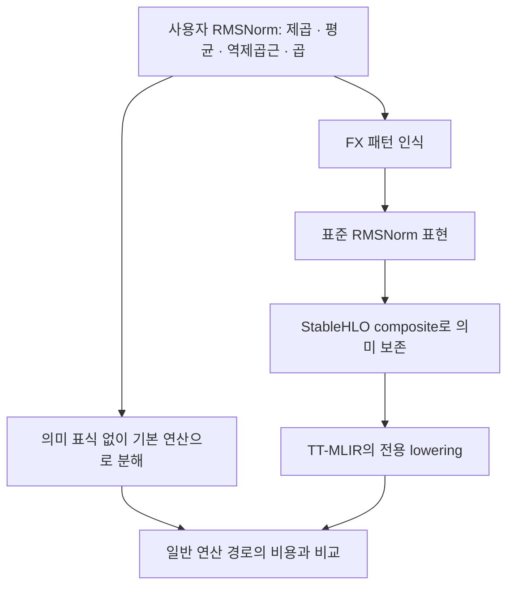

# 다른 NPU는 PyTorch와 모델을 어떻게 지원하는가

C에서 같은 함수 이름을 호출해도 링크한 구현이나 함수 포인터에 따라 실행 코드가 달라진다. 컴파일러는 여러 문장을 분석해 하나의 더 효율적인 프로그램을 만들 수도 있다. PyTorch를 NPU에 연결하는 방법도 이 두 관점에서 시작하면 이해하기 쉽다. **NPU(Neural Processing Unit)가 PyTorch를 지원한다는 말에는 여러 구현 방식이 들어 있다.** 텐서의 장치 타입을 추가해 연산을 받을 수도 있고, 모델 그래프를 받아 한 덩어리로 컴파일할 수도 있으며, 특정 모델 구조의 가중치·상태·생성 루프를 연결하는 어댑터를 제공할 수도 있다. FuryNo5의 다음 기능을 설계하려면 이 경계를 나누어 비교하는 편이 유용하다.

이 장은 2026-11-19에 확인한 공식 문서와 고정 소스를 비교한다. 각 회사가 제공하는 모든 경로를 열거한 것은 아니며, 아래 예제의 SDK(Software Development Kit)와 장치는 서로 다르다. 이번 문서 작업에서 이들 장비의 성능을 새로 측정하지 않았다. PyTorch의 공통 확장 규약은 [PrivateUse1](https://docs.pytorch.org/tutorials/advanced/privateuseone.html)과 [custom compiler backend](https://docs.pytorch.org/docs/2.15/user_guide/torch_compiler/torch.compiler_custom_backends.html), 각 업체의 구현은 절별 출처를 기준으로 한다.

## 1. 지원이라는 말을 네 개의 계약으로 나눈다

**Tensor(텐서)는** 계산할 다차원 배열이다. 저장소 주소 외에 shape(축별 길이), dtype(원소 자료형), stride(축마다 한 칸 움직일 때 건너뛸 원소 수), device(어느 장치의 저장소인지)를 가진다고 생각하면 된다. 예를 들어 연속 저장된 2×3 배열은 shape `[2,3]`, stride `[3,1]`이므로 다음 행으로 가려면 원소 세 개, 다음 열로 가려면 한 개를 이동한다. 실제 저장 순서를 **layout(배치)이라고** 한다.

**Backend**는 같은 상위 연산을 실제로 수행하는 구현 쪽이다. 한 연산씩 적절한 backend 함수를 고르는 것을 **dispatch(디스패치)라고** 한다. 반면 **계산 그래프**는 연산을 정점, 값 전달을 간선으로 기록한 프로그램이다. Python 코드 `y=x*2+3`을 `입력→곱하기→더하기→출력`으로 적으면 실행 전에 전체 관계를 분석할 수 있다. 컴파일 중 쓰는 이런 표현이 IR(Intermediate Representation, 중간 표현)이다.

이제 “지원한다”를 다음 네 질문으로 나눌 수 있다.

| 지원 계약 | 호출자가 기대하는 것 | 구현자가 해결해야 하는 일 |
|---|---|---|
| 텐서·연산 지원 | 장치 텐서를 만들고 `add`, `matmul` 등을 호출 | 메모리 할당·복사·주소 계산·실행 순서·연산 구현·오류 정책 |
| 그래프 지원 | 여러 연산이 있는 함수를 컴파일해 반복 실행 | 캡처, 분해, 지원 영역 선택, shape 조건, 코드 생성, 컴파일 캐시 |
| 모델 지원 | 모델 ID·가중치를 넘겨 결과를 얻음 | 구조와 설정 해석, 가중치 변환, 입출력·참고할 위치·요청별 상태 계약 |
| 서비스 지원 | 동시 요청, 생성·취소, 배치, 상태 독립성 | 요청 스케줄링, 메모리 관리, 다음 출력 선택, 서비스 지연과 장애 처리 |

예를 들어 `add` 구현이 있어 두 배열을 더할 수 있어도 모델의 가중치 파일을 어떤 순서로 연결할지, 이전 요청의 상태를 어디에 보관할지는 아직 정해지지 않았다. 여러 요청을 동시에 받는다면 상태를 분리하고 종료 시 메모리를 회수하는 일도 추가된다. 위 표는 그 책임을 나눈 핸드북의 비교 기준이다. 텐서 연산 하나를 성공시킨 뒤 곧바로 임의 Hugging Face 모델의 서빙을 보장할 수 없는 이유를 설명한다. FuryNo5의 연산·그래프 생산 역할은 [10장](10-furyno5-architecture.md), fxbX의 적재·실행계획은 [12장](12-fxbx.md), 서빙 계약은 [14장](14-serving-vllm.md)과 연결된다.

ATen(A Tensor Library)은 PyTorch의 tensor 연산 계층이고, FX는 Python 수준에서 그래프를 표현·변환하는 도구 이름이다. 아래 ATen 경로는 연산 구현을 고르는 관점, FX 경로는 그래프 전체를 변환하는 관점이다.



이 도식은 지원 방식의 분류다. 업체마다 독립된 런타임·드라이버를 갖고, 한 업체 안에서도 여러 실행 경로가 있을 수 있다. FX는 PyTorch의 그래프 표현·변환 도구 이름이며, IR(Intermediate Representation)은 컴파일 중 분석하고 변환할 중간 표현을 뜻한다.

## 2. 방식 A: PyTorch 장치로 들어간다

외부 하드웨어가 PyTorch 안의 연산 호출을 받으려면 자기 구현을 선택할 자리가 필요하다. PyTorch의 `PrivateUse1`은 그 목적으로 예약된 **디스패치 키**다. 여기서 키는 암호 키가 아니라 구현 선택에 사용하는 식별자다. 구현자는 `TORCH_LIBRARY_IMPL(aten, PrivateUse1, ...)`로 장치 연산을 등록할 수 있다. 여기에 장치 선택, 난수 생성기, 직렬화, 메모리·복사 같은 기반도 필요하다. 연산 함수를 등록했다고 전체 장치 backend가 완성되는 것은 아니다. [공식 backend 통합 설명](https://docs.pytorch.org/tutorials/advanced/privateuseone.html)


함수 포인터 표에 비유하면 다음과 같다. 아래 함수명은 역할을 설명하기 위한 가상 이름이며 PyTorch의 실제 C++ symbol은 아니다.

| 호출 연산 | 선택된 backend | 호출할 구현의 개념 |
|---|---|---|
| add | CPU | `cpu_add` |
| add | PrivateUse1 | `vendor_add` |
| matmul | PrivateUse1 | `vendor_matmul` |

실제 PyTorch dispatcher는 장치 외에도 자동미분 같은 여러 키를 고려한다. `PrivateUse1` 등록이 “없는 모든 연산을 자동 변환한다”는 의미는 아니다. 구현이나 분해 경로가 없는 연산을 만났을 때 오류를 낼지, 별도 fallback을 쓸지도 backend가 정의해야 한다.

장치 tensor를 만들려면 **allocator(메모리 할당기)가** 저장 공간을 확보하고, CPU 값을 옮기는 복사 경로가 있어야 한다. 현재 사용할 장치를 선택·복구하는 **device guard**, 작업 제출 순서를 관리하는 **stream**도 실행기 설계에 들어간다. stream에 제출이 끝났다고 장치 계산까지 끝난 것은 아니다. 따라서 올바른 결과를 CPU로 읽을 때 완료 대기도 필요하다.

### Ascend: TorchNPU와 TorchAir를 구분한다

Ascend의 **TorchNPU**는 연산과 장치 자원을 `PrivateUse1`로 통합하는 사례다. 다음은 해당 환경에서 두 텐서를 장치로 옮겨 행렬곱을 수행하는 짧은 예다. 호환되는 CANN(Compute Architecture for Neural Networks), 드라이버, PyTorch, TorchNPU가 먼저 설치되어 있어야 한다. Furiosa 환경에 이 import만 추가해 실행되는 코드는 아니다. [TorchNPU 고정 README](https://github.com/Ascend/pytorch/blob/2373dee2db393489d91d44f5fbefd2d6cef30439/README.md)

행렬곱은 왼쪽의 한 행과 오른쪽의 한 열을 원소별로 곱해 더한다. 예를 들어 `[1,2] @ [[1,2],[3,4]]`의 첫 출력은 `1×1+2×3=7`, 둘째는 `1×2+2×4=10`이다. 아래 큰 예에서도 같은 규칙을 쓴다. 왼쪽 `[16,32]`와 오른쪽 `[32,64]`의 공통 차원 32를 곱해 합치므로 결과는 `[16,64]`다. 16·32·64는 배열 크기이며 PE 개수가 아니다.

```python
# Ascend 전용 예제. 이 문서 환경에서 장치 실행하지 않았다.
import torch
import torch_npu  # Ascend 장치 연산과 Python 연결을 준비한다.

left = torch.randn(16, 32).npu()   # CPU에서 만든 [16,32] 값을 Ascend 장치로 옮긴다.
right = torch.randn(32, 64).npu()  # 공통 축 32가 왼쪽 열 수와 같아야 한다.
product = left @ right            # 결과 shape [16,64], 행·열의 곱을 32개씩 합한다.
```

**Eager 실행**은 Python이 연산을 호출할 때 그 연산을 바로 실행하는 방식이다. **TorchAir-GE**는 여러 연산을 모은 더 큰 그래프를 다룬다. `torch.compile`이 받은 FX 그래프를 IR로 바꾸고 GE(Graph Engine)로 컴파일·실행한다. 공식 사용법은 eager 경로에서 모델이 올바르게 실행되는지 먼저 확인하고 `torch_npu`, `torchair` 순서로 import하도록 안내한다. 두 경로가 함께 존재한다는 점이 중요하다. [TorchAir-GE 문서](https://www.hiascend.com/document/detail/en/Pytorch/2610/userguide/torchcompile/docs/en/torch_compile/pytorch_torchair_ge_desc.md)

FuryNo5에 대한 해석은 이렇다. 장치 tensor의 일반 연산 호환성을 넓히는 일과, 그래프의 큰 영역을 합쳐 빠르게 실행하는 일은 별도의 개발 축이다. FuryNo5의 현재 `tclmachine` custom op 등록·FX 치환을 TorchNPU와 동일한 완성도의 전역 장치 통합이라고 부르지 않는다. [현재 등록 경로](10-furyno5-architecture.md)

## 3. 방식 B: 그래프를 받아 장치 프로그램으로 컴파일한다

`torch.compile`의 custom backend는 기본적으로 **FX `GraphModule`과 예제 입력을 받아, 같은 호출 계약을 갖는 실행 함수를 반환**한다. 반환 함수가 실제 장치 컴파일러와 런타임을 호출해야 NPU 가속이 생긴다. 다음 코드는 그 경계만 확인하는 CPU(Central Processing Unit) 실습이다. [PyTorch custom backend 규약](https://docs.pytorch.org/docs/2.15/user_guide/torch_compiler/torch.compiler_custom_backends.html)


여기서 `GraphModule`은 “그래프와 그것을 실행하는 Python 함수를 함께 가진 객체”다. backend는 예제 입력을 보고 지원 크기·자료형을 정하며, 변환한 그래프를 실행할 callable을 반환한다. 반환 함수는 **넘겨받은 그래프의 인수·출력 계약**을 지켜야 한다. 원래 모델에 `x` 하나만 있었어도 그래프의 인수에는 가중치·buffer가 별도로 들어올 수 있으므로 원래 Python 함수 시그니처를 추측하면 안 된다.

이 예제는 입력의 각 행을 `16→32→8`개 숫자로 변환한다. `Linear(in,out)`은 입력 벡터에 학습된 가중치를 곱하고 bias를 더하는 층이다. PyTorch의 weight는 `[out,in]`이므로 계산은 `x @ weight.T + bias`다. `T`는 행과 열을 바꾸는 전치다. `ReLU`는 원소별 `max(0,x)`여서 음수는 0, 양수는 그대로 둔다. 입력 두 개를 묶은 `[2,16]`은 첫 Linear 뒤 `[2,32]`, 마지막 뒤 `[2,8]`이 된다.

```python
import torch

compile_events = []

def inspect_backend(graph_module, example_inputs):
    compile_events.append(len(list(graph_module.graph.nodes)))  # backend가 받은 그래프의 노드 수
    print(graph_module.code)  # 입력·가중치가 어떤 인수로 나타났는지 관찰한다.
    # 실제 NPU backend는 이 자리에서 IR 변환·컴파일·실행기 생성을 한다.
    # 여기서는 원래 그래프 함수를 반환하므로 CPU 실행을 유지한다.
    return graph_module.forward

model = torch.nn.Sequential(
    torch.nn.Linear(16, 32), torch.nn.ReLU(), torch.nn.Linear(32, 8)
).eval()
compiled = torch.compile(
    model, backend=inspect_backend,
    fullgraph=True,   # 그래프를 끊어 Python으로 이어 실행하는 지점이 있으면 오류로 드러낸다.
    dynamic=False,    # 이 실습에서는 관찰한 shape를 기준으로 특수화한다.
)
x = torch.randn(2, 16)  # 입력 두 행, 행마다 특성 16개
with torch.inference_mode():  # 추론 중 역전파용 기록은 만들지 않는다.
    torch.testing.assert_close(compiled(x), model(x))  # 두 [2,8] 출력을 비교한다.
    torch.testing.assert_close(compiled(x + 1), model(x + 1))  # shape는 유지하고 값만 바꾼다.
print("backend가 받은 그래프 크기:", compile_events)
```

`.eval()`은 dropout·정규화처럼 학습/추론 모드가 있는 층을 추론 모드로 놓고, `inference_mode()`는 자동미분 기록을 끈다. `torch.compile` 호출은 실행 준비 객체를 만들며 보통 첫 실제 입력 호출에서 캡처와 backend 작업을 진행한다. 이후 조건이 같으면 준비 결과를 재사용할 수 있다. 새 shape·상태로 가정이 바뀌면 재컴파일이 필요할 수 있다.

코드는 그래프 표현과 backend에 전달된 노드 수를 출력하고, 두 번의 출력 비교가 맞지 않으면 오류를 낸다. 노드 수나 backend 호출 횟수를 모든 PyTorch 버전에서 같은 상수라고 가정하지 않는다. 이 예제로 컴파일 경계의 위치를 볼 수 있지만 성능 개선을 증명한 것은 아니다. 실제 backend는 허용 shape·dtype·stride, 모델 상태, 재컴파일 조건, 실패 시 동작을 함께 정의해야 한다. 다운로드 가능한 같은 실습은 [inspect_fx_backend.py](../examples/inspect_fx_backend.py)에 있다.

### 원래 함수의 인수와 캡처한 함수의 인수를 연결한다

위 `print(graph_module.code)`를 읽을 때는 **사용자가 부르는 함수와 backend가 구현할 함수가 같은 인수 목록인지 먼저 확인**한다. 모델 객체가 멤버로 보관하던 weight·bias가 캡처된 그래프에서는 명시적인 인수로 나타날 수 있다. 모델이 반환한 tensor 한 개가 그래프 내부에서는 한 원소 tuple 같은 컨테이너로 반환될 수도 있다. backend는 전달받은 `GraphModule.forward`의 계약을 그대로 맞추고, 바깥의 컴파일 실행 경로가 사용자 호출과 그 내부 호출을 연결한다.

아래는 숫자 하나를 `x×weight+bias`로 바꾸는 **호출 구조 설명용 예**다. 위 MLP(Multi-Layer Perceptron)의 실제 출력 코드를 관측해 옮긴 것이 아니며, 모든 PyTorch 버전이 같은 인수 순서·tuple 형태를 만든다는 뜻도 아니다.

| 경계 | 설명용 함수 형태 | 이 경계를 호출하는 쪽의 책임 |
|---|---|---|
| 사용자 모델 | `model(x) → y` | x만 전달. weight·bias는 모델 상태 |
| 캡처된 그래프 | `forward(weight,bias,x) → (y,)` | 세 인수를 올바른 순서로 전달하고 한 원소 컨테이너 받기 |
| backend가 반환한 callable | 위 캡처 그래프와 같은 계약 | 가속 여부와 관계없이 입력 순서·출력 구조 유지 |
| 사용자에게 돌아갈 결과 | 다시 `y` | 내부 결과를 원래 모델의 반환 구조로 복원 |

tuple의 `(y,)`에서 쉼표는 “원소 하나의 tuple”을 만든다. `(y)`는 괄호로 감싼 y 자체다. backend가 첫 형태를 요구받았는데 y만 반환하면 값이 7로 같아 보여도 호출자가 기대하는 출력 구조는 깨진다. Python의 리스트·tuple도 함수 인터페이스의 일부다.

[captured_call_contract_demo.py](../examples/captured_call_contract_demo.py)는 외부 패키지 없이 이 대응을 실행한다. 여기서 `user_wrapper`는 역할을 보여 주기 위해 직접 쓴 함수이며 PyTorch 내부 구현을 복제한 코드가 아니다.

```python
weight, bias = 2, 1  # 원래 모델 객체가 보관한다고 가정한 스칼라 상태

def original_model(x):
    return x * weight + bias  # 사용자 계약: 인수 하나, 숫자 하나 반환

def captured_forward(weight_arg, bias_arg, x_arg):
    y = x_arg * weight_arg + bias_arg
    return (y,)  # 이 설명용 캡처 그래프의 계약: 인수 셋, 한 원소 tuple 반환

def example_backend(graph_forward):
    # 실제 backend 함수의 (GraphModule, example_inputs) API가 아닌 역할 설명용 함수다.
    return graph_forward  # 실제 backend도 받은 그래프의 호출 계약을 보존해야 한다.

backend_callable = example_backend(captured_forward)

def user_wrapper(x):
    internal_outputs = backend_callable(weight, bias, x)  # 바깥 상태를 내부 인수로 연결
    (y,) = internal_outputs  # 내부 반환 구조를 풀어 원래 사용자 출력으로 연결
    return y

assert captured_forward(2, 1, 3) == (7,)
assert user_wrapper(3) == original_model(3) == 7
print(captured_forward(2, 1, 3), user_wrapper(3))  # (7,) 7
```

실제 실습에서는 위의 이름·순서를 추측해 하드코딩하지 않고, 출력한 `graph_module.code`의 `forward` 인수와 `return`을 읽는다. 앞의 `inspect_backend`가 `graph_module.forward`를 그대로 반환하는 이유도 그 계약을 보존하기 위해서다. NPU용 callable로 바꿀 때는 해당 인수들을 장치 입력·상수·상태로 연결하고, 결과를 **그 그래프가 요구한 구조**로 돌려줘야 한다. 단일 tensor를 반환하는 원래 모델과 내부 그래프의 반환 컨테이너를 무조건 같다고 간주하지 않는다. [PyTorch backend 호출 계약](https://docs.pytorch.org/docs/2.15/user_guide/torch_compiler/torch.compiler_custom_backends.html) · [확인한 소스 본문](https://github.com/pytorch/pytorch/blob/449b1768410104d3ed79d3bcfe4ba1d65c7f22c0/docs/source/user_guide/torch_compiler/torch.compiler_custom_backends.md)

### Rebellions: 명시적 컴파일과 `torch.compile` 경로

Rebellions 공식 Quick Start는 `rebel.compile_from_torch`로 모델을 컴파일해 `.rbln`으로 저장하고 `rebel.Runtime`으로 실행하는 경로, 그리고 `torch.compile(..., backend="rbln")` 경로를 각각 보여준다. 후자는 첫 호출의 컴파일·캐시 조회와 이후 반복 실행을 구분한다. 조사한 문서의 `mode="strict"`는 컴파일 실패를 오류로 드러내며, 기본 폴백 설명과 구분된다. **이는 해당 RBLN 경로의 정책**이다. 다른 NPU의 EDF 누락 정책으로 옮겨 해석하지 않는다. [공식 Quick Start](https://docs.rbln.ai/latest/getting_started/quick_start.html)

```python
# 호환 RBLN SDK와 backend가 설치된 환경의 핵심 호출 예시.
import torch
import rebel  # 이 프로세스에 rbln compiler backend를 등록한다.

# model은 eval()로 준비한 모델, inputs는 그 모델의 대표 입력이다.
compiled = torch.compile(
    model,
    backend="rbln",
    dynamic=False,  # 관찰한 입력 shape를 기준으로 컴파일하는 예
    options={
        "cache_dir": "./rbln-cache",  # 호환되는 기존 컴파일 결과를 찾거나 새로 보관할 위치
        "mode": "strict",             # 컴파일 실패를 조용한 CPU 대체로 숨기지 않음
    },
)
with torch.no_grad():
    result = compiled(inputs)
```

### AWS Neuron: HLO에서 NEFF로 가는 traced inference

AWS(Amazon Web Services) Neuron의 `torch_neuronx.trace` 추론 경로는 torch-xla로 HLO(High Level Operations) 표현을 만들고 `neuronx-cc`로 NEFF(Neuron Executable File Format)를 생성한다. 이 바이너리가 TorchScript `ScriptModule`에 담긴다. 여기서 비교하는 것은 **Neuron 2.31.1 문서의 traced inference 경로**이며, Neuron의 학습·다른 frontend까지 한 방식으로 일반화하지 않는다. [Tracing API](https://awsdocs-neuron.readthedocs-hosted.com/en/v2.31.1/frameworks/torch/torch-neuronx/api-reference-guide/inference/api-torch-neuronx-trace.html)


이 문맥의 **trace**는 예제 입력으로 모델 연산을 추적해 컴파일하는 진입점이며, 실행 시간을 수집하는 profiler trace와 목적이 다르다. **HLO**는 행렬곱·덧셈 같은 연산을 표현하는 중간 단계다. **NEFF**는 Neuron 장치 프로그램을 담는 실행 파일 형식이고, **ScriptModule**은 저장·재적재 가능한 TorchScript 실행 객체다. `.pt`는 이 예에서 NEFF를 품은 상위 저장물이며 C 소스나 일반 CPU 실행 파일로 바뀌었다는 뜻이 아니다.

| 단계 | 입력 | 나온 결과 | 아직 확인하지 못한 것 |
|---|---|---|---|
| `trace(net, sample)` | 모델과 대표 배열 | HLO를 거쳐 컴파일한 추론 객체 | 다른 shape·다른 NPU의 지원 |
| `torch.jit.save` | 컴파일한 객체 | 저장 파일 | 새 환경에서의 호환성 |
| `torch.jit.load` | 저장 파일 | 다시 호출할 객체 | 해당 입력의 실제 실행·정답 |
| `restored(sample)` | 호환 입력 | 모델 출력 | 다른 입력 분포의 품질·성능 |

```python
# Neuron SDK 전용 핵심 예시. 다른 NPU에서 재사용할 수 있는 파일이 아니다.
import torch
import torch_neuronx

net = torch.nn.Sequential(torch.nn.Linear(16, 8), torch.nn.ReLU()).eval()
sample = torch.randn(1, 16)  # 한 입력 벡터, 특성 16개; 출력은 [1,8]
artifact = torch_neuronx.trace(net, sample)  # 대표 shape·dtype를 기준으로 장치 프로그램 생성
# 이 파일은 Neuron 실행물을 담는다. Furiosa EDF로 이름만 바꿀 수 없다.
torch.jit.save(artifact, "small-neuron.pt")
restored = torch.jit.load("small-neuron.pt")  # 호환 Neuron 환경에서 실행 객체 복원
prediction = restored(sample)               # 같은 입력 계약으로 실제 추론
```

이 경로는 예제 입력의 shape와 dtype 조건을 고정한다. **Bucket(입력 규격 묶음)은** 서로 다른 입력 크기에 맞춰 준비한 실행 규격이다. 가령 별도 배치 1용 `[1,16]`과 배치 4용 `[4,16]` 실행물을 준비했다면 요청 수에 맞는 것을 고르는 정책이 추가로 필요하다. 위 코드가 그 두 규격을 자동으로 생성한다는 뜻은 아니다. 가변 길이를 다루는 방법으로 bucketing을 설명하며, 추론 시 아무 shape나 받아 동일 실행물을 재사용한다는 의미가 아니다. FuryNo5의 shape 계약과 버킷 문제도 같은 관점에서 읽을 수 있다. [Neuron tracing 제약](https://awsdocs-neuron.readthedocs-hosted.com/en/v2.31.1/frameworks/torch/torch-neuronx/api-reference-guide/inference/api-torch-neuronx-trace.html) · [06장](06-buckets-shapes.md)

**DMA(Direct Memory Access)는** CPU가 원소마다 복사 명령을 반복하기보다 전송 장치에 메모리 이동을 맡기는 방식이다. 전송의 출발지·도착지·크기 등을 나타낸 자료가 **descriptor(전송 설명 자료)다**. **Pseudo instruction(의사 명령)은** 파일에 기록된 더 추상적인 동작 표현으로, 적재기가 실제 장치에서 필요한 명령이나 전송 설명 자료로 구체화할 수 있다.

또 하나 배울 점은 **바이너리 파일과 장치에 바로 복사할 원시 명령열이 항상 같은 것은 아니라는 사실**이다. Neuron Runtime 2.28 문서는 NEFF 컨테이너 안의 명령·텐서 정보 등을 읽고, 일부 pseudo instruction을 적재 시 하드웨어 명령과 DMA(Direct Memory Access) descriptor로 변환하는 단계를 명시한다. 이것은 Neuron의 확인된 사례다. 이 사실만으로 Furiosa EDF도 같은 pseudo instruction·patching 포맷이라고 추정하지 않는다. [Neuron Runtime 구조](https://awsdocs-neuron.readthedocs-hosted.com/en/v2.28.0/neuron-runtime/nrt-developer-guide.html) · [Furiosa EDF의 확인 범위](04-tcl-edf.md)

## 4. Tenstorrent: 공통 IR과 고수준 의미를 함께 보존한다

**Frontend(입력 처리부)는** PyTorch 같은 사용자 프로그램을 compiler가 이해하는 표현으로 바꾸고, runtime interface는 컴파일 결과를 장치에 적재·실행하는 호출 경계를 제공한다. TT-XLA는 PJRT(Portable JAX Runtime) 인터페이스를 통해 PyTorch/XLA·JAX의 StableHLO 그래프를 TT-MLIR 컴파일러로 전달한다. StableHLO는 HLO 연산을 주고받기 위한 중간 표현이고, MLIR(Multi-Level Intermediate Representation)은 여러 수준의 표현을 다루는 컴파일러 기반이다. **Lowering**은 이런 고수준 연산을 장치가 처리할 더 구체적인 연산·배치로 바꾸는 과정이다. TTNN은 Tenstorrent의 장치 연산 라이브러리 이름이다. 조회한 공식 저장소는 PyTorch의 주 frontend로 TT-XLA를 안내하고 **TT-Torch를 deprecated**로 표시한다. 따라서 과거 `tt-torch` 소개를 최신 권장 경로로 복사하지 않았다. [고정 README](https://github.com/tenstorrent/tt-xla/blob/fdc3b7773674081b8f8c0698de3400d8d899dc8f/README.md)


### RMSNorm을 기본 산술에서 다시 묶는 이유

RMSNorm은 벡터의 원소 크기를 정규화하는 연산이다. **RMS(Root Mean Square)는** “제곱 → 평균 → 제곱근” 순서로 구한다. 설명용 입력 `[3,4]`의 제곱은 `[9,16]`, 평균은 `(9+16)/2=12.5`, 제곱근은 약 3.5355다. 원소를 그 값으로 나누면 약 `[0.8485,1.1314]`가 된다. 실제 연산은 작은 `epsilon`을 더해 0 나눗셈 등을 피하고, 학습한 원소별 가중치도 곱한다.

compiler가 이 계산을 “제곱·합·나눗셈·제곱근·곱”으로만 보게 되면 정규화라는 의미를 놓칠 수 있다. **Fusion(연산 결합)은** 여러 연산을 함께 처리하는 변환이고, **composite(복합 연산 표식)는** 묶인 계산에 `rms_norm` 같은 의미 있는 이름을 남겨 후속 변환이 알아보도록 하는 방법이다. 표식만 붙였다고 빠른 커널이 생기는 것은 아니며, 아래 compiler가 그 의미를 구현하는 경로도 필요하다.

FuryNo5에 특히 참고할 부분은 **분해하기 전에 연산의 의미를 남기는 방법**이다. TT-XLA는 등록된 RMSNorm(Root Mean Square Normalization) 패턴과 shape 조건이 맞으면 여러 기본 연산을 FX 패턴으로 찾고 표준 정규화 연산으로 재결합한다. 이어 StableHLO composite 표식을 남겨, 후속 분해를 거친 뒤에도 TT-MLIR가 최적화된 연산으로 인식할 수 있게 한다. [Fusing and Composite Ops](https://github.com/tenstorrent/tt-xla/blob/fdc3b7773674081b8f8c0698de3400d8d899dc8f/docs/source/fusing_and_composite_ops.md)



**Attention**은 현재 위치가 참고할 다른 위치들의 가중치를 계산해 내용을 섞는 연산이다. **Gated MLP(Multilayer Perceptron)는** 여러 선형 층으로 만든 벡터에 별도의 gate 벡터를 원소별로 곱해 통과량을 조절하는 형태다. 이들 역시 작은 산술 연산의 목록과 전체 의미를 함께 이해하는 것이 도움이 된다.

이것을 FuryNo5에 옮기는 연구 가설은 “모든 ATen을 가능한 한 잘게 쪼개기”에만 집중하지 말고, **RMSNorm·Attention·gated MLP 같은 영역의 의미를 유지한 채 합법적인 TCL 또는 커스텀 커널 후보를 선택하자**는 것이다. 실제 효과는 대상 shape와 반올림·dtype·상태 조건에 따라 측정해야 한다. 외부 프로젝트의 최적화가 RNGD에서도 같은 성능을 낸다는 증거는 아니다. [19장 모델·실행 방식 최적화 연구](19-model-optimization.md)

## 5. 모델 어댑터는 컴파일러 위에 놓이는 별도 계층이다

모델 어댑터가 필요한 이유를 파일 읽기에 비유할 수 있다. 배열 파일에 `layer.0.weight`라는 값이 있어도 그것이 어느 층의 어떤 입력에 곱해지는지는 모델 구조가 정한다. 같은 출력 shape의 두 배열을 뒤바꾸면 loader는 읽을 수 있어도 모델은 틀린 결과를 낼 수 있다. **모델 어댑터**는 구조·설정·가중치 이름·전후처리·상태를 연결한다. 생성 모델이라면 과거 토큰의 attention 값을 보관하는 **KV(Key–Value) cache**, 읽으면 안 되는 위치를 막는 **mask**, 요청을 끝낼 규칙도 맞춰야 한다.

Optimum RBLN은 Hugging Face Transformers·Diffusers의 모델 클래스를 RBLN용 클래스로 연결한다. 조사한 소스는 모델 ID에서 처음 컴파일하는 경로와 저장된 산출물 디렉터리에서 다시 적재하는 경로를 나눈다. 컴파일러 자체와 모델별 가중치·입출력·상태 연결부의 역할이 분리되어 있다. 공개 어댑터의 존재가 의존 컴파일러의 전체 공개를 뜻하지도 않는다. [Optimum RBLN README](https://github.com/RBLN-SW/optimum-rbln/blob/370e2c98e5511373ca3f6454b444c327223822f7/README.md)

FHA(Furiosa-Hug-Anything)와 비교할 지점도 여기에 있다. 모델을 찾고 작업을 준비하는 과정, 지원되지 않는 계산을 드러내고 구현하는 과정, 컴파일 산출물을 패키징하는 과정, 재현 가능한 검증과 게시 과정을 연결해야 한다. **FuryAwesome는 발견·요청·배포 정보, FuryNo5는 변환·컴파일·실행계획 생산, fxbX는 패키지 적재·실행, FHA는 작업 절차와 도구 연결**이라는 역할을 기준으로 보면 다른 생태계의 모델 어댑터와 비교하기 쉽다. 실제 자동화 범위와 포맷별 게시 조건은 [13장](13-porting-fha.md)에서 확인한다.

## 6. 한 표로 비교하고 FuryNo5의 다음 작업을 정한다

| 사례 | 이 장에서 확인한 진입점 | 중간·배포 표현 | FuryNo5에서 참고할 설계 |
|---|---|---|---|
| Ascend | TorchNPU의 장치 연산, TorchAir-GE 그래프 | ATen dispatch, FX·GE IR | 장치 호환성과 그래프 최적화의 책임 분리 |
| Rebellions | `compile_from_torch`, `torch.compile`, Optimum RBLN | `.rbln`, 모델별 저장 디렉터리 | 명시적 컴파일·적재와 편리한 모델 API 병행 |
| AWS Neuron | `torch_neuronx.trace` 추론 | HLO → NEFF → ScriptModule | 입력 조건·배포 실행물·런타임 적재의 구분 |
| Tenstorrent | TT-XLA·PJRT | StableHLO → TT-MLIR·TTNN | frontend 재사용, composite 의미 보존 |
| FuryNo5·fxbX | 프로젝트의 capture·변환·export | TCL·EDF·실행계획·패키지 | 지원 증거, 캐시 계약, 모델 상태와 게시를 함께 관리 |

표의 업체별 근거는 앞 절의 공식 문서다. 마지막 열은 FuryNo5 개발 관점의 해석이다. 지원 모델 개수나 성능 우열을 나타내는 표로 사용하지 않는다.

실제로 가져올 개선을 고를 때는 다음 순서가 출발점이 된다.

1. **지원 보고를 모델 이름보다 세밀하게 만든다.** 연산 overload·shape·dtype·stride·상태 조건으로 실패를 재현한다.
2. **의미가 큰 영역을 유지할 지점을 만든다.** 무조건 분해하기 전에 전용 lowering과 일반 분해를 비교한다.
3. **컴파일 성공과 런타임 성공을 별도로 기록한다.** 파일 생성, 로드, NPU 실행, 수치 일치, warm 성능을 분리한다.
4. **모델 어댑터와 공통 컴파일러의 경계를 유지한다.** 특정 모델의 특수 조건을 전체 ATen 규칙에 섞지 않는다.
5. **검증된 산출물의 사용법을 배포 정보에 남긴다.** 외부 가중치, Python API, 입력 규격, SDK와 topology 조건을 FuryAwesome에서 다시 확인할 수 있게 한다.

이 순서는 기능이 이미 구현되었다는 뜻이 아니다. 현재 구현은 [10–13장](10-furyno5-architecture.md), 개선 후보의 평가 방법은 [19장](19-model-optimization.md)을 함께 본다.

## 출처

| 자료 | 확인한 범위 |
|---|---|
| [PyTorch PrivateUse1](https://docs.pytorch.org/tutorials/advanced/privateuseone.html) | 외부 장치 연산·generator·guard·직렬화 통합 |
| [PyTorch custom backend](https://docs.pytorch.org/docs/2.15/user_guide/torch_compiler/torch.compiler_custom_backends.html) | GraphModule·예제 입력·callable 계약 |
| [Ascend 고정 소스](https://github.com/Ascend/pytorch/blob/2373dee2db393489d91d44f5fbefd2d6cef30439/README.md) | TorchNPU의 PrivateUse1과 장치 사용 |
| [TorchAir-GE](https://www.hiascend.com/document/detail/en/Pytorch/2610/userguide/torchcompile/docs/en/torch_compile/pytorch_torchair_ge_desc.md) | FX→GE 경로와 eager 확인 전제 |
| [RBLN Quick Start](https://docs.rbln.ai/latest/getting_started/quick_start.html) | 명시적 compile/runtime 및 torch.compile 경로·strict 정책 |
| [Optimum RBLN 고정 소스](https://github.com/RBLN-SW/optimum-rbln/blob/370e2c98e5511373ca3f6454b444c327223822f7/README.md) | 모델 어댑터·저장 산출물·의존 컴파일러 |
| [Neuron tracing 2.31.1](https://awsdocs-neuron.readthedocs-hosted.com/en/v2.31.1/frameworks/torch/torch-neuronx/api-reference-guide/inference/api-torch-neuronx-trace.html) | HLO→NEFF, 저장·로드, 정적 입력 조건 |
| [Neuron Runtime 2.28](https://awsdocs-neuron.readthedocs-hosted.com/en/v2.28.0/neuron-runtime/nrt-developer-guide.html) | NEFF 컨테이너와 적재 시 처리의 구체적 사례 |
| [TT-XLA 고정 README](https://github.com/tenstorrent/tt-xla/blob/fdc3b7773674081b8f8c0698de3400d8d899dc8f/README.md) | PJRT·StableHLO·TT-MLIR와 TT-Torch deprecated 표기 |
| [TT-XLA fusion·composite](https://github.com/tenstorrent/tt-xla/blob/fdc3b7773674081b8f8c0698de3400d8d899dc8f/docs/source/fusing_and_composite_ops.md) | 고수준 의미를 보존하는 실제 설계 |

`latest`·`stable` 문서는 변경될 수 있다. 이 장의 고정 커밋과 조회일을 함께 사용하고, 설치 명령·지원 모델·속도를 다른 버전의 보증으로 해석하지 않는다.
