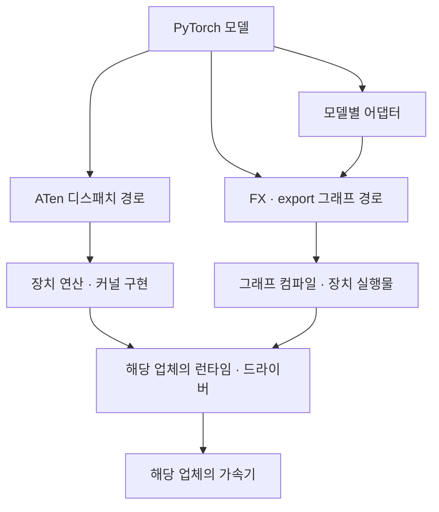
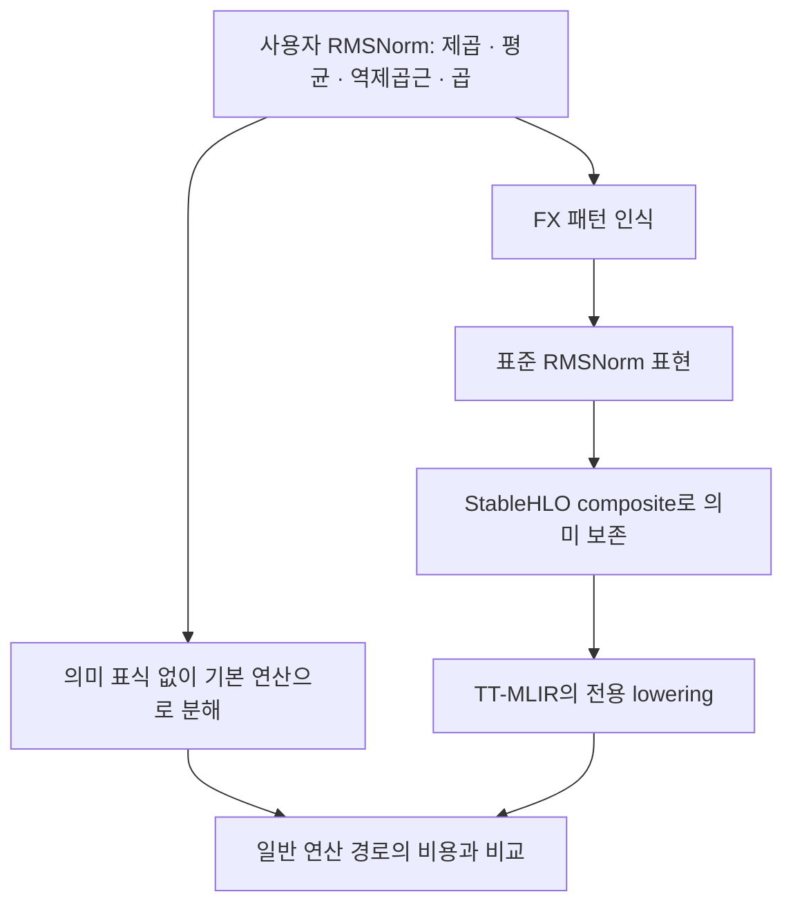

# 다른 NPU는 PyTorch와 모델을 어떻게 지원하는가

**NPU(Neural Processing Unit)가 PyTorch를 지원한다는 말에는 여러 구현 방식이 들어 있다.** 텐서의 장치 타입을 추가해 연산을 받을 수도 있고, 모델 그래프를 받아 한 덩어리로 컴파일할 수도 있으며, 특정 모델 구조의 가중치·상태·생성 루프를 연결하는 어댑터를 제공할 수도 있다. FuryNo5의 다음 기능을 설계하려면 이 경계를 나누어 비교하는 편이 유용하다.

이 장은 2026-11-19에 확인한 공식 문서와 고정 소스를 비교한다. 각 회사가 제공하는 모든 경로를 열거한 것은 아니며, 아래 예제의 SDK(Software Development Kit)와 장치는 서로 다르다. 이번 문서 작업에서 이들 장비의 성능을 새로 측정하지 않았다. PyTorch의 공통 확장 규약은 [PrivateUse1](https://docs.pytorch.org/tutorials/advanced/privateuseone.html)과 [custom compiler backend](https://docs.pytorch.org/docs/stable/torch.compiler_custom_backends.html), 각 업체의 구현은 절별 출처를 기준으로 한다.

## 1. 지원이라는 말을 네 개의 계약으로 나눈다

| 지원 계약 | 호출자가 기대하는 것 | 구현자가 해결해야 하는 일 |
|---|---|---|
| 텐서·연산 지원 | 장치 텐서를 만들고 `add`, `matmul` 등을 호출 | allocator, 복사, stride, device guard, stream, 연산 구현·오류 정책 |
| 그래프 지원 | 여러 연산이 있는 함수를 컴파일해 반복 실행 | 캡처, 분해, 지원 영역 선택, shape 조건, 코드 생성, 컴파일 캐시 |
| 모델 지원 | 모델 ID·가중치를 넘겨 결과를 얻음 | 구조와 config 해석, 가중치 변환, 입출력·mask·상태·KV cache 계약 |
| 서비스 지원 | 동시 요청, 생성·취소, 배치, 상태 독립성 | 요청 스케줄링, 메모리 관리, 샘플링, 서비스 지연과 장애 처리 |

위 표는 핸드북의 비교 기준이다. 텐서 연산 하나를 성공시킨 뒤 곧바로 임의 Hugging Face 모델의 서빙을 보장할 수 없는 이유를 설명한다. FuryNo5의 연산·그래프 생산 역할은 [10장](10-furyno5-architecture.md), fxbX의 적재·실행계획은 [12장](12-fxbx.md), 서빙 계약은 [14장](14-serving-vllm.md)과 연결된다.



이 도식은 지원 방식의 분류다. 업체마다 독립된 런타임·드라이버를 갖고, 한 업체 안에서도 여러 실행 경로가 있을 수 있다. FX는 PyTorch의 그래프 표현·변환 도구 이름이며, IR(Intermediate Representation)은 컴파일 중 분석하고 변환할 중간 표현을 뜻한다.

## 2. 방식 A: PyTorch 장치로 들어간다

PyTorch의 `PrivateUse1`은 외부 하드웨어 backend를 연결할 수 있는 예약된 디스패치 키다. 구현자는 `TORCH_LIBRARY_IMPL(aten, PrivateUse1, ...)`로 장치 연산을 등록할 수 있다. 여기에 장치 선택, 난수 생성기, 직렬화, 메모리·복사 같은 기반도 필요하다. 연산 함수를 등록했다고 전체 장치 backend가 완성되는 것은 아니다. [공식 backend 통합 설명](https://docs.pytorch.org/tutorials/advanced/privateuseone.html)

### Ascend: TorchNPU와 TorchAir를 구분한다

Ascend의 **TorchNPU**는 연산과 장치 자원을 `PrivateUse1`로 통합하는 사례다. 다음은 해당 환경에서 두 텐서를 장치로 옮겨 행렬곱을 수행하는 짧은 예다. 호환되는 CANN(Compute Architecture for Neural Networks), 드라이버, PyTorch, TorchNPU가 먼저 설치되어 있어야 한다. Furiosa 환경에 이 import만 추가해 실행되는 코드는 아니다. [TorchNPU 고정 README](https://github.com/Ascend/pytorch/blob/2373dee2db393489d91d44f5fbefd2d6cef30439/README.md)

```python
# Ascend 전용 예제. 이 문서 환경에서 장치 실행하지 않았다.
import torch
import torch_npu

left = torch.randn(16, 32).npu()
right = torch.randn(32, 64).npu()
product = left @ right
```

**TorchAir-GE**는 더 큰 그래프를 다룬다. `torch.compile`이 받은 FX 그래프를 IR로 바꾸고 GE(Graph Engine)로 컴파일·실행한다. 공식 사용법은 eager 경로에서 모델이 올바르게 실행되는지 먼저 확인하고 `torch_npu`, `torchair` 순서로 import하도록 안내한다. 두 경로가 함께 존재한다는 점이 중요하다. [TorchAir-GE 문서](https://www.hiascend.com/document/detail/en/Pytorch/2610/userguide/torchcompile/docs/en/torch_compile/pytorch_torchair_ge_desc.md)

FuryNo5에 대한 해석은 이렇다. 장치 tensor의 일반 연산 호환성을 넓히는 일과, 그래프의 큰 영역을 합쳐 빠르게 실행하는 일은 별도의 개발 축이다. FuryNo5의 현재 `tclmachine` custom op 등록·FX 치환을 TorchNPU와 동일한 완성도의 전역 장치 통합이라고 부르지 않는다. [현재 등록 경로](10-furyno5-architecture.md)

## 3. 방식 B: 그래프를 받아 장치 프로그램으로 컴파일한다

`torch.compile`의 custom backend는 기본적으로 **FX `GraphModule`과 예제 입력을 받아, 같은 호출 계약을 갖는 실행 함수를 반환**한다. 반환 함수가 실제 장치 컴파일러와 런타임을 호출해야 NPU 가속이 생긴다. 다음 코드는 그 경계만 확인하는 CPU(Central Processing Unit) 실습이다. [PyTorch custom backend 규약](https://docs.pytorch.org/docs/stable/torch.compiler_custom_backends.html)

```python
import torch

compile_events = []

def inspect_backend(graph_module, example_inputs):
    compile_events.append(len(list(graph_module.graph.nodes)))
    print(graph_module.code)
    # 실제 NPU backend는 이 자리에서 IR 변환·컴파일·실행기 생성을 한다.
    # 여기서는 원래 그래프 함수를 반환하므로 CPU 실행을 유지한다.
    return graph_module.forward

model = torch.nn.Sequential(
    torch.nn.Linear(16, 32), torch.nn.ReLU(), torch.nn.Linear(32, 8)
).eval()
compiled = torch.compile(
    model, backend=inspect_backend, fullgraph=True, dynamic=False
)
x = torch.randn(2, 16)
with torch.inference_mode():
    torch.testing.assert_close(compiled(x), model(x))
    torch.testing.assert_close(compiled(x + 1), model(x + 1))
print("backend가 받은 그래프 크기:", compile_events)
```

이 예제로 컴파일 경계의 위치를 볼 수 있지만 성능 개선을 증명한 것은 아니다. 실제 backend는 허용 shape·dtype·stride, 모델 상태, 재컴파일 조건, 실패 시 동작을 함께 정의해야 한다. 다운로드 가능한 같은 실습은 [inspect_fx_backend.py](../examples/inspect_fx_backend.py)에 있다.

### Rebellions: 명시적 컴파일과 `torch.compile` 경로

Rebellions 공식 Quick Start는 `rebel.compile_from_torch`로 모델을 컴파일해 `.rbln`으로 저장하고 `rebel.Runtime`으로 실행하는 경로, 그리고 `torch.compile(..., backend="rbln")` 경로를 각각 보여준다. 후자는 첫 호출의 컴파일·캐시 조회와 이후 반복 실행을 구분한다. 조사한 문서의 `mode="strict"`는 컴파일 실패를 오류로 드러내며, 기본 폴백 설명과 구분된다. **이는 해당 RBLN 경로의 정책**이다. 다른 NPU의 EDF 누락 정책으로 옮겨 해석하지 않는다. [공식 Quick Start](https://docs.rbln.ai/latest/getting_started/quick_start.html)

```python
# 호환 RBLN SDK와 backend가 설치된 환경의 핵심 호출 예시.
import torch
import rebel  # 이 프로세스에 rbln compiler backend를 등록한다.

# model은 eval()로 준비한 모델, inputs는 그 모델의 대표 입력이다.
compiled = torch.compile(
    model,
    backend="rbln",
    dynamic=False,
    options={"cache_dir": "./rbln-cache", "mode": "strict"},
)
with torch.no_grad():
    result = compiled(inputs)
```

### AWS Neuron: HLO에서 NEFF로 가는 traced inference

AWS(Amazon Web Services) Neuron의 `torch_neuronx.trace` 추론 경로는 torch-xla로 HLO(High Level Operations) 표현을 만들고 `neuronx-cc`로 NEFF(Neuron Executable File Format)를 생성한다. 이 바이너리가 TorchScript `ScriptModule`에 담긴다. 여기서 비교하는 것은 **Neuron 2.31.1 문서의 traced inference 경로**이며, Neuron의 학습·다른 frontend까지 한 방식으로 일반화하지 않는다. [Tracing API](https://awsdocs-neuron.readthedocs-hosted.com/en/v2.31.1/frameworks/torch/torch-neuronx/api-reference-guide/inference/api-torch-neuronx-trace.html)

```python
# Neuron SDK 전용 핵심 예시. 다른 NPU에서 재사용할 수 있는 파일이 아니다.
import torch
import torch_neuronx

net = torch.nn.Sequential(torch.nn.Linear(16, 8), torch.nn.ReLU()).eval()
sample = torch.randn(1, 16)
artifact = torch_neuronx.trace(net, sample)
torch.jit.save(artifact, "small-neuron.pt")
restored = torch.jit.load("small-neuron.pt")
prediction = restored(sample)
```

이 경로는 예제 입력의 shape와 dtype 조건을 고정한다. 가변 길이를 다루는 방법으로 bucketing을 설명하며, 추론 시 아무 shape나 받아 동일 실행물을 재사용한다는 의미가 아니다. FuryNo5의 shape 계약과 버킷 문제도 같은 관점에서 읽을 수 있다. [Neuron tracing 제약](https://awsdocs-neuron.readthedocs-hosted.com/en/v2.31.1/frameworks/torch/torch-neuronx/api-reference-guide/inference/api-torch-neuronx-trace.html) · [06장](06-buckets-shapes.md)

또 하나 배울 점은 **바이너리 파일과 장치에 바로 복사할 원시 명령열이 항상 같은 것은 아니라는 사실**이다. Neuron Runtime 2.28 문서는 NEFF 컨테이너 안의 명령·텐서 정보 등을 읽고, 일부 pseudo instruction을 적재 시 하드웨어 명령과 DMA(Direct Memory Access) descriptor로 변환하는 단계를 명시한다. 이것은 Neuron의 확인된 사례다. 이 사실만으로 Furiosa EDF도 같은 pseudo instruction·patching 포맷이라고 추정하지 않는다. [Neuron Runtime 구조](https://awsdocs-neuron.readthedocs-hosted.com/en/v2.28.0/neuron-runtime/nrt-developer-guide.html) · [Furiosa EDF의 확인 범위](04-tcl-edf.md)

## 4. Tenstorrent: 공통 IR과 고수준 의미를 함께 보존한다

TT-XLA는 PJRT(Portable JAX Runtime) 인터페이스를 통해 PyTorch/XLA·JAX의 StableHLO 그래프를 TT-MLIR 컴파일러로 전달한다. MLIR(Multi-Level Intermediate Representation)은 여러 수준의 표현을 다루는 컴파일러 기반이다. 조회한 공식 저장소는 PyTorch의 주 frontend로 TT-XLA를 안내하고 **TT-Torch를 deprecated**로 표시한다. 따라서 과거 `tt-torch` 소개를 최신 권장 경로로 복사하지 않았다. [고정 README](https://github.com/tenstorrent/tt-xla/blob/fdc3b7773674081b8f8c0698de3400d8d899dc8f/README.md)

FuryNo5에 특히 참고할 부분은 **분해하기 전에 연산의 의미를 남기는 방법**이다. TT-XLA는 등록된 RMSNorm(Root Mean Square Normalization) 패턴과 shape 조건이 맞으면 여러 기본 연산을 FX 패턴으로 찾고 표준 정규화 연산으로 재결합한다. 이어 StableHLO composite 표식을 남겨, 후속 분해를 거친 뒤에도 TT-MLIR가 최적화된 연산으로 인식할 수 있게 한다. [Fusing and Composite Ops](https://github.com/tenstorrent/tt-xla/blob/fdc3b7773674081b8f8c0698de3400d8d899dc8f/docs/source/fusing_and_composite_ops.md)



이것을 FuryNo5에 옮기는 연구 가설은 “모든 ATen을 가능한 한 잘게 쪼개기”에만 집중하지 말고, **RMSNorm·Attention·gated MLP 같은 영역의 의미를 유지한 채 합법적인 TCL 또는 커스텀 커널 후보를 선택하자**는 것이다. 실제 효과는 대상 shape와 반올림·dtype·상태 조건에 따라 측정해야 한다. 외부 프로젝트의 최적화가 RNGD에서도 같은 성능을 낸다는 증거는 아니다. [19장 모델·실행 방식 최적화 연구](19-model-optimization.md)

## 5. 모델 어댑터는 컴파일러 위에 놓이는 별도 계층이다

Optimum RBLN은 Hugging Face Transformers·Diffusers의 모델 클래스를 RBLN용 클래스로 연결한다. 조사한 소스는 모델 ID에서 처음 컴파일하는 경로와 저장된 산출물 디렉터리에서 다시 적재하는 경로를 나눈다. 컴파일러 자체와 모델별 가중치·입출력·상태 연결부의 역할이 분리되어 있다. 공개 어댑터의 존재가 의존 컴파일러의 전체 공개를 뜻하지도 않는다. [Optimum RBLN README](https://github.com/RBLN-SW/optimum-rbln/blob/370e2c98e5511373ca3f6454b444c327223822f7/README.md)

FHA(Furiosa-Hug-Anything)와 비교할 지점도 여기에 있다. 모델을 찾고 작업을 준비하는 과정, 지원되지 않는 계산을 드러내고 구현하는 과정, 컴파일 산출물을 패키징하는 과정, 재현 가능한 검증과 게시 과정을 연결해야 한다. **FuryAwesome는 발견·요청·배포 정보, FuryNo5는 변환·컴파일·실행계획 생산, fxbX는 패키지 적재·실행, FHA는 작업 절차와 도구 연결**이라는 역할을 기준으로 보면 다른 생태계의 모델 어댑터와 비교하기 쉽다. 실제 자동화 범위와 포맷별 게시 조건은 [13장](13-porting-fha.md)에서 확인한다.

## 6. 한 표로 비교하고 FuryNo5의 다음 작업을 정한다

| 사례 | 이 장에서 확인한 진입점 | 중간·배포 표현 | FuryNo5에서 참고할 설계 |
|---|---|---|---|
| Ascend | TorchNPU의 장치 연산, TorchAir-GE 그래프 | ATen dispatch, FX·GE IR | 장치 호환성과 그래프 최적화의 책임 분리 |
| Rebellions | `compile_from_torch`, `torch.compile`, Optimum RBLN | `.rbln`, 모델별 저장 디렉터리 | 명시적 컴파일·적재와 편리한 모델 API 병행 |
| AWS Neuron | `torch_neuronx.trace` 추론 | HLO → NEFF → ScriptModule | 입력 조건·배포 실행물·런타임 적재의 구분 |
| Tenstorrent | TT-XLA·PJRT | StableHLO → TT-MLIR·TTNN | frontend 재사용, composite 의미 보존 |
| FuryNo5·fxbX | 프로젝트의 capture·변환·export | TCL·EDF·실행계획·패키지 | 지원 증거, 캐시 계약, 모델 상태와 게시를 함께 관리 |

표의 업체별 근거는 앞 절의 공식 문서다. 마지막 열은 FuryNo5 개발 관점의 해석이다. 지원 모델 개수나 성능 우열을 나타내는 표로 사용하지 않는다.

실제로 가져올 개선을 고를 때는 다음 순서가 출발점이 된다.

1. **지원 보고를 모델 이름보다 세밀하게 만든다.** 연산 overload·shape·dtype·stride·상태 조건으로 실패를 재현한다.
2. **의미가 큰 영역을 유지할 지점을 만든다.** 무조건 분해하기 전에 전용 lowering과 일반 분해를 비교한다.
3. **컴파일 성공과 런타임 성공을 별도로 기록한다.** 파일 생성, 로드, NPU 실행, 수치 일치, warm 성능을 분리한다.
4. **모델 어댑터와 공통 컴파일러의 경계를 유지한다.** 특정 모델의 특수 조건을 전체 ATen 규칙에 섞지 않는다.
5. **검증된 산출물의 사용법을 배포 정보에 남긴다.** 외부 가중치, Python API, 입력 규격, SDK와 topology 조건을 FuryAwesome에서 다시 확인할 수 있게 한다.

이 순서는 기능이 이미 구현되었다는 뜻이 아니다. 현재 구현은 [10–13장](10-furyno5-architecture.md), 개선 후보의 평가 방법은 [19장](19-model-optimization.md)을 함께 본다.

## 출처

| 자료 | 확인한 범위 |
|---|---|
| [PyTorch PrivateUse1](https://docs.pytorch.org/tutorials/advanced/privateuseone.html) | 외부 장치 연산·generator·guard·직렬화 통합 |
| [PyTorch custom backend](https://docs.pytorch.org/docs/stable/torch.compiler_custom_backends.html) | GraphModule·예제 입력·callable 계약 |
| [Ascend 고정 소스](https://github.com/Ascend/pytorch/blob/2373dee2db393489d91d44f5fbefd2d6cef30439/README.md) | TorchNPU의 PrivateUse1과 장치 사용 |
| [TorchAir-GE](https://www.hiascend.com/document/detail/en/Pytorch/2610/userguide/torchcompile/docs/en/torch_compile/pytorch_torchair_ge_desc.md) | FX→GE 경로와 eager 확인 전제 |
| [RBLN Quick Start](https://docs.rbln.ai/latest/getting_started/quick_start.html) | 명시적 compile/runtime 및 torch.compile 경로·strict 정책 |
| [Optimum RBLN 고정 소스](https://github.com/RBLN-SW/optimum-rbln/blob/370e2c98e5511373ca3f6454b444c327223822f7/README.md) | 모델 어댑터·저장 산출물·의존 컴파일러 |
| [Neuron tracing 2.31.1](https://awsdocs-neuron.readthedocs-hosted.com/en/v2.31.1/frameworks/torch/torch-neuronx/api-reference-guide/inference/api-torch-neuronx-trace.html) | HLO→NEFF, 저장·로드, 정적 입력 조건 |
| [Neuron Runtime 2.28](https://awsdocs-neuron.readthedocs-hosted.com/en/v2.28.0/neuron-runtime/nrt-developer-guide.html) | NEFF 컨테이너와 적재 시 처리의 구체적 사례 |
| [TT-XLA 고정 README](https://github.com/tenstorrent/tt-xla/blob/fdc3b7773674081b8f8c0698de3400d8d899dc8f/README.md) | PJRT·StableHLO·TT-MLIR와 TT-Torch deprecated 표기 |
| [TT-XLA fusion·composite](https://github.com/tenstorrent/tt-xla/blob/fdc3b7773674081b8f8c0698de3400d8d899dc8f/docs/source/fusing_and_composite_ops.md) | 고수준 의미를 보존하는 실제 설계 |

`latest`·`stable` 문서는 변경될 수 있다. 이 장의 고정 커밋과 조회일을 함께 사용하고, 설치 명령·지원 모델·속도를 다른 버전의 보증으로 해석하지 않는다.
