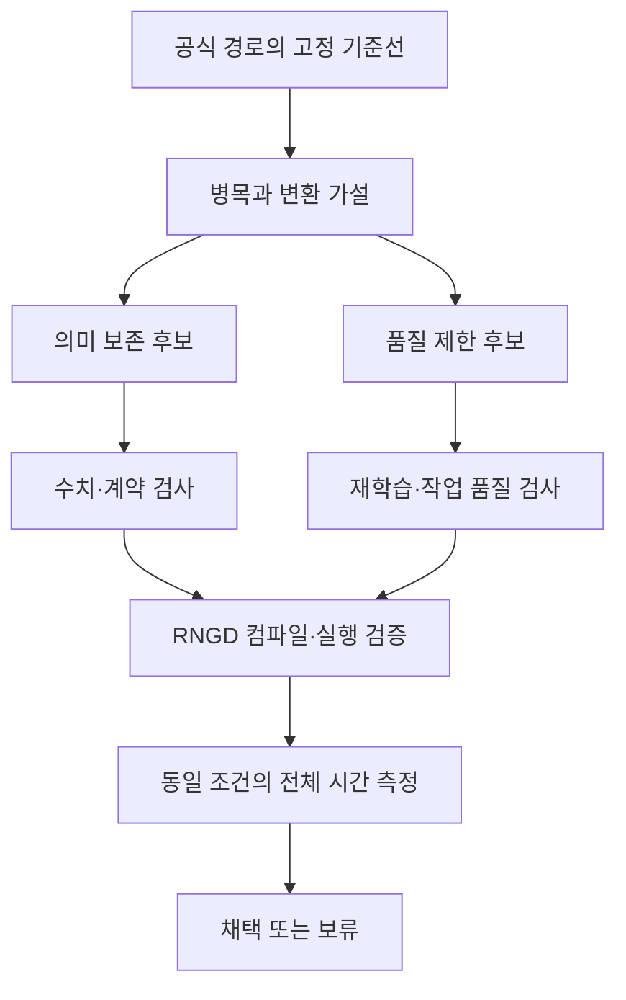
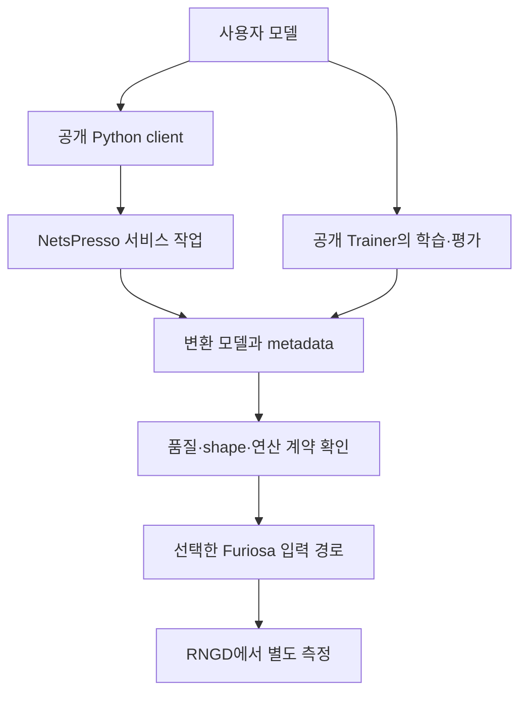
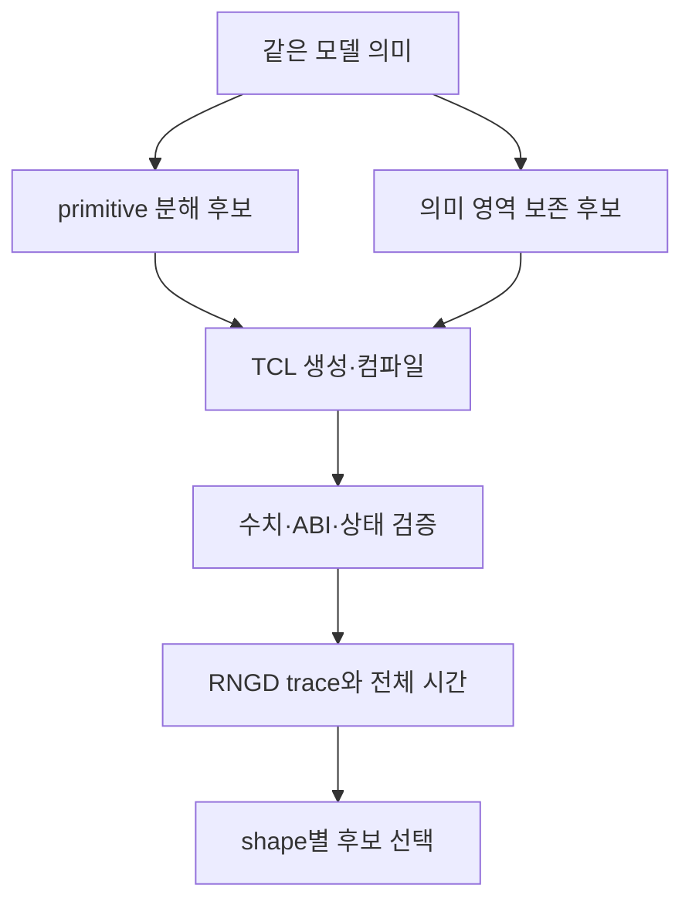

# 19. 모델을 다시 해석해 RNGD에 맞추는 최적화 연구

DB의 질의 계획에서 연산 하나를 지웠어도 전체 질의가 빨라지는지는 디스크 읽기와 다른 연산의 비용을 함께 봐야 한다. 모델 최적화도 같다. 계산할 숫자를 줄이는 방법, 같은 계산의 표현을 바꾸는 방법, 호출 사이의 메모리 이동을 줄이는 방법은 서로 다른 효과를 낸다.

**공식 포팅보다 좋은 결과를 얻을 가능성은 있다. 다만 그 가능성을 입증하려면 모델이 계산하는 일, 컴파일러가 보는 표현, 장치에 일을 제출하는 경계를 함께 연구해야 한다.** 이 장은 이미 빠르다고 주장하는 결과 보고서가 아니다. 공개 도구로 변환 후보를 만들고, 같은 품질 조건에서 RNGD(Renegade)의 실제 이득을 판정하는 연구 계획이다. 실행 중 복사·동기화·계측의 기초는 [7장](07-optimization.md), 다른 NPU(Neural Processing Unit) 스택의 설계는 [18장](18-npu-ecosystems.md)에서 이어 읽는다.

공식 Furiosa Compiler도 그래프 최적화, 연산 결합, 메모리 할당, 스케줄링, 층 사이 데이터 이동을 이미 최적화한다. 따라서 외부 도구에서 연산 하나를 지웠다는 사실만으로 공식 경로보다 빠르다고 말할 수 없다. 공식 compiler가 같은 변환을 수행했는지, 외부 변환이 유용한 패턴을 오히려 깨뜨렸는지부터 비교해야 한다. [공식 compiler의 책임](https://developer.furiosa.ai/v2026.4.1/en/overview/software_stack.html)

> **조사·검증 기준** · 공개 자료와 아래 고정 commit을 2026-11-19에 확인했다. 예제의 API(Application Programming Interface)는 문서·소스와 대조했지만, 집필 환경에 PyTorch와 Furiosa SDK(Software Development Kit), RNGD가 없어 예제를 실행하지 않았다. 이 장에는 새 NPU 성능 측정값이 없다. 표의 RNGD 적용 순서는 FuryNo5의 연구 제안이며 공식 지원표가 아니다.

## 1. 같은 계산을 빠르게 하는 연구와 모델을 줄이는 연구

두 연구는 합격 기준이 다르다. 첫째는 같은 모델의 계산 의미를 보존하면서 표현을 바꾸는 것이다. 앞 계산의 출력에 적용하는 상수 배율·덧셈을 앞 계산의 계수로 흡수하는 **folding(계수 접기)**, 불필요한 변환 제거, 입력에 따라 바뀌지 않는 부분의 사전 계산이 여기에 속한다. 뒤의 Conv–BN(Convolution–Batch Normalization) 실습에서 숫자로 확인한다. 둘째는 모델 자체를 바꾸는 것이다. **Pruning(가지치기)은** 가중치나 채널·층 일부를 제거하고, **distillation(지식 증류)은** 큰 교사 모델의 출력을 이용해 작은 학생 모델을 학습시키며, **quantization(양자화)은** 숫자를 더 적은 표현값으로 근사한다. 이 경우 원본과 모든 출력이 같아야 한다는 기준을 사용할 수 없고, 사전에 정한 실제 작업의 품질 한도를 만족해야 한다. [추론용 folding 조건](https://docs.pytorch.org/docs/2.10/generated/torch.nn.utils.fusion.fuse_conv_bn_eval.html), [구조적 pruning](https://openaccess.thecvf.com/content/CVPR2023/html/Fang_DepGraph_Towards_Any_Structural_Pruning_CVPR_2023_paper.html), [지식 증류](https://arxiv.org/abs/1503.02531)

| 비교 계열 | 허용하는 변경 | 합격 기준 | 결과를 부르는 방법 |
|---|---|---|---|
| 의미 보존 변환 | 연산 표현·배치·실행 경계 | 계약별 수치 허용오차와 실제 작업 품질 유지 | 같은 모델의 실행 개선 |
| 품질 제한 모델 변환 | 채널·층·정밀도·학생 모델 | 사전 고정한 품질 손실 한도와 자원 목표 | 변환 모델의 품질–성능 절충 |

예를 들어 작은 학생 모델이 빨라졌다면 유용한 결과다. 그러나 이를 원래 대형 모델의 동일 연산을 더 빠르게 실행한 결과로 합쳐 보고하지 않는다. 또 MAC(Multiply–Accumulate) 수나 parameter 수는 장치 지연의 대리 지표일 뿐이다. NetAdapt는 이런 간접 지표를 줄여도 실제 지연·에너지가 줄지 않을 수 있어 대상 장치의 측정값으로 모델을 탐색해야 한다고 설명한다. 이 원리를 RNGD에서 검증하자는 것이 이 장의 출발점이다. [NetAdapt 논문](https://arxiv.org/abs/1804.03230)




### 계산량을 절반으로 줄여도 시간이 절반이 되지 않는 예

설명용 요청 하나가 계산 30 ms, 메모리 이동 40 ms, 제출·대기 30 ms를 차례로 수행해 총 100 ms 걸린다고 하자. 계산만 절반인 15 ms로 줄이면 전체는 85 ms다. 절약한 것은 15 ms이며 50 ms가 아니다. 반대로 반복 복사를 20 ms 줄이면 계산을 바꾸지 않아도 전체 80 ms가 된다. 실제 실행은 일부 구간이 겹칠 수 있으므로 이 단순 합산은 원리 설명용이다.

품질도 함께 고정한다. 기준 모델의 분류 정확도가 90%이고 허용 하한을 89%로 정했다고 하자. 후보 A가 60 ms·88%, 후보 B가 80 ms·89.5%라면 A는 더 빨라도 품질 조건을 통과하지 못한다. 이것은 선택 규칙을 설명하는 가상 숫자이며 이 책의 실측 결과가 아니다. 이후의 도구들은 **후보를 만드는 수단**이고, 이 선택을 대신 증명하지 않는다.

## 2. 먼저 공식 기준선을 재현 가능하게 만든다


### 비교표의 입력 규격을 먼저 읽는다

**Tensor**는 다차원 배열, **shape**는 각 축의 길이다. 예를 들어 영상 입력 `[1,3,24,24]`는 배치 1개·색상 채널 3개·높이 24·너비 24를 뜻하는 NCHW(Number, Channel, Height, Width) 순서다. **Axis(축)는** 이 네 방향 중 하나이고, **channel(채널)은** 같은 위치에서 구별하는 특징 묶음이다. 입력에서는 RGB 세 값일 수 있고, 중간 층에서는 모델이 만든 특징 여러 개다. 이 배열에는 `1×3×24×24=1,728`개 원소가 있다. **Dtype(자료형)이** FP32(Floating Point 32-bit)면 원소당 4바이트이므로 원소 데이터는 6,912바이트다.

**Weight(가중치)는** 학습으로 정해져 추론 중 반복 사용하는 계수이고, **activation(활성값)은** 현재 입력으로 계산한 중간 배열이다. **Layout(배치)은** 논리적인 축의 값들을 메모리에 어떤 순서로 저장하는지 뜻한다. shape가 같아도 축별 주소 간격인 stride가 다르면 커널에 전달하는 주소 계산이 달라진다. **Padding**은 실행 규격을 맞추려고 빈 원소를 채우는 일이며, **bucket**은 여러 입력 크기에 맞춰 준비한 실행 규격 묶음이다. 이 때문에 “FP8 모델”이라는 이름만으로 가중치·중간값·상태의 형식과 비용을 알 수는 없다.

기준선은 공식 지원 모델과 권장 설정에서 시작한다. 예를 들어 공식 Qwen3 문서는 FP8(Floating Point 8-bit) weight, 동적 FP8 activation, 16-bit KV(Key–Value) cache를 구분한다. KV cache는 이전 입력 토큰들의 attention 계산에 쓸 K(Key, 비교용 벡터)·V(Value, 내용 벡터)를 보관한 상태다. 출력 생성 때 다시 계산하지 않으려고 유지하므로 가중치와도, 잠깐 쓰고 버리는 중간값과도 수명이 다르다. 단순히 두 결과에 모두 ‘FP8’이라고 적어 두어서는 같은 정밀도 계약인지 알 수 없다. [공식 Qwen3 실행·양자화 조건](https://developer.furiosa.ai/v2026.4.1/en/furiosa_llm/models/qwen3.html)

다음은 이 책이 제안하는 비교 규칙이다. 후보마다 임의로 바꿔 가장 좋은 숫자만 고르는 것을 막기 위해 실험 전에 기록한다.

| 고정하거나 별도 축으로 보고할 조건 | 기록할 내용 |
|---|---|
| 모델과 품질 | 원본 checkpoint revision·해시, 후보 구조·가중치·변환 recipe, tokenizer, 전처리, 평가 데이터와 합격 한도 |
| 입력과 출력 | shape·batch·길이 분포, attention mask, 생성 길이·종료 규칙, sampling 설정, 유효 출력 수 |
| 실행 환경 | SDK·compiler·driver·firmware, NPU 수·PE(Processing Element) 구성, CPU(Central Processing Unit) threads·affinity, 호스트 메모리·장치 상태 |
| 준비와 cache | compiler cache, 가중치 packing, 모델 load, prefix cache·KV cache, warm-up, cold와 warm의 경계 |
| 시간의 시작과 끝 | 요청 도착·전송·제출·완료 중 어디부터인지, 완료 동기화 위치, 결과 복사·후처리 포함 여부 |
| 통계와 운영 조건 | 반복 횟수, 교차 실행 순서, 중앙값·꼬리 지연·변동, 동시 요청 수, 처리량과 품질을 함께 만족한 조건 |

**Cold(최초 준비 포함)와** **warm(준비 뒤 반복)도** 나눈다. 예를 들어 compiler cache가 없어서 컴파일하는 시간, 가중치를 장치로 올리는 시간, 이미 적재된 모델의 반복 호출은 각각 다른 비용이다. prefix cache는 여러 요청이 공유하는 입력 앞부분의 KV를 재사용하는 것이므로, 같은 문장만 반복해 얻은 warm 결과가 처음 보는 문장에도 그대로 적용되지는 않는다.

처음에는 같은 shape와 batch로 변경 효과를 분리한다. 그다음 실제 서비스 분포에서 서로 다른 버킷·batch 정책을 비교하되, 동일한 품질 및 지연 한도에서 수용할 수 있는 처리량을 보고한다. LLM(Large Language Model)은 TTFT(Time To First Token, 요청부터 첫 토큰까지의 시간)와 TPOT(Time Per Output Token, 이후 토큰 간격)를, 이미지 모델은 유효 이미지당 시간과 품질을 함께 본다. kernel 시간만 좋아지고 전체 요청이 느려지면 배포 개선으로 승인하지 않는다. 구체적인 완료·trace 계측은 [17장](17-debugging.md)을 따른다.

## 3. NetsPresso는 무엇이 공개되어 있는가

Nota의 **NetsPresso 제품**, 공개 **PyNetsPresso 패키지**, 공개 **NetsPresso Trainer**는 구분해야 한다. 제품 페이지는 graph optimization, quantization, 장치 적용을 통합한 플랫폼을 설명한다. 이는 제품의 기능 소개이며 전체 최적화 엔진의 소스가 공개되었다는 선언이 아니다. [NetsPresso 제품](https://netspresso.ai/platform)

| 대상 | 공개 자료에서 확인한 범위 | FuryNo5 연구에서의 위치 |
|---|---|---|
| NetsPresso 플랫폼 | 모델 최적화·양자화·변환·프로파일 서비스 | 서비스가 생성한 후보를 받아 독립 검증 |
| PyNetsPresso | Apache-2.0 공개 Python 패키지. 계정/API key, 모델 업로드, 원격 작업 요청·조회·다운로드 코드 | 자동화 client와 입력·출력 계약의 참고 자료 |
| netspresso-trainer | Apache-2.0 공개 학습 코드와 모델·데이터·학습 설정 | 재학습과 평가 pipeline의 후보 |

PyNetsPresso의 `compressor.py`에는 모델 업로드와 compression 작업 요청이 있고, `graph_optimizer.py`도 모델을 업로드해 서비스의 graph optimization 작업을 시작한다. 따라서 이 저장소만 설치하면 제품의 전체 압축·최적화 엔진을 독립적으로 로컬 실행할 수 있다고 설명하면 안 된다. 공개 client에 로컬 보조 기능과 학습 연결 코드가 있다는 사실도 함께 보아야 한다. [압축 client 구현](https://github.com/Nota-NetsPresso/PyNetsPresso/blob/f0faa78114054f80f77e5af217e1f7df1a2c9027/netspresso/compressor/v2/compressor.py), [graph optimizer 구현](https://github.com/Nota-NetsPresso/PyNetsPresso/blob/f0faa78114054f80f77e5af217e1f7df1a2c9027/netspresso/graph_optimizer/graph_optimizer.py), [Trainer](https://github.com/Nota-NetsPresso/netspresso-trainer/blob/d45731ca88051e2c701f27c26cdfdf60c874b152/README.md)

실제 입력 계약을 읽으면 중요한 세부사항도 보인다. 확인한 PyNetsPresso commit의 graph optimizer는 ONNX(Open Neural Network Exchange) 입력을 **batch size 1인 임시 모델로 바꾼 뒤** 업로드한다. 그 결과가 원래의 모든 batch 조건을 보존한다고 가정하지 말고 원본·변환본의 입력 시그니처를 비교해야 한다. 예를 들어 원본 입력이 `[8,3,224,224]`였다면 한 번에 이미지 여덟 장을 받는 계약이고, 첫 축을 1로 바꾼 `[1,3,224,224]`는 한 장을 받는 계약이다. 이미지 한 장의 수치 결과가 맞아도 원래 여덟 장 묶음까지 지원한다고 증명한 것은 아니다. 변경한 shape와 검증한 호출을 보고서에 함께 남긴다. 이 동작을 모든 향후 NetsPresso 버전의 고정 규칙으로 일반화하지도 않는다. [batch 변경·업로드·작업 시작](https://github.com/Nota-NetsPresso/PyNetsPresso/blob/f0faa78114054f80f77e5af217e1f7df1a2c9027/netspresso/graph_optimizer/graph_optimizer.py#L116-L146)



확인한 공개 `DeviceName` 목록과 Benchmark Studio의 장치 목록에는 RNGD가 없다. 따라서 **NetsPresso가 RNGD용 EDF(Executable Device Format)를 직접 만들거나 RNGD 성능을 측정한다고 확인하지 못했다.** 제품 전체의 향후 지원 가능성을 부정하는 말은 아니다. 현재 연구에서는 모델 변환 산출물을 받아 Furiosa 쪽에서 다시 컴파일·측정하는 경로를 가정한다. [확인한 장치 enum](https://github.com/Nota-NetsPresso/PyNetsPresso/blob/f0faa78114054f80f77e5af217e1f7df1a2c9027/netspresso/enums/device.py), [공개 Benchmark Studio](https://benchmark.netspresso.ai/), [패키지·로그인 설명](https://github.com/Nota-NetsPresso/PyNetsPresso/blob/f0faa78114054f80f77e5af217e1f7df1a2c9027/README.md)

## 4. 양자화의 수치 계약을 이해한 뒤 도구를 고른다

### 숫자를 작게 저장한다는 뜻

먼저 균일한 정수 양자화의 원리를 계산해 보자. 아래는 **설명용 3-bit 정수 범위 `−4~3`이며** RNGD 지원 형식이라는 주장이 아니다. 표현 가능한 정수는 8개다. 실수와 정수 간격을 연결하는 **scale(배율)을** 0.25, 실수 0이 놓일 정수 **zero point(영점)를** 0으로 정한다.

실수 x를 저장할 때 `q = clamp(round(x / scale) + zero_point)`를 계산한다. `round`는 가까운 정수로 반올림하고, `clamp`는 표현 범위를 넘은 값을 양 끝으로 제한한다. 다시 실수로 해석할 때는 `x_hat = scale × (q − zero_point)`를 계산한다.

| 원래 x | x / 0.25 | 반올림 | −4~3으로 제한한 q | 복원 x_hat |
|---:|---:|---:|---:|---:|
| −0.9 | −3.6 | −4 | −4 | −1.0 |
| −0.2 | −0.8 | −1 | −1 | −0.25 |
| 0.3 | 1.2 | 1 | 1 | 0.25 |
| 0.9 | 3.6 | 4 | 3 | 0.75 |

마지막 행은 반올림 뒤 범위를 넘어서 **clipping(끝값으로 잘림)** 오차가 추가됐다. scale을 키우면 더 넓은 범위를 담지만 표현 간격이 거칠어지고, 줄이면 작은 값은 세밀하게 표현하지만 큰 값이 더 많이 잘린다.

```python
# 양자화 식을 확인하는 순수 Python. NPU 커널이나 지원 형식을 구현한 코드가 아니다.
values = [-0.9, -0.2, 0.3, 0.9]
scale, zero_point = 0.25, 0
qmin, qmax = -4, 3  # 설명용 정수 코드의 하한과 상한
codes = [
    min(qmax, max(qmin, round(x / scale) + zero_point))
    for x in values  # 실수를 정수 코드로 바꾸고 범위를 제한한다.
]
restored = [scale * (q - zero_point) for q in codes]  # 원래 실수 단위로 복원
print(codes)     # [-4, -1, 1, 3]
print(restored)  # [-1.0, -0.25, 0.25, 0.75]
```

**Calibration(보정)은** 실제 사용을 대표하는 입력으로 값의 범위를 관찰하고 scale·clipping 범위를 정하는 과정이다. 작은 값만 든 보정 데이터로 정한 scale에 실제 서비스의 큰 값이 들어오면 clipping이 늘 수 있다. weight에만 scale을 둘지 activation에도 둘지, tensor 전체에 하나를 둘지 출력 채널별·몇 개 원소의 group별로 둘지도 정해야 한다. 이 단위가 **granularity(적용 단위)다**. producer와 실행 커널이 같은 단위를 해석해야 한다.

**PTQ(Post-Training Quantization)는** 학습이 끝난 모델에 적용하는 양자화이고, 대표 입력을 사용한 보정이 필요한지는 선택한 방법에 따라 다르다. **QAT(Quantization-Aware Training)는** 학습 중에도 양자화 오차의 영향을 고려해 가중치를 조정하는 방법이다. **Packing(압축 배치)은** 작은 코드를 실제 비트·메모리 순서에 맞춰 담는 작업이다. 4-bit 코드는 이론상 한 바이트에 두 개 담을 수 있지만 scale·정렬·부가정보도 필요하다. 곱한 결과를 더해 가는 **누산(accumulation)의** 자료형은 저장 형식과 별도일 수 있다. 이 모든 조건을 맞춰야 파일 크기 감소가 실행에서도 유효하다. [양자화의 backend 계약](https://github.com/pytorch/ao/blob/a791dcb26432500f99d40271c81ee8e2753cf99a/docs/source/workflows/inference.md) · [보정과 양자화 경계](https://github.com/openvinotoolkit/nncf/blob/0d605e5da7eb735aff96a14a3a771d84d90f88f8/README.md)

위의 균일 정수 식을 FP8·FP4 같은 부동소수점 형식의 저장 규칙과 동일시하지 않는다. 실제 형식의 지수·가수·scale·반올림·누산 계약을 확인해야 한다. 아래 도구 표의 양자화 지원도 **어떤 형식을 어느 backend에서 계산하는지**까지 읽는다.

### 변환 산출물이 어느 실행기에서 쓰이는가


가장 현실적인 첫 후보는 **변환 뒤에도 일반적인 PyTorch 모델과 weight로 남는 방법**이다. 이 핸드북에서 확인한 FuryNo5의 `export_model`은 PyTorch 모델 또는 `ExportedProgram`에서 출발한다. 아래 ONNX 도구의 결과를 이 함수에 그대로 넣는 연결은 구현된 것으로 확인하지 않았다. ONNX 후보를 실제로 사용할 때는 선택한 importer의 opset·domain·dtype 지원을 확인하거나, 검증한 변환을 PyTorch 쪽에 적용해야 한다. [FuryNo5 capture 경계](https://github.com/smallstep-zzz/FuryNo5/blob/bba9efea8201aec48150514a35d0b637d29d107e/tplmachine/graph_capture.py#L188-L195)

| 도구와 고정 GitHub 소스 | 주된 변환 | 보존 조건과 검증 | 재학습 | RNGD에서의 판단 |
|---|---|---|---|---|
| [PyTorch fusion](https://github.com/pytorch/pytorch/blob/449b1768410104d3ed79d3bcfe4ba1d65c7f22c0/torch/nn/utils/fusion.py) | Conv–BN·Linear–BN folding | eval, 고정 running statistics, 연결 관계와 수치 오차 | 보통 불필요 | 일반 module로 남아 첫 실험에 적합. compiler가 이미 합쳤는지 확인 |
| [ONNX Optimizer](https://github.com/onnx/optimizer/blob/149a316813a9eca37755c0597c070c83f050db39/README.md) / [ONNX Simplifier](https://github.com/onnxsim/onnxsim/blob/8b35932256e84743db1de14051e8aa717acbd4ec/README.md) | 선택한 graph pass, shape 추론, 상수 접기 | 동적 축·initializer 변경 가능성·출력 시그니처·opset 유지 | 의미 보존 경로는 보통 불필요 | 후보 생성·그래프 분석에 유용. RNGD importer 수용은 별도 |
| [Microsoft Olive](https://github.com/microsoft/Olive/blob/4af8b5d410d32101f790eebc335abdf9fcc93ad1/README.md) | 변환·양자화·최적화 pass와 탐색 orchestration | 선택한 pass·target·정확도 평가 계약 | 선택한 pass에 따라 다름 | 범용 pass와 실험 관리의 후보. 기본 ORT(ONNX Runtime) 지연 점수를 RNGD 점수로 사용하지 않음 |
| [TorchAO](https://github.com/pytorch/ao/blob/a791dcb26432500f99d40271c81ee8e2753cf99a/docs/source/workflows/inference.md) | low-bit weight·activation 양자화, 학습 workflow | packing·scale·granularity·tensor 표현·실행 kernel의 일치 | PTQ는 보통 불필요, QAT는 필요 | 양자화 연구용. CUDA(Compute Unified Device Architecture)·Triton·CPU 전용 kernel을 RNGD에서 바로 쓸 수는 없음 |
| [NNCF](https://github.com/openvinotoolkit/nncf/blob/0d605e5da7eb735aff96a14a3a771d84d90f88f8/README.md) | PTQ·weight compression·QAT·pruning | calibration 대표성, backend별 양자화 표현, export 계약 | PTQ는 보통 불필요, QAT·pruning은 품질 복원 필요 가능 | PyTorch/ONNX 변환 후보. OpenVINO 실행기와 IR(Intermediate Representation)은 RNGD 실행 산출물이 아님 |
| [Torch-Pruning / DepGraph](https://github.com/VainF/Torch-Pruning/blob/c3be4903186ddbf284c109dcb2147a380f26265e/README.md) | 의존하는 채널·차원의 구조적 제거 | residual·concat·head 차원의 결합, 새 구조·shape·품질 | 미세조정이 필요할 수 있음 | 일반 dense 연산의 크기를 줄일 수 있어 우선 조사. 실제 타일·padding 효과 측정 |
| [NVIDIA ModelOpt](https://github.com/NVIDIA/Model-Optimizer/blob/d2d92b00ed34662d835b3854bc951599a55eb760/README.md) | 양자화·pruning·NAS·distillation | 내보낸 구조·weight·scale·사용자 정의 연산의 계약 | 방법별로 다름 | 구조 축소·증류 recipe를 참고. TensorRT용 artifact·전용 양자화 kernel은 직접 이식 대상이 아님 |

NAS(Neural Architecture Search)는 층의 종류·폭·깊이 같은 신경망 구조 후보를 탐색하는 방법이다. **Dense 연산**은 일반적으로 배열의 전체 원소를 계산하고, **sparse 연산**은 0이 아닌 위치 같은 희소 구조를 이용해 계산을 생략한다. 가중치에 0이 많다는 사실만으로 dense 커널의 반복문이 자동으로 짧아지는 것은 아니다. NNCF(Neural Network Compression Framework)는 OpenVINO 추론 최적화를 중심으로 설계되었지만 PyTorch와 ONNX 입력도 지원한다. 지원되는 입력 형식과 실행 속도가 개선되는 backend는 같은 말이 아니다. [NNCF의 ONNX 조건](https://github.com/openvinotoolkit/nncf/blob/0d605e5da7eb735aff96a14a3a771d84d90f88f8/docs/usage/post_training_compression/post_training_quantization/ONNX.md)

특히 ModelOpt의 ONNX 양자화 문서는 TensorRT 규칙을 따르는 Q/DQ(Quantize/Dequantize) node를 만들며, TensorRT engine으로 컴파일해 가속하는 경로를 설명한다. Q는 앞 예제의 정수 코드화, DQ는 scale을 사용한 실수값 해석에 대응한다. 변환 그래프에 이 둘을 표시해도 이를 합쳐 빠른 저정밀 계산으로 실행할지는 대상 backend의 지원에 달려 있다. 같은 ONNX 확장자를 가졌다고 Furiosa가 그 표현을 지원한다는 뜻이 아니다. Olive의 transformer pass도 ORT optimizer를 호출하므로, target 전용 fusion을 그대로 선택하기 전에 출력 domain과 연산 목록을 검사한다. [ModelOpt의 TensorRT 계약](https://github.com/NVIDIA/Model-Optimizer/blob/d2d92b00ed34662d835b3854bc951599a55eb760/docs/source/guides/_onnx_quantization.rst#L1-L16), [Olive transformer pass](https://github.com/microsoft/Olive/blob/4af8b5d410d32101f790eebc335abdf9fcc93ad1/olive/passes/onnx/transformer_optimization.py)

**유지보수 상태도 선택 조건이다.** 확인한 TorchAO README는 신규 기능 개발을 줄이고, 안정된 저수준 primitive는 `torch`로, 상위 workflow는 이를 사용하는 프로젝트로 통합하는 방향을 공지한다. 기존 workflow의 호환성 유지와 개별 수정도 함께 설명한다. 따라서 FuryNo5의 장기 계층을 특정 TorchAO 내부 표현에 고정하기보다, 필요한 양자화 계약과 export 경계를 따로 정의하는 편을 연구안으로 제안한다. [확인한 TorchAO 방향](https://github.com/pytorch/ao/blob/a791dcb26432500f99d40271c81ee8e2753cf99a/README.md#L6-L19)

## 5. 작은 실습: 추론용 Conv–BN folding

**Convolution(합성곱)은** 작은 가중치 창을 입력 위치에 적용하며 곱한 값을 더해 특징을 만드는 계산이다. **BatchNorm(Batch Normalization)은** 채널별 값을 평균·분산으로 정규화한 뒤 학습한 배율 gamma와 이동값 beta를 적용한다. 추론에서는 학습 중 보관한 **running mean·variance(누적 평균·분산 추정값)를** 고정해 쓴다. 이 값이 고정되어 있기 때문에 앞 convolution의 계수에 합칠 수 있다.

평균과 분산부터 계산해 보자. 값 `[1,5]`의 평균은 `(1+5)/2=3`이다. 평균에서의 차이는 `[−2,2]`이고, 그 제곱의 평균인 분산은 `(4+4)/2=4`다. 분산의 제곱근인 표준편차는 2다. 이 계산은 용어 설명용이며 PyTorch가 학습 중 누적 통계를 갱신하는 전체 규칙을 대신하지 않는다. 아래 예에서는 **저장된 평균이 3, 분산이 4**라고 가정한다.

한 출력 채널만 보면서 convolution 결과를 `z=2x+1`로 놓자. 여기서 2는 입력에 곱하는 weight, 1은 더하는 **bias(편향)다**. 이어서 BatchNorm의 gamma를 2, beta를 0.5로 놓자. 계산을 간단하게 보이기 위해 여기서만 epsilon을 0으로 생략한다.

| 계산 순서 | x=3일 때 |
|---|---:|
| convolution `z=2×3+1` | 7 |
| 평균 빼기 `z−3` | 4 |
| 표준편차로 나누기 `4/√4` | 2 |
| gamma를 곱하고 beta 더하기 `2×2+0.5` | 4.5 |

이를 한 번에 쓰면 `2×(2x+1−3)/2+0.5 = 2x−1.5`다. 새 weight는 2, 새 bias는 −1.5이고 x=3에서 똑같이 4.5가 나온다. 이처럼 뒤 연산을 앞 계수에 흡수하는 것이 folding이다. 실제 연산은 작은 양수 **epsilon**을 분모의 제곱근 안에 더해 분산이 0에 가까울 때를 처리한다.

일반 식에서는 출력 채널마다 `a = gamma / sqrt(variance + epsilon)`를 만들고 `W_new=a×W`, `b_new=a×(b−mean)+beta`로 바꾼다. `sqrt`는 제곱근이고, 식의 곱은 해당 출력 채널의 모든 convolution 가중치에 같은 배율을 적용한다는 뜻이다. 학습 모드에서는 입력 batch에 따라 통계가 달라지므로 이 고정 계수 변환을 그대로 사용할 수 없다. [PyTorch 2.10 구현](https://github.com/pytorch/pytorch/blob/449b1768410104d3ed79d3bcfe4ba1d65c7f22c0/torch/nn/utils/fusion.py#L20-L53)

다음은 CPU(Central Processing Unit) 예제이며 [fold_conv_bn.py](../examples/fold_conv_bn.py)로 내려받을 수 있다. PyTorch 2.10 API에 맞췄다. 합성 입력으로 running statistics를 채우는 부분은 실습 준비이며 실제 모델을 학습하거나 제품 품질을 검증하는 과정은 아니다.

```python
import torch
from torch import nn
from torch.nn.utils.fusion import fuse_conv_bn_eval

def main():
    torch.manual_seed(7)
    original = nn.Sequential(
        nn.Conv2d(3, 8, kernel_size=3, padding=1, bias=False),  # 입력 채널 3 → 출력 채널 8
        nn.BatchNorm2d(8),  # 출력의 8개 채널마다 통계·gamma·beta를 가진다.
    )

    # 합성 실습용 statistics. 실제 모델에서는 학습된 buffer를 사용한다.
    original.train()  # 이 모드에서 아래 입력들이 BN의 누적 통계를 갱신한다.
    with torch.no_grad():  # 역전파 기록만 끈다. train 모드의 통계 갱신은 계속된다.
        for _ in range(8):
            original(torch.randn(4, 3, 24, 24))  # N,C,H,W = 이미지 4개, 채널 3, 높이·너비 24
    original.eval().requires_grad_(False)  # 통계를 고정하고 추론용 가중치로 준비한다.
    folded = fuse_conv_bn_eval(original[0], original[1])  # Conv+BN을 새 Conv 계수로 접는다.
    folded.eval().requires_grad_(False)

    max_error = 0.0
    with torch.inference_mode():
        for shape in [(1, 3, 24, 24), (3, 3, 19, 27)]:  # batch·공간 크기를 달리해 확인
            for scale in [0.1, 1.0, 5.0]:
                x = scale * torch.randn(shape)
                expected, actual = original(x), folded(x)  # 두 결과 shape는 모두 [N,8,H,W]
                torch.testing.assert_close(
                    actual, expected, rtol=1e-5, atol=1e-5  # 절대오차+기준값 비례 오차 한도
                )
                max_error = max(
                    max_error, (actual - expected).abs().max().item()
                )
    print({"torch": torch.__version__, "max_abs_error": max_error})

if __name__ == "__main__":
    main()
```

```bash
python -m pip show torch
python fold_conv_bn.py
```

출력 수치는 실행한 독자의 환경에서 얻는 값이다. 이 책은 통과 결과를 미리 적지 않는다. 이 예제의 합격은 시험한 FP32(Floating Point 32-bit) 입력에서의 수치 확인이다. BF16(BFloat16)·FP8로 바꾸면 다시 검사하고, 분기에서 원래 convolution 출력을 따로 사용하는 모델은 연결 관계도 확인한다. 원본과 folding 모델을 각각 같은 Furiosa 경로로 컴파일한 뒤 EDF 수·실측 시간에 차이가 있는지를 확인해야 최적화 실험이 완성된다.

## 6. ONNX 단순화는 별도 후보로 보관한다

ONNX Optimizer는 사용자가 선택한 pass를 순서대로 적용한다. ONNX Simplifier는 shape 추론·graph optimization·constant folding을 결합한다. node 수 감소와 numerical check 통과는 유용한 증거지만, 모든 입력에서의 의미 보존이나 RNGD 가속을 자동으로 증명하지는 않는다. [Optimizer 동작](https://github.com/onnx/optimizer/blob/149a316813a9eca37755c0597c070c83f050db39/README.md#L13-L22), [Simplifier API](https://github.com/onnxsim/onnxsim/blob/8b35932256e84743db1de14051e8aa717acbd4ec/onnxsim/onnx_simplifier.py#L8916-L8989)


**상수 접기(constant folding)도** 작은 식으로 이해할 수 있다. 그래프가 `c=2+3; y=x*c`이고 2와 3이 실행 중 변하지 않으면 준비 단계에서 c=5를 계산해 `y=x*5`만 남길 수 있다. 입력 `[1,2]`의 출력은 둘 다 `[5,10]`이다. 하지만 c가 외부 입력으로 바뀔 수 있다면 이를 5로 고정하는 것은 다른 함수다.

ONNX의 **initializer**는 이름을 붙여 그래프에 저장한 tensor 값이다. 보통 가중치·상수에 사용한다. **Opset**은 연산 의미의 버전, **domain**은 표준 연산인지 업체별 확장인지 구분하는 이름 공간이다. 형식 검사 통과, 몇 입력의 값 비교 통과, 대상 compiler가 그 연산을 지원한다는 사실은 서로 다른 검사다.

아래는 **외부 데이터 파일이 없는 작은 정적 FP32 입력 모델**을 `input.onnx`로 준비한 경우의 출발점이다. [simplify_onnx_candidate.py](../examples/simplify_onnx_candidate.py)로 내려받을 수 있다. 임의의 LLM 전체를 처리하는 스크립트가 아니다. graph optimization pass를 끄고 shape 추론과 상수 접기를 먼저 살펴본다. 더 공격적인 pass는 다음 실험에서 하나씩 켠다. ONNX, ONNX Simplifier, 비교 실행에 필요한 ONNX Runtime을 호환되는 별도 환경에 설치하고 버전을 기록한다.

```python
from importlib.metadata import version
from pathlib import Path
import onnx
from onnxsim import simplify

model = onnx.load("input.onnx")  # 원본은 읽고 후보는 다른 파일에 저장한다.
onnx.checker.check_model(model)  # 그래프 형식·연결 검사는 수치 정답 검증과 별개다.
weights = {tensor.name for tensor in model.graph.initializer}
for value in model.graph.input:
    if value.name in weights:
        continue  # 여기는 외부 입력의 shape 검사이며 저장된 가중치는 건너뛴다.
    tensor = value.type.tensor_type
    if tensor.elem_type != onnx.TensorProto.FLOAT:  # 이 작은 실습은 FP32 입력으로 한정
        raise ValueError("This example requires FP32 tensor inputs")
    if any(not d.HasField("dim_value") or d.dim_value <= 0
           for d in tensor.shape.dim):
        raise ValueError("Keep dynamic-shape experiments separate")

output = Path("candidate-constant-folded.onnx")
if output.exists():
    raise FileExistsError(output)
candidate, checked = simplify(
    model, check_n=5, perform_optimization=False  # 표본 비교 5회, 일반 최적화 pass는 끈다.
)
if not checked:
    raise RuntimeError("Numerical checks did not pass")
onnx.checker.check_model(candidate)
onnx.save(candidate, output)
print({name: version(name) for name in ["onnx", "onnxsim", "onnxruntime"]})
print({"before_nodes": len(model.graph.node),
       "after_nodes": len(candidate.graph.node)})
```

`check_n=5`는 표본 비교이며 운영 데이터·경계값 평가를 대신하지 않는다. 고정 commit의 API 기본값은 `check_n=0`이므로 검사 횟수를 명시했다. 원래 동적 입력을 고정 shape로 덮어썼다면 그것은 지원 범위를 좁힌 다른 후보다. 가중치가 런타임에 바뀌는 모델에서는 initializer를 상수로 접어도 되는지도 확인한다. 이 산출물을 FuryNo5에 전달하려면 앞 절의 importer 경계를 해결해야 한다. [API의 검사·shape·initializer 옵션](https://github.com/onnxsim/onnxsim/blob/8b35932256e84743db1de14051e8aa717acbd4ec/onnxsim/onnx_simplifier.py#L8916-L8989)

## 7. 구조를 줄일 때는 하드웨어가 좋아하는 크기도 다시 찾는다

구조적 pruning은 weight를 0으로 표시하는 것과 다르다. 채널이나 hidden dimension을 실제로 제거하면 뒤따르는 연산의 텐서 크기도 바뀐다. DepGraph는 연동된 층을 함께 줄이기 위한 의존 관계를 만든다. 반면 mask만 적용한 dense 텐서는 shape가 그대로일 수 있으므로, 별도의 sparse 실행 지원을 확인하지 않은 상태에서 계산량 감소를 주장하지 않는다. [DepGraph의 문제 정의](https://openaccess.thecvf.com/content/CVPR2023/html/Fang_DepGraph_Towards_Any_Structural_Pruning_CVPR_2023_paper.html)


### 중간 채널 하나를 지우면 다음 층도 바뀐다

첫 선형 층의 weight를 `W1[4,3]`, 다음 층의 weight를 `W2[2,4]`라고 하자. PyTorch 선형 층은 weight를 `[출력 수, 입력 수]`로 저장한다. 입력 `x[1,3]`에 `x @ W1.T`를 계산하면 중간값 `h[1,4]`가 나온다. `.T`는 행과 열을 바꾼다는 뜻이므로 곱셈에 참여하는 두 배열의 맞닿는 길이는 3이다. 이어서 `h @ W2.T`는 `[1,2]`를 만든다.

중간값의 0부터 센 **2번 채널**을 없애면 다음 변화가 함께 필요하다.

| 항목 | 원래 | 2번 중간 채널 제거 후 | 이유 |
|---|---|---|---|
| 첫 weight W1 | `[4,3]` | `[3,3]` | 출력 2번을 만드는 행 제거 |
| 첫 bias | `[4]` | `[3]` | 같은 출력에 더하는 값 제거 |
| 중간값 h | `[1,4]` | `[1,3]` | 남은 채널 0·1·3만 전달 |
| 다음 weight W2 | `[2,4]` | `[2,3]` | 사라진 입력 2번을 읽는 열 제거 |
| 최종 출력 | `[1,2]` | `[1,2]` | 최종 출력 개수는 유지하지만 값은 바뀔 수 있음 |

이는 DB에서 참조하는 열을 제거할 때 의존하는 질의도 바꾸는 문제와 비슷하다. 다음 코드는 **차원 변경만 보여 주는 예제**다. 좋은 채널을 선택하거나 모델 품질을 복구하는 pruning 알고리즘은 아니다.

```python
import torch

torch.manual_seed(7)
x = torch.tensor([[1.0, 2.0, 3.0]])  # 배치 1개, 입력 특징 3개
w1, b1 = torch.randn(4, 3), torch.randn(4)
w2, b2 = torch.randn(2, 4), torch.randn(2)
keep = torch.tensor([0, 1, 3])  # 중간 채널 2를 빼고 유지할 인덱스

w1_small = w1.index_select(0, keep)  # axis 0 = 첫 층의 출력 행: [4,3] → [3,3]
b1_small = b1.index_select(0, keep)  # 그 출력에 대응하는 편향도 함께 제거
w2_small = w2.index_select(1, keep)  # axis 1 = 다음 층의 입력 열: [2,4] → [2,3]

hidden = x @ w1_small.T + b1_small  # [1,3] @ [3,3] + [3] → [1,3]
output = hidden @ w2_small.T + b2   # [1,3] @ [3,2] + [2] → [1,2]
print(tuple(hidden.shape), tuple(output.shape))  # (1, 3) (1, 2)
```

여기서 bias `[3]`을 `[1,3]`에 더하는 것은 각 행의 세 출력에 같은 편향을 더하는 **broadcasting(축 확장 적용)이다**. 원본 2번 채널의 기여를 제거했으므로 최종 출력 shape가 같아도 원본과 수치가 같다는 보장은 없다.

분기에서는 의존 관계가 더 늘어난다. 두 배열을 원소별로 더하는 **residual(잔차) 연결**은 대응하는 채널이 맞아야 한다. 채널 축으로 이어 붙이는 **concat(concatenation)은** 길이 3과 5를 합쳐 8로 만들므로, 뒤 층은 8개 입력을 읽어야 한다. DepGraph는 이렇게 함께 변경할 차원의 관계를 추적하는 데 사용한다. 단순히 한 weight의 행만 지우는 것보다 넓은 문제가 되는 이유다. [의존 관계를 묶는 DepGraph](https://openaccess.thecvf.com/content/CVPR2023/html/Fang_DepGraph_Towards_Any_Structural_Pruning_CVPR_2023_paper.html)

### 논리 차원이 작아져도 실제 작업 묶음은 그대로일 수 있다

**Tile(타일)은** 큰 배열을 계산·전송하기 위해 자른 일정 크기의 조각이다. 설명용 장치가 너비 8씩만 작업한다고 가정하자. 실제 RNGD의 타일 폭을 8이라고 주장하는 예가 아니다.

| 유효 채널 | 필요한 8칸 묶음 | 총 처리 칸 | 빈 칸 |
|---:|---:|---:|---:|
| 15 | 2 | 16 | 1 |
| 13 | 2 | 16 | 3 |
| 8 | 1 | 8 | 0 |

15에서 13으로 줄여도 작업 묶음은 두 개다. 8까지 줄이면 한 개가 되지만, 더 많이 줄인 만큼 품질을 유지하기 어려울 수 있다. 실제 compiler는 여러 차원을 함께 나누고 배치하므로 표처럼 한 축만으로 성능을 예측하지 않는다. 그 대신 논리 차원·padding·생성 프로그램을 함께 조사해야 한다는 원리를 얻는다.

FuryNo5에서 먼저 시험할 후보는 원래 폭에 대한 여러 **실제 차원 값**이다. 비율 하나만 정하지 않고, compiler가 수용하는 shape와 타일의 빈 공간, region 경계, 가중치 재사용을 비교한다. 채널을 줄였는데 padding이 그대로거나 작은 연산의 제출 비용이 두드러지면 전체 이득은 작을 수 있다. 이는 확인해야 할 가설이다. Torch-Pruning 예제의 `round_to=8`은 NVIDIA 성능 자료를 참고한 권고이므로 RNGD의 보편적인 최적 배수로 복사하지 않는다. [Torch-Pruning의 차원 반올림 예제](https://github.com/VainF/Torch-Pruning/blob/c3be4903186ddbf284c109dcb2147a380f26265e/README.md#L163-L190)

작업 순서에도 경계가 있다. Torch-Pruning의 dependency graph 생성은 PyTorch Autograd를 사용하므로 `torch.no_grad()` 또는 inference mode 안에서 수행하면 안 된다. 필요한 pruning·미세조정을 마친 뒤 모델을 eval·frozen 상태로 바꾸고 FuryNo5에 export한다. 수정된 layer 크기와 모델 설정도 checkpoint와 함께 보존해야 한다. [Autograd 요구](https://github.com/VainF/Torch-Pruning/blob/c3be4903186ddbf284c109dcb2147a380f26265e/README.md#L90-L115)

distillation은 더 자유로운 선택이다. 세 종류를 구분하는 교사가 `[0.7,0.2,0.1]`이라는 확률을 냈다고 하자. 정답 번호만 주는 `[1,0,0]`과 달리 두 번째 종류가 세 번째보다 더 비슷하다는 정보도 있다. 학생은 이런 출력 분포와 실제 정답을 학습 신호로 사용할 수 있다. 교사 모델의 출력을 학습 신호로 사용하되 학생 구조를 RNGD가 효율적으로 실행하는 dense 연산 위주로 설계할 수 있다. 다만 이런 구조가 유리하다는 것은 측정할 가설이고, 지식 증류가 정확한 원본 의미를 보존하는 변환은 아니다. 학습 데이터·교사·loss·품질 평가와 비용을 공개해야 한다. [지식 증류의 기본 방법](https://arxiv.org/abs/1503.02531), [ModelOpt의 pruning·distillation 범위](https://github.com/NVIDIA/Model-Optimizer/blob/d2d92b00ed34662d835b3854bc951599a55eb760/README.md)

## 8. 고수준 의미를 보존하는 것도 최적화다

**의미 보존은 공식 TCL(Tensor Contraction Language) 자체의 설계 목표이기도 하다.** Furiosa의 SDK 2026.3 설명은 contraction과 축의 의미를 유지하고, compiler가 tiling·scheduling·fusion·hardware mapping을 수행하도록 설계했다고 명시한다. 따라서 여기의 과제는 공식 스택에 없던 원리를 새로 발명하는 것이 아니다. FuryNo5가 캡처·분해·영역 분할 과정에서 그 정보를 불필요하게 잃지 않고 공식 compiler에 전달하는지 점검하는 것이다. FuryNo5 내부의 개선이 확인되어도 공식 최적화 기준선을 넘어섰다는 결론은 별도 비교가 필요하다. [TCL의 공식 설계 배경](https://furiosa.ai/blog/furiosa-sdk-2026-3-a-new-kernel-framework-and-the-models-it-unlocks)


여기서 필요한 용어를 연산 하나에 붙여 보자. 행렬곱 `C[i,j] = Σ_k A[i,k]×B[k,j]`에서 `Σ_k`는 “k를 차례로 바꾸며 곱한 값을 모두 더한다”는 뜻이다. 공통 축 k를 곱셈 뒤 합으로 없애는 계산이 **contraction(축 수축)이다**. i·j·k가 각각 출력 행·출력 열·공통 입력 축이라는 의미를 알면 compiler는 이를 나누어 처리할 수 있다. **Tiling**은 큰 행렬을 작은 조각으로 나누고, **scheduling**은 그 조각의 실행·이동 순서를 정한다. **Fusion**은 이어지는 계산을 함께 실행해 중간 저장·호출을 줄이는 변환이고, **mapping**은 논리적인 축과 조각을 장치의 계산·메모리 자원에 배치하는 것이다. 어느 변환도 무조건 이득은 아니며, 함께 유지해야 할 중간값이 늘면 메모리가 더 필요할 수 있다.

**RMSNorm(Root Mean Square Layer Normalization)의** 이름도 계산을 풀면 이해할 수 있다. 입력 `[3,4]`의 제곱은 `[9,16]`, 제곱의 평균은 `(9+16)/2=12.5`, 그 제곱근은 약 3.5355다. 입력을 이 값으로 나누면 약 `[0.8485,1.1314]`가 된다. 실제 연산은 작은 epsilon과 학습한 채널별 배율도 포함한다. 이러한 계산 전체가 정규화라는 사실을 표시하는 **composite(복합 연산 표시)는** 후속 compiler가 의미를 인식할 실마리다. 표시 하나가 곧 빠른 하드웨어 명령이라는 뜻은 아니다. gated MLP(Multi-Layer Perceptron)는 특징 변환의 한 경로가 다른 경로의 값을 원소별 곱으로 조절하는 구조다. 이를 일반 곱·덧셈으로만 남길지 의미 있는 묶음으로 유지할지가 연구 질문이다.

모든 연산을 가장 작은 ATen(A Tensor Library) primitive로 분해하면 공통 규칙으로 다루기 쉬워진다. 반대로 RMSNorm(Root Mean Square Layer Normalization), attention, gated MLP(Multi-Layer Perceptron) 같은 의미 단위를 잃으면 해당 연산을 위한 좋은 실행 경로를 찾기 어려울 수 있다. TT-XLA는 사용자 RMSNorm 패턴을 표준 Torch 연산으로 바꾸고, composite 표시를 이용해 후속 분해에서도 그 의미를 보존하는 설계를 문서화했다. 이는 **다른 backend에서 확인한 설계 사례**이며 FuryNo5에 이미 같은 최적화가 있다는 뜻은 아니다. [고정 TT-XLA 설명](https://github.com/tenstorrent/tt-xla/blob/fdc3b7773674081b8f8c0698de3400d8d899dc8f/docs/source/fusing_and_composite_ops.md), [18장](18-npu-ecosystems.md)



여기서 ABI(Application Binary Interface)는 커널 입출력의 호출 계약이다. FuryNo5 연구에서는 정규화 전의 의미 정보와 검증된 작은 영역을 함께 유지하고, **분해한 후보와 의미를 보존한 후보를 같은 shape에서 비교**할 수 있다. 기존 `tcl_region`의 지원 범위와 정밀도 경계를 넘어선 결합은 새 구현·검증 과제다. [현재 정규화](https://github.com/smallstep-zzz/FuryNo5/blob/bba9efea8201aec48150514a35d0b637d29d107e/tplmachine/graph_capture.py), [현재 영역 생성기](https://github.com/smallstep-zzz/FuryNo5/blob/bba9efea8201aec48150514a35d0b637d29d107e/tplmachine/tcl_region.py)

### attention의 중간 행렬을 줄이되 계산 의미는 유지한다

Attention은 현재 **Q(Query, 질의 벡터)와** 앞선 위치들의 **K(Key, 비교용 벡터)를** 비교하고, 비교 점수에 따라 **V(Value, 내용 벡터)들을** 섞는다. 보통 쓰는 식은 `softmax(QKᵀ / sqrt(d) + mask)V`다. `Kᵀ`는 K의 행·열을 바꾸고, d는 비교 벡터 길이이며, `sqrt(d)`로 점수 크기를 조정한다. **Mask**는 볼 수 없는 위치를 제외한다. **Softmax**는 각 점수에 지수함수 exp를 적용한 뒤 그 합으로 나누어, 양수이면서 합이 1인 가중치를 만든다.

가장 작은 예로 벡터 길이 d=1, 질의 `Q=[1]`, 두 위치의 `K=[1,0]`, `V=[10,20]`을 생각하자. mask는 없고 출력 하나를 계산한다.

| 단계 | 계산 | 결과 |
|---|---|---|
| 두 위치의 비교 점수 | `1×1`, `1×0` | `[1,0]` |
| 양수로 변환 | `exp(1)`, `exp(0)` | 약 `[2.7183,1]` |
| 합으로 나눠 가중치 만들기 | 각 값 ÷ `3.7183` | 약 `[0.7311,0.2689]` |
| 내용을 가중 평균 | `0.7311×10 + 0.2689×20` | 약 `12.6894` |

이 식을 `Q(KᵀV)`로 바꾸면 `1×(1×10+0×20)=10`이 된다. softmax를 삭제했기 때문에 다른 함수다. 단순한 선형 행렬곱은 결합 순서를 바꿀 수 있어도 이 attention 전체에 같은 법칙을 적용할 수 없다. mask, 어느 축에서 softmax하는지, 학습 시 일부 값을 무작위로 끄는 dropout이 있는지, 반올림 위치까지 확인해야 한다.

입력 길이가 L이면 모든 질의와 모든 키의 점수를 담은 배열은 대략 L×L 크기다. 이를 통째로 저장하는 대신 조각별로 읽으면서 같은 정규화 결과를 누적할 수 있다. **FlashAttention**은 이런 메모리 이동을 줄이는 attention 계산의 사례다. 아래는 한 행에서 사용하는 누적 통계의 원리를 위의 두 점수로 보여 준 것이다.

| 처리한 조각 | 현재 최대 점수 m | `exp(점수−m)`의 합 l | 같은 가중치를 곱한 V의 합 o |
|---|---:|---:|---:|
| 점수 1, 내용 10 | 1 | `exp(0)=1` | `1×10=10` |
| 점수 0, 내용 20 추가 | 1 | `1+exp(−1)≈1.3679` | `10+exp(−1)×20≈17.3576` |
| 최종 결과 | — | — | `o/l≈12.6894` |

모든 점수에서 같은 최대값을 빼면 지수함수가 지나치게 커지는 것을 줄이면서 최종 비율은 유지한다. 뒤 조각에서 더 큰 최대값이 나타나면 기존 l·o도 새 최대값 기준으로 재조정한다. 이렇게 **최댓값·합·가중합이라는 작은 상태를 유지하는 것**이 핵심이며 softmax를 생략하지 않는다. 실제 구현은 많은 행·타일·mask와 자료형을 다룬다. 이 원리를 이해하는 것과 GPU(Graphics Processing Unit)용 구현을 RNGD에 그대로 적용하는 것은 다르다. RNGD의 메모리·연산 계약에 맞춘 별도 커널과 수치 검증이 필요하다. [FlashAttention 논문](https://arxiv.org/abs/2205.14135)

## 9. workload마다 다른 연구 가설을 세운다

다음 표는 측정 결과가 아니라 **병목을 확인한 뒤 선택할 실험 후보**다. 앞에서 본 layout은 메모리 순서, fusion은 이어지는 계산의 결합, bucket은 준비한 입력 크기 규격이다. **Device-resident state(장치에 상주하는 상태)는** 호출이 끝나도 장치 메모리에 남겨 다음 호출에서 재사용하는 배열이다. 복사를 줄일 수 있는 대신 동시에 살아 있는 배열, 즉 **live memory**의 합이 커져 다른 요청이 쓸 공간을 줄일 수 있다. 이 비용을 모델 종류별로 확인한다.

LLM의 **prefill**은 이미 주어진 입력 토큰들을 처리하는 단계이고, **decode**는 앞선 출력으로 다음 토큰을 하나씩 생성하는 단계다. **Encoder**는 입력을 특징 배열로 바꾸는 모델, **embedding**은 검색·비교에 쓸 벡터 표현, **reranker**는 이미 찾은 후보들의 관련도를 다시 점수화하는 모델이다. **Diffusion(확산) 모델**은 잡음 상태를 여러 단계에 걸쳐 바꾸며 결과를 생성한다. 이름이 비슷한 모델끼리도 입력 길이와 반복 횟수가 달라 병목이 달라질 수 있다.

| workload | 먼저 확인할 모델 수준 질문 | 후보와 주요 절충 |
|---|---|---|
| CNN(Convolutional Neural Network)·고정 크기 영상 | BN·전처리·채널 폭이 불필요한 연산·경계를 만드는가? | folding·채널 pruning. 품질 복원과 detector의 좌표·후처리 계약 확인 |
| encoder·embedding·reranker | 길이 padding과 반복 transpose가 주된 비용인가? | shape 특수화·축 배치 변경·정적 weight 준비. 길이 분포와 출력 pooling 의미 유지 |
| 긴 prefill | attention 중간값과 normalization의 메모리 이동이 큰가? | 의미 영역 보존·IO(Input/Output) 이동을 줄이는 attention. 수치 안정성과 컴파일 비용 검증 |
| 작은 batch의 decode | 계산보다 weight·KV 이동, 층별 host 제출이 큰가? | 지원 양자화·상태 상주·큰 실행 단위. live memory와 상태 갱신·취소 처리의 비용 비교 |
| diffusion·반복 모델 | 단계마다 동일 weight·shape를 다시 준비하는가? | 준비 재사용·구간 실행, 별도 실험으로 단계 수 축소·증류. 출력 품질·조건 제어 능력 확인 |
| 작고 불규칙한 모델 | 장치 제출 비용을 상각할 만큼 일이 큰가? | 요청 묶기·표현 변경과 CPU 기준선 비교. 요청 대기시간 증가를 함께 측정 |

decode에서는 모델 API 자체가 `한 층 계산 → host 확인 → 다음 층 계산`을 강제하는지 살펴본다. 변경 가능한 경우 상태 tensor와 출력 범위를 명시한 큰 실행 단위로 표현해 반복적인 host 왕복을 줄이는 연구를 할 수 있다. 다만 입력을 장치에 남겨 두었다는 사실만으로 자동으로 더 빠른 실행기가 되는 것은 아니다. 상태 수명·동시 요청 격리·오류 후 복구와 실제 NPU task를 검증한다. 기존 FuryNo5·fxbX의 실행계획과 상태 계약은 이 연구의 출발점이다. [실행계획 계약](https://github.com/smallstep-zzz/FuryNo5/blob/bba9efea8201aec48150514a35d0b637d29d107e/docs/fxbx-producer/EXECUTION_PLAN.md)

양자화에서는 bit 수보다 **어떤 연산을 어떤 scale·group·누산 형식으로 계산하는지**가 중요하다. 공식 2026.4.1 stack 페이지는 BF16·FP8과 planned 항목을 구분한다. 외부 도구의 INT4(Integer 4-bit) 파일이 작더라도 실행 시 BF16으로 풀고 추가 변환을 해야 한다면, 작은 파일이 곧 빠른 NPU 계산이 되는 것은 아니다. 공식 모델의 양자화 계약을 기준점으로 삼고, 새로운 형식은 정확도·loader·kernel·전송을 함께 검증한다. [공식 양자화 상태](https://developer.furiosa.ai/v2026.4.1/en/overview/software_stack.html), [Qwen3의 구체적 계약](https://developer.furiosa.ai/v2026.4.1/en/furiosa_llm/models/qwen3.html)

개요의 planned 표기를 모든 4-bit 형식의 미지원으로 일반화하지 않는다. 공식 SDK 2026.3 소개에는 모델별 MXFP4·NVFP4라는 4-bit 부동소수점 weight 사용 사례도 있다. 정수 INT4와 이런 부동소수점 형식은 다르며, 실제 판단은 모델별 형식·scale·지원 커널의 계약을 따른다. [모델별 양자화 사례](https://furiosa.ai/blog/furiosa-sdk-2026-3-a-new-kernel-framework-and-the-models-it-unlocks)

### 공식 compiler가 좋아도 남는 입력·실행 경계의 선택

compiler는 주어진 프로그램 안에서 최적화를 수행한다. 사용자 요청을 언제 묶을지, 어떤 학생 구조를 학습할지, 어느 상태를 호출 사이에 유지할지까지 항상 대신 결정하는 것은 아니다. 다음은 그 경계에서 **FuryNo5가 실험할 구체적인 가설**이다. 아래 어느 행도 현재 SDK가 자동으로 제공하거나 RNGD에서 이득이 확인된 기능 목록이 아니다. mapping·메모리 배치가 실제 접근 패턴을 바꾸며, 같은 논리 값이라도 물리 표현 변경에는 비용이 따른다는 공식 설명을 출발점으로 삼았다. [Mapping과 물리 표현](https://developer.furiosa.ai/furiosa-opt/book/mapping-tensors/index.html), [메모리 성능의 조건](https://developer.furiosa.ai/furiosa-opt/book/moving-tensors/memory-performance.html)

| 연구 가설 | 이득이 생길 조건 | 반례·실패 조건 | 측정할 지표 |
|---|---|---|---|
| **작은 GEMV를 독립 batch의 GEMM으로 표현** | 같은 weight를 쓰는 독립 요청이 충분하고, 배치를 기다릴 지연 여유가 있음 | 요청이 드물거나 weight·shape가 다름. 같은 요청의 다음 토큰은 앞선 출력에 의존하므로 단순 병합 불가 | weight 전송·재사용, 유효 token당 시간, batch 대기시간, TTFT·TPOT와 꼬리 지연 |
| **pruning 폭을 타일·분할 경계와 함께 탐색** | 실제 dense 차원과 필요한 타일·전송이 함께 줄어듦 | 차원은 작아졌으나 padding 비중 증가, 병렬성 감소, 새 layout 변환 발생 | 논리/물리 크기, padding, 유효 연산 비율, NPU 시간, 품질 |
| **layout 변환을 필요한 영역 경계에 모음** | 여러 소비자가 같은 표현을 재사용하고 큰 중간값의 반복 전치를 없앨 수 있음 | 소비자 요구가 충돌하거나 두 표현을 유지하는 메모리·수명 비용이 더 큼 | 변환 횟수와 bytes, peak live memory, 경계별 시간, 전체 시간 |
| **상주 상태와 제출 단위를 함께 설계** | weight·KV·중간 상태가 반복 호출에서 재사용되고 host 개입을 줄일 수 있음 | 상태가 커져 동시성을 잃음. 요청 취소·새 입력·상태 의존 제어가 자주 필요 | host 제출 수, 장치 유휴 구간, 상태 메모리, 동시 요청 처리량, 상태 격리·복구 검증 |
| **의미를 가진 작은 영역에 맞춰 producer를 개선** | 현재 분해가 축·정밀도 정보를 잃거나 불필요한 커널 경계를 만듦 | 공식 compiler가 이미 같은 결과를 생성함. 영역을 키워 compiler 비용·live memory가 증가 | 컴파일 시간·실패율, EDF 수, 중간 전송, 동일 계약의 수치·전체 지연 |

**GEMV(General Matrix–Vector Multiplication)는** 행렬과 벡터의 곱, **GEMM(General Matrix–Matrix Multiplication)은** 행렬과 행렬의 곱이다. 같은 weight를 쓰는 독립 요청을 묶는 의미를 계산해 보자. 아래에서는 입력 벡터를 행으로 놓는 표기를 쓴다.

`W=[[1,2],[3,4]]`일 때 요청 A의 `[1,2] @ W`는 `[1×1+2×3, 1×2+2×4]=[7,10]`이다. 요청 B의 `[3,4] @ W`는 `[15,22]`다. 두 입력을 행으로 쌓아 `X=[[1,2],[3,4]]`로 만들면 한 행렬곱 `X @ W`의 결과가 `[[7,10],[15,22]]`가 된다.

```python
import torch

weight = torch.tensor([[1.0, 2.0], [3.0, 4.0]])  # [입력 특징 2, 출력 특징 2]
request_a = torch.tensor([1.0, 2.0])  # [2]: 독립 요청 A의 입력 벡터
request_b = torch.tensor([3.0, 4.0])  # [2]: 독립 요청 B의 입력 벡터
inputs = torch.stack([request_a, request_b], dim=0)  # 새 batch 축 추가: [2,2]
outputs = inputs @ weight  # [요청 2, 특징 2] @ [2,2] → [요청 2, 출력 2]
print(outputs.tolist())  # [[7.0, 10.0], [15.0, 22.0]]
```

`stack`은 새 축을 만들어 배열들을 쌓는다. 같은 입력 벡터를 기존 축으로 `concat`하면 `[1,2,3,4]`인 길이 4 벡터가 되어 다른 의미가 된다. 입력이 이미 `[1,2]` 모양의 한 행씩이라면 그때는 첫 축으로 concat해 `[2,2]`를 만들 수도 있다. **값뿐 아니라 축의 의미를 보존하는 것**이 중요하다.

수학적으로 묶을 수 있다는 사실과 compiler가 weight를 원하는 위치에서 재사용한다는 사실은 다르다. 두 번째 요청을 기다리는 동안 첫 번째 요청의 대기시간도 늘어난다. 이득은 생성된 프로그램과 실제 trace로 확인한다. 같은 요청의 다음 토큰은 앞선 출력을 아직 모르므로 이런 독립 행처럼 미리 쌓을 수 없다. 양자화 scale과 입력별 상태가 있는 경우 그 의미도 보존해야 한다.

layout 경계는 ‘transpose node가 가장 적은 그래프’만으로 선택하지 않는다. 작은 tensor의 변환 여러 번보다 큰 tensor 한 번의 변환이 비쌀 수 있다. 각 경계에 이동 bytes·측정 비용·메모리 수명을 부여해 후보를 비교한다. 제한된 문제를 최소 cut으로 모델링할 수 있는지는 별도 연구 과제이며, 모든 layout 문제를 단순한 최소 cut 하나로 해결한다고 가정하지 않는다. 같은 이유로 `device-resident`라는 이름보다 실제로 사라진 이동·제출과 늘어난 상주 메모리를 함께 보고한다.

## 10. FuryNo5에서 제안하는 연구 순서

1. **공식 기준선을 고정한다.** 같은 품질·입력·준비 조건에서 성공하는 모델을 선택하고 전체 시간과 trace를 남긴다.
2. **의미 보존 변환부터 분리 실험한다.** folding, 정적 값 준비, 불필요한 layout 변환 제거가 최종 compiler 결과에도 차이를 만드는지 본다.
3. **고수준 의미를 가진 영역을 비교한다.** 무조건 큰 TCL(Tensor Contraction Language)을 만들기보다, 분해·결합 후보의 컴파일 비용과 실제 실행을 비교한다.
4. **병목에 맞는 모델 변경을 하나씩 적용한다.** pruning·증류·양자화 각각의 품질과 성능을 측정한 뒤 상호작용을 실험한다. pruning 후 calibration 분포가 달라질 수 있으므로 이전 scale을 무조건 재사용하지 않는다.
5. **실제 입력 분포와 서비스 계약으로 재평가한다.** 버킷 수, cold start, 상태 메모리, 동시성까지 포함해 채택 여부를 정한다.

이 순서는 실패 원인을 분리하기 위한 FuryNo5의 제안이다. 학습 데이터가 없으면 pruning·증류보다 표현 변환을 먼저 선택할 수 있고, 모델이 메모리에 들어가지 않으면 정밀도·구조 축소가 먼저 필요할 수 있다. 사용자의 품질·지연·처리량·개발 비용 목표에 따라 순서를 바꾼다.

최종 결과에는 최소한 `원본/후보 해시`, `변환 도구 commit과 설정`, `품질 결과`, `입력 계약`, `compiler·SDK`, `EDF와 plan 식별자`, `cold/warm 시간`, `NPU 실행 증거`, `실패한 후보`를 함께 남긴다. **공식보다 빠르다는 표현은 이 비교를 통과한 특정 모델·입력·환경에만 붙인다.** 아직 측정하지 않은 후보에는 예상 배수를 넣지 않고, 확인할 가설과 다음 실험을 적는다.

## 출처

| 자료와 고정 snapshot | 이 장에서 확인한 내용 |
|---|---|
| [Furiosa stack 2026.4.1](https://developer.furiosa.ai/v2026.4.1/en/overview/software_stack.html) | 공식 compiler 책임·양자화의 지원/계획 구분 |
| [TCL 설계 소개](https://furiosa.ai/blog/furiosa-sdk-2026-3-a-new-kernel-framework-and-the-models-it-unlocks) | 공식 스택 자체가 의미를 보존한다는 비교 기준 |
| [Mapping Tensors](https://developer.furiosa.ai/furiosa-opt/book/mapping-tensors/index.html), [Memory Performance](https://developer.furiosa.ai/furiosa-opt/book/moving-tensors/memory-performance.html) | 물리 표현·접근 패턴·전송 비용의 연구 출발점 |
| [Furiosa Qwen3](https://developer.furiosa.ai/v2026.4.1/en/furiosa_llm/models/qwen3.html) | 공식 기준선의 구체적 정밀도·모델 계약 |
| [NetsPresso 플랫폼](https://netspresso.ai/platform), [Benchmark Studio](https://benchmark.netspresso.ai/) | 제품 기능과 공개 장치 목록 |
| [PyNetsPresso · f0faa781](https://github.com/Nota-NetsPresso/PyNetsPresso/blob/f0faa78114054f80f77e5af217e1f7df1a2c9027/README.md), [LICENSE](https://github.com/Nota-NetsPresso/PyNetsPresso/blob/f0faa78114054f80f77e5af217e1f7df1a2c9027/LICENSE) | 공개 client·계정·라이선스 |
| [netspresso-trainer · d45731ca](https://github.com/Nota-NetsPresso/netspresso-trainer/blob/d45731ca88051e2c701f27c26cdfdf60c874b152/README.md), [LICENSE](https://github.com/Nota-NetsPresso/netspresso-trainer/blob/d45731ca88051e2c701f27c26cdfdf60c874b152/LICENSE) | 공개 학습 코드 |
| [PyTorch 2.10 API](https://docs.pytorch.org/docs/2.10/generated/torch.nn.utils.fusion.fuse_conv_bn_eval.html), [소스 · 449b1768](https://github.com/pytorch/pytorch/blob/449b1768410104d3ed79d3bcfe4ba1d65c7f22c0/torch/nn/utils/fusion.py) | Conv–BN folding 조건과 호출 |
| [ONNX Optimizer · 149a3168](https://github.com/onnx/optimizer/blob/149a316813a9eca37755c0597c070c83f050db39/README.md) | 선택한 pass를 순서대로 적용 |
| [ONNX Simplifier · 8b359322](https://github.com/onnxsim/onnxsim/blob/8b35932256e84743db1de14051e8aa717acbd4ec/onnxsim/onnx_simplifier.py) | simplify의 검사·shape·상수 옵션 |
| [Olive · 4af8b5d4](https://github.com/microsoft/Olive/blob/4af8b5d410d32101f790eebc335abdf9fcc93ad1/README.md) | ORT 중심의 변환·탐색 workflow |
| [TorchAO · a791dcb2](https://github.com/pytorch/ao/blob/a791dcb26432500f99d40271c81ee8e2753cf99a/README.md) | 개발 방향과 backend별 양자화 경계 |
| [NNCF · 0d605e5d](https://github.com/openvinotoolkit/nncf/blob/0d605e5da7eb735aff96a14a3a771d84d90f88f8/README.md) | 입력 backend·압축 방법·OpenVINO 중심 목적 |
| [Torch-Pruning · c3be4903](https://github.com/VainF/Torch-Pruning/blob/c3be4903186ddbf284c109dcb2147a380f26265e/README.md), [DepGraph 논문](https://openaccess.thecvf.com/content/CVPR2023/html/Fang_DepGraph_Towards_Any_Structural_Pruning_CVPR_2023_paper.html) | 구조적 의존·Autograd·재학습·차원 변경 |
| [ModelOpt · d2d92b00](https://github.com/NVIDIA/Model-Optimizer/blob/d2d92b00ed34662d835b3854bc951599a55eb760/README.md) | pruning·증류·양자화 및 배포 경계 |
| [NetAdapt](https://arxiv.org/abs/1804.03230) | 간접 연산량 지표와 실제 장치 지연의 차이 |
| [Distilling the Knowledge in a Neural Network](https://arxiv.org/abs/1503.02531) | 학생 모델 학습의 의미 |
| [FlashAttention](https://arxiv.org/abs/2205.14135) | 정확한 attention의 IO 중심 재구성 |
| [TT-XLA composite · fdc3b777](https://github.com/tenstorrent/tt-xla/blob/fdc3b7773674081b8f8c0698de3400d8d899dc8f/docs/source/fusing_and_composite_ops.md) | 고수준 의미를 보존하는 다른 backend의 설계 사례 |

GitHub 링크는 확인한 commit에 고정했다. 개발 branch의 최신 snapshot이 모든 설치 환경에 적합한 배포판이라는 뜻은 아니다. FuryNo5 소스 링크에는 저장소 열람 권한이 필요할 수 있다.
